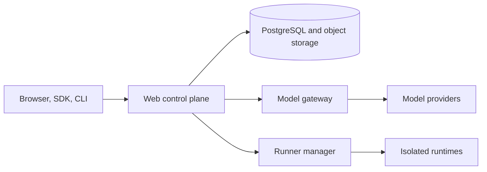

# Agent Workspace

Self-hosted control plane for building, running and sharing Claude-powered agents.

[](https://github.com/indxjp/agent-workspace/actions/workflows/ci.yml)
[](https://www.npmjs.com/package/@indx-workspace/sdk)
[](LICENSE)
[](https://docs.agentworkspace.indx.jp)

## Why Agent Workspace

- Model credentials stay in a private gateway and never enter a runtime.
- Every run executes in an isolated runtime behind a selectable driver.
- One web interface and API cover agents, projects, sessions, files, connectors and access.
- A typed SDK and the `aw` command line talk to the same API the web interface uses.

## Quickstart (60 seconds)

You need Node 24 or newer and an Anthropic API key.
Export it as `ANTHROPIC_API_KEY`, then run:

```sh claim="run"
npm create @indx-workspace@latest my-agent -- --yes
cd my-agent
npm run dev
```

This writes a project (an agent and a surface as TypeScript files) and runs it with `aw dev` on the
`@indx-workspace/embedded` local runtime: one Node process, no Docker. Open the `try:` URL that
`aw dev` prints. See the
[Quickstart](https://docs.agentworkspace.indx.jp/getting-started/quickstart) for the walkthrough.

## Architecture



The web control plane stores durable state in PostgreSQL and objects in local storage or S3. A
private model gateway resolves encrypted provider credentials, and production runs use isolated
Docker runtimes through the private runner manager; the local driver is for development only. See
[`docs/architecture.md`](docs/architecture.md) for module ownership and dependency direction.

## Self-host

Generate the deployment project for the full platform on Docker Compose. It needs Node 24 or newer,
pnpm and Docker with the Compose and `buildx` plugins, and the first run takes 10 to 20 minutes.

```sh title="illustrative" claim="illustrative"
npm create @indx-workspace@latest my-agent-platform -- --cloud local
cd my-agent-platform
pnpm install --frozen-lockfile=false
pnpm start
```

Or run `npx -p @indx-workspace/cli create-agent-workspace my-agent-platform --cloud local`. Open the
URL `pnpm start` prints and finish the setup wizard with the seeded bootstrap administrator and the
one-time password the generator printed. Then drive the workspace:

```sh title="illustrative" claim="illustrative"
export AGENT_WORKSPACE_URL=http://localhost:3000
export AGENT_WORKSPACE_API_KEY=ak_live_…
npx @indx-workspace/aw me
```

The [self-hosting guide](docs/sdk/site/building/self-hosting.mdx) covers the wizard, ports, API keys
and teardown. Deploy guides:

- [Single VM with Docker Compose](docs/deploy/single-vm.md)
- [Small GCP deployment with Terraform](infra/terraform/gcp-small/README.md)
- [Kubernetes with Helm](docs/deploy/kubernetes.md)
- [Azure Container Apps preview environment](docs/deploy/azure-container-apps.md)

## Packages

| Package                     | What it is                                                              |
| --------------------------- | ----------------------------------------------------------------------- |
| `@indx-workspace/contracts` | API contracts: Zod schemas, route catalogue and contracts version.      |
| `@indx-workspace/sdk`       | Typed, isomorphic TypeScript client, with agents and surfaces as code.  |
| `@indx-workspace/react`     | Hosted surface chat as React: `<Chat/>` and `useConversation()`.        |
| `@indx-workspace/aw`        | The `aw` command line: one command per SDK method.                      |
| `@indx-workspace/cli`       | `create-agent-workspace` and `agent-workspace` project CLI.             |
| `@indx-workspace/embedded`  | Local runtime: web, gateway and runner in one Node process.             |
| `@indx-workspace/create`    | `npm create @indx-workspace`: project generator.                        |
| `@indx-workspace/platforms` | PlatformTarget port and conformance kit for agent-platform translators. |

## Documentation

Read the [documentation site](https://docs.agentworkspace.indx.jp), or start from
[`docs/sdk/`](docs/sdk/README.md) and [`docs/architecture.md`](docs/architecture.md).

## Contributing

Open an issue before non-trivial work. See [`CONTRIBUTING.md`](CONTRIBUTING.md) for the development
setup and checks, and [`ENGINEERING_GUIDELINES.md`](ENGINEERING_GUIDELINES.md) for the enforced
coding standard.

## Security

Report vulnerabilities as described in [`SECURITY.md`](SECURITY.md), not in a public issue. When
you deploy:

- Never expose the local driver as tenant isolation: it runs commands as the host user.
- Keep the model gateway and runner on private networks and rotate generated secrets before exposure.
- Mount the Docker socket only into the runner.
- Use immutable image digests for production deployments.

## Community and support

Ask questions in GitHub Discussions; see [`SUPPORT.md`](SUPPORT.md) for where to get help.

## License

[Apache-2.0](LICENSE).
