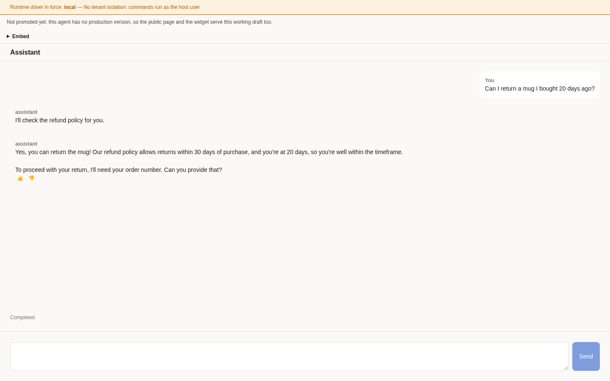
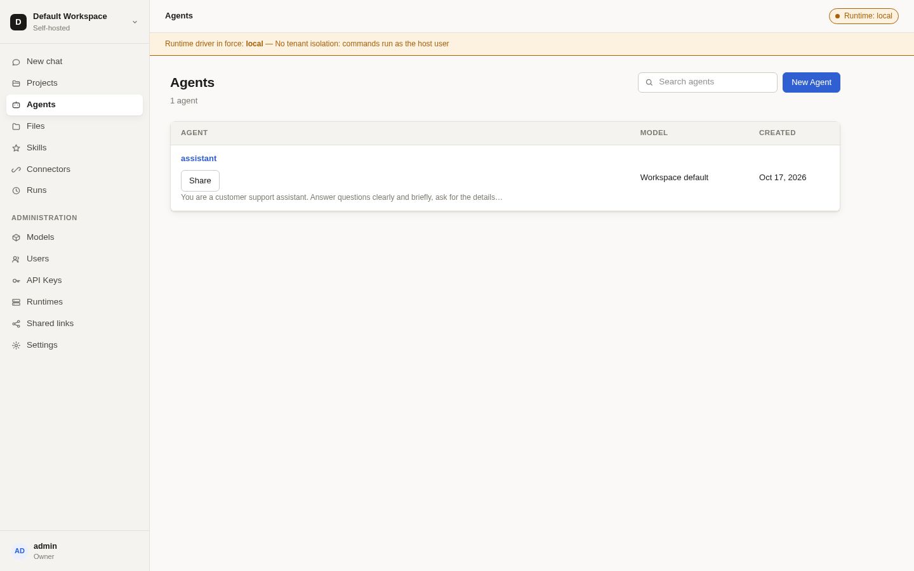
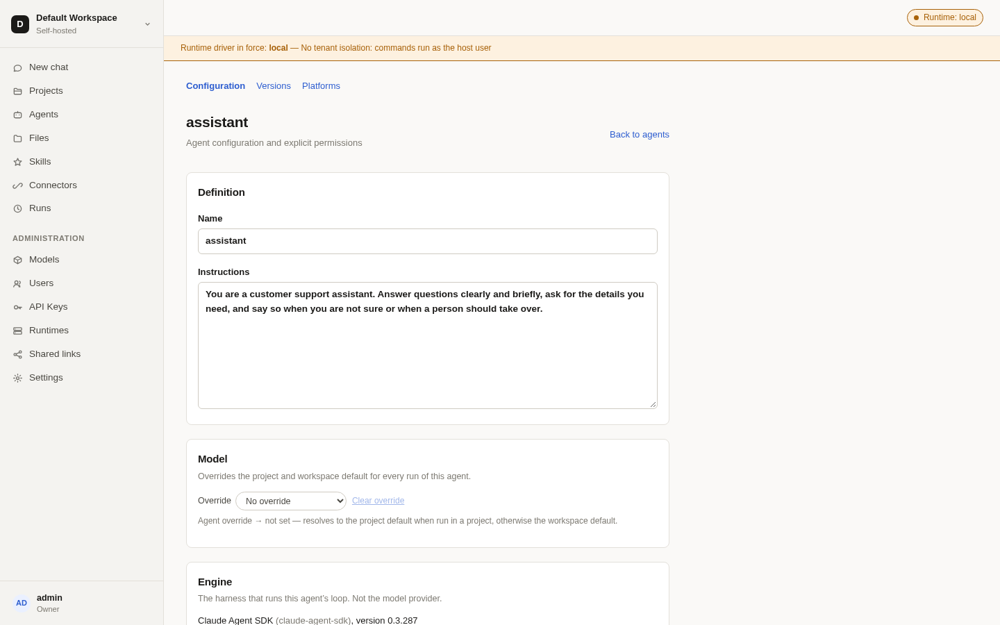
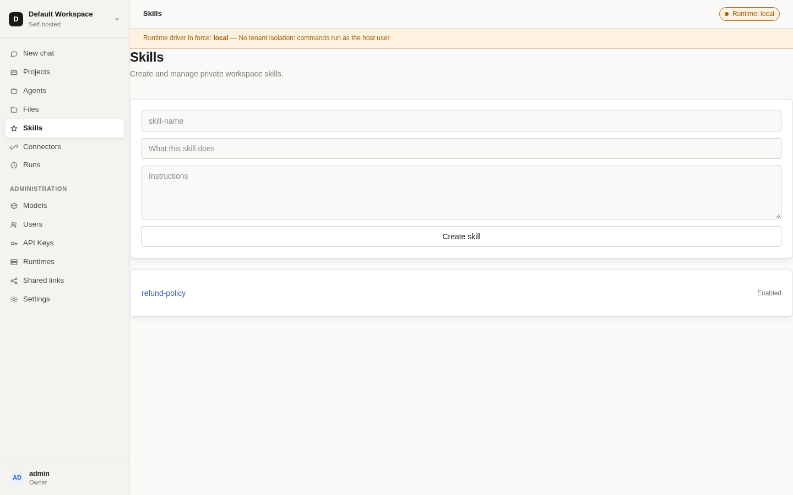
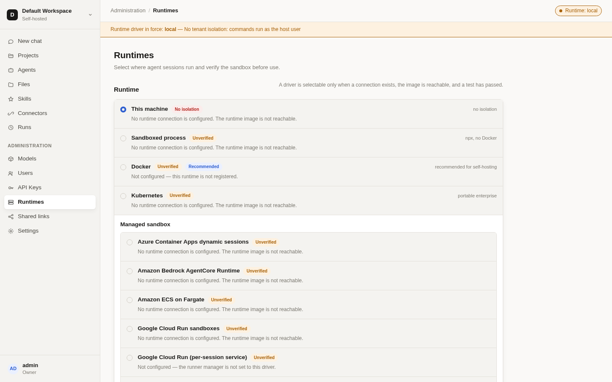
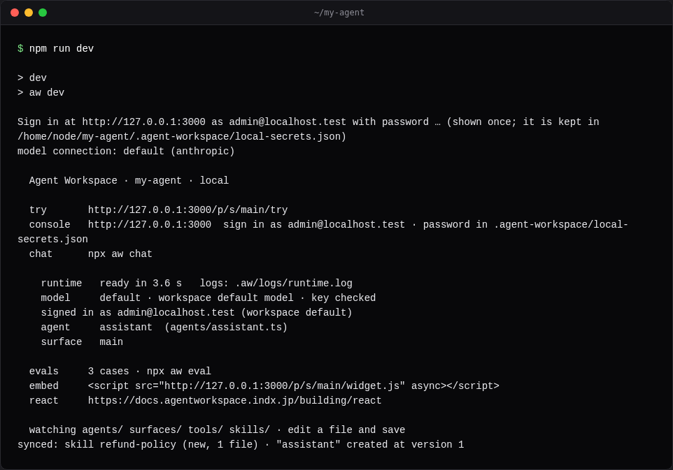
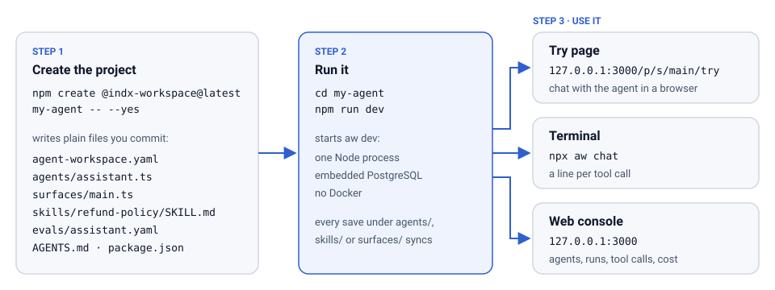
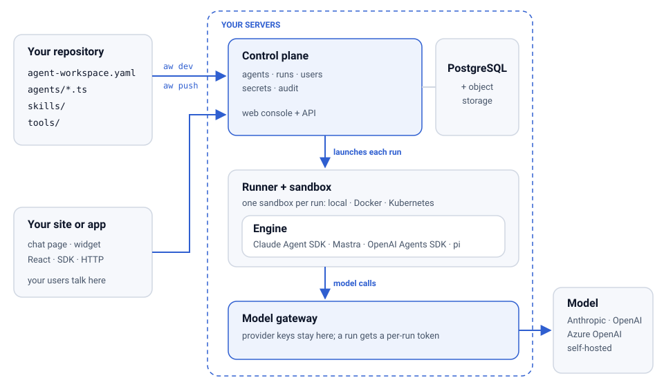

# Agent Workspace

**Your agent, your stack, on your own servers.**

Agent Workspace is the self-hosted layer around the Claude Agent SDK: everything an agent needs
after you write it, as files you commit and screens an admin can use. You choose the engine, the
model, the skills, the tools, the frontend and where it runs, from a laptop to your own VM, your
Kubernetes or your cloud. Your data, files and keys stay on your servers.

[](https://github.com/indxjp/agent-workspace/actions/workflows/ci.yml)
[](https://www.npmjs.com/package/@indx-workspace/sdk)
[](LICENSE)
[](https://docs.agentworkspace.indx.jp)

<p align="center">
  
</p>

<p align="center">
  <a href="#quickstart-60-seconds">Quick start</a> ·
  <a href="https://docs.agentworkspace.indx.jp">Documentation</a> ·
  <a href="https://docs.agentworkspace.indx.jp/tutorials">Tutorials</a> ·
  <a href="https://lp.agentworkspace.indx.jp">Website</a>
</p>

## Why Agent Workspace

Writing an agent with the SDK takes an afternoon. What stalls the rollout is everything around
it: who can change the agent, where it executes, whose keys it holds, and what happens when the
model changes. Three problems come up in every team.

| The problem                                                                                                                                      | What Agent Workspace does                                                                                                                                                                                                                                              | What you get                                                                         |
| ------------------------------------------------------------------------------------------------------------------------------------------------ | ---------------------------------------------------------------------------------------------------------------------------------------------------------------------------------------------------------------------------------------------------------------------- | ------------------------------------------------------------------------------------ |
| **The configuration lives on someone's laptop.** An administrator cannot see what is running, change it, or prove what it was allowed to do.     | Agents, skills, connectors and runtimes are files in your repository and screens in a web console. `aw push` saves a version; an admin sees and changes the same agent in the browser. Permission, credential, agent and runtime changes are recorded in an audit log. | One source of truth, reviewed like code and visible to the people who answer for it. |
| **Agents write files and run shell commands.** Where that executes is an operator's decision, yet most implementations compile it into the code. | Each run starts in the sandbox you choose: this machine for development, a Docker container, or a Kubernetes Pod. Provider keys stay in a model gateway; a run gets a per-run token, never the key.                                                                    | Switch the sandbox without touching the agent. A sandbox never holds a provider key. |
| **The model or the cloud will change.** Procurement picks Azure. A regulator picks a region.                                                     | The model is a setting: Anthropic, OpenAI, Azure OpenAI or a self-hosted model, through one gateway. The same images run on one VM, your Kubernetes or your cloud.                                                                                                     | A provider or region change is a setting, not a rewrite.                             |

Behind that are three promises:

- **Managed agents, in your own cloud.** Agents, sessions, files, tools and sandboxes, with no
  proprietary format in between, and the data never leaves your account.
- **Build the agent; everything around it is one call.** Storage, users, credentials, runs and
  deployment are resources behind one API, the `aw` command line and a typed SDK.
- **Switch anything, embed anywhere.** Model, sandbox and cloud are data. Put the agent on your
  site with one tag, in a React app, or behind your own backend.

### The part that is fun

- **One command, and it runs.** `npm run dev` starts the whole platform in one Node process with
  an embedded PostgreSQL. No Docker, no cloud account.
- **Edit a file, save, and watch the agent change.** `aw dev` watches `agents/`, `skills/`,
  `surfaces/` and `tools/`. Every save syncs, and the try page in your browser picks it up.
- **Talk to it in your terminal.** `npx aw chat` streams the answer with a line per tool call, so
  you see what the agent did, not just what it said.
- **See every run.** `npx aw runs trace <run-id>` shows each step, every tool and skill call, its
  timing and its tokens, and `aw eval` scores the agent against your own cases before you promote
  a version.

### See it

The web console is where an administrator sees and changes what the repository defines.

<table>
  <tr>
    <td width="50%"><br><sub><b>Agents.</b> Every agent in the workspace, defined in code or in the browser.</sub></td>
    <td width="50%"><br><sub><b>Agent detail.</b> One agent's configuration, the same definition as its file in the repository.</sub></td>
  </tr>
  <tr>
    <td width="50%"><br><sub><b>Skills.</b> SKILL.md folders, created in the browser or imported with <code>aw skills import</code>.</sub></td>
    <td width="50%"><br><sub><b>Runtimes.</b> Where runs execute, with each driver's status. Switch it without touching the agent.</sub></td>
  </tr>
</table>

## Quickstart (60 seconds)

**You need:** Node 24 or newer, an Anthropic API key, and about a minute. No Docker. On a clean
machine, `npm create` took 35 seconds and `npm run dev` was ready 5 seconds later.

Set the key in the shell you will run the project from
([create a key](https://console.anthropic.com/settings/keys)):

| Shell                       | Command                                 |
| --------------------------- | --------------------------------------- |
| macOS, Linux, WSL, Git Bash | `export ANTHROPIC_API_KEY=sk-ant-...`   |
| PowerShell                  | `$env:ANTHROPIC_API_KEY = 'sk-ant-...'` |
| cmd.exe                     | `set ANTHROPIC_API_KEY=sk-ant-...`      |

Then create the project and run it:

```sh claim="run"
npm create @indx-workspace@latest my-agent -- --yes
cd my-agent
npm run dev
```

`npm create` writes a project of plain files: `agent-workspace.yaml`, an agent in
`agents/assistant.ts`, a chat surface in `surfaces/main.ts`, a starter skill, evals, and an
`AGENTS.md` for coding agents. `npm run dev` runs `aw dev`, which starts the local runtime and
prints one ready screen when everything is up:

<p align="center">
  
</p>

Open the `try` URL it prints, <http://127.0.0.1:3000/p/s/main/try>, and send a message. That is
your agent answering. From here:

- Run `npx aw chat` in a second terminal to talk to it there.
- Open the `console` URL to see the agent, its skill and where it runs. The ready screen says
  which email to sign in with and which file holds the first-run password.
- Change the brand colour in `surfaces/main.ts` and save. `aw dev` prints a `synced:` line and the
  try page picks up the new colour on reload.
- Run `npx aw eval` to score the agent against the cases in `evals/assistant.yaml`.

<p align="center">
  <picture>
    <source media="(prefers-color-scheme: dark)" srcset="docs/sdk/site/images/diagrams/first-agent-flow-dark.svg">
    
  </picture>
</p>

The [Quickstart](https://docs.agentworkspace.indx.jp/getting-started/quickstart) walks through
each step with the output you should see, and
[Troubleshooting](https://docs.agentworkspace.indx.jp/getting-started/troubleshooting) covers a
missing key, a busy port, and Windows and WSL.

<details>
<summary><strong>Let a coding agent do it</strong></summary>

Paste this into Claude Code, Codex or a similar agent, from the directory where the project should
go, with your key already set in the shell the agent runs in:

```text
Create an Agent Workspace project here and run it. Run
`npm create @indx-workspace@latest my-agent -- --yes`, then `cd my-agent`.
Read my-agent/AGENTS.md and follow it: start `npm run dev` in the background (it never exits),
wait for the ready screen, run `npx aw chat -p "hi"`, and tell me the try URL. If the model key
variable is not set, ask me for it and do not write it to any file.
```

The generated `AGENTS.md` tells the agent the rest: where the runtime's log is, how to check it,
the key commands for each shell, and that a key is never committed.

</details>

### What you can do next

The documentation follows one path in seven chapters, and each one ends where the next begins.

| I want to…                                        | Go to                                                                                      |
| ------------------------------------------------- | ------------------------------------------------------------------------------------------ |
| Run an agent on my machine and find my way around | [Chapter 1: Run your first agent](https://docs.agentworkspace.indx.jp/path/first-agent)    |
| Give it instructions, skills, tools and files     | [Chapter 2: Build your agent](https://docs.agentworkspace.indx.jp/path/build)              |
| Score it with evals and improve it                | [Chapter 3: Test and improve it](https://docs.agentworkspace.indx.jp/path/test)            |
| Put it on my site or in my app                    | [Chapter 4: Put it in your product](https://docs.agentworkspace.indx.jp/path/embed)        |
| Deploy it to my own servers                       | [Chapter 5: Ship it to your servers](https://docs.agentworkspace.indx.jp/path/ship)        |
| Run it for a team: users, keys, models, runtimes  | [Chapter 6: Run it for your team](https://docs.agentworkspace.indx.jp/path/operate)        |
| Move it to another agent platform                 | [Chapter 7: Run it on other platforms](https://docs.agentworkspace.indx.jp/path/platforms) |
| Build a complete business agent, step by step     | [Tutorials](https://docs.agentworkspace.indx.jp/tutorials)                                 |

## Architecture

<p align="center">
  <picture>
    <source media="(prefers-color-scheme: dark)" srcset="docs/sdk/site/images/diagrams/architecture-dark.svg">
    
  </picture>
</p>

You keep the agent as files in your repository, and `aw` saves them to the control plane, which
stores agents, runs, users and secrets in PostgreSQL and object storage. Each run starts the
agent's engine (the Claude Agent SDK by default, or Mastra, the OpenAI Agents SDK or pi) in the
sandbox you chose, and the engine reaches the model only through the gateway that holds the
provider key. Your site, app or backend talks to the same control plane, through the same API the
web console uses. [`docs/architecture.md`](docs/architecture.md) covers module ownership and
dependency direction.

## Self-host

`npm run dev` runs everything in one process for development. For a team, generate a deployment
project that runs the platform's services (web, runner, gateway and PostgreSQL, plus object
storage when you choose S3) on Docker Compose. It needs Node 24 or newer, pnpm, and Docker with the
Compose and `buildx` plugins. The first `pnpm start` pulls the images; on our test machine the
setup wizard was up about two minutes after `npm create`. Production runs use isolated Docker runtimes through the private
runner manager; the local driver is for development only.

```sh title="illustrative" claim="illustrative"
npm create @indx-workspace@latest my-agent-platform -- --cloud local
cd my-agent-platform
pnpm install --frozen-lockfile=false
pnpm start
```

Or run `npx -p @indx-workspace/cli create-agent-workspace my-agent-platform --cloud local`. Open the URL `pnpm start` prints and finish the setup wizard with the
seeded bootstrap administrator and the one-time password the generator printed. Then drive the
workspace from a terminal:

```sh title="illustrative" claim="illustrative"
export AGENT_WORKSPACE_URL=http://localhost:3000
export AGENT_WORKSPACE_API_KEY=ak_live_…
npx @indx-workspace/aw me
```

The [self-hosting guide](https://docs.agentworkspace.indx.jp/building/self-hosting) covers the
wizard, ports, API keys and teardown. Deploy guides for operators:

- [Single VM with Docker Compose](docs/deploy/single-vm.md)
- [Small GCP deployment with Terraform](infra/terraform/gcp-small/README.md)
- [Kubernetes with Helm](docs/deploy/kubernetes.md)
- [Azure Container Apps preview environment](docs/deploy/azure-container-apps.md)

## Packages

| Package                     | What it is                                                              |
| --------------------------- | ----------------------------------------------------------------------- |
| `@indx-workspace/contracts` | API contracts: Zod schemas, route catalogue and contracts version.      |
| `@indx-workspace/sdk`       | Typed, isomorphic TypeScript client, with agents and surfaces as code.  |
| `@indx-workspace/react`     | Hosted surface chat as React: `<Chat/>` and `useConversation()`.        |
| `@indx-workspace/aw`        | The `aw` command line: one command per SDK method.                      |
| `@indx-workspace/cli`       | `create-agent-workspace` and `agent-workspace` project CLI.             |
| `@indx-workspace/embedded`  | Local runtime: web, gateway and runner in one Node process.             |
| `@indx-workspace/create`    | `npm create @indx-workspace`: project generator.                        |
| `@indx-workspace/platforms` | PlatformTarget port and conformance kit for agent-platform translators. |

## Documentation

- **Using Agent Workspace:** the [documentation site](https://docs.agentworkspace.indx.jp), from
  the quick start to the API reference.
- **How the code is organised:** [`docs/architecture.md`](docs/architecture.md) and the SDK notes
  in [`docs/sdk/`](docs/sdk/README.md).
- **Operating a deployment:** the deploy guides above and the
  [operations runbook](docs/operations/runbook.md).
- **Changing the code:** [`CONTRIBUTING.md`](CONTRIBUTING.md).

## Contributing

Open an issue before non-trivial work. See [`CONTRIBUTING.md`](CONTRIBUTING.md) for the development
setup and checks, and [`ENGINEERING_GUIDELINES.md`](ENGINEERING_GUIDELINES.md) for the enforced
coding standard.

## Security

Report vulnerabilities as described in [`SECURITY.md`](SECURITY.md), not in a public issue. When
you deploy:

- Never expose the local driver as tenant isolation: it runs commands as the host user.
- Keep the model gateway and runner on private networks and rotate generated secrets before exposure.
- Mount the Docker socket only into the runner.
- Use immutable image digests for production deployments.

## Community and support

Ask questions in GitHub Discussions; see [`SUPPORT.md`](SUPPORT.md) for where to get help.

## License

[Apache-2.0](LICENSE).
