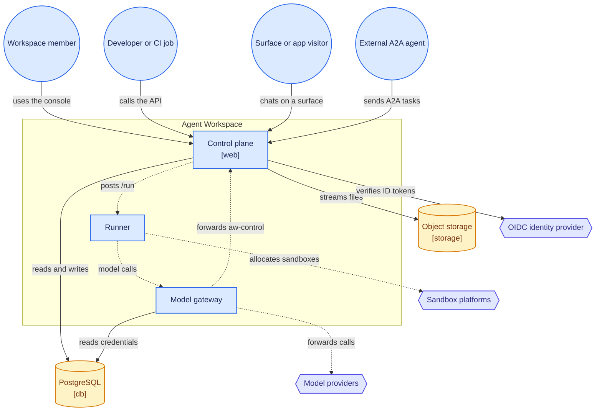
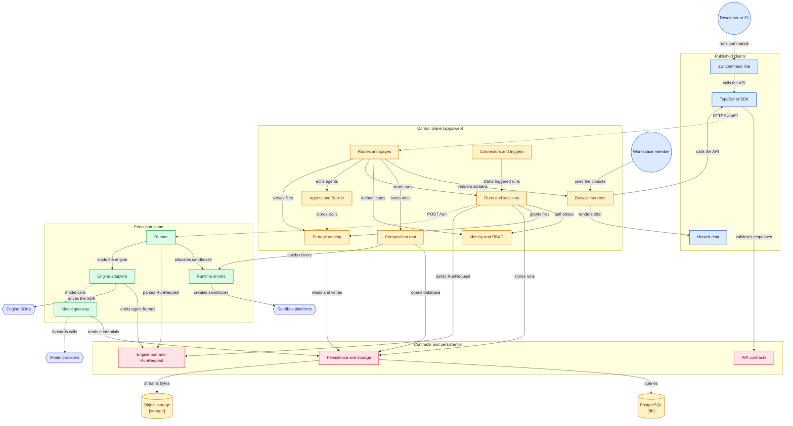
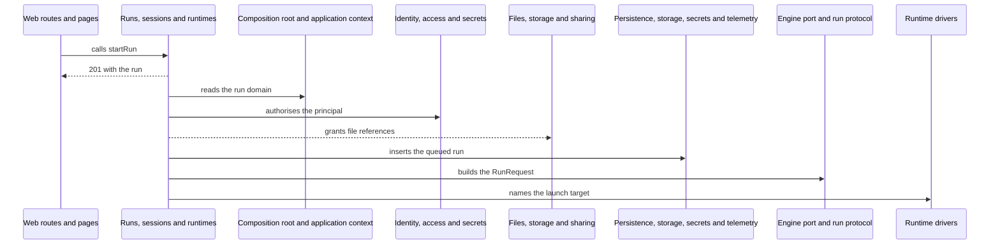
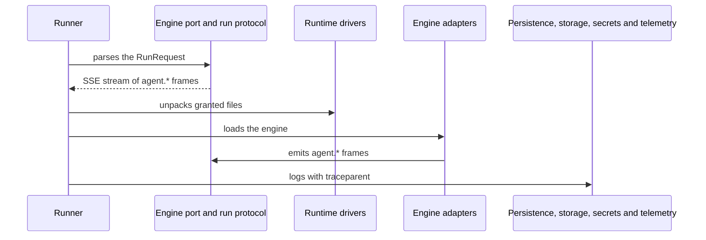
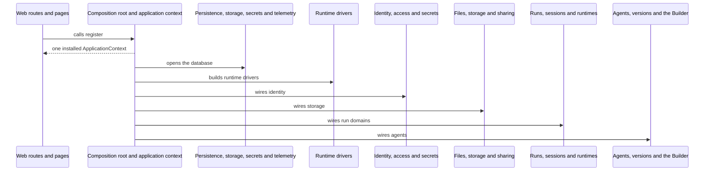
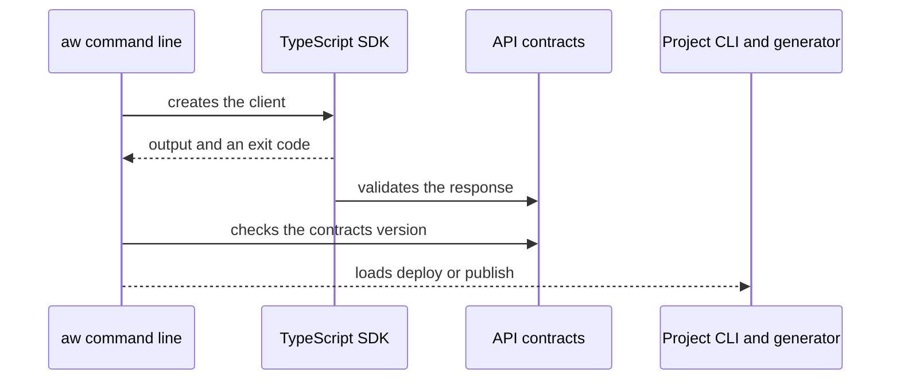
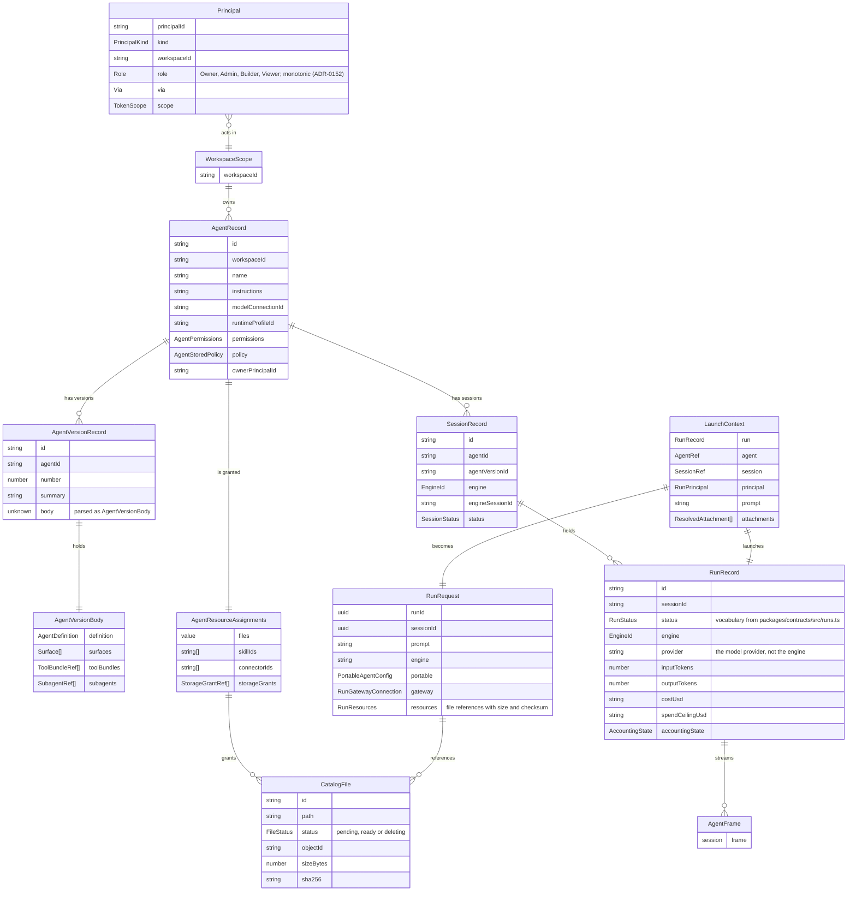

# agent-workspace architecture

> Generated by `jevlint architecture show --markdown` from `.jevlint/architecture/`, compiled at d07c017e56c6d9cc9cb9aac6096c6dd93264d688. Edit the SSOT, not this file.

Agent Workspace is a self-hostable platform for running AI agents for a team. The Next.js control plane (apps/web) holds workspaces, agents, sessions, files and runs, and launches each run on the runner (apps/runner), which places it in a sandbox through a runtime driver and executes it with one engine adapter (Claude Agent SDK, OpenAI Agents, Mastra or pi). Model calls go through the gateway, which swaps a short-lived run identity for the stored credential. Published packages (contracts, sdk, react, app, aw, cli) let browsers, the aw command line and customer apps reach the same /api/** contracts. Wire schemas sit at the bottom and depend on nothing; only packages/core talks to PostgreSQL and object storage.

## Overview

Agent Workspace runs AI agents for a team, on infrastructure the team chooses. A workspace member
defines an agent (instructions, model connection, files, skills, connectors, a runtime profile),
talks to it in sessions, and shares it as a hosted chat surface, an A2A endpoint or a portal app.
Developers drive the same platform from the `aw` command line, the TypeScript SDK or a generated
project. The product is one control plane (`apps/web`), one runner (`apps/runner`), one gateway
(`packages/gateway`) and a set of published packages under `@indx-workspace/*`.

### The main workflow in one paragraph

A caller sends `POST /api/agents/:id/runs`. The route hands the request to `startRun` in
`apps/web/server/runs/api.ts`, which authenticates the principal, checks run permission and starts
an authorised, idempotent run: the run row is stored as `queued` in PostgreSQL through
`packages/core`. The launcher then asks the runner's runtime manager for a sandbox and posts a
`RunRequest` to `${base}/run` over HTTP (`launcher-execution.ts:76`). Inside the sandbox the
runner's runtime server (`apps/runner/src/server.ts:259`) checks the granted files' checksums,
loads one engine adapter through `apps/runner/src/engines.ts`, and streams `agent.*` frames back as
server-sent events. Every model call the engine makes goes to the gateway, which swaps the
short-lived run token for the stored provider credential. The control plane stores the frames and
settles usage and cost on the run.

### Who uses it

| Caller | Enters through | Credential |
| --- | --- | --- |
| Workspace member in a browser | `apps/web/components` screens, through the SDK | signed sign-in session cookie |
| Developer or CI job | `aw`, the SDK, `create-agent-workspace` | API key or CLI token |
| Visitor of a surface or portal app | public pages, `@indx-workspace/react`, `@indx-workspace/app` | browser token or share link |
| External agent | the A2A endpoint | API key or OAuth access token |
| Scheduler | cron route and trigger fire URL | cron secret or trigger secret |

The diagram shows what the system talks to. Solid arrows are imports in the code; dashed arrows are
HTTP calls between processes, which the import graph cannot show.

People and programs come in through the control plane; only the runner touches sandboxes and only the gateway touches model providers.

## Design principles

### 1. The wire contracts are at the bottom and depend on nothing

`packages/contracts` holds every `/api/**` schema, problem code and closed vocabulary, and imports
only `zod`. The SDK, the browser screens, `aw`, the CLI, portal apps and the server all import the
same schemas, and the SDK validates every response against them (ADR-0052).

- **Why:** customers integrate from outside the repository, and a browser that reads a response
  differently from how the server renders it is a bug nobody sees.
- **Cost:** a wire change is a contracts change, a regenerated API report and a lock-step release
  of nine packages (commit `4517e8bcf` moved all nine from 0.6.12 to 0.6.13 together).
- **Kept by:** the `contracts` component's empty `depends_on`, `wire-packages-stay-framework-free`,
  and dependency-cruiser's `contracts-depend-on-nothing-in-the-workspace`.

### 2. Only persistence talks to PostgreSQL and buckets, and a repository takes a tenant, not a caller

All database and object access is in `packages/core`. A repository's only request input is
`WorkspaceScope`, a value minted from a lookup and deliberately without the actor or role
(`scope.ts:105-120`). Inside the web server only a domain's `store.ts` should import `core/db`.

- **Why:** tenant isolation is the first design priority in `ENGINEERING_GUIDELINES.md`;
  authorisation (RBAC) and tenant selection (scope) stay in different places with different reasons
  to change.
- **Cost:** an extra store layer per domain, and 31 files that still name persistence outside a
  store (`domain-does-not-import-persistence` ceiling in `tests/architecture-rules.test.ts`).
- **Kept by:** `only-persistence-and-app-kit-use-drizzle`, the three bucket `only` rules, the
  checklist item `only-stores-name-persistence`, and the repository's baseline ceilings.

### 3. Decisions are pure; effects come in as arguments

A domain's `core/` folder imports only itself, the contracts and zod, and reads no clock, random
value, environment, file or network (`AGENTS.md`, hexagonal rule 2). Outside cores, server code
takes time from a `Clock` and ids from an `IdGenerator`.

- **Why:** pure rules can be tested exhaustively and checked against the Lean model in `formal/`
  (ADR-0062).
- **Cost:** constructors grow `clock` and `ids` parameters (commit `bd1d76148` threaded them through
  the Builder's shell and transport), and a ceiling of direct clock calls (`pnpm clock:check`) still
  has to be worked down.
- **Kept by:** the checklist item `domain-core-is-pure`, dependency-cruiser's `domain-core-is-pure`
  and the ESLint globals ban.

### 4. One composition root, and a domain that can be off says so

`apps/web/server/composition/register.ts` reads the environment once, builds every domain and
installs one `ApplicationContext`. A route reads it per request and answers its domain's named 503
when the domain is `disabled` or `unavailable`; there is no in-memory fallback.

- **Why:** a half-composed process must never serve, and a missing runner or bucket must be visible
  to the caller.
- **Cost:** `application-context.ts` imports a type from every domain, so the server's components
  form one cycle in the component graph (`no-component-cycles` reports it), and process-global state
  needs `defineSlot` because Next.js builds instrumentation and routes as separate module graphs.
- **Kept by:** the checklist items `one-context-install` and `environment-read-at-entry`.

### 5. Engines, drivers and storage backends are plug-ins loaded only when chosen

The runner names engine adapters in one file and loads them with dynamic `import()`
(`engines.ts:60-65`); each runtime driver is its own exports subpath; `openObjectStore` imports only
the backend the storage URL names (`packages/core/src/storage/index.ts:69-75`).

- **Why:** a local install must not load cloud SDKs, a run image must stay small, and a new engine
  must not touch the control plane (ADR-0065).
- **Cost:** each adapter carries a conformance kit, and the single-file rules need their own tests
  (`tests/no-sdk-import.test.ts`).
- **Kept by:** `engine-sdks-stay-in-their-adapters`, `only-runtime-drivers-call-kubernetes`, the
  runner's checklist item `runner-reaches-adapters-through-engines-ts` and `one-sdk-file-per-engine`.

### 6. Known violations are a baseline that can only shrink

Rules that the code does not yet meet are not loosened; their current violations are listed in
`.dependency-cruiser-known-violations.json` and `eslint-suppressions.json`, and
`tests/architecture-rules.test.ts` holds a ceiling per rule.

- **Why:** a rule with exceptions that grow is not a rule.
- **Cost:** the code carries visible debt for a long time, and every fix must also lower a ceiling.
- **Kept by:** the ceilings test and CI's lint-baseline check. This SSOT follows the same idea: the
  imports against the context direction are left out of `depends_on` and reported, not allowed.

## Building blocks

Every caller enters through the routes; the execution domain hands the run to the runner over HTTP, and the runner alone picks the driver and the engine.

### Published clients

`sdk` is the typed client every outside caller uses; `aw-cli`, `react-chat`, `app-kit` and the
browser screens build on it, and none of them may reach a server package
(`docs/10-product/sdk/07-structure-map.md`). `project-cli` generates and deploys projects, and `aw` loads its
`deploy` and `publish` only through `packages/aw/src/cli-bridge.ts`. They hand work on by calling
`/api/**` over HTTPS; the dashed arrow from the SDK to the routes is that boundary.

### Control plane (apps/web)

`web-routes` is the Next.js tree; it renders `web-ui` screens and calls one domain function per
route. The server is split into the bounded contexts that `apps/web/server/contexts.json` lists,
upstream first: identity (with secrets), storage and sharing, execution, integrations, agents
(with evaluations) and the store demo. In this SSOT they are the components `identity`,
`storage-sharing`, `execution`, `integrations`, `agent-authoring` and `store-demo`, each allowed to
depend only on the contexts before it. Each context has a public `index.ts` entry that the others
should import. `server-kernel` is what all of them share, and `composition` builds them and installs
the `ApplicationContext` they read at request time. The execution domain hands a run to the runner
by HTTP, not by import.

### Execution plane

`runner` is two processes: the runtime manager, which allocates a sandbox per session through one
`runtime-drivers` driver, and the runtime server inside the sandbox, which runs one
`engine-adapters` engine. Engines call `gateway` over HTTP with the run token. `sandbox-tools` are
the tool host and egress proxy that run next to an agent; the tool host implements the tool-host
contract from `aw` (`intake.ts:25`). `embedded` bundles the control plane, gateway and runner into
one process for `aw dev`.

### Contracts and persistence

`contracts` is the public wire language, `run-contract` the private one between control plane,
runner and engines (`AgentEngine`, `RunRequest`), and `platforms` the pure translators that export
a portable agent to other agent platforms. `persistence` (`packages/core`) is the only component
that reaches PostgreSQL and object storage.

```mermaid
flowchart TB
  subgraph layer_bundle["bundle"]
    c_embedded["Local runtime bundle"]
  end
  subgraph layer_delivery["delivery"]
    c_app_kit["Portal app kit"]
    c_aw_cli["aw command line"]
    c_project_cli["Project CLI and generator"]
    c_sandbox_tools["Sandbox tool host and egress proxy"]
    c_web_routes["Web routes and pages"]
  end
  subgraph layer_application["application"]
    c_agent_authoring["Agents, versions and the Builder"]
    c_composition["Composition root and application context"]
    c_execution["Runs, sessions and runtimes"]
    c_identity["Identity, access and secrets"]
    c_integrations["Integrations and model connections"]
    c_runner["Runner"]
    c_storage_sharing["Files, storage and sharing"]
    c_store_demo["Agent Store demo"]
  end
  subgraph layer_kernel["kernel"]
    c_server_kernel["Server shared kernel"]
  end
  subgraph layer_client["client"]
    c_react_chat["Hosted chat for React"]
    c_sdk["TypeScript SDK"]
    c_web_ui["Browser screens"]
  end
  subgraph layer_adapters["adapters"]
    c_engine_adapters["Engine adapters"]
    c_gateway["Model and tool gateway"]
    c_persistence["Persistence, storage, secrets and telemetry"]
    c_runtime_drivers["Runtime drivers"]
  end
  subgraph layer_contracts["contracts"]
    c_contracts["API contracts"]
    c_platforms["Platform translators"]
    c_run_contract["Engine port and run protocol"]
  end
  c_agent_authoring -->|19| c_composition
  c_agent_authoring -->|189| c_contracts
  c_agent_authoring -->|41| c_execution
  c_agent_authoring -->|1| c_gateway
  c_agent_authoring -->|34| c_identity
  c_agent_authoring -->|22| c_integrations
  c_agent_authoring -->|12| c_persistence
  c_agent_authoring -->|2| c_platforms
  c_agent_authoring -->|10| c_run_contract
  c_agent_authoring -->|10| c_runtime_drivers
  c_agent_authoring -->|4| c_sdk
  c_agent_authoring -->|108| c_server_kernel
  c_agent_authoring -->|35| c_storage_sharing
  c_agent_authoring -->|21| c_web_ui
  c_app_kit -->|33| c_contracts
  c_app_kit -->|10| c_react_chat
  c_app_kit -->|27| c_sdk
  c_aw_cli -->|90| c_contracts
  c_aw_cli -->|4| c_platforms
  c_aw_cli -->|1| c_project_cli
  c_aw_cli -->|81| c_sdk
  c_composition -->|89| c_agent_authoring
  c_composition -->|30| c_contracts
  c_composition -->|60| c_execution
  c_composition -->|1| c_gateway
  c_composition -->|60| c_identity
  c_composition -->|58| c_integrations
  c_composition -->|32| c_persistence
  c_composition -->|3| c_run_contract
  c_composition -->|4| c_runtime_drivers
  c_composition -->|61| c_server_kernel
  c_composition -->|34| c_storage_sharing
  c_composition -->|31| c_store_demo
  c_composition -->|1| c_web_ui
  c_embedded -->|2| c_composition
  c_embedded -->|12| c_contracts
  c_embedded -->|1| c_gateway
  c_embedded -->|2| c_identity
  c_embedded -->|5| c_persistence
  c_embedded -->|3| c_project_cli
  c_embedded -->|2| c_runner
  c_embedded -->|1| c_sdk
  c_engine_adapters -->|41| c_contracts
  c_engine_adapters -->|43| c_run_contract
  c_execution -->|7, violation| c_agent_authoring
  c_execution -->|6| c_composition
  c_execution -->|59| c_contracts
  c_execution -->|7| c_identity
  c_execution -->|2, violation| c_integrations
  c_execution -->|9| c_persistence
  c_execution -->|9| c_run_contract
  c_execution -->|5| c_runtime_drivers
  c_execution -->|50| c_server_kernel
  c_execution -->|7| c_storage_sharing
  c_execution -->|2| c_web_ui
  c_gateway -->|22| c_contracts
  c_gateway -->|18| c_persistence
  c_identity -->|1, violation| c_agent_authoring
  c_identity -->|12| c_composition
  c_identity -->|33| c_contracts
  c_identity -->|1, violation| c_execution
  c_identity -->|3, violation| c_integrations
  c_identity -->|10| c_persistence
  c_identity -->|55| c_server_kernel
  c_identity -->|4| c_web_ui
  c_integrations -->|8| c_composition
  c_integrations -->|47| c_contracts
  c_integrations -->|17| c_execution
  c_integrations -->|1| c_gateway
  c_integrations -->|18| c_identity
  c_integrations -->|16| c_persistence
  c_integrations -->|35| c_server_kernel
  c_persistence -->|41| c_contracts
  c_platforms -->|61| c_contracts
  c_project_cli -->|43| c_contracts
  c_project_cli -->|5| c_sdk
  c_react_chat -->|18| c_contracts
  c_react_chat -->|3| c_sdk
  c_run_contract -->|13| c_contracts
  c_runner -->|4| c_contracts
  c_runner -->|4| c_engine_adapters
  c_runner -->|12| c_persistence
  c_runner -->|13| c_run_contract
  c_runner -->|24| c_runtime_drivers
  c_sandbox_tools -->|2| c_aw_cli
  c_sandbox_tools -->|1| c_contracts
  c_sdk -->|130| c_contracts
  c_server_kernel -->|1, violation| c_composition
  c_server_kernel -->|11| c_contracts
  c_server_kernel -->|1, violation| c_execution
  c_server_kernel -->|4, violation| c_identity
  c_server_kernel -->|5| c_persistence
  c_server_kernel -->|1, violation| c_storage_sharing
  c_storage_sharing -->|12, violation| c_agent_authoring
  c_storage_sharing -->|7| c_composition
  c_storage_sharing -->|34| c_contracts
  c_storage_sharing -->|2, violation| c_execution
  c_storage_sharing -->|13| c_identity
  c_storage_sharing -->|27| c_persistence
  c_storage_sharing -->|1| c_run_contract
  c_storage_sharing -->|39| c_server_kernel
  c_store_demo -->|2| c_agent_authoring
  c_store_demo -->|31| c_contracts
  c_store_demo -->|2| c_execution
  c_store_demo -->|6| c_identity
  c_store_demo -->|3| c_integrations
  c_store_demo -->|9| c_persistence
  c_store_demo -->|11| c_server_kernel
  c_store_demo -->|3| c_storage_sharing
  c_web_routes -->|106| c_agent_authoring
  c_web_routes -->|38| c_composition
  c_web_routes -->|17| c_contracts
  c_web_routes -->|40| c_execution
  c_web_routes -->|127| c_identity
  c_web_routes -->|28| c_integrations
  c_web_routes -->|6| c_react_chat
  c_web_routes -->|126| c_server_kernel
  c_web_routes -->|48| c_storage_sharing
  c_web_routes -->|14| c_store_demo
  c_web_routes -->|97| c_web_ui
  c_web_ui -->|77| c_contracts
  c_web_ui -->|17| c_react_chat
  c_web_ui -->|39| c_sdk
  linkStyle 44 stroke:#d03b3b,stroke-width:2px
  linkStyle 48 stroke:#d03b3b,stroke-width:2px
  linkStyle 57 stroke:#d03b3b,stroke-width:2px
  linkStyle 60 stroke:#d03b3b,stroke-width:2px
  linkStyle 61 stroke:#d03b3b,stroke-width:2px
  linkStyle 87 stroke:#d03b3b,stroke-width:2px
  linkStyle 89 stroke:#d03b3b,stroke-width:2px
  linkStyle 90 stroke:#d03b3b,stroke-width:2px
  linkStyle 92 stroke:#d03b3b,stroke-width:2px
  linkStyle 93 stroke:#d03b3b,stroke-width:2px
  linkStyle 96 stroke:#d03b3b,stroke-width:2px
```

The layers run top to bottom. A component may import its own layer and those below. The server's
contexts share the `application` layer because the composition root and the contexts import each
other by design (the root builds them; they read the context it installed); their direction is held
by each component's `depends_on`, not by layers.

## How it runs

### Start a run

`POST /api/agents/:id/runs` reaches `startRun` (`apps/web/server/runs/api.ts:79`). It reads the run
domain from the application context and answers 503 if runs are `disabled` (no runner configured).
It authenticates the principal, refuses a malformed agent id with `400 invalid_agent_id`, resolves
ownership, checks run permission, and calls `startAuthorisedRun`. The start is idempotent: an
`Idempotency-Key` is stored per principal with the hash of the canonical request, so a replay
returns the original run and a different request under the same key gets
`409 run_idempotency_conflict` (ADR-0151). Preflight and refusal mapping live in `start-input`,
`start-preparation` and `start-refusal`.

The launcher then asks the runtime manager for a sandbox and posts the `RunRequest` to
`${base}/run` (`launcher-execution.ts:76`), carrying `traceparent` and a bearer token when one is
set. `relay.ts` reads the SSE answer into stored frames; a status other than 200 fails the run with
a public reason (`relay.ts:312`).

**Where it fails:** a disabled run domain (503), a refused preflight (spend ceiling, daily cost cap,
demo gate), an idempotency conflict (409), no sandbox capacity, or a runtime that does not answer
200. Interrupting a live run reaches only the replica that launched it (issue #261); orphaned runs
are failed by the stale sweep under a database lease.

### Execute a run in the sandbox

The runtime server inside the sandbox accepts `POST /run` and its alias `/invocations`
(`apps/runner/src/server.ts:259`). Admission parses the `RunRequest`, resource verification checks
every granted file's size and checksum against the archive the control plane streamed, and
`run-execution.ts` starts the engine that `engines.ts` loads by dynamic import. An engine whose
package is not in the image answers `engine_not_installed` (comment above `ENGINE_MODULES`).

The answer is an SSE stream of `agent.*` frames whose ids are resume cursors. A gated tool call
stops the run as `awaiting_approval`; it holds no lease, and an approval continues it as a new run
in the same session (ADR-0145).

### Boot the control plane

Next.js calls `register()` once per server process (`apps/web/instrumentation.ts`).
`register.ts` reads settings and opens the database, then `registerOpenedDatabase` calls the
`wire<Domain>` functions and finally `installApplicationContext` once. If wiring throws, nothing is
installed and the pools opened so far are closed (`docs/architecture.md:313-331`).

**Where it fails:** no session secret or no reachable database means no context at all, and every
route answers its 503. A missing runner disables the six run-dependent domains together.

### Run an aw command

`aw` parses arguments, resolves the profile and credential, creates an SDK client and runs one
command per SDK method (`packages/aw/src/main.ts`). The SDK sends `CONTRACTS_VERSION`, validates the
answer and turns a problem into a typed error; `aw` prints a table or JSON and exits with a stable
code. `aw deploy` and `aw publish` load the project CLI through `cli-bridge.ts`.

## Data and state

A run belongs to a session of an agent in one workspace; the runner receives a RunRequest with file references, never bytes, and streams agent frames back.

- `WorkspaceScope` (`packages/core/src/db/repositories/scope.ts`): The only tenant value a repository takes; minted from a lookup, never from caller input.
- `Principal` (`apps/web/server/rbac/principal.ts`): The resolved caller of one request.
- `AgentRecord` (`packages/core/src/db/repositories/agents.ts`): A stored agent row.
- `AgentVersionRecord` (`packages/core/src/db/repositories/agent-versions.ts`): An immutable numbered version of an agent; environment pointers name which one runs.
- `AgentVersionBody` (`packages/contracts/src/agent-versions/body.ts`): What a version holds, as published on the wire.
- `AgentResourceAssignments` (`packages/contracts/src/agents/resource.ts`): The files, skills, connectors and storage grants an agent may use.
- `CatalogFile` (`packages/core/src/db/repositories/resource-catalogs-model.ts`): A catalog row naming one stored object; only a ready row is listed or granted.
- `SessionRecord` (`packages/core/src/db/repositories/runs/types.ts`): A conversation with one agent; runs continue in it.
- `RunRecord` (`packages/core/src/db/repositories/runs/types.ts`): One execution of an agent, with its accounting.
- `LaunchContext` (`apps/web/server/runs/environment.ts`): Everything the launcher needs for one run, assembled in memory.
- `RunRequest` (`packages/run-protocol/src/schemas.ts`): The body of POST /run that the runtime server receives.
- `AgentFrame` (`packages/contracts/src/run-events.ts`): One agent.* frame of a run's stream, discriminated by frame.

### What is stored where

| State | Where | Written by | Read by |
| --- | --- | --- | --- |
| Workspaces, members, agents, versions, sessions, runs, run events, tokens, secrets (encrypted) | PostgreSQL, schema in `packages/core/src/db/schema/` | `packages/core` repositories, called from each domain's `store.ts` | the control plane and the gateway |
| File, skill, attachment and session-state bytes | one object store, chosen by `AW_STORAGE_URL` (`s3://`, `gcs://`, `azblob://`, `file://`) | the storage catalog service only | the catalog service; the runner gets an archive |
| Catalog rows naming those bytes | PostgreSQL (`files`, `skill_revisions`, `session_state_blobs`) | the catalog service | domains, through the catalog |
| A portal app's own records | the app's PostgreSQL schema, through Drizzle in `packages/app/src/db/` | the app kit | the app |
| Process-local state | eight `defineSlot` slots (live runs, trace attributes, driver instances, cron handle, ...) | the process | the process |

### How a save stays consistent

Every save is row-first (ADR-0153). The catalog reserves a `pending` row under a new object id,
streams the bytes to `workspaces/<workspace id>/<area>/<object id>`, then one transaction confirms
the row as `ready` with the measured size and checksum. A replaced or removed row is `deleting`
until its object is gone, and a cleanup job reports or removes what a crash left. Only `ready` rows
are listed, searched or granted, and a rename changes the row alone.

### Runs

A run row's status comes from the closed vocabulary in `packages/contracts/src/runs.ts`. A paused
run (`awaiting_approval`) stores a deadline 24 hours ahead; one unique index allows exactly one
continuation per paused run, and approved tool calls are consumed by one guarded update so each runs
at most once (`docs/architecture.md:597-622`). Usage, tokens and cost are written on the run row
(`RunRecord`: `inputTokens`, `costUsd`, `accountingState`).

### Tenancy

Every repository query is built from `WorkspaceScope.workspaceId`, a value the scope resolver mints
from a lookup. The class keeps a private copy so `isWorkspaceScope` can check an invariant rather
than a shape (`scope.ts:105-120`). Authorisation happens before a workspace-scoped read.

### Lifetimes

Sign-in session cookies last 12 hours, CLI tokens 12 hours, browser tokens 1 to 60 minutes, run
tokens 5 minutes (at most 1 hour), public share links 24 hours to never; bearer secrets are stored
only as SHA-256 hashes. Migrations under `migrations/` are forward-only and expand/contract
(`pnpm migrations:lint`). Demo workspaces, their tokens, admissions and guests are swept when they
expire (`store-demo`).

## Cross-cutting concerns

### Errors

Every owned JSON route builds its `{ error: { code, message } }` envelope in
`apps/web/server/http/result.ts`, rendered by `route()` in `http/route.ts`; the comment at the top
of `result.ts` lists the deliberate variants (public surface pages, versioning). Expected failures
carry a stable code from `packages/contracts`; infrastructure failures stay 5xx, keep their cause
for the log and never echo SQL, provider or credential text (checklist `expected-failures-are-typed`).
The SDK decodes the envelope into typed errors such as `ApiProblemError`.

### Trust boundaries and access

A request is checked three times, each for one thing: `apps/web/proxy.ts` checks that a credential
of the right shape is present and a cookie is validly signed; the route resolves the credential into
a `Principal` (`resolveActor`, `composition/session-rbac.ts`); `decide()` in `rbac/decide.ts` asks
the pure rules in `rbac/core/` whether that role may use the method on the path. Signing keys derive
from `SESSION_SECRET` with HKDF and a purpose label, so a token for one purpose fails every other.
Only `identity` imports `jose` and `openid-client` (`only-identity-verifies-oidc`).

Provider credentials never reach a sandbox. The runner receives a short-lived run token signed with
`GATEWAY_TOKEN_SECRET` (`packages/gateway/src/tokens/run-token.ts`), and the gateway swaps it for the
stored key. Sandbox egress goes through `packages/egress-proxy`, which refuses loopback, private,
link-local (including the cloud metadata address) and reserved ranges (`address.ts`).

### Input validation

HTTP bodies, provider JSON, environment values, persisted JSON and runner frames are `unknown`
until a Zod schema or a small predicate checks them. Owned APIs reject unknown keys; extensible
third-party protocols may keep them after the consumed fields are validated.

### Configuration

The environment is read once, in a composition root or a process entry point, and passed on as typed
values (checklist `environment-read-at-entry`). The files that still read `process.env` elsewhere are
the `no-restricted-properties` entries of `eslint-suppressions.json`, which may only shrink.
`AW_STORAGE_URL` is the one storage setting, parsed by `parseStorageUrl` for server and CLI alike.

### Observability

Web, runner and gateway log one JSON object per line through the `Logger` port in
`@agent-workspace/core/telemetry`, with fixed `msg` strings and redacted values. A W3C `traceparent`
travels from the web's span to the runner and on to the gateway with every model call; OpenTelemetry
export is on only when `OTEL_EXPORTER_OTLP_ENDPOINT` is set (ADR-0155). Only `persistence` and the
web's `server-kernel` telemetry import OpenTelemetry.

### Concurrency

Run start is idempotent per key; approvals are consumed by guarded updates; catalog locks are proven
on PostgreSQL only. The stale-run sweep runs on one replica at a time under a database lease, and
interrupts reach only the launching replica.

## Decisions

### The SDK is contracts-first and the application is its first consumer (ADR-0052)

- **Context:** `/api/**` contracts lived as hand-written parsers inside server domains, so nothing
  outside the repository could validate against them.
- **Decision:** `contracts` publishes Zod schemas and depends on `zod` alone; `sdk` depends only on
  `contracts`. A domain enters the SDK only after a conformance test proves the server's real
  serializers satisfy the schema, and `apps/web/contracts` re-exports rather than copies.
- **Consequences:** browser screens reach the server only through the SDK; a wire change is a
  versioned, reported change.
- **Alternatives:** generating the client from OpenAPI (no document existed, and it would lack the
  stream follower); publishing `apps/web/contracts` directly (breaks "packages never import apps");
  moving every domain at once (would freeze open defects into a public surface).

### An agent's engine is an extension point behind one port (ADR-0065)

- **Context:** every agent ran on the Claude Agent SDK, imported from one runner file; the Owner
  decided on 2026-09-26 to accept other engines.
- **Decision:** the platform owns the `AgentEngine` port in `packages/engine`; each engine is a
  `packages/engine-<id>` adapter with one SDK file, reached by the runner only through
  `apps/runner/src/engines.ts`. "Provider" keeps meaning the model provider; the harness is the
  "engine".
- **Consequences:** four adapters exist (Claude Agent SDK, OpenAI Agents, Mastra, pi); the control
  plane knows engines only by id.
- **Alternatives:** keeping the Claude SDK as the only runtime, which the earlier spec required and
  this ADR reversed.

### Object storage: one key layout, catalog-first writes, references not bytes (ADR-0153)

- **Context:** three object roots, path-as-key renames, rows written after objects under an
  in-process lock, and granted files base64-encoded into the `/run` body.
- **Decision:** one object store and key layout with immutable object ids, row-first saves, a
  streaming `ObjectStore` port in `packages/core/src/storage`, and runs that receive references and
  one streamed archive.
- **Consequences:** a rename touches one row; a crash leaves only rows the cleanup job can see.
- **Alternatives:** a new `packages/storage`, path-as-key, object-first writes, and a
  maintenance-window migration were all rejected.

### The local runtime is one bundled package that aw dev forks (ADR-0109)

- **Context:** `aw dev` must run control plane, gateway and runner in one process from a generated
  project, but the server was not installable.
- **Decision:** `@indx-workspace/embedded` bundles them over embedded PostgreSQL; nothing imports it.
- **Consequences:** `embedded` is the only component allowed to depend on almost everything.
- **Alternatives:** bundling the server into `aw` or the CLI, an all-in-one container image,
  downloading the runtime on first run, and publishing core, gateway, runner and web separately.

### The server is split into bounded contexts with public entries (refactoring plan part 04)

- **Context:** `apps/web/server` grew to dozens of domain folders importing each other freely.
- **Decision:** `contexts.json` groups the folders into contexts listed upstream first, a shared
  kernel and the composition root; dependency-cruiser builds one direction rule and one entry rule
  per context from the data (commits `21932f40f` for identity, `65dde8faf` for execution).
- **Consequences:** the existing contrary imports became baselines that can only shrink; moving a
  folder between contexts is a one-line data change.
- **Alternatives:** not recorded in the commits or the architecture document; splitting the server
  into packages is not discussed there.

### RBAC's rules are pure and live in rbac/core (commit 754f81e5d)

- **Context:** roles, scopes, the permission table and the decision were mixed with path
  classification and I/O.
- **Decision:** move them into `apps/web/server/rbac/core/` under both purity checks; `rbac/decide.ts`
  classifies the path and passes the verdict in.
- **Consequences:** the authorisation rules can be tested and checked against the formal model
  without a server. Alternatives are not recorded.

### Run start is idempotent and a stopped run holds no lease (ADR-0151)

- **Decision:** ratify `awaiting_approval` as a stopped, lease-free status and keep `waiting` and
  `suspended` out; a start replay with the same key and request hash returns the original run.
- **Alternatives:** the ADR's other options, including persisting a live waiting state, which it
  rejects because it creates recovery obligations with no producer.

### A public share link is shown once and stored only as a hash (commit a75871d09)

- **Decision:** `POST /api/shares` returns the token once; the server keeps its SHA-256, migrated
  expand-only (migration 0105) with a trigger for rolling updates.
- **Consequences:** a lost link cannot be shown again; `aw shares list` has no URL column.
  Alternatives are not recorded.

## Risks and debt

### The server's contexts form one cycle

`jevlint architecture check --static` reports a single component cycle through `composition`,
`server-kernel` and every server context. Part of it is by design: `application-context.ts` imports a
type from every domain (lines 15-39) and every domain reads `applicationContext()`. The rest is debt:
imports against the context order in `contexts.json`.

| From | Into (upstream rule broken) | Examples |
| --- | --- | --- |
| `execution` | `agent-authoring`, `integrations` | `apps/web/server/runs/api.ts:64`, `apps/web/server/runs/environment.ts:32`, `apps/web/server/runs/transcription.ts:11` |
| `storage-sharing` | `agent-authoring`, `execution` | `apps/web/server/files/file-path-policy.ts:2`, `apps/web/server/shares/http.ts:1`, `apps/web/server/shares/session-snapshot/snapshot.ts:4` |
| `identity` | `agent-authoring`, `execution`, `integrations` | `apps/web/server/oauth/store.ts:17`, `apps/web/server/setup/runtime-detection.ts:1`, `apps/web/server/oauth/resource.ts:6` |
| `server-kernel` | `identity`, `execution`, `storage-sharing`, `composition` | `apps/web/server/audit/api.ts:25`, `apps/web/server/pagination/list-cursor.ts:21`, `apps/web/server/http/rate-limit.ts:26`, `apps/web/server/features/console.ts:15` |

These match the repository's own ceilings (`context-*-imports-only-upstream` 31 in all,
`shared-kernel-imports-no-context` 5). Two kernel imports are not in that baseline because the
repository's map does not cover root files: `apps/web/server/features/console.ts:15` (into `application-context.ts`)
and `apps/web/server/client-identity.ts:8` (into `auth/session`).

### Hubs

`jevlint architecture plan` ranks the contracts barrels (`agents.ts`, `agent-versions.ts`,
`project-file.ts`, `surfaces.ts`, `setup.ts`) as hubs used by up to 16 components. They are deliberate
public surfaces listed by name, so a change to one fans out to every client; the API reports in
`docs/10-product/sdk/api/` make that visible. In `packages/core`, repositories such as `agents.ts`,
`agent-versions.ts` and `directory.ts` are hubs inside `persistence`.

### Persistence outside stores

31 files in `apps/web/server` still name `core/db` outside a `store.ts`
(`domain-does-not-import-persistence`). This SSOT cannot check it, because the rule is per file
inside a component; it is the checklist item `only-stores-name-persistence`.

### Layer exceptions this SSOT accepts

- `sandbox-tools` sits in the delivery layer because the tool host imports the tool-host contract
  type from `@indx-workspace/aw/tools/host` (`packages/tool-host/src/intake.ts:25`).
- `agent-authoring` imports `gateway` (evaluations) and `sdk` (the Builder's definition), so the
  control plane depends on two packages beside `core`.

### Hard to change

- `apps/web/server/runs/api.ts` is named as the largest unit still due to be split
  (`docs/architecture.md:706`).
- Interrupt is per replica (issue #261), and there is no run-attempt row or renewable launch lease.
- Runner, gateway and web each have bare durations and direct clock calls counted by
  `pnpm durations:check` and `pnpm clock:check`.
- Test code is mixed into source folders (`*.test-support.ts`, `*.contract.ts`, conformance suites,
  acceptance harnesses); this SSOT ignores them by pattern, so a production file with such a name
  would be missed.

## Change guide

Read the owning component's summary and key files first; `AGENTS.md` has the same owners in short.
Every change ends with `pnpm check:fast`, `pnpm test` and `pnpm build`.

| To add or change | Change these files | Follow this rule | Run this check |
| --- | --- | --- | --- |
| A wire field, status, role or problem code | `packages/contracts/src/<area>.ts`, then the SDK resource in `packages/sdk/src/resources/` | one vocabulary, defined once in contracts; never copy it | `pnpm api:update`, `pnpm docs:check`, `tests/duplicate-vocabulary.test.ts` |
| A `/api/**` route | `apps/web/app/api/**/route.ts` calling one function in `apps/web/server/<domain>/` | `routes-are-thin`; answer through `http/route.ts` | `pnpm architecture:check` |
| A use case in a domain | `apps/web/server/<domain>/service.ts` (or `api.ts`), its `store.ts` | import only contexts upstream in `contexts.json`, and other contexts through their `index.ts` | `pnpm architecture:check`, `jevlint architecture check --static` |
| A decision rule | the domain's `core/` folder | `domain-core-is-pure`: no clock, ids, env or I/O; take them as arguments | the domain's tests, ESLint |
| A new domain with rules of its own | `core/`, `ports.ts`, `adapters/<port>/`, `transport/composition.ts`, as `apps/web/server/builder/` | one production and one memory adapter per port, one contract test run against both | the contract tests, `tests/store-conformance.test.ts` |
| Storage shape | `packages/core/src/db/schema/`, a generated migration in `migrations/` | expand/contract; `DROP`, `RENAME`, `SET NOT NULL` need `-- safe:` | `pnpm migrations:check`, `pnpm migrations:lint`, a PostgreSQL-backed test |
| A file, skill or attachment behaviour | `apps/web/server/storage/` and the domain that calls it | only the catalog service reaches object storage; row first | `resource-catalogs.contract.ts` suites, `pnpm stories:check` |
| A storage backend | `packages/core/src/storage/<backend>-store.ts`, `open.ts` | loaded only through `openObjectStore`; the bucket SDK only in that file | `packages/core/src/storage/contract.ts` suite |
| A browser screen | `apps/web/components/<area>/` with its `*-model.ts` | call `browserClient()`; never import `apps/web/server` | `raw-fetch-budget.test.ts`, `pnpm architecture:check` |
| An engine | a new `packages/engine-<id>/`, one line in `apps/runner/src/engines.ts` | one exported factory, one SDK file, no `core` import | the engine conformance kit, `tests/no-sdk-import.test.ts` |
| A runtime driver | `packages/runtime/src/<driver>.ts`, a new exports subpath, a `manager-driver-<id>.ts` in the runner | runtime imports nothing in the workspace | the driver's tests, `pnpm package-exports:check` |
| An `aw` command | `packages/aw/src/commands/`, using an SDK method | aw reaches only sdk, contracts and platforms; the CLI only via `cli-bridge.ts` | `pnpm api:update` for aw's report |
| Process-global state in web | `defineSlot` in `apps/web/server/runtime-slot.ts` | composed domain wiring belongs in `ApplicationContext`, not a slot | review |
| A new component, port or line of communication | the code, `docs/architecture.md` "Ports and adapters", and this SSOT | update the map in the same pull request | `jevlint architecture list`, `jevlint architecture check --static` |

## Glossary

| Term | Meaning here | Where in the code |
| --- | --- | --- |
| Workspace | the tenant; every row and object key belongs to one | `WorkspaceScope`, `packages/core/src/db/repositories/scope.ts` |
| Principal | the resolved caller of a request: person, API key, agent, guest | `apps/web/server/rbac/principal.ts` |
| Agent | stored instructions, model connection, permissions and grants | `AgentRecord`, `packages/core/src/db/repositories/agents.ts` |
| Agent version | an immutable numbered body; an environment pointer names which runs | `packages/core/src/db/repositories/agent-versions.ts` |
| Session | a conversation with one agent; runs continue in it | `SessionRecord`, `packages/core/src/db/repositories/runs/types.ts` |
| Run | one execution of an agent with its usage and cost | `RunRecord`, same file; status in `packages/contracts/src/runs.ts` |
| Engine | the agent harness that executes a run (Claude Agent SDK, OpenAI Agents, Mastra, pi) | `packages/engine-*`, port in `packages/engine/src/port.ts` |
| Provider | the model provider that served the calls, never the engine | `MODEL_PROVIDERS`, `packages/contracts/src/runs.ts` |
| Runtime, runtime driver | where a run's sandbox lives (local, Docker, Kubernetes, Cloud Run, ...) and the code that allocates it | `packages/runtime`, `apps/runner/src/manager-driver-*.ts` |
| Runtime manager | the runner process that allocates sandboxes and proxies to them | `apps/runner/src/manager*.ts` |
| RunRequest | the body of `POST /run` sent to the runtime | `packages/run-protocol/src/schemas.ts` |
| agent.* frame | one event of a run's stream; its id is the resume cursor | `AgentFrame`, `packages/contracts/src/run-events.ts` |
| Gateway | the model and tool proxy that swaps a run token for a stored credential | `packages/gateway` |
| Run token | short-lived credential a run uses at the gateway | `packages/gateway/src/tokens/run-token.ts` |
| Catalog | the rows that name stored objects; the only way to them | `apps/web/server/storage/service.ts` |
| Surface | a hosted chat for an agent on a customer page | `apps/web/server/surfaces/`, `packages/react` |
| Share link | a public `/p/<token>` link to a session selection, stored as a hash | `apps/web/server/shares/` |
| Builder | the built-in agent that edits agents through its own ports | `apps/web/server/builder/` |
| Context | one bounded group of server folders with a direction and an entry | `apps/web/server/contexts.json` |
| Shared kernel | server folders every context may use | `apps/web/server/{audit,features,http,...}` |
| Application context | the one object holding every built domain, read per request | `apps/web/server/application-context.ts` |
| Portal app | a customer's Next.js app built on the app kit | `packages/app`, `examples/` |
| Demo, guest | an Agent Store visitor's temporary workspace and its email-link identity | `apps/web/server/demo/`, `apps/web/server/email-link/` |
| Portable agent, platform target | a definition that exports to other agent platforms | `packages/platforms`, `packages/contracts/src/portable-agent.ts` |

## Reference

### Components

#### Agents, versions and the Builder (`agent-authoring`)

Defines what runs: agents, versions and pointers, teams, skills, tool bundles, projects, policy ceilings, the run-request composer, platform export, the Builder and version evaluations.

- Layer: application
- Paths: `apps/web/server/agent-teams/**`, `apps/web/server/agent-versions/**`, `apps/web/server/agents/**`, `apps/web/server/builder/**`, `apps/web/server/compose/**`, `apps/web/server/platforms/**`, `apps/web/server/policy-ceiling/**`, `apps/web/server/projects/**`, `apps/web/server/resources/**`, `apps/web/server/skills/**`, `apps/web/server/tool-bundles/**`, `apps/web/server/evaluations/**`
- Depends on: composition, contracts, execution, gateway, identity, integrations, persistence, platforms, run-contract, runtime-drivers, sdk, server-kernel, storage-sharing, web-ui
- Used by: composition, execution, identity, storage-sharing, store-demo, web-routes
- Interface: `AgentRecord`, `CallContext`

Key files:

- `apps/web/server/agents/store.ts`: the agent store and its conformance-tested provider
- `apps/web/server/agent-versions/wiring.ts`: agent versions and pointers per environment
- `apps/web/server/builder/ports.ts`: the Builder's eight ports, each with a production and a memory adapter

#### Portal app kit (`app-kit`)

The kit a customer portal app imports: resources, recipes, pages, agent tools, generated Next.js routes and its own Drizzle schema. It reaches the platform only through sdk, contracts and react; examples/ are its consumers.

- Layer: delivery
- Paths: `packages/app/**`
- Depends on: contracts, react-chat, sdk
- Used by: nothing
- Interface: `appRuntime`, `resourceRoutes`, `recipeRoutes`, `currentPerson`
- Uses: drizzle, postgres, react, nextjs, mcp

Key files:

- `packages/app/src/app.ts`: defineApp: the app definition
- `packages/app/src/server/index.ts`: appRuntime and the generated route handlers
- `packages/app/src/resource.ts`: defineResource and field validation

#### aw command line (`aw-cli`)

The aw command line: one command per SDK method with JSON output and stable exit codes, project push, aw dev, and the tool-host contract. Deploy and publish load the project CLI lazily.

- Layer: delivery
- Paths: `packages/aw/**`
- Depends on: contracts, platforms, project-cli, sdk
- Used by: sandbox-tools
- Interface: `main`, `CliIo`
- Uses: mcp, zod

Key files:

- `packages/aw/src/index.ts`: bin entry: signals, terminal and main()
- `packages/aw/src/io.ts`: CliIo: every effect a command may have, injected
- `packages/aw/src/cli-bridge.ts`: the one dynamic import of the project CLI's deploy and publish

#### Composition root and application context (`composition`)

Reads the environment once, opens the database, calls each wire&lt;Domain&gt; function and installs one ApplicationContext per process. Routes and domain handlers read it with applicationContext() and answer a named 503 when a domain is off.

- Layer: application
- Paths: `apps/web/server/composition/**`, `apps/web/server/application-context.ts`, `apps/web/server/readiness.ts`, `apps/web/server/start.ts`, `apps/web/server/auth-settings.ts`
- Depends on: agent-authoring, contracts, execution, gateway, identity, integrations, persistence, run-contract, runtime-drivers, server-kernel, storage-sharing, store-demo, web-ui
- Used by: agent-authoring, embedded, execution, identity, integrations, server-kernel, storage-sharing, web-routes
- Interface: `register`, `installApplicationContext`, `applicationContext`, `ApplicationContext`
- Uses: nextjs

Key files:

- `apps/web/server/composition/register.ts`: register() and registerOpenedDatabase: the composition root
- `apps/web/server/application-context.ts`: the ApplicationContext type and its one slot; installApplicationContext, applicationContext
- `apps/web/server/composition/session-rbac.ts`: resolves each credential family into a Principal

#### API contracts (`contracts`)

The Zod wire schemas of /api/**, route catalogue, problem codes, closed vocabularies and CONTRACTS_VERSION. Depends on zod alone, so it is consumable outside the repository.

- Layer: contracts
- Paths: `packages/contracts/**`
- Depends on: nothing
- Used by: agent-authoring, app-kit, aw-cli, composition, embedded, engine-adapters, execution, gateway, identity, integrations, persistence, platforms, project-cli, react-chat, run-contract, runner, sandbox-tools, sdk, server-kernel, storage-sharing, store-demo, web-routes, web-ui
- Interface: `CONTRACTS_VERSION`, `RUN_STATUSES`, `AgentFrame`, `ProjectPolicy`, `AgentVersionBody`, `parseStorageUrl`
- Uses: zod

Key files:

- `packages/contracts/src/runs.ts`: RUN_STATUSES, MODEL_PROVIDERS and run schemas
- `packages/contracts/src/run-events.ts`: AgentFrame: the agent.* frames a run streams
- `packages/contracts/src/problem.ts`: the problem envelope and codes

#### Local runtime bundle (`embedded`)

The web control plane, gateway and runner in one Node process over embedded PostgreSQL, published as the bundle aw dev forks (ADR-0109). Nothing imports it.

- Layer: bundle
- Paths: `packages/embedded/**`
- Depends on: composition, contracts, gateway, identity, persistence, project-cli, runner, sdk
- Used by: nothing
- Uses: postgres

Key files:

- `packages/embedded/src/launch.ts`: the ./launch export aw dev forks
- `packages/embedded/src/workspace.ts`: starts web, gateway and runner together
- `packages/embedded/src/embedded-db.ts`: embedded PostgreSQL lifecycle

#### Engine adapters (`engine-adapters`)

One package per engine (Claude Agent SDK, OpenAI Agents, Mastra, pi), each exporting one AgentEngine factory; exactly one file per adapter imports its SDK.

- Layer: adapters
- Paths: `packages/engine-claude-agent-sdk/**`, `packages/engine-mastra/**`, `packages/engine-openai-agents/**`, `packages/engine-pi/**`
- Depends on: contracts, run-contract
- Used by: runner
- Interface: `createClaudeAgentSdkEngine`, `createMastraEngine`
- Uses: claude_agent_sdk, openai_agents, mastra, pi_agent, ai_sdk

Key files:

- `packages/engine-claude-agent-sdk/src/engine.ts`: createClaudeAgentSdkEngine
- `packages/engine-claude-agent-sdk/src/boundary.ts`: the one file that imports the Claude Agent SDK
- `packages/engine-openai-agents/src/engine.ts`: the OpenAI Agents engine

#### Runs, sessions and runtimes (`execution`)

Starts, streams, interrupts and settles runs: idempotent start and preflight, the launcher that posts a RunRequest to the runtime over HTTP and relays agent.* frames as SSE, sessions, engines, runtime profiles and usage.

- Layer: application
- Paths: `apps/web/server/engines/**`, `apps/web/server/execution/**`, `apps/web/server/runs/**`, `apps/web/server/runtimes/**`, `apps/web/server/sessions/**`, `apps/web/server/usage/**`
- Depends on: agent-authoring (violation), composition, contracts, identity, integrations (violation), persistence, run-contract, runtime-drivers, server-kernel, storage-sharing, web-ui
- Used by: agent-authoring, composition, identity, integrations, server-kernel, storage-sharing, store-demo, web-routes
- Interface: `startRun`, `getRunApi`, `RunRecord`, `RunPrincipal`, `LaunchContext`

Key files:

- `apps/web/server/runs/api.ts`: the run routes' handlers: startRun, readRun, streams
- `apps/web/server/runs/launcher-execution.ts`: posts the RunRequest to the runtime and relays the SSE stream
- `apps/web/server/runs/launcher.ts`: composes preparation, execution, output relay and outcomes

#### Model and tool gateway (`gateway`)

The proxy for every model and tool call: checks the run token, swaps it for the stored provider credential, translates provider APIs, meters spend, and forwards aw-control to the Builder.

- Layer: adapters
- Paths: `packages/gateway/**`
- Depends on: contracts, persistence
- Used by: agent-authoring, composition, embedded, integrations
- Interface: `createGatewayApplication`, `startGateway`, `createRouter`, `authorizeToolCall`
- Uses: google_auth, mcp, postgres

Key files:

- `packages/gateway/src/index.ts`: createGatewayApplication and startGateway
- `packages/gateway/src/router.ts`: provider routing
- `packages/gateway/src/tokens/run-token.ts`: the run token (5 min, at most 1 h)

#### Identity, access and secrets (`identity`)

Who the caller is and what they may do: sign-in sessions, OIDC, API keys, CLI and OAuth tokens, email-link guests, invitations, workspaces, RBAC (pure rules in rbac/core) and the secrets context.

- Layer: application
- Paths: `apps/web/server/auth/**`, `apps/web/server/cli-auth/**`, `apps/web/server/email-link/**`, `apps/web/server/identity/**`, `apps/web/server/invitations/**`, `apps/web/server/oauth/**`, `apps/web/server/rbac/**`, `apps/web/server/setup/**`, `apps/web/server/team/**`, `apps/web/server/tokens/**`, `apps/web/server/workspaces/**`, `apps/web/server/secrets/**`
- Depends on: agent-authoring (violation), composition, contracts, execution (violation), integrations (violation), persistence, server-kernel, web-ui
- Used by: agent-authoring, composition, embedded, execution, integrations, server-kernel, storage-sharing, store-demo, web-routes
- Interface: `Principal`, `decide`, `authorise`, `requireSignInSession`
- Uses: oidc, nextjs

Key files:

- `apps/web/server/identity/index.ts`: the context's public entry for other contexts
- `apps/web/server/rbac/decide.ts`: decide(): classifies the path and asks the pure rules in rbac/core
- `apps/web/server/rbac/principal.ts`: Principal: the resolved caller every domain receives

#### Integrations and model connections (`integrations`)

How a workspace meets the outside: MCP connectors, model connections, the A2A endpoint, endpoint clients, the tool endpoint the gateway forwards to, triggers and webhooks.

- Layer: application
- Paths: `apps/web/server/a2a/**`, `apps/web/server/connectors/**`, `apps/web/server/endpoint-clients/**`, `apps/web/server/endpoints/**`, `apps/web/server/gateway/**`, `apps/web/server/integrations/**`, `apps/web/server/models/**`, `apps/web/server/tool-endpoint/**`, `apps/web/server/triggers/**`, `apps/web/server/webhooks/**`
- Depends on: composition, contracts, execution, gateway, identity, persistence, server-kernel
- Used by: agent-authoring, composition, execution, identity, store-demo, web-routes
- Interface: `fire`, `deliver`

Key files:

- `apps/web/server/a2a/dispatch.ts`: A2A endpoint: API key or OAuth token, then a run
- `apps/web/server/connectors/wiring.ts`: connector domain wiring and credential replacement
- `apps/web/server/triggers/fire.ts`: fire(): a trigger secret starts a run for its owner

#### Persistence, storage, secrets and telemetry (`persistence`)

@agent-workspace/core: Drizzle schema and workspace-scoped repositories over PostgreSQL, the ObjectStore port with backends loaded one at a time, secrets, egress policy and the Logger port. All database and bucket access goes through here.

- Layer: adapters
- Paths: `packages/core/**`
- Depends on: contracts
- Used by: agent-authoring, composition, embedded, execution, gateway, identity, integrations, runner, server-kernel, storage-sharing, store-demo
- Interface: `DatabaseRoot`, `WorkspaceScope`, `requireWorkspaceScope`, `ObjectStore`, `openObjectStore`, `Logger`
- Uses: postgres, drizzle, s3, gcs, azure_blob, google_auth, opentelemetry

Key files:

- `packages/core/src/storage/index.ts`: storage barrel; cloud backends only through openObjectStore
- `packages/core/src/db/repositories/root.ts`: DatabaseRoot: one provider per repository
- `packages/core/src/db/repositories/scope.ts`: WorkspaceScope: the only tenant value a repository takes

#### Platform translators (`platforms`)

The PlatformTarget port and one pure translator per agent platform (Copilot Studio, Foundry, Gemini Enterprise, AgentCore, ...) that exports a portable agent.

- Layer: contracts
- Paths: `packages/platforms/**`
- Depends on: contracts
- Used by: agent-authoring, aw-cli
- Interface: `PlatformTarget`
- Uses: zod

Key files:

- `packages/platforms/src/port.ts`: PlatformTarget
- `packages/platforms/src/registry.ts`: the list of targets
- `packages/platforms/src/compile.ts`: compiles a portable agent for a target, with verdicts

#### Project CLI and generator (`project-cli`)

The project CLI and npm create: generates a deployment project from one validated profile, starts it with Compose, probes buckets and databases, and deploys through a step runner over external tools.

- Layer: delivery
- Paths: `packages/cli/**`, `packages/create/**`
- Depends on: contracts, sdk
- Used by: aw-cli, embedded
- Interface: `DeploymentProfile`, `DeployContext`, `runStep`
- Uses: s3, gcs, postgres

Key files:

- `packages/cli/src/validate.ts`: bucket and database probes (the S3 and GCS exception)
- `packages/cli/src/profile.ts`: DeploymentProfile: cloud, storage, runtime, identity
- `packages/cli/src/deploy/steps.ts`: DeployContext and runStep

#### Hosted chat for React (`react-chat`)

The hosted surface chat as &lt;Chat/&gt; with replaceable parts and the headless useConversation() hook.

- Layer: client
- Paths: `packages/react/**`
- Depends on: contracts, sdk
- Used by: app-kit, web-routes, web-ui
- Interface: `Chat`, `useConversation`, `AssistantProse`
- Uses: react

Key files:

- `packages/react/src/index.ts`: the package's exported parts
- `packages/react/src/run-model.ts`: Run: the view model of one run's frames
- `packages/react/src/surface-chat-model.ts`: surface conversation state over the SDK

#### Engine port and run protocol (`run-contract`)

The private run contract: the AgentEngine port, agent.* frame builders and path grants (packages/engine), and RunRequest with its schemas and Claude event mapping (packages/run-protocol). Types and pure functions.

- Layer: contracts
- Paths: `packages/engine/**`, `packages/run-protocol/**`
- Depends on: contracts
- Used by: agent-authoring, composition, engine-adapters, execution, runner, storage-sharing
- Interface: `AgentEngine`, `RunRequest`, `EngineRefusalError`
- Uses: zod

Key files:

- `packages/engine/src/port.ts`: AgentEngine: the port every adapter implements
- `packages/engine/src/frames.ts`: agent.* frame builders
- `packages/run-protocol/src/schemas.ts`: RunRequest, the body of POST /run

#### Runner (`runner`)

Two processes from one package: the runtime manager allocates a sandbox per session through one runtime driver and proxies to it; the runtime server inside answers POST /run, verifies files, starts the engine and streams agent.* frames.

- Layer: application
- Paths: `apps/runner/**`
- Depends on: contracts, engine-adapters, persistence, run-contract, runtime-drivers
- Used by: embedded
- Interface: `startRunner`, `startRunnerManager`, `createRunnerManagerFunction`
- Uses: zod

Key files:

- `apps/runner/src/manager-start.ts`: startRunnerManager: composes the manager-driver-* modules and shutdown
- `apps/runner/src/engines.ts`: ENGINE_MODULES: the one file that imports an engine adapter
- `apps/runner/src/server.ts`: runtime server: POST /run and /invocations

#### Runtime drivers (`runtime-drivers`)

The RuntimeDriver port with one exports subpath per driver (local, Docker, Kubernetes, Cloud Run, ACA, Cloudflare, Vercel, external) and the workspace archive transfer. Imports nothing in the workspace.

- Layer: adapters
- Paths: `packages/runtime/**`
- Depends on: nothing
- Used by: agent-authoring, composition, execution, runner
- Interface: `RuntimeDriver`, `RuntimeRefusalError`
- Uses: kubernetes, google_auth

Key files:

- `packages/runtime/src/driver.ts`: RuntimeDriver and its capabilities
- `packages/runtime/src/docker.ts`: the Docker driver
- `packages/runtime/src/kubernetes.ts`: the Kubernetes driver

#### Sandbox tool host and egress proxy (`sandbox-tools`)

Processes in or beside a sandbox: the tool host that runs an agent's code tools from a manifest, and the egress proxy that enforces the host allow-list and refuses private and metadata addresses.

- Layer: delivery
- Paths: `packages/tool-host/**`, `packages/egress-proxy/**`
- Depends on: aw-cli, contracts
- Used by: nothing
- Interface: `runSandbox`, `runIntakeSandbox`

Key files:

- `packages/tool-host/src/sandbox.ts`: runSandbox: manifest, bundles, ready file
- `packages/tool-host/src/intake.ts`: HTTP file intake for Cloud Run tool sandboxes
- `packages/egress-proxy/src/proxy.ts`: the CONNECT proxy

#### TypeScript SDK (`sdk`)

The typed isomorphic client over /api/**: sends the contracts version, validates every response and decodes problems into typed errors. Also agents-as-code (/define) and the project file (/project).

- Layer: client
- Paths: `packages/sdk/**`
- Depends on: contracts
- Used by: agent-authoring, app-kit, aw-cli, embedded, project-cli, react-chat, web-ui
- Interface: `createClient`, `AgentWorkspaceClient`, `ApiProblemError`
- Uses: zod

Key files:

- `packages/sdk/src/index.ts`: createClient and AgentWorkspaceClient, one resource client per family
- `packages/sdk/src/http.ts`: transport: version header, validation, problems
- `packages/sdk/src/errors.ts`: ApiProblemError and the other error classes

#### Server shared kernel (`server-kernel`)

What every server context may use: the route wrapper and error envelope, JSON logs and traces, audit, feature switches, pagination, versioning, Clock, IdGenerator, settings and defineSlot. It should import no context; five imports still do.

- Layer: kernel
- Paths: `apps/web/server/audit/**`, `apps/web/server/features/**`, `apps/web/server/http/**`, `apps/web/server/openapi/**`, `apps/web/server/pagination/**`, `apps/web/server/telemetry/**`, `apps/web/server/versioning/**`, `apps/web/server/*.ts`
- Depends on: composition (violation), contracts, execution (violation), identity (violation), persistence, storage-sharing (violation)
- Used by: agent-authoring, composition, execution, identity, integrations, storage-sharing, store-demo, web-routes
- Interface: `route`, `problem`, `log`, `systemClock`, `defineSlot`, `DomainError`
- Uses: opentelemetry, nextjs

Key files:

- `apps/web/server/http/route.ts`: route(): renders every error envelope
- `apps/web/server/http/result.ts`: the { error: { code, message } } envelope and its deliberate variants
- `apps/web/server/telemetry/logger.ts`: the web process's JSON-line logger

#### Files, storage and sharing (`storage-sharing`)

The storage catalog service, the only way files, skills, attachments and run delivery reach the object store, with row-first saves; bucket connections, hashed public share links and hosted surfaces.

- Layer: application
- Paths: `apps/web/server/files/**`, `apps/web/server/shares/**`, `apps/web/server/storage/**`, `apps/web/server/storage-and-sharing/**`, `apps/web/server/storage-connections/**`, `apps/web/server/surfaces/**`
- Depends on: agent-authoring (violation), composition, contracts, execution (violation), identity, persistence, run-contract, server-kernel
- Used by: agent-authoring, composition, execution, server-kernel, store-demo, web-routes
- Interface: `createStorageService`, `StorageService`

Key files:

- `apps/web/server/storage/service.ts`: createStorageService: the catalog service, the only way to a stored object
- `apps/web/server/storage/store.ts`: the catalog store provider over the core repositories
- `apps/web/server/files/http.ts`: file route helpers over the catalog

#### Agent Store demo (`store-demo`)

The Agent Store's demo side: provisions a visitor's demo workspace from a seeded template, caps demo runs and daily spend, records leads and sweeps expired demos. Each store is a port with a PostgreSQL and a memory adapter.

- Layer: application
- Paths: `apps/web/server/demo/**`
- Depends on: agent-authoring, contracts, execution, identity, integrations, persistence, server-kernel, storage-sharing
- Used by: composition, web-routes
- Interface: `createDemoProvisioner`, `createDemoTemplates`

Key files:

- `apps/web/server/demo/provision/binder.ts`: createDemoProvisioner: binds a guest to a fresh demo workspace
- `apps/web/server/demo/caps/ports.ts`: DemoRunAdmissions and DemoSpend ports
- `apps/web/server/demo/sweep/ports.ts`: DemoSweepStore and DemoWorkspaceFiles ports

#### Web routes and pages (`web-routes`)

The Next.js App Router tree: every /api/** route handler, the signed-in shell's pages, public share and surface pages, and the edge proxy that checks a credential's shape. A route parses, calls one domain function and answers through the route wrapper.

- Layer: delivery
- Paths: `apps/web/app/**`, `apps/web/app/.well-known/**`, `apps/web/app/api/a2a/agents/*/.well-known/**`, `apps/web/*.ts`, `apps/web/*.mjs`, `apps/web/formal/**`
- Depends on: agent-authoring, composition, contracts, execution, identity, integrations, react-chat, server-kernel, storage-sharing, store-demo, web-ui
- Used by: nothing
- Uses: nextjs, react

Key files:

- `apps/web/app/api/agents/[id]/runs/route.ts`: POST starts a run: route wrapper around runs/api startRun
- `apps/web/proxy.ts`: edge check of credential shape and session-cookie signature, per path
- `apps/web/instrumentation.ts`: Next.js register() hook that loads the composition root once per process

#### Browser screens (`web-ui`)

Browser screens under components/, each calling the SDK through its *-model.ts and browserClient(), plus the apps/web/contracts re-exports that browser and server share. Never imports server or persistence code.

- Layer: client
- Paths: `apps/web/components/**`, `apps/web/lib/**`, `apps/web/contracts/**`
- Depends on: contracts, react-chat, sdk
- Used by: agent-authoring, composition, execution, identity, web-routes
- Interface: `browserClient`
- Uses: react, nextjs

Key files:

- `apps/web/lib/browser-client.ts`: the one way a screen reaches /api/**: the SDK with the session cookie
- `apps/web/contracts/agents.ts`: re-exports of the published agent schemas under the app's names (ADR-0052)
- `apps/web/components/composer/home-chat-controls.tsx`: home chat composer inputs, one of the HomeChat parts

### External systems

| Id | System | Packages | Notes |
| --- | --- | --- | --- |
| postgres | PostgreSQL | `pg`, `embedded-postgres` |  |
| drizzle | Drizzle ORM | `drizzle-orm`, `drizzle-orm/*` |  |
| s3 | Amazon S3 | `@aws-sdk/*` |  |
| gcs | Google Cloud Storage | `@google-cloud/storage` |  |
| azure_blob | Azure Blob Storage | `@azure/storage-blob` |  |
| claude_agent_sdk | Claude Agent SDK | `@anthropic-ai/claude-agent-sdk` |  |
| openai_agents | OpenAI Agents SDK | `@openai/agents`, `@openai/agents-extensions` |  |
| mastra | Mastra | `@mastra/*` |  |
| pi_agent | pi coding agent | `@earendil-works/pi-coding-agent` |  |
| ai_sdk | AI SDK providers | `@ai-sdk/*` |  |
| kubernetes | Kubernetes API | `@kubernetes/client-node` |  |
| google_auth | Google Cloud auth | `google-auth-library` |  |
| opentelemetry | OpenTelemetry | `@opentelemetry/*` |  |
| mcp | Model Context Protocol SDK | `@modelcontextprotocol/sdk`, `@modelcontextprotocol/sdk/*` |  |
| oidc | OIDC and JWT libraries | `jose`, `openid-client` |  |
| nextjs | Next.js | `next`, `next/*` |  |
| react | React | `react`, `react-dom`, `react/*`, `react-dom/*` |  |
| zod | Zod | `zod`, `zod/*` |  |
| vitest | Vitest | `vitest`, `vitest/*` |  |

### Rules

- `layers-point-down` (layers)
- `no-component-cycles` (no-cycles)
- `only-persistence-and-app-kit-use-drizzle` (only)
- `only-the-storage-boundary-imports-s3` (only)
- `only-the-storage-boundary-imports-gcs` (only)
- `only-persistence-imports-azure-blob` (only)
- `engine-sdks-stay-in-their-adapters` (only)
- `only-runtime-drivers-call-kubernetes` (only)
- `only-identity-verifies-oidc` (only)
- `production-does-not-import-vitest` (forbid)
- `wire-packages-stay-framework-free` (forbid)

### Checklist

- `only-stores-name-persistence`: In apps/web/server, only a domain's store.ts (and composition/) imports @agent-workspace/core/db; any other file reaches the database through its domain's store.?
- `domain-core-is-pure`: A file under a domain's core/ folder imports only that core/, @indx-workspace/contracts and zod, and takes time, ids, environment and I/O as arguments.?
- `routes-are-thin`: A route handler parses its input, calls one service or domain function and answers through apps/web/server/http/route.ts or the domain's http helpers; it holds no business rule.?
- `expected-failures-are-typed`: An expected failure is answered with a stable error code from packages/contracts; an unexpected one stays 5xx, keeps its cause for the log and never returns a raw SQL, provider, file-system or credential-bearing message.?
- `environment-read-at-entry`: process.env is read only in a composition root or a process entry point and passed on as typed values.?

