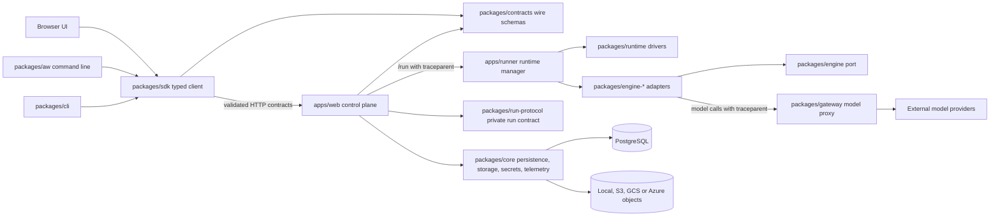
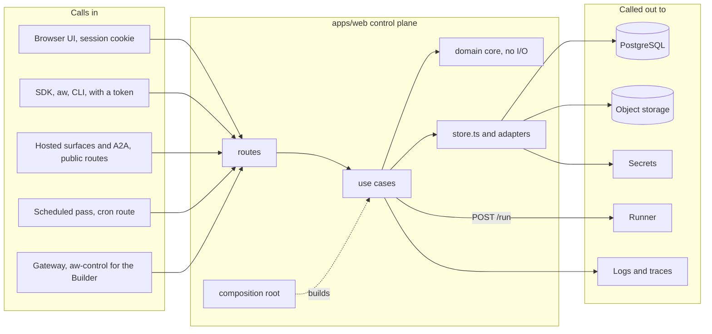
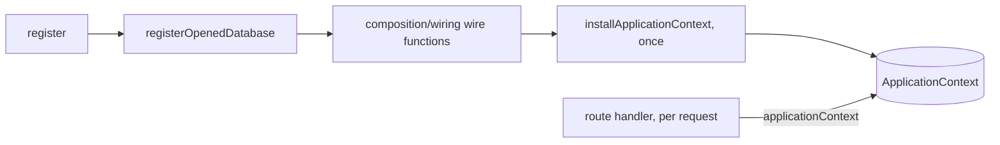

# Architecture

This document describes the architecture as it is and the rules a change is held to. Every rule
under [Dependency rules](#dependency-rules) and [Quality gates](#quality-gates) names the gate that
enforces it; a rule with no gate is not listed. Decisions and their reasons live in
[`docs/adr/`](adr/).

## System shape

Agent Workspace is a pnpm monorepo with two deployable applications and a set of supporting
packages. The web application is the control plane. The runner executes an agent inside a selected
runtime through an engine adapter. The gateway substitutes a short-lived run identity for a stored
provider credential. Core owns persistence, the object stores behind the storage catalog
([Storage](#storage)), secrets and the telemetry port; runtime owns the sandbox drivers; the engine port and its adapters own agent execution; run-protocol is the
private contract between the control plane, the runner and the adapters. Contracts publish the
control plane's wire schemas, the SDK is the typed client over them that the web application's
browser code and external integrations share, and `aw` is the operator's command line over the SDK.

## Repository ownership

| Area                          | Owns                                                                                                                                                           | Must not own                                                          |
| ----------------------------- | -------------------------------------------------------------------------------------------------------------------------------------------------------------- | --------------------------------------------------------------------- |
| `apps/web/app`                | Next.js routes, pages, route-level mapping                                                                                                                     | database queries, provider credentials, another route's logic         |
| `apps/web/components`         | browser rendering and interaction; each screen's `*-model.ts` request model                                                                                    | server runtime values, persistence records, raw `/api` requests       |
| `apps/web/server/<domain>`    | domain application operations; its `store.ts` adapter is the one file that may name persistence                                                                | unrelated domain registries, process-global wiring of its own         |
| `apps/web/server/composition` | the composition root: reads the environment, builds every domain, installs one application context                                                             | domain rules                                                          |
| `apps/runner`                 | private runtime-manager HTTP boundary and execution; `src/engines.ts` is the one file that names an adapter                                                    | web UI or durable control-plane state                                 |
| `packages/core`               | database repositories, secrets, storage, audit, the telemetry and tracing port                                                                                 | application composition or UI; any workspace package but `contracts`  |
| `packages/engine`             | the `AgentEngine` port, `agent.*` frame builders, path grants, the sandbox-environment contract; the conformance and adapter kits under its `/testing` subpath | any engine SDK, any application, any other package but `contracts`    |
| `packages/run-protocol`       | the private run contract: `RunRequest`, the agent configuration schemas, the Claude SDK event surface and its `agent.*` mapping                                | any I/O, `core`, any package but `contracts` and `engine`             |
| `packages/engine-<id>`        | one engine adapter: its root exports one factory, its internals are under `/testing`, exactly one file imports its SDK                                         | another adapter, `core`, a web route                                  |
| `packages/platforms`          | the `PlatformTarget` port, the per-field verdict model, the platform conformance kit (ADR-0133), pure and with no I/O                                          | any application, any I/O, any other package but `contracts`           |
| `packages/runtime`            | runtime driver interfaces and implementations, one `exports` subpath per driver                                                                                | any other workspace package                                           |
| `packages/gateway`            | authenticated provider routing and adapters                                                                                                                    | discovering credentials from process globals                          |
| `packages/cli`                | generator/startup orchestration                                                                                                                                | business rules duplicated from applications                           |
| `packages/contracts`          | published wire schemas and derived types of `/api/**`, and the closed vocabularies (run status, roles)                                                         | any workspace package, framework, or database                         |
| `packages/sdk`                | typed isomorphic client over the contracts                                                                                                                     | server implementations (`core`, `runtime`, `gateway`)                 |
| `packages/react`              | the hosted surface chat for customer pages                                                                                                                     | anything but the SDK and the contracts                                |
| `packages/aw`                 | the `aw` command line: argument parsing, output, exit codes                                                                                                    | anything but the SDK, the contracts and the pure platform translators |
| `packages/embedded`           | the local runtime, a bundle of the server with no importable API (ADR-0109)                                                                                    | being imported by any workspace package                               |

`packages/tool-host`, `packages/egress-proxy`, `packages/skills-office` and `packages/create` are
small leaves, each with its own dependency rule. Tests stay beside the unit they protect;
cross-package conformance and browser/e2e tests live under `tests/`. Infrastructure is under
`infra/`, deployment documentation under `docs/deploy/`, and architecture decisions under
`docs/adr/`.

## Ports and adapters

The same areas, seen as hexagons. Each area has one of five roles: a **driving adapter** calls in
(a route, a screen, a command line); the **application** runs a use case; a **core** decides, with
no I/O; a **driven adapter** is called out to (the database, object storage, a runner); a
**contract or port** is the shared language between them. The control plane is one hexagon:
callers come in through routes, a use case asks its domain's core for a decision, then calls the
adapters it needs. The runner and the gateway are hexagons of their own; the diagram shows them
from the control plane's side, where the gateway also calls in for the Builder. A change that adds
a component, a port, an adapter or a line of communication updates this section in the same pull
request.

The local launcher keeps its injected dependencies in `launcher-contract.ts` and ordered
resource release and interruption handling in `launcher-lifecycle.ts`. Its startup phases live in
`launcher-startup.ts`, project and port setup in `launcher-setup.ts`, and membership, profile and
credential preparation in `launcher-authorization.ts`. Cloud Run's driver uses
`cloud-run-admin.ts` for its REST adapter, `cloud-run-config.ts` for configuration validation,
`cloud-run-registry.ts` for service ownership and reuse, and `cloud-run-create.ts` for provisioning,
with the shared shapes in `cloud-run-contract.ts`.
The public route catalogue composes resource-family tables under `packages/contracts/src/routes/`;
its schema registry and body definitions remain independent of those tables. Project rendering
separates setup tools, model configuration, theme examples, starter content, TypeScript source
printing and package shell files from file assembly. These are internal modules within the existing package boundaries; no new port or
cross-package communication is introduced. Test fixtures use `.test-support.ts` modules and stay
out of production builds.

| Role             | Areas                                                                                                                                                                                        |
| ---------------- | -------------------------------------------------------------------------------------------------------------------------------------------------------------------------------------------- |
| Driving adapter  | `apps/web/app` (routes), `apps/web/components` (screens), `packages/sdk`, `packages/react`, `packages/aw`, `packages/cli`                                                                    |
| Application      | a domain's use cases in `apps/web/server/<domain>`, the composition root `apps/web/server/composition`, `apps/runner`                                                                        |
| Core             | a domain's `core/` folder (every top-level `apps/web/server/<domain>/core/` is checked, by `domain-core-is-pure`); `packages/platforms` (`platforms-are-pure`)                               |
| Driven adapter   | `packages/core`, a domain's `store.ts` and `adapters/`, the drivers in `packages/runtime`, the `packages/engine-*` adapters, `packages/gateway`, and the leaf packages                       |
| Contract or port | `packages/contracts`, `packages/run-protocol`, the `AgentEngine` port in `packages/engine`, the `RuntimeDriver` port in `packages/runtime`, the `PlatformTarget` port, a domain's `ports.ts` |

The composer's `HomeChat` screen composes `use-home-chat` session state, `home-chat-live` run
frames, `home-chat-controls` inputs and `home-chat-options` choices. These browser components
continue to call the SDK. `home-chat-approval` renders the shared `RunApproval` card while the
session hook follows approval continuations. Run launching stays within the runs application: `launcher` composes
preparation, execution, output relay and outcomes; the repository separates scoped creation,
lifecycle, accounting and queries under `packages/core/src/db/repositories/runs/`. Storage keeps
catalog decisions in `service` and its upload, save and read modules, with object I/O through its
existing object-store port. Run admission orders input validation, session preparation and refusal
mapping in `start-input`, `start-session`, `start-preparation` and `start-refusal`. The repository
adapter delegates durable replay to `repository-stream`, which uses narrow repository readers
and the shared replay-cursor policy. These internal modules add no cross-domain port or persistence access.

Resource screens keep file navigation, table rows, skills and connectors in separate browser modules,
with request state shared through `resource-screen-state`. Agent creation separates form state and
submission in `use-new-agent-form` from its reusable steps and mode switch. Skill handlers share
content decoding, metadata and description modules; `skill-patch` orders path checks, writes and
manifest recovery. Surface session composition separates preflight from session/key creation and
uses `deployment-origin` to extend production origin lists. Their existing SDK and storage ports
remain the boundaries. Focused test suites share explicitly named `.test-support.ts` fixtures.

The CLI keeps its deployment entry points stable while separating provider workflows. Project
orchestration delegates persisted state, prerequisites, Cloud Run image preparation, Kubernetes
configuration and managed GCP stacks to focused modules. GCP lifecycle operations separate state
backends, Terraform variables and plans, staged applies, secret storage, Vertex setup and guarded
destruction. Vercel and Cloudflare separate validated settings, deployment plans and provider
commands; both continue to execute external tools through the existing runner and step boundary.
Compose startup separates image resolution, environment validation, Docker commands, socket access
and host-port checks. Cloudflare rendering assembles named Worker template sections. These internal
modules retain the existing CLI APIs and dependency direction; focused test suites share typed
fixtures and preserve the deployment command and generated-artifact contracts.

The composition root keeps setup checks, persistence and rollback in named steps, and delegates
runtime verification to `runtime-verification`. The run resource loader composes file, storage,
skill, connector and project loading through its existing stores. Connector stores separate
credential replacement and compensation from wire mapping. Session RBAC resolves each token family
through the composition root's actor dependencies. RBAC's roles, permission table, declared
sub-resources, token scopes, conferral, the owner rule and `decideRoute` are its pure
`rbac/core/`; `rbac/decide.ts` classifies the path's surface (`auth/paths`) and passes the
verdict in. The agent-version memory adapter keeps shared
state, workspace queries and validated write transitions under `agent-versions/memory-store/`.
Docker keeps its argument policy, network setup and allocation lifecycle under `runtime/src/docker/`;
Kubernetes separates manifest construction (`runtime/src/kubernetes/resources.ts`) from driver
allocation and cleanup. External providers share handle state under `runtime/src/external/state.ts`;
E2B process framing and Vercel HTTP/error handling stay behind their provider adapters. Workspace
transfer separates path validation, ustar encoding, stream reading, transactional extraction and
file collection under `runtime/src/transfer/`, retaining the public `transfer.ts` entry point.
The folder object store separates
filesystem traversal from object operations. The gallery harness separates run frames, approval
recording, resource routing and triggers. These modules retain the existing ports and dependency
direction; their contract suites register focused behavior groups over shared fixtures. Release
packing delegates tar validation and consumer smoke checks to `package-tar`, `package-smoke`,
`consumer-process` and `boot-smoke` under `scripts/release/`.
The run launcher composition names its model preparation, storage lifecycle and completion
callbacks separately, with attachment transcription and launch-scoped resource tracking in internal
modules. Run preflight keeps its existing contract and refusal vocabulary while separating model
selection, target description and ordered queue checks. Its callers still use the same preflight
entry point. Attachment, cleanup, endpoint-client, agent-route and trigger test suites share typed
fixtures and register focused behavior groups; the BYO bucket tutorial and resume acceptance harness
name their setup, transport and execution phases. These extractions add no ports or cross-domain
communication.

Public-surface, session-state, connector, model-route, API-key, token-exchange and storage tests
register focused behavior groups over shared typed fixtures. Integration fixtures separate route
transport, database seeding and composition setup; the same cases still drive memory and PostgreSQL.
Run API wiring names credentials, feedback, evaluations and session operations separately. Setup
persistence orders model connection, runtime connection, profile and agent writes with their undo
entries; each model, profile and agent writer separates creation from updates. Connector stores
bind workspace-scoped query, credential and tool operations to the existing store contract. The runtime-manager client separates redacted errors, verification retries, allocation and
sandbox cleanup behind its existing API. These internal extractions add no cross-domain ports.

Run start keeps its public service entry point and separates typed start input, ordered preparation,
and refusal mapping. File handlers keep their existing exports while delegating path policy, resource
mapping, catalog reads, catalog mutations and download signing to focused modules. The repository
run store separates replay-cursor decisions from durable stream polling. The run acceptance harness
separates process supervision, its independent SSE client and proxy assertions. Builder, surface,
session, compose, OAuth, storage, authorization, runtime, project, invitation and connector tests
share typed fixtures through `.test-support.ts` modules, keeping registration order and database
lifecycle in their existing suite entry points. Formal run vectors separate scenario preparation
and assertions from their test catalogue. These extractions retain the existing ports and public
contracts and add no cross-domain communication.

Gallery benchmark contract cells name their assertion module; the evidence gate checks the suite
entry point, the same-gallery owner filename and the required test title.

The runner's HTTP entry points retain their public contracts. `apps/runner/src/manager.ts`
classifies manager requests; its context owns allocation maps and session locks. Allocation,
per-handle proxying, verification, tool endpoints and error mapping have separate modules that
consume that context. `manager-start.ts` composes provider-specific `manager-driver-*` modules and
shutdown handling. The runtime server delegates workspace archives to `server-files.ts` and run
admission, resource verification, engine execution, interruption and SSE output to their respective
`run-*` modules. Tool sandbox configuration, readiness and lifecycle operations share an explicit
sandbox context; provider credentials stay within those operations. These internal components add
no new external ports or communication paths.

The app recipe runner coordinates recording and scheduling, delegates lease-backed execution to
`recipe-runner-execution`, and delegates approval decisions and waiting-run checks to
`recipe-runner-approvals`, all over the existing recipe store and SDK ports. Claude's boundary
keeps the sole SDK import and delegates permission decisions and durability tracking to
`permissions` and `run-state`; Mastra similarly delegates stream observation and stop decisions to
its `run-state`. Portable conversion shares its context and drop-reporting contract through
`convert-contract`, maps exported tools in `convert-tools`, and imports portable definitions through
`convert-definition`. E2B delegates authenticated sandbox API calls and list/connect decoding to its
`e2b-client`, while retaining allocation cleanup at the provider boundary. The external driver
keeps session operations in `ExternalSessionDriver`, with hard and idle timeout calculations defined
once. E2B and Vercel providers coordinate their sandbox lifecycle through private lifecycle objects;
the returned provider and driver interfaces expose bound operations. The MCP repository keeps its workspace-bound SQL
operations in one adapter and its records and outcomes in `mcp-server-contract`, re-exported through
the existing repository entry point. These are internal modules; public entry points
and communication ports are unchanged. Focused gateway, Foundry, SDK, CLI, embedded database and project-schema tests share
fixtures without adding production adapters.

### Ports

| Port                         | Defined in                                               | Adapters                                                                         | Used by                                                             | Held to it by                                                |
| ---------------------------- | -------------------------------------------------------- | -------------------------------------------------------------------------------- | ------------------------------------------------------------------- | ------------------------------------------------------------ |
| `AgentEngine`                | `packages/engine/src/port.ts`                            | one per `packages/engine-*`                                                      | the runner, only through `apps/runner/src/engines.ts`               | the conformance kit in `@agent-workspace/engine/testing`     |
| `RuntimeDriver`              | `packages/runtime/src/driver.ts`                         | one per `./driver/*` subpath                                                     | the runner                                                          | each driver's tests                                          |
| `PlatformTarget`             | `packages/platforms/src/port.ts`                         | `packages/platforms/src/targets/`, listed in `registry.ts`                       | `aw`, the control plane and the CLI                                 | the platform conformance kit (ADR-0133)                      |
| `ObjectStore`                | `packages/core/src/storage/object-store.ts`              | local, S3, GCS, Azure, and memory for tests                                      | the storage catalog service                                         | one contract suite, `packages/core/src/storage/contract.ts`  |
| `CatalogPort` (storage)      | `packages/core/src/db/repositories/resource-catalogs.ts` | PostgreSQL, and `memory-catalog.ts` for tests                                    | the storage catalog service and the files domain                    | `resource-catalogs.contract.ts`, run against both            |
| `SessionStateBlobRepository` | `packages/core/src/db/repositories/session-state.ts`     | PostgreSQL, and `memory-session-state-blobs.ts` for tests                        | the storage catalog service, the sessions store and the cleanup job | `session-state-blobs.contract.ts`, run against both          |
| `SecretsService`             | `packages/core/src/secrets/service.ts`                   | the database, and in memory for tests                                            | the control plane and the gateway                                   | `packages/core/src/secrets/service.test.ts`                  |
| `Logger`                     | `packages/core/src/telemetry/logger.ts`                  | JSON lines                                                                       | web, runner and gateway                                             | `packages/core/src/telemetry/telemetry.test.ts`              |
| The Builder's ports          | `apps/web/server/builder/ports.ts`                       | a production and a memory adapter each, under `builder/adapters/<port>/`         | the Builder's use cases                                             | one `<port>.contract.ts` per port, run against both adapters |
| `<Domain>StoreProvider`      | `apps/web/server/<domain>/store.ts`                      | PostgreSQL, and in memory for tests                                              | that domain                                                         | `tests/store-conformance.test.ts`                            |
| `IdTokenKeySource`           | `apps/web/server/auth/token-exchange.ts`                 | discovery of `OIDC_ISSUER_URL` and its `jwks_uri`, and a local key set for tests | `POST /api/auth/token-exchange` (ADR-0161)                          | `apps/web/server/auth/token-exchange.test.ts`                |
| `Clock`                      | `apps/web/server/clock.ts`                               | `systemClock`, and `fixedClock` for tests                                        | the stale-run sweep, the local API key and webhook delivery         | `apps/web/server/clock.test.ts`                              |
| `IdGenerator`                | `apps/web/server/ids.ts`                                 | `randomIds`, and `counterIds` (valid UUIDs, counted) for tests                   | surface sessions                                                    | `apps/web/server/ids.test.ts`                                |

The Builder's ports are `ApprovalPort`, `AuthorizationPort`, `PolicyPort`, `AuditPort`,
`CheckerPort`, `RunnerPort`, `CatalogPort` and `AgentStorePort`. Its `CatalogPort` (the names and
ids the Builder may offer) is not the storage `CatalogPort`; the two share a name only.

### How components talk

Every line is HTTP or a port call, and each carries a typed contract. A value that arrives over
one of them is `unknown` until a schema checks it ([Runtime and trust boundaries](#runtime-and-trust-boundaries)).

| From                 | To              | How, and what it carries                                                                                                                           |
| -------------------- | --------------- | -------------------------------------------------------------------------------------------------------------------------------------------------- |
| Browser              | control plane   | HTTPS `/api/**` through the SDK with the session cookie; every answer is validated against the contracts                                           |
| `aw`, SDK users, CLI | control plane   | the same SDK over HTTPS, with a token                                                                                                              |
| Browser              | object storage  | a file above `MAX_UPLOAD_BYTES` (64 MiB): a signed upload link, then an `upload-complete` call                                                     |
| Control plane        | PostgreSQL      | `packages/core` repositories, through a domain's `store.ts` (older imports elsewhere are a baseline)                                               |
| Control plane        | object storage  | `ObjectStore`, streamed, through the storage catalog service, the only way in (a dependency rule)                                                  |
| Control plane        | runner          | `POST /run` with a `RunRequest`, a bearer token when one is set, and `traceparent`                                                                 |
| Runner               | control plane   | the `agent.*` frames, as server-sent events on the same response; each frame's `id` is the resume cursor                                           |
| Runner               | sandbox         | one `RuntimeDriver`                                                                                                                                |
| Engine adapter       | gateway         | model calls with the short-lived run identity and `traceparent`                                                                                    |
| Agent tools          | gateway         | `POST /v1/tools/:connectorId/mcp` and `POST /v1/tool-sandbox/mcp`                                                                                  |
| Gateway              | control plane   | `POST /v1/tools/aw-control/mcp`, forwarded to `/api/builder/mcp` with only the run token, the body capped at 4 MiB                                 |
| Gateway              | model providers | provider HTTP with the stored credential                                                                                                           |
| Control plane        | OIDC issuer     | discovery and the `jwks_uri` of the one configured `OIDC_ISSUER_URL`, to verify an app's ID token (ADR-0161); never a URL from the token           |
| Local control plane  | `aw dev` issuer | the same, over `http:` to `127.0.0.1` in the local posture only; production refuses a non-`https:` issuer at boot (ADR-0161, 2026-11-01 amendment) |
| Every server process | logs and traces | one JSON line per event through the `Logger` port; W3C `traceparent` joins web, runner and gateway                                                 |

### Where the code does not match yet

- Some domain files still name persistence outside `store.ts`: the
  `domain-does-not-import-persistence` baseline in `.dependency-cruiser-known-violations.json`.
- Some files still read `process.env` outside the composition root: the `no-restricted-properties`
  entries in `eslint-suppressions.json`.

Each of these may only shrink ([Quality gates](#quality-gates)).

## Composition

`apps/web/server/composition/register.ts` is the composition root. Next.js calls `register()` once
per server process. It reads the environment and opens the database; `registerOpenedDatabase` then
calls the plain `wire<Domain>` functions in `composition/wiring/` (agents, subsystems, run
resources, run runtime, projects and shares, and the run domains), each of which returns its domain
fully built. When everything is built, the root calls `installApplicationContext` **once** with one
`ApplicationContext` (`apps/web/server/application-context.ts`) that holds every domain. A route
never sees a half-composed context: if wiring throws, nothing is installed and the database pools
opened so far are closed.

- **A domain that can be off says so in its type.** The domains that need a run runtime (`runs`,
  `a2a`, `toolEndpoint`, `tokens`, `triggers`, `surfaces`) are `serving | disabled`; with no runner
  configured all six are `disabled` together. The domains that need configuration or storage
  (`secrets`, `models`, `connectors`, `runtimes`, `files`, `skills`, `setup`) are
  `serving | unavailable`. No context at all means no session secret or no reachable database.
- **Readers read per request and fail closed.** A route reads `applicationContext()`, or a domain
  reader such as `getRunApi()`, on every request, and answers its domain's named `503` when the
  context is missing or the domain is not `serving`. There is no silent fallback to in-memory
  stores. Files, skills, attachments and run delivery read and write only through the catalog
  service; a `files` domain without it is `unavailable`, never served from a path-based store.
- **Process-global state is declared only with `defineSlot`** (`apps/web/server/runtime-slot.ts`),
  because Next.js compiles `instrumentation.ts` and the route handlers into separate module graphs;
  ESLint rejects a hand-written `globalThis` property. Besides the context, eight slots hold
  process-local state that is not domain wiring:

  | Slot (under `apps/web/server/`)   | Why it is process-local                                                          |
  | --------------------------------- | -------------------------------------------------------------------------------- |
  | `composition/held-composition.ts` | the close handle `start.ts` uses to release the pools: process lifecycle         |
  | `runs/interrupt.ts`               | the live runs this process launched, written per run                             |
  | `telemetry/runtime.ts`            | a bounded map of per-run trace attributes, written per run                       |
  | `engines/images.ts`               | the engine-image map parsed from the environment, shared with the runner         |
  | `engines/registry.ts`             | extra engine descriptors registered by tests; the built-in engines are constants |
  | `runtimes/registry.ts`            | live driver instances and the map that de-duplicates renewals                    |
  | `setup/runtime-detection.ts`      | a time-boxed cache of the runtime-detection promise                              |
  | `triggers/schedule-cron.ts`       | the cron-pass handle, installed only where `CRON_SECRET` is set                  |

  A new `defineSlot` that holds composed domain wiring is a review finding: that domain belongs in
  `ApplicationContext`.

## Storage

Stored bytes live in one object store, chosen by one setting. Files, skills, chat attachments and
run delivery also keep their names in one catalog
([ADR-0153](adr/0153-object-storage-one-key-layout-catalog-first-writes-references-not-bytes.md)).
There are three layers:

- **The catalog service** (`apps/web/server/storage/service.ts`) is the only way those four read or
  write a stored object. Routes and domains call it, never a backend; a domain without it is
  `unavailable` and its routes answer `503`.
- **Two ports** sit under it. `CatalogPort` holds the rows: a PostgreSQL version and an in-memory
  version, both held to `resource-catalogs.contract.ts`; locks and concurrency are proven on
  PostgreSQL only. `ObjectStore` holds the bytes, with one backend per URL scheme, each held to
  `packages/core/src/storage/contract.ts`.
- **The adapters** are the PostgreSQL repositories and the backends in `packages/core/src/storage/`.
  `openObjectStore` imports only the backend the URL names, so a local install never loads a cloud
  library, and wraps it in the scoped store that bounds a signed link's lifetime.

Every save is row-first. The catalog reserves a `pending` row under a new object id, the bytes are
streamed to `workspaces/<workspace id>/<area>/<object id>` (built only by `storageObjectName`), and
one transaction confirms the row as `ready` with the size and checksum measured on the way. A
replaced or removed row becomes `deleting` until its object is gone; the cleanup job reports what a
crash left, and in `delete` mode removes it. Only a `ready` row is listed, searched or granted, and a rename changes the row alone.
A signed-link upload takes the same steps, with `upload-complete` as the confirm.
A session-state blob keeps its own row (`session_state_blobs`) and takes the same steps: the row
waits under a side key while it is `pending` or `deleting`, and its confirm checks the same
reservation token.

A run receives references, not bytes: the `RunRequest` lists each granted file's path, mode, size
and checksum, the control plane streams the files to the runner as one archive, and the runner
checks every checksum before the engine starts.

`AW_STORAGE_URL` (`s3://`, `gcs://`, `azblob://` or `file://`) is the one location setting. It is
parsed once, by `parseStorageUrl` in `packages/contracts/src/storage-url.ts`, for the server and the
CLI alike, and it never carries a credential.

## Dependency rules

The direction is delivery (routes, screens, `aw`) → application/domain → ports → infrastructure
adapters, with the wire contracts underneath everything: core, engine, platforms and sdk depend on
contracts; run-protocol on contracts and engine; the adapters on engine and contracts (the Claude
adapter also on run-protocol); react, aw and cli on sdk. Each rule below is a dependency-cruiser
rule in [`dependency-cruiser.config.mjs`](../dependency-cruiser.config.mjs), checked by
`pnpm architecture:check`, unless another gate is named.

| Rule                                                                                                                          | What it enforces                                                                                                                                                                                                                                                                                                                        |
| ----------------------------------------------------------------------------------------------------------------------------- | --------------------------------------------------------------------------------------------------------------------------------------------------------------------------------------------------------------------------------------------------------------------------------------------------------------------------------------- |
| `libraries-do-not-import-applications`                                                                                        | no package imports `apps/*`                                                                                                                                                                                                                                                                                                             |
| `contracts-depend-on-nothing-in-the-workspace`                                                                                | the contracts are consumable outside this repository ([ADR-0052](adr/0052-the-sdk-is-contracts-first-and-the-application-is-its-first-consumer.md), [SDK structure map](sdk/07-structure-map.md))                                                                                                                                       |
| `sdk-depends-only-on-contracts`, `react-depends-only-on-sdk-and-contracts`, `cli-depends-only-on-sdk-and-contracts`           | the published client packages never reach a server-side package                                                                                                                                                                                                                                                                         |
| `aw-depends-only-on-sdk-and-contracts`, `aw-reaches-cli-only-through-the-cli-bridge`                                          | `aw` reaches the SDK, the contracts and the pure platform translators; `packages/aw/src/cli-bridge.ts` alone loads the CLI's `deploy` and `publish` by dynamic `import()` ([ADR-0103](adr/0103-one-project-file-holds-every-environment.md), [ADR-0133](adr/0133-one-portable-agent-definition-exports-to-many-agent-platforms.md) D11) |
| `core-depends-only-on-contracts`                                                                                              | core is persistence, storage, secrets and telemetry; the run protocol and the engine port are not its business                                                                                                                                                                                                                          |
| `run-protocol-depends-only-on-contracts-and-engine`                                                                           | the private run contract carries no I/O and no database                                                                                                                                                                                                                                                                                 |
| `engine-port-depends-only-on-contracts`                                                                                       | the port is types and pure functions                                                                                                                                                                                                                                                                                                    |
| `engine-adapters-depend-only-on-the-port-and-contracts`, `claude-adapter-depends-only-on-the-port-contracts-and-run-protocol` | an adapter sees the port, the contracts and its own SDK (the Claude adapter also run-protocol), never `core` or another adapter                                                                                                                                                                                                         |
| `engine-testing-subpaths-are-for-tests`                                                                                       | only tests import `@agent-workspace/engine/testing` or an adapter's `/testing` (conformance kit, adapter internals); an adapter's root exports one factory                                                                                                                                                                              |
| `web-does-not-import-an-engine-adapter`, `runner-reaches-engine-adapters-only-through-engines-ts`                             | the control plane knows engines only through the contracts; the runner names adapters in `apps/runner/src/engines.ts` alone                                                                                                                                                                                                             |
| `runtime-depends-on-nothing-in-the-workspace`                                                                                 | the in-sandbox layer drags nothing into a run image; each driver is its own subpath (`./driver/docker`, `./driver/kubernetes`, …), so an optional driver loads only when selected                                                                                                                                                       |
| `gateway-depends-only-on-core-and-contracts`                                                                                  | the gateway never reaches the runtime, an engine or an application                                                                                                                                                                                                                                                                      |
| `platforms-depend-only-on-contracts`, `platforms-are-pure`                                                                    | translators run in a browser, the control plane or `aw`: no Node built-in outside `src/testing/`; npm imports are held to `contracts`, `zod` and `yaml` by `packages/platforms/src/dependencies.test.ts`                                                                                                                                |
| `egress-proxy-…`, `tool-host-…`, `skills-office-…`, `create-depends-only-on-cli`, `nothing-imports-embedded`                  | the leaf packages' own boundaries                                                                                                                                                                                                                                                                                                       |
| `browser-ui-does-not-import-server-values`, `browser-ui-does-not-import-persistence`                                          | `apps/web/components` never imports `apps/web/server` or `core/db`                                                                                                                                                                                                                                                                      |
| `web-contracts-do-not-import-persistence`                                                                                     | a domain's `contract.ts` (and `projects/resource.ts`) never names a database record                                                                                                                                                                                                                                                     |
| `routes-do-not-import-routes`                                                                                                 | shared route logic lives in a server domain; baseline 0                                                                                                                                                                                                                                                                                 |
| `app-does-not-import-core`                                                                                                    | `app/**` reaches persistence through server domains; baseline 1                                                                                                                                                                                                                                                                         |
| `only-the-s3-boundary-imports-the-s3-sdk`                                                                                     | only `core/src/storage/s3-store.ts` and the CLI bucket probe `cli/src/validate.ts` (ADR-0082) import the S3 libraries; tests, `.live.` and `.acceptance.` files may (the storage design, §07 rule 1)                                                                                                                                    |
| `only-the-gcs-boundary-imports-the-gcs-sdk`                                                                                   | only `core/src/storage/gcs-store.ts` and `cli/src/validate.ts` import `@google-cloud/storage`; tests, `.live.` and `.acceptance.` files may                                                                                                                                                                                             |
| `only-the-azure-boundary-imports-the-azure-sdk`                                                                               | only `core/src/storage/azure-blob-store.ts` imports `@azure/storage-blob`; tests, `.live.` and `.acceptance.` files may; `@azure/identity` is a credential library and is not covered                                                                                                                                                   |
| `raw-storage-backends-stay-in-core-storage`                                                                                   | only `core/src/storage/` imports `s3-store.ts`, `gcs-store.ts` or `azure-blob-store.ts`, whose raw factories sign links with no expiry bound; tests may                                                                                                                                                                                 |
| `storage-backends-are-for-tests`                                                                                              | only tests import `@agent-workspace/core/storage/backends`, which loads the Azure and Google Cloud libraries; production opens a store with `openObjectStore`                                                                                                                                                                           |
| `memory-catalog-store-is-for-tests`                                                                                           | only tests import `resources/catalog-store.memory.ts`; production wires the PostgreSQL catalog store (the storage design, §07 rule 4)                                                                                                                                                                                                   |
| `app-does-not-import-storage-adapters`                                                                                        | `app/**` never value-imports a domain `store.ts` or `composition/storage.ts`; type-only imports are allowed; baseline 0 (the storage design, §07 rule 2)                                                                                                                                                                                |
| `only-the-catalog-service-reaches-object-storage`                                                                             | a domain reaches object storage through `apps/web/server/storage/`, never `core/src/storage`, even type-only; the pure helpers (content type, key safety, object name), the composition root and tests may; `tool-bundles/` is a named exception (not workspace files); baseline 0 (the storage design, §07 rule 3)                     |
| `domain-does-not-import-persistence`                                                                                          | only a domain's `store.ts` names `core/db`; baseline 44, 18 of them in the composition root                                                                                                                                                                                                                                             |
| `context-<name>-imports-only-upstream`, `shared-kernel-imports-no-context`, `no-context-imports-the-composition-root`         | the server's contexts depend in one direction, built from [`apps/web/server/contexts.json`](../apps/web/server/contexts.json) (see "Server contexts" below); baseline 73                                                                                                                                                                |
| `context-<name>-entered-through-its-entry`                                                                                    | another context imports a context that names an entry through that one file, not the folders underneath (part 04, step 7); baseline 14 for identity, 1 for evaluations, 0 for secrets, 17 for agents, 22 for execution, 9 for integrations, 21 for storage and sharing                                                                  |
| `domain-core-is-pure`                                                                                                         | a domain's `core/` imports only its own `core/`, `packages/contracts` and zod, even type-only (AGENTS.md hexagonal rule 2); every core, none left out (refactoring plan part 05); no baseline                                                                                                                                           |
| `production-does-not-import-tests`, `no-unresolved-imports`                                                                   | production code never imports a test module; every internal import resolves                                                                                                                                                                                                                                                             |
| `no-circular-dependencies` and the two schema-cycle rules                                                                     | no cycles except two Drizzle foreign-key cycles, each limited to its two schema modules: `workspaces.ts` ↔ `model-connections.ts` and `agents.ts` ↔ `agent-versions.ts`                                                                                                                                                                 |
| one SDK file per engine (`tests/no-sdk-import.test.ts`)                                                                       | each third-party engine SDK is imported by exactly one file, checked as a set equality and against the emitted declarations; `packages/embedded/package.json` may list SDKs only at the owning engine's pin                                                                                                                             |
| closed vocabularies (`tests/duplicate-vocabulary.test.ts`)                                                                    | run statuses, roles and the other vocabularies `packages/contracts` owns are not re-declared; the four-entry allowlist may only shrink                                                                                                                                                                                                  |
| package entry points (`pnpm package-exports:check`)                                                                           | manifest targets exist, no wildcard exports, no TypeScript runtime targets, no reaching into another package's source; `tsconfig.architecture.json` names only the declared subpaths                                                                                                                                                    |

The baseline rules ignore exactly the entries in `.dependency-cruiser-known-violations.json`,
and `tests/architecture-rules.test.ts` holds a ceiling per rule: a new violation fails, and a fixed
one must be removed from the file and the ceiling lowered. The same test holds
`only-the-catalog-service-reaches-object-storage` at a ceiling of 0, so it can never gain an entry.

### Server contexts

The folders in `apps/web/server/` group into seven bounded contexts, a shared kernel and the
composition root. The contexts are listed upstream first, and dependency-cruiser holds the direction:
a context imports the shared kernel and the contexts above it (`context-<name>-imports-only-upstream`),
the shared kernel imports no context (`shared-kernel-imports-no-context`), and only `composition/`
may import every context (`no-context-imports-the-composition-root`). The rules are built from the
data, so moving a folder is a one-line change. The imports against the direction when the rules
landed are baseline entries that can only shrink (73, see the ceilings in
`tests/architecture-rules.test.ts`). The data is
[`apps/web/server/contexts.json`](../apps/web/server/contexts.json); `tests/server-contexts.test.ts`
fails when a server folder is in no entry or in two, or when this table and the data differ.

A context can also name one public entry (part 04, step 7). Identity's is
[`apps/web/server/identity/index.ts`](../apps/web/server/identity/index.ts): another context
imports identity from there, not from `auth/`, `rbac/`, `oauth/` and the other folders underneath,
and `context-identity-entered-through-its-entry` refuses a new deep import. The entry re-exports
only modules without start-up work, so importing it loads no application context and nothing
Next.js-only; the 14 deep imports left when it landed (into `rbac/http.ts`, `auth/index.ts`,
`oauth/resource.ts` and three other modules) are baseline entries that can only shrink. Tests,
`composition/` and identity's own modules import the modules directly; route handlers in `app/` and
the files at the root of `server/` are outside the context map and not covered.

The other contexts get their entry the same way, one per change; each entry's comment lists the
deep imports it leaves and why:

| Context             | Entry                          | Deep imports left |
| ------------------- | ------------------------------ | ----------------- |
| identity            | `identity/index.ts`            | 14                |
| evaluations         | `evaluations/index.ts`         | 1                 |
| secrets             | `secrets/index.ts`             | 0                 |
| agents              | `agents/index.ts`              | 17                |
| execution           | `execution/index.ts`           | 22                |
| integrations        | `integrations/index.ts`        | 9                 |
| storage and sharing | `storage-and-sharing/index.ts` | 21                |

<!-- server-contexts:start -->

| Context             | Folders in `apps/web/server/`                                                                                                                     |
| ------------------- | ------------------------------------------------------------------------------------------------------------------------------------------------- |
| shared kernel       | `audit`, `features`, `http`, `openapi`, `pagination`, `telemetry`, `versioning`                                                                   |
| identity            | `auth`, `cli-auth`, `identity`, `invitations`, `oauth`, `rbac`, `setup`, `team`, `tokens`, `workspaces`                                           |
| secrets             | `secrets`                                                                                                                                         |
| storage and sharing | `files`, `shares`, `storage`, `storage-and-sharing`, `storage-connections`, `surfaces`                                                            |
| execution           | `engines`, `execution`, `runs`, `runtimes`, `sessions`, `usage`                                                                                   |
| integrations        | `a2a`, `connectors`, `endpoint-clients`, `endpoints`, `gateway`, `integrations`, `models`, `tool-endpoint`, `triggers`, `webhooks`                |
| agents              | `agent-teams`, `agent-versions`, `agents`, `builder`, `compose`, `platforms`, `policy-ceiling`, `projects`, `resources`, `skills`, `tool-bundles` |
| evaluations         | `evaluations`                                                                                                                                     |
| composition root    | `composition`                                                                                                                                     |

<!-- server-contexts:end -->

### CLI project loading and local synchronization

`packages/aw/src/project/load.ts` coordinates discovery, the loader child, Markdown conversion,
and assembly. Their sibling modules own those steps; `load-types.ts` carries the shared result
contract, and the original loader exports remain the entry point for callers. Assembly collects
agents, attaches surfaces, then validates bodies and registers tools in that order.

`dev/sync.ts` owns watcher scheduling and cancellation. `sync-project-file.ts` owns project-file
reload state, and `sync-report.ts` owns session output and removed-agent notices. The dev command
keeps process lifetime and cleanup; `commands/dev-session.ts` handles signed-in startup.

Local resource application separates model checks, tool application, request delivery, and secret
fingerprint persistence. Both model and tool application record a fingerprint only after every
send naming that secret succeeded. These modules remain CLI adapters over the SDK.

## Browser boundary

Browser code reaches `/api/**` one way: a screen calls its `*-model.ts`, the model calls
`browserClient()` (`apps/web/lib/browser-client.ts`), and that is `@indx-workspace/sdk` on the
page's own origin with the session cookie. The SDK states the contracts version, encodes path
segments, validates every response against the contract and decodes problems into typed errors, so
a screen hand-writes none of it.

An ESLint rule rejects a raw `fetch('/api…')` in `components/**`, `app/**/*.tsx` and `lib/**`, and
`apps/web/components/raw-fetch-budget.test.ts` counts every raw network call there against an exact
per-file budget that may only go down. Four files remain:

| File (under `apps/web/components/`)                 | Why it is still a raw request                                                                                   |
| --------------------------------------------------- | --------------------------------------------------------------------------------------------------------------- |
| `setup/setup-wizard.tsx`                            | the setup wizard runs before anyone has signed in, so there is no session for the client to use                 |
| `shares/public-message-form.tsx`                    | it posts to the public visitor route `/p/<token>/messages`, which is not part of `/api/**`                      |
| `runtimes/model.ts`, `runtimes/runtimes-screen.tsx` | `POST /api/runtimes/test` stays raw until server change S-4 gives it the standard envelope and the SDK a method |

## Runtime and trust boundaries

Every value entering through HTTP, provider JSON, environment/configuration, persisted JSON, or an
external process is `unknown` until validated. Schemas are the source of truth for reusable wire
contracts. Persistence records are mapped explicitly to JSON resources, including `Date` to ISO-8601
conversion. Extensible third-party protocols may preserve unknown keys after validating fields the
application consumes; owned APIs reject unknown keys. The environment is read once, in a
composition root or entry point, and injected (ESLint `no-restricted-properties` on `process.env`,
with a per-file baseline).

Authorization happens before a workspace-scoped repository or projection is read. A browser sign-in session proves
identity; RBAC proves permission; a repository scope proves tenant selection. None substitutes for
another. The metrics route is the reference pattern: resolve resource access, take the authorized
workspace id, then filter the service-side projection. Roles are monotonic: in the order Owner,
Admin, Builder, Viewer, each role holds at least every grant of the roles after it, and conferral
dominance is the formal `Grant.le` order ([ADR-0152](adr/0152-roles-are-monotonic.md)). A session
share publishes only the turns its owner selected, copied by the server from that session's own
runs ([ADR-0158](adr/0158-a-session-share-publishes-a-chosen-selection-of-its-own-turns.md)).

### Identity and access

A request is checked in three places, and each does one job:

1. `apps/web/proxy.ts` (the edge) checks that a credential of the right shape is present for the
   path, and that a session cookie is validly signed. It does not decide what the caller may do.
2. The route resolves the credential into a `Principal` (`resolveActor` in
   `apps/web/server/composition/session-rbac.ts`), using the adapter for that credential.
3. `decide()` (`apps/web/server/rbac/decide.ts`, with the pure rules in `rbac/core/`) answers
   whether that role may use this method on this path.

The web app's signing keys are derived from `SESSION_SECRET` with HKDF and a purpose label
(`apps/web/server/auth/core/key-ring.ts`), so a token signed for one purpose is refused for every
other. The run token is signed with the gateway's own `GATEWAY_TOKEN_SECRET`. Bearer secrets are
stored only as a SHA-256 hash and looked up by that hash.

| Credential                                                        | Lifetime                                        | Stored as                                  | Can be revoked                             | Adapter                                                                    |
| ----------------------------------------------------------------- | ----------------------------------------------- | ------------------------------------------ | ------------------------------------------ | -------------------------------------------------------------------------- |
| Session cookie (password or OIDC sign-in)                         | 12 h                                            | not stored; signed cookie                  | no; sign-out clears it                     | `apps/web/server/auth/session.ts`, rules in `auth/core/`                   |
| Workspace selection cookie                                        | 10 min                                          | not stored; signed cookie                  | no                                         | `apps/web/server/auth/selection.ts`                                        |
| Invitation identity cookie                                        | 10 min                                          | not stored; signed cookie                  | no                                         | `apps/web/server/auth/invitation-identity.ts`                              |
| OIDC sign-in transaction                                          | 10 min                                          | not stored; signed JWT (`jose`)            | no                                         | `apps/web/server/auth/oidc.ts`                                             |
| API key `ak_live_`                                                | until its expiry                                | hash                                       | yes                                        | `apps/web/server/rbac/api-key.ts`                                          |
| CLI token `awu_live_` (device flow; the device code lasts 10 min) | 12 h                                            | hash                                       | yes                                        | `apps/web/server/rbac/cli-token.ts`, `apps/web/server/cli-auth/`           |
| OAuth code / access `awo_live_` / refresh                         | 1 min / 1 h / 30 d                              | hash                                       | yes; a replayed refresh revokes its family | `apps/web/server/oauth/` (client check in `client-auth.ts`)                |
| Token exchange (an IdP ID token for an OAuth access token)        | as the OAuth access token                       | hash                                       | yes                                        | `apps/web/server/auth/token-exchange.ts`                                   |
| Browser token `awt_live_` (also surface visitors)                 | 1–60 min, 5 min by default                      | hash                                       | yes                                        | `apps/web/server/rbac/browser-token.ts`                                    |
| Run token (runner to gateway)                                     | 5 min, at most 1 h                              | not stored; signed, plus an active run row | yes, by ending the run                     | `packages/gateway/src/tokens/run-token.ts`                                 |
| Public share link `pub_`                                          | 24 h, 7 days, 30 days or never                  | hash; the full link is shown once          | yes                                        | `apps/web/server/shares/`                                                  |
| Invitation token; trigger secret                                  | until used or expired; while the trigger exists | hash                                       | yes                                        | `apps/web/server/invitations/token.ts`; `apps/web/server/triggers/fire.ts` |

An A2A agent endpoint takes an API key or an OAuth access token (`apps/web/server/a2a/dispatch.ts`),
so it adds no credential of its own.

Web Crypto is the default for this code. Two places use `node:crypto` because they run
synchronously in Node: the CLI device code (`apps/web/server/cli-auth/device-code.ts`) and the
share visitor key (`apps/web/server/shares/runnable/visitor-identity.ts`). Both derive the same key
bytes as the Web Crypto path, and a test holds the two equal. The session cookie is not a JWT; the
OIDC sign-in and the token exchange verify the identity provider's JWTs with `jose`, because that
is the format the provider sends.

### Runs

A run is a row in `runs`; its status vocabulary comes from `packages/contracts`.

- **Idempotent start.** `POST /api/agents/:id/runs` accepts an `Idempotency-Key`. The key is stored
  prefixed with the acting principal and is unique per workspace; beside it is the SHA-256 of the
  canonical request (the agent id and the parsed body with every object's members sorted, arrays in
  order). A replay with the same hash returns the original run whatever its status; a different
  request under the same key answers `409 run_idempotency_conflict`
  ([ADR-0151](adr/0151-a-stopped-run-holds-no-lease-and-run-start-is-idempotent.md)).
- **A paused run holds nothing.** `awaiting_approval` is a stopped, non-final status
  ([ADR-0145](adr/0145-a-run-stops-for-approval-or-handoff-and-continues-in-its-session.md)). The
  update that pauses a run stores `approval_deadline_at`, 24 hours later; a decision after the
  deadline cancels the run instead.
- **One continuation per paused run.** An approval decision completes the paused run and inserts a
  new run whose `continues_run_id` points at it; a unique index makes a second continuation
  impossible. The continuation acts for the paused run's subject
  ([ADR-0157](adr/0157-an-approval-continuation-acts-for-the-paused-runs-subject.md)).
- **Approvals are consumed durably.** `approvals_consumed_at` is stamped by the update that moves
  the continuation out of `queued`, before the runner is sent anything, and a check constraint
  refuses to queue it again, so an accepted continuation is never retried. Each approved call is
  added to `consumed_tool_calls` by one guarded update, so it runs at most once however many callers
  race for it.
- **Not yet built:** a run-attempt row and a renewable launch lease. Interrupting a live run reaches
  only the replica that launched it (cross-replica interrupt is issue #261), and orphaned runs are
  failed by a stale sweep that one replica at a time runs under a database lease.

### Observability

Server processes log one JSON object per line through the logger port in
`@agent-workspace/core/telemetry`, with `service` `web`, `runner` or `gateway`; field values are
redacted and `msg` is a fixed string. `no-console` is an ESLint error in `apps/web/server`,
`apps/web/app`, `apps/runner/src` and `packages/gateway/src`.

Trace context is W3C `traceparent`, parsed strictly. The web control plane forwards its active
span's `traceparent` on runtime requests; the runner adopts a valid one, binds its `traceId` to the
request's log lines and hands it to the engine, so every model call to the gateway carries it; the
gateway adopts it at its edge, or starts a fresh trace. A trace id is for correlation only, never
for authorisation, tenancy or billing. OpenTelemetry export is on only when
`OTEL_EXPORTER_OTLP_ENDPOINT` is set, in the web app, the runner and the gateway alike, with no
auto-instrumentation ([ADR-0155](adr/0155-server-processes-log-json-lines-and-join-a-w3c-trace-for-correlation.md)).

## Error boundary

Parsers and domain operations produce stable expected failures. HTTP adapters translate those to a
documented status and error code; one route wrapper (`apps/web/server/http/route.ts`) renders every
error envelope. Infrastructure and programming failures retain their cause, are observable, and
remain 5xx; raw external messages are never returned to a client. Cleanup is part of the operation
and its failure must be retained even when a primary failure already exists; an ESLint rule rejects
a discarded cleanup failure.

## Quality gates

`main` takes changes only through a pull request and a merge queue, so every merge is tested
against the latest `main` before it lands. The required checks are `CI success` and
`OSS export · dry run`
([ADR-0149](adr/0149-main-requires-a-pull-request-and-the-ci-success-gate.md) and its amendment).
`CI success` depends on every other CI job and fails on one that was skipped or cancelled; a new
required job is added to its `needs`. Every workflow that produces a required check runs on
`merge_group`, which `pnpm workflows:check` enforces. Locally, `pnpm check:fast`, `pnpm test` and
`pnpm build` run the same gates.

Each ratchet below moves in one direction only.

| Gate                      | What it enforces                                                                                                                                                                                                                | Where it lives                                                                                                                         |
| ------------------------- | ------------------------------------------------------------------------------------------------------------------------------------------------------------------------------------------------------------------------------- | -------------------------------------------------------------------------------------------------------------------------------------- |
| Architecture boundaries   | the dependency rules above; the baseline rules may only shrink, under per-rule ceilings                                                                                                                                         | `pnpm architecture:check`, `tests/architecture-rules.test.ts`                                                                          |
| ESLint suppressions       | known violations are listed per file and rule; ESLint fails a file above its count, and CI fails a baseline that grows for any file and rule                                                                                    | `eslint-suppressions.json`, `scripts/check-lint-baseline.mjs`                                                                          |
| Domain core globals       | a `<domain>/core/` file reads no clock, `Math.random`, `process`, `fetch` or other network globals, `crypto`, `performance`, timers or the global object (`globalThis`, `window`, `self`); one baseline file may read the clock | `eslint.config.mjs`, `tests/lint-baseline.test.ts`                                                                                     |
| No new suppressions       | a diff adds no `ts-ignore`, `ts-expect-error` or `eslint-disable`                                                                                                                                                               | CI fast checks                                                                                                                         |
| Raw-fetch budget          | browser raw network calls match an exact per-file budget that only goes down                                                                                                                                                    | `apps/web/components/raw-fetch-budget.test.ts`                                                                                         |
| Complexity ceiling        | the ESLint `complexity` maximum equals the measured maximum of production code, so it drops when a hotspot is simplified                                                                                                        | `pnpm complexity:check`                                                                                                                |
| Clock ceiling             | direct clock and random-id calls in server code, renamed imports too (no stores, composition, tests; not secret-making `getRandomValues`/`randomInt`) equal `scripts/clock-ceiling.json`; CI refuses a raise                    | `pnpm clock:check`, `scripts/clock-ceiling.mjs`, `tests/lint-baseline.test.ts`                                                         |
| Duration ceiling          | bare durations, sizes and limits (`1_000` or more, separator or not; not hex, negated or `Date.UTC`; not a `const` initializer) in server, runner and gateway code equal `scripts/duration-ceiling.json`; CI refuses a raise    | `pnpm durations:check`, `scripts/duration-ceiling.mjs`, `tests/lint-baseline.test.ts`                                                  |
| Coverage floors           | three suites (critical packages, apps, UI and CLI) meet their floors, and no floor is lower than on the base                                                                                                                    | `scripts/check-coverage-ratchet.mjs`, CI coverage jobs                                                                                 |
| Public API reports        | an API Extractor report of every exported subpath of contracts, sdk, react and aw is committed and current, so a breaking change is a visible diff                                                                              | `docs/sdk/api/`, `pnpm docs:check` (`pnpm api:update` regenerates)                                                                     |
| Formal specification      | the Lean model builds with no `sorry` or extra axiom, its layers point one way, every `file#symbol` citation resolves, and its vectors replay against TypeScript                                                                | `pnpm formal:check`, CI `formal` job ([ADR-0062](adr/0062-the-specification-is-a-lean-4-model-and-typescript-is-tested-against-it.md)) |
| Storage story coverage    | every storage story × entry-point cell a test covered on the merge base is still covered; a malformed `[US-STO-xx]` tag fails                                                                                                   | `pnpm stories:check --base`, CI fast checks                                                                                            |
| Storage size limits       | each storage size limit is defined in one place; a copy elsewhere in the storage scope fails, and the allowlist may only shrink                                                                                                 | `tests/storage-limits.test.ts`                                                                                                         |
| Storage bridges           | every temporary storage bridge carries a marker, in the form ENGINEERING_GUIDELINES.md gives, naming the issue that deletes it                                                                                                  | `tests/storage-bridges.test.ts`, [the debt review](operations/debt-review.md)                                                          |
| Catalog fakes             | tests use the shared in-memory catalog, not a hand-written copy of the catalog port; the allowlist may only shrink                                                                                                              | `tests/catalog-fakes.test.ts`                                                                                                          |
| Store conformance         | every in-memory store is held to its PostgreSQL implementation by a shared conformance suite; the allowlist is empty                                                                                                            | `tests/store-conformance.test.ts`                                                                                                      |
| PR ownership contract     | every changed file is covered by the `Owns globs:` line of the PR body                                                                                                                                                          | `scripts/check-file-ownership.mjs`                                                                                                     |
| PR size                   | more than 3000 changed lines (generated files excluded) needs a `Large PR justification:` line                                                                                                                                  | `scripts/ci/check-pr-size.mjs`                                                                                                         |
| Changes fragments         | a user-visible change adds `changes/<slug>.md`; only a `release/*` branch edits a `CHANGELOG.md`                                                                                                                                | `scripts/release/changes.mjs` ([`changes/README.md`](../changes/README.md))                                                            |
| No skipped tests          | a CI Vitest run with a skipped test fails, and the browser lane fails on a skipped or flaky test                                                                                                                                | `scripts/ci/vitest-no-skip.mjs`, `scripts/ci/playwright-no-skip.mjs`                                                                   |
| Migrations                | the journal is consistent, numbers cannot collide, and a new migration is expand-only                                                                                                                                           | `pnpm migrations:check`, `pnpm migrations:lint`                                                                                        |
| Secrets and dependencies  | gitleaks finds no secret; a lockfile change adds no advisory missing from the osv-scanner baseline; licences are allowed                                                                                                        | CI fast checks                                                                                                                         |
| Dead code and duplication | no unused file, export or dependency; duplication stays within budget                                                                                                                                                           | `pnpm deadcode:check` (knip), `pnpm duplication:check` (jscpd)                                                                         |
| Documentation             | generated references, OpenAPI and `llms.txt` are current; internal links resolve                                                                                                                                                | `pnpm docs:check`                                                                                                                      |
| ADRs                      | ADR numbers are unique, names well formed, every status known                                                                                                                                                                   | `pnpm adr:check`                                                                                                                       |
| Public tree               | the exported open-source tree carries no private path or name                                                                                                                                                                   | `OSS export · dry run` (`scripts/oss/`)                                                                                                |

Every shrinking baseline is listed once a quarter by [the debt review](operations/debt-review.md).

## Test runner support modules

The test runners keep their command entry points in `tests/journey/harness.mjs`,
`tests/app-kit/run.mjs`, `tests/docs-claims/run.mjs`, `tests/apps/lane.mjs` and
`tests/e2e/tool-sandbox.e2e.mjs`. Their sibling modules separate parsing and verdicts from
process control, generated project setup, browser checks and reporting. Journey's
`run-machine.mjs` copies the standalone harness and first-hour process modules into the clean
container along with the specs. The route deployment probe owns its database and server lifecycle
in `tests/no-route-probe.ts`; screen declaration and plan rules live in
`tests/screen-inventory-model.ts`. Focused suites share fixtures without importing another test
module. These modules depend on the existing SDK and runner boundaries and add no production ports.

## Remaining decomposition

The largest unit still due to be split is `apps/web/server/runs/api.ts`.
The 44 `domain-does-not-import-persistence` entries are the places where a domain still names a
persistence type outside its `store.ts`; each is removed by moving that use behind the store.
Splits follow domains (storage, projects and sharing, runtime, runs and sessions, identity), not
generic technical folders. The dependency-ordered migration sequence and its open product
questions are in the [refactoring plan](architecture/refactoring/claude-agent-workspace-refactoring-plan.md)
and its [decision ledger](architecture/refactoring/claude-agent-workspace-refactoring-decisions.md).
