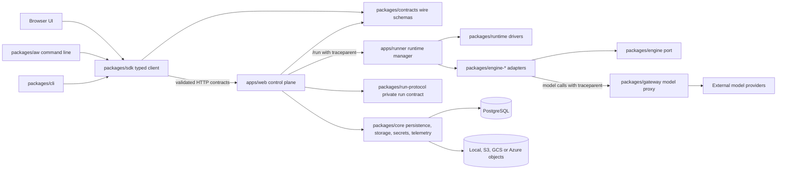
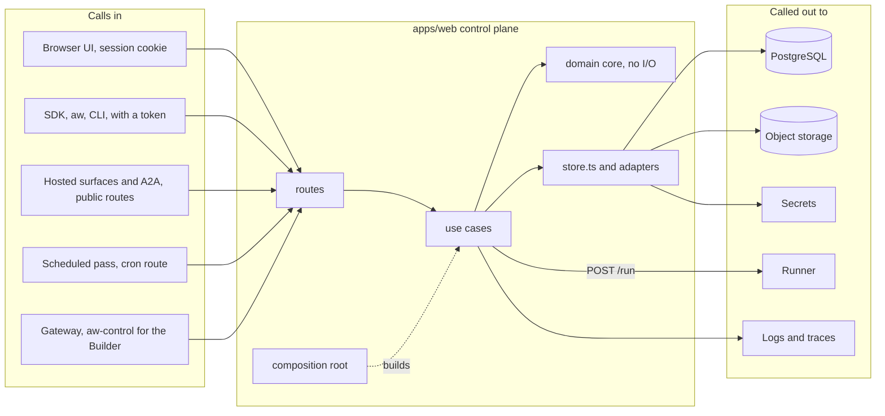
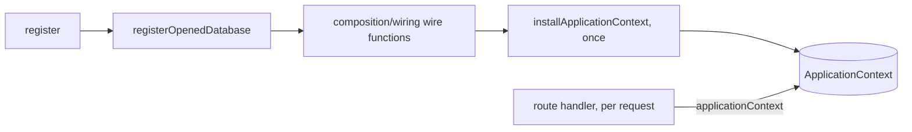

# Architecture

This document describes the architecture as it is and the rules a change is held to. Every rule
under [Dependency rules](#dependency-rules) and [Quality gates](#quality-gates) names the gate that
enforces it; a rule with no gate is not listed. Decisions and their reasons live in
[`docs/adr/`](adr/).

## System shape

Agent Workspace is a pnpm monorepo with two deployable applications and a set of supporting
packages. The web application is the control plane. The runner executes an agent inside a selected
runtime through an engine adapter. The gateway substitutes a short-lived run identity for a stored
provider credential. Core owns persistence, the object stores behind the storage catalog
([Storage](#storage)), secrets and the telemetry port; runtime owns the sandbox drivers; the engine port and its adapters own agent execution; run-protocol is the
private contract between the control plane, the runner and the adapters. Contracts publish the
control plane's wire schemas, the SDK is the typed client over them that the web application's
browser code and external integrations share, and `aw` is the operator's command line over the SDK.

## Repository ownership

| Area                          | Owns                                                                                                                                                           | Must not own                                                          |
| ----------------------------- | -------------------------------------------------------------------------------------------------------------------------------------------------------------- | --------------------------------------------------------------------- |
| `apps/web/app`                | Next.js routes, pages, route-level mapping                                                                                                                     | database queries, provider credentials, another route's logic         |
| `apps/web/components`         | browser rendering and interaction; each screen's `*-model.ts` request model                                                                                    | server runtime values, persistence records, raw `/api` requests       |
| `apps/web/server/<domain>`    | domain application operations; its `store.ts` adapter is the one file that may name persistence                                                                | unrelated domain registries, process-global wiring of its own         |
| `apps/web/server/composition` | the composition root: reads the environment, builds every domain, installs one application context                                                             | domain rules                                                          |
| `apps/runner`                 | private runtime-manager HTTP boundary and execution; `src/engines.ts` is the one file that names an adapter                                                    | web UI or durable control-plane state                                 |
| `packages/core`               | database repositories, secrets, storage, audit, the telemetry and tracing port                                                                                 | application composition or UI; any workspace package but `contracts`  |
| `packages/engine`             | the `AgentEngine` port, `agent.*` frame builders, path grants, the sandbox-environment contract; the conformance and adapter kits under its `/testing` subpath | any engine SDK, any application, any other package but `contracts`    |
| `packages/run-protocol`       | the private run contract: `RunRequest`, the agent configuration schemas, the Claude SDK event surface and its `agent.*` mapping                                | any I/O, `core`, any package but `contracts` and `engine`             |
| `packages/engine-<id>`        | one engine adapter: its root exports one factory, its internals are under `/testing`, exactly one file imports its SDK                                         | another adapter, `core`, a web route                                  |
| `packages/platforms`          | the `PlatformTarget` port, the per-field verdict model, the platform conformance kit (ADR-0133), pure and with no I/O                                          | any application, any I/O, any other package but `contracts`           |
| `packages/runtime`            | runtime driver interfaces and implementations, one `exports` subpath per driver                                                                                | any other workspace package                                           |
| `packages/gateway`            | authenticated provider routing and adapters                                                                                                                    | discovering credentials from process globals                          |
| `packages/cli`                | generator/startup orchestration                                                                                                                                | business rules duplicated from applications                           |
| `packages/contracts`          | published wire schemas and derived types of `/api/**`, and the closed vocabularies (run status, roles)                                                         | any workspace package, framework, or database                         |
| `packages/sdk`                | typed isomorphic client over the contracts                                                                                                                     | server implementations (`core`, `runtime`, `gateway`)                 |
| `packages/react`              | the hosted surface chat for customer pages                                                                                                                     | anything but the SDK and the contracts                                |
| `packages/aw`                 | the `aw` command line: argument parsing, output, exit codes                                                                                                    | anything but the SDK, the contracts and the pure platform translators |
| `packages/embedded`           | the local runtime, a bundle of the server with no importable API (ADR-0109)                                                                                    | being imported by any workspace package                               |

`packages/tool-host`, `packages/egress-proxy`, `packages/skills-office` and `packages/create` are
small leaves, each with its own dependency rule. Tests stay beside the unit they protect;
cross-package conformance and browser/e2e tests live under `tests/`. Infrastructure is under
`infra/`, deployment documentation under `docs/deploy/`, and architecture decisions under
`docs/adr/`.

## Ports and adapters

The same areas, seen as hexagons. Each area has one of five roles: a **driving adapter** calls in
(a route, a screen, a command line); the **application** runs a use case; a **core** decides, with
no I/O; a **driven adapter** is called out to (the database, object storage, a runner); a
**contract or port** is the shared language between them. The control plane is one hexagon:
callers come in through routes, a use case asks its domain's core for a decision, then calls the
adapters it needs. The runner and the gateway are hexagons of their own; the diagram shows them
from the control plane's side, where the gateway also calls in for the Builder. A change that adds
a component, a port, an adapter or a line of communication updates this section in the same pull
request.

| Role             | Areas                                                                                                                                                                                        |
| ---------------- | -------------------------------------------------------------------------------------------------------------------------------------------------------------------------------------------- |
| Driving adapter  | `apps/web/app` (routes), `apps/web/components` (screens), `packages/sdk`, `packages/react`, `packages/aw`, `packages/cli`                                                                    |
| Application      | a domain's use cases in `apps/web/server/<domain>`, the composition root `apps/web/server/composition`, `apps/runner`                                                                        |
| Core             | a domain's `core/` folder (`apps/web/server/builder/core/` is the one checked, by `builder-core-is-pure`); `packages/platforms` (`platforms-are-pure`)                                       |
| Driven adapter   | `packages/core`, a domain's `store.ts` and `adapters/`, the drivers in `packages/runtime`, the `packages/engine-*` adapters, `packages/gateway`, and the leaf packages                       |
| Contract or port | `packages/contracts`, `packages/run-protocol`, the `AgentEngine` port in `packages/engine`, the `RuntimeDriver` port in `packages/runtime`, the `PlatformTarget` port, a domain's `ports.ts` |

### Ports

| Port                         | Defined in                                               | Adapters                                                                         | Used by                                                             | Held to it by                                                |
| ---------------------------- | -------------------------------------------------------- | -------------------------------------------------------------------------------- | ------------------------------------------------------------------- | ------------------------------------------------------------ |
| `AgentEngine`                | `packages/engine/src/port.ts`                            | one per `packages/engine-*`                                                      | the runner, only through `apps/runner/src/engines.ts`               | the conformance kit in `@agent-workspace/engine/testing`     |
| `RuntimeDriver`              | `packages/runtime/src/driver.ts`                         | one per `./driver/*` subpath                                                     | the runner                                                          | each driver's tests                                          |
| `PlatformTarget`             | `packages/platforms/src/port.ts`                         | `packages/platforms/src/targets/`, listed in `registry.ts`                       | `aw`, the control plane and the CLI                                 | the platform conformance kit (ADR-0133)                      |
| `ObjectStore`                | `packages/core/src/storage/object-store.ts`              | local, S3, GCS, Azure, and memory for tests                                      | the storage catalog service                                         | one contract suite, `packages/core/src/storage/contract.ts`  |
| `CatalogPort` (storage)      | `packages/core/src/db/repositories/resource-catalogs.ts` | PostgreSQL, and `memory-catalog.ts` for tests                                    | the storage catalog service and the files domain                    | `resource-catalogs.contract.ts`, run against both            |
| `SessionStateBlobRepository` | `packages/core/src/db/repositories/session-state.ts`     | PostgreSQL, and `memory-session-state-blobs.ts` for tests                        | the storage catalog service, the sessions store and the cleanup job | `session-state-blobs.contract.ts`, run against both          |
| `SecretsService`             | `packages/core/src/secrets/service.ts`                   | the database, and in memory for tests                                            | the control plane and the gateway                                   | `packages/core/src/secrets/service.test.ts`                  |
| `Logger`                     | `packages/core/src/telemetry/logger.ts`                  | JSON lines                                                                       | web, runner and gateway                                             | `packages/core/src/telemetry/telemetry.test.ts`              |
| The Builder's ports          | `apps/web/server/builder/ports.ts`                       | a production and a memory adapter each, under `builder/adapters/<port>/`         | the Builder's use cases                                             | one `<port>.contract.ts` per port, run against both adapters |
| `<Domain>StoreProvider`      | `apps/web/server/<domain>/store.ts`                      | PostgreSQL, and in memory for tests                                              | that domain                                                         | `tests/store-conformance.test.ts`                            |
| `IdTokenKeySource`           | `apps/web/server/auth/token-exchange.ts`                 | discovery of `OIDC_ISSUER_URL` and its `jwks_uri`, and a local key set for tests | `POST /api/auth/token-exchange` (ADR-0161)                          | `apps/web/server/auth/token-exchange.test.ts`                |

The Builder's ports are `ApprovalPort`, `AuthorizationPort`, `PolicyPort`, `AuditPort`,
`CheckerPort`, `RunnerPort`, `CatalogPort` and `AgentStorePort`. Its `CatalogPort` (the names and
ids the Builder may offer) is not the storage `CatalogPort`; the two share a name only.

### How components talk

Every line is HTTP or a port call, and each carries a typed contract. A value that arrives over
one of them is `unknown` until a schema checks it ([Runtime and trust boundaries](#runtime-and-trust-boundaries)).

| From                 | To              | How, and what it carries                                                                                                                 |
| -------------------- | --------------- | ---------------------------------------------------------------------------------------------------------------------------------------- |
| Browser              | control plane   | HTTPS `/api/**` through the SDK with the session cookie; every answer is validated against the contracts                                 |
| `aw`, SDK users, CLI | control plane   | the same SDK over HTTPS, with a token                                                                                                    |
| Browser              | object storage  | a file above `MAX_UPLOAD_BYTES` (64 MiB): a signed upload link, then an `upload-complete` call                                           |
| Control plane        | PostgreSQL      | `packages/core` repositories, through a domain's `store.ts` (older imports elsewhere are a baseline)                                     |
| Control plane        | object storage  | `ObjectStore`, streamed, through the storage catalog service, the only way in (a dependency rule)                                        |
| Control plane        | runner          | `POST /run` with a `RunRequest`, a bearer token when one is set, and `traceparent`                                                       |
| Runner               | control plane   | the `agent.*` frames, as server-sent events on the same response; each frame's `id` is the resume cursor                                 |
| Runner               | sandbox         | one `RuntimeDriver`                                                                                                                      |
| Engine adapter       | gateway         | model calls with the short-lived run identity and `traceparent`                                                                          |
| Agent tools          | gateway         | `POST /v1/tools/:connectorId/mcp` and `POST /v1/tool-sandbox/mcp`                                                                        |
| Gateway              | control plane   | `POST /v1/tools/aw-control/mcp`, forwarded to `/api/builder/mcp` with only the run token, the body capped at 4 MiB                       |
| Gateway              | model providers | provider HTTP with the stored credential                                                                                                 |
| Control plane        | OIDC issuer     | discovery and the `jwks_uri` of the one configured `OIDC_ISSUER_URL`, to verify an app's ID token (ADR-0161); never a URL from the token |
| Every server process | logs and traces | one JSON line per event through the `Logger` port; W3C `traceparent` joins web, runner and gateway                                       |

### Where the code does not match yet

- Only `apps/web/server/builder/core/` is checked for purity. `apps/web/server/shares/core/` is
  named `core` but reads the application context and HTTP helpers.
- `builder-core-is-pure` checks imports. A global such as `Date.now()` or `Math.random()` needs no
  import, so only an ESLint rule catches it, as `packages/platforms` already does.
- Some domain files still name persistence outside `store.ts`: the
  `domain-does-not-import-persistence` baseline in `.dependency-cruiser-known-violations.json`.
- Some files still read `process.env` outside the composition root: the `no-restricted-properties`
  entries in `eslint-suppressions.json`.

The last two are baselines that may only shrink ([Quality gates](#quality-gates)).

## Composition

`apps/web/server/composition/register.ts` is the composition root. Next.js calls `register()` once
per server process. It reads the environment and opens the database; `registerOpenedDatabase` then
calls the plain `wire<Domain>` functions in `composition/wiring/` (agents, subsystems, run
resources, run runtime, projects and shares, and the run domains), each of which returns its domain
fully built. When everything is built, the root calls `installApplicationContext` **once** with one
`ApplicationContext` (`apps/web/server/application-context.ts`) that holds every domain. A route
never sees a half-composed context: if wiring throws, nothing is installed and the database pools
opened so far are closed.

- **A domain that can be off says so in its type.** The domains that need a run runtime (`runs`,
  `a2a`, `toolEndpoint`, `tokens`, `triggers`, `surfaces`) are `serving | disabled`; with no runner
  configured all six are `disabled` together. The domains that need configuration or storage
  (`secrets`, `models`, `connectors`, `runtimes`, `files`, `skills`, `setup`) are
  `serving | unavailable`. No context at all means no session secret or no reachable database.
- **Readers read per request and fail closed.** A route reads `applicationContext()`, or a domain
  reader such as `getRunApi()`, on every request, and answers its domain's named `503` when the
  context is missing or the domain is not `serving`. There is no silent fallback to in-memory
  stores. Files, skills, attachments and run delivery read and write only through the catalog
  service; a `files` domain without it is `unavailable`, never served from a path-based store.
- **Process-global state is declared only with `defineSlot`** (`apps/web/server/runtime-slot.ts`),
  because Next.js compiles `instrumentation.ts` and the route handlers into separate module graphs;
  ESLint rejects a hand-written `globalThis` property. Besides the context, eight slots hold
  process-local state that is not domain wiring:

  | Slot (under `apps/web/server/`)   | Why it is process-local                                                          |
  | --------------------------------- | -------------------------------------------------------------------------------- |
  | `composition/held-composition.ts` | the close handle `start.ts` uses to release the pools: process lifecycle         |
  | `runs/interrupt.ts`               | the live runs this process launched, written per run                             |
  | `telemetry/runtime.ts`            | a bounded map of per-run trace attributes, written per run                       |
  | `engines/images.ts`               | the engine-image map parsed from the environment, shared with the runner         |
  | `engines/registry.ts`             | extra engine descriptors registered by tests; the built-in engines are constants |
  | `runtimes/registry.ts`            | live driver instances and the map that de-duplicates renewals                    |
  | `setup/runtime-detection.ts`      | a time-boxed cache of the runtime-detection promise                              |
  | `triggers/schedule-cron.ts`       | the cron-pass handle, installed only where `CRON_SECRET` is set                  |

  A new `defineSlot` that holds composed domain wiring is a review finding: that domain belongs in
  `ApplicationContext`.

## Storage

Stored bytes live in one object store, chosen by one setting. Files, skills, chat attachments and
run delivery also keep their names in one catalog
([ADR-0153](adr/0153-object-storage-one-key-layout-catalog-first-writes-references-not-bytes.md)).
There are three layers:

- **The catalog service** (`apps/web/server/storage/service.ts`) is the only way those four read or
  write a stored object. Routes and domains call it, never a backend; a domain without it is
  `unavailable` and its routes answer `503`.
- **Two ports** sit under it. `CatalogPort` holds the rows: a PostgreSQL version and an in-memory
  version, both held to `resource-catalogs.contract.ts`; locks and concurrency are proven on
  PostgreSQL only. `ObjectStore` holds the bytes, with one backend per URL scheme, each held to
  `packages/core/src/storage/contract.ts`.
- **The adapters** are the PostgreSQL repositories and the backends in `packages/core/src/storage/`.
  `openObjectStore` imports only the backend the URL names, so a local install never loads a cloud
  library, and wraps it in the scoped store that bounds a signed link's lifetime.

Every save is row-first. The catalog reserves a `pending` row under a new object id, the bytes are
streamed to `workspaces/<workspace id>/<area>/<object id>` (built only by `storageObjectName`), and
one transaction confirms the row as `ready` with the size and checksum measured on the way. A
replaced or removed row becomes `deleting` until its object is gone; the cleanup job reports what a
crash left, and in `delete` mode removes it. Only a `ready` row is listed, searched or granted, and a rename changes the row alone.
A signed-link upload takes the same steps, with `upload-complete` as the confirm.
A session-state blob keeps its own row (`session_state_blobs`) and takes the same steps: the row
waits under a side key while it is `pending` or `deleting`, and its confirm checks the same
reservation token.

A run receives references, not bytes: the `RunRequest` lists each granted file's path, mode, size
and checksum, the control plane streams the files to the runner as one archive, and the runner
checks every checksum before the engine starts.

`AW_STORAGE_URL` (`s3://`, `gcs://`, `azblob://` or `file://`) is the one location setting. It is
parsed once, by `parseStorageUrl` in `packages/contracts/src/storage-url.ts`, for the server and the
CLI alike, and it never carries a credential.

## Dependency rules

The direction is delivery (routes, screens, `aw`) → application/domain → ports → infrastructure
adapters, with the wire contracts underneath everything: core, engine, platforms and sdk depend on
contracts; run-protocol on contracts and engine; the adapters on engine and contracts (the Claude
adapter also on run-protocol); react, aw and cli on sdk. Each rule below is a dependency-cruiser
rule in [`dependency-cruiser.config.mjs`](../dependency-cruiser.config.mjs), checked by
`pnpm architecture:check`, unless another gate is named.

| Rule                                                                                                                          | What it enforces                                                                                                                                                                                                                                                                                                                        |
| ----------------------------------------------------------------------------------------------------------------------------- | --------------------------------------------------------------------------------------------------------------------------------------------------------------------------------------------------------------------------------------------------------------------------------------------------------------------------------------- |
| `libraries-do-not-import-applications`                                                                                        | no package imports `apps/*`                                                                                                                                                                                                                                                                                                             |
| `contracts-depend-on-nothing-in-the-workspace`                                                                                | the contracts are consumable outside this repository ([ADR-0052](adr/0052-the-sdk-is-contracts-first-and-the-application-is-its-first-consumer.md), [SDK structure map](sdk/07-structure-map.md))                                                                                                                                       |
| `sdk-depends-only-on-contracts`, `react-depends-only-on-sdk-and-contracts`, `cli-depends-only-on-sdk-and-contracts`           | the published client packages never reach a server-side package                                                                                                                                                                                                                                                                         |
| `aw-depends-only-on-sdk-and-contracts`, `aw-reaches-cli-only-through-the-cli-bridge`                                          | `aw` reaches the SDK, the contracts and the pure platform translators; `packages/aw/src/cli-bridge.ts` alone loads the CLI's `deploy` and `publish` by dynamic `import()` ([ADR-0103](adr/0103-one-project-file-holds-every-environment.md), [ADR-0133](adr/0133-one-portable-agent-definition-exports-to-many-agent-platforms.md) D11) |
| `core-depends-only-on-contracts`                                                                                              | core is persistence, storage, secrets and telemetry; the run protocol and the engine port are not its business                                                                                                                                                                                                                          |
| `run-protocol-depends-only-on-contracts-and-engine`                                                                           | the private run contract carries no I/O and no database                                                                                                                                                                                                                                                                                 |
| `engine-port-depends-only-on-contracts`                                                                                       | the port is types and pure functions                                                                                                                                                                                                                                                                                                    |
| `engine-adapters-depend-only-on-the-port-and-contracts`, `claude-adapter-depends-only-on-the-port-contracts-and-run-protocol` | an adapter sees the port, the contracts and its own SDK (the Claude adapter also run-protocol), never `core` or another adapter                                                                                                                                                                                                         |
| `engine-testing-subpaths-are-for-tests`                                                                                       | only tests import `@agent-workspace/engine/testing` or an adapter's `/testing` (conformance kit, adapter internals); an adapter's root exports one factory                                                                                                                                                                              |
| `web-does-not-import-an-engine-adapter`, `runner-reaches-engine-adapters-only-through-engines-ts`                             | the control plane knows engines only through the contracts; the runner names adapters in `apps/runner/src/engines.ts` alone                                                                                                                                                                                                             |
| `runtime-depends-on-nothing-in-the-workspace`                                                                                 | the in-sandbox layer drags nothing into a run image; each driver is its own subpath (`./driver/docker`, `./driver/kubernetes`, …), so an optional driver loads only when selected                                                                                                                                                       |
| `gateway-depends-only-on-core-and-contracts`                                                                                  | the gateway never reaches the runtime, an engine or an application                                                                                                                                                                                                                                                                      |
| `platforms-depend-only-on-contracts`, `platforms-are-pure`                                                                    | translators run in a browser, the control plane or `aw`: no Node built-in outside `src/testing/`; npm imports are held to `contracts`, `zod` and `yaml` by `packages/platforms/src/dependencies.test.ts`                                                                                                                                |
| `egress-proxy-…`, `tool-host-…`, `skills-office-…`, `create-depends-only-on-cli`, `nothing-imports-embedded`                  | the leaf packages' own boundaries                                                                                                                                                                                                                                                                                                       |
| `browser-ui-does-not-import-server-values`, `browser-ui-does-not-import-persistence`                                          | `apps/web/components` never imports `apps/web/server` or `core/db`                                                                                                                                                                                                                                                                      |
| `web-contracts-do-not-import-persistence`                                                                                     | a domain's `contract.ts` (and `projects/resource.ts`) never names a database record                                                                                                                                                                                                                                                     |
| `routes-do-not-import-routes`                                                                                                 | shared route logic lives in a server domain; baseline 0                                                                                                                                                                                                                                                                                 |
| `app-does-not-import-core`                                                                                                    | `app/**` reaches persistence through server domains; baseline 1                                                                                                                                                                                                                                                                         |
| `only-the-s3-boundary-imports-the-s3-sdk`                                                                                     | only `core/src/storage/s3-store.ts` and the CLI bucket probe `cli/src/validate.ts` (ADR-0082) import the S3 libraries; tests, `.live.` and `.acceptance.` files may (the storage design, §07 rule 1)                                                                                                                                    |
| `only-the-gcs-boundary-imports-the-gcs-sdk`                                                                                   | only `core/src/storage/gcs-store.ts` and `cli/src/validate.ts` import `@google-cloud/storage`; tests, `.live.` and `.acceptance.` files may                                                                                                                                                                                             |
| `only-the-azure-boundary-imports-the-azure-sdk`                                                                               | only `core/src/storage/azure-blob-store.ts` imports `@azure/storage-blob`; tests, `.live.` and `.acceptance.` files may; `@azure/identity` is a credential library and is not covered                                                                                                                                                   |
| `raw-storage-backends-stay-in-core-storage`                                                                                   | only `core/src/storage/` imports `s3-store.ts`, `gcs-store.ts` or `azure-blob-store.ts`, whose raw factories sign links with no expiry bound; tests may                                                                                                                                                                                 |
| `storage-backends-are-for-tests`                                                                                              | only tests import `@agent-workspace/core/storage/backends`, which loads the Azure and Google Cloud libraries; production opens a store with `openObjectStore`                                                                                                                                                                           |
| `memory-catalog-store-is-for-tests`                                                                                           | only tests import `resources/catalog-store.memory.ts`; production wires the PostgreSQL catalog store (the storage design, §07 rule 4)                                                                                                                                                                                                   |
| `app-does-not-import-storage-adapters`                                                                                        | `app/**` never value-imports a domain `store.ts` or `composition/storage.ts`; type-only imports are allowed; baseline 0 (the storage design, §07 rule 2)                                                                                                                                                                                |
| `only-the-catalog-service-reaches-object-storage`                                                                             | a domain reaches object storage through `apps/web/server/storage/`, never `core/src/storage`, even type-only; the pure helpers (content type, key safety, object name), the composition root and tests may; `tool-bundles/` is a named exception (not workspace files); baseline 0 (the storage design, §07 rule 3)                     |
| `domain-does-not-import-persistence`                                                                                          | only a domain's `store.ts` names `core/db`; baseline 46, 18 of them in the composition root                                                                                                                                                                                                                                             |
| `production-does-not-import-tests`, `no-unresolved-imports`                                                                   | production code never imports a test module; every internal import resolves                                                                                                                                                                                                                                                             |
| `no-circular-dependencies` and the two schema-cycle rules                                                                     | no cycles except two Drizzle foreign-key cycles, each limited to its two schema modules: `workspaces.ts` ↔ `model-connections.ts` and `agents.ts` ↔ `agent-versions.ts`                                                                                                                                                                 |
| one SDK file per engine (`tests/no-sdk-import.test.ts`)                                                                       | each third-party engine SDK is imported by exactly one file, checked as a set equality and against the emitted declarations; `packages/embedded/package.json` may list SDKs only at the owning engine's pin                                                                                                                             |
| closed vocabularies (`tests/duplicate-vocabulary.test.ts`)                                                                    | run statuses, roles and the other vocabularies `packages/contracts` owns are not re-declared; the four-entry allowlist may only shrink                                                                                                                                                                                                  |
| package entry points (`pnpm package-exports:check`)                                                                           | manifest targets exist, no wildcard exports, no TypeScript runtime targets, no reaching into another package's source; `tsconfig.architecture.json` names only the declared subpaths                                                                                                                                                    |

The three baseline rules ignore exactly the entries in `.dependency-cruiser-known-violations.json`,
and `tests/architecture-rules.test.ts` holds a ceiling per rule: a new violation fails, and a fixed
one must be removed from the file and the ceiling lowered. The same test holds
`only-the-catalog-service-reaches-object-storage` at a ceiling of 0, so it can never gain an entry.

## Browser boundary

Browser code reaches `/api/**` one way: a screen calls its `*-model.ts`, the model calls
`browserClient()` (`apps/web/lib/browser-client.ts`), and that is `@indx-workspace/sdk` on the
page's own origin with the session cookie. The SDK states the contracts version, encodes path
segments, validates every response against the contract and decodes problems into typed errors, so
a screen hand-writes none of it.

An ESLint rule rejects a raw `fetch('/api…')` in `components/**`, `app/**/*.tsx` and `lib/**`, and
`apps/web/components/raw-fetch-budget.test.ts` counts every raw network call there against an exact
per-file budget that may only go down. Four files remain:

| File (under `apps/web/components/`)                 | Why it is still a raw request                                                                                   |
| --------------------------------------------------- | --------------------------------------------------------------------------------------------------------------- |
| `setup/setup-wizard.tsx`                            | the setup wizard runs before anyone has signed in, so there is no session for the client to use                 |
| `shares/public-message-form.tsx`                    | it posts to the public visitor route `/p/<token>/messages`, which is not part of `/api/**`                      |
| `runtimes/model.ts`, `runtimes/runtimes-screen.tsx` | `POST /api/runtimes/test` stays raw until server change S-4 gives it the standard envelope and the SDK a method |

## Runtime and trust boundaries

Every value entering through HTTP, provider JSON, environment/configuration, persisted JSON, or an
external process is `unknown` until validated. Schemas are the source of truth for reusable wire
contracts. Persistence records are mapped explicitly to JSON resources, including `Date` to ISO-8601
conversion. Extensible third-party protocols may preserve unknown keys after validating fields the
application consumes; owned APIs reject unknown keys. The environment is read once, in a
composition root or entry point, and injected (ESLint `no-restricted-properties` on `process.env`,
with a per-file baseline).

Authorization happens before a workspace-scoped repository or projection is read. A browser sign-in session proves
identity; RBAC proves permission; a repository scope proves tenant selection. None substitutes for
another. The metrics route is the reference pattern: resolve resource access, take the authorized
workspace id, then filter the service-side projection. Roles are monotonic: in the order Owner,
Admin, Builder, Viewer, each role holds at least every grant of the roles after it, and conferral
dominance is the formal `Grant.le` order ([ADR-0152](adr/0152-roles-are-monotonic.md)). A session
share publishes only the turns its owner selected, copied by the server from that session's own
runs ([ADR-0158](adr/0158-a-session-share-publishes-a-chosen-selection-of-its-own-turns.md)).

### Runs

A run is a row in `runs`; its status vocabulary comes from `packages/contracts`.

- **Idempotent start.** `POST /api/agents/:id/runs` accepts an `Idempotency-Key`. The key is stored
  prefixed with the acting principal and is unique per workspace; beside it is the SHA-256 of the
  canonical request (the agent id and the parsed body with every object's members sorted, arrays in
  order). A replay with the same hash returns the original run whatever its status; a different
  request under the same key answers `409 run_idempotency_conflict`
  ([ADR-0151](adr/0151-a-stopped-run-holds-no-lease-and-run-start-is-idempotent.md)).
- **A paused run holds nothing.** `awaiting_approval` is a stopped, non-final status
  ([ADR-0145](adr/0145-a-run-stops-for-approval-or-handoff-and-continues-in-its-session.md)). The
  update that pauses a run stores `approval_deadline_at`, 24 hours later; a decision after the
  deadline cancels the run instead.
- **One continuation per paused run.** An approval decision completes the paused run and inserts a
  new run whose `continues_run_id` points at it; a unique index makes a second continuation
  impossible. The continuation acts for the paused run's subject
  ([ADR-0157](adr/0157-an-approval-continuation-acts-for-the-paused-runs-subject.md)).
- **Approvals are consumed durably.** `approvals_consumed_at` is stamped by the update that moves
  the continuation out of `queued`, before the runner is sent anything, and a check constraint
  refuses to queue it again, so an accepted continuation is never retried. Each approved call is
  added to `consumed_tool_calls` by one guarded update, so it runs at most once however many callers
  race for it.
- **Not yet built:** a run-attempt row and a renewable launch lease. Interrupting a live run reaches
  only the replica that launched it (cross-replica interrupt is issue #261), and orphaned runs are
  failed by a stale sweep that one replica at a time runs under a database lease.

### Observability

Server processes log one JSON object per line through the logger port in
`@agent-workspace/core/telemetry`, with `service` `web`, `runner` or `gateway`; field values are
redacted and `msg` is a fixed string. `no-console` is an ESLint error in `apps/web/server`,
`apps/web/app`, `apps/runner/src` and `packages/gateway/src`.

Trace context is W3C `traceparent`, parsed strictly. The web control plane forwards its active
span's `traceparent` on runtime requests; the runner adopts a valid one, binds its `traceId` to the
request's log lines and hands it to the engine, so every model call to the gateway carries it; the
gateway adopts it at its edge, or starts a fresh trace. A trace id is for correlation only, never
for authorisation, tenancy or billing. OpenTelemetry export is on only when
`OTEL_EXPORTER_OTLP_ENDPOINT` is set, in the web app, the runner and the gateway alike, with no
auto-instrumentation ([ADR-0155](adr/0155-server-processes-log-json-lines-and-join-a-w3c-trace-for-correlation.md)).

## Error boundary

Parsers and domain operations produce stable expected failures. HTTP adapters translate those to a
documented status and error code; one route wrapper (`apps/web/server/http/route.ts`) renders every
error envelope. Infrastructure and programming failures retain their cause, are observable, and
remain 5xx; raw external messages are never returned to a client. Cleanup is part of the operation
and its failure must be retained even when a primary failure already exists; an ESLint rule rejects
a discarded cleanup failure.

## Quality gates

`main` takes changes only through a pull request and a merge queue, so every merge is tested
against the latest `main` before it lands. The required checks are `CI success` and
`OSS export · dry run`
([ADR-0149](adr/0149-main-requires-a-pull-request-and-the-ci-success-gate.md) and its amendment).
`CI success` depends on every other CI job and fails on one that was skipped or cancelled; a new
required job is added to its `needs`. Every workflow that produces a required check runs on
`merge_group`, which `pnpm workflows:check` enforces. Locally, `pnpm check:fast`, `pnpm test` and
`pnpm build` run the same gates.

Each ratchet below moves in one direction only.

| Gate                      | What it enforces                                                                                                                                                 | Where it lives                                                                                                                         |
| ------------------------- | ---------------------------------------------------------------------------------------------------------------------------------------------------------------- | -------------------------------------------------------------------------------------------------------------------------------------- |
| Architecture boundaries   | the dependency rules above; the three baseline rules may only shrink, under per-rule ceilings                                                                    | `pnpm architecture:check`, `tests/architecture-rules.test.ts`                                                                          |
| ESLint suppressions       | known violations are listed per file and rule; ESLint fails a file above its count, and CI fails a baseline that grows for any file and rule                     | `eslint-suppressions.json`, `scripts/check-lint-baseline.mjs`                                                                          |
| No new suppressions       | a diff adds no `ts-ignore`, `ts-expect-error` or `eslint-disable`                                                                                                | CI fast checks                                                                                                                         |
| Raw-fetch budget          | browser raw network calls match an exact per-file budget that only goes down                                                                                     | `apps/web/components/raw-fetch-budget.test.ts`                                                                                         |
| Complexity ceiling        | the ESLint `complexity` maximum equals the measured maximum of production code, so it drops when a hotspot is simplified                                         | `pnpm complexity:check`                                                                                                                |
| Coverage floors           | three suites (critical packages, apps, UI and CLI) meet their floors, and no floor is lower than on the base                                                     | `scripts/check-coverage-ratchet.mjs`, CI coverage jobs                                                                                 |
| Public API reports        | an API Extractor report of every exported subpath of contracts, sdk, react and aw is committed and current, so a breaking change is a visible diff               | `docs/sdk/api/`, `pnpm docs:check` (`pnpm api:update` regenerates)                                                                     |
| Formal specification      | the Lean model builds with no `sorry` or extra axiom, its layers point one way, every `file#symbol` citation resolves, and its vectors replay against TypeScript | `pnpm formal:check`, CI `formal` job ([ADR-0062](adr/0062-the-specification-is-a-lean-4-model-and-typescript-is-tested-against-it.md)) |
| Storage story coverage    | every storage story × entry-point cell a test covered on the merge base is still covered; a malformed `[US-STO-xx]` tag fails                                    | `pnpm stories:check --base`, CI fast checks                                                                                            |
| Storage size limits       | each storage size limit is defined in one place; a copy elsewhere in the storage scope fails, and the allowlist may only shrink                                  | `tests/storage-limits.test.ts`                                                                                                         |
| Storage bridges           | every temporary storage bridge carries a marker, in the form ENGINEERING_GUIDELINES.md gives, naming the issue that deletes it                                   | `tests/storage-bridges.test.ts`, [the debt review](operations/debt-review.md)                                                          |
| Catalog fakes             | tests use the shared in-memory catalog, not a hand-written copy of the catalog port; the allowlist may only shrink                                               | `tests/catalog-fakes.test.ts`                                                                                                          |
| Store conformance         | every in-memory store is held to its PostgreSQL implementation by a shared conformance suite; the allowlist is empty                                             | `tests/store-conformance.test.ts`                                                                                                      |
| PR ownership contract     | every changed file is covered by the `Owns globs:` line of the PR body                                                                                           | `scripts/check-file-ownership.mjs`                                                                                                     |
| PR size                   | more than 3000 changed lines (generated files excluded) needs a `Large PR justification:` line                                                                   | `scripts/ci/check-pr-size.mjs`                                                                                                         |
| Changes fragments         | a user-visible change adds `changes/<slug>.md`; only a `release/*` branch edits a `CHANGELOG.md`                                                                 | `scripts/release/changes.mjs` ([`changes/README.md`](../changes/README.md))                                                            |
| No skipped tests          | a CI Vitest run with a skipped test fails, and the browser lane fails on a skipped or flaky test                                                                 | `scripts/ci/vitest-no-skip.mjs`, `scripts/ci/playwright-no-skip.mjs`                                                                   |
| Migrations                | the journal is consistent, numbers cannot collide, and a new migration is expand-only                                                                            | `pnpm migrations:check`, `pnpm migrations:lint`                                                                                        |
| Secrets and dependencies  | gitleaks finds no secret; a lockfile change adds no advisory missing from the osv-scanner baseline; licences are allowed                                         | CI fast checks                                                                                                                         |
| Dead code and duplication | no unused file, export or dependency; duplication stays within budget                                                                                            | `pnpm deadcode:check` (knip), `pnpm duplication:check` (jscpd)                                                                         |
| Documentation             | generated references, OpenAPI and `llms.txt` are current; internal links resolve                                                                                 | `pnpm docs:check`                                                                                                                      |
| ADRs                      | ADR numbers are unique, names well formed, every status known                                                                                                    | `pnpm adr:check`                                                                                                                       |
| Public tree               | the exported open-source tree carries no private path or name                                                                                                    | `OSS export · dry run` (`scripts/oss/`)                                                                                                |

Every shrinking baseline is listed once a quarter by [the debt review](operations/debt-review.md).

## Remaining decomposition

The largest units still due to be split are `apps/web/components/resources/resource-screens.tsx`,
`apps/web/components/composer/home-chat.tsx`, `apps/web/server/runs/launcher.ts`,
`apps/web/server/runs/api.ts` and the run repository `packages/core/src/db/repositories/runs.ts`.
The 46 `domain-does-not-import-persistence` entries are the places where a domain still names a
persistence type outside its `store.ts`; each is removed by moving that use behind the store.
Splits follow domains (storage, projects and sharing, runtime, runs and sessions, identity), not
generic technical folders. The dependency-ordered migration sequence and its open product
questions are in the [refactoring plan](architecture/refactoring/claude-agent-workspace-refactoring-plan.md)
and its [decision ledger](architecture/refactoring/claude-agent-workspace-refactoring-decisions.md).
