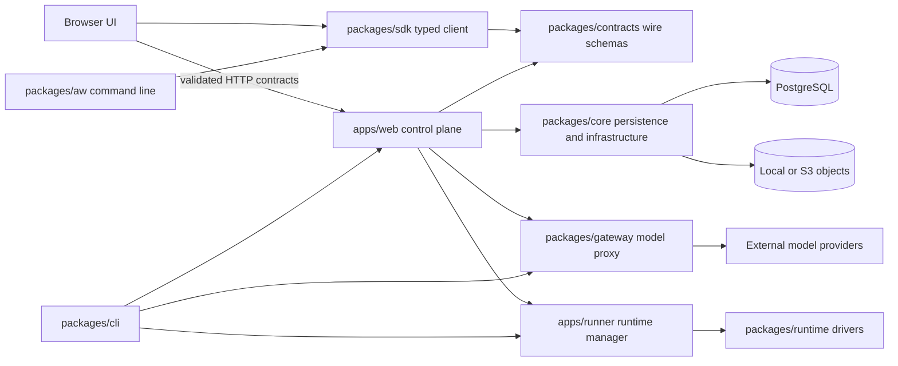

# Architecture

## System shape

Agent Workspace is a pnpm monorepo with two deployable applications and seven supporting packages.
The web application is the control plane. The runner executes an agent inside a selected runtime.
The gateway substitutes a short-lived run identity for a stored provider credential. Core owns
persistence and shared infrastructure; runtime owns driver contracts and implementations; CLI owns
installation and startup orchestration. Contracts publish the control plane's wire schemas, the
SDK is the typed client over them that the web application and external integrations share, and
`aw` is the operator's command line over the SDK.

## Repository ownership

| Area                       | Owns                                                                                                                                  | Must not own                                                       |
| -------------------------- | ------------------------------------------------------------------------------------------------------------------------------------- | ------------------------------------------------------------------ |
| `apps/web/app`             | Next.js routes, pages, route-level mapping                                                                                            | database queries, provider credentials                             |
| `apps/web/components`      | browser rendering and interaction                                                                                                     | server runtime values, persistence records                         |
| `apps/web/contracts`       | dependency-light wire schemas and derived types                                                                                       | Drizzle or Next.js dependencies                                    |
| `apps/web/server/<domain>` | domain application operations and adapters                                                                                            | unrelated domain registries                                        |
| `apps/runner`              | private runtime-manager HTTP boundary and execution                                                                                   | web UI or durable control-plane state                              |
| `packages/core`            | database repositories, secrets, storage, audit, telemetry                                                                             | application composition or UI                                      |
| `packages/engine`          | the `AgentEngine` port, `agent.*` frame builders, path grants, the sandbox-environment contract, the conformance kit, the adapter kit | any engine SDK, any application, any other package but `contracts` |
| `packages/platforms`       | the `PlatformTarget` port, the per-field verdict model, the platform conformance kit (ADR-0133), pure and with no I/O                 | any application, any I/O, any other package but `contracts`        |
| `packages/engine-<id>`     | one engine adapter, with exactly one file importing its SDK                                                                           | another adapter, or a web route                                    |
| `packages/runtime`         | runtime driver interfaces and implementations                                                                                         | web routes or persistence                                          |
| `packages/gateway`         | authenticated provider routing and adapters                                                                                           | discovering credentials from process globals                       |
| `packages/cli`             | generator/startup orchestration                                                                                                       | business rules duplicated from applications                        |
| `packages/contracts`       | published wire schemas and derived types of `/api/**`                                                                                 | any workspace package, framework, or database                      |
| `packages/sdk`             | typed isomorphic client over the contracts                                                                                            | server implementations (`core`, `runtime`, `gateway`)              |
| `packages/aw`              | the `aw` command line: argument parsing, output, exit codes                                                                           | anything but the SDK and the contracts                             |

Tests stay beside the unit they protect; cross-package conformance and browser/e2e tests live under
`tests/`. Infrastructure is under `infra/`, deployment documentation under `docs/deploy/`, and
architecture decisions under `docs/adr/`.

## Dependency rules

The intended direction is delivery → application/domain → ports → infrastructure adapters. In the
current repository some web domain interfaces still use `packages/core` persistence types; that is
a migration seam, not the target.

Enforced now:

- core, runtime, gateway, contracts, sdk, and aw do not import applications;
- contracts import no other workspace package, and sdk imports only contracts — the two are
  consumable outside this repository, so nothing server-side may leak into them
  ([ADR-0052](adr/0052-the-sdk-is-contracts-first-and-the-application-is-its-first-consumer.md),
  design in [`docs/sdk/`](sdk/README.md); the packages, the four layers one resource crosses and
  the tables the SDK surfaces are drawn on one page in the
  [SDK structure map](sdk/07-structure-map.md));
- aw imports only sdk, contracts and the pure platform translators (`packages/platforms`,
  [ADR-0133](adr/0133-one-portable-agent-definition-exports-to-many-agent-platforms.md)): the
  command line is a client of the control plane like any customer program, and never a
  server-side package. The one exception is `packages/aw/src/cli-bridge.ts`, the single aw file
  that loads `@indx-workspace/cli/deploy` (`aw deploy`) and `@indx-workspace/cli/publish`
  (`aw platforms publish`) with a dynamic `import()` as an optional peer
  ([ADR-0103](adr/0103-one-project-file-holds-every-environment.md), #621;
  [ADR-0133](adr/0133-one-portable-agent-definition-exports-to-many-agent-platforms.md) D11);
  no other aw file may reach the CLI, and the CLI itself reaches only sdk and contracts;
- browser components do not import server runtime values or core persistence values;
- the engine port depends only on `contracts`; an engine adapter depends only on the port,
  `contracts`, `core` and its own third-party SDK, and never on another adapter; `apps/web`'s
  production code never imports an adapter; and `apps/runner` reaches one only through
  `apps/runner/src/engines.ts`. `core` is on the adapter's list transitionally — the private
  `/run` contract and the ENG-03 `agent.*` mapping still live there — and
  [ADR-0070](adr/0070-the-engine-port-and-its-first-adapter.md) records what removes it. Each
  third-party engine SDK has exactly one file allowed to import it, one row per engine in
  `tests/no-sdk-import.test.ts`'s table, checked as a set equality and again against the
  emitted declarations. The one manifest that declares SDKs without owning a boundary is the
  runtime bundle's (`packages/embedded/package.json`, ADR-0109), which may list them only at the
  owning engine's exact pin and never import them;
- `packages/platforms` depends only on `contracts`, `zod` and `yaml`, held by
  `packages/platforms/src/dependencies.test.ts` (dependency-cruiser excludes `node_modules`, so it
  cannot see an npm import), and its production code (not `src/testing/` or a test) imports no Node
  built-in, so a translator can run in a browser, the
  control plane or `aw` ([ADR-0133](adr/0133-one-portable-agent-definition-exports-to-many-agent-platforms.md));
- production code does not import test modules;
- all internal imports resolve, and the graph contains no cycles except the documented two-file
  Drizzle cycle between `workspaces.ts` and `model-connections.ts`. The workspace's default model
  connection uses a tenant-scoped composite foreign key; the model connection's workspace reference
  uses a single column. The architecture rule permits only those two import edges and rejects any
  third module joining the cycle.

Additional target rules after the remaining contract extraction:

- domain and wire contracts do not import Drizzle schema types;
- client components anywhere under `apps/web` obey the browser boundary;
- optional runtime drivers are imported through explicit subpaths rather than one broad barrel.

Package entrypoints are already mechanical: `pnpm package-exports:check` validates manifest targets,
rejects wildcard exports and TypeScript runtime targets in packages, and prevents consumers from
reaching into another package's source tree. `tsconfig.architecture.json` names only those declared
subpaths, so type analysis cannot accidentally legitimize a private module.

## Runtime and trust boundaries

Every value entering through HTTP, provider JSON, environment/configuration, persisted JSON, or an
external process is `unknown` until validated. Schemas are the source of truth for reusable wire
contracts. Persistence records are mapped explicitly to JSON resources, including `Date` to ISO-8601
conversion. Extensible third-party protocols may preserve unknown keys after validating fields the
application consumes; owned APIs reject unknown keys.

Authorization happens before a workspace-scoped repository or projection is read. A browser sign-in session proves
identity; RBAC proves permission; a repository scope proves tenant selection. None substitutes for
another. The metrics route is the reference pattern: resolve resource access, take the authorized
workspace id, then filter the service-side projection.

## Error boundary

Parsers and domain operations produce stable expected failures. HTTP adapters translate those to a
documented status and error code. Infrastructure and programming failures retain their cause, are
observable, and remain 5xx; raw external messages are never returned to a client. Cleanup is part of
the operation and its failure must be retained even when a primary failure already exists.

## Incremental target structure

Large-scale moves should follow behavior-preserving seams rather than a directory rewrite:

The detailed current-state audit, interactive target-state views, and dependency-ordered migration sequence are indexed by the
[Claude Agent Workspace refactoring plan](architecture/refactoring/claude-agent-workspace-refactoring-plan.md). That proposal
expands this summary but does not supersede the current invariants documented here until its RF-601 cleanup step is complete.
The plan's six unresolved product questions and their conservative RF-001 defaults are tracked in the
[refactoring decision ledger](architecture/refactoring/claude-agent-workspace-refactoring-decisions.md). Those defaults guide
dependent engineering work but remain pending ratification by the owners named in the ledger.

1. Extract schemas/mappers for one HTTP domain and make both server and browser consume them.
2. Define domain ports without database types; make the existing repository an adapter.
3. Move one domain's global registry behind an explicit factory/application context.
4. Extract that domain's installer from `server/composition/register.ts`.
5. Add an import rule, then repeat for the next domain.

Highest-value decomposition targets are `apps/web/server/composition/register.ts`,
`components/resources/resource-screens.tsx`, `components/composer/home-chat.tsx`, and the run/session
repositories. Splits should follow storage, projects/sharing, runtime, runs/sessions, and identity—not
generic technical folders.
