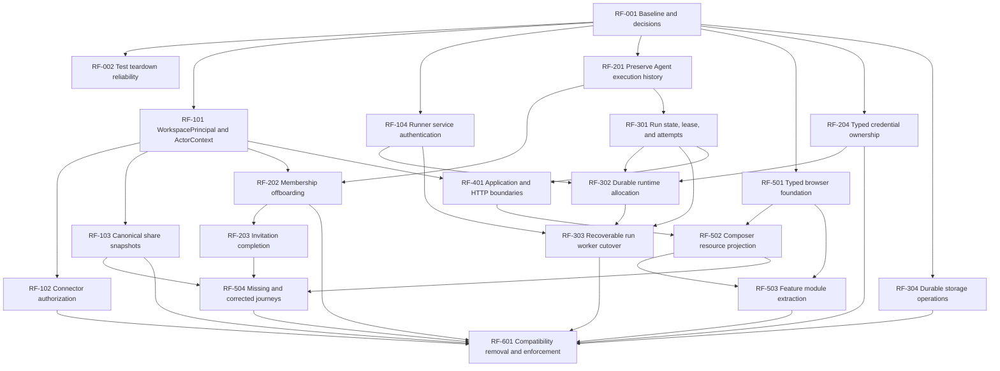

# Claude Agent Workspace refactoring plan

Status: proposed architecture and migration plan. This document does **not** authorize implementation, production behavior changes, or schema migration.

Baselines:

- [As-Is domain architecture](../as-is/claude-agent-workspace-domain-architecture.html)
- [As-Is data and feature architecture](../as-is/claude-agent-workspace-data-feature-architecture.html)
- [As-Is frontend architecture](../as-is/claude-agent-workspace-frontend-architecture.html)
- [To-Be domain architecture](../to-be/claude-agent-workspace-domain-architecture.html)
- [To-Be data and feature architecture](../to-be/claude-agent-workspace-data-feature-architecture.html)
- [To-Be frontend architecture](../to-be/claude-agent-workspace-frontend-architecture.html)

RF-001 decision defaults and characterization ownership are recorded in the
[refactoring decision ledger](claude-agent-workspace-refactoring-decisions.md). Defaults in that
ledger remain pending product ratification and do not authorize behavior changes outside their
owning refactoring units.

Relationship to existing documentation: this plan expands the "Incremental target structure" summary in
[`docs/architecture.md`](../../architecture.md) and does not supersede it until RF-601 updates that document.
Where the two disagree, `docs/architecture.md` describes the current invariant and this plan describes the proposal.

## Executive architecture summary

### Current architecture

Agent Workspace is a pnpm monorepo with a Next.js control plane (`apps/web`), an execution plane (`apps/runner`), PostgreSQL and object-storage infrastructure (`packages/core`), runtime drivers (`packages/runtime`), and an authenticated provider gateway (`packages/gateway`). Workspace-scoped repositories, tenant-paired foreign keys, one Claude Agent SDK import, durable run events/transcripts, and the accounting ledger are strong foundations.

The largest risks sit at lifecycle and asynchronous boundaries. A durable queued Run is handed to an untracked web-process callback; runtime handles and session affinity live only in runner-manager Maps; runner HTTP is unauthenticated; API keys can be attributed and authorized as the oldest Owner; connector item routes do not consistently classify own/other access; Agent deletion cascades through execution history; member removal discovers ownership constraints as raw database failures; share publication trusts caller-authored content; and two required browser journeys are incomplete.

### Target architecture

Keep the existing deployable boundaries and make five missing concepts explicit:

1. `WorkspacePrincipal` is the exact workspace actor/owner for either a Membership or APIKey.
2. `ExecutionSpec` and `ShareSnapshot` are immutable, server-built, versioned value objects.
3. Runs have a database-enforced state machine, renewable lease, idempotency key, and durable `RunAttempt` records.
4. `RuntimeAllocation` durably owns external runtime handles, heartbeats, expiry, cleanup, and reconciliation.
5. Typed credential ownership and `StorageOperation` records close existing cross-resource crash windows.

Frontend routes become thin mappings to feature-owned screens, hooks, clients, models, and tests. One shared typed HTTP boundary and a small domain-free UI layer replace ad hoc fetch parsing and cross-domain screen modules.

### Preserve

- Opaque `WorkspaceScope` and scope-bound repositories.
- Composite tenant foreign keys and concealment of cross-tenant rows.
- User/UserIdentity/Workspace and explicit resource joins.
- Closed-world RBAC classification and “narrow, never widen” resource composition.
- One Claude SDK boundary in `apps/runner/src/claude.ts`.
- Gateway token/run/model binding and provider-credential isolation.
- Durable `run_events`, transcripts, run tokens, and usage ledger.
- Archive gates for Workspace and Project.
- One RunView, pure run event model, URL-backed filters, and full-navigation workspace reset.
- SDK-native Skill representation; no generic workflow, Task, ToolExecution, RAG, or Organization layer without a product requirement.

### Critical corrections

1. Stop using a human fallback for machine-principal authorization.
2. Require per-row connector authorization and server-owned share snapshots.
3. Authenticate every runner/manager request.
4. Remove destructive Agent-to-history cascades and add member offboarding/ownership transfer.
5. Replace fire-and-forget launch ownership with database leases, attempts, recovery, and durable allocation ownership.
6. Make model/runtime credential ownership direct and transactional.
7. Restore assigned resources to the composer and complete invitation/session journeys.

### Migration strategy

No flag-day rewrite. Each dangerous change follows: add model/field -> backfill -> dual-read only where needed -> switch writers -> validate invariant -> switch readers -> enforce constraint -> remove compatibility. Dual-write is used only when a rollback window requires both representations. Old columns and code remain until production verification proves the new path complete.

### Recommended execution order

1. Characterization, product decisions, and reliable test teardown.
2. Principal/actor model, immediate authorization guards, canonical sharing, and runner authentication.
3. Historical execution snapshots and non-destructive Agent lifecycle.
4. Membership offboarding, invitation completion, and typed credential ownership.
5. Run leases/attempts, durable allocations, then recoverable worker cutover.
6. File/object consistency operations and general application/transport boundary extraction.
7. Typed browser foundation, composer correction, feature extraction, and missing journeys.
8. Compatibility removal, constraints, import rules, architecture tests, and documentation supersession.

### Parallelizable work

- Identity/authorization and runner authentication are independent after Phase 0.
- Historical snapshot work can run alongside runner authentication.
- Typed browser client/UI primitives can begin after contracts are characterized, while backend migrations proceed.
- File/object consistency is independent of run allocation once transaction/outbox conventions are agreed.
- Documentation/enforcement work follows each completed seam rather than waiting for the end.

### End state

- No request is authorized as an invented human.
- No share contains authoritative caller-authored content.
- No successful domain mutation lacks local audit evidence.
- No nonterminal Run or external runtime handle lacks a durable owner, expiry, and recovery path.
- No runner control endpoint relies only on network placement.
- Agent/member lifecycle changes cannot silently delete historical runs, transcripts, events, or accounting.
- Browser data is parsed through wire schemas; feature ownership and dependency direction are mechanically enforced.

## Evidence-backed revalidation

| Current implementation | Current problem | Evidence | Desired architecture | Required change |
| --- | --- | --- | --- | --- |
| `POST /api/shares` chooses `body.transcript`, `body.definition`, or `body.snapshot`. | Authorization proves access to an id, not that published content came from that subject. | `apps/web/app/api/shares/route.ts:59-77`; `apps/web/server/shares/core/input.ts`; `service.ts:67` | Typed server subject loaders build immutable snapshots. | Remove authoritative content from the request; load, redact, hash, persist, and audit transactionally. |
| `startRun()` persists a queued row and calls `env.launch()`; launcher starts `void (async ...)`. | Web-process death can strand queued/running state. | `apps/web/server/runs/api.ts:272`; `launcher.ts:244,269`; `environment.ts:115` | Database-leased worker with attempts and stale-run recovery. | Add legal transitions, lease/version fields, `RunAttempt`, worker claim loop, and reconciler. |
| Runner server declares no authentication. | Network-policy error becomes an execution-control vulnerability. | `apps/runner/src/server.ts:58-73`; deployment security docs | Short-lived service authorization plus private TLS/network policy. | Add shared issuer/verifier middleware, bind token to audience/method/path/run/allocation, then enforce. |
| Runner manager stores `allocations` and `bySession` in Maps. | Restart loses runtime ownership; cleanup/reattachment is undecidable. | `apps/runner/src/manager.ts:226-277`; `runtime-manager-client.ts:95` | Durable `RuntimeAllocation` and reconciliation. | Persist handle lifecycle, lease, heartbeat, expiry, generation, and cleanup attempts. |
| `resolveActorUserId` falls back to oldest Owner and item ownership compares it to `createdBy`. | Machine principals can receive a human's “own” permission and obscure attribution. | `apps/web/server/rbac/ownership.ts:69-95`; `resources/item-ownership.ts:40-43` | Exact `WorkspacePrincipal`; attribution and authorization are separate operations. | Backfill principals, switch ownership FKs, refuse fallback authorization immediately. |
| Connector item routes use workspace store without consistent `requireResourceAccess`. | Builder own/other policy is not enforced. | `apps/web/app/api/connectors/**`; `docs/adr/W9-AUTH-117-connectors-have-no-caller-identity.md` | Connectors use the same resource authorization path as files/skills. | Add ownership resolver, closed-world route declaration, concealment and API-key tests. |
| `sessions_agent_workspace_fk ON DELETE CASCADE`. | Agent deletion removes Sessions, Runs, events, transcripts, usage and share charges. | `packages/core/src/db/schema/sessions.ts:94-103`; downstream cascade schemas | Agent archive/tombstone; immutable execution snapshots; history references do not cascade. | Backfill snapshots, change FK behavior, expose archive, reserve purge for retention workflow. |
| `deleteMembership` checks existence/last owner then deletes. | Creator/session FKs can produce untyped infrastructure failures; no transfer workflow. | `packages/core/src/db/repositories/directory.ts:420`; `apps/web/server/rbac/handlers.ts:353`; `the current-status note` | Preflight + transfer/archive + soft removal. | Add ownership inventory, transactional offboarding and stable `membership_in_use`/dependency responses. |
| Invitation links target `/accept-invitation`; no page exists. | The issuer flow creates an unusable invitee journey. | `apps/web/server/invitations/send-invitation.ts:40`; accept API; no matching page | Complete pending/accept/reject/revoke/expire state machine and invitee screen. | Add safe resolve contract, route/screen, identity binding, reject action and browser tests. |
| Composer maps assigned Files/Connectors to empty arrays. | Saved Agent configuration is not represented in the central run UI. | `apps/web/app/(shell)/page.tsx:134-135`; `components/composer/model.ts:205` | Server `ComposerProjection`; StartRun re-resolves selected ids and stores effective snapshot. | Add projection query/contract, remove empty mapping, and regression-test UI-to-runtime resource equivalence. |

## Decisions required before implementation

| Decision | Owner | Blocking items | Default if undecided |
| --- | --- | --- | --- |
| Retain project-level model defaults despite `docs/spec.md` rule 20.5.2? | Product + architecture | No existing RF owner; Product + architecture must assign ownership before RF-401/RF-502 changes this contract. | Preserve current behavior but mark specification mismatch; do not expand it. |
| May API keys create durable Sessions, or only invoke stateless/owned resources? | Product + security | RF-101, RF-301 | Permit only if a machine WorkspacePrincipal owns the Session explicitly. |
| Retention period and legal hold for Runs/transcripts/audit? | Product + compliance | RF-201, purge design | Retain indefinitely; archive only, no automatic purge. |
| Ship runnable public links? | Product + security | No existing RF owner; Product + security must define a scoped unit before the release gate can change. | Keep permanent false release gate. |
| Add email delivery for invitations? | Product/operations | RF-203 | Keep manual link as a supported adapter; complete acceptance regardless. |
| Is optional Run `waiting/suspended` needed now? | Product/runtime | RF-301 schema state list | Decided (ADR-0151, option A): no live `waiting`/`suspended` is persisted. `awaiting_approval` is a lease-free stopped state under ADR-0145; RF-301 designs pending, live and stopped classes. |

## Priority, severity, and effort

- **Priority**: P0 immediate security/correctness/data-integrity; P1 architectural blocker/high-value correction; P2 important maintainability/scalability; P3 cleanup.
- **Severity**: Critical, High, Medium, Low describes the current consequence, not schedule.
- **Effort**: S (days), M (roughly one focused engineer-week), L (multi-week/cross-layer), XL (multi-phase coordination). Estimates are relative and must be re-estimated after design review.

Delaying a P0 creates a concrete exposure: unauthorized ownership, executable control without service authentication, fabricated public content, lost history, or unrecoverable paid work. P1 items either block those P0 cutovers or leave a major product journey/data invariant incomplete.

## Architecture dependency graph

Foundation work: RF-001/RF-002. Independent early streams: RF-101, RF-104, RF-201, RF-204, RF-501. Highest-risk synchronization: RF-301 + RF-302 + RF-104 before RF-303. Cleanup is intentionally blocked until every compatibility reader/writer has moved.

## Phases and synchronization points

| Phase | Purpose | Why before the next phase | Exit/synchronization point |
| --- | --- | --- | --- |
| 0 — Safety net and decisions | Characterize behavior, settle product questions, stabilize DB test teardown. | Dangerous migrations need trusted failures and fixed semantics. | S0: characterization and migration fixtures green; open product decisions have explicit defaults. |
| 1 — Security identity and service trust | Exact principals, connector authorization, canonical shares, runner authentication. | Later lifecycle and execution code must not encode the old unsafe identity/trust model. | S1: no fallback authorization, all runner calls can be authenticated, share request cannot author content. |
| 2 — Historical and ownership lifecycle | Preserve Agent history, offboard members, complete invitations, type credentials. | Durable orchestration must retain trustworthy history and ownership through retries/changes. | S2: Agent/member changes are non-destructive; all credentials have typed owners. |
| 3 — Durable execution and storage | Run leases/attempts, runtime allocations, worker cutover, storage operations. | Application/frontend cleanup should target the final APIs and state machines. | S3: process-kill recovery passes; no authoritative runtime Map; storage reconciliation is measurable. |
| 4 — Application/transport boundaries | Explicit context, use cases, ports, uniform Problems/audit. | Frontend clients need stable feature contracts. | S4: selected domains no longer expose Drizzle records or global runtime registries. |
| 5 — Frontend corrections and feature ownership | Shared typed client, composer projection, feature extraction, missing journeys. | Cleanup waits until routes/screens use new contracts. | S5: key browser journeys and feature-boundary checks green. |
| 6 — Cleanup and enforcement | Remove old columns/readers, supersede stale ADRs, add import/constraint/architecture gates. | Cleanup before cutover proof would destroy rollback paths. | S6: no compatibility path, current docs and gates describe actual architecture. |

## Parallel workstreams

| Workstream | Primary items | May run alongside | Synchronization |
| --- | --- | --- | --- |
| A — Identity/security | RF-101, 102, 103, 202, 203 | B, C, D foundation work | Principal schema/API at S1; offboarding contracts at S2. |
| B — Run/runtime | RF-104, 301, 302, 303 | A and frontend foundation | Auth verifier + run lease schema before allocation/worker cutover at S3. |
| C — Domain/persistence | RF-201, 204, 304 | A/B when migrations use distinct files/tables, except RF-204 must complete before B's RF-302 | One migration owner per wave; schema index regenerated once. |
| D — Frontend | RF-501, 502, 503, 504 | Backend until API-dependent steps | Contract freeze at S4; browser journeys at S5. |
| E — Tests/enforcement/docs | RF-001, 002, 601 plus tests in every item | All streams | Adds gates after, never before, the permitted new structure lands. |

To avoid merge chaos, one engineer owns each migration and shared contract file per integration window. Parallel branches must not both edit `register.ts`, migration journal, `components/resources/resource-screens.tsx`, or the same contract barrel without an explicit integration owner.

---

## Phase 0 — Safety net and characterization

### RF-001 — Freeze invariants, decisions, and characterization fixtures

| Field | Value |
| --- | --- |
| Priority / severity / effort | P0 / High / M |
| Why now | Every later change alters security or durable lifecycle; ambiguity would become data migration. |
| Current problem | Governing spec, later ADRs, comments, and implementation disagree on run events, project models, Agent creators, runtime ownership, and sharing. |
| Evidence | `docs/spec.md`; `docs/architecture.md`; stale W1/W2 run-event ADRs; `apps/web/server/composition/register.ts:530`; current schemas. |
| Target architecture | One reviewed decision ledger plus executable characterization of current public behavior and migration invariants. |
| Affected modules | `docs/spec.md`, relevant ADRs, current status/capability docs, route/contract/repository tests. |
| Dependencies | None. |

Implementation steps:

1. Record the six product decisions above; where unresolved, encode the documented safe default.
2. Mark obsolete run-event ADRs as superseded without rewriting history.
3. Add characterization tests for share request content, API-key own-resource behavior, connector access, Agent deletion cascade, member-removal constraint, composer projection, and launcher crash window.
4. Add migration fixtures representing legacy ownership, used/unused Agents, Sessions/Runs, credentials, active allocations (once their tables exist), and partial file operations.
5. Establish stable public Problem codes expected after each correction.

- **Database changes:** none.
- **API/frontend/runtime changes:** tests and documentation only; no behavior change.
- **Migration strategy:** not applicable; this is the rollback evidence for later migrations.
- **Backward compatibility:** characterization distinguishes behavior to preserve from defects deliberately changed.
- **Testing strategy:** unit, route contract, real PostgreSQL repository, and targeted browser fixtures; tests for known defects may be marked expected-failure only with an issue/id and expiry phase.
- **Observability:** define metric/log names before implementation; do not emit them yet.
- **Security:** fixtures contain no real credentials/tokens.
- **Rollback:** revert documentation/tests as one change; no runtime state changed.
- **Definition of Done:** decision ledger reviewed; every P0/P1 has a failing characterization or invariant test; stale documents are explicitly superseded, not silently treated as current.

### RF-002 — Make isolated PostgreSQL teardown deterministic

| Field | Value |
| --- | --- |
| Priority / severity / effort | P1 / Low product severity, High CI impact / S |
| Why now | A red test command cannot reliably protect dangerous migrations. |
| Current problem | The full suite once reported unhandled `57P01` after all 3,893 tests passed. The migration test alone passes. |
| Evidence | `session-migration.test.ts:96`; `repositories/testing.ts:120-129`; `scripts/test-with-services.mjs`; isolated rerun: 1 file/1 test passed. |
| Target architecture | Test-owned pools close before forced database drop; container shutdown occurs only after the child and all handles finish. |
| Dependencies | RF-001 only for recording the finding. |

Conclusion: this is currently classified as **test infrastructure / cleanup ordering**, not a product lifecycle defect. The isolated suite passes, while `createIsolatedTestDatabase.close()` calls `pool.end()` before `DROP DATABASE ... WITH (force)`. The most likely causes are a connection not owned by that pool (for example a migration/helper pool or another suite collision) or container teardown racing a late client event. This must be proven with instrumentation, not guessed.

Implementation steps:

1. Attach `error` listeners to every test-created `pg.Pool`/Client and tag logs with isolated DB name and owner.
2. Query `pg_stat_activity` for the target DB after `pool.end()` and before forced drop; fail with owning application/query metadata if connections remain.
3. Give every isolated suite a collision-proof database name while retaining readable prefixes.
4. Prefer normal `DROP DATABASE` after proving zero sessions; use `WITH (force)` only in a bounded final cleanup path whose terminated-client errors are awaited/consumed.
5. Ensure `test-with-services.mjs` waits for the Vitest process and no descendant/late rejection before `docker rm -f`.
6. Run the migration test repeatedly and the full suite with unhandled rejections fatal.

- **Database changes:** test databases only.
- **API/frontend/runtime changes:** none.
- **Migration strategy:** none.
- **Backward compatibility:** none.
- **Testing strategy:** 20 isolated repetitions, parallel DB suites, full `pnpm test`, deliberate leaked-connection self-test, Windows and CI Linux.
- **Observability:** test-only connection owner/name/activity diagnostics.
- **Security:** diagnostics must redact database passwords/URLs.
- **Rollback:** revert helper changes; no production code or data.
- **Definition of Done:** two consecutive full-suite runs exit green; forced-drop self-test consumes expected termination; no unhandled rejection; root cause documented.

## Phase 1 — Security identity and service trust

### RF-101 — Introduce WorkspacePrincipal and split identity, ownership, and attribution

| Field | Value |
| --- | --- |
| Priority / severity / effort | P0 / High / L |
| Why now | Delaying preserves a path where a machine key can receive a human's own-resource rights. |
| Current problem | `resolveActorUserId` uses the oldest Owner fallback for both stamping and `item-ownership` comparison. |
| Evidence | `apps/web/server/rbac/ownership.ts:69-95`; `resources/item-ownership.ts:40-43`; creator FKs in Agent/File/Skill/MCP/Share/Session schemas. |
| Target architecture | `ActorContext { principalId, kind, userId?, apiKeyId?, label }`; every owned row references a tenant-paired WorkspacePrincipal. |
| Affected modules | Core schemas/repositories/migrations; auth principal/resolvers; resource stores/routes; audit; all creator serializers. |
| Dependencies | RF-001. |

Implementation steps:

1. Immediate guard: own-scoped API-key operations return stable `machine_ownership_unsupported` until principal storage lands; never use fallback for authorization.
2. Add `workspace_principals` with workspace, kind (`membership`/`api_key`), source id, active/revoked timestamps, unique/XOR constraints, and tenant-paired uniqueness.
3. Backfill one human principal per Membership and one machine principal per APIKey.
4. Add nullable `owner_principal_id`/`created_by_principal_id` to owned rows; backfill from human creators and API-key audit evidence where unambiguous. Mark ambiguous legacy rows as a workspace-system principal only if architecture review approves; never guess an individual.
5. Add `ActorContextResolver`; separate `authorizationSubject`, `creatorAttribution`, and display-label APIs.
6. Dual-read principal first, legacy user second; switch all new writes to principal.
7. Validate no null/invalid/cross-tenant owner; make principal FKs non-null where ownership is required.
8. Remove oldest-Owner fallback from authorization and later from creation.

- **Database migration:** the generated Drizzle migration adds the new table and nullable columns, performs a set-based backfill in its existing all-or-nothing migration transaction, verifies every required owner, and only then promotes ownership columns to `NOT NULL`. This is not an online bounded-batch backfill: production-sized row counts and the DDL lock/WAL window must be rehearsed.
- **Compatibility window:** legacy creator columns remain present and human writers continue to populate them. Temporary database triggers translate prior-version Membership, API-key, and human-owned row inserts to exact same-workspace principals, so an old writer does not fail after the schema cutover. Current writers that choose a principal create the source and principal in one transaction. RF-601 owns removal of these triggers after every old writer is drained.
- **Verification/cutover:** PostgreSQL migration coverage replays the prior-version SQL contract
  after cutover, including source creation, all human-owned relations, audit attribution, API-key
  revocation synchronization, and cross-tenant constraints. RF-101 cut directly to exact-principal
  enforcement; it did not run an authorization-shadow phase or emit decision-divergence logs.
- **Rollback:** retain all legacy columns and compatibility triggers. An application rollback is safe while persisted ownership is still representable by the legacy human columns. Disable new machine-owned creation before a rollback; if machine-owned rows with null legacy user attribution already exist, roll forward instead of fabricating a human owner. Do not drop the principal table or triggers until the rollback window closes.
- **API changes:** expose principal kind/id only where useful; keep user labels compatible. Stable Problems for unsupported/undecidable ownership.
- **Frontend changes:** deferred from RF-101. A focused follow-up must render service/API-key
  owners distinctly from human names; authorization remains server-side and must not depend on
  client rendering.
- **Runtime changes:** Run request/audit receives principal id/label snapshot, not provider credentials.
- **Testing:** migration/backfill, tenant FK, human/machine own/other matrix, revoked key, removed member, race between auth and membership removal, API contracts.
- **Observability:** deferred from RF-101. A follow-up must define a stable telemetry sink for
  ownership-null/ambiguous counts and principal kind on audit; no shadow-window divergence signal
  exists because cutover used direct enforcement.
- **Security:** principal id comes only from verified session/API key, never request JSON.
- **Definition of Done:** no production own-resource decision calls `oldestOwnerUserId`; every owned new row carries a valid workspace principal; architecture test prevents fallback reuse.

### RF-102 — Enforce connector item authorization

| Field | Value |
| --- | --- |
| Priority / severity / effort | P0 / High / M |
| Why now | Workspace admission currently permits connector reads/mutations beyond the Builder own-resource policy. |
| Current problem | Connector routes resolve workspace/store but do not consistently call `requireResourceAccess`; ADR acknowledges missing caller identity. |
| Evidence | `apps/web/app/api/connectors/route.ts`; `[id]/route.ts`; `test-connection`; `W9-AUTH-117-connectors-have-no-caller-identity.md`. |
| Target architecture | Connector implements the same closed-world own/other read/write policy and concealment as File/Skill. |
| Affected modules | Connector routes/handlers/store/contracts/tests; RBAC route declarations; ownership resolver. |
| Dependencies | Immediate deny guard can ship alone; final machine ownership depends RF-101. |

Implementation steps:

1. Declare every collection/item/subresource action in the closed-world route inventory.
2. Resolve connector row under WorkspaceScope, return 404 for absent/cross-tenant before decision.
3. Compute ownership from `ownerPrincipalId`; call `requireResourceAccess` for GET/PATCH/DELETE/test-connection/credential rotation.
4. Ensure test-connection cannot reveal endpoint/provider failure details to unauthorized callers.
5. Add Builder own/other, Viewer, Admin/Owner, API-key, cross-tenant and malformed-id tests.

- **Database changes:** none after RF-101 owner column; before cutover, use safe human ownership only and refuse machine own decisions.
- **API changes:** some previously permitted requests become 403/404 with stable Problem codes; document security correction, not compatibility promise.
- **Frontend changes:** handle forbidden/concealed errors; do not hide actions as the security boundary.
- **Runtime changes:** none; run resource compiler still revalidates assigned connector.
- **Migration:** enforce routes after ownership backfill validation; no data rewrite.
- **Backward compatibility:** intentionally breaking for unauthorized behavior.
- **Testing/observability:** authorization matrix; decision counters; redacted denial logs.
- **Rollback:** feature flag can restore old route adapter only during emergency, but P0 exposure requires a time-bounded rollback approval.
- **Definition of Done:** every connector route appears in classification tests and reaches one authorization helper before store mutation/probe.

### RF-103 — Build canonical server-owned Share snapshots

| Field | Value |
| --- | --- |
| Priority / severity / effort | P0 / High / M |
| Why now | Publicly attributable content can be fabricated under a real subject id. |
| Current problem | Publish request accepts transcript/definition/snapshot/label; subject ownership and content provenance are separate. |
| Evidence | `shares/route.ts:59-77`; `shares/core/input.ts`; `service.ts:67`; `schema/shares.ts`. |
| Target architecture | Options-only command -> typed subject loader -> canonical projection -> redaction -> version/hash -> immutable Share + audit. |
| Affected modules | Share contracts/routes/service/repository; session/agent/project/skill projection ports; public renderer; ShareDialog. |
| Dependencies | RF-101 for exact publisher/owner; subject loaders can be developed in parallel. |

Implementation steps:

1. Define `PublishShareCommand` with subject type/id, visibility, mode, expiry, include options and optional passphrase—no authoritative content or label.
2. Define one `ShareSubjectLoader` per supported subject using WorkspaceScope and application records, not Drizzle types at the transport boundary.
3. Require subject existence even for Owner/Admin; compare ownership/capability through the normal policy path.
4. Normalize and redact with a versioned schema; compute content hash; reject unknown snapshot schema.
5. Persist snapshot, subject metadata, publisher principal and correct typed audit action in one transaction.
6. Add a compatibility endpoint/parser only if deployed old clients require it; ignore/reject client content and compare it only in shadow telemetry.
7. Update public renderer and admin preview to schema-versioned view models.

- **Database migration:** add snapshot schema version, content hash, publisher principal; backfill existing snapshots as `legacy-v0`/unverified.
- **Compatibility:** existing links continue rendering legacy snapshots; new publication always server-owned. Never rewrite historical public content silently.
- **Verification/cutover:** compare server projection to old client payload in non-sensitive hash telemetry; remove request fields after client rollout.
- **Rollback:** retain legacy renderer and fields; revert writer to previous version only with explicit security approval. New snapshots remain readable.
- **API/frontend/runtime:** options-only publish API; ShareDialog stops sending content; no runner changes.
- **Testing:** forged/nonexistent subject, Builder own/other, redaction fixtures, hash/version determinism, passphrase/expiry, legacy rendering, browser publish/copy/revoke/public view.
- **Observability:** publish outcome, subject type, snapshot version/hash, redaction count; never payload/passphrase.
- **Security:** redaction and canonicality are server responsibilities; runnable links stay disabled.
- **Definition of Done:** request schema cannot carry snapshot/transcript/definition; every new Share can be reproduced from a typed loader/version and passes provenance tests.

### RF-104 — Authenticate runner-manager and runner HTTP

| Field | Value |
| --- | --- |
| Priority / severity / effort | P0 / Critical if exposed / M |
| Why now | Network isolation is a single control protecting code execution endpoints. |
| Current problem | Runner `/run`, `/interrupt`, `/files` and related endpoints explicitly have no auth. |
| Evidence | `apps/runner/src/server.ts:58-73`; fixed `RUNNER_URL`; deployment network-policy docs. |
| Target architecture | TLS/private network plus short-lived signed service requests bound to audience, method/path, run, allocation and expiry. |
| Affected modules | Runner/manager server/client contracts; web issuer; CLI/env/deployment templates; tests. |
| Dependencies | RF-001; independent of database principal work. |

Implementation steps:

1. Define a minimal service-token claim/schema and replay/idempotency semantics; use a distinct key from user session/gateway secrets.
2. Add verifier middleware to both fixed runner and manager before body parsing/side effects.
3. Add issuer to web worker/allocator clients; bind run/allocation identifiers and endpoint audience.
4. Add key id/generation for rotation and overlapping verification.
5. Roll out “optional but verify if present,” measure all callers, update Compose/Helm/CLI secret injection, then require tokens.
6. Retain private services/network policies and require HTTPS/mTLS where the deployment supports it; token auth is defense in depth, not a reason to expose endpoints.

- **Database changes:** none; key material stays deployment-managed. A nonce table is unnecessary if operations are idempotent and claims are tightly bound/short-lived.
- **API changes:** private contract adds Authorization; 401/403 responses are bounded and non-revealing.
- **Frontend:** none.
- **Runtime:** all control endpoints protected; health may use a separate unauthenticated liveness path with no sensitive state.
- **Migration/rollback:** compatibility mode with metrics; rollback accepts previous key generation, never logs tokens; enforcement flag can be reverted while network isolation remains.
- **Testing:** claim parser, expiry/audience/path/run mismatch, replay/idempotency, key rotation, fixed runner and manager integration, Helm/Compose render, direct unauthenticated refusal.
- **Observability:** auth outcome/reason/key id/audience; rate-limit failures; no token values.
- **Definition of Done:** every state-changing runner/manager endpoint rejects missing/invalid credentials in tests and deployed configuration supplies a rotatable service key.

## Phase 2 — Historical and ownership lifecycle

### RF-201 — Preserve execution history across Agent lifecycle

| Field | Value |
| --- | --- |
| Priority / severity / effort | P0 / High data loss / L |
| Why now | Offboarding and durable retries are unsafe while Agent deletion can erase evidence. |
| Current problem | Agent -> Session cascade removes Runs, events, usage, transcript messages and share charge links. |
| Evidence | `schema/sessions.ts:94-103`; downstream run/transcript FKs; W1 DB ADR. |
| Target architecture | Agent archive is normal lifecycle; Run stores immutable validated ExecutionSpec/labels; historical references never cascade. |
| Affected modules | Agent/Session/Run schemas/repositories/services/routes/UI; run compiler; retention docs/tests. |
| Dependencies | RF-001 product retention decision; can run parallel with RF-101. |

Implementation steps:

1. Define versioned `ExecutionSpec` containing effective instructions hash/content policy, model/provider ids, permission/tool policy, resource ids/versions, runtime profile snapshot and display labels—never secret values.
2. Persist it atomically before Run becomes queued; reject queueing if compilation fails.
3. Backfill legacy Runs with the strongest derivable snapshot and explicit `legacyIncomplete` fields; never fabricate unavailable resource versions.
4. Add `agents.archived_at`; change user delete action to archive/restore.
5. Change Session Agent FK from cascade to restrict only after snapshot/label backfill. Plain `set null` is unavailable here: `sessions_agent_workspace_fk` is the composite pair `(agent_id, workspace_id)` and PostgreSQL nulls every referencing column, including the `NOT NULL` tenant discriminator. Choosing a nullable variant instead requires both the PostgreSQL 15+ `ON DELETE SET NULL (agent_id)` column list and dropping `agent_id`'s `NOT NULL`; cost that explicitly rather than treating it as equivalent to restrict. Preserve tenant integrity with paired constraints.
6. Add explicit purge use case gated by retention/legal-hold/dependency report; keep it unavailable until policy exists.

- **Migration:** add Run snapshot/version and Agent archive; batch backfill; validate all nonlegacy new Runs; change FK in a later migration after proof.
- **Compatibility window:** readers prefer snapshot, fall back to live Agent only for legacy rows. Writers always snapshot.
- **Verification:** counts and hashes; delete/archival rehearsal on production-shaped copy; ensure run/accounting/transcript counts unchanged.
- **Cutover/cleanup:** UI/API archive replaces DELETE; remove live-Agent dependency from run history rendering; later drop fallback.
- **Rollback:** retain Agent rows and old FK until new path verified; snapshot columns are additive and safe to keep.
- **API/frontend/runtime:** archive/restore endpoints and status; Run technical details read snapshot; retry uses same snapshot.
- **Testing:** migration, archive history, nullable/deleted source, run compilation, snapshot secret exclusion, browser archive/restore/latest run.
- **Observability/security:** archived-agent run attempts rejected; snapshot version/incomplete count; sensitive instructions follow existing access policy.
- **Definition of Done:** archiving/removing an Agent cannot change historical run/event/usage/transcript counts; new Runs are independently explainable from ExecutionSpec.

### RF-202 — Implement member offboarding and ownership transfer

| Field | Value |
| --- | --- |
| Priority / severity / effort | P0 / High / L |
| Why now | Current removal can fail as a 500 and has no safe resolution path. |
| Current problem | Direct membership deletion collides with ownership/session FKs after only a last-owner check. |
| Evidence | `directory.ts:420`; `rbac/handlers.ts:353-379`; creator constraints; the current-status note. |
| Target architecture | Preflight dependency report; atomic transfer/archive; membership/principal soft removal; historical references preserved. |
| Affected modules | Directory schemas/repositories; Agent/File/Skill/Connector/Project/Session/Share ownership; team contracts/UI. |
| Dependencies | RF-101 exact principals; RF-201 non-destructive history. |

Implementation steps:

1. Add membership status (`active`, `offboarding`, `removed`) and principal disable timestamp.
2. Build scoped ownership inventory grouped into mutable resources, active sessions/work, sole-owner responsibilities and historical-only references.
3. Add preflight endpoint returning stable categories/counts, not raw SQL details.
4. Add transactional `OffboardMember` with expected membership version: validate replacement principal/last owner, transfer selected mutable resources, archive selected resources, cancel or refuse active work, disable principal, mark removed, audit.
5. Keep historical actor label/principal references; prohibit new auth immediately after commit.
6. Translate residual FK violations to typed `membership_in_use` with internal cause.

- **Migration:** additive status/timestamps and principal ownership are from RF-101; no hard-delete backfill.
- **Compatibility:** existing DELETE route may call preflight/offboard with conservative “refuse if any dependency” until UI supports choices.
- **Verification/cutover:** compare inventory to FK query; simulate member with every owned entity; verify no history loss.
- **Rollback:** removed status can be restored only through audited admin recovery while credentials remain invalidated; transfers require reverse operation, not DB rollback.
- **API/frontend/runtime:** preflight/execute contracts, team dialog, active-run handling policy; no runtime identity after removal.
- **Testing:** last owner, concurrent ownership change, cross-tenant replacement, idempotent repeat, every entity category, real PostgreSQL, browser preflight/transfer/remove.
- **Observability/security:** counts/outcome/actor ids in audit; no resource names in metrics; removal revokes active sessions/API keys as policy requires.
- **Definition of Done:** member removal never leaks a database error, never deletes history, and returns a complete actionable dependency report or a committed audited result.

### RF-203 — Complete invitation acceptance/rejection lifecycle

| Field | Value |
| --- | --- |
| Priority / severity / effort | P1 / High journey failure / M |
| Why now | Offboarding/principal work defines the membership creation invariant needed by acceptance. |
| Current problem | Generated `/accept-invitation` links have no page; issuer tests cannot cover invitee redemption. |
| Evidence | `send-invitation.ts:40`; invitation accept API; team tests asserting link is not rendered in tables. |
| Target architecture | Explicit pending -> accepted/rejected/revoked/expired transition; invitee route binds token to authenticated/pre-session identity and creates Membership+Principal atomically. |
| Affected modules | Invitation contracts/repository/routes; auth pre-session cookie; new route/feature; browser tests. |
| Dependencies | RF-101 and RF-202 membership/principal semantics. |

Implementation steps:

1. Define safe invitation-resolution response (workspace name, role, expiry; no token hash or member directory).
2. Add `/accept-invitation` page and feature; token remains in URL only until exchange, then replace history.
3. Bind invitation email/subject to OIDC or documented pre-session identity.
4. In one transaction lock pending invitation, verify token/expiry/identity, create/restore Membership and principal, mark accepted, audit.
5. Add reject action; resend rotates token and invalidates prior link; expiry is derived and optionally materialized by maintenance.
6. Keep manual copy delivery; add email only as an outbox adapter if product approves.

- **Database migration:** optional rejectedAt/rejectedBy and delivery metadata; existing accepted/revoked/expiry fields preserved.
- **Compatibility:** old valid links work on new page; POST remains until page client migrates.
- **Verification:** token rotation, existing membership, concurrent accepts, wrong identity, revoked/expired link.
- **Rollback:** backend transitions remain; old manual API can continue if page is rolled back.
- **Testing:** repository transition matrix, API contract, auth binding, browser accept/reject/expired/revoked, accessibility.
- **Observability/security:** state transition counts only; tokens/emails redacted; prevent referrer leakage and cacheable token pages.
- **Definition of Done:** every generated link lands on a usable screen and acceptance creates exactly one active Membership and WorkspacePrincipal.

### RF-204 — Make credential ownership typed and transactional

| Field | Value |
| --- | --- |
| Priority / severity / effort | P1 / High / L |
| Why now | Derived names and cross-pool compensation leave credential orphans and allow wrong-purpose references. |
| Current problem | Model credentials use `MODEL_CONNECTION_<UUID>`; runtime connections are Secret-name conventions; SecretsService uses a separate pool. |
| Evidence | `server/models/store.ts`; `server/runtimes/connections.ts`; `schema/runtime-profiles.ts`; W9 credential ADRs. |
| Target architecture | Direct tenant-paired Secret FKs from ModelConnection, Connector and explicit RuntimeConnection; encryption repository joins caller UnitOfWork. |
| Affected modules | Secret/model/runtime/MCP schemas, repositories, services, routes, reconciler, migration. |
| Dependencies | RF-001 decisions; independent of run state but required before final allocation design. |

Implementation steps:

1. Separate cryptographic service (seal/open) from persistence; accept a scoped transaction/repository instead of opening an independent pool.
2. Add Secret purpose/owner invariant and direct model credential FK.
3. Add `runtime_connections` with driver, validated endpoint/config, optional credential Secret FK and verification status.
4. Backfill model/runtime ownership from names; quarantine ambiguous/forged prefix rows and report them.
5. Dual-read explicit link first, legacy name second; switch create/rotate/delete to one transaction.
6. Update RuntimeProfile to typed RuntimeConnection FK and per-driver schemas.
7. Remove general-secret ability to create reserved purposes/names; retire naming classification after verification.

- **Migration:** additive tables/FKs, bounded backfill, orphan report, non-null/purpose constraints only after zero ambiguity.
- **Compatibility:** legacy secret lookup remains read-only for one release; new writers never create name-owned credentials.
- **Rollback:** keep derived names and old lookup until cutover; additive FKs may remain nullable.
- **API/frontend/runtime:** runtime connection resource becomes typed; forms use driver schemas; runner receives resolved nonsecret config only.
- **Testing:** migration fixtures, crash/failure transaction rollback, wrong-purpose/cross-tenant FKs, rotation/delete, no plaintext leak, driver schema matrix.
- **Observability/security:** orphan/ambiguous count, rotation result, decrypt failures; never secret names if they contain customer data or plaintext.
- **Definition of Done:** every active model/connector/runtime credential has one database-enforced owner/purpose and create/rotate/delete cannot leave a process-crash orphan.

## Phase 3 — Durable execution and storage

### RF-301 — Add legal Run transitions, idempotency, leases, and RunAttempt

| Field | Value |
| --- | --- |
| Priority / severity / effort | P0 / High / L |
| Why now | Durable allocation/worker work needs a database authority for who may act on a Run. |
| Current problem | Run status has queued/running/terminal states but no lease, transition version, retry owner or attempt history. |
| Evidence | `schema/runs.ts`; `repositories/runs.ts`; `runs/api.ts`; `launcher.ts`. |
| Target architecture | Requested/queued/starting/running/stopped (`awaiting_approval`, and the terminal statuses as the final subset) state machine, with the lease valid only while live (ADR-0151) with compare-and-swap version, request idempotency, lease and RunAttempt. |
| Affected modules | Run schema/repository/store/contracts/API/SSE/UI; gateway token issuance/revocation; operations docs. |
| Dependencies | RF-201 ExecutionSpec; ADR-0151 (decision-ledger item 6, accepted 2026-10-18). |

Implementation steps:

1. Specify allowed transitions and which transaction owns timestamps, token revocation, accounting state and audit.
2. Add request idempotency key scoped to principal/workspace and immutable request hash.
3. Add transition version, lease owner/token/expiry, next-attempt time and attempt counter; add `run_attempts` with stable error codes.
4. Implement repository claim using `FOR UPDATE SKIP LOCKED` or atomic update; only lease holder can transition nonterminal state.
5. Add renewal and stale-lease classification; distinguish retryable pre-execution failure from ambiguous provider execution.
6. Preserve public status compatibility initially; expose attempt detail only in technical/admin views.
7. Add maintenance query and operational runbook for stale work.

- **Migration:** additive nullable lease/idempotency fields and attempts table; backfill terminal versions; existing nonterminal rows marked legacy/manual-reconcile.
- **Compatibility:** current launcher may acquire an internal lease during transition; existing clients still see queued/running/completed/failed/cancelled.
- **Verification:** state invariant SQL, duplicate request hashes, concurrent claim tests, time-skew bounds, terminal immutability.
- **Rollback:** old launcher can ignore additive fields while no new worker is enabled; once worker cutover starts, rollback requires draining leases.
- **API/frontend/runtime:** optional Idempotency-Key; stable conflict response; attempt projection; runtime starts only from leased attempt.
- **Testing:** property/state transition tests, real PG contention, crash between each transition, idempotency mismatch, lease expiry/reclaim, gateway token revoke transaction.
- **Observability/security:** queue age, transition rejection, lease owner/age, attempts; lease tokens internal and redacted.
- **Definition of Done:** database rejects/ignores illegal or stale transitions; concurrent workers cannot own one attempt; repeated identical start returns one Run.

### RF-302 — Persist RuntimeAllocation ownership and reconciliation

| Field | Value |
| --- | --- |
| Priority / severity / effort | P0 / High / L |
| Why now | A recoverable worker cannot safely retry while runtime ownership exists only in a process Map. |
| Current problem | Manager restart loses allocations/session affinity; cleanup caller/TTL reclamation is incomplete. |
| Evidence | `runner/manager.ts:226-277`; `runtime-manager-client.ts:95`; RuntimeProfile idle timeout plumbing. |
| Target architecture | `runtime_allocations` records run/attempt/profile/driver/handle, state, generation, lease, heartbeat, expiry and cleanup. |
| Affected modules | New core schema/repository; runtime driver contract; manager/client; worker; operations/metrics. |
| Dependencies | RF-104 service auth, RF-301 RunAttempt, RF-204 typed runtime connections. |

Implementation steps:

1. Define allocation state machine and ownership: requested, allocating, active, releasing, released, failed, expired/quarantined.
2. Add unique active allocation rules by Run and, if session affinity remains, session+generation.
3. Persist intent before driver create; pass stable allocation id/idempotency key to manager/driver.
4. Persist external handle and active state immediately after create; heartbeat both RunAttempt and allocation.
5. Release on terminal/cancel/expiry; treat not-found as idempotent success and record driver errors safely.
6. Add reconciler: stale DB allocations, driver inventory (where supported), orphan quarantine/release, and operator override.
7. Convert manager Maps to caches only; rebuild from DB/driver or start empty without losing authority.

- **Migration:** new table/indexes; no backfill possible for volatile legacy handles. During deployment, drain or explicitly import live allocations before switching authority.
- **Compatibility window:** dual-register new allocations in DB while Map remains routing cache; compare manager health count with DB count.
- **Verification/cutover:** zero unexplained legacy handles; restart manager under active test allocation; switch allocator reads to DB.
- **Rollback:** keep manager compatibility and do not remove DB rows; drain new allocations before old manager code.
- **API/frontend:** private allocation protocol adds id/generation/auth; admin technical detail may show safe state only.
- **Runtime:** driver create/destroy/inspect become idempotent or explicitly report capability limits.
- **Testing:** manager restart, duplicate create/destroy, lost response, lease expiry, driver timeout, orphan inventory, multi-worker contention, process kill.
- **Observability/security:** allocation age/state/driver/cleanup attempts; handles treated as sensitive operational identifiers; service auth mandatory.
- **Definition of Done:** killing/restarting web, worker, or manager cannot make an active runtime unowned or unreleasable.

### RF-303 — Cut over to a recoverable run worker

| Field | Value |
| --- | --- |
| Priority / severity / effort | P0 / Critical availability/cost / XL |
| Why now | This is the cutover that removes stranded Runs and orphan runtime cost. It must follow the durable foundations. |
| Current problem | The web process launches and relays one long-lived execution without durable ownership/restart semantics. |
| Evidence | `runs/api.ts`, `launcher.ts`, `relay.ts`, `sse.ts`; current run-event polling already supports cross-replica readers. |
| Target architecture | Dedicated worker loop claims Runs, allocates runtime, invokes authenticated runner, persists events, renews leases, finalizes/revokes/releases and reconciles stale work. |
| Affected modules | Web composition/startup; run launcher/relay/store; new worker module/process mode; CLI/Compose/Helm; operations. |
| Dependencies | RF-104, RF-301, RF-302. |

Implementation steps:

1. Extract current launch/relay body behind a `RunExecutor` port without behavior change.
2. Build worker loop with bounded concurrency, claim/renew/shutdown drain and backoff.
3. Classify retry boundary: safe before runner accepts; ambiguous after acceptance requires runner idempotency/status query, not blind replay.
4. Make event append, terminal transition, token revocation and allocation release individually idempotent and reconciled.
5. Shadow mode: worker observes eligible Runs but does not claim; compare classification/metrics.
6. Canary workspaces or deployment flag route new Runs to worker; old launcher acquires compatibility lease for old path.
7. Drain direct-launch Runs; disable `env.launch()` from request path; keep one release rollback switch.
8. Add startup stale-run reconciliation and operator runbook.

- **Database migration:** uses RF-301/302 only; no extra generic job table.
- **Compatibility:** public StartRun remains 202 and event URL unchanged; durable event polling already supports another process.
- **Verification/cutover:** process-kill injection at queue/allocate/runner-accepted/stream/finalize/release; no duplicate provider request or stranded state.
- **Rollback:** stop worker claims, wait lease expiry/drain, re-enable compatibility launcher that honors leases. Never run both as owners.
- **Frontend:** no protocol change beyond more accurate starting/retrying technical states.
- **Runtime:** authenticated idempotent start/status/interrupt and allocation generation.
- **Testing:** unit executor, repository concurrency, integration with fake runner, real runner acceptance, multi-worker, SIGTERM, network partition, lost response, stale lease, duplicate terminal frames.
- **Observability/security:** worker health, queue depth/age, claims, renewals, stale recovery, attempt outcomes, allocation cleanup, trace across run/attempt/allocation; service token redaction.
- **Definition of Done:** automated failure injection cannot leave a Run or allocation indefinitely nonterminal without a visible quarantined/manual state; request process contains no fire-and-forget launcher authority.

### RF-304 — Coordinate PostgreSQL file catalog and object-store mutations

| Field | Value |
| --- | --- |
| Priority / severity / effort | P1 / Medium / L |
| Why now | Existing compensation is good but cannot recover every process-death window or make partial state observable. |
| Current problem | File catalog and objects cannot commit atomically; subtree moves can return `partial`; catalog wiring is optional. |
| Evidence | `server/files/handlers.ts`; `files/http.ts`; `core/storage/**`; `repositories/resource-catalogs.ts`. |
| Target architecture | Mandatory catalog + `StorageOperation` intent/phases/idempotency + reconciliation; visibility changes after verified object effects. |
| Affected modules | File schema/repository/handlers/contracts/UI; object-store port; maintenance worker. |
| Dependencies | RF-001; can run parallel to execution work. Reuse, but do not overgeneralize, worker/lease conventions. |

Implementation steps:

1. Inventory operation types and irreversible points: upload, folder marker, move/rename subtree, delete, output promotion.
2. Add operation record with source/destination preconditions, object list/hash summary, state, attempt/error and requester principal.
3. Commit catalog intent + operation; worker performs idempotent object phases and verifies result.
4. Expose pending/failed state without showing a completed path prematurely.
5. Add reconciler for legacy uncatalogued objects, orphan catalog rows and incomplete operations.
6. Make catalog adapter mandatory in production composition; keep a test adapter explicitly named.

- **Migration:** new table and optional File consistency/version fields; backfill catalog/object reconciliation report before enforcing.
- **Compatibility:** synchronous small operations may wait for operation completion while using the same durable record; response shape can add operation id.
- **Verification/cutover:** inject death between every phase, compare storage listing/catalog, run reconciliation dry-run, then enable repair.
- **Rollback:** pause worker; old handlers can read committed catalog rows, but must not process new operation states blindly. Cut back only after drain.
- **Testing:** object-store contract, repository, failure injection, case/path/traversal/symlink limits, S3/local, browser pending/error recovery.
- **Observability/security:** oldest pending, retries, orphan counts, bytes; paths redacted/hashed in logs where sensitive.
- **Definition of Done:** every production object mutation has a durable operation id and can converge after process death without manual database editing.

## Phase 4 — Application and API boundaries

### RF-401 — Extract explicit application context, use cases, ports, and uniform HTTP Problems

| Field | Value |
| --- | --- |
| Priority / severity / effort | P1 / Medium / L (incremental) |
| Why now | New contracts should not be wired into the same 900-line composition/global registry seam. |
| Current problem | `register.ts` configures many process globals; web ports reuse core persistence records; error/audit patterns differ by domain. |
| Evidence | `apps/web/server/composition/register.ts`; 15 runtime registries; `docs/architecture.md` migration seam; `server/http/error-response.ts`. |
| Target architecture | Explicit `ApplicationContext` built once; feature installers expose use cases over domain ports; route adapters only authenticate/parse/map Problems. |
| Affected modules | `instrumentation-node.ts`, composition/register, domain runtime modules, stores/contracts/routes, dependency rules. |
| Dependencies | RF-101 and RF-301 establish the hardest port shapes; extraction can proceed one domain at a time. |

Implementation steps:

1. Define request context (`trace`, ActorContext, WorkspaceScope) and stable Problem contract.
2. For one domain, define application records/ports without Drizzle types; adapt current repository.
3. Build a domain installer/factory returning use cases; inject it into route factory/context rather than `globalThis`.
4. Put local audit in the same UnitOfWork for mutations; external sink uses outbox when required.
5. Migrate routes and tests; remove that domain registry; add an import rule.
6. Repeat in dependency order: identity/security, sharing, runs/runtime, storage, projects/resources, administration.
7. Keep one startup entrypoint; do not create service locators or generic repository abstractions.

- **Database changes:** none by itself; consumes prior schemas.
- **API/frontend/runtime changes:** intended behavior-preserving except stable error envelopes documented in owning units.
- **Migration/compatibility:** old runtime adapter delegates to new context during one-domain cutover; never maintain two authorities.
- **Testing:** port contract tests, route Problem mapping, audit atomicity, composition startup, dependency-cruiser, no global registry reachability.
- **Observability/security:** request trace propagated; raw infrastructure causes logged internally, never returned.
- **Rollback:** restore domain adapter/registry while new ports remain; no data change.
- **Definition of Done:** targeted domain routes depend on application ports/records, not core DB types or global runtime lookup; error/audit semantics are uniform and tested.

## Phase 5 — Frontend corrections and feature ownership

### RF-501 — Establish typed browser client and shared UI primitives

| Field | Value |
| --- | --- |
| Priority / severity / effort | P1 / Medium / M |
| Why now | Every later screen migration needs one reliable fetch/error/session boundary and stable primitives. |
| Current problem | Only Projects consistently use `fetchJson`+Zod; other features cast Records/hand-parse. Request state and UI patterns repeat. |
| Evidence | `lib/fetch-json.ts`; components under agents/resources/shares/models; StatusBadge in `run-view.tsx`; shell icons. |
| Target architecture | Domain-neutral `apiClient`; feature clients parse wire schemas; small `components/ui`; one typed icon registry. |
| Affected modules | Browser lib/contracts; shared UI/icon files; feature clients/hooks/tests; dependency rules. |
| Dependencies | RF-001 characterization; can run in parallel with backend. |

Implementation steps:

1. Specify `ApiProblem`, success parsing, AbortSignal, timeout policy and session/workspace recovery.
2. Extend/replace `fetchJson` without endpoint knowledge; never return `any`/unvalidated `Record`.
3. Pilot with one strong feature (Projects) and one weak feature (Shares or Models).
4. Extract Page/PageHeader/Button/Card/Alert/Dialog/StatusBadge/Timestamp/Icon only from proven duplicates; preserve DOM/accessibility.
5. Require workspace id in any feature cache/query key; keep full-navigation reset.
6. Add loading/error/not-found route surfaces using shared Problems.

- **Database/API/runtime:** none except consuming existing contracts.
- **Migration:** per-feature adapters; old helpers coexist until no call sites. No global cache framework required.
- **Backward compatibility:** markup and routes remain; Problem details become consistent.
- **Testing:** client status/schema/session recovery/abort tests, primitive accessibility/render tests, browser workspace switch/bfcache.
- **Observability/security:** client may forward trace id; never log response bodies or secrets.
- **Rollback:** feature reverts to old client independently; primitives keep compatibility props until callers migrate.
- **Definition of Done:** pilot features have zero unchecked response casts; shared primitives import no feature/domain/API modules; tenant reset tests pass.

### RF-502 — Restore assigned resources through ComposerProjection

| Field | Value |
| --- | --- |
| Priority / severity / effort | P1 / High correctness / M |
| Why now | The product's primary run path misrepresents persisted Agent configuration. |
| Current problem | Server mapper hardcodes Files/Connectors empty; home still fetches unused modelConnections. |
| Evidence | `app/(shell)/page.tsx:134-135,215-221`; `components/composer/model.ts:205`; agent resource APIs. |
| Target architecture | Scoped ComposerProjection includes authorized Agent assignments and Project defaults; StartRun re-reads ids and persists effective ExecutionSpec. |
| Affected modules | Composer contracts/server projection/page/model/HomeChat; resource-assignment feature; run request compiler/tests. |
| Dependencies | RF-401 application port for projection; RF-501 typed client; RF-201 ExecutionSpec for final equality proof. |

Implementation steps:

1. Define wire schemas for available/assigned File, Skill and Connector summaries and provenance (Agent/Project).
2. Build server projection from assignment repositories under the same ActorContext/WorkspaceScope.
3. Remove empty-array mapper and unused modelConnections prop/query.
4. Move selector state to a composer reducer; project/agent changes reset/narrow selections deterministically.
5. StartRun submits ids/selections only; use case re-resolves and intersects with permissions/assignments.
6. Assert persisted ExecutionSpec resource ids equal the effective UI selection after server narrowing.

- **Database changes:** none beyond RF-201 snapshot.
- **API:** new/extended composer projection; StartRun contract may add resource selection ids with strict bounds.
- **Frontend:** actual assigned resources appear; unavailable changes yield typed conflict and refresh.
- **Runtime:** existing resource loader remains authority; receives compiled snapshot.
- **Migration/compatibility:** projection fields additive; old empty behavior removed after browser regression.
- **Testing:** projection authorization, stale/cross-tenant ids, permission ceilings, server component mapping, reducer, browser agent assignment -> composer -> run materialization.
- **Observability/security:** assigned/selected/effective counts; no file paths/connector secrets in metrics.
- **Rollback:** hide new selectors/use old defaults while backend projection remains additive.
- **Definition of Done:** configured assignments are visible and a full-stack test proves selected effective resources reach the runner exactly once without widening.

### RF-503 — Extract feature-owned frontend modules

| Field | Value |
| --- | --- |
| Priority / severity / effort | P2 / Medium / L (incremental) |
| Why now | Stable client/primitives let modules move without inventing new abstractions. |
| Current problem | `resource-screens.tsx` owns five domains; HomeChat/history/agent modules concentrate responsibilities; hooks are embedded with inconsistent semantics. |
| Evidence | `components/resources/resource-screens.tsx` (1,249 LOC); documented hotspot counts; cross-feature imports. |
| Target architecture | `features/<domain>` public entry with screen/components/hooks/client/model/tests; `features/resource-assignment` is the only deliberate cross-feature resource concept. |
| Affected modules | Routes/components/tests for Files, Skills, Connectors, API keys, Settings, Agents, Runs, Composer; dependency config. |
| Dependencies | RF-501; RF-502 for composer split. |

Implementation steps:

1. Define permitted public entry/import direction; do not bulk move.
2. Extract Files first because FilePicker public behavior must split into `resource-assignment` versus File CRUD.
3. Extract Skills, Connectors, API Keys and Settings one at a time; route keeps same export through temporary compatibility barrel.
4. Split run history into query client, pure filter/model, list/detail screens; move StatusBadge/Timestamp to UI.
5. Split Agent form steps/model/client without duplicating resource selector logic.
6. After each feature: update tests/routes, run browser smoke, add dependency-cruiser rule, remove compatibility export.

- **Database/API/runtime:** none; behavior-preserving structural changes.
- **Migration:** TypeScript import compatibility only; one feature per reviewable change.
- **Backward compatibility:** routes and rendered behavior remain; temporary re-exports are removed promptly.
- **Testing:** existing component/browser tests, screen inventory, a11y, dependency graph, dead-code and duplication gates.
- **Observability/security:** no change; ensure client errors still use trace/session recovery.
- **Rollback:** revert one feature extraction; no shared flag/data.
- **Definition of Done:** `resource-screens.tsx` no longer exists; a feature imports no sibling internal; routes import public feature entries; no new generic utils/components bucket.

### RF-504 — Complete missing/corrected frontend journeys

| Field | Value |
| --- | --- |
| Priority / severity / effort | P1 / High / L |
| Why now | Backend security/lifecycle changes require usable screens; current links and sharing flows are incomplete. |
| Current problem | No invitation acceptance/session screen; Agent detail lacks Run/archive overview; sharing/public UI is incomplete; setup/health have error-state gaps. |
| Evidence | route inventory; `send-invitation.ts`; Agent detail components/API; ShareDialog/public page; setup-wizard; settings resource screen. |
| Target architecture | Focused feature screens over typed contracts, preserving current visual design. |
| Affected modules | New invitation/session routes; Agent detail; sharing; setup; settings/readiness; shell recent navigation. |
| Dependencies | RF-103, RF-203, RF-501/502; Agent archive from RF-201. |

Implementation steps:

1. Implement invitation acceptance/rejection route with token history replacement and identity states.
2. Add Sessions list/recent navigation/archive/resume over existing durable model.
3. Add Agent overview/latest run/Run/archive controls; no hard delete.
4. Switch ShareDialog to options-only publish; add accessible copy feedback/passphrase form and versioned public renderer.
5. Fix setup per-step validation/detection error; replace settings list “health” probes with dedicated readiness contracts.
6. Replace inert model tabs with actual controls or plain section labels.

- **Database:** none beyond owning backend units.
- **API:** consumes typed invitation/session/share/agent/readiness contracts.
- **Frontend:** routes/screens described above; prefix-aware nav metadata and route recovery surfaces.
- **Runtime:** none directly.
- **Migration/backward compatibility:** enable screens only after backend capability probe/version; old admin routes remain.
- **Testing:** browser happy/error/expired/concurrent flows, mobile, keyboard/screen reader, session resume/archive, share publish/public/revoke, setup failure, Agent archive history.
- **Observability/security:** journey outcomes and trace ids; token/passphrase/prompt/resource names redacted; public cache headers reviewed.
- **Rollback:** remove nav/feature flag while backend remains compatible; invitation link must never regress to a missing route.
- **Definition of Done:** all emitted links resolve; session lifecycle is usable; share UI cannot author content; critical browser flows have desktop/mobile coverage.

## Phase 6 — Cleanup and architecture enforcement

### RF-601 — Remove compatibility paths and enforce the target architecture

| Field | Value |
| --- | --- |
| Priority / severity / effort | P2 then P3 / Medium / M |
| Why now | Old fallbacks left after cutover would preserve the original risks and invite architectural drift. |
| Current problem | Stale comments/ADRs, global registries, persistence type leakage, duplicated identifiers/parsers and compatibility fields can become accidental authorities. |
| Evidence | `docs/architecture.md`; stale files identified in As-Is audit; dependency-cruiser config; tenancy/scope/SDK gates. |
| Target architecture | Mechanical rules protect only demonstrated boundaries; obsolete paths and documents are removed after production proof. |
| Affected modules | Migrations/schema, old creator/name fields, registry modules, route helpers, docs/ADRs, dependency and architecture tests, CI. |
| Dependencies | All owning migration units at their cleanup milestone; does not wait for unrelated P3 polish. |

Implementation steps:

1. For each migration, capture proof: zero legacy reads/writes, zero null/ambiguous backfill, compatibility metric quiet for one agreed window.
2. Remove oldest-Owner auth fallback, legacy creator readers, secret-name ownership, direct launcher, Map authority, client-authored share fields and resource-screen compatibility barrels.
3. Drop old columns/constraints only in separate reversible migrations with backups/check queries.
4. Supersede stale ADRs/comments and update `docs/spec.md`, `docs/architecture.md`, operations and deployment docs to actual target behavior.
5. Add focused enforcement:
   - dependency-cruiser rules for feature public entries and application ports;
   - browser no-server/no-persistence rules retained;
   - architecture test ensuring own authorization uses WorkspacePrincipal only;
   - route inventory requiring authorization classification;
   - DB constraints for legal states, tenant pairs and typed credential owners;
   - contract tests forbidding authoritative Share payload fields;
   - runner test requiring service auth on every control route;
   - CI recovery/failure-injection lane for leases/allocations.
6. Do not add line-count gates, naming-only abstractions or rules that reject every valid future implementation.

- **Migration:** one cleanup migration per proven compatibility family; backup and precondition queries documented.
- **Backfill/verification/cutover:** must already be complete; cleanup refuses when invariant query is nonzero.
- **Rollback:** restore prior application before destructive cleanup; after column drop use documented backup/forward repair, not ad hoc rollback.
- **API/frontend/runtime:** remove deprecated fields/endpoints/flags only after version/support window.
- **Testing:** all repository gates, full suite, migration up/down rehearsal where supported, build, browser, execution recovery, deployment render.
- **Observability/security:** alerts for deprecated client calls before removal; after cleanup, any call is rejected and measured.
- **Definition of Done:** current documentation matches implementation; no old authority path exists; CI mechanically enforces every high-value target boundary without speculative restrictions.

## Schema migration playbook

For every database-changing unit, the pull request and runbook must contain these seven headings:

1. **Migration** — exact additive DDL, locks/index strategy, expected duration.
2. **Backfill** — bounded/idempotent query or job, source of truth, treatment of ambiguous rows.
3. **Compatibility window** — which readers/writers understand old/new and for how long.
4. **Verification** — SQL invariants, row counts, cross-tenant constraints, production-shaped rehearsal.
5. **Cutover** — feature flag/version and order of web/worker/runner/gateway deployment.
6. **Rollback** — safe stopping/draining point, old reader availability, data that cannot be reversed.
7. **Cleanup** — constraint tightening, old column/path removal, documentation/gate update.

Dangerous migration invariants:

- Principal: every required owned row maps to exactly one same-workspace active or historical principal.
- Agent history: Run/Event/Usage/Transcript counts are unchanged before and after Agent FK change.
- Credentials: every active credential has exactly one typed owner and no owner points to a wrong-purpose/cross-workspace Secret.
- Run: at most one valid lease holder/active attempt per Run; terminal Runs have no active lease/allocation.
- Allocation: every active external handle has one durable row; every durable active row is found or explicitly quarantined.
- Storage: no visible catalog row lacks its verified object unless its operation is pending/failed and exposed as such.

## Test strategy by phase

| Phase | Required evidence |
| --- | --- |
| 0 | Characterization, migration fixtures, deterministic PostgreSQL teardown, two green full-suite runs. |
| 1 | Principal/authorization matrix, share provenance/redaction, runner-auth negative tests, route inventory. |
| 2 | Real-PostgreSQL backfills/FKs, history retention, offboarding concurrency/idempotency, invitation browser flow, credential crash rollback. |
| 3 | State-machine properties, multi-worker claim contention, process kill/failure injection, manager restart/orphan reconciliation, S3/local partial operations. |
| 4 | Port contract parity, HTTP Problem mapping, audit atomicity, no-global-registry/import reachability. |
| 5 | Typed client parser tests, component/accessibility tests, desktop/mobile browser journeys, workspace switch/cache isolation, composer-to-run resource E2E. |
| 6 | Full `pnpm check:fast`, `pnpm test`, coverage lanes, `pnpm build`, migration rehearsal, Compose/Helm render, recovery suite. |

Every bug correction receives a regression test that fails against the old behavior. Expected domain failures assert stable public codes. Failure injection must cover the boundary immediately before and after each external side effect, not only successful retries.

## Deployment and rollback sequence for the highest-risk cutover

1. Deploy schema additions and old-code-compatible readers.
2. Deploy runner/manager that accepts and verifies optional service tokens; update secret/config distribution.
3. Enforce runner tokens after all caller metrics show authenticated traffic.
4. Deploy Run lease/attempt and allocation dual-registration code with worker disabled.
5. Backfill/validate; drain or import legacy live allocations.
6. Enable shadow worker, then a canary workspace/deployment.
7. Kill web/worker/manager processes at each lifecycle point and verify recovery/no duplicate provider call.
8. Expand worker ownership; drain direct launcher.
9. Disable direct launcher but retain rollback switch for one release.
10. After compatibility metrics stay zero, remove direct launch/Map authority and tighten constraints.

Rollback never runs old and new launch owners simultaneously. Stop claims, drain/expire leases, verify allocation ownership, then switch the sole authority.

## Architecture enforcement end state

The following checks provide clear value and should be retained or added:

- Existing package exports, cycle, browser/server, SDK-import, route-inventory, WorkspaceScope forgery/reachability and tenancy schema tests.
- Application/domain wire contracts cannot import Drizzle records.
- Feature modules import sibling features only through reviewed public subpaths; shared UI imports no feature.
- Every API route declares resource/action/subresource and uses the common authorization/Problem boundary.
- Own-resource decisions require a WorkspacePrincipal id; no oldest-owner fallback is importable from authorization modules.
- Share publish schema rejects authoritative content fields.
- Every runner control route passes shared service-auth middleware.
- Legal Run/Allocation/Membership/Invitation states and same-workspace references are database constrained.
- Recovery tests run in CI with fatal unhandled rejections and process termination injection.
- Documentation truth tests point to current, non-superseded decisions.

Avoid enforcement based on file length, arbitrary folder names, or generic “all code must use repository X” rules. Add a rule only after the desired seam exists and the rule admits legitimate future implementations.

## Final acceptance criteria

The refactoring program is complete only when:

1. All To-Be diagrams describe implemented, tested behavior; any deferred/product-decision node is still clearly marked.
2. No P0 compatibility path remains.
3. Production-shaped migrations pass precondition and rollback rehearsals.
4. Runner and runtime recovery tests prove restart, duplicate request, lease expiry, network loss, and cleanup behavior.
5. Agent/member lifecycle tests prove execution/accounting/transcript retention.
6. Share provenance tests prove the browser cannot author the published representation.
7. Connector and API-key authorization matrices are exhaustive for role, own/other, action and tenant.
8. Composer E2E proves persisted assignments become effective runtime resources without widening.
9. Invitation/session/share browser journeys pass desktop, mobile, keyboard and accessibility checks.
10. `pnpm check:fast`, `pnpm test`, and `pnpm build` exit green; the PostgreSQL teardown issue is closed with a proven test-infrastructure cause/fix.
