# Concepts and the canonical ER model

This page resolves Agent Workspace's concept tangle: every term has one meaning, each real
distinction is kept, and each accident of history is named and given a proposed cleanup. It is the
prose form of three Lean modules, which are the source of truth:

| Module                                                                 | What it states                                                                                                                                                                       |
| ---------------------------------------------------------------------- | ------------------------------------------------------------------------------------------------------------------------------------------------------------------------------------ |
| [`Er/Current.lean`](../../formal/AgentWorkspace/Er/Current.lean)       | Today's schema, whole: the five concept clusters' views of the 33 tables put together, transactions and reachable states, owners, and a consistent witness with a row in every table |
| [`Er/Target.lean`](../../formal/AgentWorkspace/Er/Target.lean)         | The target ER model (one meaning per term), its row checks and consistency, session-claim resolution today and in the target, and this glossary as data                              |
| [`Er/Refinement.lean`](../../formal/AgentWorkspace/Er/Refinement.lean) | The refinement map from today's schema onto the target, and the one-cell states where the two diverge                                                                                |

The theorems are in `formal/AgentWorkspace/Theorems/*/ErSynthesis.lean`, and the unit report is
[`units/er-synthesis.md`](units/er-synthesis.md). The ER diagram below is generated by
`Er.Target.erDiagram`, and `tests/formal/er-synthesis.test.ts` fails when this page no longer
carries it verbatim or no longer lists a glossary term. The cluster reports hold the detail each
term rests on: [identity](units/concept-identity.md), [catalog](units/concept-catalog.md),
[configuration](units/concept-configuration.md), [work](units/concept-work.md) and
[publication](units/concept-publication.md), over the shared foundation [er-core](units/er-core.md).

## Three questions, three mechanisms

`docs/architecture.md`: "_A session proves identity; RBAC proves permission; a repository scope
proves tenant selection. None substitutes for another._" The formalisation keeps the three apart
and shows where today's code blurs them.

| Question                                                       | Answered by                                                                                                 | Formalised in                                                                                                                                                               |
| -------------------------------------------------------------- | ----------------------------------------------------------------------------------------------------------- | --------------------------------------------------------------------------------------------------------------------------------------------------------------------------- |
| **Identity**: who is calling                                   | A verified credential (browser session, API key, browser token) resolved to one durable principal           | `Concepts.Principal.Principal`, `Concepts.Principal.Actor`, `Er.Target.Resolution`                                                                                          |
| **Permission**: what that principal may do                     | The role on its membership or API key, read from the directory on every request, through the decision table | `Concepts.Membership.Role`; `Normative.ErSynthesis.current_role_is_read_from_the_membership`, `resolved_principal_is_not_revoked`, `identity_does_not_determine_permission` |
| **Tenant selection**: which workspace's rows a query may touch | A repository scope for the selected workspace, honoured only through a membership of it                     | `Normative.ErSynthesis.tenant_selection_requires_a_membership`; the whole-schema tenancy theorems below                                                                     |

Where today's code blurs them:

- A browser session's subject is the user's **email**, a mutable attribute, and every request
  resolves its membership by email and slug. `Refinement.ErSynthesis.current_identity_breaks_on_an_email_change`
  shows a session that stops resolving when the email changes although nothing else did, and
  `target_identity_survives_an_email_change` shows that resolution by user id does not depend on
  any email. `resolution_by_id_refines_resolution_by_email` shows the two agree wherever the email
  finds the user ([ADR draft](../adr/FORMAL-P1-identity-permission-tenant-selection.md)).
- The session token carries a role claim that verification pins to `owner`, so it carries no
  information (`role_claim_carries_no_information`). A permission-shaped field in an identity token
  invites the conflation the rule forbids; the target drops it.
- "Principal" names both the durable row and the per-request authenticated object, and "session"
  names both the conversation and the sign-in credential. The glossary gives each its own term.

## Glossary

One meaning per term. The first column is the canonical term; the aliases are today's other
names for the same thing. Each alias resolves to exactly one term
(`Meta.ErSynthesis.every_alias_names_one_term`), and every table is the home of exactly one term
(`every_table_is_home_to_one_term`). Lean names are relative to `AgentWorkspace`.

| Term                        | Meaning                                                                                                                                                                                 | Today's aliases and conflations                                                                                                            | Formalised in                                                                                                         |
| --------------------------- | --------------------------------------------------------------------------------------------------------------------------------------------------------------------------------------- | ------------------------------------------------------------------------------------------------------------------------------------------ | --------------------------------------------------------------------------------------------------------------------- |
| **workspace**               | The tenant: the isolation boundary every tenant-owned row belongs to exactly one of. A `workspaces` row, whose own `id` is its tenant column; selected by `id` or by its unique `slug`. | "tenant". The session token carries the slug, repository scopes the id. The transcript `project_key` is a second copy of the workspace id. | `Concepts.Workspace.Workspace`, `Er.Core.Tenancy.root`, `Invariants.ErSynthesis.tenant_row_has_exactly_one_workspace` |
| **user**                    | A global human identity, keyed by its id: a lower-case unique email and a display name. No workspace, no role.                                                                          | Session identity is keyed by email today.                                                                                                  | `Concepts.User.User`                                                                                                  |
| **user identity**           | One OIDC `(issuer, subject)` pair bound to exactly one user.                                                                                                                            | —                                                                                                                                          | `Concepts.User.UserIdentity`                                                                                          |
| **membership**              | One user in one workspace with exactly one role; at most one per (workspace, user). The human source of a principal.                                                                    | 04 §1.1 calls it a principal.                                                                                                              | `Concepts.Membership.Membership`                                                                                      |
| **role**                    | `owner`, `admin`, `builder` or `viewer`, carried by a membership, an API key or an invitation: what a principal may do, through the decision table. Not a privilege order.              | "permissions" (the `api_keys` header). The owning principal is also called "owner" (see the conflations).                                  | `Concepts.Membership.Role`                                                                                            |
| **principal**               | A `workspace_principals` row: the workspace-local identity that owns rows and receives authorisation decisions. Exactly one source (a membership or an API key). Never a bare user.     | "WorkspacePrincipal", `workspace_principals`.                                                                                              | `Concepts.Principal.Principal`, `Invariants.ErCore.principal_has_exactly_one_source`                                  |
| **authenticated principal** | What a verified credential resolves to for one request: the principal's id, kind and workspace, the role read now, a label, the verifier and, for a browser token only, a scope.        | The TypeScript class `Principal` (`rbac/principal.ts`); RF-101's "ActorContext".                                                           | `Concepts.Principal.Actor`                                                                                            |
| **principal kind**          | `membership` or `api-key`.                                                                                                                                                              | Stored as `api_key` today, the only closed set outside the DDL value gate.                                                                 | `Concepts.Principal.Kind`, `Refinement.ErSynthesis.value_gate_diverges_exactly_at`                                    |
| **verifier**                | How the caller proved identity: `session`, `api-key` or `browser-token`. A browser token is not a third identity kind.                                                                  | "via".                                                                                                                                     | `Concepts.Principal.Via`                                                                                              |
| **api key**                 | A machine credential of one workspace with one fixed role; it is its principal's source.                                                                                                | —                                                                                                                                          | `Concepts.ApiKey.ApiKey`                                                                                              |
| **invitation**              | An offer of one role in one workspace to one email, redeemed once.                                                                                                                      | `invited_by` is a user id (legacy attribution).                                                                                            | `Concepts.Invitation.Invitation`                                                                                      |
| **browser token**           | A short-lived bearer minted by a principal, attenuating it to one run or one session. Carries no role.                                                                                  | —                                                                                                                                          | `Concepts.BrowserToken.BrowserToken`                                                                                  |
| **cli session**             | One `aw login` of one member (ADR-0083): an approved device code, then a short-lived `awu_live_` user token acting as that member. Removing the membership deletes it.                  | "user token", "device authorization".                                                                                                      | `Er.Core.TableName.cliSessions`                                                                                       |
| **minter**                  | The principal that minted a browser token.                                                                                                                                              | `minted_by_principal_id`.                                                                                                                  | `Er.Current.ownerColumn?`                                                                                             |
| **label**                   | Display attribution (a member's name, a key's name). Never an authorisation input.                                                                                                      | "actor" (the compatibility string on the authenticated principal), `actor_label`, "displayActor".                                          | `Concepts.Principal.Actor`                                                                                            |
| **owner**                   | The principal authorisation compares for own/other: `owner_principal_id` on every owned resource.                                                                                       | "publisher", `publisher_principal_id` (shares), "ownerPrincipalId" (wire).                                                                 | `Er.Current.ownerColumn?`, `Er.Target.ownerColumn?`, `Invariants.ErSynthesis.owned_row_has_exactly_one_owner`         |
| **creator**                 | Legacy human attribution: the creating membership's user id, `NULL` for an API key. Display only.                                                                                       | `created_by`, "createdBy", `invited_by`, "initiatingUserId". Not an owner.                                                                 | `Refinement.ErSynthesis.columns_diverge_exactly_at` (the target adds principal attribution beside it)                 |
| **agent**                   | One `agents` row: instructions, model choice, runtime profile, permissions, owner.                                                                                                      | `AgentResource` is the agent's body.                                                                                                       | `Concepts.Agent.Agent`                                                                                                |
| **skill**                   | One `skills` row, addressed by its slug name.                                                                                                                                           | —                                                                                                                                          | `Concepts.Skill.Skill`                                                                                                |
| **file**                    | A node of the workspace tree: a file (with an object key) or a folder.                                                                                                                  | "folder" (a file of kind `folder`).                                                                                                        | `Concepts.File.File`                                                                                                  |
| **connector**               | An MCP server reached by `stdio`, `http` or `sse`, with an optional sealed credential.                                                                                                  | "MCP server", `mcp_servers`, `mcp_server_id`, "mcpServerIds" (project wire) beside "connectorIds" (agent wire).                            | `Concepts.Connector.Connector`, `Refinement.ErSynthesis.table_names_diverge_exactly_at`                               |
| **assignment**              | An agent may load or call a catalogued resource: an `agent_files` (with access), `agent_skills` or `agent_mcp_servers` row.                                                             | "resources", "capabilities", "file grant", "read-only grant".                                                                              | `Concepts.Grant.FileAssignment`, `SkillAssignment`, `ConnectorAssignment`                                             |
| **project link**            | A project contributes a file or connector to its sessions.                                                                                                                              | "project resources".                                                                                                                       | `Concepts.Grant.ProjectFileLink`, `ProjectConnectorLink`                                                              |
| **grant**                   | A member, by principal, may run an agent. Binary, with no access level.                                                                                                                 | "Viewer grant", "permitted". Stored by user id today.                                                                                      | `Concepts.Grant.AgentGrant`, `Invariants.ErSynthesis.target_grant_names_one_principal_of_its_workspace`               |
| **agent version**           | One immutable, numbered snapshot of an agent's definition, written by the UI, `aw push` or the API.                                                                                     | —                                                                                                                                          | `Er.Core.catalogue .agentVersions`                                                                                    |
| **version pointer**         | The version of an agent that is live in one environment (only `local` today).                                                                                                           | —                                                                                                                                          | `Er.Core.catalogue .agentVersionPointers`                                                                             |
| **pointer move**            | One recorded move of a version pointer: a set, a promotion or a rollback; append-only, newest first, so a rollback is one step.                                                         | Not the pointer itself; its newest row is the pointer.                                                                                     | `Er.Core.catalogue .agentPointerMoves`                                                                                |
| **evaluation**              | One server-scored run of an agent version's evaluation cases: the score, the counts, the cases and each case's result; append-only.                                                     | Not run feedback; a promotion gate reads it.                                                                                               | `Er.Core.catalogue .agentVersionEvaluations`                                                                          |
| **endpoint client**         | What one external platform may reach (ADR-0134): one MCP project or one agent's A2A endpoint, with its agents and bound API keys.                                                       | —                                                                                                                                          | `Er.Target.glossary`                                                                                                  |
| **access**                  | `read` or `read-write` on a file assignment.                                                                                                                                            | —                                                                                                                                          | `Concepts.Grant.FileAccess`                                                                                           |
| **model connection**        | A named way to reach one model provider: provider, non-secret config and a write-only credential.                                                                                       | Its credential is found by the name `MODEL_CONNECTION_<ID>`, not by a key.                                                                 | `Concepts.ModelConnection.ModelConnection`                                                                            |
| **provider**                | The API family a model connection speaks. An attribute, not a resource.                                                                                                                 | The runtime provider is also called "provider".                                                                                            | `Concepts.ModelConnection.Provider`                                                                                   |
| **runtime provider**        | The engine that executes an agent.                                                                                                                                                      | "claude-agent-sdk".                                                                                                                        | — (Phase 4, the neutral event view)                                                                                   |
| **model choice**            | The pair (model connection, model), never one without the other.                                                                                                                        | Unenforced on agents today.                                                                                                                | `Concepts.ModelConnection.ModelChoice`, `Refinement.ErSynthesis.diverges_at_a_model_without_connection`               |
| **credential**              | The write-only secret value of a model connection, runtime connection or connector.                                                                                                     | "hasCredential" is its only trace on the wire.                                                                                             | `Concepts.Secret.Secret`                                                                                              |
| **runtime driver**          | Where a run executes (11 values). Its last passing Test Runtime in a workspace is one `runtime_verifications` row.                                                                      | "driver".                                                                                                                                  | `Concepts.RuntimeProfile.Driver`, `Er.Core.TableName.runtimeVerifications`                                            |
| **runtime profile**         | A named description of where and within which limits runs execute.                                                                                                                      | —                                                                                                                                          | `Concepts.RuntimeProfile.RuntimeProfile`                                                                              |
| **runtime connection**      | The endpoint and credential a driver needs.                                                                                                                                             | "RuntimeConnection" (04 §2 lists it as a resource); a secret named `RUNTIME_CONNECTION__…`. It has no table.                               | `Concepts.Secret.Purpose`, `Er.Current.Configuration.runtimeConnectionsTyped`                                         |
| **secret**                  | One envelope-encrypted value of a workspace with an environment-variable-shaped name.                                                                                                   | Also holds runtime connections and model-connection credentials.                                                                           | `Concepts.Secret.Secret`                                                                                              |
| **secret purpose**          | What a secret is for: plain, model-connection credential or runtime connection.                                                                                                         | Recorded only by the name today.                                                                                                           | `Concepts.Secret.Purpose`, `Refinement.ErSynthesis.diverges_at_an_untyped_runtime_connection`                         |
| **project**                 | A container of sessions, instructions, defaults and links; active or archived.                                                                                                          | The transcript `project_key` is a workspace id, not a project.                                                                             | `Concepts.Project.Project`                                                                                            |
| **session**                 | One conversation with one agent: the continuity between runs.                                                                                                                           | "conversation". The sign-in credential is also called "session".                                                                           | `Concepts.Session.Session`                                                                                            |
| **sign-in session**         | The browser credential that proves a person's identity.                                                                                                                                 | "browser session", "SessionPrincipal", `auth.kind: 'session'`.                                                                             | `Er.Target.Resolution.ClaimsCurrent`, `ClaimsTarget`                                                                  |
| **engine session id**       | The id the engine reports for a session; always the session's own id.                                                                                                                   | "engineSessionId", "providerSessionId", `engine_session_id`; formerly "claudeSessionId", `claude_session_id`.                              | `Refinement.ErSynthesis.diverges_at_a_foreign_sdk_session_id`                                                         |
| **engine**                  | The harness that runs the agent loop (ADR-0065). Not the model provider.                                                                                                                | `AgentPolicy.engine`, `sessions.engine`, `runs.engine`; "claude-agent-sdk".                                                                | `Contracts.Engines.EngineId`                                                                                          |
| **transcript**              | One stored SDK transcript of a session: the main one or a subagent's.                                                                                                                   | The wire calls the non-empty subpaths "subkeys".                                                                                           | `Concepts.Session.Transcript`                                                                                         |
| **transcript message**      | One delivery of a transcript entry.                                                                                                                                                     | —                                                                                                                                          | `Concepts.Session.TranscriptMessage`                                                                                  |
| **session state stream**    | One engine's opaque, ordered state of a session, keyed by the engine's own `stream_key`.                                                                                                | "stream", `streamKey`; the Claude adapter renders `projectKey + '/' + subpath` into it.                                                    | `Er.Target.sessionStateStreams`                                                                                       |
| **session state entry**     | One stored entry of a stream, idempotent by its `entry_key`.                                                                                                                            | `entryKey`; a keyless entry has nothing to dedup on and is always appended.                                                                | `Er.Target.sessionStateEntries`                                                                                       |
| **session state blob**      | A size-capped snapshot of an engine's own state directory.                                                                                                                              | `blobKey`, "snapshot"; refused over the cap, never truncated.                                                                              | `Er.Target.sessionStateBlobs`                                                                                         |
| **run**                     | One execution of one agent inside one session; owned through its session.                                                                                                               | 04 §2 lists runs among rows carrying an owner.                                                                                             | `Concepts.Run.Run`                                                                                                    |
| **run status**              | `queued`, `running`, `completed`, `failed`, `cancelled`.                                                                                                                                | Not the accounting state.                                                                                                                  | `Contracts.RunStatus`                                                                                                 |
| **accounting state**        | Whether usage settlement is trustworthy.                                                                                                                                                | Shares the word `failed` with the run status.                                                                                              | `Concepts.Usage.AccountingState`                                                                                      |
| **usage**                   | The five counters.                                                                                                                                                                      | —                                                                                                                                          | `Concepts.Usage.Counters`                                                                                             |
| **ledger row**              | One provider response's usage, unique per (run, response).                                                                                                                              | "usage record", `run_usage_records`.                                                                                                       | `Concepts.Usage.UsageRecord`                                                                                          |
| **run event**               | A durable, sequenced stream entry of a run.                                                                                                                                             | Control frames are frames, not run events.                                                                                                 | `Concepts.RunEvent.RunEvent`                                                                                          |
| **run feedback**            | One rating, up or down, of the answer a run gave, with an optional comment; append-only.                                                                                                | Not an evaluation case; slice 4 reads it.                                                                                                  | `Er.Target.runFeedback`                                                                                               |
| **run token**               | A gateway credential minted for one run.                                                                                                                                                | Not a browser token scoped to a run.                                                                                                       | `Concepts.Run.RunToken`                                                                                               |
| **surface session key**     | The hashed key that lets a browser resume one surface session; only its SHA-256 digest is kept.                                                                                         | `resumeKey`; not a run token or a browser token.                                                                                           | `Er.Target.surfaceSessionKeys`                                                                                        |
| **audit event**             | One recorded control-plane action.                                                                                                                                                      | Every publish is audited as `session-published`.                                                                                           | `Er.Current.Work.AuditEvent`                                                                                          |
| **share**                   | One published subject of one workspace; the only mechanism that reaches outside a workspace.                                                                                            | —                                                                                                                                          | `Concepts.Share.Share`                                                                                                |
| **subject**                 | What a share publishes: a typed reference to an agent, session, project or skill of the share's workspace.                                                                              | `subject_id`, untyped text with no key today.                                                                                              | `Concepts.Share.SubjectType`, `Invariants.ErSynthesis.target_share_subject_stays_in_workspace`                        |
| **visibility**              | Who may open a share: `private`, `workspace` or `public`.                                                                                                                               | Printed in one column with the mode.                                                                                                       | `Concepts.Share.Visibility`                                                                                           |
| **mode**                    | How an agent share behaves: `definition` or `runnable`.                                                                                                                                 | "runnable" is not a fourth visibility.                                                                                                     | `Concepts.Share.Mode`                                                                                                 |
| **share view**              | One opening of a public link.                                                                                                                                                           | Also counts admitted visitor messages today.                                                                                               | `Concepts.Share.ShareView`                                                                                            |
| **charge**                  | The cost of one run attributed to a runnable share.                                                                                                                                     | —                                                                                                                                          | `Concepts.Share.ShareRunCharge`                                                                                       |
| **identity**                | Who is calling: a verified credential resolved to a principal.                                                                                                                          | "authentication".                                                                                                                          | `Er.Target.Resolution.resolveTarget`, `Meta.ErSynthesis.identity_permission_and_tenant_selection_are_distinct`        |
| **permission**              | What a principal may do: its role through the decision table.                                                                                                                           | "authorisation", "RBAC".                                                                                                                   | `Normative.ErSynthesis.current_role_is_read_from_the_membership`                                                      |
| **tenant selection**        | Which workspace's rows a query may touch: a repository scope.                                                                                                                           | "repository scope", "workspace selection".                                                                                                 | `Normative.ErSynthesis.tenant_selection_requires_a_membership`                                                        |

## Conflations today

Words that today denote more than one term. Each is split into distinct terms, and in the target
vocabulary the word names at most one of them (`Meta.ErSynthesis.every_conflation_is_resolved`).

| Word      | Denotes today                          | Target reading                                                                               | Source                                  |
| --------- | -------------------------------------- | -------------------------------------------------------------------------------------------- | --------------------------------------- |
| principal | principal; authenticated principal     | "principal" is the row; the per-request object is the "authenticated principal"              | identity finding 4                      |
| session   | session; sign-in session               | "session" is the conversation; the credential is the "sign-in session"                       | work F-6                                |
| grant     | grant; assignment                      | "grant" is `agent_grants` only; the three agent-resource tables hold "assignments"           | catalog finding 8                       |
| provider  | provider; runtime provider             | "provider" is the model API family                                                           | configuration glossary                  |
| owner     | owner; role                            | "owner" the term is the owning principal; `owner` the role value is always written as a role | this unit                               |
| failed    | run status; accounting state           | two enumerations that share a value and are never compared                                   | work glossary                           |
| project   | project; workspace                     | "project" is the project; the transcript `project_key` is the workspace id                   | work F-3                                |
| actor     | label; authenticated principal         | "label" for display; "authenticated principal" for the object                                | identity finding 4                      |
| secret    | secret; runtime connection; credential | typed by purpose in the target                                                               | configuration findings 3, 5 and 8       |
| creator   | creator; owner                         | "creator" is legacy display attribution; the owner is a principal                            | catalog glossary, publication finding 2 |

## Tenancy, whole schema

Stated once for the whole database (`Er.Current.consistent`, the conjunction of every cluster's
view), in `Theorems/Invariants/ErSynthesis.lean`:

- `every_composite_key_is_tenant_paired` and `composite_reference_stays_in_workspace`: every
  composite key compares the two tenant columns, so a composite reference stays in its workspace
  in **any** state, consistent or not.
- `no_cross_workspace_reference` and `reference_chain_stays_in_workspace`: in every consistent
  state no reference, and no chain of references, crosses a workspace.
- `reachable_state_has_no_cross_workspace_reference` and `cross_workspace_write_is_rolled_back`:
  whatever sequence of transactions any writer sends, the database never reaches such a state,
  and a transaction that would leave one is rolled back.
- `tenant_row_has_exactly_one_workspace`: every row of a scoped table has exactly one owning
  workspace row.
- `owner_reference_names_exactly_one_principal` and `owned_row_has_exactly_one_owner`: every row
  the schema gives an owner column has exactly one owning principal (the actor of an audit event
  may be absent), and it lives in the row's own workspace.
- `target_has_no_cross_workspace_reference`, `target_share_subject_stays_in_workspace` and
  `target_grant_names_one_principal_of_its_workspace`: the same isolation in the target, which
  also covers what today's schema leaves to the service.

## The target ER model

The target keeps all 33 tables and every tenancy class (`Refinement.ErSynthesis.tenancy_classes_are_unchanged`),
and changes only what the formalisation showed to be an accident of history. Each change is one
ADR draft, status proposed; none changes product code.

| Change                                                                                                          | ADR draft                                                                                                    |
| --------------------------------------------------------------------------------------------------------------- | ------------------------------------------------------------------------------------------------------------ |
| A grant names the member's principal, not its user id                                                           | [FORMAL-P1-grants-name-principals](../adr/FORMAL-P1-grants-name-principals.md)                               |
| Every membership and every API key has its principal                                                            | [FORMAL-P1-every-source-has-a-principal](../adr/FORMAL-P1-every-source-has-a-principal.md)                   |
| "Connector" is the concept's only name (`connectors`, `agent_connectors`, `project_connectors`, `connector_id`) | [FORMAL-P1-connector-is-the-only-name](../adr/FORMAL-P1-connector-is-the-only-name.md)                       |
| Every owned row names its owner `owner_principal_id`; attribution by principal beside the legacy user id        | [FORMAL-P1-one-owner-vocabulary](../adr/FORMAL-P1-one-owner-vocabulary.md)                                   |
| A share's subject is one typed, tenant-paired reference per subject type                                        | [FORMAL-P1-share-subject-is-a-typed-reference](../adr/FORMAL-P1-share-subject-is-a-typed-reference.md)       |
| A `SET NULL` reference uses the sibling pattern                                                                 | [FORMAL-P1-set-null-keys-use-the-sibling-pattern](../adr/FORMAL-P1-set-null-keys-use-the-sibling-pattern.md) |
| A principal kind has one spelling, `api-key`                                                                    | [FORMAL-P1-principal-kind-has-one-spelling](../adr/FORMAL-P1-principal-kind-has-one-spelling.md)             |
| A secret's purpose is typed: a model connection's credential is a key, a runtime connection is checked          | [FORMAL-P1-secret-purpose-is-typed](../adr/FORMAL-P1-secret-purpose-is-typed.md)                             |
| Documented row invariants are database checks                                                                   | [FORMAL-P1-documented-row-invariants-are-checks](../adr/FORMAL-P1-documented-row-invariants-are-checks.md)   |
| Identity, permission and tenant selection stay separate in the sign-in token                                    | [FORMAL-P1-identity-permission-tenant-selection](../adr/FORMAL-P1-identity-permission-tenant-selection.md)   |

The diagram is generated from `Er.Target.schema` by `Er.Target.erDiagram` and must not be edited by
hand. It draws every foreign key except the 39 references to the tenant root (every table but
`workspaces`, `users` and `user_identities` belongs to exactly one workspace) and the 9
single-column `SET NULL` siblings (the tenant-paired key beside each is drawn instead). A label is
the child's key columns other than its tenant column. `||` means every key column is `NOT NULL`
(exactly one parent), `|o` at most one; `o|` means the key covers a key of the child (at most one
child per parent), `o{` many. `created_at` and `updated_at` are omitted.

```mermaid
erDiagram
  agents ||--o{ agent_files : "agent_id"
  files ||--o{ agent_files : "file_id"
  agents ||--o{ agent_grants : "agent_id"
  workspace_principals ||--o{ agent_grants : "principal_id"
  agents ||--o{ agent_connectors : "agent_id"
  connectors ||--o{ agent_connectors : "connector_id"
  agents ||--o{ agent_skills : "agent_id"
  skills ||--o{ agent_skills : "skill_id"
  agents ||--o{ agent_pointer_moves : "agent_id"
  agent_versions ||--o{ agent_pointer_moves : "version_id, agent_id"
  workspace_principals |o--o{ agent_pointer_moves : "moved_by"
  agent_versions ||--o{ agent_version_evaluations : "version_id"
  workspace_principals ||--o{ agent_version_evaluations : "created_by_principal_id"
  agents ||--o{ agent_version_pointers : "agent_id"
  agent_versions ||--o{ agent_version_pointers : "version_id, agent_id"
  agents ||--o{ agent_versions : "agent_id"
  workspace_principals ||--o{ agent_versions : "created_by_principal_id"
  model_connections |o--o{ agents : "model_connection_id"
  runtime_profiles |o--o{ agents : "runtime_profile_id"
  memberships |o--o{ agents : "created_by"
  workspace_principals ||--o{ agents : "owner_principal_id"
  agent_versions |o--o| agents : "materialised_version_id, id"
  users |o--o{ audit_events : "actor_user_id"
  workspace_principals |o--o{ audit_events : "actor_principal_id"
  runs |o--o{ browser_tokens : "run_id"
  sessions |o--o{ browser_tokens : "session_id"
  workspace_principals ||--o{ browser_tokens : "minted_by_principal_id"
  memberships ||--o{ cli_sessions : "user_id"
  endpoint_clients ||--o{ endpoint_client_agents : "client_id"
  agents ||--o{ endpoint_client_agents : "agent_id"
  endpoint_clients ||--o{ endpoint_client_api_keys : "client_id"
  api_keys ||--o| endpoint_client_api_keys : "api_key_id"
  workspace_principals ||--o{ endpoint_clients : "acts_for_principal_id"
  workspace_principals ||--o{ endpoint_clients : "created_by_principal_id"
  memberships |o--o{ files : "created_by"
  workspace_principals ||--o{ files : "owner_principal_id"
  users |o--o{ invitations : "invited_by"
  workspace_principals |o--o{ invitations : "invited_by_principal_id"
  memberships |o--o{ connectors : "created_by"
  secrets |o--o{ connectors : "credential_secret_id"
  workspace_principals ||--o{ connectors : "owner_principal_id"
  users ||--o{ memberships : "user_id"
  secrets |o--o{ model_connections : "credential_secret_id"
  endpoint_clients ||--o{ oauth_tokens : "client_id"
  workspace_principals ||--o{ oauth_tokens : "subject_principal_id"
  projects ||--o{ project_files : "project_id"
  files ||--o{ project_files : "file_id"
  projects ||--o{ project_connectors : "project_id"
  connectors ||--o{ project_connectors : "connector_id"
  users |o--o{ projects : "created_by"
  agents |o--o{ projects : "default_agent_id"
  model_connections |o--o{ projects : "default_model_connection_id"
  workspace_principals ||--o{ projects : "owner_principal_id"
  sessions ||--o{ runs : "session_id"
  model_connections |o--o{ runs : "model_connection_id"
  runs ||--o{ run_events : "run_id"
  runs ||--o{ run_feedback : "run_id"
  runs ||--o{ run_usage_records : "run_id"
  runs ||--o{ run_tokens : "run_id"
  secrets |o--o{ runtime_profiles : "runtime_connection_id"
  session_transcripts ||--o{ session_messages : "project_key, session_id, subpath"
  sessions ||--o{ session_state_blobs : "session_id"
  session_state_streams ||--o{ session_state_entries : "session_id, engine, stream_key"
  sessions ||--o{ session_state_streams : "session_id"
  sessions ||--o{ session_transcripts : "session_id"
  users |o--o{ sessions : "user_id"
  agents ||--o{ sessions : "agent_id"
  agent_versions |o--o{ sessions : "agent_version_id, agent_id"
  projects |o--o{ sessions : "project_id"
  memberships |o--o{ sessions : "user_id"
  workspace_principals ||--o{ sessions : "owner_principal_id"
  shares ||--o{ share_views : "share_id"
  shares ||--o{ share_run_charges : "share_id"
  runs ||--o| share_run_charges : "run_id"
  users |o--o{ shares : "created_by"
  memberships |o--o{ shares : "created_by"
  workspace_principals ||--o{ shares : "owner_principal_id"
  agents |o--o{ shares : "subject_agent_id"
  sessions |o--o{ shares : "subject_session_id"
  projects |o--o{ shares : "subject_project_id"
  skills |o--o{ shares : "subject_skill_id"
  memberships |o--o{ skills : "created_by"
  workspace_principals ||--o{ skills : "owner_principal_id"
  sessions ||--o| surface_session_keys : "session_id"
  agents ||--o{ surface_session_keys : "agent_id"
  users ||--o{ user_identities : "user_id"
  model_connections |o--o| workspaces : "default_model_connection_id"
  memberships |o--o| workspace_principals : "membership_id"
  api_keys |o--o| workspace_principals : "api_key_id"
  workspace_principals |o--o{ workspace_principals : "acts_for_principal_id"
```

Reading it against today's diagram (`docs/sdk/07-structure-map.md` §3): the `memberships → agent_grants`
edge is now `workspace_principals → agent_grants`; the three `mcp_servers` edges are `connectors`
edges; `shares` has an owner and four subject edges; `invitations` and `model_connections` gain a
principal and a credential edge; every other edge is today's.

## Current to target mapping

`Er.Refinement.toTarget` maps every state of today's database onto the target, row by row. It never
adds, drops or re-homes a row (`refinement_keeps_every_row_in_its_workspace`,
`refinement_keeps_row_ids`), and every tenancy constraint of today has an image of the same class
(`every_tenancy_constraint_is_kept`); every key the target adds is itself a tenancy constraint
(`added_keys_are_tenancy_constraints`). The schema cells where the two differ are exact
(`keys_diverge_exactly_at`, `keys_added_exactly_at`, `columns_diverge_exactly_at`,
`checks_diverge_exactly_at`, `table_names_diverge_exactly_at`, `set_null_diverges_exactly_at`,
`value_gate_diverges_exactly_at`, `owner_columns_diverge_exactly_at`).

| Today                                                                                            | Target                                                                                                                                                                                   | How a row maps                                                  | ADR                                   |
| ------------------------------------------------------------------------------------------------ | ---------------------------------------------------------------------------------------------------------------------------------------------------------------------------------------- | --------------------------------------------------------------- | ------------------------------------- |
| `agent_grants.user_id`, `agent_grants_member_workspace_fk → memberships (workspace_id, user_id)` | `agent_grants.principal_id`, `agent_grants_principal_workspace_fk → workspace_principals (workspace_id, id)`                                                                             | the principal of the user's membership in the grant's workspace | grants-name-principals                |
| unique `(workspace_id, agent_id, user_id)`                                                       | unique `(workspace_id, agent_id, principal_id)`                                                                                                                                          | —                                                               | grants-name-principals                |
| `mcp_servers`, `agent_mcp_servers`, `project_mcp_servers`, `mcp_server_id`                       | `connectors`, `agent_connectors`, `project_connectors`, `connector_id`                                                                                                                   | column renamed                                                  | connector-is-the-only-name            |
| `shares.publisher_principal_id`, `shares_publisher_principal_workspace_fk`                       | `shares.owner_principal_id`, `shares_owner_principal_workspace_fk`                                                                                                                       | column renamed                                                  | one-owner-vocabulary                  |
| `invitations.invited_by` (a user)                                                                | the same, plus `invited_by_principal_id` (tenant-paired, `SET NULL` by sibling)                                                                                                          | the principal of the inviter's membership                       | one-owner-vocabulary                  |
| `shares.subject_id` (text, no key), `shares_subject_id_not_blank`                                | `subject_agent_id`, `subject_session_id`, `subject_project_id`, `subject_skill_id` (tenant-paired, `CASCADE`), `shares_subject_matches_type`                                             | the id moves to its type's column                               | share-subject-is-a-typed-reference    |
| `projects_default_agent_workspace_fk` and `sessions_project_workspace_fk`, composite `SET NULL`  | the same keys `NO ACTION`, plus single-column `SET NULL` siblings                                                                                                                        | —                                                               | set-null-keys-use-the-sibling-pattern |
| `workspace_principals.kind` `api_key`, `workspace_principals_source_xor`                         | `api-key`, `workspace_principals_source_matches_kind`                                                                                                                                    | value respelled                                                 | principal-kind-has-one-spelling       |
| a model connection's credential found by the name `MODEL_CONNECTION_<ID>`                        | `model_connections.credential_secret_id` (tenant-paired, `RESTRICT`)                                                                                                                     | the secret the name points at                                   | secret-purpose-is-typed               |
| `runtime_profiles.runtime_connection_id` may name any secret                                     | it names a runtime connection (state invariant)                                                                                                                                          | —                                                               | secret-purpose-is-typed               |
| no check                                                                                         | `agents_model_pair`, `sessions_sdk_id_is_id`, `session_transcripts_project_key_is_workspace`, `shares_agent_has_mode`, `shares_budget_only_runnable`, `run_usage_records_provider_valid` | —                                                               | documented-row-invariants-are-checks  |
| no constraint                                                                                    | every membership and API key has a principal (state invariant)                                                                                                                           | —                                                               | every-source-has-a-principal          |

## Where the states diverge

`Refinement.ErSynthesis.refinement_holds_on_the_witness`: today's witness state (a row in every one
of the 33 tables, `Er.Current.Witness.state`) is consistent, and so is its image. Each state below
is one cell away from it, is consistent today, and breaks exactly the named target constraint
(`every_divergence_cell_is_exact` and one theorem per cell):

| State (`Er.Refinement.Divergence`)                        | Target constraint it breaks                                 | Theorem                                      |
| --------------------------------------------------------- | ----------------------------------------------------------- | -------------------------------------------- |
| an API key with no principal                              | `every_source_has_a_principal`                              | `diverges_at_a_source_without_principal`     |
| a granted member with no principal                        | `agent_grants.principal_id`, `every_source_has_a_principal` | `diverges_at_a_grant_without_principal`      |
| a profile naming a plain secret as its runtime connection | `runtime_connections_are_typed`                             | `diverges_at_an_untyped_runtime_connection`  |
| an agent with a model and no connection                   | `agents_model_pair`                                         | `diverges_at_a_model_without_connection`     |
| a session whose SDK session id is another id              | `sessions_sdk_id_is_id`                                     | `diverges_at_a_foreign_sdk_session_id`       |
| a transcript stored under another key                     | `session_transcripts_project_key_is_workspace`              | `diverges_at_a_transcript_under_another_key` |
| a share of a missing agent                                | `shares_subject_agent_workspace_fk`                         | `diverges_at_a_dangling_subject`             |
| a share of another workspace's agent                      | `shares_subject_agent_workspace_fk`                         | `diverges_at_a_cross_workspace_subject`      |
| a skill share whose id is an agent's                      | `shares_subject_skill_workspace_fk`                         | `diverges_at_a_wrongly_typed_subject`        |
| an agent share with no mode                               | `shares_agent_has_mode`                                     | `diverges_at_an_agent_share_without_mode`    |
| a budget on a definition share                            | `shares_budget_only_runnable`                               | `diverges_at_a_budget_on_a_definition_share` |
| a ledger row with an unknown provider                     | `run_usage_records_provider_valid`                          | `diverges_at_an_unknown_ledger_provider`     |

And one operation: deleting an agent that is a project's default is refused today, because the
composite `SET NULL` would null `projects.workspace_id`, while the target clears the default and
stays consistent (`deleting_a_default_agent_diverges`).
