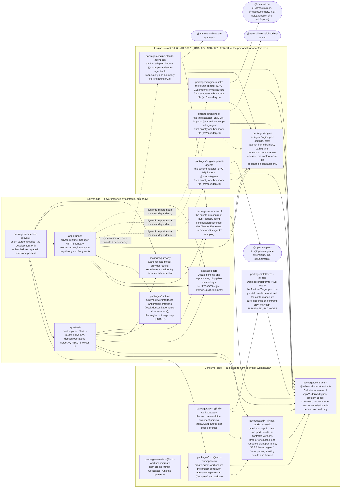
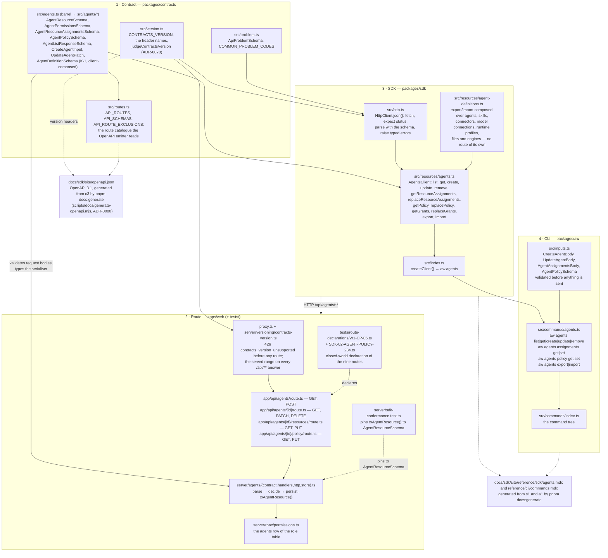
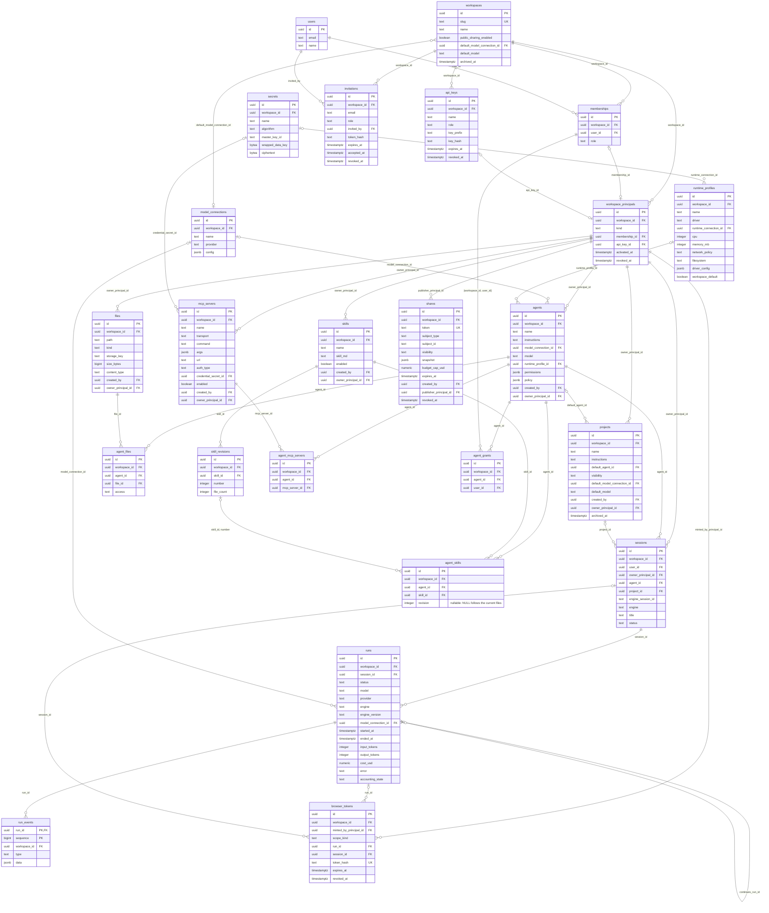

# SDK structure map

One page to read before touching a migration unit (#233–#253): which packages exist, what each
one owns, the only allowed import direction between them, how one resource crosses the four
layers, the tables the SDK surfaces, and the four names every concept has (contract module,
route, SDK method, `aw` command). Everything here is drawn from the tree at the commit this
document was written against — `package.json` dependencies, `dependency-cruiser.config.mjs`,
`packages/core/src/db/schema/**`, `migrations/meta/0021_snapshot.json`, and the generated
reference under `docs/sdk/site/reference/**` — not from the specification. Where the code and
[04](04-api-specification.md) disagree, the code is drawn and a footnote names the section and
the unit that closes the gap. The procedure and the unit order live in the
the migration playbook (maintainers' notes); this page does not repeat them.

## 1. Package map

Arrows are the workspace dependencies each `package.json` declares (`workspace:*`), which is
also the direction `pnpm architecture:check` enforces (`dependency-cruiser.config.mjs`:
`libraries-do-not-import-applications`, `contracts-depend-on-nothing-in-the-workspace`,
`sdk-depends-only-on-contracts`, `aw-depends-only-on-sdk-and-contracts`,
`cli-depends-only-on-sdk-and-contracts`, `create-depends-only-on-cli`,
`engine-port-depends-only-on-contracts`, `run-protocol-depends-only-on-contracts-and-engine`,
`platforms-depend-only-on-contracts`,
`platforms-are-pure`, and the `src/dependencies.test.ts` allowlist (contracts, `zod`, `yaml`, no other
npm package, which dependency-cruiser cannot hold because it excludes `node_modules`),
`engine-adapters-depend-only-on-the-port-and-contracts` (any adapter but the Claude one sees only
the port, the contracts and its own package, never another adapter or `packages/core`),
`claude-adapter-depends-only-on-the-port-contracts-and-run-protocol` (the Claude adapter may also
import `packages/run-protocol`, for its `RunRequest` and `agent.*` mapping),
`core-depends-only-on-contracts`,
`web-does-not-import-an-engine-adapter`,
`runner-reaches-engine-adapters-only-through-engines-ts`). Nothing imports an application;
nothing server-side is reachable from the three consumer packages.

**The three consumer packages and the project CLI are the published ones** (issues #246 and #364,
[ADR-0082](../adr/0082-the-sdk-packages-publish-under-indx-workspace-from-a-tag-with-provenance.md)).
Their workspace names are their npm names: `@indx-workspace/contracts`, `@indx-workspace/sdk`
(subpaths `./events` and `./testing`, the recording `fetch` double and contract-valid fixtures),
`@indx-workspace/platforms` (the pure platform translators, ADR-0133, second in publish order),
`@indx-workspace/aw` (the `aw` bin), `@indx-workspace/cli` (the bins `create-agent-workspace` and
`agent-workspace`; subpath `./create`) and `@indx-workspace/create` (what
`npm create @indx-workspace` runs). Every other member keeps `@agent-workspace/*` and stays
`"private": true`; that scope is a third party's on npm, so no published manifest, template or
`dist/` file may name it (`scripts/release/pack-packages.mjs` refuses one). The CLI therefore
reaches only the SDK and the contracts; the development-only embedded workspace, which imports the
server, is the private `packages/embedded` (`pnpm start:embedded`). The five are released in
lock-step at
`CONTRACTS_VERSION` by `.github/workflows/publish-packages.yml` from a `packages-v<version>` tag,
with npm trusted publishing (provenance is one switch, off while the repository is internal);
CI's heavy-checks packs and installs them on every change (`pnpm release:pack --smoke`).

Two edges deserve a sentence. `apps/web → packages/sdk` exists because the application is the
SDK's first consumer (ADR-0052): today `components/run/live.ts` and `components/run/model.ts`
import the SDK's parsers, and `apps/web/contracts/*.ts` re-export the contracts package for the
rest of the app (deleted family by family in unit 15, #247).
`packages/engine-claude-agent-sdk → claude-agent-sdk` is
the single permitted crossing of the Claude Agent SDK boundary, and
`packages/engine-openai-agents → @openai/agents` the single crossing of the OpenAI Agents SDK's
(its AI SDK bridge and Anthropic provider are confined to the same file), and
`packages/engine-pi → @earendil-works/pi-coding-agent` the single crossing of pi's, and
`packages/engine-mastra → @mastra/core` the single crossing of Mastra's (its MCP client, memory and
the two AI SDK providers are confined to the same file);
`tests/no-sdk-import.test.ts`
scans the whole tracked tree and fails when a second importer appears or the first disappears.

**The engine edges are present as of unit ENG-04 (#303)**, and each is enforced rather than
drawn from intent.
[ADR-0065](../adr/0065-an-agents-engine-is-an-extension-point-behind-one-port.md) D2 fixed the
import direction and
[ADR-0070](../adr/0070-the-engine-port-and-its-first-adapter.md) records what it became:
`packages/engine` depends on `packages/contracts` and `zod` and on nothing else in the workspace,
so it could later be published as an SPI; an adapter depends on `packages/engine`,
`packages/contracts`, its own third-party SDK, and — transitionally, until the private `/run`
contract's v2 — `packages/core`, which still holds `RunRequest` and the ENG-03 `agent.*` mapping;
`apps/runner` imports the port statically and an adapter only through `src/engines.ts` (a dynamic
import by id, from a table of literal specifiers); and `apps/web`'s production code never imports
an adapter at all, knowing engines only as contract values and as its own registry's descriptors.
**Since ENG-07 (#306) a runtime image packages exactly one adapter.** `runtime.Dockerfile` takes
`ENGINE` and copies only `packages/engine-<engine>`, and `packages/runtime`'s `engine-images.ts`
owns the `engine → image` map that both `apps/web` (for `installed` and `422
engine_not_installed`) and `apps/runner`'s manager (for which image a driver starts) parse
([ADR-0073](../adr/0073-one-runtime-image-per-engine.md)). **Since ENG-09 (#308) the runner's
manifest names no adapter** ([ADR-0074](../adr/0074-the-openai-agents-sdk-runs-a-plain-agent-behind-the-port.md)
D11): in the workspace the registry's imports resolve through the root manifest, and in an image
`runtime.Dockerfile` installs the selected adapter through its own filter and links it into the
runner — the dashed edges above. The second adapter, `packages/engine-openai-agents`, depends on
the port and the contracts only (not `packages/core`), and so does the third,
`packages/engine-pi` (ENG-08, #307,
[ADR-0081](../adr/0081-pi-runs-in-process-with-a-pinned-loader-behind-the-port.md)), and the
fourth, `packages/engine-mastra` (ENG-10, #309,
[ADR-0084](../adr/0084-mastra-runs-a-plain-agent-with-memory-over-the-platform-store.md));
`ENGINE_IDS` publishes all four engines.

## 2. Layer diagram — one resource through four layers

`agents` is the resource drawn because it is the freshest surface after unit 2 (#234, merged
as #258). Each layer
imports only the layer to its left across the wire; the server never imports the SDK's client
code, and the CLI never speaks HTTP itself.

`POST /api/agents/:id/runs` (`app/api/agents/[id]/runs/route.ts`, declared in
`tests/route-declarations/W1-CP-04.ts`) is the tenth route under `/api/agents` but belongs to
the runs family: `RunsClient.start` and `aw runs start`.[^policy] Its body takes an optional
`version` (issue #697): a new session runs that numbered version instead of `local`'s, and an
unknown number answers `404 agent_version_not_found`. `aw chat --agent-version <n>|--env <name>`
sends it (`--env` is resolved to a number by the CLI from the version list's pointers).

[^policy]:
    04 §5.9 also lists `archive`/`restore` (RF-201), which waits for the refactoring programme.
    `export`/`import` (K-1, unit 7, #239) has no route: `AgentsClient.export`/`import` compose the
    routes above with the skills, connectors, model-connection, runtime-profile, files and engines
    reads (`src/resources/agent-definitions.ts`, ADR-0076).

## 3. ER diagram — the tables the SDK surfaces

Drawn from `packages/core/src/db/schema/*.ts` and `migrations/meta/0027_snapshot.json` (the
latest snapshot at this commit). Column names are the database's snake_case; `created_at` and
`updated_at` are present on every table and omitted here. Every tenant-owned table carries
`workspace_id`, and every cross-table foreign key is composite on `(id, workspace_id)` so a row
cannot reference another workspace's row; the diagram shows each relationship once.

Four entities are abbreviated to the columns a consumer meets on the wire: `secrets` (the
envelope-encryption nonces and tags are omitted; no ciphertext ever reaches the wire), `runs`
(the cache token counters, `cost_currency`, `price_table_version`, `tool_calls`,
`accounting_error`), `runtime_profiles` (`disk_mb`, `allowed_domains`, `persist_paths`, the two
timeouts) and `shares` (`subject_label`, `mode`, `include`, `spent_usd`, `stopped`,
`passphrase_hash`, `suspended_at`); `api_keys.last_used_at` is omitted too. The schema files
are the full list. `agents.policy` (migration `0021`, unit 2) is `NULL` until the first
`PUT /api/agents/:id/policy`; a `NULL` row means the runner compiles the policy from
`permissions` as before. `agent_grants` stores the membership's `user_id`; the API accepts and
returns that membership's stable `principalId`, so callers never address grants by a user id.

### Tables the SDK does not reach

| Table                                                                   | Why it is not on the wire                                                                                                                                                                                                       | Reachable when                            |
| ----------------------------------------------------------------------- | ------------------------------------------------------------------------------------------------------------------------------------------------------------------------------------------------------------------------------- | ----------------------------------------- |
| `run_tokens`                                                            | `POST /api/runs/:id` revokes a run's tokens, but no SDK method calls it; minted for the runner, never for a consumer                                                                                                            | unit 3 (#235), S-15 (renamed and exposed) |
| `run_usage_records`                                                     | Per-response accounting; `RunResource.usage`/`cost` are the aggregate on `runs`                                                                                                                                                 | never as a resource                       |
| `session_transcripts`, `session_messages`                               | Read only through `sessions.transcript.read` / `.subkeys` as the provider-native transcript; not addressable rows                                                                                                               | —                                         |
| `session_state_streams`, `session_state_entries`, `session_state_blobs` | The engine-scoped session store (ENG-06). Written and read by the runner over the private `/api/sessions/:id/state-*` routes with its per-run token; no SDK method and no browser screen reaches one                            | never as a resource                       |
| `project_files`, `project_mcp_servers`                                  | Surfaced as `ProjectResource.fileIds` / `mcpServerIds`, not as rows                                                                                                                                                             | —                                         |
| `share_views`, `share_run_charges`                                      | Public share-page accounting (`/p/*`), out of scope for the SDK (04 §1)                                                                                                                                                         | never                                     |
| `user_identities`                                                       | OIDC subject ↔ user mapping; sign-in is a browser journey                                                                                                                                                                       | never                                     |
| `audit_events`                                                          | Reachable, but only as `observability.audit.list` / `listAll` on `GET /api/audit-events` (Owner-only, through `authorise`, standard envelope — ADR-0075; cursor-paged on `(created_at, id)`, workspace-bound cursor — ADR-0079) | never as a resource                       |

## 4. Resource ↔ contract ↔ route ↔ SDK ↔ CLI

One row per family, taken from `docs/sdk/site/reference/sdk/*.mdx` (method → route) and
`docs/sdk/site/reference/cli/commands.mdx` (the command tree). The contract module is the
`@indx-workspace/contracts/<family>` subpath, i.e. `packages/contracts/src/<family>.ts`; the
SDK client is `packages/sdk/src/resources/<family>.ts`; the commands are
`packages/aw/src/commands/<family>.ts`.

| Resource           | Contract module                   | Routes (`apps/web/app/api/…`)                                                                                                                                                                                                    | SDK (`aw.…`)                                                                                                                                                                             | `aw` commands                                                                                                                                             | Tables                                                                                                       |
| ------------------ | --------------------------------- | -------------------------------------------------------------------------------------------------------------------------------------------------------------------------------------------------------------------------------- | ---------------------------------------------------------------------------------------------------------------------------------------------------------------------------------------- | --------------------------------------------------------------------------------------------------------------------------------------------------------- | ------------------------------------------------------------------------------------------------------------ |
| Me (the principal) | `team`                            | `GET /me`                                                                                                                                                                                                                        | `me()` (`packages/sdk/src/me.ts`)                                                                                                                                                        | `aw me`                                                                                                                                                   | `workspace_principals`, `memberships`, `api_keys`                                                            |
| Workspaces         | `workspaces`                      | `GET/POST /workspaces`, `GET/PATCH /workspaces/:id`, `POST /auth/workspace` (JSON body → `200 { workspace }`; the form-encoded body still → `303`), `POST /auth/cli-workspace` (a CLI user token), `GET/PATCH /sharing-policies` | `workspaces.list/get/create/update/select`, `workspaces.sharingPolicy.get/set`                                                                                                           | `aw workspaces list                                                                                                                                       | get                                                                                                          | create | update | select`, `aw workspaces sharing-policy get | set` [^s22] | set`[^s22]; no command for`select` (session-only) | `workspaces` |
| Team               | `team`, `invitations`, `api-keys` | `/memberships[/:id]`, `/users`, `/invitations[/:id]`, `/invitations/:id/resend\|accept`, `/api-keys[/:id]`                                                                                                                       | `team.members.*`, `team.users.*`, `team.invitations.*`, `team.apiKeys.*`                                                                                                                 | `aw team members\|users\|api-keys …` [^s22]                                                                                                               | `memberships`, `users`, `invitations`, `api_keys`, `workspace_principals`                                    |
| Endpoint clients   | `endpoint-clients`                | `GET/POST /endpoint-clients`, `GET/PATCH/DELETE /endpoint-clients/:id`, `POST /endpoint-clients/:id/keys`, `POST /endpoint-clients/:id/secret`                                                                                   | `endpointClients.list/get/create/update/revoke/mintKey/rotateSecret`                                                                                                                     | `aw endpoint-clients list\|get\|create\|update\|revoke`, `aw endpoint-clients keys create`, `aw endpoint-clients secret rotate`                           | `endpoint_clients`, `endpoint_client_agents`, `endpoint_client_api_keys`                                     |
| Triggers           | `triggers`                        | `GET/POST /triggers`, `GET/PATCH/DELETE /triggers/:id`, `POST /triggers/:id/secret`, `POST /triggers/:id/fire/:secret` (public, sender-facing) [^fire]                                                                           | `triggers.list/get/create/update/remove/rotateSecret`                                                                                                                                    | `aw triggers list\|get\|create\|update\|remove`, `aw triggers secret rotate`                                                                              | `triggers`, `trigger_deliveries`                                                                             |
| Tokens             | `tokens`                          | `POST /tokens`                                                                                                                                                                                                                   | `tokens.mint`                                                                                                                                                                            | `aw tokens mint`                                                                                                                                          | `browser_tokens`                                                                                             |
| Models             | `models`                          | `GET /models`, `/model-connections[/:id]`, `/model-connections/:id/credential\|test`                                                                                                                                             | `models.discover`, `models.connections.list/get/create/update/remove/rotateCredential/test`                                                                                              | `aw models discover`, `aw models connections …`                                                                                                           | `model_connections`                                                                                          |
| Runtimes           | `runtimes`                        | `/runtime-profiles[/:id]`, `/runtime-connections`                                                                                                                                                                                | `runtimes.profiles.list/get/create/update/remove`, `runtimes.connections.list/create`                                                                                                    | `aw runtimes profiles …`, `aw runtimes connections …` [^runtimes]                                                                                         | `runtime_profiles`, `secrets` (a connection is a secret)                                                     |
| Secrets            | `secrets`                         | `GET/POST /secrets`, `PUT/DELETE /secrets/:id`                                                                                                                                                                                   | `secrets.list/create/replace/remove`                                                                                                                                                     | `aw secrets list\|create\|replace\|remove`                                                                                                                | `secrets`                                                                                                    |
| Files              | `files`                           | `GET/POST /files`, `GET/PATCH/DELETE /files/:id` (id = base64url of the path), `POST /files/:id/upload-urls\|download-urls`                                                                                                      | `files.list/upload/createFolder/download/move/remove/createUploadUrl/createDownloadUrl`                                                                                                  | `aw files list\|upload [--direct]\|mkdir\|download\|move\|remove`                                                                                         | `files`                                                                                                      |
| Skills             | `skills`                          | `GET/POST /skills`, `GET/PATCH/DELETE /skills/:name` (`?export=true`), `POST /skills/:name/revisions`                                                                                                                            | `skills.list/import/get/export/update/publish/remove`                                                                                                                                    | `aw skills list\|get\|import\|export\|update\|publish\|enable\|disable\|remove`                                                                           | `skills`, `skill_revisions`, `agent_skills`                                                                  |
| Connectors (MCP)   | `connectors`                      | `GET/POST /connectors`, `GET/PATCH/DELETE /connectors/:id`, `POST /connectors/:id/test-connection`                                                                                                                               | `connectors.list/get/create/update/remove/rotateCredential/test/testDraft`                                                                                                               | `aw connectors list\|get\|create\|update\|remove\|rotate-credential\|test\|test-draft`                                                                    | `mcp_servers`                                                                                                |
| Engines            | `engines`                         | `GET /engines`                                                                                                                                                                                                                   | `engines.list`                                                                                                                                                                           | `aw engines list`; `aw agents create\|update --engine <id>`                                                                                               | none — the catalogue is deployment configuration, read from `apps/web/server/engines/registry.ts` [^engines] |
| Agents             | `agents`                          | `GET/POST /agents`, `GET/PATCH/DELETE /agents/:id`, `GET/PUT /agents/:id/resources`, `GET/PUT /agents/:id/policy`, `GET/PUT /agents/:id/grants`                                                                                  | `agents.list/get/create/update/remove/getResourceAssignments/replaceResourceAssignments/getPolicy/replacePolicy/getGrants/replaceGrants/export/import` (export/import compose, no route) | `aw agents list\|get\|create\|update\|remove\|export\|import`, `aw agents assignments get\|set`, `aw agents policy get\|set`, `aw agents grants get\|set` | `agents`, `agent_files`, `agent_skills`, `agent_mcp_servers`, `agent_grants`                                 |
| Projects           | `projects`                        | `GET/POST /projects`, `GET/PATCH /projects/:id`, `POST /projects/:id/archive\|restore`, `POST /projects/:id/sessions`                                                                                                            | `projects.list/get/create/update/archive/restore/startSession/adoptSession`                                                                                                              | `aw projects list\|get\|create\|update\|archive\|restore\|start-session\|adopt-session`                                                                   | `projects`, `project_files`, `project_mcp_servers`                                                           |
| Sessions           | `sessions`                        | `GET /sessions`, `GET/PATCH /sessions/:engineSessionId`, `GET /sessions/:engineSessionId/transcript\|subkeys`                                                                                                                    | `sessions.list/listAll/get/update`, `sessions.transcript.read/subkeys`                                                                                                                   | `aw sessions list\|get\|rename\|archive\|restore\|transcript\|subkeys`                                                                                    | `sessions`, `session_transcripts`, `session_messages`                                                        |
| Runs               | `runs`, `run-events`              | `POST /agents/:id/runs`, `GET /runs`, `GET /runs/:id`, `GET /runs/:id/events` (SSE), `POST /runs/:id/interrupt`, `POST /runs/:id/revoke-tokens`                                                                                  | `runs.start/get/list/events/follow/waitForOutcome/interrupt/revokeTokens`                                                                                                                | `aw runs start\|get\|list\|events\|follow\|wait\|interrupt`                                                                                               | `runs`, `run_events`, `run_usage_records`, `run_tokens`                                                      |
| Shares             | `shares`                          | `GET/POST /shares`, `DELETE /shares/:id`                                                                                                                                                                                         | `shares.list/publish/revoke`                                                                                                                                                             | `aw shares list\|revoke` [^publish]                                                                                                                       | `shares`                                                                                                     |
| Observability      | `observability`                   | `GET /metrics`, `GET /audit-events`                                                                                                                                                                                              | `observability.metrics.recentRuns`, `observability.audit.list/listAll`                                                                                                                   | `aw metrics recent-runs`, `aw audit list`                                                                                                                 | `runs` (projection), `audit_events`                                                                          |

Routes not in the table are outside the SDK's scope by 04 §1 (`/api/setup`, `/api/setup/runtime-detect`,
`/api/auth/*`) or wait for a unit: `POST /api/runtimes/:id` (`id` must be `test`; S-4 → unit 9, #241).
`POST /api/runs/:id` stays only as a deprecated alias of `POST /api/runs/:id/revoke-tokens` (unit 3, #235).

[^s22]:
    `aw workspaces list|get|create|update|select` and `aw team invitations list|create|resend|revoke`
    run as a person after `aw login` (unit 10, #242, ADR-0083): `auth.startDevice/pollToken/revoke`
    over `POST /auth/cli-device`, `GET/POST /auth/cli-verify`, `POST/DELETE /auth/cli-token`, and
    an API key is still refused on those routes (ADR W9-WS-119). `team.invitations.accept` stays
    browser-only.

[^runtimes]:
    `aw runtimes detect|test` of 04 §7.2 have no command: `GET /api/setup/runtime-detect` moves to
    `/api/runtimes/detect` (S-9) and `POST /api/runtimes/test` adopts the standard envelope (S-4)
    in unit 9 (#241).

[^publish]:
    `aw shares publish` is absent because the snapshot is still built by the browser; the SDK
    method exists and the server-owned snapshot is RF-103 (refactoring programme).

[^fire]:
    `POST /triggers/:id/fire/:secret` has no SDK method and no `aw` command. Its caller is a provider
    (Microsoft Graph, Zoom, a mail rule) that holds no API key; the URL secret that `triggers.create`
    and `triggers.rotateSecret` return once is its only authentication. `trigger_deliveries` holds
    the dedupe and rate records of firings and is never on the wire.

[^engines]:
    The only family in this table with no row of its own. An engine is not tenant data: it is what
    a deployment installs, so the catalogue lives in configuration and the engine _chosen_ is
    stored on the rows that make the choice — `agents.policy`'s `engine` discriminant,
    `sessions.engine` and `runs.engine` in §3's diagram.

## 5. Conventions

- **Dependency rule.** `contracts ← sdk ← aw`; the three import nothing else from the workspace
  and nothing from `apps/`. `apps/web` may import `contracts`, `sdk`, `core`, `gateway` and
  `runtime`; `apps/runner` imports `core` and `runtime` and is the only importer of
  `@anthropic-ai/claude-agent-sdk`. Every edge is a named error-severity rule in
  `dependency-cruiser.config.mjs`; a new import that crosses one fails `pnpm architecture:check`,
  and a package is imported only through its declared `package.json` exports
  (`pnpm package-exports:check`).
- **Where problem codes live.** The shared envelope and codes are `packages/contracts/src/problem.ts`
  (`ApiProblemSchema`, `ApiProblemDetailSchema`, `COMMON_PROBLEM_CODES`, exported from the root
  entry). A family's own codes sit beside its schemas (`FILES_PROBLEM_CODES`,
  `SKILLS_PROBLEM_CODES`, `SHARES_PROBLEM_CODES`). The server maps domain failures to those codes in
  `apps/web/server/<family>/**`; the SDK raises them as `ApiProblemError.code`; the CLI prints
  `error: <code>: <message>` and exits 1. Never a second copy of a code.
- **Where an engine is described.** Everything the platform knows about one engine (capabilities,
  engine-native settings, narrowing, withheld tool names, MCP tool-name form, session-stream key) is
  its entry in `ENGINE_CATALOGUE` in `packages/contracts/src/engine-catalogue.ts` (ADR-0136). Read
  it; never branch on an engine id.
- **The contracts version.** `CONTRACTS_VERSION` and the negotiation rule live in
  `packages/contracts/src/version.ts`; the served range is declared once, in
  `apps/web/server/versioning/contracts-version.ts`, and applied to every `/api/**` request by
  `apps/web/proxy.ts` before anything else runs. The SDK sends the header from `src/http.ts` and
  raises `426` as `ContractsVersionUnsupportedError`; `aw` prints both versions and the fix
  (`src/version.ts`). A new route inherits all of it; nothing per route is needed (ADR-0078).
- **Adding a resource or an operation** (the playbook's moves 1–7, in this order): the schema in
  `packages/contracts/src/<family>.ts` with its tests → the route in `apps/web/app/api/**`, its
  domain operation in `apps/web/server/<family>/**`, its RBAC row in
  `apps/web/server/rbac/permissions.ts`, and its closed-world declaration in
  `tests/route-declarations/<owner>.ts` (`tests/route-inventory.test.ts` fails on an undeclared
  route) → the conformance case in `apps/web/server/sdk-conformance.test.ts` → the method in
  `packages/sdk/src/resources/<family>.ts` → the command in `packages/aw/src/commands/<family>.ts`
  → one consumer in `apps/web` or the CLI → the route's entry in
  `packages/contracts/src/routes.ts` (`tests/docs/openapi.test.ts` fails on a declared route with
  no entry) → `pnpm docs:generate` (the reference pages, `openapi.json` and `llms.txt`;
  `pnpm docs:check` fails a hand edit) and the 04 §5 row flips ⬜ → ✅.
- **Where the order comes from.** The migration playbook (maintainers' notes) §4 is the
  merge order of the 21 units and §6 the parallel lanes; an issue that disagrees with it is wrong.
