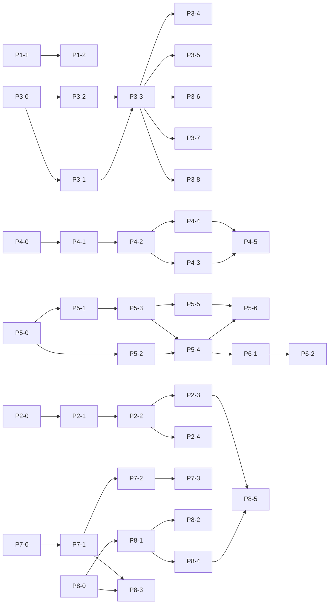

# Path to 100: the enterprise tutorial benchmark

This plan takes the ten [enterprise tutorials](../site/tutorials/index.mdx) from today's scores to
100 on the gallery's own benchmark, one reviewable unit at a time. It is written so a developer new
to the repository can pick up any unit, follow its steps and know when it is done.

Every number here is computed, not estimated: the scores come from
`tests/gallery/<use-case>/benchmark.ts` through `scoreOf` in
[`tests/gallery/harness/benchmark.ts`](../../../tests/gallery/harness/benchmark.ts), and each
unit's "Score effect" names the benchmark cells it moves. The path table was produced by applying
those moves phase by phase; a unit that moves a cell nobody needs, or a cell left uncovered,
fails the calculation. Tracker: #1273.

## Where the tutorials stand (audited 2026-10-18)

All 110 cells were re-audited against `main` by five read-only agents, one per pair of use cases,
and two design studies; every changed verdict cites `file:line` evidence. The audit fixed a
stale probe (`surface-mcp-tool-results`, made obsolete by #1119), a wrong citation in every
per-person scope cell (RF-102 is connector-route authorization, shipped in #237), and verdicts
that applied the rubric unevenly.

| #   | Use case                                                                                                | Agent | Search | Parse | Struct | Approve | Write | Trigger | Scope | UI  | Eval | Audit | Score |
| --- | ------------------------------------------------------------------------------------------------------- | ----- | ------ | ----- | ------ | ------- | ----- | ------- | ----- | --- | ---- | ----- | ----- |
| 1   | [Manual search agent](../site/tutorials/manual-search.mdx)                                              | ✅    | 🟡     | ❌    | 🟡     | —       | —     | —       | ❌    | ✅  | ✅   | ✅    | 63    |
| 2   | [CAD drawing agent](../site/tutorials/cad-drafting.mdx)                                                 | ✅    | 🟡     | 🟡    | 🟡     | 🟡      | ❌    | —       | ❌    | 🟡  | 🟡   | ✅    | 50    |
| 3   | [Quotation agent](../site/tutorials/quotation.mdx)                                                      | ✅    | ✅     | ❌    | 🟡     | ❌      | ❌    | —       | ❌    | 🟡  | ✅   | ✅    | 50    |
| 4   | [Ringi review agent](../site/tutorials/ringi-review.mdx)                                                | ✅    | 🟡     | ❌    | 🟡     | —       | 🟡    | 🟡      | ❌    | ✅  | ✅   | ✅    | 60    |
| 5   | [Customer inquiry agent](../site/tutorials/customer-inquiry.mdx)                                        | ✅    | 🟡     | —     | 🟡     | 🟡      | —     | ❌      | 🟡    | ✅  | ✅   | ✅    | 67    |
| 6   | [Excel consolidation & analysis agent](../site/tutorials/excel-consolidation.mdx)                       | ✅    | 🟡     | 🟡    | 🟡     | 🟡      | ❌    | ❌      | ❌    | ✅  | ✅   | ✅    | 55    |
| 7   | [Contract review agent](../site/tutorials/contract-review.mdx)                                          | ✅    | 🟡     | 🟡    | 🟡     | 🟡      | ❌    | —       | ❌    | 🟡  | ✅   | 🟡    | 50    |
| 8   | [Meeting minutes & action-item agent](../site/tutorials/meeting-minutes.mdx)                            | ✅    | —      | 🟡    | 🟡     | 🟡      | 🟡    | ❌      | ❌    | ✅  | ✅   | ✅    | 60    |
| 9   | [Skill-transfer & maintenance troubleshooting agent](../site/tutorials/maintenance-troubleshooting.mdx) | ✅    | 🟡     | ❌    | 🟡     | 🟡      | 🟡    | —       | 🟡    | ✅  | ✅   | ✅    | 65    |
| 10  | [Quality defect and past-trouble analysis agent](../site/tutorials/quality-defect.mdx)                  | ✅    | 🟡     | 🟡    | 🟡     | 🟡      | —     | —       | ❌    | ✅  | ✅   | ✅    | 67    |

Average: **58.7**.

### The rubric

- ✅ the platform does it: the use case writes no code of its own for this capability.
- 🟡 the use case does it with code it ships (an MCP server, a skill script, a backend step, a
  second run) and its offline suite exercises that code; or the platform does most of it and the
  use case covers the missing part itself.
- ❌ the use case does not do it: the step is left to a person, to a system the gallery does not
  build, or is impossible today.

A cell reaches ✅ only when the platform gains the capability and the use case **deletes** its own
code for it. Re-grading a cell without that is not progress, and no unit in this plan does it.

## The optimal path

Phases are ordered by points per unit of work, then by dependency: the first phase needs no public
contract change, caller identity (the largest gain, nine use cases) comes second, structured output
(a parser deleted from all ten backends) third, and the phases that need an Owner decision come
last so they never block the others. Phases are a recommended order, not a lock: units whose
prerequisites are met can run in parallel.

| After                               | 1   | 2   | 3   | 4   | 5   | 6   | 7   | 8   | 9   | 10  | Average |
| ----------------------------------- | --- | --- | --- | --- | --- | --- | --- | --- | --- | --- | ------- |
| Today                               | 63  | 50  | 50  | 60  | 67  | 55  | 50  | 60  | 65  | 67  | 58.7    |
| P1 Files a run writes come back     | 63  | 60  | 50  | 60  | 67  | 64  | 60  | 60  | 65  | 67  | 61.6    |
| P2 Caller identity for tools        | 75  | 70  | 60  | 70  | 72  | 73  | 70  | 70  | 70  | 78  | 70.8    |
| P3 Structured run output            | 81  | 80  | 65  | 75  | 78  | 77  | 75  | 75  | 75  | 83  | 76.4    |
| P4 Inbound triggers                 | 81  | 80  | 65  | 80  | 89  | 86  | 75  | 85  | 75  | 83  | 79.9    |
| P5 A run that pauses for a person   | 81  | 85  | 75  | 80  | 94  | 91  | 80  | 90  | 80  | 89  | 84.5    |
| P6 Agent writes behind approval     | 81  | 85  | 85  | 85  | 94  | 91  | 80  | 95  | 85  | 89  | 87.0    |
| P7 Attachments on runs and surfaces | 81  | 90  | 100 | 95  | 94  | 91  | 85  | 95  | 95  | 89  | 91.5    |
| P8 Reading and finding documents    | 100 | 100 | 100 | 100 | 100 | 100 | 100 | 100 | 100 | 100 | 100.0   |

Columns are the use-case numbers above. P8 depends on an Owner decision that amends the spec
(see [Owner decisions](#owner-decisions)); if it is declined, the plan ends after P7 at
91.5 and the remaining cells are shown as a documented product ceiling.

### Dependencies

Units with no arrow into them can start now. Within a phase, the ADR unit (`-0`) comes first, the
private layers next (core, engine), then one vertical slice that adds the public contract, then the
gallery migration.

## Principles every unit follows

These apply the repository's [engineering guidelines](../../../ENGINEERING_GUIDELINES.md) (which
turn _Beautiful Code_ into checks) and [architecture rules](../../architecture.md) to this work.
They do not replace them.

1. **Contract first, in the documented direction.** contracts → core → server adapters → SDK
   resource → `aw` CLI → docs ([architecture](../../architecture.md#dependency-rules),
   [SDK structure map](../07-structure-map.md)). The SDK imports only contracts; the CLI only the
   SDK and contracts.
2. **Interface apart from implementation.** The public interface is `@indx-workspace/contracts`
   and `@indx-workspace/sdk`. A server detail (a storage prefix, a header, a table) never leaks
   into it; callers get one named method (`runs.result`, `runs.outputs`, `runs.approve`).
3. **An honest contract.** A public field lands in the same PR as the server code that honours it
   or refuses it by name. The PR that makes a gap probe flip deletes the probe and moves every cell
   citing it ([`tests/gallery/probes.test.ts`](../../../tests/gallery/probes.test.ts)).
4. **One decision, one owner.** A rule used in two places (does this call need approval? does this
   tool name match a surface key? when does this schedule fire?) is one pure function in contracts
   or the domain, tested once, called everywhere.
5. **The smallest honest design.** Each unit lists what it must not build. No interface with one
   implementation, no setting for a value that never changes, no new dependency for a few lines;
   reuse an existing seam (the overlay, the lease pass, the subset matcher) before adding one.
6. **Deletion is the measure.** A capability is done when gallery code is deleted: every gallery
   unit lists the functions it removes in the PR body.
7. **Tests prove behaviour.** Each unit names its tests; a corrected defect gets a regression test
   that fails before the fix; boundary schemas get valid, invalid, unknown-key and bound cases.
8. **Small, owned units.** About 600 lines or less, one layer or one vertical slice, with
   `Owns globs` in the PR body (the CI gate checks the diff against them), respecting files owned
   by the in-flight RF gap programme (#1255).

## How to work a unit

1. Read the unit below and its issue; read the files named in **Why** before editing.
2. Branch from `main` (`feat/<unit-id>-<slug>`), in your own worktree.
3. Write the tests in **Tests to add** first where the unit fixes a defect.
4. Follow **Steps** in order; stay inside **Owns globs**.
5. For a gallery change run `GALLERY_WRITE=1` with the gallery tests to regenerate the tutorial
   tables, then run them again without it.
6. Finish with `pnpm check:fast`, `pnpm test` and `pnpm build`; report any check that could not
   run.
7. Open the PR with `Closes #<issue>`, the Owns globs line and, for a gallery unit, the list of
   deleted functions.

## P1. Files a run writes come back

No public contract change, so it can start at once; the cheapest points in the plan.

### P1-1

**Collect the files a run writes under outputs/ into a run-owned prefix** · #1274

**Phase P1 · layer: server · about 300 lines**

## Why

- A file the agent writes never reaches the file store: the default runtime profile has `persistPaths: null` (apps/web/server/composition/setup.ts:609, mapped to "absent" in compose/runtime-profile.ts:97), so `collectRuntimeOutputs` (runs/launcher.ts:378) returns early.
- When a profile does set it, `promoteOutputs` (compose/workspace-lifecycle.ts:51-69) writes each tar entry at its bare path, so a run can silently overwrite an existing workspace file. That is a latent data-loss bug.

## Steps

1. Write the failing test first: a run that writes `outputs/report.md` under its working directory leaves nothing in the file store (launcher.test.ts).
2. In the launcher, collect `outputs/` relative to the run's working directory after every `completed` run of an agent with `writeFiles`, without needing a profile setting. Keep `persistPaths` behaviour for profiles that set it.
3. In `promoteOutputs`, prefix every entry with `runs/<runId>/outputs/`. Decode first (already done), refuse traversal (already done), never write outside the prefix.
4. Keep the size cap (`maxBytes`) and the public failure message ("Run output could not be saved.").

## Tests to add

- launcher.test.ts: a completed run with a file under outputs/ promotes it to runs/<runId>/outputs/…; a failed run promotes nothing; an agent without writeFiles is not collected.
- workspace-lifecycle.test.ts: an existing object at the same bare path is untouched (regression for the overwrite).
- runner files test: the collection reads the session directory, not the runtime root.

## Acceptance criteria

- The regression test fails on main and passes here.
- No object outside `runs/<runId>/outputs/` is written by output promotion.
- `pnpm check:fast`, `pnpm test` and `pnpm build` green; a check that could not run is reported, never skipped.

## Principles applied

- Fix the root cause in the one shared function (`promoteOutputs`), not in each caller.
- Side effects at the boundary: collection stays in the launcher; the prefix rule is a pure function with its own test.

## Do not build

- A persist-paths settings UI.
- Writing back into read-write grants (concurrent overwrite; waits for #1258 / RF-304).

## Ordering

After #1264.

Coordinate with the RF gap programme (#1255): land after #1264 splits the file, or rebase onto it.

### P1-2

**runs.outputs() in the SDK and `aw runs outputs`, and the gallery reads the agent's own files** · #1275

**Phase P1 · layer: sdk+cli+gallery · about 450 lines**

## Why

- P1-1 stores the files; developers need one call to list and download them instead of knowing the prefix.

## Steps

1. SDK: `aw.runs.outputs(runId, { signal })` returns the file resources under `runs/<runId>/outputs/` (a thin call over the existing files list; no new route).
2. CLI: `aw runs outputs <runId> [--download <dir>]`.
3. Docs: resources/runs.mdx section "Files a run writes"; `pnpm docs:generate`.
4. Gallery: the scripted workspace serves outputs; cad-drafting stops regenerating the DXF in its backend, contract-review returns the agent's redlined .docx, excel-consolidation returns the agent's workbook. Delete the regeneration code and its tests that only existed for the workaround.
5. Update the three write cells to ok / contract and regenerate with GALLERY_WRITE=1.

## Tests to add

- sdk runs.test.ts: outputs() lists only the run prefix and passes the signal.
- aw runs.test.ts: the command prints and downloads.
- Each gallery suite: the backend returns the file the agent wrote.

## Acceptance criteria

- cad-drafting.write, contract-review.write, excel-consolidation.write are ✅ with contract evidence.
- The backend DXF regeneration path in cad-drafting is deleted.
- `pnpm check:fast`, `pnpm test` and `pnpm build` green; a check that could not run is reported, never skipped.

## Principles applied

- Interface over implementation: callers never spell the storage prefix; it lives in one SDK method.
- Deletion is the success measure: list the gallery functions removed in the PR body.

## Do not build

- A new route when the files list already answers it.

## Score effect

- cad-drafting Write ❌ → ✅
- contract-review Write ❌ → ✅
- excel-consolidation Write ❌ → ✅

## Ordering

After #1274 (P1-1).

### P1-3

**Match surface toolResults by tool name, whatever the engine prefixes** · #1276

**Phase P1 · layer: contracts+react · about 150 lines**

## Why

- The widget matches a toolResults key exactly (packages/react/src/surface-chat.tsx:131). Claude names a connector tool `mcp__<connector>__<tool>`, so a surface must spell the connector name, which differs per workspace when the name is not a usable slug (#1109) and differs per engine (Mastra `<server>_<tool>`, OpenAI Agents the bare name).

## Steps

1. Add one pure function in contracts, `toolResultFor(toolName, toolResults)`: exact key first, then a key equal to the part after the last `__`. Export it from the surfaces entry point.
2. Use it at surface-chat.tsx:131. Do not add matching for Mastra's single `_` separator (ambiguous).
3. Document that `toolResults: { find_files: 'table' }` now works; switch the gallery surfaces to bare tool names in the same PR.

## Tests to add

- contracts: exact wins over suffix; `mcp__x__find_files` matches `find_files`; `find_files_v2` does not match `files`.
- react: a card renders for `mcp__x__find_files` keyed `find_files`.

## Acceptance criteria

- Gallery surfaces use bare tool names and still render tables.
- `pnpm check:fast`, `pnpm test` and `pnpm build` green; a check that could not run is reported, never skipped.

## Principles applied

- One decision, one owner: matching lives in contracts and every renderer calls it.

## Do not build

- Regex or glob keys.

## Ordering

No prerequisite; can start now.

## P2. Caller identity for tools

The largest gain after the audit: nine use cases cannot restrict what an agent shows by person. A connector learns who is asking, and a grant can follow the caller.

### P2-0

**ADR-0142 and roadmap N-8: tools learn who is asking** · #1277

**Phase P2 · layer: adr+roadmap · about 150 lines**

## Why

- Per-person scope was cited as RF-102, which is connector-route authorization (shipped, #237). Nothing tracks the real gap; ADR-0105 proposes identity linking.

## Steps

1. Decide a signed identity assertion per run: `x-aw-identity: base64url({ sub, principalKind, workspace, runId, aud, exp }).hmac`, keyed by a per-connector secret, opted in per connector (`identity: { secret }`).
2. Decide `StartRunRequest.subject` (opaque, ≤256 chars) settable only by API-key callers; a signed-in user's run uses their own principal; a browser token cannot set it.
3. Decide per-person file grants as a second step (`files('deals/{team}')` resolved from ADR-0104 teams).
4. Add roadmap N-8.
5. Add probe `run-caller-identity` to tests/gallery/harness/probes.ts (`StartRunRequestSchema.safeParse({ prompt, subject })`) and point the ten scope cells at it, so the day the field lands the benchmark knows.

## Tests to add

- pnpm docs:check

## Acceptance criteria

- ADR accepted; roadmap entry present.
- `pnpm check:fast`, `pnpm test` and `pnpm build` green; a check that could not run is reported, never skipped.

## Principles applied

- Decision before code.

## Do not build

- OAuth per end user in v1.

## Ordering

No prerequisite; can start now.

### P2-1

**Connector identity option, run subject, and the identity assertion helpers** · #1278

**Phase P2 · layer: contracts · about 300 lines**

## Why

- Contracts own the wire shape and the pure sign/verify pair so servers in any language-agnostic stack can verify with the SDK.

## Steps

1. `identity?: { secret }` on ProjectConnectorSchema and the connector resource; `subject?` on StartRunRequest.
2. Pure `signIdentity(payload, key)` / `verifyIdentity(header, key, now)` (WebCrypto HMAC, no new dependency).
3. This PR flips probe `run-caller-identity` (added by P2-0): delete it and move the ten scope cells to interim source evidence citing the new contract. Until P2-2 the server refuses `subject` and connector `identity` with a named problem code, so the contract is never silently ignored.

## Tests to add

- tamper, expiry, wrong key, unknown key in payload.

## Acceptance criteria

- No server change yet; field refused by the server until P2-2 (honest contract).
- `pnpm check:fast`, `pnpm test` and `pnpm build` green; a check that could not run is reported, never skipped.

## Principles applied

- Security at the trust boundary; no secret in logs.

## Ordering

After #1277 (P2-0), #1261.

### P2-2

**Send the identity assertion to opted-in connectors and openapi tools** · #1279

**Phase P2 · layer: server · about 450 lines**

## Why

- Only the code-tool host receives run headers today (`withToolHostRunHeaders`, apps/web/server/compose/run-request.ts:902-940); MCP connectors and openapi tools receive only the connector credential (packages/gateway/src/tools/openapi.ts:2-4).

## Steps

1. Generalise withToolHostRunHeaders into run headers; add x-aw-identity for connectors with identity.
2. Refuse `subject` from browser and user tokens (403).

## Tests to add

- header present only on opted-in connectors; 403 on a browser-token subject.

## Acceptance criteria

- Secret never logged.
- `pnpm check:fast`, `pnpm test` and `pnpm build` green; a check that could not run is reported, never skipped.

## Principles applied

- Generalise the existing seam rather than add a second.

## Ordering

After #1278 (P2-1), #1264.

Coordinate with the RF gap programme (#1255): land after #1264 splits the file, or rebase onto it.

### P2-3

**verifyIdentity in the SDK, `subject` on runs.start, and the gallery scopes by caller** · #1280

**Phase P2 · layer: sdk+cli+gallery · about 500 lines**

## Why

- customer-inquiry mints an HMAC token into the prompt (lib/customer-token.mjs); maintenance names the technician in the prompt; the other connectors cannot filter by person at all.

## Steps

1. Export verifyIdentity; StartRunInput.subject; project-file identity in aw.
2. Gallery: every MCP/openapi connector verifies the assertion and filters by subject; delete customer-token minting and the prompt-carried identities.
3. Scope cells → ok for the connector-based use cases.

## Tests to add

- Each suite: another person's records are refused by subject, not by prompt text.

## Acceptance criteria

- Eight scope cells ✅.
- `pnpm check:fast`, `pnpm test` and `pnpm build` green; a check that could not run is reported, never skipped.

## Principles applied

- Deletion is the measure.

## Score effect

- manual-search Scope ❌ → ✅
- cad-drafting Scope ❌ → ✅
- quotation Scope ❌ → ✅
- ringi-review Scope ❌ → ✅
- customer-inquiry Scope 🟡 → ✅
- excel-consolidation Scope ❌ → ✅
- meeting-minutes Scope ❌ → ✅
- maintenance-troubleshooting Scope 🟡 → ✅
- quality-defect Scope ❌ → ✅

## Ordering

After #1279 (P2-2).

### P2-4

**Per-person file grants: a grant path that follows the caller's team** · #1281

**Phase P2 · layer: vertical · about 550 lines**

## Why

- contract-review's `contracts` grant is per agent: everyone with the page reaches every draft (apps/web/server/compose/resource-loader.ts:494-516).

## Steps

1. `files('contracts/{team}', 'read')`: the placeholder resolves from the run principal's ADR-0104 teams; a run without a resolvable team gets no grant (fail closed).

## Tests to add

- resolution per team; fail closed; tenant isolation.

## Acceptance criteria

- contract-review.scope ✅.
- `pnpm check:fast`, `pnpm test` and `pnpm build` green; a check that could not run is reported, never skipped.

## Principles applied

- Fail closed.

## Do not build

- Arbitrary expressions in grant paths.

## Score effect

- contract-review Scope ❌ → ✅

## Ordering

After #1279 (P2-2).

## P3. Structured run output

Every backend parses free text today; one contract field removes a parser from all ten use cases.

### P3-0

**ADR-0143: a run can be asked for structured output** · #1282

**Phase P3 · layer: adr · about 120 lines**

## Why

- No ADR covers run output. The engine already supports it (the pinned Claude Agent SDK takes `outputFormat: { type: 'json_schema' }`, mapped in `packages/core/src/claude-sdk-events.ts`).

## Steps

1. Decide: `StartRunRequest.outputSchema` (JSON Schema object, root type object, at most 32 KiB); `RunResource.output: { text, structured } | null`, null until completed; `agent.result.output`.
2. Decide: the engine enforces the schema; the server does not add a JSON Schema validator in v1; the SDK re-validates with the caller's Zod schema.
3. Decide: an engine without the catalogue capability `structuredOutput` refuses `outputSchema` with the existing 422 `engine_capability_unsupported`.
4. Record the probe rule: the PR that adds the public field retires probe `run-output-schema` and moves its cells in the same change.

## Tests to add

- pnpm docs:check

## Acceptance criteria

- ADR accepted and indexed.
- `pnpm check:fast`, `pnpm test` and `pnpm build` green; a check that could not run is reported, never skipped.

## Principles applied

- Decision before code; one record per decision.

## Do not build

- Server-side schema validation (new dependency).

## Ordering

No prerequisite; can start now.

### P3-1

**Store a run's output schema and final output** · #1283

**Phase P3 · layer: core · about 300 lines**

## Why

- The run row stores the prompt (packages/core/src/db/schema/runs.ts:177) but nothing about the answer; every backend re-folds `agent.message` frames (tests/gallery/shared/run-answer.ts:47-86).

## Steps

1. One migration: `runs.output_schema jsonb null`, `runs.output jsonb null`.
2. Repository: write output when the run finishes; read it in the run mapper input.
3. Private `RunRequest.outputSchema` (core/src/schemas.ts).

## Tests to add

- PostgreSQL round-trip of both columns; output is written only on completion.

## Acceptance criteria

- Generated migration present; one migration for the wave (merge with P5-2 if they land together).
- `pnpm check:fast`, `pnpm test` and `pnpm build` green; a check that could not run is reported, never skipped.

## Principles applied

- Persistence adapters translate rows to domain values; no Drizzle type leaks into contracts.

## Ordering

After #1282 (P3-0), #1264.

Coordinate with the RF gap programme (#1255): land after #1264 splits the file, or rebase onto it.

### P3-2

**Claude adapter: map outputSchema to outputFormat and return structured_output** · #1284

**Phase P3 · layer: engine · about 350 lines**

## Why

- `buildSdkOptions` (packages/engine-claude-agent-sdk/src/boundary.ts:378-417) never sets `outputFormat`.

## Steps

1. Port: `EngineRunRequest.outputSchema?`.
2. Boundary: pass `outputFormat`; map the result's `structured_output` to `agent.result.output`; map `error_max_structured_output_retries` to a named run failure.
3. Catalogue: `structuredOutput: true` for claude-agent-sdk, false elsewhere.

## Tests to add

- boundary.test.ts: options carry outputFormat only when asked.
- Adapter test: a fake result with structured_output becomes agent.result.output.
- Conformance-kit case.

## Acceptance criteria

- No public contract change in this PR (the probe stays false).
- `pnpm check:fast`, `pnpm test` and `pnpm build` green; a check that could not run is reported, never skipped.

## Principles applied

- The engine port depends only on contracts; the SDK import stays in its one allowed file.

## Do not build

- Structured output for other engines in this unit (P3-6).

## Ordering

After #1282 (P3-0).

### P3-3

**Public contract: outputSchema on runs.start, output on the run, runs.result() in the SDK** · #1285

**Phase P3 · layer: vertical · about 550 lines**

## Why

- This is the change that flips probe `run-output-schema`; per the probe rule it lands as one vertical slice so the server never accepts a field it ignores.

## Steps

1. Contracts: `StartRunRequestSchema.outputSchema` (valid, invalid, unknown key, size bound), `RunResourceSchema.output`, `agent.result.output`; bump CONTRACTS_VERSION; Lean model and vectors if the run contract is modelled.
2. Server: accept and store; refuse with 422 when the engine lacks `structuredOutput`; forward through compose; the relay writes output on finish; the mapper renders it.
3. SDK: `runs.start(agentId, { prompt, outputSchema })` accepts JSON Schema or a Zod schema (`z.toJSONSchema`); new `runs.result(runId, { schema, signal })` follows to the end and returns `{ run, text, output }`, typed when a schema is given.
4. Testing fixtures: `fixtures.run({ output })`.
5. Delete probe `run-output-schema`; move the ten struct cells to `{ verdict: 'work', evidence: 'source', ref: 'packages/contracts/src/runs.ts' }` with the note "contract present, use case not migrated yet" until P3-5.

## Tests to add

- contracts runs.test.ts
- apps/web/server/runs/api.test.ts (422 for an engine without the capability)
- launcher test (output written)
- sdk-conformance.test.ts
- sdk runs.test.ts (result() parses with a Zod schema and rejects a mismatch)

## Acceptance criteria

- probes.test.ts and benchmark.test.ts green with the probe removed.
- runs.result() documented in resources/runs.mdx.
- `pnpm check:fast`, `pnpm test` and `pnpm build` green; a check that could not run is reported, never skipped.

## Principles applied

- Contract first, and honest: a public field is honoured or refused by name, never ignored.
- Interface vs implementation: the SDK exposes `result()`; how the answer is assembled stays server-side.

## Do not build

- Streaming partial structured output.

## Ordering

After #1283 (P3-1), #1284 (P3-2).

Coordinate with the RF gap programme (#1255): land after #1264 splits the file, or rebase onto it.

### P3-4

**`aw runs start --output-schema` and the structured-output guide** · #1286

**Phase P3 · layer: cli+docs · about 250 lines**

## Why

- The CLI is a client like any program; it must reach every public capability.

## Steps

1. Flag reads a JSON Schema file; `aw runs get` prints output.
2. Guide: "Get typed data back from a run" with one Zod example; `pnpm docs:generate`.

## Tests to add

- aw command tests

## Acceptance criteria

- docs:check green.
- `pnpm check:fast`, `pnpm test` and `pnpm build` green; a check that could not run is reported, never skipped.

## Principles applied

- One example, task first.

## Ordering

After #1285 (P3-3).

### P3-5

**Gallery: use cases 1–5 ask for structured output and delete their answer parsers** · #1287

**Phase P3 · layer: gallery · about 500 lines**

## Why

- Every backend parses free text: manual-search 〔…〕, cad-drafting parseChangeSet/parseJson/toHole, quotation lastJsonBlock/parseJson, ringi-review backend/review-sheet.ts, customer-inquiry handoffReason.

## Steps

1. Scripted workspace records outputSchema and serves output.
2. Each use case defines a Zod schema next to its backend and calls runs.result({ schema }).
3. Delete the parsers and their parser-only tests; keep every grounding check (citations against tool results, re-running the cost model).
4. struct cells → ok / contract; GALLERY_WRITE=1.

## Tests to add

- Each suite: the backend reads typed output; grounding checks still refuse bad drafts.

## Acceptance criteria

- Five struct cells ✅.
- PR body lists every deleted function.
- `pnpm check:fast`, `pnpm test` and `pnpm build` green; a check that could not run is reported, never skipped.

## Principles applied

- Struct removes parsing, not verification.

## Score effect

- manual-search Struct 🟡 → ✅
- cad-drafting Struct 🟡 → ✅
- quotation Struct 🟡 → ✅
- ringi-review Struct 🟡 → ✅
- customer-inquiry Struct 🟡 → ✅

## Ordering

After #1285 (P3-3).

### P3-6

**Gallery: use cases 6–10 ask for structured output and delete their answer parsers** · #1288

**Phase P3 · layer: gallery · about 500 lines**

## Why

- excel splitJsonBlock, contract-review parseRiskTable/clauseOf, meeting-minutes itemsFromJson/itemsFromTable/parseActionItems, maintenance paragraphAt and the parse half of inspectTurn, quality-defect the 8D Markdown parse.

## Steps

1. As P3-5 for these five.

## Tests to add

- As P3-5.

## Acceptance criteria

- Five struct cells ✅; tests/gallery/shared/run-answer.ts deleted if unused.
- `pnpm check:fast`, `pnpm test` and `pnpm build` green; a check that could not run is reported, never skipped.

## Principles applied

- Struct removes parsing, not verification.

## Score effect

- excel-consolidation Struct 🟡 → ✅
- contract-review Struct 🟡 → ✅
- meeting-minutes Struct 🟡 → ✅
- maintenance-troubleshooting Struct 🟡 → ✅
- quality-defect Struct 🟡 → ✅

## Ordering

After #1285 (P3-3).

### P3-7

**Evals can check structured output (`expect.output`)** · #1289

**Phase P3 · layer: contracts+server · about 300 lines**

## Why

- Eval expectations are contains / notContains / tool / toolInput / judge (packages/contracts/src/evaluations.ts:46-75): cad-drafting cannot say "the outline is 140 × 90".

## Steps

1. `expect.output`: a subset match on the run's structured output, reusing the toolInput subset matcher.
2. cad-drafting eval pins the change set geometry.

## Tests to add

- contracts schema cases; evaluator subset match (extra keys pass, a differing value fails).

## Acceptance criteria

- cad-drafting.eval ✅.
- `pnpm check:fast`, `pnpm test` and `pnpm build` green; a check that could not run is reported, never skipped.

## Principles applied

- Reuse the existing matcher; no second comparison algorithm.

## Do not build

- JSONPath.

## Score effect

- cad-drafting Eval 🟡 → ✅

## Ordering

After #1285 (P3-3).

### P3-8

**Structured output on the OpenAI Agents and Mastra engines** · #1290

**Phase P3 · layer: engine · about 400 lines**

## Why

- Engine neutrality: a capability the SDK advertises should not depend on the engine choice. OpenAI Agents has `outputType`; Mastra has `structuredOutput`.

## Steps

1. Map outputSchema in each adapter; flip the catalogue flag per engine.

## Tests to add

- Each adapter's boundary test plus the conformance-kit case from P3-2.

## Acceptance criteria

- The 422 refusal remains only for engines that cannot do it.
- `pnpm check:fast`, `pnpm test` and `pnpm build` green; a check that could not run is reported, never skipped.

## Principles applied

- Adapters never import each other.

## Ordering

After #1285 (P3-3).

## P4. Inbound triggers

Independent of every other lever; four use cases start from an event or a schedule.

### P4-0

**ADR-0144: inbound triggers start runs from a webhook or a schedule** · #1291

**Phase P4 · layer: adr · about 120 lines**

## Why

- No route starts a run on an event (probe `inbound-trigger`); roadmap N-3 / #250 is the opposite direction (outbound).

## Steps

1. Decide the trigger resource (webhook | schedule, prompt template with `{{body}}` only), the one-time secret, the owner principal (firing refused once revoked), dedupe by `Idempotency-Key` per trigger, and scheduling via the existing lease pattern (runs/stale-sweep.ts, sessions/retention-cron.ts).
2. Decide `croner` as a direct dependency instead of hand-written cron parsing (rung 5: already in the lockfile transitively).
3. Decide the provider handshakes in scope: Microsoft Graph `validationToken` echo and Zoom `endpoint.url_validation`; no per-provider signature schemes.

## Tests to add

- pnpm docs:check

## Acceptance criteria

- ADR accepted.
- `pnpm check:fast`, `pnpm test` and `pnpm build` green; a check that could not run is reported, never skipped.

## Principles applied

- Decision before code.

## Do not build

- Event filters, JSONPath mapping, retry queues.

## Ordering

No prerequisite; can start now.

### P4-1

**Trigger and trigger-delivery tables** · #1292

**Phase P4 · layer: core · about 350 lines**

## Why

- Triggers need durable definitions and a unique (trigger, delivery key) for dedupe.

## Steps

1. `triggers` (workspace, agent, name, kind, prompt template, cron, timezone, enabled, owner principal, secret hash, last fired).
2. `trigger_deliveries (trigger_id, delivery_key)` unique.
3. Repository in a new file (no #1264 conflict).

## Tests to add

- PostgreSQL: dedupe unique, tenant scoping, secret stored hashed.

## Acceptance criteria

- Generated migration present.
- `pnpm check:fast`, `pnpm test` and `pnpm build` green; a check that could not run is reported, never skipped.

## Principles applied

- Tenant isolation first: every query is workspace-scoped.

## Ordering

After #1291 (P4-0).

### P4-2

**Trigger routes: manage, and fire a webhook that starts a run** · #1293

**Phase P4 · layer: vertical · about 550 lines**

## Why

- The probe-flipping slice: CRUD plus public `POST /api/triggers/:id/fire`.

## Steps

1. Contracts: TriggerResourceSchema and routes.
2. Fire: `Authorization: Bearer <secret>` (a `?token=` fallback only for senders that cannot set headers; document the logging risk); optional Idempotency-Key; starts a run as the owner principal in a new session; answers 202 { run }.
3. Graph `validationToken` and Zoom url-validation echo on fire.
4. RBAC: Builder/Admin manage.
5. Wire in a new per-subsystem module (the shape #1264 moves to), not in register.ts.
6. Retire probe `inbound-trigger`; move the four trigger cells to interim source cells.

## Tests to add

- wrong secret 401; revoked owner 403; duplicate key returns the same run; disabled 404; handshake echo; route inventory.

## Acceptance criteria

- probes.test.ts green with the probe removed.
- `pnpm check:fast`, `pnpm test` and `pnpm build` green; a check that could not run is reported, never skipped.

## Principles applied

- Validate at the trust boundary: the body is untrusted text, capped at MAX_PROMPT_CHARS, never interpreted.

## Do not build

- Provider signature schemes.

## Ordering

After #1292 (P4-1).

### P4-3

**Schedule pass: fire due schedule triggers** · #1294

**Phase P4 · layer: server · about 350 lines**

## Why

- excel-consolidation runs monthly; today "your own cron calls the backend".

## Steps

1. Pure `nextFireAt(cron, timezone, after)` over croner.
2. Long-lived servers: interval under the maintenance lease. Serverless: `/api/cron/triggers` behind CRON_SECRET, added to vercel.json crons.

## Tests to add

- nextFireAt table test across DST and Asia/Tokyo; a due trigger fires once under two concurrent passes.

## Acceptance criteria

- Both wirings tested like retention-cron.
- `pnpm check:fast`, `pnpm test` and `pnpm build` green; a check that could not run is reported, never skipped.

## Principles applied

- Pure decision, effectful shell.

## Ordering

After #1293 (P4-2).

### P4-4

**aw.triggers in the SDK, `aw triggers` and the triggers guide** · #1295

**Phase P4 · layer: sdk+cli+docs · about 450 lines**

## Why

- Every resource crosses the four layers (docs/sdk/07-structure-map.md §2).

## Steps

1. create / list / get / update / remove; create returns the secret once.
2. CLI mirrors it; structure map row; docs page.

## Tests to add

- SDK resource tests with fetchDouble; CLI tests.

## Acceptance criteria

- Structure map lists the resource.
- `pnpm check:fast`, `pnpm test` and `pnpm build` green; a check that could not run is reported, never skipped.

## Principles applied

- One resource, four layers, one name.

## Ordering

After #1293 (P4-2).

### P4-5

**Gallery: ringi, excel, meeting and customer inquiry start from triggers** · #1296

**Phase P4 · layer: gallery · about 450 lines**

## Why

- ringi hosts its own webhook and dedupe store; excel, meeting and customer inquiry name a cron, a Graph/Zoom listener and a mail handler they do not build.

## Steps

1. ringi: delete the webhook host, memoryKeyStore/ProcessedKeyStore and parseSubmission; promptFor becomes a template.
2. excel: a schedule trigger. meeting: a webhook trigger fed by the Graph subscription. customer inquiry: a webhook trigger fed by the mail provider's inbound-parse webhook.
3. Cells → ok / contract.

## Tests to add

- Each suite fires its trigger against the scripted workspace.

## Acceptance criteria

- Three trigger cells ✅; ringi's is re-scored not needed (#1573).
- `pnpm check:fast`, `pnpm test` and `pnpm build` green; a check that could not run is reported, never skipped.

## Principles applied

- Deletion is the measure.

## Score effect

- ringi-review Trigger 🟡 → — (not needed; the backend starts each run with Idempotency-Key, #1573)
- excel-consolidation Trigger ❌ → ✅
- meeting-minutes Trigger ❌ → ✅
- customer-inquiry Trigger ❌ → ✅

## Ordering

After #1294 (P4-3), #1295 (P4-4).

## P5. A run that pauses for a person

Approval and handoff; it amends ADR-0065 D9 and is the prerequisite for agent writes.

### P5-0

**ADR-0145: a run stops for approval or handoff and continues in its session** · #1297

**Phase P5 · layer: adr · about 150 lines**

## Why

- ADR-0065 D9 lists interactive approvals and handoffs as non-goals; ADR-0108 D30 is deferred because "no run can pause today"; the refactoring plan defers a waiting status "until a runtime feature requires it". This is that feature.

## Steps

1. Stop-and-continue, not a live wait: `awaiting_approval` ends the runtime (tokens revoked, accounting settled) and is not session-busy.
2. Decision route `POST /api/runs/:id/approval { decision, comment }` answers 202 with a continuation run in the same session; a second decision is 409.
3. Declaration on the Claude arm: `engine.requireApproval: GrantingToolRule[]` next to autoApprove; ProjectPolicy.approval stays notBuilt.
4. Handoff: a platform tool `handoff_to_person({ reason })` emitting `agent.handoff`, opted in with `engine.handoff: true`.
5. Amend ADR-0065 D9 and reactivate ADR-0108 D30.

## Tests to add

- pnpm docs:check

## Acceptance criteria

- ADR accepted; D9 amended.
- `pnpm check:fast`, `pnpm test` and `pnpm build` green; a check that could not run is reported, never skipped.

## Principles applied

- Decision before code.

## Do not build

- A live in-run wait.
- A workflow engine or multi-approver chains.
- Approvals on non-Claude engines in v1.

## Ordering

No prerequisite; can start now.

### P5-1

**One decision for "does this call need approval": needsApproval and the canonical call key** · #1298

**Phase P5 · layer: contracts · about 200 lines**

## Why

- The engine (canUseTool) and the gateway (write backstop, P6) must agree on the same answer.

## Steps

1. Pure `needsApproval(rules, toolName)` and `canonicalCall(name, input)` (canonical JSON, no hashing).
2. `requireApproval` rule schema in the Claude arm; regenerate the golden schema.

## Tests to add

- Unit tests only; no probe flips.

## Acceptance criteria

- Golden schema updated.
- `pnpm check:fast`, `pnpm test` and `pnpm build` green; a check that could not run is reported, never skipped.

## Principles applied

- One decision, one owner, used by every caller.

## Ordering

After #1297 (P5-0).

### P5-2

**The awaiting_approval run status and the approved calls a continuation may make** · #1299

**Phase P5 · layer: core · about 350 lines**

## Why

- RUN_STATUSES has no pause (packages/contracts/src/runs.ts:10; core copy core/src/db/schema/runs.ts:45-49 with a check constraint at :217).

## Steps

1. Migration: widen the status check; `runs.pending_approval jsonb`, `runs.approved_tool_calls jsonb`.
2. Transitions: running → awaiting_approval → completed; refuse awaiting_approval → running.
3. Stale sweep and session_busy skip awaiting_approval.

## Tests to add

- PostgreSQL transition tests.

## Acceptance criteria

- Coordinated with RF-301's run state machine if it has started.
- `pnpm check:fast`, `pnpm test` and `pnpm build` green; a check that could not run is reported, never skipped.

## Principles applied

- Model states as a closed union with exhaustive switches.

## Ordering

After #1297 (P5-0), #1264.

Coordinate with the RF gap programme (#1255): land after #1264 splits the file, or rebase onto it.

### P5-3

**Claude adapter: stop on a call that needs approval** · #1300

**Phase P5 · layer: engine · about 450 lines**

## Why

- There is no canUseTool in boundary.ts:378-417, so an unapproved tool is simply denied (#1021).

## Steps

1. canUseTool overlay: a matching rule whose canonical call is not approved emits `agent.approval.requested` and returns `{ behavior: 'deny', interrupt: true }`; the runner reports outcome awaiting_approval.
2. Compose strips requireApproval rules from allowedTools (allowedTools bypasses canUseTool) and stops wildcard-approving connectors that expose write operations.
3. Catalogue `approvals: true` for Claude only; others refuse requireApproval with 422.
4. Update the Lean EngineToolPolicy vectors.

## Tests to add

- boundary/overlay tests; runner outcome mapping; formal refinement test.

## Acceptance criteria

- No public status yet.
- `pnpm check:fast`, `pnpm test` and `pnpm build` green; a check that could not run is reported, never skipped.

## Principles applied

- Pitfall named in the code comment: allowedTools bypasses canUseTool.

## Ordering

After #1298 (P5-1).

Coordinate with the RF gap programme (#1255): land after #1264 splits the file, or rebase onto it.

### P5-4

**Public approval: awaiting_approval, the approval route, runs.approve/reject** · #1301

**Phase P5 · layer: vertical · about 550 lines**

## Why

- The probe-flipping slice for `run-approval`.

## Steps

1. Public status, `pendingApproval` on RunResource, `agent.approval.requested` frame, the route.
2. New runs/approval.ts modelled on runs/interrupt.ts: starts the continuation via service.ts with approvedToolCalls=[call] and a prompt (approved / rejected: <comment>). RBAC = start-run grant.
3. SDK `runs.approve(id, { comment })`, `runs.reject(id, { comment })`; runs.result() returns at awaiting_approval. CLI `aw runs approve|reject`.
4. Retire probe run-approval; interim source cells.

## Tests to add

- api tests (409 on a second decision); launcher conclude; sdk-conformance; contracts status golden.

## Acceptance criteria

- Probe removed, tests green.
- `pnpm check:fast`, `pnpm test` and `pnpm build` green; a check that could not run is reported, never skipped.

## Principles applied

- Honest contract: a status the server can produce, nothing speculative.

## Ordering

After #1299 (P5-2), #1300 (P5-3).

Coordinate with the RF gap programme (#1255): land after #1264 splits the file, or rebase onto it.

### P5-5

**Handoff to a person: the handoff tool and the agent.handoff frame** · #1302

**Phase P5 · layer: vertical · about 400 lines**

## Why

- customer-inquiry and maintenance detect handoff phrases in free text (「担当者におつなぎします」).

## Steps

1. In-process MCP tool `handoff_to_person({ reason })` through the existing overlay seam (the CLAUDE_SKILL_SCRIPT_SERVER pattern, boundary.ts:389-395).
2. Frame `agent.handoff { reason }`; the run ends completed.
3. The widget shows the handoff state.
4. Retire probe run-handoff.

## Tests to add

- frame schema; adapter emits it; widget renders it.

## Acceptance criteria

- Probe removed.
- `pnpm check:fast`, `pnpm test` and `pnpm build` green; a check that could not run is reported, never skipped.

## Principles applied

- Reuse the overlay seam; no new extension mechanism.

## Ordering

After #1300 (P5-3).

### P5-6

**Gallery: approvals and handoffs replace the two-run flows and phrase detection** · #1303

**Phase P5 · layer: gallery · about 550 lines**

## Why

- Two runs in one session (cad, excel, meeting), a pending queue (quotation), phrase detection (customer, maintenance), decisions after the run (contract review, quality DR).

## Steps

1. Delete meeting-minutes mcp/approval.mjs and checkApproved; the cad double run; excel's second confirmation run; quotation's pending handling; phrase detection in customer and maintenance.
2. contract-review and quality-defect pause for legal / the DR decision.
3. May be split into two PRs of four use cases.

## Tests to add

- Each suite drives awaiting_approval → approve → completed against the scripted workspace.

## Acceptance criteria

- Eight hitl cells ✅.
- `pnpm check:fast`, `pnpm test` and `pnpm build` green; a check that could not run is reported, never skipped.

## Principles applied

- Deletion is the measure.

## Score effect

- cad-drafting Approve 🟡 → ✅
- quotation Approve ❌ → ✅
- excel-consolidation Approve 🟡 → ✅
- contract-review Approve 🟡 → ✅
- meeting-minutes Approve 🟡 → ✅
- customer-inquiry Approve 🟡 → ✅
- maintenance-troubleshooting Approve 🟡 → ✅
- quality-defect Approve 🟡 → ✅

## Ordering

After #1301 (P5-4), #1302 (P5-5).

## P6. Agent writes behind approval

openapiTool write operations, executed only for an approved call.

### P6-1

**openapiTool write operations, executed only for an approved call** · #1304

**Phase P6 · layer: contracts+gateway · about 500 lines**

## Why

- TOOL_OPERATION_METHODS is GET/HEAD (packages/contracts/src/tool-connectors.ts:81); ADR-0113 SD4 refuses writes until runs can pause.

## Steps

1. Allow POST/PUT/PATCH/DELETE rules; every write operation is implicitly requireApproval.
2. Gateway sends a JSON requestBody and executes a write only when the canonical call is in runs.approved_tool_calls; otherwise a tool error approval_required (backstop against a curl past canUseTool).
3. Amend ADR-0113 SD4.

## Tests to add

- tool-connectors.test.ts; gateway openapi.test.ts (unapproved refused, approved executes with body); authorize.test.ts.

## Acceptance criteria

- connector_write_unsupported removed or renamed consistently.
- `pnpm check:fast`, `pnpm test` and `pnpm build` green; a check that could not run is reported, never skipped.

## Principles applied

- Defence in depth: engine and gateway call the same needsApproval.

## Do not build

- Non-JSON request bodies.

## Ordering

After #1301 (P5-4).

### P6-2

**openapiTool accepts write rules; gallery agents write to ERP, workflow, tracker and log** · #1305

**Phase P6 · layer: sdk+gallery · about 450 lines**

## Why

- The agent cannot book a quote, post a ringi comment, create a task or log a fix without your own server.

## Steps

1. SDK accepts write rules; compose adds implicit approval; retire probe openapi-write.
2. quotation books after approval; ringi posts its comment (delete the retry store); meeting-minutes replaces most of mcp/tasks.mjs with an openapiTool `POST /tasks`; maintenance logs through openapiTool.

## Tests to add

- define tests; each suite writes only after approval.

## Acceptance criteria

- Four write cells ✅.
- `pnpm check:fast`, `pnpm test` and `pnpm build` green; a check that could not run is reported, never skipped.

## Principles applied

- Deletion is the measure.

## Score effect

- quotation Write ❌ → ✅
- ringi-review Write 🟡 → ✅
- meeting-minutes Write 🟡 → ✅
- maintenance-troubleshooting Write 🟡 → ✅

## Ordering

After #1304 (P6-1).

## P7. Attachments on runs and surfaces

Parked by #611 for lack of a customer; six gallery use cases are that evidence.

### P7-0

**Un-park attachments (#542) and record the design: file-store references, not inline bytes** · #1306

**Phase P7 · layer: owner-decision+adr · about 120 lines**

## Why

- #542 was parked by #611 "no customer has asked yet"; six gallery use cases need it. ADR-0108:63-64 accepted attachments if small; #541 found they are.

## Steps

1. Owner un-parks #542.
2. ADR: `attachments: [{ fileId }]` (≤10, unique) reusing the grant path; read-only; refused for agents without readFiles (422); concealed 404 for a foreign id; a surface upload route stores under `.attachments/<sessionId>/`.

## Tests to add

- pnpm docs:check

## Acceptance criteria

- Owner decision recorded on #542.
- `pnpm check:fast`, `pnpm test` and `pnpm build` green; a check that could not run is reported, never skipped.

## Principles applied

- Reuse the grant path instead of a second file channel.

## Do not build

- Inline base64 (384 KiB cap).
- Claude document/image content blocks: the Read tool already reads PDFs and images.

## Ordering

No prerequisite; can start now.

### P7-1

**Run attachments: contract, server and SDK** · #1307

**Phase P7 · layer: vertical · about 550 lines**

## Why

- StartRunRequestSchema is strict with no attachments (packages/contracts/src/runs.ts:135-161).

## Steps

1. Contract + problem codes run_attachment_not_found / run_attachments_unreadable; Lean vectors.
2. Server authorises each id with the files read check, appends `{ fileId, access: 'read' }` to the run grants, adds "Attached (read-only): <path>" to the user turn; browser tokens refused until P7-2.
3. SDK StartRunInput.attachments.
4. Change probe run-attachments to send `{ fileId }`, then retire it.

## Tests to add

- parser parity (Zod vs hand parser); foreign id concealed; agent without readFiles 422; sdk body.

## Acceptance criteria

- Probe removed.
- `pnpm check:fast`, `pnpm test` and `pnpm build` green; a check that could not run is reported, never skipped.

## Principles applied

- Honest contract.

## Ordering

After #1306 (P7-0), #1264.

Coordinate with the RF gap programme (#1255): land after #1264 splits the file, or rebase onto it.

### P7-2

**Surface attachments: parts.attachments, a session upload route and the composer** · #1308

**Phase P7 · layer: vertical · about 550 lines**

## Why

- SurfacePartsSchema refuses attachments (packages/contracts/src/surfaces.ts:273-312).

## Steps

1. `parts.attachments: boolean`; `POST /p/s/<name>/sessions/:id/attachments` with a size cap, reusing the fixed upload path from #1258; returns a fileId.
2. Composer: a native file input; images downscaled with canvas.
3. Retire probe surface-attachments.

## Tests to add

- size cap; session scoping; composer sends the fileId.

## Acceptance criteria

- Probe removed.
- `pnpm check:fast`, `pnpm test` and `pnpm build` green; a check that could not run is reported, never skipped.

## Principles applied

- Native platform first (file input, canvas).

## Do not build

- An upload library.

## Ordering

After #1307 (P7-1), #1258.

### P7-3

**Gallery: drawings, quotes, drafts and photos arrive as attachments** · #1309

**Phase P7 · layer: gallery · about 500 lines**

## Why

- "Upload with aw files upload and name the file in the chat" in four tutorials; quotes left to a person in ringi; no photo in maintenance.

## Steps

1. Delete the upload-first steps; ringi attaches the 見積書; maintenance attaches the photo; quotation attaches the drawing (the Read tool reads PDF and images).

## Tests to add

- Each suite starts a run with attachments.

## Acceptance criteria

- Cells below ✅.
- `pnpm check:fast`, `pnpm test` and `pnpm build` green; a check that could not run is reported, never skipped.

## Principles applied

- Deletion is the measure.

## Score effect

- cad-drafting UI 🟡 → ✅
- quotation UI 🟡 → ✅
- contract-review UI 🟡 → ✅
- ringi-review Parse ❌ → ✅
- maintenance-troubleshooting Parse ❌ → ✅
- quotation Parse ❌ → ✅

## Ordering

After #1308 (P7-2).

## P8. Reading and finding documents

Built-in extraction and retrieval are spec non-goals today; this phase starts with the Owner decision that amends the spec.

### P8-0

**Owner decision: amend the spec to allow built-in document reading and search** · #1310

**Phase P8 · layer: owner-decision+adr · about 150 lines**

## Why

- docs/spec.md lists "document extraction pipelines" (:110), "RAG pipelines" and "vector databases" (:101-102) as features not to add, and §16 (:1124-1128) and §38 (:2492-2503) as non-goals. Without this decision, search and parse cannot honestly reach ✅.

## Steps

1. Owner decides. If yes, the ADR narrows the change: on-demand text extraction (no ingestion pipeline) and lexical full-text search over extracted text in PostgreSQL (tsvector); no embeddings, no vector store, no external service.
2. If no, the plan stops here and the gallery shows these cells as a documented product ceiling.

## Tests to add

- pnpm docs:check

## Acceptance criteria

- Decision recorded either way.
- `pnpm check:fast`, `pnpm test` and `pnpm build` green; a check that could not run is reported, never skipped.

## Principles applied

- A spec non-goal is changed by an explicit decision, never by a quiet feature.

## Do not build

- Vector search in v1.

## Ordering

No prerequisite; can start now.

### P8-1

**Built-in document reader: PDF, Excel, Word and DXF to text** · #1311

**Phase P8 · layer: vertical · about 550 lines**

## Why

- Every use case parses its own formats; tests/gallery/shared/skills/office-reader already reads xlsx and docx with Node alone.

## Steps

1. Promote office-reader into a first-party skill package shipped with the platform and referenced as `builtinSkill('office-reader')`; add PDF text and ASCII DXF entities.
2. Runs through run_skill_script (no shell).

## Tests to add

- Golden extraction per format; refuses encrypted PDFs by name.

## Acceptance criteria

- Skill available without user code.
- `pnpm check:fast`, `pnpm test` and `pnpm build` green; a check that could not run is reported, never skipped.

## Principles applied

- Promote what exists before writing new code.

## Do not build

- OCR in v1.

## Ordering

After #1310 (P8-0).

### P8-2

**Gallery: use the built-in reader instead of per-use-case parsers** · #1312

**Phase P8 · layer: gallery · about 450 lines**

## Why

- manual-search cannot read PDF; cad, excel, contract review and quality defect ship their own parsers.

## Steps

1. Swap parsers for builtinSkill('office-reader'); keep domain checks.

## Tests to add

- Suites green with the parsers deleted.

## Acceptance criteria

- Cells below ✅.
- `pnpm check:fast`, `pnpm test` and `pnpm build` green; a check that could not run is reported, never skipped.

## Principles applied

- Deletion is the measure.

## Score effect

- manual-search Parse ❌ → ✅
- cad-drafting Parse 🟡 → ✅
- excel-consolidation Parse 🟡 → ✅
- contract-review Parse 🟡 → ✅
- quality-defect Parse 🟡 → ✅

## Ordering

After #1311 (P8-1).

### P8-3

**Audio transcription for runs (meeting minutes)** · #1313

**Phase P8 · layer: owner-decision+vertical · about 500 lines**

## Why

- Meeting minutes takes text only; audio is transcribed in Teams or Zoom.

## Steps

1. Owner decides whether transcription belongs in the platform; if yes, an audio attachment is transcribed through the workspace's model connection when the provider supports it, and refused by name otherwise.

## Tests to add

- refusal for an unsupported provider; transcript reaches the turn.

## Acceptance criteria

- meeting-minutes.parse ✅ or recorded as a ceiling.
- `pnpm check:fast`, `pnpm test` and `pnpm build` green; a check that could not run is reported, never skipped.

## Principles applied

- Stretch: only after P8-0.

## Do not build

- A bundled speech model.

## Score effect

- meeting-minutes Parse 🟡 → ✅

## Ordering

After #1310 (P8-0), #1307 (P7-1).

### P8-4

**Built-in search over workspace files** · #1314

**Phase P8 · layer: vertical · about 550 lines**

## Why

- Eight use cases host their own index server (probe built-in-index).

## Steps

1. Index extracted text on upload in PostgreSQL full-text (tsvector, Japanese-aware tokenisation decided in P8-0).
2. `GET /api/files/search?q=` and a built-in agent tool `search_files` that returns path, page and snippet for citations.
3. SDK files.search; retire probe built-in-index.

## Tests to add

- tenant isolation; grant scoping (a run sees only granted folders); Japanese query.

## Acceptance criteria

- Probe removed.
- `pnpm check:fast`, `pnpm test` and `pnpm build` green; a check that could not run is reported, never skipped.

## Principles applied

- Smallest honest design: lexical first.

## Do not build

- Embeddings.

## Ordering

After #1311 (P8-1).

### P8-5

**Gallery: built-in search, openapiTool reads and the postgres gate replace hosted index servers** · #1315

**Phase P8 · layer: gallery · about 500 lines**

## Why

- manual, cad, ringi, excel, contract review use files; customer inquiry and maintenance read business systems that openapiTool already covers; quality defect reads its quality system through the same openapiTool route (#1572), so it no longer needs the postgres connector gate (#598).

## Steps

1. File-based use cases → search_files.
2. customer-inquiry CRM and maintenance trouble log → openapiTool reads with caller identity; PII masking stays in the CRM API.
3. quality-defect → QMS API read with openapiTool and caller identity; createCase is the gated write (#1572). #598 is not needed.

## Tests to add

- Suites green with index servers deleted.

## Acceptance criteria

- Cells below ✅.
- `pnpm check:fast`, `pnpm test` and `pnpm build` green; a check that could not run is reported, never skipped.

## Principles applied

- Deletion is the measure.

## Score effect

- manual-search Search 🟡 → ✅
- cad-drafting Search 🟡 → ✅
- ringi-review Search 🟡 → ✅
- excel-consolidation Search 🟡 → ✅
- contract-review Search 🟡 → ✅
- customer-inquiry Search 🟡 → ✅
- maintenance-troubleshooting Search 🟡 → ✅
- quality-defect Search 🟡 → ✅

## Ordering

After #1314 (P8-4), #1280 (P2-3).

### P8-6

**Skill revisions so a review shows which rules applied (#251, N-1)** · #251

**Phase P8 · layer: existing-issue**

## Why

- contract-review.audit is 🟡 until a skill has immutable revisions pinned in the agent version.

## Steps

1. Tracked by #251; the gallery cell flips when it lands.

## Acceptance criteria

- contract-review.audit ✅.

## Score effect

- contract-review Audit 🟡 → ✅

## Ordering

No prerequisite; can start now.

## Owner decisions

| Decision                                                                                  | Blocks                | Why it is the Owner's                                                         |
| ----------------------------------------------------------------------------------------- | --------------------- | ----------------------------------------------------------------------------- |
| Accept ADR-0145 amending ADR-0065 D9 (approvals and handoffs were non-goals)              | P5, P6                | Reverses an accepted decision.                                                |
| Un-park attachments (#542, parked by #611)                                                | P7                    | A product priority call; the gallery is the customer evidence #611 asked for. |
| Amend docs/spec.md (:101-102, :110, §16, §38) for on-demand extraction and lexical search | P8                    | A spec non-goal.                                                              |
| Audio transcription in the platform                                                       | P8-3                  | A product scope call.                                                         |
| Reopen the postgres connector gate (#598)                                                 | quality-defect search | No longer needed by the gallery (#1572).                                      |

## Coordination with the RF gap programme

#1264 is splitting `apps/web/server/composition/register.ts`, `compose/run-request.ts` and the
core repositories now. Units that edit those files say so and land after the split; units that only
add new files (contracts, a new table, an SDK resource) can start immediately. New problem codes go
through the shared `problem()` helper that #1259 consolidates.

## Housekeeping found by the audit

- #792 (promote agents with code tools) is implemented by PR #844 and can be closed.
- The roadmap's RF-102 entry described per-row connector authorization, which shipped in #237.
