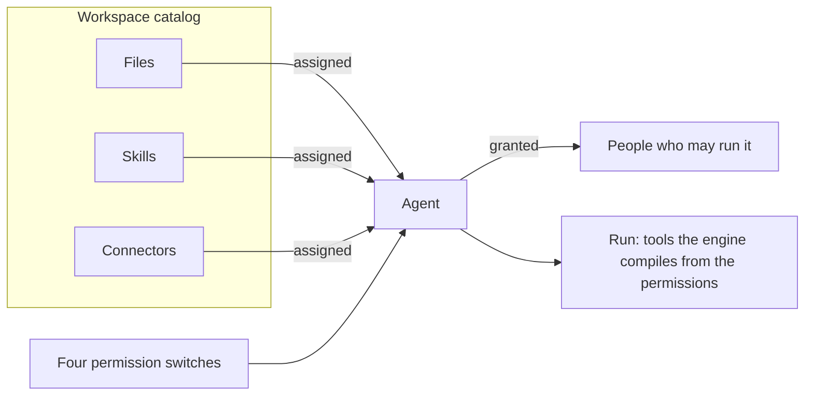

<Info>
**Chapter 2 · Build your agent — step 2 of 7** · [the chapter map](/path/build)

- **You will:** decide what the support agent may do: its permissions, its engine, and the files, skills and connectors it may reach.
- **You will learn:** least privilege with the four permission switches, what each engine refuses, and how assignment differs from ownership.
- **You need:** an agent, as files from [Agents as code](/guides/agents-as-code) or created with `aw agents create`.

</Info>

An agent is a record you create with `aw.agents` or the `aw` CLI: instructions, a model, four
permission switches, and the files, skills and connectors it may reach. This page shows how to set
each one up and what it decides once a run starts.

**What you can do**

- [Create an agent](#create-an-agent)
- [Give it only the tools it needs](#tool-permissions-and-least-privilege)
- [Give it files, skills and connectors](#assigning-resources-files-skills-connectors)
- [Run it on another engine](#run-it-on-another-engine)
- [Continue a conversation, or set a project's default agent](#projects-and-sessions)
- [Move or delete it](#what-you-can-and-cannot-do-today)



<Tip>
  Prefer files in a repository? Define the agent with `defineAgent` and save it with `aw push`; see
  [Agents as code](/guides/agents-as-code).
</Tip>

## Create an agent

One command creates the agent and assigns its resources:

```sh title="illustrative" claim="illustrative"
aw agents create --file agent.json --skill <skillId> --connector <connectorId> --grant-file <fileId>:read
```

`agent.json` holds the `name`, `instructions`, `modelConnectionId`, `model` and all four
`permissions` switches; a minimal one is in the [CLI overview](/cli/overview). `null` for the model
fields means the workspace default. The SDK equivalent is `aw.agents.create(input, { assignments })`.

| Field                         | Decides                                                                                                                                                                                                                        |
| ----------------------------- | ------------------------------------------------------------------------------------------------------------------------------------------------------------------------------------------------------------------------------ |
| `name`                        | How the agent is picked out in a list. Unique per workspace, trimmed.                                                                                                                                                          |
| `instructions`                | The system-level instructions merged into every run. Empty is valid.                                                                                                                                                           |
| `modelConnectionId` / `model` | Which provider connection and model the run uses, or `null` for the workspace default — see [Choose models and runtimes](/building/models-and-runtimes).                                                                       |
| `runtimeProfileId`            | Which sandbox sizing, network policy, and filesystem policy the run executes under, or `null` for the workspace default — see [Choose models and runtimes](/building/models-and-runtimes) and [Runtimes](/resources/runtimes). |
| `permissions`                 | The four tool-permission booleans — see the next section.                                                                                                                                                                      |

Every field, its bounds and error codes are on [Agents](/resources/agents#the-agent-record). Starting
and streaming a run is on [Runs](/resources/runs).

<Accordion title="Complete SDK example: connector, skill, agent and a run">

```ts title="design-an-agent.ts" claim="compile"
import { createClient } from '@indx-workspace/sdk';

const baseUrl = process.env.AGENT_WORKSPACE_URL;
const apiKey = process.env.AGENT_WORKSPACE_API_KEY;
if (baseUrl === undefined || apiKey === undefined) {
  throw new Error('Set AGENT_WORKSPACE_URL and AGENT_WORKSPACE_API_KEY');
}
const aw = createClient({
  baseUrl,
  auth: { kind: 'api-key', apiKey },
});

async function main(): Promise<void> {
  const token = process.env.INTERNAL_MCP_TOKEN;
  if (token === undefined) throw new Error('Set INTERNAL_MCP_TOKEN');

  // Connectors and skills are their own Configure resources — see /resources/connectors and
  // /resources/skills. An agent only references them by id/name; it does not own them.
  const connector = await aw.connectors.create({
    name: 'internal-search',
    transport: 'http',
    url: 'https://mcp.internal.example.com',
    authType: 'bearer',
    credential: token,
  });

  const skillMd = [
    '---',
    'name: release-notes',
    'description: Draft release notes from merged pull requests.',
    'allowed-tools: Read, Grep',
    '---',
    '',
    'Read the merged PRs since the last tag and draft release notes.',
  ].join('\n');
  const skill = await aw.skills.import({
    name: 'release-notes',
    files: [{ path: 'SKILL.md', contentBase64: Buffer.from(skillMd, 'utf8').toString('base64') }],
  });
  // A skill is addressed by name everywhere else on this site, but resource *assignment* is by
  // id — see "Assigning resources" below.

  // Least privilege: every permission starts false, and only the ones this agent's job needs
  // are turned on. K-2: the assignments are composed into the same request as create, one call.
  const { agent } = await aw.agents.create(
    {
      name: 'Release notes writer',
      instructions: 'Summarise merged pull requests into three user-facing release-note bullets.',
      modelConnectionId: null, // null = the workspace's default model connection
      model: null, //              null = the workspace's default model
      runtimeProfileId: null, //   null = the workspace's default runtime profile
      permissions: {
        readFiles: true,
        writeFiles: false,
        runCommands: false,
        unrestrictedNetwork: false,
      },
    },
    {
      assignments: {
        files: [],
        skillIds: [skill.id],
        connectorIds: [connector.id],
      },
    },
  );

  const started = await aw.runs.start(agent.id, {
    prompt: 'Summarise the last week of merged pull requests.',
  });
  const finished = await aw.runs.waitForOutcome(started.run.id);
  console.log(finished.status, finished.usage.totalTokens);
}

main();
```

</Accordion>

## Tool permissions and least privilege

`permissions` is four booleans — `readFiles`, `writeFiles`, `runCommands`, `unrestrictedNetwork` —
and every one is required on `create`: there is no default, because an agent whose permissions
nobody chose is an agent whose blast radius nobody chose. A permission that is `false` removes its
tools from the run outright:

| When this permission is `false` | These SDK tools are denied        |
| ------------------------------- | --------------------------------- |
| `readFiles`                     | `Read`, `Glob`, `Grep`            |
| `writeFiles`                    | `Write`, `Edit`, `NotebookEdit`   |
| `runCommands`                   | `Bash`, `BashOutput`, `KillShell` |
| `unrestrictedNetwork`           | `WebFetch`, `WebSearch`           |

The four permissions are tool gates, plus one network floor: they are not a sandbox by
themselves. `unrestrictedNetwork` also decides how wide a network the run's sandbox may be given,
so a shell cannot reach the internet an agent was not trusted with. When the agent's runtime
profile asks for `open` and the permission is `false`, the run's network policy is lowered before
the sandbox is created:

| Runtime profile policy | `unrestrictedNetwork`        | The run gets                                                                                     |
| ---------------------- | ---------------------------- | ------------------------------------------------------------------------------------------------ |
| `none`                 | any                          | `none` (the model gateway only)                                                                  |
| `restricted`           | any                          | `restricted`, the profile's own `allowedDomains`                                                 |
| `open`                 | `true`                       | `open`                                                                                           |
| `open`                 | `false`                      | `restricted`, limited to the hosts of the agent's remote connectors (Docker and Kubernetes only) |
| `open`                 | `false`, no remote connector | `none`                                                                                           |

Only the `docker` and `kubernetes` drivers enforce the lowered `restricted`, through their
per-session egress proxy, and only when the deployment sets `AGENT_WORKSPACE_EGRESS_PROXY_IMAGE` for
both the web app and the runner manager. Without it, and always on Cloud Run (`cloud-run-service`)
and ACA (`aca-sessions`), the run fails with `network_policy_unenforceable`, whose message names
the hosts it was lowered to. It never falls back to `open`: grant the agent `unrestrictedNetwork`,
remove its remote connectors, or run it on Docker or Kubernetes. `none` and a granted `open` run on
every driver. Any other policy a driver cannot enforce refuses the run through the driver's own
check. The `local` runtime enforces no network policy and is not lowered. A deployment's policy
ceiling that turns `unrestrictedNetwork` off lowers the network the same way (ADR-0119).

**Least privilege in practice:** start every new agent with all four permissions `false` and turn
on only what its instructions actually require. `runCommands` and `unrestrictedNetwork` together
are the highest-blast-radius combination — a shell plus outbound network — so reserve that pairing
for agents whose job genuinely needs both, not as a default. A `read-write` file assignment on an
agent whose `writeFiles` is `false` is ineffective: the write tools are denied before the file is
ever reached, so grant the permission and the access together.

<Note>
  These four booleans are a **floor**, not a complete mapping of the Claude Agent SDK's tool surface
  — the SDK exposes tools this checkbox set does not name. `toolPolicyFor`'s own comment calls this
  out directly. Read the table as the guaranteed minimum, not as an exhaustive list.
</Note>

<AccordionGroup>
  <Accordion title="Why a deny list, not an allow list">

What each boolean turns into is compiled server-side, once per run, by `toolPolicyFor` in
`apps/web/server/compose/run-request.ts` (`AgentPermissionsSchema` is in
`packages/contracts/src/agents.ts`). A permission that is `false` adds tool names to the Claude Agent
SDK's `disallowedTools`. The server does not maintain an allow list, because the SDK's own
`allowedTools` only auto-approves a tool — it does not remove the tool's definition — and a run has
no interactive user to answer a permission prompt. Denying removes the tool outright.

  </Accordion>
  <Accordion title="The policy getPolicy answers is the base, not the effective, one">

`aw.agents.getPolicy(id)` answers the agent's policy **as stored** — or, for an agent nobody has
called `replacePolicy` on, the policy derived from the four checkboxes. For a `claude-agent-sdk`
policy two further layers are applied on top when a run is actually composed, and neither appears in
that body:

- **Connector auto-approvals.** Every connector assigned to the agent adds an
  `mcp__<server>__*` entry to the run's `autoApprove`.
- **Read-only file-grant denials.** Every `'read'` file assignment adds
  `Write(…)`, `Edit(…)`, `NotebookEdit(…)` and `Bash` entries to the run's `deny`.

So `tools.autoApprove` and `tools.deny` in the response are the lists a run _starts_ from, not the
lists it ends up with: an agent with a connector assigned reports `autoApprove: []` while every one
of its runs auto-approves that connector's tools. To audit an agent's full run-time surface, read
its resource assignments (`getResourceAssignments`) alongside its policy. Both layers only ever
narrow or auto-approve what the checkboxes already allow — neither can widen an agent past them.

  </Accordion>
</AccordionGroup>

## Run it on another engine

An agent runs on `claude-agent-sdk` unless its policy names another engine. Switch with one command:

```sh title="illustrative" claim="illustrative"
aw agents update <id> --engine openai-agents   # or: pi, mastra
```

It prints the translated policy before it applies it. `aw engines list` (`aw.engines.list()`) shows
which engines this deployment offers and what each can honour. The SDK equivalent is
`aw.agents.replacePolicy(agentId, { engine, skills, limits, … })`.

Each engine compiles its own tools from the same four permissions, and a capability an engine lacks
is a typed refusal (`422 engine_capability_unsupported`), never a silently narrower run:

| Engine             | Not supported, so refused                                  |
| ------------------ | ---------------------------------------------------------- |
| `claude-agent-sdk` | a fork                                                     |
| `openai-agents`    | an assigned skill, a fork                                  |
| `pi`               | an assigned connector (`capability: 'mcp'`)                |
| `mastra`           | a fork; a connector tool whose policy asks for an approval |

**Switching an engine never widens the agent.** What the old policy withheld is carried into the new
one. A denial the new engine cannot express — an MCP tool, an MCP glob or a wildcard — is refused
`422 engine_switch_would_widen`, `details` naming each rule, and nothing is stored. See
[Runtime neutrality](/concepts/runtime-neutrality) for the side-by-side table.

<AccordionGroup>
  <Accordion title="OpenAI Agents SDK (openai-agents)">

```ts title="illustrative" claim="illustrative"
await aw.agents.replacePolicy(agentId, {
  engine: 'openai-agents',
  skills: { mode: 'allowlist', names: [] },
  limits: { maxTurns: 20, maxBudgetUsd: null },
  reasoningEffort: 'medium', // optional: 'minimal' | 'low' | 'medium' | 'high'
  parallelToolCalls: true, // optional
  withheldPermissions: ['runCommands'], // optional: switches turned off whatever the checkbox says
});
```

The arm carries no tool grammar. Its tools are compiled from the same four permissions:

| Permission            | `openai-agents` tools                                                                                                          |
| --------------------- | ------------------------------------------------------------------------------------------------------------------------------ |
| `readFiles`           | `read_file`, `list_files`, `search_files`                                                                                      |
| `writeFiles`          | `apply_patch` (a write inside a read-only file grant is refused and the file is unchanged)                                     |
| `runCommands`         | `shell` — withheld while the agent has a read-only file grant                                                                  |
| `unrestrictedNetwork` | no tool of its own; remote (HTTP/SSE) connectors are allowed without it, as on Claude; it still sets the sandbox network floor |

The engine declares `skills: false` and `fork: false`, so an agent with a skill assigned, or a fork,
is refused `422 engine_capability_unsupported` rather than run without it. `maxTurns` is the SDK's
own. `maxBudget` is `'adapter'` and **provisional**: the adapter prices the usage the gateway reports
back and stops the run with `stopReason: 'max_budget'` when a `maxBudgetUsd` is reached; a cap on a
model its price table does not list is refused when the run starts. Enforcement moves into the
gateway for every engine later (#342). The model is reached through the gateway in the model
connection's own dialect — the Responses API for an OpenAI-family connection, Anthropic Messages for
an Anthropic-family one — and billing comes only from the gateway's usage records. The engine's
tracing export is always off.

  </Accordion>
  <Accordion title="pi coding agent (pi)">

```ts title="illustrative" claim="illustrative"
await aw.agents.replacePolicy(agentId, {
  engine: 'pi',
  skills: { mode: 'allowlist', names: [] },
  limits: { maxTurns: 20, maxBudgetUsd: null },
  thinkingLevel: 'medium', // optional: 'off' | 'minimal' | 'low' | 'medium' | 'high'
  withheldPermissions: ['runCommands'], // optional: switches turned off whatever the checkbox says
});
```

This arm has no tool grammar either; its tools are pi's own four built-ins, selected by the same
permissions:

| Permission            | `pi` tools                                                                                                             |
| --------------------- | ---------------------------------------------------------------------------------------------------------------------- |
| `readFiles`           | `read` (a read outside the workspace is blocked)                                                                       |
| `writeFiles`          | `write`, `edit` (a write into a read-only file grant or `.pi` is blocked, `..` and symlinks included)                  |
| `runCommands`         | `bash` — withheld while the agent has a read-only file grant; it runs with the request's environment, not the runner's |
| `unrestrictedNetwork` | no tool of its own                                                                                                     |

The engine declares `mcp: false`, so an agent with a connector assigned is refused
`422 engine_capability_unsupported` with `capability: 'mcp'` rather than run without it. Skills,
resume and fork are supported; skills are placed at `.pi/skills/<name>/`, and pi loads only those
and the agent's instructions (appended to pi's own system prompt) — nothing from `~/.pi`,
`~/.agents` or the project's `AGENTS.md`, `.agents/skills` or `.pi/extensions`. `maxTurns` and
`maxBudget` are both `'adapter'`: the adapter counts turns and stops the run with
`stopReason: 'max_turns'`, and — provisionally, from the same price table — stops it with
`stopReason: 'max_budget'`; a cap on a model the table cannot price is refused. The engine speaks
only Anthropic Messages to the gateway, the gateway's native ingress, so it reaches any provider: the
gateway translates the request for an OpenAI-family connection.

  </Accordion>
  <Accordion title="Mastra (mastra)">

```ts title="illustrative" claim="illustrative"
await aw.agents.replacePolicy(agentId, {
  engine: 'mastra',
  skills: { mode: 'allowlist', names: [] },
  limits: { maxTurns: 20, maxBudgetUsd: null },
  toolCallConcurrency: 4, // optional: 1–16 tool calls at once per step
  withheldPermissions: ['runCommands'], // optional: switches turned off whatever the checkbox says
});
```

This arm has no tool grammar and no memory option; its tools are Mastra's own workspace tools,
selected by the same permissions (each is `mastra_workspace_`-prefixed):

| Permission            | `mastra` tools                                                                                                                                                            |
| --------------------- | ------------------------------------------------------------------------------------------------------------------------------------------------------------------------- |
| `readFiles`           | `read_file`, `list_files`, `grep`, `file_stat`                                                                                                                            |
| `writeFiles`          | `write_file`, `edit_file`, `mkdir`, `delete` (a write into a read-only file grant or `.mastra` is refused by the workspace's filesystem, `..`, `~` and symlinks included) |
| `runCommands`         | `execute_command` and the process tools — withheld while the agent has a read-only file grant; they run with the request's environment, not the runner's                  |
| `unrestrictedNetwork` | no tool of its own                                                                                                                                                        |

Connectors, skills and resume are supported: a connector's tools reach the model through Mastra's
MCP client and stream as `agent.tool.call` with `kind: 'mcp'`, and skills are placed at
`.mastra/skills/<name>/` and read as workspace skills. A fork is refused (`fork: false`), and so is
a connector tool whose policy asks for an approval. `maxTurns` is `'native'` (Mastra's `maxSteps`)
and `maxBudget` is the same provisional `'adapter'` cap. The engine speaks each connection's own
dialect — Anthropic Messages, OpenAI Responses or Chat Completions — through the gateway only.
Conversation memory is kept in the platform's session store, so a second run on the same session
recalls the first; semantic recall and working memory are off, and Mastra's telemetry is off.

  </Accordion>
  <Accordion title="How a switch translates what was withheld">

When the `PUT` changes `engine`, the server carries what the old arm withheld into the new one: a
Claude `tools.deny` of `Bash` becomes `withheldPermissions: ['runCommands']` (no `shell`), a denial
of `Write`, `Edit` or `NotebookEdit` withholds `writeFiles` (no `apply_patch`),
`permissionMode: 'plan'` withholds `writeFiles` and `runCommands`, and a denial of a tool this engine
does not have simply stays absent. The `200` body is the translated policy. A switch between
`claude-agent-sdk` and `pi` is carried the same way, naming pi's tools (a `Bash` denial withholds
`runCommands`, so no `bash`), and a switch between `openai-agents` and `pi` carries
`withheldPermissions` verbatim. `mastra` is carried the same way, naming Mastra's workspace tools.

  </Accordion>
</AccordionGroup>

## Assigning resources: files, skills, connectors

Assign files, skills and connectors when you create the agent (the `--skill`, `--connector` and
`--grant-file` flags above, or `{ assignments }` in the SDK), or later with
`aw agents assignments set <id> --file <json>` (`aw.agents.replaceResourceAssignments`). That call
replaces the whole set at once; there is no partial patch, so read the current set first
(`aw agents assignments get <id>`) when you mean to add. Full contract on
[Agents](/resources/agents#getresourceassignments).

- **Files.** A `'read-write'` grant is capped by the agent's own `writeFiles` permission; the response
  shows what was actually stored, which may be narrower than what you asked for.
- **Skills** are assigned by their resource-catalog id. See [Author a skill](/building/skills).
- **Connectors**, once assigned, are auto-approved for the run (`agentConfigFor` in
  `apps/web/server/compose/run-request.ts`); an assigned connector's own calls do not need
  `unrestrictedNetwork`, though a project's own connector associations do (see
  [Projects](/resources/projects)). See [Connect an MCP server](/building/mcp-servers).

Assignment decides which agent may load or call a resource, never who may edit the resource: a
Builder may assign any other Builder's skill, connector or file to their own agent. A resource sits in
the workspace's **catalog**, is **assigned** to an agent, and an agent is **granted** to a person; see
[Ownership and sharing](/concepts/ownership-and-sharing).

## Projects and sessions

- **Continue a conversation.** Pass `sessionId` to `aw.runs.start` to continue a
  [session](/resources/sessions) instead of starting fresh. See
  [Run lifecycle](/concepts/run-lifecycle).
- **Give a class of work a default agent.** A [project](/resources/projects) can name a
  `defaultAgentId`; `aw.projects.startSession` runs that agent, with the project's own instructions
  appended after the agent's (`agentConfigFor`, `apps/web/server/compose/run-request.ts`) rather than
  replacing them.

## What you can and cannot do today

| Do                                                                                    | How                                                                                                                          |
| ------------------------------------------------------------------------------------- | ---------------------------------------------------------------------------------------------------------------------------- |
| Create, read, update, and list agents                                                 | `aw.agents.create` / `get` / `update` / `list`                                                                               |
| Choose a model, model connection, and runtime profile, or leave the workspace default | the agent's `modelConnectionId`, `model`, `runtimeProfileId` fields, `null` for default                                      |
| Grant least-privilege tool permissions                                                | the four `permissions` booleans, compiled into a Claude Agent SDK deny list                                                  |
| Assign files, skills, and connectors                                                  | `create(input, { assignments })` in one call, or `aw.agents.getResourceAssignments` / `replaceResourceAssignments` afterward |
| Read and replace the agent's tool, skill and limit policy                             | `aw.agents.getPolicy` / `replacePolicy`                                                                                      |
| Give a project a default agent                                                        | `aw.projects.create`/`update`'s `defaultAgentId`                                                                             |
| Move an agent to another workspace                                                    | `aw.agents.export` / `import` — see [Move an agent between workspaces](/building/moving-agents)                              |
| Delete an agent                                                                       | `aw.agents.remove` — see the warning below before you rely on this                                                           |

<Warning>
  **Today:** `aw.agents.remove` cascades through the agent's sessions, runs, events, transcripts,
  and usage records — there is no soft-archive. **Target:** `POST /api/agents/:id/archive` and
  `restore`; history references never cascade; `remove` is reserved for a retention workflow.
  Tracked as [RF-201](/concepts/roadmap#rf-201-agent-archive-instead-of-delete).
</Warning>

<Note>
  A Viewer may run only agents whose grant list includes the Viewer's membership principal id. Read
  and replace that list with `aw.agents.getGrants` and `aw.agents.replaceGrants`.
</Note>

## See also

<CardGroup cols={2}>
  <Card title="Agents" href="/resources/agents">
    The full `AgentResource` contract, every method, every error code.
  </Card>
  <Card title="Author a skill" href="/building/skills">
    What a SKILL.md directory is, how it is materialized, and how to assign one.
  </Card>
  <Card title="Connect an MCP server" href="/building/mcp-servers">
    Transports, credentials, and how a connector reaches the model.
  </Card>
  <Card title="Choose models and runtimes" href="/building/models-and-runtimes">
    Model connections, runtime drivers, and profiles.
  </Card>
</CardGroup>
