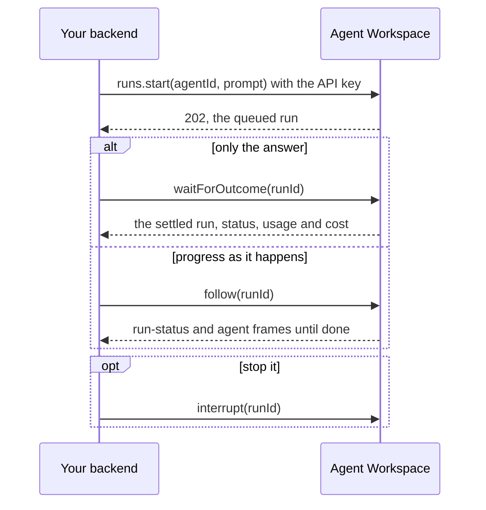

<Info>
**Chapter 4 · Put it in your product — step 6 of 8** · [the chapter map](/path/embed)

- **You will:** start the agent from your own server or CI job and get its answer.
- **You will learn:** which role to mint a key with, wait versus stream, and how to map SDK errors onto your own API.
- **You need:** an API key ([Authentication](/getting-started/authentication)) and a running project ([Quickstart](/getting-started/quickstart)).

</Info>

Start agents from your own server, a CI job, or anything that isn't a browser: the backend holds a
workspace API key, starts a run, and waits for or streams the outcome. A backend in another
language follows the same shape over raw HTTP — see [Call the API without the SDK](/building/http-api).
`createClient` and `aw.*` are the **Consume** surface; the agents, runs and sessions you touch
through it are **Configure** data ([Public surface and stability](/concepts/public-surface)).

What you can do:

- [Call an agent from code in a few minutes](#call-it-from-code-starting-from-aw-dev), starting from `aw dev`
- [Mint a key with the right role](#which-role-to-mint)
- [Wait for the answer, or stream progress](#start-and-wait-vs-streaming)
- [Learn when a run finished, without webhooks](#learn-when-a-run-finished)
- [Stop a run](#stopping-a-run)
- [Turn SDK failures into your own API's errors](#mapping-sdk-errors-onto-your-own-api)
- [Run an agent from CI with no code](#running-aw-from-ci-as-the-no-code-alternative)



## Call it from code, starting from `aw dev`

This continues [Your first agent](/getting-started/quickstart): `npm run dev` is running in
`my-agent`, and you want your own code to start a run on its `assistant` agent.

<Steps>
  <Step title="Try it from the CLI">

In a second terminal, inside `my-agent`, `aw` already knows the workspace: it takes the URL from
`agent-workspace.yaml` and the key `aw dev` stored, so no `AGENT_WORKSPACE_*` variable is set.

```sh title="illustrative" claim="illustrative"
npx aw agents list
npx aw runs start <agent-id> --prompt "Say hello." --follow
```

  </Step>
  <Step title="Mint a key for your code">

The URL is `http://127.0.0.1:3000` unless `environments.local.port` in `agent-workspace.yaml` says
otherwise. The SDK is already a pinned dependency of the project; do not reinstall it.

`aw dev`'s own key may not mint keys (`npx aw team api-keys create` answers
`403 local_runtime_key_not_permitted`), so mint this one in the console: sign in at
`http://127.0.0.1:3000`, open **Administration → API Keys** (`/admin/api-keys`) and create an
`admin` key. It is shown once. Admin, because a Builder key runs only agents its own member created,
and `aw dev` saved these.

```sh title="illustrative" claim="illustrative"
export AGENT_WORKSPACE_URL=http://127.0.0.1:3000
export AGENT_WORKSPACE_API_KEY=ak_live_...
```

  </Step>
  <Step title="Start the run and wait for it">

```ts title="first-run.ts" claim="compile"
import { createClient } from '@indx-workspace/sdk';

const aw = createClient({
  baseUrl: process.env.AGENT_WORKSPACE_URL!,
  auth: { kind: 'api-key', apiKey: process.env.AGENT_WORKSPACE_API_KEY! },
});
const agent = (await aw.agents.list()).find((candidate) => candidate.name === 'assistant');
const { run } = await aw.runs.start(agent!.id, { prompt: 'Say hello.' });
const settled = await aw.runs.waitForOutcome(run.id);
console.log(settled.status, settled.usage.totalTokens);
```

  </Step>
</Steps>

The SDK does not read these variables itself; you pass them to `createClient`
([Configuration](/getting-started/configuration)). Against a deployed control plane the same code
works with that URL and key.

<Accordion title="first-run.ts with checks and a timeout">

```ts title="first-run.ts" claim="compile"
import { createClient } from '@indx-workspace/sdk';

const baseUrl = process.env.AGENT_WORKSPACE_URL;
const apiKey = process.env.AGENT_WORKSPACE_API_KEY;
if (baseUrl === undefined || apiKey === undefined) {
  throw new Error('set AGENT_WORKSPACE_URL and AGENT_WORKSPACE_API_KEY');
}
const aw = createClient({ baseUrl, auth: { kind: 'api-key', apiKey }, timeoutMs: 15_000 });

const agent = (await aw.agents.list()).find((candidate) => candidate.name === 'assistant');
if (agent === undefined) throw new Error('no assistant yet: is npm run dev running?');
const { run } = await aw.runs.start(agent.id, { prompt: 'Say hello.' });
const settled = await aw.runs.waitForOutcome(run.id);
console.log(settled.status, settled.usage.totalTokens);
```

</Accordion>

## Which role to mint

An API key's role is fixed at mint time; to change it, revoke and reissue.
[`aw.team.apiKeys.create`](/resources/team#apikeys-create) takes `{ name, role, expiresAt? }`, with
`role` one of `'owner' | 'admin' | 'builder' | 'viewer'`
([Membership roles](/concepts/workspaces-and-principals#membership-roles)). The key is shown only
once, in the response; store it then.

| Job                                                                                                  | Mint with                  | Why                                                                                                                                                                                                                                                              |
| ---------------------------------------------------------------------------------------------------- | -------------------------- | ---------------------------------------------------------------------------------------------------------------------------------------------------------------------------------------------------------------------------------------------------------------- |
| Run-only automation — start agents, read runs and sessions, nothing else                             | `builder`                  | Builder has "read any, write/run own" on agents and "read own" on runs: it runs only agents this key's member created, so an agent `aw dev` or another member saved needs `admin`.                                                                               |
| Administration — managing team members, secrets, model connections, runtime profiles and connections | `owner` or `admin`         | A Builder or Viewer key gets `403 forbidden` on every write to them. A Builder may read runtime profiles, but not change them; secrets are Owner-only.                                                                                                           |
| Anything under `/api/workspaces` or `/api/invitations`                                               | Neither — no API key works | Every route in both families refuses an API-key principal, any role, with `403 api_key_not_permitted`. Only `auth: { kind: 'session' }` reaches them — see [Which credential for which job](/concepts/workspaces-and-principals#which-credential-for-which-job). |

In practice the first key comes from a person signed into the control plane (`auth: { kind:
'session' }`), since you need a credential with a role that can confer the one you mint. Full
reference: [Team](/resources/team).

<Tip>
  Call [`aw.me()`](/reference/sdk/client#me) (`aw me` from the CLI) on start-up to confirm which
  workspace and role a key resolved to. It is the cheapest way to catch a key pasted from the wrong
  environment.
</Tip>

## Start-and-wait vs. streaming

Want only the final answer? Call [`waitForOutcome`](/resources/runs#waitforoutcome), as above. Want
to relay progress (a job log, a websocket to your own frontend)? Read
[`follow`](/resources/runs#follow) and forward frames as they arrive:

```ts title="stream-and-relay.ts (illustrative)" claim="illustrative"
const signal = new AbortController().signal; // tie this to your own job's cancellation
for await (const frame of aw.runs.follow(runId, { signal })) {
  if (frame.kind === 'run-status') console.log('job log:', { status: frame.data.status });
  if (frame.kind === 'runtime') console.log('job log:', { runtime: frame.name });
}
```

Both share the same reconnect behaviour. Every frame kind is on [Streaming](/guides/streaming).

## Learn when a run finished

Nothing calls back into your backend when a run finishes. Two patterns work today:

- **Stay in-process:** call `follow` or `waitForOutcome` from the same request or job that started
  the run. This is the common case.
- **Check from another process:** persist the run id (and the last event id, if you have one),
  then call [`runs.get`](/resources/runs#get) for its `status`, or reopen the stream with
  [`runs.follow(runId, { after: lastEventId })`](/resources/runs#follow).

Polling `runs.list` on a timer for "everything that changed" is not supported: `RunListQuery` has
no `updatedAfter` or similar field. Poll `runs.get(runId)` for a run id you already have.

<Note>
  **Today:** a backend learns that a run finished by following its stream or polling `runs.get` —
  there is no callback. **Target:** a workspace registers an endpoint and receives signed
  `run.completed`, `run.failed` and `run.cancelled` events, retried with backoff and deduplicated by
  run id. Tracked as [N-3](/concepts/roadmap#n-3-webhooks-for-run-outcomes).
</Note>

## `runs.start` is not idempotent — detect a duplicate before retrying

`runs.start` answers `202` with no dedupe: calling it twice makes two runs, and there is no
`Idempotency-Key`. Before retrying an uncertain `start` (a timeout, a redeploy, a queue
redelivery), list by `agent` and correlate by `sessionId` —
[Retries and idempotency](/guides/retries-and-idempotency#runs-start-is-not-idempotent) has the
pattern and the retry rule for every other method.

<Note>
  **Today:** a retried `runs.start` after a lost response may start a second run; detect it yourself
  by listing. **Target:** an `Idempotency-Key` request header, honoured server-side. Tracked as
  [S-6](/concepts/roadmap#s-6-idempotency-keys).
</Note>

## Stopping a run

`aw.runs.interrupt(runId)` (`POST /api/runs/:id/interrupt`) stops a run this caller may run: it
makes the run terminal (`cancelled`) and revokes its gateway tokens, whether or not the runtime
itself can be reached. Stopping your own `follow` (or aborting its `signal`) only ends _your_
view of the run — call `interrupt` to stop the run itself. See [`interrupt`](/resources/runs#interrupt).

## Mapping SDK errors onto your own API

Branch on the three typed failures — never on `message` — and translate them:

| SDK error                | Means                                                      | A typical mapping                                                    |
| ------------------------ | ---------------------------------------------------------- | -------------------------------------------------------------------- |
| `ApiProblemError`        | The server refused (`status`, `code`)                      | Pass a 4xx through; fold a 5xx to `502`; retryable on `429` or `503` |
| `ContractViolationError` | The response did not match the contract                    | `502`, do not retry                                                  |
| `TransportError`         | No response arrived (`aborted` says whether you cancelled) | `502`, retryable unless `aborted`                                    |

<Accordion title="map-errors.ts">

```ts title="map-errors.ts" claim="compile"
import { ApiProblemError, ContractViolationError, TransportError } from '@indx-workspace/sdk';

interface ServiceError {
  readonly status: number;
  readonly code: string;
  readonly retryable: boolean;
}

function toServiceError(error: unknown): ServiceError {
  if (error instanceof ApiProblemError) {
    // Pass the upstream status straight through for a 4xx; fold every 5xx to a flat 502.
    return {
      status: error.status < 500 ? error.status : 502,
      code: error.code,
      retryable: error.status === 429 || error.status === 503,
    };
  }
  if (error instanceof ContractViolationError) {
    return { status: 502, code: 'upstream_contract_mismatch', retryable: false };
  }
  if (error instanceof TransportError) {
    return { status: 502, code: 'upstream_unreachable', retryable: !error.aborted };
  }
  throw error; // not one of ours — let it surface as an unhandled failure
}
```

</Accordion>

Full shape of each error, including `retryAfterSeconds`: [Errors](/guides/errors). The retry rule:
[What's safe to retry yourself](/guides/retries-and-idempotency).

## Timeouts

`timeoutMs` on `createClient` bounds only the wait for response _headers_: it does not bound a slow
body and never cuts a `follow` connection short. For a whole-call deadline, pass
`{ signal: AbortSignal.timeout(ms) }` per call. See
[Timeouts and cancellation](/guides/timeouts-and-cancellation).

## Observability

For a backend's own record of what it started, use `runs.get`/`runs.list` (durable).
[`aw.observability.metrics.recentRuns()`](/resources/observability#metrics-recentruns) (one web
process's bounded, in-memory window) and [`audit.list`](/resources/observability#audit-list) are
for dashboards and the audit trail, not for driving application logic.

## Running `aw` from CI as the no-code alternative

A CI job that only kicks off one agent and checks the outcome needs no SDK. With
`AGENT_WORKSPACE_URL` and `AGENT_WORKSPACE_API_KEY` set (never `--api-key`, which is refused by
design), `aw runs start "$AGENT_ID" --prompt "…" --wait --json` follows the run silently and prints
the settled record — the CLI equivalent of `waitForOutcome`. Exit codes suit a shell pipeline: `0`
ok, `1` `ApiProblemError`, `2` usage, `3` `ContractViolationError`, `4` `TransportError`, `130`
`SIGINT` ([Output and exit codes](/cli/output-and-exit-codes)).

<Accordion title="ci-step.sh">

```sh title="ci-step.sh (illustrative)" claim="illustrative"
export AGENT_WORKSPACE_URL="$STAGING_URL"
export AGENT_WORKSPACE_API_KEY="$STAGING_BUILDER_KEY"   # never --api-key — it's refused by design

if ! aw runs start "$AGENT_ID" --prompt "Review this PR's diff for regressions." --wait --json > run.json; then
  echo "run did not complete successfully" >&2
  exit 1
fi
jq -r '.status, .usage.totalTokens' run.json
```

</Accordion>

See [aw vs. the SDK](/cli/cli-vs-sdk) for when a script like this is enough and when you need the
SDK (branching on a specific `ApiProblemError.code`, custom retry logic).

## What you can and cannot do today

| Do                                                                        | How                                                                                  |
| ------------------------------------------------------------------------- | ------------------------------------------------------------------------------------ |
| Run an agent and get its settled outcome                                  | `aw.runs.start` + `aw.runs.waitForOutcome`, or `aw runs start --wait` from CI        |
| Stream progress to your own log or frontend                               | `aw.runs.follow`, forwarding frames as they arrive                                   |
| Detect (not prevent) a duplicate `runs.start` after an uncertain response | List by `agent`, correlate by `sessionId` — see above                                |
| Map every SDK failure onto your own API's error shape                     | `instanceof ApiProblemError \| ContractViolationError \| TransportError` — see above |
| Learn which workspace and role an API key resolves to                     | `aw.me()` — see [Which role to mint](#which-role-to-mint) above                      |
| Get called back when a run finishes                                       | Not yet — no webhooks; stay in-process or poll `runs.get`                            |
| Stop a run from your backend                                              | `aw.runs.interrupt(runId)` — see [Stopping a run](#stopping-a-run) above             |

## See also

<CardGroup cols={2}>
  <Card title="Build a frontend" href="/building/frontend">
    Why the API key must stay on your backend, and how to render a run for a browser.
  </Card>
  <Card title="Runs" href="/resources/runs">
    The full run record, every `list` filter, and `start`'s complete contract.
  </Card>
  <Card title="Errors" href="/guides/errors">
    The three typed failures in full, and `COMMON_PROBLEM_CODES`.
  </Card>
  <Card title="Retries and idempotency" href="/guides/retries-and-idempotency">
    What's safe to retry automatically, and the `withRetry` wrapper you own.
  </Card>
</CardGroup>
