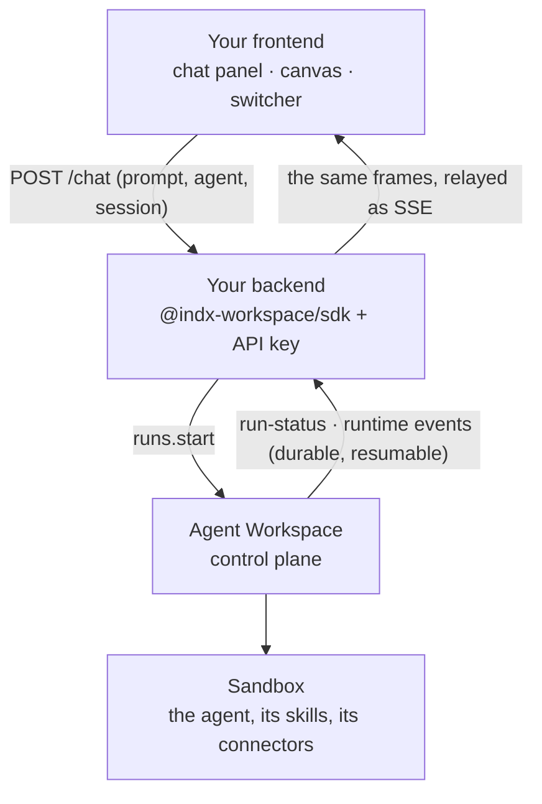

<Info>
**Chapter 4 · Put it in your product — step 4 of 8** · [the chapter map](/path/embed)

- **You will:** put the agent inside your application, with one widget tag or a backend that relays its stream.
- **You will learn:** the relay pattern, the frames a chat panel or canvas reduces, and how to switch agents.
- **You need:** an agent with a surface (`main` in a generated project) and [Build a frontend](/building/frontend).

</Info>

Put an agent inside your own application — a chat panel, a copilot side bar, a canvas that fills
with what the agent produced — while the agent, its permissions, skills, connectors and the people
who may change it stay managed in Agent Workspace. Your code is the **Consume** surface driving the
**Configure** surface ([Public surface and stability](/concepts/public-surface)); nothing here
requires a change to the platform.

What you can do:

- [Show the chat with one tag or one component](#show-the-chat-with-one-tag-or-one-component)
- [Stream an agent run into your own UI](#stream-an-agent-run-into-your-own-ui) through your backend
- [Build a chat panel](#a-chat-panel) or [a canvas](#a-canvas) from the same stream
- [Let people switch agents](#switching-agents)
- [Skip the relay with a browser token](#skip-the-relay-a-browser-token-per-run-or-session)
- [Stop, resume and fail well](#stopping-resuming-and-failing-well)

## Show the chat with one tag or one component

The fastest way is the surface a project already has. `aw dev` prints a one-tag widget on its
ready screen; paste it into any HTML page:

```html title="illustrative" claim="illustrative"
<script src="http://127.0.0.1:3000/p/s/main/widget.js" async></script>
```

In a React app, render the surface's chat as a component, styled by one import (pass its
`definition` for its theme and greeting):

```tsx claim="compile"
import { Chat } from '@indx-workspace/react';
import '@indx-workspace/react/styles.css';

export const Help = () => <Chat surface="main" baseUrl="http://127.0.0.1:3000" />;
```

[Your own React](/building/react) goes on from there: replacing the composer and drawing the whole
chat with `useConversation()`. The rest of this page is for when the surface's chat is not what
you want to ship: your own backend, your own stream handling, a canvas.

## Stream an agent run into your own UI

Your backend holds the workspace API key and talks to the control plane with the SDK; your
frontend talks only to your backend; the control plane runs the agent in its sandbox and streams
what it did back.



A workspace API key is long-lived and carries a role, so it must never reach a browser. The relay
also gives your backend the place to attach your own user identity, rate limits and product logic.
It is the right shape for a frontend on a genuinely different origin, since this deployment sends
no CORS headers. (On a shared origin, [a browser token](#skip-the-relay-a-browser-token-per-run-or-session)
can replace the relay; the frontend code does not change.)

<Steps>
  <Step title="Your backend starts the run">

One route takes the prompt, the agent the person picked, and the session that keeps the
conversation together. Pass the previous run's `sessionId` and the agent picks up where it left
off:

```ts title="backend/start-chat.ts (illustrative)" claim="illustrative"
const aw = createClient({ baseUrl, auth: { kind: 'api-key', apiKey } });

export async function startChat(agentId: string, prompt: string, sessionId: string | null) {
  const { run } = await aw.runs.start(agentId, { prompt, sessionId });
  return { runId: run.id, sessionId: run.sessionId };
}
```

  </Step>
  <Step title="Your backend relays the stream">

A second route reads `aw.runs.events(runId, { after: lastEventId })` and writes each frame to the
browser as Server-Sent Events with the same names, ids and JSON, so the frontend can use the SDK's
own parser. The browser's `Last-Event-ID` header becomes the `after` cursor, which makes a reload
resume instead of replay. Use `events`, not `follow`: the _browser_ is the party that reconnects,
and `follow`'s own reconnect would hide a drop from it. Set `Content-Type: text/event-stream`,
`Cache-Control: no-cache`, and abort the `signal` when the browser disconnects.

  </Step>
  <Step title="Your frontend draws the stream">

For a React page, `<Chat/>` or `useConversation()` already does this against a surface. For any
other frontend, or a canvas, fold the frames with the [reducer below](#appendix-reduce-the-stream-yourself).

  </Step>
</Steps>

<AccordionGroup>
  <Accordion title="backend/start-chat.ts, in full">

```ts title="backend/start-chat.ts" claim="compile"
import { createClient } from '@indx-workspace/sdk';

const baseUrl = process.env.AGENT_WORKSPACE_URL;
const apiKey = process.env.AGENT_WORKSPACE_API_KEY;
if (baseUrl === undefined || apiKey === undefined) {
  throw new Error('Set AGENT_WORKSPACE_URL and AGENT_WORKSPACE_API_KEY');
}
export const aw = createClient({
  baseUrl,
  auth: { kind: 'api-key', apiKey },
});

export interface StartChatRequest {
  readonly agentId: string;
  readonly prompt: string;
  /** The session of the previous turn with this agent, or null for a fresh conversation. */
  readonly sessionId: string | null;
}

export async function startChat(
  request: StartChatRequest,
): Promise<{ runId: string; sessionId: string }> {
  const { run } = await aw.runs.start(request.agentId, {
    prompt: request.prompt,
    sessionId: request.sessionId,
  });
  return { runId: run.id, sessionId: run.sessionId };
}
```

  </Accordion>
  <Accordion title="backend/relay-run.ts: re-encode and relay the frames">

```ts title="backend/relay-run.ts" claim="compile"
import type { AgentWorkspaceClient } from '@indx-workspace/sdk';
import type { RunEventFrame } from '@indx-workspace/sdk/events';
import { RUN_STATUS_EVENT, RUN_WARNING_EVENT } from '@indx-workspace/contracts/run-events';

/** One frame, re-encoded as the SSE text the control plane itself would have sent. */
export function encodeFrame(frame: RunEventFrame): string {
  switch (frame.kind) {
    case 'done':
      return 'event: done\ndata: {}\n\n';
    case 'run-failed':
      return `event: run-failed\ndata: ${JSON.stringify(frame.data)}\n\n`;
    case 'stream-reset':
      return `event: stream-reset\ndata: ${JSON.stringify(frame.data)}\n\n`;
    case 'run-status': {
      const id = frame.id === null ? '' : `id: ${frame.id}\n`;
      return `event: ${RUN_STATUS_EVENT}\n${id}data: ${JSON.stringify(frame.data)}\n\n`;
    }
    case 'run-warning': {
      const id = frame.id === null ? '' : `id: ${frame.id}\n`;
      return `event: ${RUN_WARNING_EVENT}\n${id}data: ${JSON.stringify(frame.data)}\n\n`;
    }
    case 'runtime': {
      const id = frame.id === null ? '' : `id: ${frame.id}\n`;
      return `event: ${frame.name}\n${id}data: ${JSON.stringify(frame.data)}\n\n`;
    }
  }
}

/**
 * Relay one run's stream. `write` is whatever your HTTP framework gives you for a chunked
 * `text/event-stream` response; `lastEventId` is the browser's `Last-Event-ID` header, if any.
 */
export async function relayRun(
  aw: AgentWorkspaceClient,
  runId: string,
  lastEventId: string | null,
  write: (chunk: string) => void,
  signal: AbortSignal,
): Promise<void> {
  for await (const frame of aw.runs.events(runId, { after: lastEventId, signal })) {
    write(encodeFrame(frame));
    if (frame.kind === 'done') return;
  }
}
```

  </Accordion>
  <Accordion title="Every frame and what a UI does with it">

The run's **event stream** is the contract between an agent and anything that renders it: ordered,
durable, resumable by id, with the provider's own message kept untouched next to a neutral view.
Your UI is a reducer over it.

| Frame or event                     | Meaning                                                                                                                | What a UI does with it                                         |
| ---------------------------------- | ---------------------------------------------------------------------------------------------------------------------- | -------------------------------------------------------------- |
| `run-status` (`kind`)              | The run moved to `queued`, `running`, `completed`, `failed` or `cancelled`; `data.error` carries the safe failure text | Status pill, enable/disable the composer, show the error       |
| `run-warning` (`kind`)             | A notice about the run start: a stable `data.code` (e.g. `attachments_removed_shell`) and optional `message`           | Show a dismissible notice, even for an unknown `code`          |
| `runtime` (`kind`)                 | One neutral `agent.*` frame; parse it with `toAgentEvent`                                                              | Everything below                                               |
| `agent.session`                    | The engine opened or resumed its session                                                                               | Show "connected"; remember `engineSessionId` if you display it |
| `agent.message` (role `assistant`) | A turn's `blocks` of `text` and `reasoning`; `messageId` repeats when a grown snapshot of the same turn arrives        | Replace the bubble with that `messageId`, never append         |
| `agent.message` (role `user`)      | The prompt as the engine recorded it                                                                                   | Usually already rendered; skip or reconcile                    |
| `agent.tool.call`                  | The agent called a tool: `toolCallId`, `name`, `kind`, `input`                                                         | A "working…" row; on a canvas, an in-progress artifact         |
| `agent.tool.result`                | The answer to a call: `toolCallId`, `status`, `output`, `isError`                                                      | Resolve the row; on a canvas, the artifact's content           |
| `agent.usage`                      | The engine's own token counters, informational                                                                         | Token footer (billing is `runs.get`'s `cost`)                  |
| `agent.result`                     | The engine's terminal accounting: `stopReason`, `turns`, `engineCostUsd`                                               | Cost footer                                                    |
| `agent.native`                     | Anything the engine emitted with no neutral meaning, verbatim                                                          | Ignore, or show under "technical details"                      |
| `agent.malformed`                  | The engine produced something its adapter could not parse                                                              | Show under "technical details"; do not render as content       |
| `stream-reset` (`kind`)            | What follows is not contiguous with what you have                                                                      | Clear the rendered transcript and continue                     |
| `run-failed` (`kind`)              | This connection could not deliver a successful run                                                                     | Terminal error state                                           |
| `done` (`kind`)                    | The stream is over (says nothing about success — read the last `run-status`)                                           | Stop reading                                                   |

The full frame vocabulary is on [Streaming](/guides/streaming), the neutral view on
[Runtime neutrality](/concepts/runtime-neutrality), and the reference on
[Events](/reference/sdk/events).

  </Accordion>
</AccordionGroup>

## A chat panel

The [appendix reducer](#appendix-reduce-the-stream-yourself) _is_ a chat panel: render `turns` as
bubbles keyed by `id`, `tools` as a collapsible "working…" list, `status` as a pill, and `costUsd`
as a footer. Two rules come from the provider's behaviour, not from taste:

- **Replace by id, never append.** The provider re-sends a grown snapshot of the same assistant
  turn as it streams; the `id` repeats. Appending produces duplicates.
- **Plain language first, the trace one click away.** `text` for the person, `tools` behind a
  disclosure, and every neutral frame's `raw` (the message the engine emitted) for a "technical
  details" view.

For a one-shot answer instead of a conversation, `assistantResponseFromAgentEvent(event)` returns
just the assistant's visible text with its id.

## A canvas

A canvas reduces the same stream into **artifacts** — what the agent produced — from two sources:

1. **Tool calls and results, live.** A `tool.call` is an artifact in progress (its `name` and
   `input` say what is being made); the matching `tool.result` (`id`) is its content. Which tool
   names mean "produced something" is provider-native — with the Claude Agent SDK a `Write` or
   `Edit` call names a file path in its `input`, and a connector's tool is named
   `mcp__<connector-name>__<tool>` — so read `input` and `output` as `unknown`, render the tools you
   know, and show the rest as text.
2. **Workspace files, after the run.** Anything the agent wrote with `writeFiles: true` and a
   `read-write` file assignment is in the workspace's files. When the last `run-status` says
   `completed`, list them with `aw.files.list` and fetch them with `aw.files.download` through your
   backend.

Give each embedded surface its own folder (`canvas/<user>/<session>/`) and assign that folder to
the agent with `read-write` access, so one user's output never lands in another's view;
[Files](/resources/files) has the path grammar and the assignment shape. A canvas's own files pass
through your backend. The user's uploads go through `POST /api/sessions/:id/attachments`, which
applies the surface's attachment rules; a session-scoped browser token is refused
`aw.files.createUploadUrl`. It can call `aw.files.createDownloadUrl` for paths under
`.attachments/<sessionId>/` only, then fetch the bytes straight from the object store. The bucket
needs a CORS rule allowing `GET` from your origin, and a deployment on a local-filesystem store
answers `501 direct_transfer_unsupported`; see
[`createDownloadUrl`](/resources/files#createdownloadurl).

<Accordion title="backend/artifacts.ts: collect a run's files">

```ts title="backend/artifacts.ts" claim="compile"
import type { AgentWorkspaceClient } from '@indx-workspace/sdk';

export interface Artifact {
  readonly path: string;
  readonly contentType: string;
  readonly bytes: Uint8Array;
}

/** Every file under `folder` after a run completed — the canvas's durable side. */
export async function collectArtifacts(
  aw: AgentWorkspaceClient,
  folder: string,
  signal: AbortSignal,
): Promise<readonly Artifact[]> {
  const entries = await aw.files.list({ path: folder }, { signal });
  const artifacts: Artifact[] = [];
  for (const entry of entries) {
    if (entry.kind !== 'file') continue;
    const downloaded = await aw.files.download(entry.path, { signal });
    if (downloaded.kind !== 'file') continue;
    artifacts.push({
      path: entry.path,
      contentType: downloaded.contentType,
      bytes: downloaded.bytes,
    });
  }
  return artifacts;
}
```

</Accordion>

## Switching agents

"Support", "Research", "Reviewer" are not modes on one agent; each is a different agent, and
continuity lives in the session.

- **List the agents the switcher shows** with `aw.agents.list()` on your backend (an API key sees
  what its role allows; a Builder key sees every agent), filtered to the ones your product exposes.
- **Keep one session per person per agent.** A session belongs to exactly one agent. Your backend
  stores `(user, agentId) → sessionId`; `aw.sessions.list()` recovers it if lost, filtered by
  `agentId` client-side (the query has no agent filter today).
- **Carry context across agents explicitly.** Sessions do not share memory; put what should carry
  over in the next prompt or in a workspace file both agents can read.

Every agent's runs share one lifecycle and one event vocabulary, so your reducers do not change
when the agent does — only `agentId` and `sessionId` on `startChat` do. To give a group of people
the same defaults (agent, model, shared files), put them in a [project](/resources/projects).

<Accordion title="backend/switch-agent.ts: find a person's session with an agent">

```ts title="backend/switch-agent.ts" claim="compile"
import type { AgentWorkspaceClient } from '@indx-workspace/sdk';

/** The session a person already has with this agent, or null. */
export async function sessionFor(
  aw: AgentWorkspaceClient,
  agentId: string,
  isMine: (session: { readonly title: string | null }) => boolean,
): Promise<string | null> {
  const { sessions } = await aw.sessions.list({ status: 'active' });
  const mine = sessions.find((session) => session.agentId === agentId && isMine(session));
  return mine === undefined ? null : mine.id;
}
```

</Accordion>

## Identity, roles and what the embedded user may do

Your backend is the principal the control plane sees; your product's users are not.

- **Mint the key with the smallest role that works.** A Builder key can start runs and read its
  own runs and sessions; it cannot administer people, models or runtimes. Keep an Owner or Admin
  key for your admin tooling, never for the relay. [Workspaces and
  principals](/concepts/workspaces-and-principals) has the role table.
- **Your backend enforces which user may see which session.** The control plane scopes rows to the
  key's principal, not to your users; keep your own `(user, sessionId)` ownership and check it
  before relaying. A session `title` is a convenient place to stamp your own user id, but it is
  not an access control.

<Warning>
  Never place the workspace API key in frontend code, a mobile app, or a URL. It is long-lived and
  carries your backend's whole role, unscoped to any one run or session. If you want the frontend to
  hold a credential of its own, mint a [browser
  token](#skip-the-relay-a-browser-token-per-run-or-session) instead — never the key itself.
</Warning>

## Skip the relay: a browser token per run or session

If your frontend shares an origin with the control plane, or reaches it through a same-origin
proxy, it can call the control plane directly. Your backend mints a short-lived, scoped bearer:

```ts title="your backend, once the run exists (illustrative)" claim="illustrative"
const { token, expiresAt } = await aw.tokens.mint(
  { kind: 'run', id: run.id },
  { ttlSeconds: 900 }, // comfortably longer than the frontend needs to connect
);
// send { token, expiresAt } to the frontend over your own channel — never over a channel this SDK sends.
```

The frontend then uses `createClient({ baseUrl, auth: { kind: 'browser-token', token } })` and
`aw.runs.follow(runId, { signal })`, feeding the same reducer. The token can read that run and
follow its events, and nothing else. Starting a run needs a _session_-scoped token, minted the
same way; the frontend then calls `aw.runs.start(agentId, { prompt, sessionId })` with the
`sessionId` the token names. A token stops working once it expires, once the run or session it
names finishes, or once you revoke the minting key — whichever comes first. See
[Authentication](/getting-started/authentication).

<Note>
  The general API sends no CORS headers, so a browser token only works when the frontend and the
  control plane share an origin (directly, or via your own reverse proxy). A genuinely cross-origin
  frontend still needs the relay above.
</Note>

**Cross-origin, for a React page.** If you only need the surface's own chat, skip both the relay
and the token: under `aw dev` a page on `localhost` already works while the surface lists no
`allowedOrigins` of its own, and for a deployed page you put its origin in the surface's
`allowedOrigins`. Render `<Chat surface="main" baseUrl="https://agents.example.com" />`; the
session bootstrap and the four visitor run routes answer the browser's CORS preflight for those
origins. See [Your own React](/building/react).

## Stopping, resuming, and failing well

- **Resume:** the browser reconnects with `Last-Event-ID`; the relay passes it as `after`. A
  full page reload continues the same run from the last frame it rendered.
- **Reset:** on `stream-reset` the relay's cursor was not resumable; clear and continue. The
  appendix reducer does this.
- **Stop reading:** abort the frontend's `signal`; the relay's `signal` follows the
  disconnect. This stops your view, not the run.
- **Stop the run itself:** `aw.runs.interrupt(runId)` from your backend — a browser has no
  workspace API key, so a "Stop" button posts to your own relay endpoint, which calls `interrupt`
  and lets the frontend learn the outcome from the stream it is already following. See
  [Stopping a run](/building/backend#stopping-a-run).
- **Errors:** an `ApiProblemError` from `runs.start` (a `403` for a role that may not run this
  agent, a `404` for an agent that is not visible) maps onto your own API's errors — [Integrate
  a backend](/building/backend) shows the mapping.

## What you can and cannot do today

| Do                                                                    | How                                                                                                             |
| --------------------------------------------------------------------- | --------------------------------------------------------------------------------------------------------------- |
| Start a run for an agent from your product, continuing a conversation | `aw.runs.start(agentId, { prompt, sessionId })` on your backend                                                 |
| Stream the run into your UI, resumable across reloads                 | relay `aw.runs.events(runId, { after })` as SSE; `readSseFrames` + `classifyRunEventFrame` in the browser       |
| Render a chat panel or a canvas from the same stream                  | reduce `toAgentEvent(frame)`; collect files with `aw.files.list`/`download`                                     |
| Offer several agents and switch between them                          | `aw.agents.list()`, one session per person per agent                                                            |
| Show status, cost and tokens                                          | `run-status` frames, `agent.usage` and `agent.result` (engine-reported) and `runs.get`'s settled `usage`/`cost` |
| Keep provider keys and the workspace key off the client               | the relay pattern; the gateway substitutes per-run tokens inside the platform                                   |

<CardGroup cols={2}>
  <Card title="Build a frontend" icon="window" href="/building/frontend">
    The framework-agnostic run store, a React hook over it, and the failure modes of a live view.
  </Card>
  <Card title="Integrate a backend" icon="server" href="/building/backend">
    Roles, error mapping, timeouts, and running `aw` from CI.
  </Card>
  <Card title="Streaming" icon="wave-square" href="/guides/streaming">
    The wire format, `events` vs `follow`, reconnection and resume in full.
  </Card>
  <Card title="Use cases" icon="lightbulb" href="/concepts/use-cases">
    Six shapes this pattern takes, from an in-product copilot to an ops automation.
  </Card>
</CardGroup>

## Appendix: reduce the stream yourself

The browser fetches your relay route, reads it with the SDK's parser (`readSseFrames` and
`classifyRunEventFrame`), and folds each frame into view state: a status, an ordered list of turns
replaced by id, tool rows, and a cost footer. Wrap `subscribe` in whatever your UI framework uses
for external state; [Build a frontend](/building/frontend) shows a store and a React hook.

<Accordion title="frontend/chat-model.ts: the whole chat model">

```ts title="frontend/chat-model.ts (illustrative)" claim="illustrative"
import {
  readSseFrames,
  classifyRunEventFrame,
  toAgentEvent,
  type RunEventFrame,
} from '@indx-workspace/sdk/events';

export interface ChatTurn {
  readonly id: string;
  readonly role: 'assistant' | 'user';
  readonly text: readonly string[];
}

export interface ToolRow {
  readonly id: string;
  readonly name: string;
  readonly done: boolean;
  readonly isError: boolean;
}

export interface ChatState {
  readonly status: 'queued' | 'running' | 'completed' | 'failed' | 'cancelled' | 'connecting';
  readonly error: string | null;
  readonly turns: readonly ChatTurn[];
  readonly tools: readonly ToolRow[];
  readonly costUsd: number | null;
}

export const initialChat: ChatState = {
  status: 'connecting',
  error: null,
  turns: [],
  tools: [],
  costUsd: null,
};

function upsert<T extends { readonly id: string }>(list: readonly T[], item: T): readonly T[] {
  const index = list.findIndex((existing) => existing.id === item.id);
  return index === -1
    ? [...list, item]
    : list.map((existing, i) => (i === index ? item : existing));
}

export function reduceChat(state: ChatState, frame: RunEventFrame): ChatState {
  switch (frame.kind) {
    case 'run-status':
      return { ...state, status: frame.data.status, error: frame.data.error };
    case 'run-failed':
      return { ...state, status: 'failed', error: frame.data.message };
    case 'stream-reset':
      return { ...initialChat, status: state.status };
    case 'done':
      return state;
    case 'runtime': {
      // `toAgentEvent` throws a `ContractViolationError` on a payload that does not satisfy its
      // frame schema — the platform wrote it, so that is drift, not something to retry. Let it
      // escape to your error boundary rather than rendering half a frame.
      const event = toAgentEvent(frame);
      switch (event?.frame) {
        case 'agent.message': {
          const text = event.blocks.flatMap((block) => (block.type === 'text' ? [block.text] : []));
          if (event.messageId === null || text.length === 0) return state;
          return {
            ...state,
            turns: upsert(state.turns, { id: event.messageId, role: event.role, text }),
          };
        }
        case 'agent.tool.call':
          return {
            ...state,
            tools: upsert(state.tools, {
              id: event.toolCallId,
              name: event.name,
              done: false,
              isError: false,
            }),
          };
        case 'agent.tool.result': {
          const row = state.tools.find((tool) => tool.id === event.toolCallId);
          return {
            ...state,
            tools: upsert(state.tools, {
              id: event.toolCallId,
              name: row?.name ?? 'tool',
              done: true,
              isError: event.isError,
            }),
          };
        }
        case 'agent.result':
          return { ...state, costUsd: event.engineCostUsd };
        default:
          return state;
      }
    }
  }
}

/** Read your relay route until `done`, calling `onChange` with each new state. */
export async function subscribe(
  relayUrl: string,
  onChange: (state: ChatState) => void,
  signal: AbortSignal,
): Promise<void> {
  const response = await fetch(relayUrl, { signal });
  if (response.body === null) throw new Error(`${relayUrl}: no response body`);
  let state = initialChat;
  for await (const raw of readSseFrames(response.body, signal)) {
    const frame = classifyRunEventFrame(raw);
    state = reduceChat(state, frame);
    onChange(state);
    if (frame.kind === 'done') return;
  }
}
```

</Accordion>
