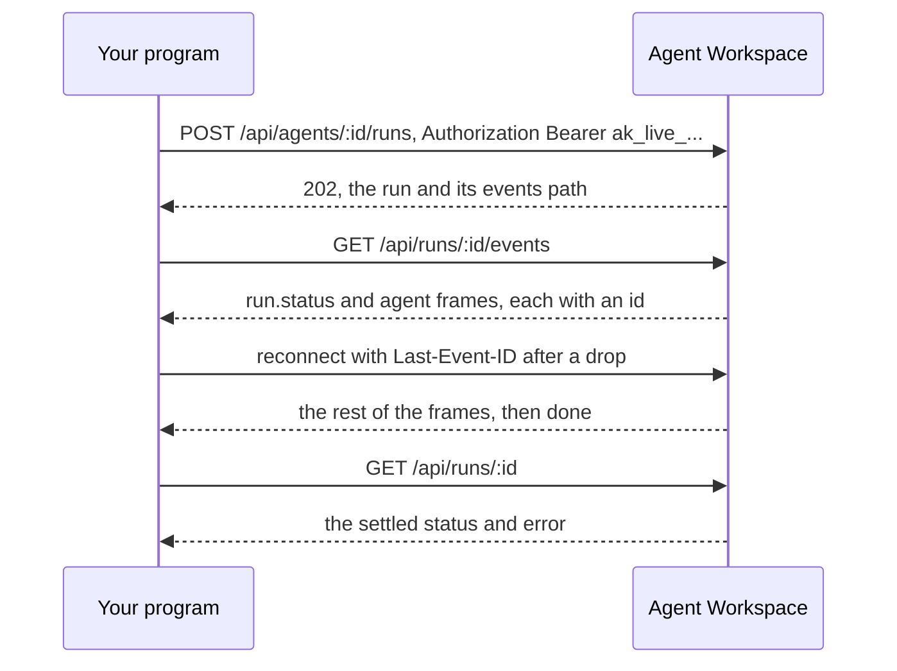

<Info>
**Chapter 4 · Put it in your product — step 7 of 8** · [the chapter map](/path/embed)

- **You will:** call the API from Python, Go, a shell or any HTTP stack, without the SDK.
- **You will learn:** the one header to send, the response and error shapes, and how to stream a run and generate a typed client.
- **You need:** an API key ([Authentication](/getting-started/authentication)).

</Info>

**The API is the product; the TypeScript SDK is its first client, not the only one.** Every
`aw.*` method is a thin wrapper over one `/api/**` route, so a Python, Go or shell consumer can do
everything the SDK does with plain HTTP.

What you can do:

- [Authenticate a request](#authenticate-a-request) with one header
- [Start a run and read the answer](#start-a-run-and-read-responses)
- [Stream a run](#streaming-a-run), resumable across reconnects
- [Upload and download files](#upload-and-download-files)
- [Generate a typed client in another language](#generate-a-client-in-another-language)

Going without the SDK, you take back three things it does for you: **validation** (it parses every
response against the published Zod schema and raises `ContractViolationError` on a mismatch),
**error mapping** (it folds several server envelope shapes into one `ApiProblemError`,
`ContractViolationError` or `TransportError`), and **resume** (`follow()` reconnects a dropped run
stream with `Last-Event-ID`). Each is a few hundred lines you write once for your own stack; this
page states what to write them against.



## Authenticate a request

Send a workspace API key as a bearer token on every request:

```sh title="illustrative" claim="illustrative"
curl -H "Authorization: Bearer $AGENT_WORKSPACE_API_KEY" \
  "$AGENT_WORKSPACE_URL/api/agents"
```

A key looks like `ak_live_<22-character id>_<43-character secret>` (`API_KEY_PATTERN` in
`@indx-workspace/contracts`). It is the credential for a backend, a CI job or any program; see
[Authentication — api-key](/getting-started/authentication#api-key-—-a-backend-ci-or-the-cli) for
how to mint one and which of the four roles (`owner`, `admin`, `builder`, `viewer`) to give it.

The other credential for this API from your own code is the control plane's own session cookie (`__Host-aw_session`, or
`__Host-aw_session_<AW_INSTANCE_ID>` on a deployment that sets `AW_INSTANCE_ID`, as every generated
project does). It exists only for the control plane's own UI calling its own API; it is not a
credential you can hand to your own frontend or backend. A customer's product reaches the platform
through an API key held on its backend ([Embed an agent in your product](/building/embedding)), or
a short-lived browser token (`awt_live_…`) that backend mints; a person at a terminal uses the user
token `aw login` issues ([Authentication](/getting-started/authentication)).

<Warning>
  Every route under `/api/workspaces` and `/api/invitations` refuses an API key outright, with `403
  api_key_not_permitted`, before any other check runs: a key represents one workspace and one fixed
  role, not a person. Those routes take the session cookie only — from a browser page on the control
  plane's own origin, or not at all from an external HTTP client today.
</Warning>

## Start a run and read responses

`POST /api/agents/:id/runs` answers `202` with the queued run and where to stream it from:

```sh title="illustrative" claim="illustrative"
curl -s -X POST \
  -H "Authorization: Bearer $AGENT_WORKSPACE_API_KEY" \
  -H "Content-Type: application/json" \
  -d '{ "prompt": "Summarise the open incidents." }' \
  "$AGENT_WORKSPACE_URL/api/agents/$AGENT_ID/runs"
# { "run": { "id": "run_…", "status": "queued", "sessionId": "ses_…", "…": "…" }, "events": "/api/runs/run_…/events" }
```

Success bodies are not uniform: `GET /api/agents/:id` answers a bare `AgentResource`, while
`GET /api/runs/:id` answers `{ run: RunResource }` (sessions and workspaces are wrapped the same
way). List routes are consistently wrapped, such as `{ agents: AgentResource[] }`. Read each
route's own shape.

A failing route answers `{ error: { code, message, details? } }`. Branch on `code`; `message` is
safe prose; `details` (an array of strings) appears only when there is more to say.

<AccordionGroup>
  <Accordion title="List and create agents with curl">

**List agents:**

```sh title="illustrative" claim="illustrative"
curl -s -H "Authorization: Bearer $AGENT_WORKSPACE_API_KEY" \
  "$AGENT_WORKSPACE_URL/api/agents"
```

```json title="illustrative" claim="illustrative"
{
  "agents": [
    {
      "id": "agt_…",
      "name": "release-notes-writer",
      "instructions": "…",
      "modelConnectionId": null,
      "model": null,
      "runtimeProfileId": null,
      "permissions": {
        "readFiles": true,
        "writeFiles": false,
        "runCommands": false,
        "unrestrictedNetwork": false
      },
      "ownerPrincipalId": "…",
      "createdAt": "…",
      "updatedAt": "…"
    }
  ]
}
```

**Create an agent:** the body is `CreateAgentInput` (`reference/contracts/agents`): `name`,
`instructions`, `modelConnectionId`, `model` (both nullable), `permissions`, and an optional
`runtimeProfileId`. The `201` answers the bare `AgentResource`:

```sh title="illustrative" claim="illustrative"
curl -s -X POST \
  -H "Authorization: Bearer $AGENT_WORKSPACE_API_KEY" \
  -H "Content-Type: application/json" \
  -d '{
    "name": "release-notes-writer",
    "instructions": "Draft release notes from a diff.",
    "modelConnectionId": null,
    "model": null,
    "permissions": { "readFiles": true, "writeFiles": false, "runCommands": false, "unrestrictedNetwork": false }
  }' \
  "$AGENT_WORKSPACE_URL/api/agents"
```

  </Accordion>
  <Accordion title="Common error codes">

`COMMON_PROBLEM_CODES` (`@indx-workspace/contracts`) is the vocabulary every route shares:

| Code                     | Status | Meaning                                                 |
| ------------------------ | ------ | ------------------------------------------------------- |
| `unauthenticated`        | 401    | No usable bearer key or session cookie.                 |
| `forbidden`              | 403    | Authenticated, but the role doesn't permit this action. |
| `invalid_body`           | 400    | The body parsed but failed schema validation.           |
| `request_body_too_large` | 413    | The body exceeds the route's size limit.                |
| `service_unavailable`    | 503    | Check the response's `Retry-After` header.              |

The full table, the `detail` field the RBAC layer still repeats beside `message` until the next
major release (read `message`), and the route that still answers a bare `{ error: '<code>' }` are
on [Errors](/guides/errors). The SDK's `ApiProblemError` folds the spellings, older deployments'
included, into one shape, which a raw client has to do for itself.

  </Accordion>
</AccordionGroup>

## Streaming a run

`GET /api/runs/:id/events` is a `text/event-stream`:

```sh title="illustrative" claim="illustrative"
curl -N \
  -H "Authorization: Bearer $AGENT_WORKSPACE_API_KEY" \
  -H "Accept: text/event-stream" \
  "$AGENT_WORKSPACE_URL/api/runs/$RUN_ID/events"
```

- **Resume** by sending the last `id:` you saw as a `Last-Event-ID` header (a browser's
  `EventSource` does this for you), or as `?after=<id>`; the header wins when both are present.
  Neither means a first connection, delivered from the beginning.
- **On `stream-reset`** (`{ reason, resumedAfter }`) the id you resumed with can no longer be
  served: discard what you rendered and continue from it.
- **`done` does not mean success.** `run-failed` says this connection could not deliver a
  successful run; the settled outcome is `GET /api/runs/:id`'s `status` (`completed`, `failed` or
  `cancelled` once terminal) and `error`.

<Accordion title="Frame groups and a sample stream">

Every frame carries an explicit `event:` name, in three groups:

- **Control frames** — `done`, `run-failed`, `stream-reset`. Written by the stream about itself;
  never carry `id:`, never move the resume cursor.
- **The platform's lifecycle event** — `run.status` (the literal wire name; the SDK's classified
  `RunEventFrame.kind` calls it `'run-status'`). Durable, carries `id:`.
- **Agent frames** — the neutral `agent.*` vocabulary (`agent.message`, `agent.tool.call`, …).
  Durable, carry `id:`. Every name and schema is on [Streaming](/guides/streaming#the-wire-format).

```http title="illustrative" claim="illustrative"
event: run.status
id: 42
data: {"status":"running","error":null}

event: agent.message
id: 43
data: {"frame":"agent.message","engine":"claude-agent-sdk","messageId":"…","role":"assistant","blocks":[{"type":"text","text":"…"}],"raw":{"…":"…"}}

event: done
data: {}
```

</Accordion>

## Upload and download files

Files are addressed by **path**, not by an opaque id, and the wire uses two encodings
([why](/resources/files#the-path-encoding-header-—-the-one-unusual-part-of-the-wire)):

- **Upload** (`POST /api/files`): the path goes in an `x-file-path` header, percent-encoded UTF-8,
  with `x-resource-path-encoding: percent-utf8`.
- **Download, move and remove** (`GET`/`PATCH`/`DELETE /api/files/:id`): `:id` is the path's UTF-8
  bytes, base64url-encoded without padding.

A `FileResource.id` from a `list()` response is a separate, opaque catalog id, not interchangeable
with this route id. Full reference: [Files](/resources/files).

<Accordion title="Upload and download with curl">

```sh title="illustrative" claim="illustrative"
curl -s -X POST \
  -H "Authorization: Bearer $AGENT_WORKSPACE_API_KEY" \
  -H "x-file-path: $(python3 -c 'import urllib.parse,sys;print(urllib.parse.quote(sys.argv[1]))' 'reports/q3/summary.md')" \
  -H "x-resource-path-encoding: percent-utf8" \
  -H "Content-Type: application/octet-stream" \
  --data-binary @summary.md \
  "$AGENT_WORKSPACE_URL/api/files"
```

```sh title="illustrative" claim="illustrative"
FILE_ROUTE_ID=$(python3 -c "import base64,sys;print(base64.urlsafe_b64encode(sys.argv[1].encode()).decode().rstrip('='))" 'reports/q3/summary.md')
curl -s -H "Authorization: Bearer $AGENT_WORKSPACE_API_KEY" \
  "$AGENT_WORKSPACE_URL/api/files/$FILE_ROUTE_ID" -o summary.md
```

</Accordion>

## Page through lists

`GET /api/runs`, `GET /api/sessions` and `GET /api/audit-events` are cursor-paged: pass `cursor`
back exactly as the previous page's `nextCursor`, `null` meaning no next page. The session and
audit cursors are bound to their list and the caller's workspace; any other is
`400 invalid_cursor`. Every other `list` route returns the whole collection, with no `cursor` or
`limit`. See [Pagination](/guides/pagination).

## Validate responses in TypeScript

`@indx-workspace/contracts` publishes the Zod schema behind every route — `.strict()`, so an
unrecognised field fails validation rather than being silently dropped. Import the schemas
directly and skip `createClient` entirely.

## Generate a client in another language

This site publishes [`openapi.json`](/openapi.json), an OpenAPI 3.1 document of every public route,
generated from the same Zod schemas the SDK validates with and regenerated on every release. Point
any off-the-shelf generator at it — for example Python, with
[`openapi-python-client`](https://github.com/openapi-generators/openapi-python-client):

```bash title="illustrative" claim="illustrative"
pipx run openapi-python-client generate --url https://docs.agentworkspace.indx.jp/openapi.json
```

```python title="illustrative" claim="illustrative"
from agent_workspace_api_client import AuthenticatedClient
from agent_workspace_api_client.api.me import me

client = AuthenticatedClient(base_url="https://aw.example.com", token="ak_live_…")
principal = me.sync(client=client)
print(principal.workspace_id, principal.role)
```

<Accordion title="What the OpenAPI document covers">

It has one operation per route (the catalogue is
[`@indx-workspace/contracts/routes`](/reference/contracts/routes)), the standard error envelope as
every operation's `default` response, the `x-agent-workspace-contracts` request header with its
`400` and `426` refusals and the served-range response headers, and the run event stream as
`text/event-stream`. The few routes that take no workspace credential (runtime detection,
invitation acceptance) say so in their own `security`. Browser journeys and the private routes
only the runner calls are not in it. The **HTTP API** group of the Reference tab renders it.

The platform's own tests type-check a TypeScript client generated with `openapi-typescript`
against `GET /api/me`, and call it with `openapi-fetch`, checking the answer against the
document's schema.

</Accordion>

<Note>
  **Today:** a request body that has no Zod schema in the contracts yet — most create and update
  bodies — is described as untyped JSON; the SDK's input types document those fields. Each is typed
  by adding its schema to the owning contract module; the document follows on the next `pnpm
  docs:generate`.
</Note>

## Idempotency, webhooks, versioning

- **Idempotency:** `runs.start` (and every other write) is not idempotent — a retried request
  after a lost response may create a second row, and there is no `Idempotency-Key` header to
  prevent it. Detect a duplicate yourself; see [Retries and
  idempotency](/guides/retries-and-idempotency). Tracked as
  [S-6](/concepts/roadmap#s-6-idempotency-keys).
- **Webhooks:** nothing calls back into your service when a run finishes — poll `GET
/api/runs/:id`, or keep a connection open on `GET /api/runs/:id/events`. See [Integrate a
  backend](/building/backend). Tracked as
  [N-3](/concepts/roadmap#n-3-webhooks-for-run-outcomes).
- **Versioning:** send `X-Agent-Workspace-Contracts: <version>` — the `@indx-workspace/contracts`
  version your client was built against — on every request. Every `/api/**` answer carries the
  served range in `X-Agent-Workspace-Contracts` (current) and `X-Agent-Workspace-Contracts-Minimum`.
  A version outside it is refused with `426 contracts_version_unsupported` before authentication;
  a header that is not `MAJOR.MINOR.PATCH` is `400 contracts_version_malformed`. A request without
  the header is always accepted and served at the current version, since browser forms, links and
  the identity provider's callback cannot send it. See [Public surface and
  stability](/concepts/public-surface#versions-and-deprecation).

## Browser calls

Calling `/api/**` directly from a customer's frontend does not work today: the control plane sets
no CORS headers on the general API, and a browser never holds a workspace API key, which is
long-lived and must stay server-side. A browser holds either the control plane's own same-origin
session cookie or a short-lived browser token your backend minted. The one cross-origin exception
is a hosted surface's chat ([Build a frontend](/building/frontend#chat-component-react)).

<Note>
  **Today:** your backend can mint a short-lived, run- or session-scoped browser token
  (`aw.tokens.mint`, [Authentication](/getting-started/authentication)) for your frontend to call
  the control plane with directly, instead of relaying the event stream yourself. **Not yet:** this
  deployment sends no CORS headers and refuses `OPTIONS`, so a browser token only works for a
  frontend that shares an origin with the control plane (or reaches it through a same-origin proxy)
  — a frontend on a genuinely different origin still needs the backend relay ([Embed an agent in
  your product](/building/embedding)) until CORS is added.
</Note>

## What you can and cannot do today

| Do                                                        | How                                                                                                                           |
| --------------------------------------------------------- | ----------------------------------------------------------------------------------------------------------------------------- |
| Authenticate any program                                  | `Authorization: Bearer ak_live_…` on every route except `/api/workspaces` and `/api/invitations`                              |
| Call every resource family                                | Plain HTTP — no route requires the SDK                                                                                        |
| Branch on a stable failure code                           | `error.code` in the response body — see [Errors](/guides/errors)                                                              |
| Stream a run, resumable across reconnects                 | `GET /api/runs/:id/events`, `Last-Event-ID` or `?after=`                                                                      |
| Validate a response in TypeScript without the HTTP client | Import the schema from `@indx-workspace/contracts` directly                                                                   |
| Validate a response in another language                   | Generate a client from the [OpenAPI document](#generate-a-client-in-another-language)                                         |
| Retry a write safely on your own                          | Only after you've read [Retries and idempotency](/guides/retries-and-idempotency) — most writes are not safe to retry blindly |
| Call from a browser sharing the control plane's origin    | Yes, with a browser token — see [Authentication](/getting-started/authentication)                                             |
| Call from a browser on a genuinely different origin       | Not yet — no CORS; relay through your backend                                                                                 |

<CardGroup cols={2}>
  <Card title="Integrate a backend" icon="server" href="/building/backend">
    Roles, error mapping, timeouts — the same concerns from the SDK's side.
  </Card>
  <Card title="Streaming" icon="wave-square" href="/guides/streaming">
    Every frame schema, `events` vs `follow`, and the neutral `AgentEvent` view.
  </Card>
  <Card title="Errors" icon="triangle-alert" href="/guides/errors">
    The three envelope spellings in full, and the complete `COMMON_PROBLEM_CODES` table.
  </Card>
  <Card title="Contracts reference" icon="book-open" href="/reference/contracts/index">
    Every schema this page's routes validate against.
  </Card>
</CardGroup>
