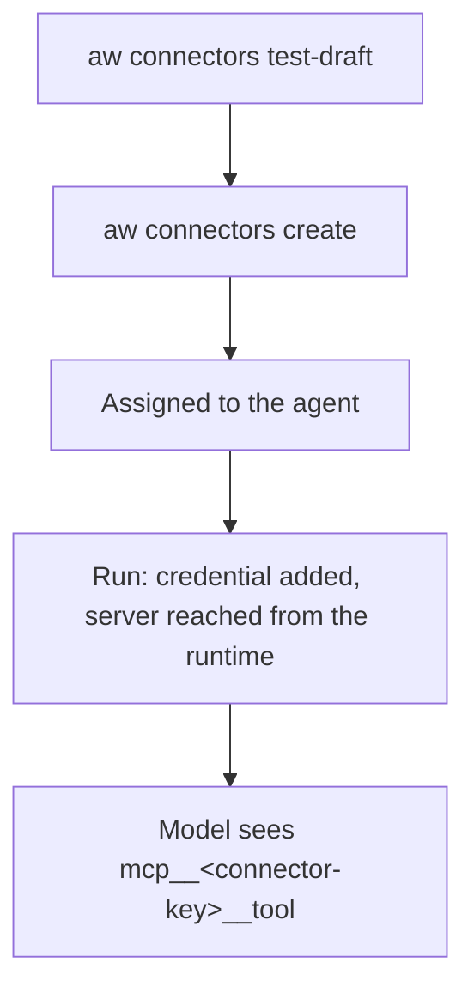

<Info>
**Chapter 2 · Build your agent — step 6 of 7** · [the chapter map](/path/build)

- **You will:** register a remote MCP server as a connector, test it, and give it to the support agent.
- **You will learn:** which transport to pick, how the credential is stored and rotated, and how the connector's tools reach the model.
- **You need:** an agent from [Design an agent](/building/agents) and the URL and credential of an MCP server.

</Info>

Give an agent new tools by connecting it to an MCP server. A **connector** is the platform's saved
configuration for reaching one MCP server: where it is and its credential. You create it as data with
`aw connectors` or `aw.connectors`, test it, and assign it to an agent; no code needed.

**What you can do**

- [Connect a remote MCP server](#connect-a-remote-mcp-server)
- [Test it before you save it](#test-it-before-you-save-it)
- [Give it to an agent](#give-it-to-an-agent)
- [Rotate or change its credential](#rotate-or-change-its-credential)
- [Know what network it runs under](#network-policy-for-remote-servers)



Connectors run on `claude-agent-sdk`, `openai-agents` and `mastra`. The `pi` engine has no MCP, so
an agent on it with a connector assigned is refused with `422 engine_capability_unsupported`.

## Connect a remote MCP server

Pick the transport the server speaks:

| Transport | How the control plane reaches it                    | Fits when                                                              |
| --------- | --------------------------------------------------- | ---------------------------------------------------------------------- |
| `http`    | Connects to `url` over streamable HTTP              | A remote MCP server you or a vendor hosts over HTTPS — the common case |
| `sse`     | Connects to `url` over Server-Sent Events           | A remote MCP server that only speaks the older SSE transport           |
| `stdio`   | Launches `command` (with `args`) as a child process | A pinned `npx` package, in a tool sandbox only — see below             |

`authType` is `none`, `api-key`, `bearer` or `oauth`. Then save it:

```sh title="illustrative" claim="illustrative"
aw connectors create --file connector.json --value-stdin
```

`connector.json` holds `name`, `transport`, `url` and `authType`; `--value-stdin` reads the
credential from stdin so it never sits in the file. The SDK equivalent is `aw.connectors.create`.
Every field is on [Connectors](/resources/connectors).

<Warning>
  **`stdio` only runs inside a sandbox, and no deployment environment starts one for it yet.**
  Spawning a caller-supplied command is arbitrary code execution as whatever process runs it; two
  separate leak incidents against the control plane process are the reason the platform now refuses
  to `spawn` one at all. `aw.connectors.test` and `testDraft` against a `stdio` connector always
  answer `{ ok: false, kind: 'stdio-probe-unavailable' }` — a declared refusal, not a flaky test. The
  transport is still accepted and stored. `stdio` is supported in the per-session tool sandbox (the
  one that runs code tools), which launches a version's `stdio` servers itself, but only a pinned
  command — `npx <package>@<exact version>`, never a tag, a range or another program — with its
  secrets passed in the environment, never on the command line. Its limits today:

  - The tool sandbox is off by default; a version with a `stdio` connector can be pointed at `local`
    only. Promoting it, or pointing `production` at it, is refused with
    `422 stdio_connector_needs_tool_sandbox`, naming each connector.
  - In `local` (`aw dev`) the version is saved, but no run launches the `stdio` server yet: the run
    goes ahead without its tools and nothing warns (issue #793). Use an `http` or `sse` connector
    locally.
  - `npx` fetches the package through the egress proxy, so `registry.npmjs.org` must be one of the
    session's declared domains; nothing else reaches the registry.
  - All sessions share one tool-sandbox network until issue #841 gives each session its own.
  - Forwarding a run's MCP client to the server through the gateway, and a real
    `aw.connectors.test` probe, are still to come.
</Warning>

## Test it before you save it

```sh title="illustrative" claim="illustrative"
aw connectors test-draft --file connector.json --value-stdin   # nothing is stored
aw connectors test <id>                                         # a saved connector
```

`test-draft` (`aw.connectors.testDraft`) runs the same validation and probe as `create` and persists
nothing; the credential is used for one probe and discarded. `test` re-probes a saved connector with
its stored credential. A failed probe is still a `200` with `ok: false, kind, message`, not a thrown
error. `aw connectors test` and `test-draft` print that outcome either way and exit `1` when `ok` is
`false`.

<Accordion title="Complete SDK example: test, create, assign, rotate">

```ts title="connect-mcp-server.ts" claim="compile"
import { createClient, ApiProblemError } from '@indx-workspace/sdk';

const baseUrl = process.env.AGENT_WORKSPACE_URL;
const apiKey = process.env.AGENT_WORKSPACE_API_KEY;
if (baseUrl === undefined || apiKey === undefined) {
  throw new Error('Set AGENT_WORKSPACE_URL and AGENT_WORKSPACE_API_KEY');
}
const aw = createClient({
  baseUrl,
  auth: { kind: 'api-key', apiKey },
});

async function connectSearchTool(agentId: string): Promise<void> {
  const token = process.env.INTERNAL_MCP_TOKEN;
  if (token === undefined) throw new Error('Set INTERNAL_MCP_TOKEN');

  const draft = {
    name: 'internal-search',
    transport: 'http' as const,
    url: 'https://mcp.internal.example.com',
    authType: 'bearer' as const,
    credential: token,
  };

  // Prove the endpoint and credential work before anything is stored.
  const dryRun = await aw.connectors.testDraft(draft);
  if (!dryRun.ok) {
    throw new Error(`draft connector failed: ${dryRun.kind} — ${dryRun.message}`);
  }

  const connector = await aw.connectors.create(draft);

  // Give the agent this connector, keeping whatever it already has.
  const current = await aw.agents.getResourceAssignments(agentId);
  await aw.agents.replaceResourceAssignments(agentId, {
    ...current,
    connectorIds: [...new Set([...current.connectorIds, connector.id])],
  });

  try {
    await aw.connectors.rotateCredential(connector.id, 'a-fresher-token');
  } catch (error) {
    if (error instanceof ApiProblemError) console.error(error.code);
    else throw error;
  }
}
```

</Accordion>

## Give it to an agent

Assign it with `--connector <id>` on `aw agents create`, or add it to `connectorIds` with
`aw agents assignments set` (`aw.agents.replaceResourceAssignments`). There is no separate "assign"
call, and the whole set (`files`, `skillIds`, `connectorIds`) is replaced at once, so read the current
assignments first if you mean to add rather than overwrite. A project's connectors add to, and never
replace, an agent's own. See [Design an agent](/building/agents#assigning-resources-files-skills-connectors).

The model sees each tool as `mcp__<key>__<tool>`. The key is the connector's name when that name is
a lowercase slug (letters, digits and hyphens, at most 46 characters, not starting with `connector-`,
not `agent-workspace`, and not already used by another server in the run), so `internal-search`
appears as `mcp__internal-search__search`. Any other name falls back to `connector-<id>`, e.g.
`mcp__connector-3f2a…__search`. You may write an allow or deny rule in the slug form,
`mcp__internal-search__search`, but it is stored by connector id: saving the policy rewrites it to
`mcp__connector-<id>__search`, and each run rewrites that to the connector's key for the run. A rule
therefore keeps applying to the same connector after a rename, and never passes to another connector
that later takes the name. A slug-form rule that names no MCP connector of the workspace when it is
saved is stored as written.

Who may assign, read, edit or test whose connector follows the catalog → assignment → grant
vocabulary on [Ownership and sharing](/concepts/ownership-and-sharing).

<Warning>
  Connector item routes enforce the [roles table](/concepts/workspaces-and-principals): a Builder
  may read any connector, but may update, delete, or test only a connector that Builder owns.
</Warning>

<Accordion title="How the runner hands a connector to the agent">

1. **Resolving assignments into an MCP config.** When a run is composed, the union of the agent's
   own `connectorIds` and its project's connectors is resolved by `loadConnectors` in
   `apps/web/server/compose/resource-loader.ts`. A disabled connector is silently skipped; one
   with no resolvable credential throws before the run starts — a pre-launch refusal, never a
   silent drop. Each surviving connector becomes one `McpServerConfig` entry: `stdio` becomes
   `{ type: 'stdio', command, args, env? }`, `http`/`sse` become `{ type, url, headers? }`, with
   the decrypted credential folded into `env` or `headers` there — it never appears in the
   response your `aw` client ever sees.
2. **The record key.** `connectorServerKey` (`packages/contracts/src/tool-connectors.ts`) keys the
   config by the connector's name when it is a usable slug and by `` `connector-${connectorId}` ``
   otherwise, because the SDK record key becomes part of `mcp__<server>__<tool>`, and a display
   name may contain spaces or non-ASCII characters that cannot survive being part of a tool name.
   A name the model can read is a name it copies correctly; a UUID it mistypes.
3. **Compiling into the run's options.** `packages/core/src/config.ts`'s `compileRunRequest`
   copies that map verbatim into `CompiledSdkOptions.mcpServers`, alongside
   `strictMcpConfig: true` on every platform-launched run — its own comment explains why:
   _"a tenant's workspace files can inject connectors we never registered"_ otherwise. So a
   connector reaches the model only through this compiled list, never through a workspace's own
   `.mcp.json`.
4. **Translating to the Claude Agent SDK.** `apps/runner/src/claude.ts`'s `toSdkMcpServer` is the
   one function (in the one file allowed to import `@anthropic-ai/claude-agent-sdk`, per that
   file's own §42 boundary) that turns each `CompiledMcpServerConfig` into the SDK's own
   `McpServerConfig` union member. It refuses — rather than silently forwarding — any transport
   value it does not recognise, so a connector shape the SDK doesn't understand fails loudly
   instead of doing something unspecified at `query()` time.

</Accordion>

## Rotate or change its credential

Replace the credential with `aw connectors rotate-credential <id> --value-stdin`
(`aw.connectors.rotateCredential`). The credential is sealed as a secret at write time and never read back: `hasCredential` says whether
one is on file, and replacing it is the only change. Every `authType` but `none` requires a non-blank
credential, and `none` refuses one. An update that changes `url` (or `command`/`args` for `stdio`)
must carry a new credential, or it is refused with `credential_required_on_retarget`.

`aw connectors update <id>` (`aw.connectors.update`) renames, re-points, re-authenticates or disables
a connector, never its owner or transport. `enabled: false` keeps the connector but makes a run of an
agent it is assigned to fail with `connector_disabled` — see [Connectors](/resources/connectors#update).
`aw connectors remove <id>` deletes it.

A stored credential is envelope-encrypted under this deployment's single `MASTER_ENCRYPTION_KEY`
today; at the target it is sealed by the cloud's own secret service instead. See
[The data plane](/concepts/data-plane) and
[D-3](/concepts/roadmap#d-3-secret-backends-on-every-cloud). The refusal codes
(`credential_not_configured`, `invalid_credential`) are on [Connectors](/resources/connectors).

## Network policy for remote servers

An `http`/`sse` connector's traffic is an ordinary outbound HTTPS request from inside the runtime, so
it follows the agent's runtime profile — there is no connector-specific network control. `none`
reaches nothing. On the `docker` and `kubernetes` drivers, `restricted` and `open` go through a
per-session egress proxy: `restricted` reaches the hosts in `allowedDomains` and nothing else, and
`open` reaches the public internet but never the cloud metadata address (`169.254.169.254`),
loopback or private (LAN) addresses. The proxy is switched on by configuring its image
(`egressProxyImage` on the driver, `AGENT_WORKSPACE_EGRESS_PROXY_IMAGE` for the runner), and the
sandbox is pointed at it with `HTTP_PROXY` / `HTTPS_PROXY` and `NO_PROXY` for the gateway (`egressProxyEnvironment` in
`packages/runtime/src/egress.ts`). On `cloud-run-service`, `open` is still unproxied and `restricted` is
refused; `aca-sessions` refuses `restricted` too.

<Warning>
  **Today:** `allowedDomains` lists the hosts you name and nothing else — the platform does not add
  a remote connector's host for you, so put the connector's host in `allowedDomains` yourself. A
  `docker` or `kubernetes` driver started without an egress proxy image keeps the earlier behaviour:
  `restricted` and any `allowedDomains` are refused (`docker runtime: restricted network policy
  requires an allowlist proxy; configure egressProxyImage`), and on `docker` `open` is Docker's
  bridge, which reaches private addresses and the metadata address. **Target:** the control plane
  adds a connector's host to `allowedDomains` itself. See [Self-host Agent
  Workspace](/building/self-hosting#which-runtime-drivers-are-real-today) for what each driver
  enforces and [Choose models and runtimes](/building/models-and-runtimes).
</Warning>

## What you can and cannot do today

| Do                                                          | How                                                      |
| ----------------------------------------------------------- | -------------------------------------------------------- |
| Register an `http`/`sse` connector and store its credential | `aw.connectors.create`                                   |
| Prove an endpoint and credential work before saving         | `aw.connectors.testDraft`                                |
| Re-probe a saved connector                                  | `aw.connectors.test`                                     |
| Rotate a credential without changing anything else          | `aw.connectors.rotateCredential`                         |
| Give an agent a connector                                   | `aw.agents.replaceResourceAssignments({ connectorIds })` |
| Rename, re-point, re-authenticate or disable a connector    | `aw.connectors.update` / `aw connectors update <id>`     |
| Remove a connector entirely                                 | `aw.connectors.remove`                                   |
| Run a pinned `npx` `stdio` server in the tool sandbox       | Supported, with the limits in the warning above          |

<CardGroup cols={2}>
  <Card title="Connectors" href="/resources/connectors">
    Every field, error code and method signature.
  </Card>
  <Card title="Design an agent" href="/building/agents">
    Assign a connector alongside files and skills, and see the two-call shape.
  </Card>
  <Card title="Choose models and runtimes" href="/building/models-and-runtimes">
    The runtime profile a connector's remote traffic actually runs under.
  </Card>
  <Card title="Extend the platform" href="/building/extending-the-platform">
    Add a new runtime driver if none of today's enforces the network policy you need.
  </Card>
</CardGroup>
