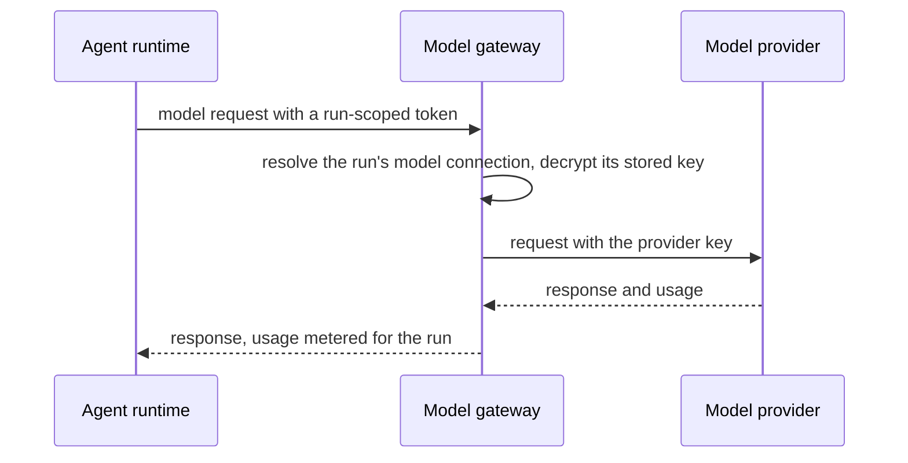

<Info>
**Chapter 2 · Build your agent — step 3 of 7** · [the chapter map](/path/build)

- **You will:** connect a model provider, pick the support agent's model, and choose where its code runs.
- **You will learn:** the order in which a run's model is resolved, how the gateway keeps the provider key away from the agent, and what each runtime driver isolates.
- **You need:** an agent from [Design an agent](/building/agents) and a provider API key.

</Info>

Two independent choices decide how an agent runs: which **model** answers it, through which provider
credential, and which **runtime** (sandbox, container, cluster or managed cloud service) executes it.
Both are data you set with `aw models` and `aw runtimes`; the drivers and the model gateway are the
platform's own code (to add one, see [Extend the platform](/building/extending-the-platform)).

**What you can do**

- [Connect a model provider](#connect-a-model-provider)
- [Pick the model for an agent, or for one run](#choosing-a-model-at-each-level)
- [Pick where the agent runs](#pick-where-the-agent-runs)
- [Size and sandbox it with a runtime profile](#size-and-sandbox-it-with-a-runtime-profile)
- [Call the gateway from an OpenAI client](#call-the-gateway-from-an-openai-client)



## Connect a model provider

```sh title="illustrative" claim="illustrative"
aw models connections create --file connection.json --value-stdin   # API key from stdin
aw models discover                                                  # models each ready connection offers
```

`connection.json` names the connection and its `provider`: `anthropic`, `anthropic-compatible`,
`openai`, `azure-openai` or `openai-compatible`. A connection is `ready` once it has a credential and
the config its provider needs:

| Provider                                      | `config`                              | Required for `ready`         |
| --------------------------------------------- | ------------------------------------- | ---------------------------- |
| `anthropic`, `anthropic-compatible`, `openai` | `baseUrl` optional                    | Just a credential            |
| `openai-compatible`                           | `baseUrl`                             | `baseUrl` and a credential   |
| `azure-openai`                                | `baseUrl`, `apiVersion`, `deployment` | All three, plus a credential |

The key is write-only: `hasCredential` says whether one is stored, no field returns it, and
`aw models connections rotate-credential <id> --value-stdin` is the only way to change it. Model
choice everywhere is a `(connectionId, providerModelId)` pair, never a bare model name. The SDK
equivalents are `aw.models.connections.create` and `aw.models.discover()`; every field is on
[Models](/resources/models).

<AccordionGroup>
  <Accordion title="SDK example: connect and list the models">

```ts title="connect-a-model.ts (illustrative)" claim="illustrative"
const providerApiKey = process.env.ANTHROPIC_PROVIDER_API_KEY;
if (providerApiKey === undefined) throw new Error('Set ANTHROPIC_PROVIDER_API_KEY');

const connection = await aw.models.connections.create({
  name: 'production-anthropic',
  provider: 'anthropic',
  apiKey: providerApiKey,
});

const catalog = await aw.models.discover();
const offered = catalog.models.filter((model) => model.connectionId === connection.id);
console.log(offered.map((model) => model.providerModelId));
if (catalog.unavailable !== undefined) {
  for (const failure of catalog.unavailable) console.warn(failure.connectionName, failure.reason);
}
```

`MODEL_PROVIDERS` is in `packages/contracts/src/runs.ts` and `MODEL_PROVIDER_CONFIG_RULES` in
`packages/contracts/src/models.ts`.

  </Accordion>
  <Accordion title="How the gateway keeps the provider key off the runtime">

An agent's runtime never holds a provider credential. `packages/runtime/src/env.ts`'s
`buildRuntimeEnvironment` refuses to emit `ANTHROPIC_API_KEY` under any circumstance — even as an
agent secret of that name — and `packages/core/src/config.ts`'s `compileRunRequest` carries the
identical refusal at the compile step. What the runtime gets instead is `ANTHROPIC_BASE_URL`
pointed at the internal model gateway and a short-lived `ANTHROPIC_AUTH_TOKEN` scoped to that one
run.

The gateway is what turns that token back into a real request. `createDatabaseGatewayRunResolver`
in `packages/gateway/src/index.ts` resolves the token's claims against the run and its
`modelConnectionId`, then decrypts the _stored_ provider credential — held as a secret named
`` `MODEL_CONNECTION_<connection id, uppercased, hyphens stripped>` `` — and substitutes it
before forwarding the request to the actual provider. The run-scoped token and the provider's own
key never occupy the same place: the agent's process holds only the former, and only the gateway
— never the runner, never the agent's own runtime — ever holds the latter.

  </Accordion>
</AccordionGroup>

## Choosing a model at each level

Set an agent's model with `aw.agents.update(agentId, { modelConnectionId, model })`, or override it
for one run with `aw.runs.start(agentId, { prompt, modelOverride: { connectionId, model } })`. A run's
model resolves in this order; the first level that names a model wins, and the connection and model
travel together:

1. **Per run.** `modelOverride` overrides everything else for this one run only.
2. **Agent default.** The agent's `modelConnectionId` and `model` — `null` for both means the agent
   has no model of its own.
3. **Workspace / project default.** An agent (and a project — see [Projects](/resources/projects))
   with no model of its own falls back to whatever default the workspace resolves; that resolution
   is a server behaviour, not something the SDK computes.
4. **Deployment default.** When nothing above applies (what `model: 'default'` in `defineAgent`
   writes), the run uses the agent's connection, or the workspace's connection named `default`, with
   the model id the deployment configures for that provider in `AW_DEPLOYMENT_DEFAULT_MODELS`.
   `aw dev`'s local runtime sets `claude-sonnet-4-5` for Anthropic and `gpt-5.1` for OpenAI; other
   deployments set nothing unless an operator does. With no id for the provider, the run is refused
   with `model_connection_unresolved`.

<Accordion title="More on the deployment default">

This is the one level where the connection (the agent's) and the model (the deployment's) come from
different places, and the run reports it as its own source, `deployment`. An agent pushed before the
workspace had a connection named `default` picks that connection up at this level only, at its next
run once it exists, so you do not need to push it again; with no such connection the run is refused,
naming it. An agent that stores a model but no connection is never paired with `default`.

</Accordion>

## Pick where the agent runs

| Your situation          | Driver                                | What it actually is                                                                                                                                                                        |
| ----------------------- | ------------------------------------- | ------------------------------------------------------------------------------------------------------------------------------------------------------------------------------------------ |
| Local development only  | `local`                               | No isolation at all — the agent runs as a child of the runner process, on the runner's own host, with the runner's own credentials. Never advertise this as tenant isolation.              |
| A team sharing one host | `docker`                              | One Docker container per session; `destroy()` removes that exact container.                                                                                                                |
| A Kubernetes cluster    | `kubernetes`                          | One pod per session, forwarding the same runtime HTTP contract every driver uses.                                                                                                          |
| A managed cloud sandbox | `cloud-run-service` or `aca-sessions` | One private Cloud Run v2 service per session (`managedByProvider: true`), or one Hyper-V-isolated Azure Container Apps dynamic session (`isolation: 'microvm'`, no persistent filesystem). |

[Which runtime drivers are real today](/building/self-hosting#which-runtime-drivers-are-real-today)
is the source of truth for what each driver enforces (isolation, domain allowlisting, session
affinity). The server refuses a `networkPolicy` a driver cannot enforce as
`422 network_policy_not_enforceable`.

<Note>
  **Today:** `docker` and `kubernetes` enforce `restricted` and `open` through a per-session egress
  proxy. The isolation suite has checks that an allowed host is reachable, any other host and
  the metadata address are refused, and a sandbox cannot bypass the proxy, but they have not yet run
  green on both lanes, so today this is covered by unit tests only. `cloud-run-service` and
  `aca-sessions` refuse `restricted` and are not exercised by the live driver suite. E2B (`external`)
  and `vercel-sandbox` have passed the providers-live lane; `cloudflare-sandbox` is implemented but
  refuses every run by name (ADR-0131), and the remaining managed-cloud ids have no implementation at all — see
  [The data plane](/concepts/data-plane#the-contract) for the standing of each cloud's sandbox.
  **Target:** one verified sandbox driver per cloud, each with a proxy or an equivalent control of
  its own. Tracked as [D-4](/concepts/roadmap#d-4-a-verified-managed-cloud-sandbox-per-cloud).
</Note>

<AccordionGroup>
  <Accordion title="Every driver id, and isolation at a glance">

`RUNTIME_DRIVERS` (`packages/contracts/src/runtimes.ts`) names thirteen ids — the six above, plus
`sandbox-runtime` (a host-backed OS sandbox, no Docker required), `gke-agent-sandbox`,
`aws-agentcore`, `aws-ecs`, `cloud-run-sandbox`, `external`, `vercel-sandbox` and `cloudflare-sandbox`. In
`packages/runtime/src/` only `local.ts`, `docker.ts`, `kubernetes.ts`, `aca-sessions.ts`,
`cloud-run.ts`, `vercel-sandbox.ts`, `cloudflare-sandbox.ts` and `external/` exist — the remaining ids, `sandbox-runtime`
included, are reserved in the contract's catalogue without a driver implementation. `external/`
carries the E2B provider, which passed every row of the providers-live lane on main
(run 37809484699).
Under `none` it denies `0.0.0.0/0` and the always-denied ranges (IPv4 and IPv6); it does not send
`::/0`, which E2B rejects, and it does not claim IPv6 egress is blocked beyond E2B's default
([internet access](https://docs.e2b.dev/sandbox/internet-access), checked 2026-10-08).

On E2B, `169.254.169.254` is not unreachable. It answers inside every sandbox with Firecracker's
per-VM metadata service (MMDS), which E2B enables unconditionally and cannot disable. Code in the
sandbox can read its own sandbox id, template id, E2B's log-collector address and a hash of envd's
access token, none of which is secret. Nothing may rely on `169.254.169.254` being unreachable on
E2B. The provider live lane checks on every run that nothing beyond MMDS, and no cloud metadata,
answers there (ADR-0120, LC4 amendment); the lane passed on E2B in runs 37791379449 and
37809484699.

`vercel-sandbox` is a driver for Vercel Sandbox microVMs over its REST API, started by the runner
manager with `RUNTIME_DRIVER=vercel-sandbox`. It passed every row of the providers-live lane on
main (run 37809484699). Its limits, as documented by Vercel on 2026-10-08
([pricing and limits](https://vercel.com/docs/sandbox/pricing),
[firewall](https://vercel.com/docs/sandbox/concepts/firewall)): a session lasts at most 45 minutes
on Hobby and 24 hours on Pro; the image is a digest-pinned reference in Vercel Container Registry;
`networkPolicy` is `none` or `open`, and `restricted` is refused by name until a live test shows
that a denied address range beats an allowed domain. Vercel's `networkPolicy.subnets` accepts IPv4
CIDRs only (providers-live run 37771522792, 2026-10-08, answered every create
`400 bad_request: Invalid CIDR "fe80::/10"` under `none` and `Invalid CIDR "::/0"` under `open`), so
the driver denies the IPv4 always-denied ranges and allows `0.0.0.0/0` under `open`. IPv6 egress denial
(link-local `fe80::/10`, unique-local `fc00::/7`, loopback `::1/128`) is **not configured through
Vercel's policy**; it is covered only by the lane's `no-ipv6-egress` proof, which passed in run
37809484699. If that proof ever fails, `vercel-sandbox` must refuse untrusted sessions by name.

`cloudflare-sandbox` is one Cloudflare container per session, reached through a bridge Worker that
this repository ships in `infra/cloudflare/sandbox-bridge/`. **Implemented; every run is refused by
name (ADR-0131)**: it refuses every network policy (`none`, `restricted` and `open`) with
`network_policy_unsupported`, so it creates no sandbox. Its providers-live lane deploys the bridge to
a real Cloudflare account and proves `none`, `open` and `restricted` refused; the live run reached
public, private, metadata and IPv6 targets under `none`, and it stays refused until a live run proves
Cloudflare denies egress. The lightweight journey (run 38215231687) records the Cloudflare Sandbox
lane as `n/a` for the agent rows for that reason. Until then a Cloudflare host runs sessions with the
E2B sandbox (`external`), which the `cloudflare-e2b` lane of the same run proved end to end; a container has no fixed maximum lifetime
and sleeps after the session timeout without activity (one hour when none is set); it has no
persistent filesystem; instance sizes go up to
`standard-4` (see
[Cloudflare Containers limits](https://developers.cloudflare.com/containers/platform-details/limits/),
checked 2026-10-08).

The web app forwards the stored provider credential to the runner manager when it allocates a
sandbox, runs Test Runtime and destroys one. When a run on `external` ends, the control plane kills
the E2B tool sandboxes that run started, before it writes the run's terminal status; a failed
release is logged and never changes the run's outcome (#1066). The session's own runtime sandbox
is not destroyed at run end, because another run of that session may still be using it, and nor is a
`vercel-sandbox` or `cloudflare-sandbox` sandbox: they end at the provider's own deadline (E2B's
timeout, Vercel's session limit, Cloudflare's sleep after inactivity). Destroying them when their
session ends is a follow-up: no session-end hook knows the sandbox's handle today.

On E2B the runner bounds that deadline instead of leaving it at the plan maximum (one hour on
Hobby, 24 hours on Pro): a session's agent sandbox is created with a timeout of its idle limit, 900
seconds unless the profile's `idleTimeoutSeconds` is longer, plus a 120-second margin, and every
reconnect for another run of the session moves the deadline out by the same amount. A crashed or
abandoned session therefore frees its slot after about 17 minutes. A profile that sets
`timeoutSeconds` keeps that hard limit and is not renewed. Tool sandboxes already end with the run
that used them.

| Deployment                             | Driver              | Isolation                            | Persistent filesystem     |
| -------------------------------------- | ------------------- | ------------------------------------ | ------------------------- |
| Local development                      | `local`             | None                                 | Yes (the host filesystem) |
| A team on one host                     | `docker`            | Container                            | Yes                       |
| Kubernetes                             | `kubernetes`        | Container                            | Yes                       |
| A managed cloud sandbox (Azure)        | `aca-sessions`      | microVM (Hyper-V)                    | No                        |
| A managed cloud sandbox (Google Cloud) | `cloud-run-service` | microVM (gen2 execution environment) | No                        |

  </Accordion>
</AccordionGroup>

## Size and sandbox it with a runtime profile

A **runtime profile** is a named bundle of driver, sizing and network policy. Create one with
`aw runtimes profiles create --file profile.json` and point an agent at it with
`aw.agents.update(agentId, { runtimeProfileId })`. There is no per-run runtime override: a run always
executes on its agent's profile. A **runtime connection** (`aw runtimes connections create`) holds
the endpoint and credential a driver needs, such as a Kubernetes cluster or a Docker host; its
credential is sealed and never read back. For `external`, `vercel-sandbox` and `cloudflare-sandbox`,
first-run setup can create the connection for you: see [Self-hosting](/building/self-hosting).

- `networkPolicy` is `'none'`, `'restricted'` (the gateway plus `allowedDomains`) or `'open'` (the
  public internet, through the egress proxy, without the metadata address or the private network).
  On `docker` and `kubernetes` the last two need the egress proxy image configured. See [Connect an
  MCP server](/building/mcp-servers#network-policy-for-remote-servers) for what `restricted` buys a
  remote connector today.
- `driverConfig.image`, when present, must pin an image by `sha256` digest; a mutable tag is refused.
- `external` reaches one sandbox provider, named by `driverConfig.provider` (`runtime.provider` in a
  deployment profile). `e2b` is the only one today and is what `external` means when `provider` is
  left out. Any other value is refused with `422 runtime_provider_unsupported` by the server and by
  the profile schema, naming the value, rather than at the first run.
- A sizing field left out is `null`: the driver's default.

<Accordion title="SDK example and sizing bounds">

```ts title="create-a-runtime-profile.ts (illustrative)" claim="illustrative"
const profile = await aw.runtimes.profiles.create({
  name: 'docker-standard',
  driver: 'docker',
  memoryMb: 2048,
  networkPolicy: 'open',
  filesystem: 'read-write',
  timeoutSeconds: 900,
  driverConfig: {
    image:
      'ghcr.io/example/agent-runtime@sha256:' +
      'e3b0c44298fc1c149afbf4c8996fb92427ae41e4649b934ca495991b7852b85',
  },
});
```

The sizing fields are `cpu`, `memoryMb`, `diskMb`, `timeoutSeconds` and `idleTimeoutSeconds`;
`RUNTIME_PROFILE_BOUNDS` (`packages/contracts/src/runtimes.ts`) gives the enforced ranges. Every
field and error code is on [Runtimes](/resources/runtimes).

</Accordion>

### Skill scripts under a sandbox

The runtime profile sizes and isolates the whole run. Inside it, an agent with `runCommands: true`
and a skill that ships `scripts/` runs those scripts through `run_skill_script`, which starts Node
with its permission model and no shell, so a read-only file grant stays read-only. It adds nothing
to the profile and relies on the runtime image having Node. See [Skills](/building/skills#run-a-skill’s-scripts).

## Call the gateway from an OpenAI client

An engine that speaks an OpenAI dialect reaches the same gateway, with the same run token, on
`POST /v1/responses` and `POST /v1/chat/completions`. For an `openai`, `azure-openai` or
`openai-compatible` connection the body is passed through, not translated:

```ts title="illustrative" claim="illustrative"
const client = new OpenAI({ baseURL: `${gatewayUrl}/v1`, apiKey: runToken });
await client.responses.create({ model, input: 'hi', stream: true });
await client.chat.completions.create({
  model,
  messages: [{ role: 'user', content: 'hi' }],
  stream: true,
});
await client.models.list();
```

The gateway refuses, and sends nothing upstream for:

- an `anthropic` or `anthropic-compatible` connection on these routes
  (`400 protocol_not_supported_for_connection`) — speak Anthropic Messages to those;
- any `tools` entry other than `function` or `custom`, and Chat Completions' `web_search_options`
  (`400 hosted_tool_not_permitted`);
- `background: true` on `/v1/responses` (`400 background_not_supported`) — stream instead;
- `previous_response_id`, `conversation` or a stored `prompt` (`400 vendor_state_not_permitted`).
  Every relayed body carries `store: false`, overwriting a `store: true` you sent.

`GET /v1/models` answers the envelope the calling SDK expects, so `models.list()` works for both the
Anthropic and the OpenAI SDK.

<Accordion title="Why each rule exists, and how usage is metered">

- **Vendor-hosted tools.** Such a tool would execute at the model vendor, outside the sandbox and
  past the platform's network policy and connector model. The rule is an allowlist, so a hosted tool
  type the vendor adds later is refused without waiting for a list to be updated.
- **`background: true`.** A backgrounded response is collected through `GET /v1/responses/{id}`,
  which this gateway does not publish, so relaying one would spend the run's tokens on a turn nothing
  could ever retrieve or meter.
- **Conversation state.** State the vendor holds lives outside the platform's session boundary and
  outside the run's transcript, keyed by an id the platform never sees, so a run that learned another
  run's stored response id could otherwise resume its context through the shared credential, and a
  stored prompt brings its own instructions and tools with it. Send the context and instructions a
  turn needs in the request; the transcript is where the platform keeps them.
- **`models.list()`.** The Anthropic envelope is answered when the request carries
  `anthropic-version` — which the Anthropic SDK always sends and no OpenAI SDK does — and the OpenAI
  `{object: 'list', data: […]}` envelope when it does not. `?format=openai|anthropic` or an
  `x-gateway-model-format` header overrides both.

Usage is metered per dialect and surfaces through `Run.usage` exactly as Anthropic traffic does.
Each settlement records which dialect served it on `run_usage_records.wire_protocol`
(`anthropic-messages`, `openai-responses` or `openai-chat-completions`). The gateway sets
`stream_options.include_usage` on every streamed Chat Completions request it forwards, because
without it the upstream reports no usage at all; an `openai-compatible` upstream that ignores it
still gets a row, at unmeasured zeros with no price, which settles the run's accounting `unavailable`
rather than claiming a free turn.

</Accordion>

## What you can and cannot do today

| Do                                                   | How                                                                     |
| ---------------------------------------------------- | ----------------------------------------------------------------------- |
| Store a provider credential and discover its models  | `aw.models.connections.create`, `aw.models.discover`                    |
| Rotate a model connection's credential               | `aw.models.connections.rotateCredential`                                |
| Override a run's model without changing the agent    | `aw.runs.start(id, { modelOverride })`                                  |
| Create a runtime profile and point an agent at it    | `aw.runtimes.profiles.create`, `aw.agents.update({ runtimeProfileId })` |
| Store a runtime connection's endpoint and credential | `aw.runtimes.connections.create`                                        |
| Clear a sizing field a profile once set              | Not yet — `PATCH` only changes a field, never clears it                 |
| Probe `POST /api/runtimes/test` from the SDK         | Not yet — the route's response is not the standard envelope             |

<Note>
  **Today:** `POST /api/runtimes/test` answers `{ error, message }` instead of the standard
  problem envelope, so there is no `aw.runtimes.test`. **Target:** the standard envelope and
  `aw.runtimes.test(driver)`. Tracked as
  [S-4](/concepts/roadmap#s-4-runtime-test-envelope).
</Note>

<Note>
  **Today:** what a host can actually run is answered by `GET /api/setup/runtime-detect`, a
  setup-time route the SDK does not wrap. **Target:** `GET /api/runtimes/detect` publishing the
  capability table plus `aw.runtimes.detect()`. Tracked as
  [S-9](/concepts/roadmap#s-9-runtime-detection-outside-setup).
</Note>

<Note>
  **Today:** `aw.runtimes.profiles.update` can change a sizing field but cannot clear one back to
  the driver's default — `{ memoryMb: null }` is `400 invalid_body`. **Target:** `null` accepted
  for every nullable field, including `runtimeConnectionId`. Tracked as
  [S-19](/concepts/roadmap#s-19-nullable-runtime-profile-fields).
</Note>

<Note>
  **Today:** a model connection's or runtime connection's credential is a secret row the connection
  references, and ownership between the two rows is by convention rather than enforced. **Target:**
  direct, transactional ownership, so rotating or deleting a connection cannot leave a dangling
  secret or an orphaned reference. Tracked as
  [RF-204](/concepts/roadmap#rf-204-typed-credential-ownership).
</Note>

<CardGroup cols={2}>
  <Card title="Models" href="/resources/models">
    Every field, error code and method signature for model connections.
  </Card>
  <Card title="Runtimes" href="/resources/runtimes">
    Every field, error code and method signature for profiles and connections.
  </Card>
  <Card title="Design an agent" href="/building/agents">
    Where `modelConnectionId`, `model` and `runtimeProfileId` live on the agent itself.
  </Card>
  <Card title="Extend the platform" href="/building/extending-the-platform">
    Add a runtime driver or a model provider adapter.
  </Card>
</CardGroup>
