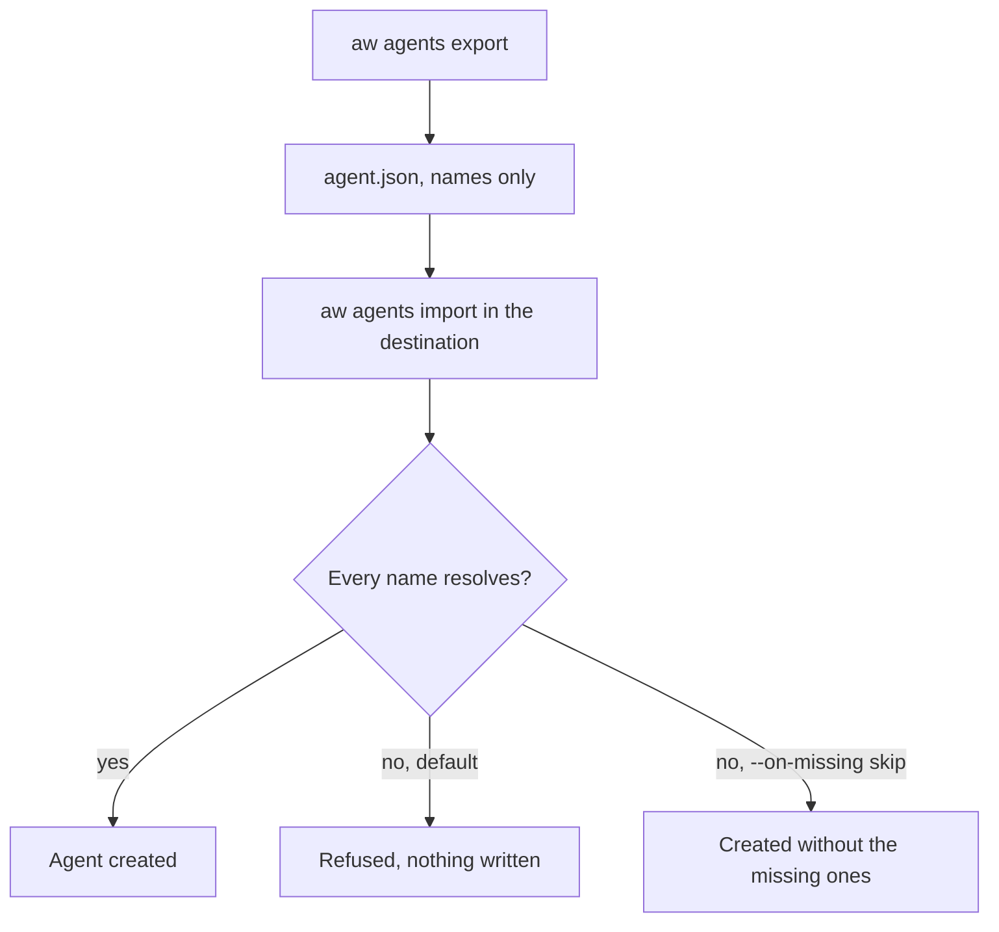

<Info>
**Chapter 5 · Ship it to your servers — step 2 of 3** · [the chapter map](/path/ship)

- **You will:** copy an agent, with its policy and assignments, from one workspace into another.
- **You will learn:** what an `AgentDefinition` carries (names, never ids or secrets), how import resolves names, and what `--on-missing skip` does.
- **You need:** a credential for each workspace, for example your laptop and the deployment from [Deploy](/guides/deploy).

</Info>

Copy an agent, with its policy and its skill, connector and file assignments, into another workspace:
promote it from development to staging to production, or hand it to a teammate.

**What you can do**

- [Copy an agent to another workspace](#copy-an-agent-to-another-workspace)
- [Export to code](#export-to-code)
- [Review what the file carries](#what-the-file-carries)
- [Import when some resources are missing](#import-when-some-resources-are-missing)



## Copy an agent to another workspace

```bash title="illustrative" claim="illustrative"
aw agents export 7c9e… > agent.json          # always JSON, whatever the output mode
aw --profile prod agents import agent.json   # or `-` to read stdin
```

Import recreates the agent in whichever workspace the credential is bound to. The SDK equivalent is
`aw.agents.export(id)` and `aw.agents.import(definition)`.

<Accordion title="SDK example: from dev to prod">

```ts title="promote.ts" claim="compile"
import { createClient } from '@indx-workspace/sdk';

const dev = createClient({
  baseUrl: process.env.AW_DEV_URL!,
  auth: { kind: 'api-key', apiKey: process.env.AW_DEV_KEY! },
});
const prod = createClient({
  baseUrl: process.env.AW_PROD_URL!,
  auth: { kind: 'api-key', apiKey: process.env.AW_PROD_KEY! },
});

const definition = await dev.agents.export('7c9e…');
const { agent, skipped } = await prod.agents.import(definition);
console.log(`created ${agent.id}; skipped ${skipped.length} references`);
```

</Accordion>

## Export to code

`aw agents export` also writes an agent as files for an [agents-as-code](/guides/agents-as-code) project:

```bash title="illustrative" claim="illustrative"
aw agents export 7c9e… --format ts          # writes agents/<name>.ts and agents/<name>.md
aw check && aw push                         # the exported files push back as the same version
```

- It writes the version the `local` pointer names, or the newest. `--agent-version <n>` names another.
- It writes under `--out`, by default the current directory. It never overwrites a file without
  `--force`: it lists the files that exist and writes none.
- It never writes `agent-workspace.yaml`. An agent that uses an `mcp()` connector needs that
  connector declared under `connectors:` in the project file in `--out`; an agent that uses an
  OpenAPI, Postgres or code tool from a project module cannot be written yet. Either way the command
  exits 1, names the path in the version, and writes nothing.

## What the file carries

The file is one **`AgentDefinition`**: the agent record, its policy and its resources.

- **Names, never ids.** Every reference to another resource is that resource's name (a file is its
  workspace path), so the file means the same thing in any workspace and diffs cleanly in review.
- **No secret and no bytes.** There is no credential field, and a file that adds one under any key
  is refused as `400 invalid_agent_definition`. A skill travels by name only — move its directory
  with `aw.skills.export`/`import` first. A connector's or model connection's credential is entered
  in each workspace on its own.
- **Not carried:** the Viewer run grants (`agents.getGrants`) name principals of the source
  workspace, so the destination decides its own.

<AccordionGroup>
  <Accordion title="An example agent.json">

```json title="agent.json (illustrative)" claim="illustrative"
{
  "apiVersion": "agentworkspace.dev/v1",
  "kind": "AgentDefinition",
  "agent": {
    "name": "Support triage",
    "instructions": "Answer support mail.",
    "permissions": {
      "readFiles": true,
      "writeFiles": false,
      "runCommands": false,
      "unrestrictedNetwork": false
    },
    "model": "claude-sonnet-4-5",
    "modelConnectionName": "anthropic-prod",
    "runtimeProfileName": null
  },
  "policy": {
    "engine": "claude-agent-sdk",
    "tools": { "…": "…" },
    "skills": { "mode": "allowlist", "names": ["triage"] },
    "limits": { "maxTurns": 20, "maxBudgetUsd": null }
  },
  "policySource": "stored",
  "resources": {
    "files": [{ "path": "handbook/playbook.md", "access": "read" }],
    "skills": ["triage"],
    "connectors": ["crm"]
  }
}
```

  </Accordion>
  <Accordion title="apiVersion, policySource and other engines">

- **`apiVersion`** is the file format's version, not the SDK's: a definition written today stays
  importable by every release that reads `agentworkspace.dev/v1`. It is the group every
  workspace-as-code file uses; the agent's engine is `policy.engine`.
- **`policySource`** says whether the source agent's policy was stored by a `replacePolicy`
  (`"stored"`) or compiled from its permissions and skills (`"compiled"`). Import stores only a
  stored policy, so a compiled one keeps following the destination agent's permissions and skill
  assignments. Left out of a hand-written file, it means `"stored"`. A compiled policy is the
  destination's to derive on the engine it compiles for, so a `"compiled"` file whose
  `policy.engine` is another engine (an `openai-agents` one, say) is refused as
  `400 invalid_agent_definition` and the new agent is removed again: set `"stored"` to import it.
- **Another engine's policy** is stored through `replacePolicy`, so it meets every check that
  route makes: an `openai-agents` definition that assigns a skill, a `pi` one that assigns a
  connector, or a `mastra` one whose connector asks for an approval is refused
  `422 engine_capability_unsupported`, and its `withheldPermissions` are stored as written. The
  agent is new, so nothing is carried over from a previous engine.
- **The allowlist** may only name skills `resources.skills` lists; a file that names another is
  refused as `400 invalid_agent_definition`.

</Accordion>
</AccordionGroup>

## Import when some resources are missing

Import resolves every name in the destination and writes nothing until all of them resolve. By
default a missing skill, connector, file, model connection or runtime profile refuses the import,
listing each one as `<kind>:<name>` in the error's `details`.

To import anyway, pass `--on-missing skip` (`{ onMissing: 'skip' }`): a missing assignment is left
out, a skipped skill leaves the policy's allowlist too, and a missing model connection or runtime
profile falls back to the deployment default. `result.skipped` lists what was left out. A name two
destination resources share is refused either way.

If the policy is refused or the import is aborted, the new agent is removed again, so a retry never leaves a second agent
behind.

<Accordion title="Import error codes and partial failures">

Each refusal is an `ApiProblemError` whose `details` list the offending references — `<kind>:<name>`
for a missing or ambiguous name, the engine id for an engine, one `<path>: <message>` per parse issue
for a malformed file — so you can print or fix them without parsing the message:

| Code                                       | When                                                                          |
| ------------------------------------------ | ----------------------------------------------------------------------------- |
| `400 invalid_agent_definition`             | the file is not an `agentworkspace.dev/v1` `AgentDefinition`                  |
| `400 unsupported_engine`                   | the policy's `engine` is not installed in this deployment (`aw engines list`) |
| `409 agent_definition_reference_ambiguous` | two resources in the destination share a name the file uses                   |
| `422 agent_definition_references_missing`  | a skill, connector, file, model connection or runtime profile is absent       |

Import creates the agent with its assignments in one call and stores the policy (unless it was
compiled). If the policy is refused — `422 engine_capability_unsupported`, for one — or the import is
aborted, the new agent is removed again. If that removal fails too, the error is still the original
refusal, with `agent:<id>` added to its `details` so you can remove the agent yourself; an abort or
network failure then surfaces as `409 agent_definition_import_incomplete` with the same `details` and
the original as its `cause`.

</Accordion>

`export` and `import` compose the ordinary routes, so they need exactly the access those routes
need: reading the agent, its policy and assignments, and the skills, connectors, model connections,
runtime profiles and files it names, in the source; creating an agent in the destination.

## See also

<CardGroup cols={2}>
  <Card title="Design an agent" href="/building/agents">
    The record, policy and assignments an export captures.
  </Card>
  <Card title="Ownership and sharing" href="/concepts/ownership-and-sharing">
    What crosses a workspace boundary, and what never does.
  </Card>
</CardGroup>
