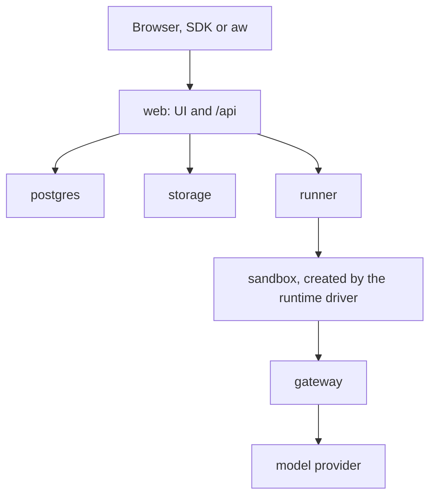

<Info>
**Chapter 5 · Ship it to your servers — step 3 of 3** · [the chapter map](/path/ship)

- **You will:** run the whole platform yourself, on a laptop, a single VM or Kubernetes.
- **You will learn:** the five services and who talks to whom, how one `agent-workspace.yaml`
  renders Compose, Helm or Terraform, and which runtime drivers are real today.
- **You need:** Node 24 or newer, pnpm, and Docker with Compose and `buildx`; for production, the
  [Deploy](/guides/deploy) page first.

</Info>

Run Agent Workspace on your own machines: a laptop to evaluate it, one VM for a team, or a cluster
for production. The same container images run in every mode; only where the agents' sandboxes
execute changes.

**What you can do**

- [Run the whole platform on a laptop](#run-the-full-platform) with one command and a five-step
  wizard
- [Connect the SDK and the CLI](#connect-the-sdk-to-your-deployment) to your deployment
- [Describe your deployment in one file](#describe-your-deployment-in-one-file) and render
  Compose, Helm or Terraform from it
- [Deploy to a VM or a cluster](#deploy-to-a-vm-or-a-cluster), seeing the plan before it applies
- [Check a project before you start it](#check-a-project-before-you-start-it)
- [Know what is isolated today](#which-runtime-drivers-are-real-today) and
  [where the security boundary is](#the-security-boundary)

You operate the platform as shipped, through its UI and the API; nothing here requires editing its
code. The single-VM walkthrough and the upgrade, rollback and backup runbook are in
[Deploy a project](/guides/deploy#single-vm) and below; Kubernetes is in
[Deploy: Kubernetes](/guides/deploy#kubernetes). The Azure Container Apps guide is provided with
your delivery ([Book a demo](https://indx.jp/en/contact)).

Only `web` is exposed; everything else stays private, and a sandbox reaches the model only through
the gateway:



## Run the full platform

This is not the way to start. To try an agent, use the [Quickstart](/getting-started/quickstart),
which takes a few minutes and needs no Docker (`npm create @indx-workspace@latest <dir> -- --yes`,
then `npm run dev`; Ctrl+C stops it). `--cloud local` writes the deployment project: the whole
platform as Docker Compose, with the setup wizard. Expect 10 to 20 minutes the first time. It needs
Node 24 or newer, pnpm, and Docker with the Compose and `docker buildx` plugins (the generator runs
`docker buildx imagetools inspect` to pin image digests).

```sh title="illustrative" claim="illustrative"
npm create @indx-workspace@latest demo -- --cloud local   # without a terminal, the defaults (or pass --yes and --database, --storage, --runtime, --auth)
# or: npx -p @indx-workspace/cli create-agent-workspace demo --cloud local
cd demo && pnpm install --frozen-lockfile=false && pnpm start
```

You should see the generator list the files it wrote, then `pnpm start` pull the published images,
start the containers (web, runner, gateway and PostgreSQL; object storage too when you chose S3)
and print the URL of the setup wizard. The end of a real run, on a machine where `PORT` in `.env`
was set to `3300` because `3000` was taken (Docker's pull and create lines left out):

```text title="Output"
Checking the Docker socket group on the daemon…
 Container my-agent-platform-web-1 Healthy
Configured runtime: docker; effective runtime: docker
Agent Workspace is up: http://127.0.0.1:3300/setup
```

On that machine the wizard was up about two minutes after `npm create`, image pulls included.

Then open the URL `pnpm start` prints (`http://localhost:3000/setup` on a local Docker). `/setup` is
the five-step wizard (**Provider**, **Credentials**, **Runtime**, **Administrator**, **First
agent**), and it asks for the administrator password only at step 4. That password is the
"One-time setup password" the generator printed (`BOOTSTRAP_ADMIN_PASSWORD` in the generated
`.env`), with the administrator email it printed (`BOOTSTRAP_ADMIN`) — not a new password, so do not
take one your browser suggests. The wizard itself needs a working LLM provider key, which is checked
when you click "Finish setup". Afterwards the deployment has a workspace, an Owner, a model
connection, a runtime profile and one runnable agent.

<Frame caption="The setup wizard at /setup, before the first step is filled in.">
  
</Frame>

You should see the wizard finish with a confirmation that the workspace, the Owner and the first
agent exist.

<Frame caption="The wizard after Finish setup: the deployment is ready to use.">
  
</Frame>

A runtime that runs in a provider's sandbox (`external` for E2B, `vercel-sandbox`,
`cloudflare-sandbox`) needs that provider's key before setup can test it, and the wizard does not
offer these drivers yet. Send `POST /api/setup` with the same body as the wizard plus
`runtimeCredential` (the provider key) and `runtimeEndpoint` (its `https` API URL), for example
`https://api.e2b.dev`. Setup tests the runtime with the key, then stores it with the rest of setup
as the encrypted runtime connection `<driver> default`, which the setup runtime profile uses. If
any step fails, the connection is rolled back too, and the key appears in no error or log. Without
the key, setup answers `422 runtime_connection_missing` and changes nothing.

<Warning>
  Every runtime the UI offers has a **Test Runtime** action. Do not claim isolation the test did not
  pass; the `local` driver has no tenant isolation and keeps its warning banner for that reason. A
  pass lasts 24 hours and is tied to the runtime image. A run that finds the pass of a runtime that
  passed before has lapsed (after a day, or an image upgrade) runs the test again itself, and fails
  with `runtime_not_verified` and the fix only when that test fails.
</Warning>

To stop the workspace, run `pnpm stop` (`agent-workspace stop`) in the project directory. It runs
`docker compose down`, then removes the sandboxes started for agent runs and the project's networks,
and keeps the data; add `--volumes` (`pnpm stop --volumes`) to also delete it.

<AccordionGroup>
  <Accordion title="Sign in before the wizard is finished">

`/` redirects to `/signin`, which does not link to the wizard. To get an owner session before
finishing the wizard, open `/signin` and sign in with the administrator email and the "One-time
setup password" that the generator printed. That session lets you create an API key at
**Administration → API Keys** (`/admin/api-keys`). Each generated project signs in with its own
cookie, so two projects on different ports can be open in one browser.

  </Accordion>
  <Accordion title="Ports, WSL and remote Docker">

The generated `.env` publishes the web service on loopback only (`PORT=127.0.0.1:3000`). To use
another port, pass `--port <n>` when you create the project, or change the port in `PORT` later; to publish on every interface, which a remote Docker
daemon needs, write the port alone (`PORT=3000`). Under WSL with mirrored networking
(`networkingMode=mirrored`), the process holding the port may be a Windows process, which
`agent-workspace start` cannot see from inside WSL and so cannot name; look for it on the Windows
side (`netstat -ano` in PowerShell). On a remote or non-local Docker daemon, `pnpm start` prints
`http://<daemon-host>:PORT` plus an ssh port-forward hint, and it may suggest a `DOCKER_GID=<n>`
line to record in `.env`.

  </Accordion>
  <Accordion title="Installing pnpm">

Use `corepack enable`, or `npm install -g pnpm`. As a non-root Linux user both fail with EACCES, so
use `sudo` or run `npm config set prefix ~/.npm-global` and add `~/.npm-global/bin` to your `PATH`.

  </Accordion>
  <Accordion title="Which project the start, stop and doctor commands accept">

`agent-workspace start`, `stop` and `doctor` are for the deployment project only: in a
`kind: Project` directory (the `aw dev` project) they refuse. `stop` and `doctor` name `aw dev`;
`start` names it when the directory has no `.env`. The embedded, container-free mode is what
`aw dev` runs; it is for development only.

  </Accordion>
</AccordionGroup>

## Connect the SDK to your deployment

Once the wizard is done, everything on this site applies to _your_ control plane. Sign in as the
administrator and mint an API key with the smallest role the job needs (Builder for automation that
starts runs of agents its own member created; Admin to run agents others saved; Owner or Admin for
administration) — [Authentication](/getting-started/authentication).
`aw team api-keys create` needs an existing credential, so create the first key in the web UI. Then
point the SDK or the CLI at it:

```sh title="illustrative" claim="illustrative"
export AGENT_WORKSPACE_URL=https://agents.example.internal   # your web service; http://localhost:3000 locally
export AGENT_WORKSPACE_API_KEY=ak_live_…                     # shown once at minting
npx @indx-workspace/aw me
```

From here: [Integrate a backend](/building/backend) for the first run from code and for automation,
[Embed an agent in your product](/building/embedding) for the frontend happy path.

## Describe your deployment in one file

You state where each store lives once, in `agent-workspace.yaml`, and the installer renders the
deployment's `.env`, its Compose file, its Helm values or its Terraform variables from it:
`npx -p @indx-workspace/cli create-agent-workspace acme-ai --cloud gcp` writes the profile and
renders them.

The profile is validated before any file is written, and `agent-workspace validate` re-checks it and
probes the stores it names. AWS accepts native `s3://` and `kms`; GCP accepts native `gcs://` and
`secret-manager`; Azure accepts native `azblob://` and `key-vault`. Cross-cloud use is refused where
written rather than accepted and ignored.

Three stores hold Agent Workspace's own state: `postgres` holds every durable row (workspaces,
principals, agents, runs, events); `storage` holds the bytes (files, skills, transcripts); secrets
are envelope-encrypted inside `postgres` under one deployment key. **Your own databases and document
systems reach an agent only as an MCP connector or as uploaded files — never through these stores.**
Which cloud service answers each store today is [The data plane](/concepts/data-plane#the-contract);
the field reference and the full variable table are [The deployment
profile](/concepts/data-plane#the-deployment-profile).

<Note>
  **Today:** the generator writes the profile and the artefacts, and `agent-workspace deploy`
  applies them: it renders, prints the plan of `docker compose`, `helm` or `terraform` for the
  profile's target, and applies it only with `--yes`. A cloud target still needs `--infra`, the
  `infra/` directory of the platform source, which we provide on request. **Target:** the
  three-command first run against signed images, with no checkout. Tracked as
  [P-6](/concepts/roadmap#p-6-a-published-release-with-signed-images-and-the-installer).
</Note>

<AccordionGroup>
  <Accordion title="An example profile (GCP)">

```yaml title="acme-ai/agent-workspace.yaml (illustrative)" claim="illustrative"
apiVersion: agentworkspace.dev/v1
kind: Deployment
cloud: gcp
storage:
  relational: cloud-sql # a postgres:// URL, or that cloud's managed PostgreSQL by name
  objects: gcs://acme-ai-files
  secrets: secret-manager
runtime:
  default: cloud-run-service
identity:
  oidc: https://accounts.google.com
  bootstrapAdmin: ops@acme.example
```

  </Accordion>
  <Accordion title="What the file accepts">

The file is read as YAML 1.2, so any valid YAML spelling of these fields works, except anchors,
aliases, non-core tags, directives, duplicate keys and a second document, which are refused because
a reader could take them more than one way. Every refusal names the line and the column.
`apiVersion: agentworkspace.dev/v1` and `kind: Deployment` say which format the file is in. A
profile without them, written by an earlier release, is still read as v1 for one minor release, and
`agent-workspace validate` prints a warning naming the two lines to add. A `kind: Project` file is
what `npm create @indx-workspace` writes without `--cloud`: `aw dev` runs it, and
`agent-workspace start`, `stop` and `doctor` refuse it: `stop` and `doctor` name `aw dev`, and
`start` names it when the directory has no `.env`.

  </Accordion>
  <Accordion title="Autocomplete the profile in your editor">

The generated profile's first line points your editor at the profile's JSON Schema, generated from
the same definition `agent-workspace validate` checks with:

```yaml title="illustrative" claim="illustrative"
# yaml-language-server: $schema=https://unpkg.com/@indx-workspace/cli@latest/schema/agent-workspace.schema.json
```

Install the [YAML extension for VS Code](https://marketplace.visualstudio.com/items?itemName=redhat.vscode-yaml)
(or any editor built on `yaml-language-server`) and the editor completes the profile's keys and the
values your `cloud` accepts, and underlines a refused value as you type. The schema ships in the
published `@indx-workspace/cli` package, served by unpkg; pin `@latest` to the CLI version you run
if you want it to match exactly. `agent-workspace validate` stays the authority: it also checks
that a `postgres://` connection string and the OIDC issuer parse as URLs. To validate without the
network, point the line at `./node_modules/@indx-workspace/cli/schema/agent-workspace.schema.json`.

  </Accordion>
</AccordionGroup>

## Deploy to a VM or a cluster

Pick the mode by who uses it; every mode runs the same images.

- **Laptop** — development and evaluation. `aw dev` runs the published `@indx-workspace/embedded`
  local runtime from the project (one Node process, an embedded PostgreSQL, no Docker; ADR-0109);
  the whole platform needs Docker Compose. For `aw dev`, agent runs on the `local` driver (no
  isolation) through the `local` runtime profile the runtime makes the workspace default, whatever
  driver its `Runtime:` startup line names; for the Compose project, the `docker` driver.
- **Single VM** — one team, one tenant, on EC2 / GCE / an Azure VM / on-premises. Sandboxes use the
  `docker` driver, with the Docker socket mounted into `runner` only —
  [Deploy a project](/guides/deploy).
- **Kubernetes** — several teams, higher concurrency, production. The runner manager runs each
  agent session in a Pod on the `kubernetes` driver (with a gVisor RuntimeClass where the cluster
  provides one); the isolation workflow's kind-deploy lane runs an agent turn on a kind cluster
  (not yet green). `open` and `restricted` reach the internet only through the per-session egress
  proxy, so set `runtime.egressProxyImage`; without it an `open` session reaches only the gateway.
  In production set `kubernetesApi.cidr` to the API server address, or the runner manager may dial
  any host on the API ports. One Helm chart, `infra/helm/agent-workspace`, with
  `values-eks.yaml`, `values-gke.yaml`, `values-aks.yaml` or `values-openshift.yaml`;
  `aw deploy production` with `target: kubernetes` installs it
  ([Deploy: Kubernetes](/guides/deploy#kubernetes)).

To change a deployment, edit `agent-workspace.yaml`, look at the plan, then apply it:

```sh title="illustrative" claim="illustrative"
agent-workspace deploy        # renders, prints the plan; exits 2 while changes are pending
agent-workspace deploy --yes  # applies exactly that plan
```

<Warning>
  Never put a model-provider key in the runner's environment: provider credentials are entered in
  the Models screen and resolved only by the gateway.
</Warning>

A sandbox image carries the runner and **exactly one engine adapter**, so a deployment configures
one runtime image per engine it offers: `AGENT_WORKSPACE_RUNTIME_IMAGE_CLAUDE_AGENT_SDK` in the
environment, or `images.runtime.claude-agent-sdk` in the Helm chart. An engine with no image is
reported `installed: false` by `GET /api/engines`, and a run on it is refused with
`422 engine_not_installed` before any sandbox is created. Upgrading from the single `RUNTIME_IMAGE`
means setting one such variable per engine.

<Note>
  **Today:** the `@indx-workspace/{contracts,sdk,aw,cli,embedded,create,react,platforms}` packages
  are on npm in lock-step (`npm view @indx-workspace/aw version` prints the `@latest` release) and
  the platform images
  (`ghcr.io/indxjp/agent-workspace/*`) are published, and the generator pins the images by
  digest. `npm create @indx-workspace@latest my-company-ai` writes the `aw dev` project by
  default, and `-- --cloud local` writes the Compose project: `cd my-company-ai`,
  `pnpm install --frozen-lockfile=false && pnpm start`, then `http://localhost:3000` is the first
  run.
  The release verdict stays blocked until the remaining evidence is in. Tracked as
  [P-6](/concepts/roadmap#p-6-a-published-release-with-signed-images-and-the-installer).
</Note>

**Keep it running**

- **Upgrade:** pin images by digest, apply migrations once, keep the PostgreSQL and object-store
  volumes. Migrations run under a PostgreSQL advisory lock, so two starters never race: the second
  waits, finds nothing pending and applies nothing. The repository's Compose file runs them in a
  one-shot `migrate` service that `web` waits for, and the Helm chart runs them in a
  pre-install/pre-upgrade Job. A project written by `aw` applies them as `web` starts.
  [Versions and deprecation](/concepts/public-surface#versions-and-deprecation) states the
  compatibility rules; the steps are in
  [Upgrade, roll back, back up](/guides/deploy#upgrade-roll-back-and-back-up).
- **Observe:** `metrics.recentRuns` and `audit.list` over the API
  ([Observability](/resources/observability)); telemetry export at the platform level
  (`packages/core/src/telemetry`).
- **Back up and restore:** the database and the object store are the whole state, and migrations
  only go forward, so a rollback that crosses a migration restores a backup taken before it. Take
  one before every upgrade, and rehearse the restore on a scratch copy; the commands are in
  [Upgrade, roll back, back up](/guides/deploy#upgrade-roll-back-and-back-up).

<AccordionGroup>
  <Accordion title="Images, render and deploy in detail">

The deployment project needs `--cloud`: `create-agent-workspace <directory> --cloud …` (run by
`npm create @indx-workspace@latest <directory> -- --cloud …`) pins its release's platform images by
digest and _refuses_ to proceed unless every image resolves to a verified digest. Without `--cloud`
it writes the `aw dev` project instead, which needs no platform image. To run an unreleased build,
supply your own image references (the `compose.yaml` and the Helm chart both take them, and the
chart accepts only immutable digests).

After you edit `agent-workspace.yaml`, `agent-workspace render` re-renders `deploy/`, `compose.yaml`
(for `local`) and the image lines of `.env` with the same renderers, lists each file as `created`,
`updated` or `unchanged`, and keeps every other `.env` line — the secrets and anything you added —
as it was. A second run changes nothing, and `agent-workspace render --check` exits non-zero without
writing when a file is out of date, for CI. Other `.env` values, such as the object-store keys, are
still edited by hand (`cp .env.example .env` still works if you would rather assemble it yourself).
`render` keeps the image digests `.env` already pins; after you install a newer CLI,
`agent-workspace render --upgrade` moves the web, gateway, runner and runtime pins to that CLI's
release and prints each `KEY: old -> new` move.

`agent-workspace deploy` prints the plan of the real tool for the profile — `docker compose` for
`local`, `terraform plan` for `gcp` and `azure`, `helm diff upgrade` (or `helm template`) for the
chart. `agent-workspace deploy --yes` applies exactly that plan (`docker compose up`, `terraform
apply` of the printed plan file, `helm upgrade --install`). A cloud target takes
`--infra <checkout>/infra`, and nothing it prints contains a `.env` secret. You can still run
`docker compose --env-file .env up -d`, `helm upgrade --install …` or `terraform apply` yourself.

The `aw dev` project is the one exception to "one image set": it runs the same platform from the
`@indx-workspace/embedded` package rather than from the images, for development only. No
cloud-specific fork of the application exists: the value files change configuration, not code. A
managed-sandbox preview for Azure Container Apps on top of the same images. What each cloud's own
storage, secrets and sandbox service actually provides today, mode by mode, is [Per cloud
today](/concepts/data-plane#per-cloud-today).

  </Accordion>
  <Accordion title="The five services">

| Service    | Image                        | Does                                                                                                                   | Exposed                           |
| ---------- | ---------------------------- | ---------------------------------------------------------------------------------------------------------------------- | --------------------------------- |
| `web`      | control plane                | the UI, `/api/**`, authentication, the setup wizard                                                                    | port 3000, the only public one    |
| `gateway`  | control plane                | the model gateway: substitutes a per-run token for the stored provider credential; Anthropic-compatible `/v1/messages` | private; reachable from sandboxes |
| `runner`   | control plane                | the execution plane: allocates a sandbox through the chosen runtime driver and relays the agent's events               | private                           |
| `postgres` | PostgreSQL 17                | every durable row: workspaces, principals, agents, runs, events                                                        | private                           |
| `storage`  | SeaweedFS, S3, or native GCS | workspace files, skills, transcripts                                                                                   | private                           |

`AW_STORAGE_SIGNED_UPLOAD_MAX_BYTES` sets the largest file a signed upload link may carry, in
bytes. It defaults to 5 GiB, the largest single S3 upload, which is also the maximum. A link
request for more answers `413 request_body_too_large` and creates nothing; a larger object that
still reaches the store is deleted when the upload is completed. A value that is not a whole number
from 1 to 5368709120 stops the web server from starting.

```sh title="illustrative" claim="illustrative"
AW_STORAGE_SIGNED_UPLOAD_MAX_BYTES=1073741824  # 1 GiB for this deployment
```

A file above 64 MiB goes from the browser straight to the object store through that signed link, so
the store needs two things the web server does not provide. Its endpoint must be reachable from the
browser, not only from the web server. And the bucket must allow CORS for a `PUT` from the app's
origin, with the `content-type` and `x-amz-meta-aw-content-type-known` request headers, and from no
other origin: never `*`. The bundled SeaweedFS in `compose.yaml` sets the origin with
`-s3.allowedOrigins`; on S3, GCS or Azure Blob, set the equivalent bucket CORS rule yourself. Where
the deployment cannot sign uploads, or the file is over `AW_STORAGE_SIGNED_UPLOAD_MAX_BYTES`, the Files
screen says "This file is too large for this deployment." A store without that CORS rule, or one the
browser cannot reach, fails the upload with a network error instead.

The Files list and downloads read the file catalog. A file an older install wrote has no catalog
row, so at start-up the server gives each one a row, in the background and without writing to the
bucket; until that run finishes after an upgrade, such a file may be missing from the list. It is
safe to repeat and to run on two instances. `AW_STORAGE_MIGRATE=off` turns it off; unset is the
default, which runs it, and `adopt` says so explicitly.

Once an hour a long-lived server runs the storage cleanup, one server at a time. `AW_STORAGE_CLEANUP`
is `report` (the default: it counts what it would remove and removes nothing) or `delete`, which
removes objects no file row points at; set `delete` only after reading one report. Files in the old
naming are counted and never deleted in this release. Where `CRON_SECRET` is set (Vercel), no timer
starts: the platform cron calls `GET /api/cron/storage-cleanup` with that secret instead. The generated
Vercel config schedules it daily, because Vercel Hobby rejects crons that run more often; a Vercel Pro
project may change the schedule to hourly.

Sandboxes — the containers or processes an agent actually runs in — are created on demand by the
runtime driver a profile names; they are not a sixth service. The specification's rule is that a
sandbox reaches the gateway and nothing else unless its profile's network policy widens that; what
each driver enforces today is in [the driver table](#which-runtime-drivers-are-real-today).

  </Accordion>
</AccordionGroup>

## Check a project before you start it

`agent-workspace doctor [dir]` tells you in one run whether a generated project can start and
whether the CLI matches the server it talks to. It exits non-zero when any check fails and zero when
there are only warnings, so a deploy pipeline can run it as a gate; `--json` prints the same results
for a machine. No password, token or connection-string credential is printed. It fixes nothing.

<AccordionGroup>
  <Accordion title="What doctor checks">

Each result is `pass`, `warn` or `fail`, with one line of advice:

- **Profile:** `agent-workspace.yaml` validates; a missing `apiVersion` is a warning.
- **Stores:** the stores answer the same probes `agent-workspace validate` runs.
- **Storage layout:** how many objects each area still holds in the old per-area layout, counted up
  to a cap. Any are a warning that names `AW_STORAGE_MIGRATE=adopt`. Only counts are printed.
- **Prerequisites:** the tools the profile's target needs are on `PATH`, with their versions:
  Docker and Compose v2 for `local`, `kubectl` and `helm` for the chart, `terraform` for the gcp and
  azure modules. A tool the target does not need is not checked.
- **Version skew:** the server at `AGENT_WORKSPACE_URL` serves this CLI's contracts version. An
  unset URL or an unreachable server is a warning.

</Accordion>
<Accordion title="Version skew between the CLI and the server">

`agent-workspace start` and `agent-workspace validate` check that the running server serves the
contracts version the CLI was built against. Every `/api/**` answer states the range it serves in
`x-agent-workspace-contracts` and `x-agent-workspace-contracts-minimum`; the CLI reads them from an
unauthenticated `GET /api/me`, where a `401` is fine.

- **`start`** checks after the server answers healthy: the Compose web service on `PORT` (default
  3000), or the embedded workspace. A refused Compose deployment is **left running**, because
  Compose had already started it; `agent-workspace stop` in the project stops it. A refused embedded
  workspace is stopped.
- **`validate`** checks when `AGENT_WORKSPACE_URL` is set, in the shell or the project's `.env`.
  With no URL there is no server to ask and `validate` stays offline.
- **Outside the range** the command exits non-zero. The message names the contracts version of the
  CLI, the range the server serves, the side to upgrade, and the fix: upgrade the CLI
  (`npm install --global @indx-workspace/cli@<server minor>`) when it is older, or, when the server
  is older, upgrade the server (for a project from `--cloud local`, `agent-workspace render
  --upgrade` moves its image pins to the CLI's release, then `agent-workspace start`) or downgrade
  the CLI to the server's minor.
- **No version headers** or **unreachable**: `validate` prints a warning on stderr and proceeds,
  because a missing header is accepted. `start` fails in both cases. With no headers, another
  process is holding the port: stop it or set `PORT` in `.env`. When unreachable, the start failed:
  check `docker compose logs web`. Under WSL with mirrored networking, the process holding the port
  may be a Windows process; look for it on the Windows side (`netstat -ano` in PowerShell).
- **In range:** no change in behaviour or output.

The web service has no dedicated health route: the control-plane API (spec §34) names none. To
probe it from a load balancer or a monitor without a session, use `GET /signin`, which answers
`200`; `/` and `/healthz` answer `307` to it, and `/api/health` is not a route, so the session gate
answers `401`. The gateway's `GET /health` and the runner manager's `GET /healthz` are anonymous.

</Accordion>
</AccordionGroup>

## Which runtime drivers are real today

A runtime profile names one of eleven driver ids (`RUNTIME_DRIVERS` in
`@indx-workspace/contracts/runtimes`). Not all of them have the same standing, and the platform is
explicit about it:

| Driver                                                                           | Standing                                                                                                                                                                                 |
| -------------------------------------------------------------------------------- | ---------------------------------------------------------------------------------------------------------------------------------------------------------------------------------------- |
| `local`                                                                          | Implemented; no isolation — development only, warning banner required                                                                                                                    |
| `sandbox-runtime`                                                                | Reserved id; not implemented. A project file that names it still starts, on `local` with no isolation and the `local` warning, and `aw dev` says so; the runner manager refuses it |
| `docker`                                                                         | Implemented; isolation live-verified by the isolation workflow; the single-VM default; removes a session at its `timeoutSeconds`; with `workspaceStorage: "anonymous-volume"` `/workspace` is a tmpfs of `diskMb` and `--memory` is memory plus workspace; `restricted` and `open` go through a per-session egress proxy once its image is configured (unit-tested; not yet live-verified), and are refused or unproxied without it |
| `kubernetes`                                                                     | Implemented; isolation live-verified on a kind cluster with Calico by the isolation workflow; the Kubernetes target runs agents, checked on kind by the isolation workflow's kind-deploy lane (not yet live-verified); `restricted` and `open` need `runtime.egressProxyImage` to reach the internet and go through a per-session egress proxy (unit-tested; not yet live-verified); without it `restricted` is refused and `open` reaches only the gateway; no managed-cluster proof |
| `aca-sessions`, `cloud-run-service`                                              | Implemented; not exercised by the live driver suite                                                                                                                                      |
| `gke-agent-sandbox`, `aws-agentcore`, `aws-ecs`, `cloud-run-sandbox`             | Named in the contract; not implemented in the current release                                                                                                                            |
| `external`                                                                       | Available (E2B); passed the provider live lane (run 37809484699)                                                                                                                         |

[Choose models and runtimes](/building/models-and-runtimes) explains what a profile controls and
how to pick a driver for a job; [Extend the platform](/building/extending-the-platform) is how a new
driver is added.

<Note>
  **Today:** the table above is every driver's standing. The
  isolation workflow
  live-verifies, on Docker and on kind: uid and gid 1000, all capabilities dropped, privilege
  escalation blocked, a read-only root with a writable `/tmp`, memory and pids limits (a process
  over the memory limit is killed, a fork bomb is stopped), `none` (no egress), `gateway` (only
  the gateway reachable), and teardown leaving nothing behind. On kind it also checks the
  default-deny egress NetworkPolicy and `activeDeadlineSeconds`. The workflow also has checks for
  `restricted` (an allowed domain is reachable through the egress proxy, any other domain is
  refused, no external name resolves), `open` (the public internet through the proxy, never the
  private network), the cloud metadata address `169.254.169.254` blocked, no route around the
  proxy, and the proxy removed at teardown; until they run green on both lanes these are covered by
  unit tests only. Cloud Run and ACA sessions refuse `restricted` and have
  no live isolation proof. **Target:** one verified sandbox driver per cloud. Tracked as
  [D-4](/concepts/roadmap#d-4-a-verified-managed-cloud-sandbox-per-cloud).
</Note>

## The security boundary

Four rules:

1. **The Docker socket is mounted into `runner` only** — never into `web`, never into a
   sandbox. Creating containers is a privileged capability and the runner is the one component
   that needs it.
2. **Provider credentials never reach a sandbox.** They are stored encrypted, resolved only by
   the gateway, and replaced inside the sandbox by a short-lived token bound to one run and one
   model. The compiled run environment refuses an `ANTHROPIC_API_KEY` outright.
3. **A sandbox's network is the profile's decision, within what the driver enforces.** A
   profile's network policy (`none` / `restricted` / `open`) and `allowedDomains` are the
   contract; `docker` and `kubernetes` enforce `restricted` and `open` through a per-session egress
   proxy when its image is configured, and refuse `restricted` and any `allowedDomains` without
   it rather than pretending to enforce them (on the Kubernetes target an unproxied `open` reaches only the
   gateway), so choose the policy deliberately (see the table
   above and [Connect an MCP server](/building/mcp-servers)). The proxy image is published with the
   release as `ghcr.io/indxjp/agent-workspace/egress-proxy`; point the runner's
   `AGENT_WORKSPACE_EGRESS_PROXY_IMAGE` at it by digest. The repository's own `compose.yaml` points
   the runner at `agent-workspace/egress-proxy:dev`, built from `egress-proxy.Dockerfile`. A project
   from `--cloud local` runs without the proxy until you set `EGRESS_PROXY_IMAGE` in its `.env` to
   the release's `egress-proxy` image, pinned by digest; until then a `restricted` `docker` profile
   is refused with `network_policy_not_enforceable` when it is saved, and the runner refuses one
   saved earlier with `network_policy_unsupported`. The tool host is not wired into a generated
   project yet.
4. **PostgreSQL, SeaweedFS, the runner and the gateway stay off public host ports.** Only `web`
   is exposed; put your own TLS terminator in front of it.

<CardGroup cols={2}>
  <Card title="What Agent Workspace is" icon="circle-info" href="/concepts/what-is-agent-workspace">
    The product thesis and the model: workspace, people, agents, runs.
  </Card>
  <Card title="Choose models and runtimes" icon="microchip" href="/building/models-and-runtimes">
    Model connections, the gateway, runtime profiles and drivers in detail.
  </Card>
  <Card title="Embed an agent in your product" icon="window" href="/building/embedding">
    The frontend happy path against your own deployment.
  </Card>
  <Card title="Migration roadmap" icon="road" href="/concepts/roadmap">
    Including the published-release item this page depends on.
  </Card>
</CardGroup>
