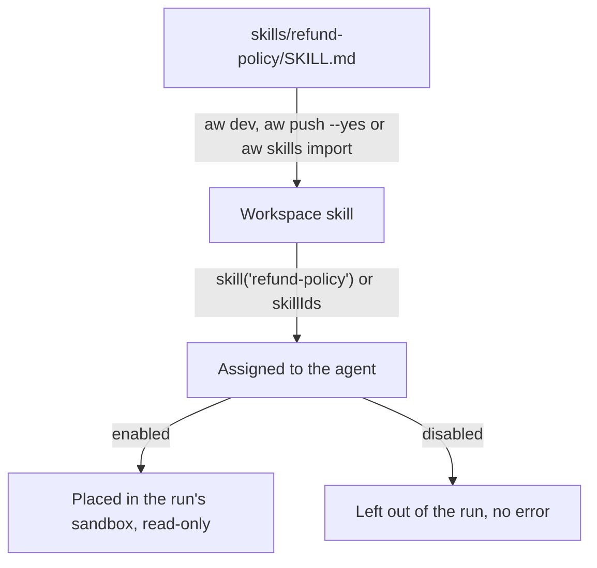

<Info>
**Chapter 2 · Build your agent — step 4 of 7** · [the chapter map](/path/build)

- **You will:** write the `refund-policy` skill and give it to the support agent.
- **You will learn:** what a `SKILL.md` directory holds, how a project folder is synced to the workspace, and when a run loads it.
- **You need:** an agent from [Agents as code](/guides/agents-as-code) or [Design an agent](/building/agents).

</Info>

A skill is a directory of instructions and supporting files an agent loads into its runs. You write
it in any editor; `aw skills` (or `aw.skills`) puts it in the workspace and keeps it current.

**What you can do**

- [Write a skill](#write-a-skill)
- [Add it to your workspace](#add-it-to-your-workspace)
- [Give it to an agent](#give-it-to-an-agent)
- [Keep skills in a project folder](#skills-in-a-project)
- [Update, disable or remove it](#update-disable-or-remove-it)



Skills run on `claude-agent-sdk`, `pi` and `mastra`. The `openai-agents` engine has no skills, so
an agent on it with a skill assigned is refused with `422 engine_capability_unsupported`.

## Write a skill

A skill is one directory: a required `SKILL.md` plus any supporting files. The platform reads
`name`, `description` and `allowed-tools` from its frontmatter; the Markdown body is served back as
`instructions`.

```markdown title="release-notes/SKILL.md (illustrative)" claim="illustrative"
---
name: release-notes
description: Draft release notes from merged pull requests.
allowed-tools: Read, Grep
---

Read the merged PRs since the last tag and draft release notes as three bullets.
```

Write each field on one line. The reader (`parseSkillFrontmatter` in
`apps/web/server/skills/frontmatter.ts`) is deliberately **not a YAML parser**: a multi-line list or
block scalar is not an error, but the field comes back `null` from `GET /api/skills/:name`. The file
itself is still stored and exported byte for byte.

<Note>
  `allowed-tools` here is the hyphenated **frontmatter** key the platform's reader parses for
  display — it is not the same thing as the Claude Agent SDK's own `allowedTools` *runtime option*
  documented on [Design an agent](/building/agents#tool-permissions-and-least-privilege), which is a
  property of the agent's compiled tool policy, not of any one skill.
</Note>

## Add it to your workspace

```sh title="illustrative" claim="illustrative"
aw skills import ./release-notes
aw skills list
aw skills export release-notes ./exported
```

`aw skills import <dir> [--name <name>]` sends every file under `<dir>` in one request; the name
defaults to the directory's. `aw skills export` writes the files back out byte for byte, and
`aw skills get <name>` reads one without writing anything. The SDK equivalent is `aw.skills.import`;
every method and error code is on [Skills](/resources/skills).

<AccordionGroup>
  <Accordion title="Complete SDK example">

```ts title="author-a-skill.ts" claim="compile"
import { createClient } from '@indx-workspace/sdk';

const baseUrl = process.env.AGENT_WORKSPACE_URL;
const apiKey = process.env.AGENT_WORKSPACE_API_KEY;
if (baseUrl === undefined || apiKey === undefined) {
  throw new Error('Set AGENT_WORKSPACE_URL and AGENT_WORKSPACE_API_KEY');
}
const aw = createClient({
  baseUrl,
  auth: { kind: 'api-key', apiKey },
});

async function main(): Promise<void> {
  const skillMd = [
    '---',
    'name: release-notes',
    'description: Draft release notes from merged pull requests.',
    'allowed-tools: Read, Grep',
    '---',
    '',
    'Read the merged PRs since the last tag and draft release notes as three bullets.',
  ].join('\n');

  const created = await aw.skills.import({
    name: 'release-notes',
    files: [{ path: 'SKILL.md', contentBase64: Buffer.from(skillMd, 'utf8').toString('base64') }],
  });
  console.log(created.name, created.enabled, created.allowedTools);

  const all = await aw.skills.list();
  console.log(all.map((skill) => skill.name));

  const disabled = await aw.skills.update('release-notes', { enabled: false });
  console.log(disabled.enabled);

  const exported = await aw.skills.export('release-notes');
  console.log(exported.files.map((file) => file.path));
}

main();
```

  </Accordion>
  <Accordion title="Import rules and limits">

`aw.skills.import` (`POST /api/skills`) both creates a skill from one `SKILL.md` and imports a whole
directory — `files` must be non-empty, contain exactly one `SKILL.md` entry somewhere in it, and hold
no two paths that are equal once letter case is folded.

- **Request body:** `MAX_SKILL_REQUEST_BODY_BYTES`, 16 MiB, base64 included, on both `import` and
  `update`; a larger body is refused mid-stream as `413 request_body_too_large`. There is no
  separate per-file or file-count limit.
- **Path grammar:** every file path is admitted segment by segment — each `/`-separated segment
  matches `[A-Za-z0-9][A-Za-z0-9._-]*`, none ending in `.` or a space, none `.` or `..` — and the
  whole path is at most `SKILL_FILE_PATH_MAX_BYTES`, 4096 UTF-8 bytes. Anything outside that
  grammar is `400 inadmissible_path`.
- **Content encoding:** `contentBase64` must be standard, padded base64 (an empty file is `""`); a
  value outside that alphabet is `400 malformed_content` rather than being decoded leniently.

</Accordion>
</AccordionGroup>

## Give it to an agent

Importing puts a skill in the workspace's catalog; assigning it is what lets an agent's runs load it.
Assign it by id with `--skill <skillId>` on `aw agents create`, or through `skillIds` in
`aw.agents.replaceResourceAssignments` — see
[Assigning resources](/building/agents#assigning-resources-files-skills-connectors). That
resource-catalog `id` on `SkillDetail` exists only for assignment, and is absent until a catalog is
configured.

Any Builder may assign any other Builder's skill to their own agent — a Builder reads every skill in
the workspace, even one it does not own — and an Admin reads, writes and deletes any skill
(ADR-0116); see [Ownership and sharing](/concepts/ownership-and-sharing).

A disabled skill, or one the agent is not assigned, is silently left out of the run — not an error.

<Accordion title="Where the runtime puts a skill">

When a run starts, `apps/runner/src/resources.ts` writes every assigned skill's files under
`<CLAUDE_CONFIG_DIR>/skills/<name>/` inside that run's sandbox — the runner's per-tenant equivalent of
the Claude Agent SDK's default `.claude/skills/` directory. `materializeSkills` rewrites the whole
directory on every turn (removing it first, so a changed or removed file cannot survive under a stale
mode) and leaves every file and directory read-only (`0o444` / `0o555`). A skill that is no longer
assigned is removed the same way, by diffing against the manifest left by the previous turn
(`removeRevoked`, same file). None of this is something you write to yourself.

`loadSkills` in `apps/web/server/compose/resource-loader.ts` skips an assigned skill whose own
`enabled` is `false`, so it is never materialized. A skill that is not in the agent's `skillIds` is
never looked up. Neither case surfaces as an error to the caller starting the run.

</Accordion>

## Run a skill's scripts

A skill can ship scripts under `scripts/`. When the agent has `permissions.runCommands: true` and a
granted skill has a `scripts/` file, the run offers one tool, `run_skill_script`, on the
`claude-agent-sdk` and `mastra` engines. The model passes the skill name, the script's file name
under that skill's `scripts/`, and a list of string arguments:

```json title="run_skill_script input (illustrative)" claim="illustrative"
{ "skill": "contract-playbook", "script": "clauses.mjs", "args": ["check", "contracts/draft.docx"] }
```

The script runs as `node --permission` with no shell, so a file grant that is read-only stays
read-only: the script can read the run's working directory and can write only its scratch
directory (`TMPDIR`) and, when the agent has `writeFiles: true`, the grants that are read-write.
It cannot start another process, and it has no stdin, no network of its own and an environment
that holds only `TMPDIR`. It stops after 120 seconds, and each of stdout and stderr is capped at
1 MiB. A refusal comes back as `refused (<code>): <reason>`, and a non-zero exit comes back as the
script's own output, so the model can read the error. Pass input as arguments or files, not a pipe:
a script that needs a sibling skill's code imports it by relative path.

On the Claude engine the tool is `mcp__agent-workspace__run_skill_script`, so an unattended run
lists it in the agent's `engine.autoApprove`; `Bash` stays denied under a read-only grant. The
`openai-agents` engine has no skills, so it never offers the tool. The design and its limits,
including the one hole it cannot close, are in ADR-0137.

## Skills in a project

Keep a skill as a folder, `skills/<name>/`, holding `SKILL.md` and any supporting files, and
reference it from an agent file with `skill('<name>')`. `aw dev` and `aw push --yes` create or update
each folder's workspace skill before they save the agent that names it. A folder whose files are
byte for byte what the workspace holds is left alone, and a file you delete from a folder is removed
from the skill.

`aw check` checks each folder the way `aw skills import` does and refuses a `skill('x')` that names
neither a folder nor a workspace skill. Deleting a folder does not delete the workspace skill, because
an agent may still use it; remove it with `aw skills remove <name>`. `npm create` writes one small
example skill for the `support` and `knowledge` themes.

<Accordion title="What aw check and aw dev print for skills">

```text
agents/support.ts: local skill_not_found [skill('refund-policy') is not in skills/ or the workspace (did you mean 'refunds'?)]
synced: skill refund-policy (new, 2 files) · "support" version 5 (1 change)
skills/old-policy: only in the workspace (no folder; aw does not delete it)
✗ skills/refunds/SKILL.md:2:1  name must be the folder's name, refunds
```

The folder name must be a skill name, and `SKILL.md` must exist, be valid UTF-8 and start with a
`---` frontmatter block of valid YAML whose `name` is the folder's name and whose `description` is
not empty; a refusal names the line. A missing
`skill('x')` is refused by name, with the nearest name when there is one. `aw dev` syncs through the
same calls `aw skills import` and `aw skills update` make.

</Accordion>

## Update, disable or remove it

```sh title="illustrative" claim="illustrative"
aw skills disable release-notes     # or: enable
aw skills remove release-notes
```

`aw.skills.update(name, patch)` (`aw skills update <name> --file <json>`) changes `enabled`, writes
`files` by exact path and deletes `removeFiles` in one patch; at least one is required. Writes run before deletes, so do a
case-only rename as two requests. `removeFiles` may never name `SKILL.md`, and a patch that would leave the skill without one is rejected and rolled back.

<Note>
  `aw.skills.remove(name)` deletes a skill and its files. While an agent still has it assigned, the
  delete is refused with `409 skill_in_use`, naming each agent in `details` — unassign first. See
  [Skills](/resources/skills#remove).
</Note>

### Naming and versions

A skill's `name` is a lower-case slug — `^[a-z0-9](?:[a-z0-9-]{0,62}[a-z0-9])?$`, 1–64 characters,
unique in the workspace — and the only handle every route uses. There is no version field: to keep an
older revision while you test a new one, use two names, such as `release-notes` and
`release-notes-v2`.

<Note>
  **Today:** a skill is one mutable directory addressed by `name`; `update` patches it in place and
  every assigning agent sees the change on its next run. **Target:** immutable revisions —
  `skills.publish(name, {files})` creates one, and an assignment pins `latest` or a specific number.
  Tracked as [N-1](/concepts/roadmap#n-1-skill-revisions).
</Note>

## See also

<CardGroup cols={2}>
  <Card title="Skills" href="/resources/skills">
    The full `SkillDetail` contract, every method, every error code.
  </Card>
  <Card title="Design an agent" href="/building/agents">
    Assigning a skill, permissions, and what the platform does and does not enforce.
  </Card>
  <Card title="Connect an MCP server" href="/building/mcp-servers">
    Connectors: the other kind of resource an agent's assignments reference.
  </Card>
  <Card title="Runtime neutrality" href="/concepts/runtime-neutrality">
    Why a skill is described as a Claude Agent SDK-native concept, not a portable format.
  </Card>
</CardGroup>
