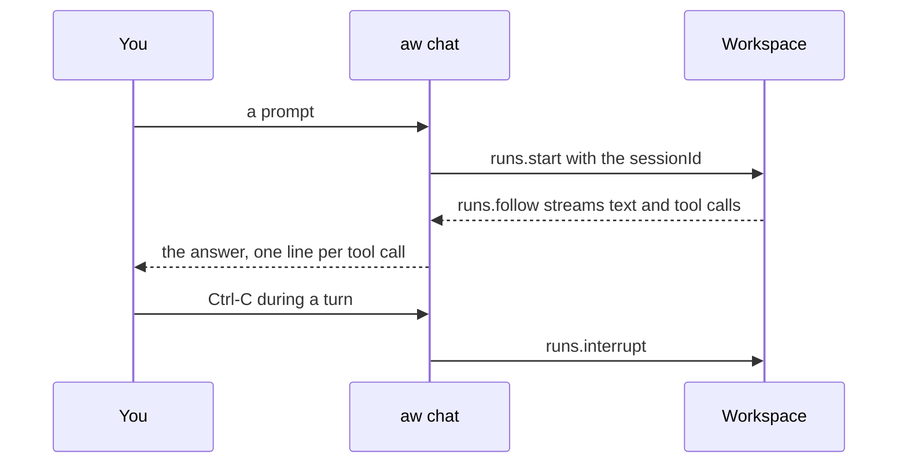

<Info>

**Chapter 1 · Run your first agent — step 4 of 4** · [the chapter map](/path/first-agent)

- **You will:** talk to your agent from the terminal, in a conversation or one prompt at a time.
- **You will learn:** how a conversation keeps its session, which version answers, and the three SDK calls behind a turn.
- **You need:** a running project from the [Quickstart](/getting-started/quickstart) (`npm run dev`).

</Info>

`aw chat [agent]` talks to one of your agents from the terminal. The agent is a name or an id; with
one agent in the workspace it is the default. `aw ask` is reserved for the configuration agent:
`aw chat` talks to your agent, `aw ask` talks to the platform.

**What you can do**

- [Have a conversation](#interactive) with streaming answers and tool calls
- [Ask one question from a script](#one-shot) and get the answer on stdout
- [Talk to a specific version](#which-version-answers), or to what production runs today
- [Build the same loop in your own code](#the-same-loop-with-the-sdk)



## Interactive

On a terminal, without `--prompt`, `aw chat` opens a prompt with line history. The agent's text
prints as it arrives, and each tool call is one dim line:

```text title="Example session with an orders tool (illustrative)" claim="illustrative"
  aw chat · /help for commands
› where is order A-1042?
  ⚙ get_order {"id":"A-1042"} → ok · 41 ms
It shipped yesterday and arrives Thursday.
```

Every turn after the first reuses the first run's `sessionId`, so the agent remembers the
conversation.

| Input                                 | Effect                                                                                       |
| ------------------------------------- | -------------------------------------------------------------------------------------------- |
| Ctrl-C during a turn                  | Interrupts the run and returns to the prompt.                                                |
| Ctrl-C at the prompt, or a second one | Exits with code 130.                                                                         |
| `/reset`                              | Starts a new conversation.                                                                   |
| `/version`                            | Shows the agent, model, engine and targeted version (`local` by default) that answered last. |
| `/help`                               | Lists these commands.                                                                        |
| `/exit` or Ctrl-D                     | Leaves.                                                                                      |

## One shot

`-p` (`--prompt`) sends one prompt, prints the answer on stdout and exits. In the Quickstart's
project, with `npm run dev` running in another terminal,
`npx aw chat -p "Can I return a mug I bought 20 days ago?"` took nine seconds and printed:

```text title="Output"
I'll check the refund policy for you.
Yes, you can return the mug! Our refund policy allows returns within 30 days of purchase, and you're at 20 days, so you're well within the timeframe.

To process your return, I'll need your order number. Could you provide that?
```

The text the agent writes before a tool call (`I'll check the refund policy for you.`) is printed
too, on its own line.

```bash title="illustrative" claim="illustrative"
aw chat support -p "summarise our refund policy"          # the answer on stdout
echo "where is order A-1042?" | aw chat support           # a piped prompt works too
aw chat support -p "summarise our refund policy" --json   # the settled run, for scripts
```

Exit codes follow [the CLI's table](/reference/cli/commands#exit-codes): 1 when the run failed,
was cancelled or did not complete, or the server refused, 2 for bad input, 4 when nothing answered, 130 on Ctrl-C.

If `aw dev` has no model key, the run fails and `aw chat` says what to do instead of the full
problem text (exit 1): the line that sets the key for your shell, then restart `npm run dev`, which
offers to open the provider's console — for example
`error: no model key: export ANTHROPIC_API_KEY=sk-ant-…, then restart npm run dev (it will offer to open the console)`.
On Windows the line names PowerShell and cmd. Against any other target the full
`model_connection_unresolved` problem is printed.

## Which version answers

By default `aw chat` runs the `local` pointer: the draft `aw dev` just synced, the same one the try
page runs. `--agent-version 3` talks to version 3, whatever the pointers say; `--env production`
talks to the version the production pointer names today.

<Accordion title="How the version flags behave">

```bash title="illustrative" claim="illustrative"
aw chat support --agent-version 3 -p "hi"   # version 3, whatever the pointers say
aw chat support --env production -p "hi"    # the version the production pointer names today
```

The flag is `--agent-version`, not `--version`, because `--version` is `aw`'s own switch (it prints
the `aw` and contracts versions). `--env local` is the default spelled out. `--env production` reads
the pointer once, when the command starts, and runs that version number, so a promote during a long
conversation does not move it. The two flags are alternatives. An unknown version is refused with
`agent_version_not_found` (exit 1); an environment that points at no version yet is refused before
any run starts, with `fix: run "aw promote --yes"`. `/reset` starts the next conversation on the same version.

</Accordion>

## The same loop with the SDK

`aw chat` adds no SDK method. It composes three calls, so the loop is yours to build:

| `aw chat` does                    | SDK call                                                                                                                         |
| --------------------------------- | -------------------------------------------------------------------------------------------------------------------------------- |
| sends a turn                      | `runs.start(agentId, { prompt, sessionId, version })` (`version` optional, first turn only) ≡ `aw runs start <agent> --prompt …` |
| streams the answer and tool calls | `runs.follow(run.id)` ≡ `aw runs follow <id>`                                                                                    |
| Ctrl-C during a turn              | `runs.interrupt(run.id)` ≡ `aw runs interrupt <id>`                                                                              |

Set `sessionId = null` to start a new conversation, which is what `/reset` does.

<Accordion title="A complete turn in TypeScript">

```ts title="illustrative" claim="illustrative"
import { createClient } from '@indx-workspace/sdk';
import { assistantResponseFromAgentEvent, toAgentEvent } from '@indx-workspace/sdk/events';

const client = createClient({ baseUrl, auth: { kind: 'api-key', apiKey } });
let sessionId: string | null = null;

async function turn(agentId: string, prompt: string): Promise<void> {
  const { run } = await client.runs.start(agentId, { prompt, sessionId });
  sessionId = run.sessionId; // reuse it: the next turn continues this conversation
  const abort = new AbortController();
  const onSigint = (): void => {
    abort.abort();
    void client.runs.interrupt(run.id);
  };
  process.once('SIGINT', onSigint);
  try {
    for await (const frame of client.runs.follow(run.id, { signal: abort.signal })) {
      const event = toAgentEvent(frame);
      const response = event === null ? null : assistantResponseFromAgentEvent(event);
      if (response !== null) console.log(response.text.join('\n'));
    }
  } catch (error) {
    if (!abort.signal.aborted) throw error;
  } finally {
    process.off('SIGINT', onSigint); // a finished turn must not answer the next Ctrl-C
  }
}
```

</Accordion>

<Card title="Next: Chapter 2: Build your agent" icon="arrow-right" href="/path/build">
  Give the agent its instructions, engine, model, skills, tools and credentials as committed files.
</Card>
