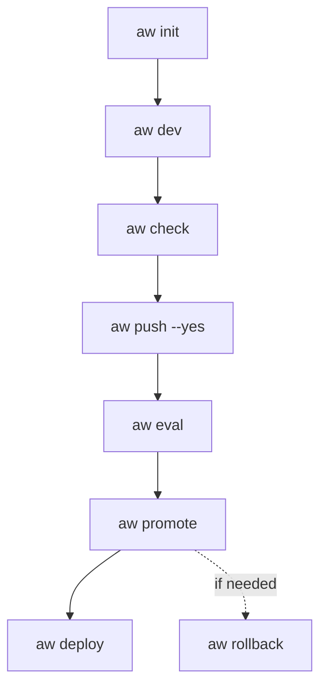

<Info>

- **Read this when:** you work from a terminal or a CI job: connect to a control plane, run an
  agent, change resources, or build and ship a project.
- **You will learn:** how to install `aw` and point it at a control plane, the project workflow from
  `aw init` to `aw deploy`, and where every command family is documented.
- **Used in:** [Chapter 1: Run your first agent](/path/first-agent), [Chapter 2: Build your
  agent](/path/build) and [Chapter 5: Ship it to your servers](/path/ship).

</Info>

`aw` is the command line for Agent Workspace: run and manage agents on a control plane, and build,
test and ship a project from your terminal. Every control-plane command is one
[`@indx-workspace/sdk`](/getting-started/installation) method (`aw agents list` calls
`client.agents.list()`), and a route that waits on a server change gets no command rather than a
stub, so `aw --help` is an honest inventory of what the control plane can do today.
`aw <family> --help` lists one family, `aw <family> <command> --help` (or `aw help <family> <command>`)
prints that command's own usage line, flags included, and `aw <family>` alone names the commands it
needs.

**What you can do**

- [Install it](#install-it) in one command
- [Connect to a control plane](#connect-to-a-control-plane) with an API key
- [Run an agent and watch it work](#run-an-agent-and-watch-it-work)
- [Create and change agents, members and secrets](#create-and-change-things)
- [Build, test and ship a project](#the-project-workflow)
- [Find the command for any resource](#commands-by-family)

<Note>
  `aw` is not `agent-workspace` (the `@indx-workspace/cli` package, the generator that scaffolds a
  self-hosted deployment: `create-agent-workspace`, `agent-workspace validate|render|deploy`; see
  [Self-host Agent Workspace](/building/self-hosting)). The two share nothing but a name. `aw` is
  the developer's and operator's CLI — it talks to a control plane that is already running, or
  starts a local one with `aw dev`.
</Note>

## Install it

`aw` is published as `@indx-workspace/aw`, in lock-step with the SDK it wraps: each `aw` release is built
against the contracts release of the same version. Run it once with `npx`, or install it globally:

```sh claim="run"
npx @indx-workspace/aw --version
npm install --global @indx-workspace/aw
aw --version   # aw <version> (contracts <version>), the two always equal
```

npm 11 warns on the global install that `esbuild` has install scripts "not yet covered by
allowScripts". That is expected: `aw` uses esbuild to bundle tools, and esbuild runs from its
platform package without the script, which only checks the binary. A project's own `package.json`
denies it the same way. To run it anyway, add `--allow-scripts=esbuild`.

A server that does not serve the binary's contracts version refuses it, and `aw` prints the
`npm install --global @indx-workspace/aw@<minor>` that fixes it
([Output and exit codes](/cli/output-and-exit-codes)).

## Connect to a control plane

Mint an API key in the workspace (**Administration → API Keys**, or `aw team api-keys create` from a
session that already has one), then export it:

```sh title="illustrative" claim="illustrative"
export AGENT_WORKSPACE_URL=https://aw.example.com
export AGENT_WORKSPACE_API_KEY=ak_live_…
```

`aw me` (or `aw whoami`) shows which workspace and role the credential resolved to. A person signs in
with `aw login` instead ([Authentication](/getting-started/authentication)).
[Configuration](/cli/configuration) has the full precedence (flags, then these two variables, then
the project file `agent-workspace.yaml`, then a profile file).

## Run an agent and watch it work

```sh title="illustrative" claim="illustrative"
aw runs start <agent-id> --prompt "Summarise the open incidents." --follow
```

`--follow` streams the run and prints the neutral `AgentEvent` view: the session id, each assistant message, each tool call and result, and
the result's cost and token counts. `--wait` instead follows silently and prints the settled run record once it ends. To
look around first, `aw agents list`, `aw agents get <agent-id>` and `aw models discover`. Every
command without `--json`/`--jsonl` prints a table or a `field  value` record
([Output and exit codes](/cli/output-and-exit-codes)). To talk to an agent turn by turn, use
[`aw chat`](/cli/chat).

<Accordion title="More run options">

`--session <id>` continues an existing session, `--model <connection-id>:<model>` overrides the
agent's model for this run, and `--prompt-file <path>` (or `--prompt-file -` for stdin) takes the
prompt from a file instead of `--prompt <text>`.

```sh title="illustrative" claim="illustrative"
aw runs list --status completed --limit 5
aw runs follow <run-id>     # reconnects with the last event id if the connection drops
aw runs wait <run-id> --json
```

</Accordion>

## Create and change things

A create or update body comes from `--file <json>` or `--file -` (stdin); a handful of scalar
fields — `--name`, `--role`, `--email` and similar — also have flags, laid over the file. The body
is validated against the contract before anything is sent, so a typo is a usage error (exit `2`),
not a round trip to the server. For example, `aw agents create --file agent.json` or
`aw team members add --email ada@example.com --role admin`.

A credential never travels as a flag value ([Configuration](/cli/configuration) says why `--api-key`
itself is refused). `secrets create`, `models connections create`, `runtimes connections create`,
`connectors create`/`test-draft`, and every `rotate-credential`/`replace` command read the value
from stdin with `--value-stdin` instead (or, for a create, from the JSON body):
`printf '%s' "$GITHUB_TOKEN" | aw secrets create --name GITHUB_TOKEN --value-stdin`.

<AccordionGroup>
  <Accordion title="A minimal agent.json">

```json title="agent.json (illustrative)" claim="illustrative"
{
  "name": "Incident summariser",
  "instructions": "Summarise the open incidents in plain language.",
  "modelConnectionId": null,
  "model": null,
  "permissions": {
    "readFiles": true,
    "writeFiles": false,
    "runCommands": false,
    "unrestrictedNetwork": false
  }
}
```

Every field above is required: `permissions` names all four switches (the values shown are the New
agent form's defaults: read files, nothing else), and `modelConnectionId` and `model` may be `null`.
An agent created that way exists but cannot run until it has a runtime profile and a model — set
`modelConnectionId`, `model` and `runtimeProfileId` in the file, or later with
`aw agents update <agent-id> --file -`; `aw models connections list` and
`aw runtimes profiles list` show the ids.

  </Accordion>
  <Accordion title="Update from stdin, and rotate a credential">

```sh title="illustrative" claim="illustrative"
echo '{"runtimeProfileId":"<profile-id>"}' | aw agents update <agent-id> --file -
printf '%s' "$NEW_KEY" | aw models connections rotate-credential <connection-id> --value-stdin
```

Standard input is read at most once per invocation, so `--api-key-stdin`, `--value-stdin` and
`--file -` cannot be combined; put the body in a file when the credential also comes from stdin.

  </Accordion>
</AccordionGroup>

## The project workflow

These commands work on a project directory (`agent-workspace.yaml`, `agents/`, `surfaces/`, `skills/`, `evals/`), not on a single resource. The [Quickstart](/getting-started/quickstart) walks through them in order.



| Command                                                                                                                                                        | What it does                                                                                                                                                                             |
| -------------------------------------------------------------------------------------------------------------------------------------------------------------- | ---------------------------------------------------------------------------------------------------------------------------------------------------------------------------------------- |
| [`aw init`](/reference/cli/commands#aw-init)                                                                                                                   | Writes a starter project into the current directory, with the same questions and flags as `npm create`.                                                                                  |
| [`aw dev`](/reference/cli/commands#aw-dev)                                                                                                                     | Runs the project on a local runtime, signs `aw` in, creates the default model connection and syncs `agents/` and `surfaces/` on every save.                                              |
| [`aw tool call`](/reference/cli/commands#aw-tool-call) | Runs one code tool from `tools/` through the local tool host, without a chat turn, and prints its result. |
| [`aw check`](/reference/cli/commands#aw-check)                                                                                                                 | Checks the project against the server and saves nothing.                                                                                                                                 |
| [`aw push`](/reference/cli/commands#aw-push)                                                                                                                   | Shows what would change; with `--yes`, saves a version and points `local` at it.                                                                                                         |
| [`aw eval`](/reference/cli/commands#aw-eval)                                                                                                                   | Runs `evals/<agent>.yaml` against a version and stores the score; `aw eval add` appends a case, `aw eval add-case` turns a thumbs-down into one. See [Evaluations](/guides/evaluations). |
| [`aw promote`](/reference/cli/commands#aw-promote), [`aw rollback`](/reference/cli/commands#aw-rollback), [`aw versions`](/reference/cli/commands#aw-versions) | Move `production` between versions, behind the optional promotion gate, and show the pointers. See [Agents as code](/guides/agents-as-code).                                             |
| [`aw deploy`](/reference/cli/commands#aw-deploy)                                                                                                               | Deploys the project's production environment; plans unless `--yes`. See [Deploy a project](/guides/deploy).                                                                              |
| [`aw chat`](/reference/cli/commands#aw-chat)                                                                                                                   | Talks to an agent from the terminal. See [aw chat](/cli/chat).                                                                                                                           |
| [`aw runs rate`](/reference/cli/commands#aw-runs-rate), [`aw feedback`](/reference/cli/commands#aw-feedback)                                                   | Rate a run thumbs-up or -down, and list the ratings given.                                                                                                                               |
| [`aw login`](/reference/cli/commands#aw-login), [`aw logout`](/reference/cli/commands#aw-logout)                                                               | Sign in as yourself through a browser, and revoke that sign-in.                                                                                                                          |

## Commands by family

Every command is listed in full, with its exact usage line, in [CLI commands](/reference/cli/commands),
and [aw vs. the SDK](/cli/cli-vs-sdk) maps each one to its SDK method. The families are `me`,
`workspaces`, `team`, `models`, `runtimes`, `secrets`, `files`, `skills`, `connectors`, `agents`,
`projects`, `sessions`, `runs`, `shares`, `metrics` and `audit`.

<Accordion title="One example per family">

Each family name links to that example's entry in the reference, and each "Resource docs" link goes
to the SDK method reference behind the commands.

| Family                                                                   | Covers                                             | Example                            | Resource docs                                     |
| ------------------------------------------------------------------------ | -------------------------------------------------- | ---------------------------------- | ------------------------------------------------- |
| [`me`](/reference/cli/commands#aw-me)                                    | the principal this credential resolves to          | `aw me`                            | [Authentication](/getting-started/authentication) |
| [`workspaces`](/reference/cli/commands#aw-workspaces-sharing-policy-get) | `sharing-policy`                                   | `aw workspaces sharing-policy get` | [Workspaces](/resources/workspaces)               |
| [`team`](/reference/cli/commands#aw-team-members-list)                   | `members`, `users`, `api-keys`                     | `aw team members list`             | [Team](/resources/team)                           |
| [`models`](/reference/cli/commands#aw-models-discover)                   | `connections`, `discover`                          | `aw models discover`               | [Models](/resources/models)                       |
| [`runtimes`](/reference/cli/commands#aw-runtimes-profiles-list)          | `profiles`, `connections`                          | `aw runtimes profiles list`        | [Runtimes](/resources/runtimes)                   |
| [`secrets`](/reference/cli/commands#aw-secrets-list)                     | metadata, create, replace, remove                  | `aw secrets list`                  | [Secrets](/resources/secrets)                     |
| [`files`](/reference/cli/commands#aw-files-list)                         | list, upload, download, move, remove               | `aw files list`                    | [Files](/resources/files)                         |
| [`skills`](/reference/cli/commands#aw-skills-list)                       | import/export a directory, enable/disable, remove  | `aw skills list`                   | [Skills](/resources/skills)                       |
| [`connectors`](/reference/cli/commands#aw-connectors-list)               | MCP connectors, field updates, credentials         | `aw connectors list`               | [Connectors](/resources/connectors)               |
| [`agents`](/reference/cli/commands#aw-agents-list)                       | agents, `assignments`, `policy`                    | `aw agents list`                   | [Agents](/resources/agents)                       |
| [`projects`](/reference/cli/commands#aw-projects-list)                   | projects, session attachment                       | `aw projects list`                 | [Projects](/resources/projects)                   |
| [`sessions`](/reference/cli/commands#aw-sessions-list)                   | list, rename, archive, transcripts                 | `aw sessions list`                 | [Sessions](/resources/sessions)                   |
| [`runs`](/reference/cli/commands#aw-runs-start)                          | start, list, events, trace, follow, wait, interrupt, rate | `aw runs start`                    | [Runs](/resources/runs)                           |
| [`shares`](/reference/cli/commands#aw-shares-list)                       | list, revoke                                       | `aw shares list`                   | [Shares](/resources/shares)                       |
| [`metrics`](/reference/cli/commands#aw-metrics-recent-runs)              | recently finished runs                             | `aw metrics recent-runs`           | [Observability](/resources/observability)         |
| [`audit`](/reference/cli/commands#aw-audit-list)                         | the audit trail                                    | `aw audit list`                    | [Observability](/resources/observability)         |

</Accordion>

## Running without a person

No command prompts or waits when no person is there. "No person" means standard input or standard output is not a terminal, or the `CI` environment variable is set (to anything but empty, `0` or `false`). In that case a command either finishes from its flags, an answers file, the environment or `--yes`, or exits at once with a `fix:` line that names the missing setting.

| Command                          | With no person                                                                                                                                       |
| -------------------------------- | ---------------------------------------------------------------------------------------------------------------------------------------------------- |
| `aw init`                        | Writes nothing until you pass `--yes`, which takes your flags, then `--answers <file>`, then the recommended answers; without `--yes` it exits 1 with `fix: aw init --yes`, `--answers` included. A provider that needs an endpoint without `--model-base-url` exits 2 with `fix: add --model-base-url <url>`. |
| `npm create @indx-workspace`     | Takes the recommended answers, your flags and `--answers <file>`, and says so on stderr. `--cloud local` takes `--database`, `--storage`, `--runtime`, `--auth` and `--yes`, and never reads standard input. |
| `npm create @indx-workspace` project name | Set by `<dir>`; without one it uses `my-agent` and says so on stderr.                                                                                |
| `npm create @indx-workspace` install, start | `--install` / `--no-install` and `--start` / `--no-start`. Unset, `--yes` installs and does not start; without `--yes` it does neither.            |
| `aw chat`                        | Needs `--prompt <text>`, or the prompt piped on standard input; without either it exits 2 naming `--prompt`.                                          |
| `aw login`                       | Exits 1 at once with `fix: set AGENT_WORKSPACE_API_KEY`; the sign-in needs a person at a browser.                                                    |
| `aw dev` model-key menu          | Set the key in the environment (for example `ANTHROPIC_API_KEY`); without it the menu is skipped and the ready screen prints the line to run.         |
| `--api-key-stdin`, `--value-stdin`, `--file -`, `--prompt-file -` (`aw runs start`) | Read a pipe. On a terminal they exit 2 instead of waiting for typing, and a pipe that stays silent for ten seconds exits 2.                 |

`--answers <file>` is YAML or JSON keyed by setup question id (for example `content.engine: claude-agent-sdk`; `aw init --help` lists each question's flag), checked like the flags. An unknown key, a wrong value or a missing file is a usage error that names the key; an unknown key's error also lists every valid id.

## Deliberately absent

`aw --help` is an honest inventory, not a preview of the whole API surface. Two different reasons keep a command out of the tree:

### Waiting on a server change

These SDK routes, or the server routes behind them, do not exist yet. Each is tracked as a numbered item on the [Migration roadmap](/concepts/roadmap); "S-nn" or "RF-nnn" below is that item's id.

| Command                                          | Tracked as                                                                                                       |
| ------------------------------------------------ | ---------------------------------------------------------------------------------------------------------------- |
| `runtimes detect`, `runtimes test`               | [S-9](/concepts/roadmap#s-9-runtime-detection-outside-setup), [S-4](/concepts/roadmap#s-4-runtime-test-envelope) |
| `agents archive`                                 | [RF-201](/concepts/roadmap#rf-201-agent-archive-instead-of-delete)                                               |
| `shares publish` (server-authored share content) | [RF-103](/concepts/roadmap#rf-103-server-owned-share-snapshots)                                                  |

### Signed in as a person

`workspaces list|get|create|update|select` and `team invitations list|create|resend|revoke` act for a person, not a workspace key: every `/api/workspaces` and `/api/invitations` route answers an API key with `403 api_key_not_permitted`. Run `aw login` first. It prints a link and a code, you confirm in a browser where you are signed in that the code shown is the one your terminal printed and approve it, and `aw` stores a twelve-hour token owner-only in `~/.config/agent-workspace/credentials.json`. `aw logout` revokes it on the server. A configured API key still wins over the sign-in, so an automation's credential never changes because someone signed in on the same machine. `team invitations accept` stays a browser step: the route proves the invitee through the identity provider's sign-in.

## Next steps

- [Configuration](/cli/configuration) — every flag, the profiles file, and how credentials resolve.
- [Output and exit codes](/cli/output-and-exit-codes) — `--json`/`--jsonl`, streaming output, and what each exit code means.
- [aw vs. the SDK](/cli/cli-vs-sdk) — when to reach for the CLI instead of the SDK, and the full command-to-method table.
