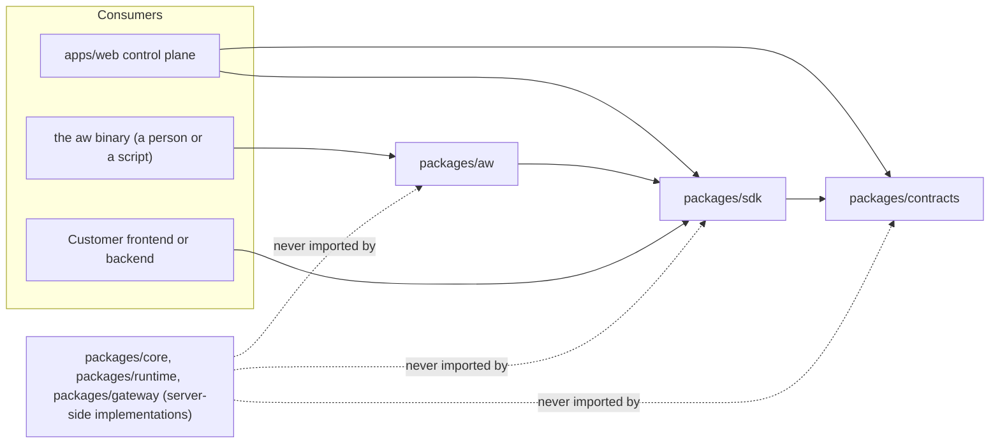

<Info>

- **Read this when:** you import `@indx-workspace/sdk` or `@indx-workspace/contracts` and want to
  know what each package owns and why a response can be rejected.
- **You will learn:** the three packages and their one-way dependency direction, the trust boundary
  every response crosses, and how the reference pages are generated.
- **Used in:** [Chapter 4: Put it in your product](/path/embed).

</Info>

This page is about the packages you write code against, not the platform they talk to. The
platform is the picture below: your code reaches the control plane through these packages, and
the control plane launches each run in a sandbox and sends model calls through the gateway.
[Self-host Agent Workspace](/building/self-hosting) covers how the platform's five services are
deployed, and [Target architecture](/concepts/target-architecture) what it is meant to become.

<Frame caption="The platform the SDK packages talk to: the control plane, the sandboxes and the model gateway on your servers.">
  
  
</Frame>

The Agent Workspace SDK is three packages, not one library. `@indx-workspace/contracts` publishes
the control plane's wire schemas, `@indx-workspace/sdk` is a typed client built on them, and
`@indx-workspace/aw` is a command-line client of the SDK. The control plane's own web application
(`apps/web`) is not a fourth, special-cased consumer — it imports the same two packages a
customer's backend would:

```ts title="either side of the wire imports the same package" claim="compile"
import { createClient } from '@indx-workspace/sdk';
import { RunResourceSchema } from '@indx-workspace/contracts/runs';

const baseUrl = process.env.AGENT_WORKSPACE_URL;
const apiKey = process.env.AGENT_WORKSPACE_API_KEY;
if (baseUrl === undefined || apiKey === undefined) {
  throw new Error('Set AGENT_WORKSPACE_URL and AGENT_WORKSPACE_API_KEY');
}
const aw = createClient({
  baseUrl,
  auth: { kind: 'api-key', apiKey },
});
```

## The three packages and the dependency direction

The direction is one-way: `aw` depends on `sdk`, `sdk` depends on `contracts`, and `contracts`
depends on nothing in the workspace but `zod`. Nothing flows back up, and nothing server-side —
`packages/core` (persistence), `packages/runtime` (execution drivers), `packages/gateway` (model
proxying) — is reachable from any of the three.



This is not a convention the packages happen to follow — the platform's dependency-cruiser rules enforce
each edge as a named, error-severity rule: `contracts-depend-on-nothing-in-the-workspace`,
`sdk-depends-only-on-contracts`, and `aw-depends-only-on-sdk-and-contracts`. A pull request that
adds an import crossing one of these edges fails the architecture check, not just review. The same rules
hold across the whole platform, including the applications these packages stay out of.

## What each package owns, and must not own

This is the relevant slice of the platform's ownership table:

| Package              | Owns                                                        | Must not own                                          |
| -------------------- | ----------------------------------------------------------- | ----------------------------------------------------- |
| `packages/contracts` | published wire schemas and derived types of `/api/**`       | any workspace package, framework, or database         |
| `packages/sdk`       | typed isomorphic client over the contracts                  | server implementations (`core`, `runtime`, `gateway`) |
| `packages/aw`        | the `aw` command line: argument parsing, output, exit codes | anything but the SDK and the contracts                |

Concretely: `contracts` is Zod schemas, derived TypeScript types, and stable problem codes — no
`fetch`, no HTTP client, no CLI concerns. `sdk` adds the client: authentication, transport, the
three typed failure classes, one resource client class per domain, and the SSE follower — it does
not add a second copy of a schema, and it does not know about terminals, flags, or exit codes.
`aw` adds argument parsing, table/JSON output, and process exit codes over the SDK's methods — it
holds no HTTP logic of its own and no schema of its own.

## The trust boundary

Every response the SDK receives is `unknown` until a contract schema accepts it
(the platform's runtime and trust boundary rule). There is no partially-typed escape
hatch: a response that does not match its schema becomes a `ContractViolationError`, never a
best-effort read of the fields that happened to parse.

Most contract schemas are `.strict()` — an object schema that refuses an unrecognised key rather
than silently dropping it. This has a direct consequence for versioning: **adding an optional
field to a response is a breaking change for a client running the previous version of
`@indx-workspace/contracts`**, because that client's schema rejects the new key as unknown. The
project's answer is not to loosen the schemas; it is to version the two packages together —
additive response fields ship as a minor release of both `contracts` and `sdk` at once
(a client that silently accepts fields it does not know is one that cannot tell drift from data).
Pin the contracts version you build against to the control-plane release you deploy against, the
same way you would pin any other API version.

The one deliberate exception is `RelayedEventDataSchema` in `@indx-workspace/contracts/run-events`
— a `looseObject`, because it wraps the Claude Agent SDK's own message union, which grows in that
package's patch releases and the platform passes it through on purpose. See
[Runtime neutrality](/concepts/runtime-neutrality) for what stays provider-native and why.

## Today, and the target

This page describes the three packages as they are. They are the **Consume** surface of the
platform — the part a customer writes code against — and they are already the shape the target
architecture keeps: one dependency direction, strict contracts, subpath entry points, the
application as a consumer. What differs from the target is around them, not inside them:

<Note>
  **Today:** the packages are published on npm; a browser authenticates with a scoped browser token,
  including from another origin; a person signs the CLI in with `aw login`; the control plane's own
  screens still mostly bypass the SDK; and a handful of lifecycles (agent policy, export, archive,
  deletion of skills and secrets) are not on the wire. **Target:** the layered layout, the
  credential per consumer type, the fully addressable API and the dogfooding rule described on
  [Target architecture](/concepts/target-architecture), reached in the order the [Migration
  roadmap](/concepts/roadmap) states. Which parts of the platform are yours to consume, configure or
  extend — and which are internal — is on [Public surface and stability](/concepts/public-surface).
</Note>

## Why it is shaped this way

The design rests on two decisions: the SDK is contracts-first (two packages, one direction, the
application as the first consumer of its own SDK), and developer documentation is a site generated
from the contracts rather than written by hand. The packages publish under `@indx-workspace`. This
site is the developer-facing statement of both; [Target architecture](/concepts/target-architecture)
and [Public surface and stability](/concepts/public-surface) say what follows from them.

## How the reference pages are generated

Everything under the **Reference** tab of this site —
[Client](/reference/sdk/client), one page per SDK resource client, one page per
contracts module, and [CLI commands](/reference/cli/commands) — is generated, not
hand-written, because a table nobody derives is a table that is wrong three times before someone
builds the derivation.

`scripts/docs/generate-sdk-reference.mjs` reads `packages/contracts/src/*.ts`,
`packages/sdk/src/**/*.ts`, and `packages/aw/src/commands/*.ts` through the TypeScript compiler
API and emits the reference pages directly from the source: signatures, parameter types, TSDoc
comments, and the CLI's command tree. Every generated page carries a "generated — do not edit"
banner for exactly this reason. Run it yourself with:

```sh title="illustrative" claim="illustrative"
pnpm docs:generate
```

Regeneration is not optional once you have changed a contract, a client method, or a CLI command:
`pnpm docs:check` regenerates the reference pages in memory and fails the build if the committed
pages differ. That check runs as part of `pnpm check:fast` and as a step in CI, so a change to the
SDK surface that is not accompanied by a regenerated reference cannot merge — the gate is the
mechanism, not a reviewer's memory.

<Card title="Concepts, continued" icon="sitemap" href="/concepts/workspaces-and-principals">
  Next: the tenancy model — workspaces, principals, roles, and which credential to use for which
  job.
</Card>
