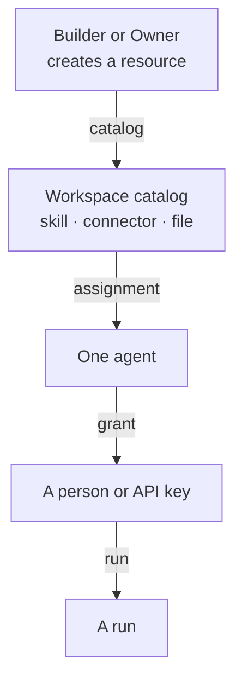

<Info>

- **Read this when:** you need to know who may create, change, assign or run a skill, connector,
  file or agent, or how to share one beyond a workspace.
- **You will learn:** the catalog → assignment → grant vocabulary, the role table the server
  enforces, and what crosses a workspace boundary today.
- **Used in:** [Chapter 2: Build your agent](/path/build) and [Chapter 6: Run it for your
  team](/path/operate).

</Info>

Every request into Agent Workspace runs as exactly one principal — a membership or an API key,
never a bare user (see [Workspaces and principals](/concepts/workspaces-and-principals)) — and
every row a principal creates carries an `owner_principal_id`. _What_ a principal may do to a
row is one decision, made by a single table on the server and reproduced below. _What a row is
reachable from_ is a separate question, and the design principles answer it with three words:
one of the eight principles, stated in full on [Design principles](/concepts/design-principles),
is **reach is explicit: catalog → assignment → grant** — a resource is _in_ a workspace's
catalog, _assigned_ to an agent, and an agent is _granted_ to a person. Sharing beyond a
workspace is an explicit organisation catalog at the target, never "everyone in the workspace
reads everything."

The **workspace is the sharing boundary today**: there is no per-resource ACL and no
organisation above workspaces. A skill, connector or file is readable by every Builder in its
workspace (see the role table below) and invisible to every principal outside it, until you
publish a [share](#beyond-one-workspace) or, at the target, register it in an organisation
catalog.

## Catalog, assignment, grant

| Verb           | Means                                                           | Today                                                                                            | Target                                             |
| -------------- | --------------------------------------------------------------- | ------------------------------------------------------------------------------------------------ | -------------------------------------------------- |
| **catalog**    | a resource exists in the workspace, owned by whoever created it | `aw.skills.import`, `aw.connectors.create`, `aw.files.upload`                                    | unchanged — catalog membership is already one call |
| **assignment** | which agent may load or call it                                 | `aw.agents.create(input, { assignments })`, one call — or `replaceResourceAssignments` afterward | unchanged — already one call                       |
| **grant**      | who may run that agent                                          | `aw.agents.getGrants` and `aw.agents.replaceGrants`                                              | unchanged — grants are already one call            |

Catalog and assignment are two different actions even today: importing a skill puts it in the
workspace's catalog; assigning it is what makes one particular agent's runs able to load it. A
resource can sit in the catalog, owned and readable, without being assigned to anything.

## The role table

`apps/web/server/rbac/permissions.ts` is the shared resource decision table. Route handlers also
enforce row ownership, tenant scope and dedicated capabilities such as run-token revocation. Each
cell below is one of
seven grants the file defines: **EVERYTHING** (read/write/run any row), **MANAGE** (read/write
any row, nothing to run), **OWN_WRITES** (read any row, write and run only your own),
**OWN_ONLY** (read and write only your own, nothing to run), **OWN_READS** (read only your own),
**READ_ONLY** (read any row), and **none**. The table below is transcribed from that file as of
this page's writing — it is documentation, not a generated artifact; keeping it in sync
mechanically is a natural follow-up, not something this page claims to do yet.

| Resource            | Owner      | Admin               | Builder                     | Viewer                                |
| ------------------- | ---------- | ------------------- | --------------------------- | ------------------------------------- |
| agents              | EVERYTHING | EVERYTHING          | OWN_WRITES, run _permitted_ | read any, write none, run _permitted_ |
| skills              | EVERYTHING | EVERYTHING          | OWN_WRITES                  | none                                  |
| files               | EVERYTHING | EVERYTHING          | OWN_WRITES                  | none                                  |
| connectors          | EVERYTHING | EVERYTHING          | OWN_WRITES                  | none                                  |
| projects            | EVERYTHING | MANAGE              | OWN_ONLY                    | none                                  |
| sessions            | EVERYTHING | OWN_ONLY            | OWN_ONLY                    | OWN_READS                             |
| runs                | EVERYTHING | READ_ONLY + run any | OWN_READS + run own         | OWN_READS + run own                   |
| api-keys            | EVERYTHING | MANAGE              | none                        | none                                  |
| memberships         | EVERYTHING | MANAGE              | none                        | none                                  |
| invitations         | EVERYTHING | MANAGE              | none                        | none                                  |
| users               | EVERYTHING | MANAGE              | none                        | none                                  |
| models              | EVERYTHING | MANAGE              | none                        | none                                  |
| model-connections   | EVERYTHING | MANAGE              | none                        | none                                  |
| runtimes            | EVERYTHING | MANAGE              | none                        | none                                  |
| runtime-profiles    | EVERYTHING | MANAGE              | READ_ONLY                   | none                                  |
| runtime-connections | EVERYTHING | MANAGE              | none                        | none                                  |
| secrets             | EVERYTHING | none                | none                        | none                                  |
| shares              | EVERYTHING | MANAGE              | OWN_ONLY                    | OWN_ONLY                              |
| sharing-policies    | EVERYTHING | READ_ONLY           | READ_ONLY                   | READ_ONLY                             |
| metrics             | EVERYTHING | READ_ONLY           | READ_ONLY                   | READ_ONLY                             |
| audit-events        | EVERYTHING | none                | none                        | none                                  |
| me                  | EVERYTHING | READ_ONLY           | READ_ONLY                   | READ_ONLY                             |
| setup               | EVERYTHING | none                | none                        | none                                  |
| workspaces          | OWN_ONLY\* | OWN_ONLY\*          | OWN_ONLY\*                  | OWN_ONLY\*                            |

\* `workspaces`' `own` is not row ownership — it is checked against the caller's _current_
membership of the target workspace (`read`) or an Owner membership of it (`write`), computed
fresh per request rather than by an `owner_principal_id` column, because a caller may legitimately
name a workspace that is not their session's workspace. Every route under `/api/workspaces` and
every route under `/api/invitations` refuses an API-key principal outright, regardless of role —
see [Workspaces and principals](/concepts/workspaces-and-principals#api-keys-act-for-one-workspace-with-no-human-membership).

A run has no `ownerPrincipalId` column. Its owner is the owner of the session it belongs to;
run-list and named-run checks join through that session (F-060).

`OWN_WRITES` includes a `run: own` cell for skills, files and connectors, but those resources
have no run route; the cell is not a callable action (F-094).

Three surprises worth stating outright, because the intuitive reading of the four role names gets
each one wrong:

- **The roles are monotonic.** Each role can do at least everything the roles below it can
  (ADR-0152): Admin holds `agents`, `skills`, `files`, `connectors` and `projects` over every row,
  and a Builder runs the agents it owns or was granted, so it runs any agent a Viewer can run
  through a grant. So an Admin can confer every role but Owner.
- **Builder writes only its own rows, but reads any row in the workspace.** `OWN_WRITES` is
  `{ read: any, write: own, run: own }` — a Builder can see every other Builder's skills,
  connectors and files, and use them (see the worked examples below), but can only edit or
  delete the ones it created.
- **Viewer runs only an owned or granted agent**, never every agent. Viewer's `agents` grant is
  `{ read: any, write: none, run: permitted }` — `permitted` is a fourth grant width, "own or
  granted", that denies unless the caller owns the agent or an `agent_grants` row names that
  (agent, user) pair. Builder's `run` on agents is the same width. Reading
  the agent list is unrestricted; starting a run is not.

## Who can use a skill, a connector, a file

Three short answers, read straight off the table above:

- **A Builder assigns another Builder's skill to their own agent.** Allowed. Assigning writes
  the _agent_ (the Builder's own row, `write: own` on `agents`), and only reads the skill
  (`read: any` on `skills`) to resolve its id — it never writes the skill row itself.
- **An Admin edits a Builder's skill.** Allowed. Admin's `skills` grant is `EVERYTHING`
  (ADR-0116), so the row's owner does not matter — the same as an Admin editing a Builder's
  agent.
- **A Viewer runs an agent.** Refused unless an `agent_grants` row exists for that Viewer's
  membership principal and that agent. An Owner or the agent's owning Builder manages that row
  with `aw.agents.replaceGrants`.

## Beyond one workspace

**Today**, the only way a resource crosses a workspace boundary is `aw.shares` — a snapshot
(not a live view) of an agent, session, project or skill, published outside the workspace behind
a `/p/<token>` link or to the workspace at large. A share is a copy of what it published at
publish time, gated by the workspace's sharing policy, and it is the _only_ mechanism that
publishes a resource outside the workspace.

An agent can also be **moved by name**: `aw.agents.export(id)` writes a portable
`AgentDefinition`, and `aw.agents.import(definition)` recreates it in another workspace, resolving
its skills, connectors, model connection, runtime profile and files by name against that
workspace's own catalog. Nothing crosses but names: no skill bytes, no credential, no run grant
([Move an agent between workspaces](/building/moving-agents)).

**At the target**, one more mechanism closes the gap between "share a snapshot" and "reuse a
live resource":

- An **organisation catalog** — the set of workspaces one deployment's owner administers — where
  a skill or connector published to it is assignable from any of the organisation's workspaces,
  still owned by its original publisher and still write-only in its credential. Tracked as
  [N-2](/concepts/roadmap#n-2-an-organisation-catalog-above-workspaces).

## What you can and cannot do today

| Do                                                                                     | How                                                                                                                                   |
| -------------------------------------------------------------------------------------- | ------------------------------------------------------------------------------------------------------------------------------------- |
| Put a skill, connector or file in your workspace's catalog                             | `aw.skills.import` / `aw.connectors.create` / `aw.files.upload` — you become its `owner_principal_id`                                 |
| Read any resource of a kind your role reads `any` for, whoever owns it                 | the resource's `list`/`get` methods — see the role table above                                                                        |
| Assign a resource you can read to an agent you own                                     | `aw.agents.replaceResourceAssignments`                                                                                                |
| Let a specific Viewer run a specific agent                                             | `aw.agents.replaceGrants(agentId, principalIds)`, or the control plane's UI                                                           |
| Publish a resource outside the workspace, as a snapshot                                | `aw.shares.publish`                                                                                                                   |
| Move an agent, with its skills and connectors resolved by name, into another workspace | `aw.agents.export` in the source, `aw.agents.import` in the destination — [Move an agent between workspaces](/building/moving-agents) |
| Keep two revisions of a skill addressable at once                                      | Only by using two names, such as `release-notes` and `release-notes-v2`                                                               |

<Note>
  **Today:** the workspace is the outermost sharing boundary; using a skill or connector in a second
  workspace means importing it again under that workspace's own catalog. **Target:** an organisation
  catalog above workspaces, so a published resource is assignable — not just re-importable — from
  any workspace the organisation owns. Tracked as
  [N-2](/concepts/roadmap#n-2-an-organisation-catalog-above-workspaces).
</Note>

<Note>
  A resource something still references is never deleted out from under it: deleting an assigned
  skill (`409 skill_in_use`) or a secret a connector or model connection uses (`409 secret_in_use`)
  is refused, with every referrer named in `details`. An update never moves an owner —
  `aw.connectors.update` refuses an `ownerPrincipalId` in its body.
</Note>

<Note>
  A skill's current files are mutable: updating them changes what every agent that does not pin a
  revision loads on its next run. `skills.publish(name, {files})` freezes them as an immutable
  numbered revision, which an assignment can pin ([Author a skill](/building/skills#revisions)).
  Publishing needs the same grant as updating the skill.
</Note>

<CardGroup cols={2}>
  <Card title="Workspaces and principals" icon="sitemap" href="/concepts/workspaces-and-principals">
    The tenancy model this page's role table lives inside: workspaces, principals, and which
    credential to use for which job.
  </Card>
  <Card title="Design an agent" icon="robot" href="/building/agents">
    Assigning files, skills and connectors to an agent in practice.
  </Card>
  <Card title="Design principles" icon="compass-drafting" href="/concepts/design-principles">
    The eight principles behind this page, including "reach is explicit."
  </Card>
  <Card title="Migration roadmap" icon="road" href="/concepts/roadmap">
    Every Today / Target gap named on this page, in one list.
  </Card>
</CardGroup>
