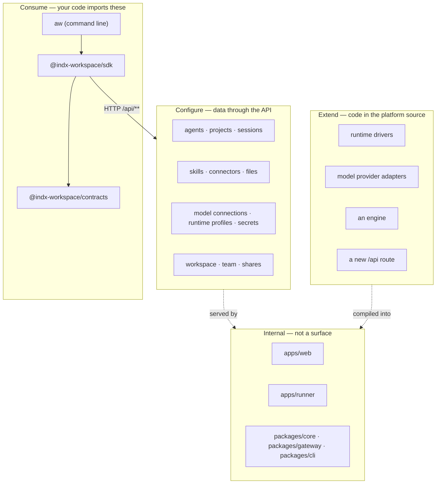

<Info>

- **Read this when:** you decide whether something is yours to build on, to change as data, to
  change as code, or to leave alone, or you plan an upgrade.
- **You will learn:** the four surfaces (Consume, Configure, Extend, Internal), the versioning and
  deprecation policy, and the stability tiers within Consume.
- **Used in:** [Chapter 4: Put it in your product](/path/embed) and [Chapter 6: Run it for your
  team](/path/operate).

</Info>

This page answers the question an SDK has to answer before anything else: **where do I stand?**
Which parts of Agent Workspace are yours to build on, which parts you change as data, which
parts you may change as code, and which parts are nobody's business but the platform's. Every
other page on this site names one of these four surfaces when it introduces something, and the
[Migration roadmap](/concepts/roadmap) lists where today falls short of the promise made here.

## The four surfaces

| Surface       | You interact with it by                      | What it is                                                                                                                               | Compatibility promise                                                                                         |
| ------------- | -------------------------------------------- | ---------------------------------------------------------------------------------------------------------------------------------------- | ------------------------------------------------------------------------------------------------------------- |
| **Consume**   | writing code against it                      | `@indx-workspace/contracts`, `@indx-workspace/sdk` (`.`, `./events`, `./define` and `./project`), the `aw` command line                  | Semantic versioning once published; the versioning rule below applies now                                     |
| **Configure** | changing data through the API                | agents, skills, connectors (MCP servers), model connections, runtime profiles and connections, secrets, files, projects, team, shares    | The resource's contract schema; a field is added in a minor release, never removed or renamed without a major |
| **Extend**    | contributing code to the platform repository | runtime drivers, model provider adapters, engines, a new `/api/**` route                                                                 | Internal interfaces with mechanical gates; no compatibility promise across releases                           |
| **Internal**  | never                                        | `apps/web` (server and screens), `apps/runner`, `packages/core`, `packages/gateway` internals, `packages/cli` (the deployment generator) | None; may change in any release                                                                               |

The line between **Configure** and **Extend** is the important one. Almost everything a customer
wants to change about _how their agents behave_ — what a given agent may do, which model it
uses, where it runs, which tools it can reach, which skills it loads, which files it sees — is
**data**, created and edited through `aw.<family>` methods or `aw <family>` commands, and
therefore needs no fork, no build, and no knowledge of the platform's code. Code is needed only
to teach the platform something it cannot do at all: run agents on a new kind of infrastructure,
talk to a new model provider, or execute agents with an engine other than the Claude Agent SDK.
[Which surface for which job](/building/overview) is the decision table.

## Consume: the packages

Three packages, one dependency direction, and a fixed set of entry points. Import only from the
subpaths a package's `exports` map declares; the platform's package-exports gate
rejects wildcard exports and deep imports into another package's source tree, so anything not
listed here is unreachable by construction.

| Package                     | Entry points                                                                                                                                                                                                                                                           | What you get                                                                                                                                                                                                                                             | Detail                                            |
| --------------------------- | ---------------------------------------------------------------------------------------------------------------------------------------------------------------------------------------------------------------------------------------------------------------------- | -------------------------------------------------------------------------------------------------------------------------------------------------------------------------------------------------------------------------------------------------------- | ------------------------------------------------- |
| `@indx-workspace/contracts` | `.` and one subpath per family: `./agents`, `./api-keys`, `./connectors`, `./files`, `./invitations`, `./models`, `./observability`, `./projects`, `./run-events`, `./runs`, `./runtimes`, `./secrets`, `./sessions`, `./shares`, `./skills`, `./team`, `./workspaces` | Zod schemas, derived types, bounds, problem codes — the wire contract of `/api/**`                                                                                                                                                                       | [Contracts reference](/reference/contracts/index) |
| `@indx-workspace/sdk`       | `.`                                                                                                                                                                                                                                                                    | `createClient`, `AgentWorkspaceClient`, `ClientOptions`, `ClientAuth`, `RequestOptions`, the three error classes and `ContractsVersionUnsupportedError`, `readContractsVersionSkew`                                                                      | [Client](/reference/sdk/client)                   |
| `@indx-workspace/sdk`       | `./events`                                                                                                                                                                                                                                                             | the SSE parser, `classifyRunEventFrame`, the `agent.*` frame parser `toAgentEvent`, `assistantResponseFromAgentEvent`                                                                                                                                    | [Events](/reference/sdk/events)                   |
| `@indx-workspace/sdk`       | `./define`                                                                                                                                                                                                                                                             | `defineAgent`, `defineSurface`, `mcp`, `skill`, `files`, `toAgentVersionBody`, `DefinitionError`, `isDefinedAgent`, `isDefinedSurface` — agents and surfaces as code, isomorphic                                                                         | [Define](/reference/sdk/define)                   |
| `@indx-workspace/sdk`       | `./project`                                                                                                                                                                                                                                                            | `readProjectFileText`, `writeProjectFileText`, `parseProjectFile`, `renderProjectFiles`, `renderProjectShell`, `projectNameFor`, `ProjectFileError`, `ProjectRenderError` — reading and rendering agent-workspace.yaml and the project files, isomorphic | [Project](/reference/sdk/project)                 |
| `@indx-workspace/aw`        | the `aw` binary                                                                                                                                                                                                                                                        | one command per SDK method a stored API key may call; `--json`/`--jsonl`; stable exit codes                                                                                                                                                              | [CLI](/cli/overview)                              |

Two rules that follow from the packages' own constraints:

- **The contracts are the API version.** Owned schemas are `.strict()`, so a response field
  the client does not know is refused as a `ContractViolationError`, never silently accepted.
  Additive fields therefore ship as a minor release of `contracts` and `sdk` _together_, and a
  consumer pins the contracts version to the control-plane release they deploy against
  ([SDK architecture](/concepts/architecture#the-trust-boundary)).
- **Nothing server-side is reachable.** `contracts` imports nothing from the workspace but
  `zod`; `sdk` imports only `contracts`; `aw` imports only `sdk` and `contracts`. The
  `dependency-cruiser` rules `contracts-depend-on-nothing-in-the-workspace`,
  `sdk-depends-only-on-contracts` and `aw-depends-only-on-sdk-and-contracts` fail the build on
  any other edge. A type you find in `packages/core` — `RunRequest`, `RuntimeProfile` as the
  runner sees it — is the control plane's private protocol with its runner, not a customer
  surface, and is deliberately not re-exported.

<Note>
  The three packages are published to npm under `@indx-workspace` in lock-step at the contracts
  version. `@indx-workspace/sdk/testing` is a public subpath of the SDK and follows the same
  stability rules as the rest of it. The npm scope `@agent-workspace` belongs to an unrelated
  publisher: no package of this platform is published there.
</Note>

## Versions and deprecation

This is the policy the Consume packages and `/api/**` are released under. It covers the three
packages — `@indx-workspace/contracts`, `@indx-workspace/sdk`, `@indx-workspace/aw` — and every
route, field, problem code and header their contracts publish. It does not cover the Extend
interfaces or anything Internal (below), which carry no compatibility promise between releases.

**Version numbers.** The three packages are released in lock-step and share one version. The
contracts version _is_ the API version: `CONTRACTS_VERSION`, exported from
`@indx-workspace/contracts`. A patch release never changes the wire. An additive change — a new
route, a new optional field, a new enum value — is a minor release; because owned schemas are
`.strict()`, a client on the previous minor refuses a response field it does not know, so `sdk`
and `contracts` move together. A removal or a rename happens only in a major release, `0.x`
included.

**Negotiation.** Every client states the version it was built against in the
`X-Agent-Workspace-Contracts` request header — the SDK and `aw` on every request, the control
plane's own screens included. Every `/api/**` answer states the range the control plane serves:
`X-Agent-Workspace-Contracts` (its current version) and `X-Agent-Workspace-Contracts-Minimum` (the
oldest it still serves), compared on `major.minor`. A client that declares a version outside that
range is refused before authentication, authorisation or any body is read:

| Request                                    | Answer                                                                                   |
| ------------------------------------------ | ---------------------------------------------------------------------------------------- |
| Header within the served range             | Unchanged behaviour                                                                      |
| Header outside the served range            | `426 contracts_version_unsupported`, naming both versions and the side that must upgrade |
| Header present but not `MAJOR.MINOR.PATCH` | `400 contracts_version_malformed`                                                        |
| No header                                  | Always accepted, and served at the current version                                       |

The SDK raises the `426` as `ContractsVersionUnsupportedError` ([Errors](/guides/errors)); `aw`
exits `1` and prints both versions and the `npm install` that fixes it; `aw --version` prints the
contracts version it was built against. A tool with its own HTTP client reads the same verdict
from any response with `readContractsVersionSkew(response.headers)`.

**Compatibility with one minor back.** A 0.4 control plane still serves 0.3 clients, but a 0.3
client refuses the shapes that only 0.4 has (`ContractViolationError`), and a 0.3 server does not
read what 0.4 added. In particular, `StartRunRequest.version` (run a new session on a numbered
agent version, used by `aw chat --agent-version` and `--env production`) is unknown to a 0.3
server, which refuses it with `400 invalid_body`; omit it against a 0.3 server. `aw chat` without
those flags sends no `version` and works against both. A 0.3 server also refuses a project policy
that carries `promotion`.

A request without the header is never refused. The browser sends some `/api/**` requests itself —
the sign-in and workspace-switch forms, the identity provider's `form_post` callback, `<a href>`
downloads — and cannot add a custom header to them, so negotiation applies only to a client that
declares its version. The SDK and `aw` always do.

**Deprecation window.** A route, field, problem code or header is first _deprecated_ in a minor
release: marked `@deprecated` in the contracts, noted in the reference and in each package's
`CHANGELOG.md`. It is removed only in the **next major** release, and no earlier than one minor
after the release that deprecated it. The deprecating release already stops depending on it: the
SDK and `aw` move to the replacement, and a response field that will be removed becomes
`.optional()` in the contracts.

**Served range.** The control plane serves its current minor and the previous minor of the same
major. At `X.0` it serves the last minor of the previous major instead, for that one minor; from
`X.1` the oldest served version is `X.0`. Because the deprecating release stopped depending on
what a major removes, a client one minor behind keeps working even across a major. A rename keeps
the old name until the next major: the run-control renames keep their old paths, and the move of
runtime detection to `GET /api/runtimes/detect` is specified the same way.

**Changelogs.** Each package keeps a `CHANGELOG.md` with one heading per release, listing what was
added, deprecated and removed. A removal names the release that deprecated it.

## Configure: the resources

Everything under the **Resources** section of this site is the Configure surface: a resource
family, its contract schema, and the SDK methods and CLI commands that create, read, update and
delete it. The [resource model](/concepts/workspaces-and-principals) is the map; the table below
is the index by intent.

| You want to change…                                                       | Resource family                              | Page                                                                                         |
| ------------------------------------------------------------------------- | -------------------------------------------- | -------------------------------------------------------------------------------------------- |
| What an agent is told, what it may do, which model and runtime it uses    | agents                                       | [Design an agent](/building/agents), [Agents](/resources/agents)                             |
| Which reusable instructions and files an agent can load                   | skills                                       | [Author a skill](/building/skills), [Skills](/resources/skills)                              |
| Which external tools an agent can call                                    | connectors (MCP servers)                     | [Connect an MCP server](/building/mcp-servers), [Connectors](/resources/connectors)          |
| Which documents an agent can read or write                                | files                                        | [Files](/resources/files)                                                                    |
| Which model providers and models are available, and with which credential | model connections                            | [Choose models and runtimes](/building/models-and-runtimes), [Models](/resources/models)     |
| Where and with what limits an agent executes                              | runtime profiles and connections             | [Choose models and runtimes](/building/models-and-runtimes), [Runtimes](/resources/runtimes) |
| A value an agent's runtime needs but must never see in plain text         | secrets                                      | [Secrets](/resources/secrets)                                                                |
| A grouping with default agent, model and files, and its own sessions      | projects                                     | [Projects](/resources/projects)                                                              |
| Who is in the workspace and with which role; machine credentials          | team (members, users, invitations, API keys) | [Team](/resources/team)                                                                      |
| What is published outside the workspace                                   | shares and the sharing policy                | [Shares](/resources/shares)                                                                  |

Who may create, change, assign and run each of these resources — the workspace as the sharing
boundary, ownership by principal, and the role table the server enforces — is on
[Ownership and sharing](/concepts/ownership-and-sharing).

Configure has one boundary of its own: **a credential goes in and never comes out.** A model
connection's, runtime connection's, connector's or secret's credential is write-only — the
response schema carries `hasCredential: boolean` or nothing at all, and the platform's
conformance suite asserts that a stored plaintext
never appears in a response body. Rotate through the resource's `rotateCredential` or `replace`
method; there is no read.

## Extend: the platform's extension points

Extend is for a contributor working in the platform source. Each extension point is an internal
TypeScript interface with a registry and a gate, and adding to one is a change INDX makes to
the platform, not something the SDK can do at runtime. [Extend the
platform](/building/extending-the-platform) walks through each; the summary:

| Extension point                                                   | Where                                                                                                              | A change here means                                                                             |
| ----------------------------------------------------------------- | ------------------------------------------------------------------------------------------------------------------ | ----------------------------------------------------------------------------------------------- |
| A runtime driver (where an agent executes)                        | `packages/runtime/src/driver.ts`, registered in `registry.ts`                                                      | A new `RuntimeDriver` value in `@indx-workspace/contracts/runtimes` — a minor contracts release |
| A model provider adapter (which model APIs the gateway can proxy) | `packages/gateway/src/providers/registry.ts` and `translate/`                                                      | A new `MODEL_PROVIDERS` value in `@indx-workspace/contracts/runs` — a minor contracts release   |
| An engine (a harness other than the Claude Agent SDK)             | the `AgentEngine` port in `packages/engine`, one adapter package per engine, reached through the runner's registry | A new `engine` discriminant value on policy, run, session and event contracts                   |
| A new `/api/**` route                                             | contract → conformance test → SDK method → CLI command → `pnpm docs:generate` (API specification §9)               | A new contracts module or export                                                                |

Extend interfaces carry no compatibility promise between releases: a driver written against
this release's `RuntimeDriver` interface may need changes at the next. The gates — the
dependency rules, `pnpm package-exports:check`, `tests/no-sdk-import.test.ts`, the route
inventory, `pnpm docs:check` — are what make a change reviewable, and they are the same for a
contributor as for the maintainers.

## Internal: what is not a surface

`apps/web` (the control plane's routes, server operations and screens), `apps/runner` (the
execution plane), `packages/core` (persistence, secrets, storage, audit, telemetry),
`packages/gateway`'s internals, and `packages/cli` (the deployment generator — unrelated to
`aw`) are the platform. They are deployable, not importable — _operating_ them is expected
([Self-host Agent Workspace](/building/self-hosting)); _importing_ or _modifying_ them is not.
Where the platform keeps its state, bytes, secrets and sandboxes — and which of those is verified
on which cloud today — is the operator's one configuration, stated on
[The data plane](/concepts/data-plane); nothing in the Consume packages names a store.
The consequences for a consumer:

- The **only** contract between your program and the platform is `/api/**` as published in
  `@indx-workspace/contracts`. A behaviour you observe that is not in a contract — a header,
  an ordering, a timing — is not promised.
- The runner's `/run` protocol, the gateway's per-run token format, and the database schema can
  change in any release. The SDK never exposes them, and nothing on this site documents them
  as something to depend on.
- The control plane's own screens are a consumer of the SDK like yours, not a privileged one.
  Where they still bypass it, that is a migration gap
  ([A-1](/concepts/roadmap#a-1-browser-screens-call-the-sdk)), not a second API.

The hosted surface page (`/p/s/<name>`, what the widget's iframe shows) is one of those screens.
With `parts.history` it keeps one browser-local entry per (surface, agent), holding
`{ sessionId, resumeKey, runIds }`, under the `localStorage` key `aw.surface.<name>`, resumes that
session on a reload and replays the stored runs' events; that shape is internal and not a
contract. The resume key is a bearer capability, and it works on loopback only until S-2.
Its feedback buttons call `POST /api/runs/:id/feedback` (C19) with the session's
own token.

A surface that declares `allowedOrigins` (for example
`defineSurface({ agent: 'support', allowedOrigins: ['https://shop.example.com'], limits: { turnsPerConversation: 30 } })`)
is served beyond loopback: its page may be framed by those origins (`frame-ancestors`), and
`POST /p/s/<name>/sessions` answers them with CORS. Any other origin is refused with
`403 surface_origin_not_allowed` before a session opens. A visitor's sessions, turns and ratings
are rate-limited, and its turns are capped by `limits.turnsPerConversation` (50 when unset on a
surface with `allowedOrigins`); the refusals are `429 surface_rate_limited` (with `Retry-After`)
and `429 surface_turn_limit_reached`. The limits are counted per
control-plane process, and per client only when `AW_TRUSTED_PROXY_HOPS` is set.

The `allowedOrigins` in force are those of the version visitors are served: the `production`
version once the agent has been promoted, otherwise the `local` draft that `aw dev` syncs. So after
a first `aw promote`, an origin added to the draft is not allowed until the draft is promoted
again. Until then a request from that origin is refused with `403 surface_origin_not_allowed`
(`details: ["promotion-pending"]`), readable by that origin's page, whose message says to run
`aw promote` (issue #733).

## Stability tiers within Consume

Everything the reference tab generates is public, but not everything is equally settled. Three
tiers, stated so that a reader can tell them apart on the page:

| Tier                 | Meaning                                                                                       | How to recognise it                                                                                                                                                         |
| -------------------- | --------------------------------------------------------------------------------------------- | --------------------------------------------------------------------------------------------------------------------------------------------------------------------------- |
| **Stable**           | Shape and behaviour will change only with a major version once published                      | Every method whose route the API specification marks ✅ and whose page carries no Today / Target callout                                                                    |
| **Provisional**      | Documented and working, but the behaviour is known to change when a listed roadmap item lands | A Today / Target callout on the page or method, linking to the [roadmap](/concepts/roadmap)                                                                                 |
| **Absent by design** | Described so you know not to look for it, and where it will appear                            | A roadmap entry with no SDK method yet — an organisation catalog ([N-2](/concepts/roadmap#n-2-an-organisation-catalog-above-workspaces)) |

A **Provisional** method is safe to build on: it works as documented today, and its roadmap
entry says what will change. It is not safe to build on the _absence_ of a behaviour — for
example, that a skill can never be assigned from another workspace
([N-2](/concepts/roadmap#n-2-an-organisation-catalog-above-workspaces)).

## What is settled

The dependency direction, the subpath exports and the strict contracts already hold, and the
packages are published under the policy [above](#versions-and-deprecation). A person-operated CLI
is first-class through `aw login`, and a customer frontend through a browser token (see
[Authentication](/getting-started/authentication)). [Target architecture](/concepts/target-architecture)
shows the layout those steps arrive at.

<CardGroup cols={2}>
  <Card title="Which surface for which job" icon="signs-post" href="/building/overview">
    A decision table from "I want to…" to the surface, the method, and the page.
  </Card>
  <Card title="Target architecture" icon="compass-drafting" href="/concepts/target-architecture">
    The layout the packages are converging on, and how today's layout maps onto it.
  </Card>
  <Card title="Migration roadmap" icon="road" href="/concepts/roadmap">
    Every Today / Target gap in one list, with where it is tracked.
  </Card>
  <Card title="SDK architecture" icon="sitemap" href="/concepts/architecture">
    The three packages, the dependency direction, and the trust boundary.
  </Card>
</CardGroup>
