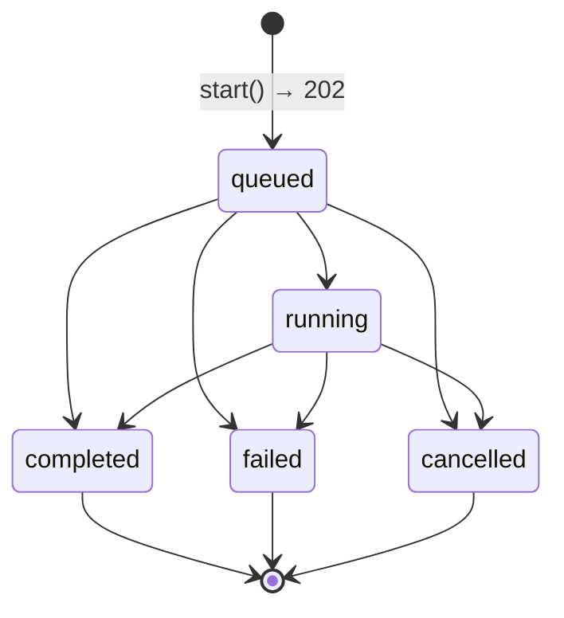
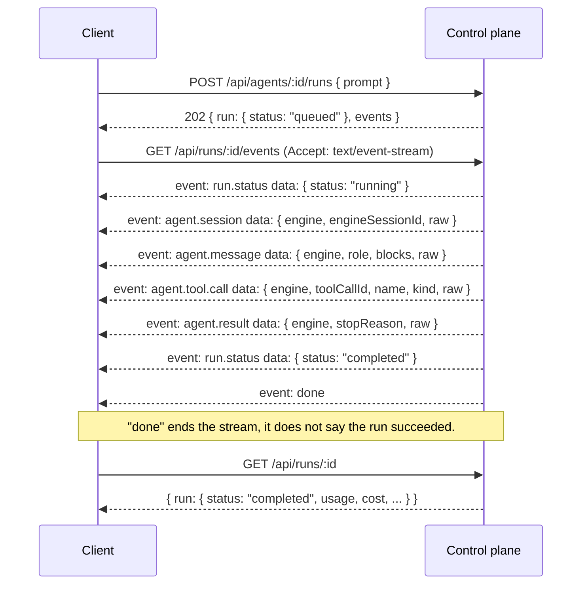

<Info>

- **Read this when:** you start runs, read their outcome or cost, continue a conversation, or render
  the event stream.
- **You will learn:** the five run statuses and how a run reaches a terminal one, how usage, cost
  and sessions relate to a run, and what each event-stream frame means, including how to resume.
- **Used in:** [Chapter 1: Run your first agent](/path/first-agent), [Chapter 3: Test and improve
  it](/path/test) and [Chapter 4: Put it in your product](/path/embed).

</Info>

A **run** is one execution of an agent against a prompt. This page is the model behind
[Runs](/resources/runs) (the `aw.runs` methods) and
[Streaming](/guides/streaming) (how to consume the event stream in practice) — read this
page for what the pieces mean, those pages for how to call them.

## From `start` to a terminal status

`aw.runs.start(agentId, { prompt })` calls `POST /api/agents/:id/runs`, which always answers `202`:
the run already exists, with `status: 'queued'`, and the body also carries `events`, the relative
path to stream it from (`StartRunResponseSchema` in `packages/contracts/src/runs.ts`).

A run's `status` is one of five values, `RUN_STATUSES` in `packages/contracts/src/runs.ts`:

```ts title="illustrative" claim="illustrative"
export const RUN_STATUSES = ['queued', 'running', 'completed', 'failed', 'cancelled'] as const;
export const TERMINAL_RUN_STATUSES = ['completed', 'failed', 'cancelled'] as const;
```

The contract's own comment is the state machine as documented: _"`queued` and `running` are live;
the other three are terminal, and a terminal run's event stream replays and ends rather than
follows."_ `isTerminalRunStatus(status)` is the exported predicate — use it instead of comparing
against the array yourself, since a fifth status would only need one place to change.



A run may finish while still `queued`, for example when it is cancelled before the runtime claims
it. The first terminal transition wins; another attempt to finish the run does not change its
status. `startedAt` is set when the run first becomes `running`. If it finishes directly from
`queued`, that terminal transition sets both `startedAt` and `endedAt`. `endedAt` is set when the
run first becomes terminal. Both timestamps are `null` while a run remains `queued`.

Read the settled record with `aw.runs.get(id)` once the run has reached a terminal status, or let
`aw.runs.waitForOutcome(id)` do both steps — follow the stream to its end, then read the record —
in one call.

## Usage, cost, and accounting

`RunResource` carries three fields that fill in as a run progresses, all on `RunResourceSchema` in
`packages/contracts/src/runs.ts` (full field list at
[runs](/reference/contracts/runs)):

- **`usage`** — `RunUsageSchema`: `inputTokens`, `outputTokens`, `cacheReadInputTokens`,
  `cacheCreationInputTokens`, a server-derived `totalTokens` (the sum of the four), and
  `toolCalls`.
- **`cost`** — `RunCostSchema`: `amount` as a decimal _string_ (never a float — `"0.000000"`
  before accounting settles), `currency`, and `priceTableVersion` (`null` until priced).
- **`accountingState`** — one of `ACCOUNTING_STATES`: `'pending' | 'complete' | 'partial' |
'failed' | 'unavailable'`. Only `'complete'` is a settled answer; `accountingError` carries why
  when it is not.

A run's `status` reaching a terminal value and its `accountingState` reaching `'complete'` are two
separate facts — a `completed` run's cost can still be `pending` or `partial` briefly after the
run itself finishes. Read both fields if your integration bills or reports on cost.
An accounting state of `'failed'` is not final: if usage arrives later, settlement recomputes the
state and can clear `accountingError` (F-099). Consumers that need a settled amount should wait for
`'complete'` or handle a later update to the record.

## Sessions group runs

A **session** is not a run; it is the continuity between runs. From the resource model in the API
specification §2:

```text
Session(→ Agent, → Project?, owner Principal, providerSessionId, title, active|archived)
  └─ Run(status, → Session, → Agent, usage, cost, accounting, error)
```

Every run belongs to exactly one session (`RunResource.sessionId`), and a session can hold many
runs. `StartRunRequest.sessionId` is how a caller chooses: pass an existing session's id to
continue it — the agent's prior context carries forward — or omit it (or send `null`) to start a
new one. `aw.projects.startSession` is the same idea scoped to a project. See
[Sessions](/resources/sessions) for the session resource itself, transcripts, and
archiving.

### What makes "the prior context carries forward" true

Continuing a session is not a property of the session **row**. The row holds the engine's own
session id; the conversation itself is state the engine wrote, and it has to survive the sandbox
that wrote it or a resume starts a fresh conversation with nothing saying so.

The platform keeps that state in one **engine-scoped session store**. Its shape is deliberately
opaque: per session and engine, a set of _streams_ of entries — each entry stored verbatim, with the
engine's own idempotency key so a retried batch stores one entry and not two — plus, for an engine
whose conversation is files rather than a list, a size-capped _blob_ snapshot. The runner writes to
it over private routes with its per-run token. The engine-neutral history a consumer reads is the
`agent.*` frame replay described below; `sessions.transcript.read` and `.subkeys` remain the Claude
Agent SDK's own transcript, served from this store for a Claude session (and, for a session created
before the store existed, from the tables that held it then), with the same response shape as
before.

Two consequences worth knowing:

- a run whose state could not be written is reported **not durable**, for every engine, and the
  platform does not offer a resume for it;
- a session is pinned to the engine that ran it. Continuing a session on a different engine is
  refused rather than attempted — one engine's state replayed into another is not a resume.

The store is engine-scoped, has a blob cap and its own route family.

## The event stream

`GET /api/runs/:id/events` is a `text/event-stream`; `aw.runs.events(id)` yields it as classified
frames, and `aw.runs.follow(id)` adds resume-on-drop on top. Every frame falls into one of three
kinds (API specification §4; the per-frame schemas are at
[run-events](/reference/contracts/run-events)):

1. **Control frames** (`CONTROL_FRAME_NAMES`: `done`, `run-failed`, `stream-reset`) — written by
   the stream itself. They carry no `id:` and never move the resume cursor.
2. **The platform's own lifecycle event** (`RUN_STATUS_EVENT`, `run.status`) — durable and
   replayable, appended whenever the run's `status` changes. Its `id:` is a resume cursor.
3. **Neutral agent frames** (`AGENT_FRAME_NAMES`: `agent.session`, `agent.message`,
   `agent.message.delta`, `agent.tool.call`, `agent.tool.result`, `agent.usage`, `agent.result`,
   `agent.native`, `agent.malformed`) — **one engine-neutral vocabulary**, produced once by the
   engine's adapter in the runner rather than re-derived by each client. Every frame
   names its `engine` and carries the engine-native message in `raw`. These also carry a resume
   `id:`. `aw.runs.events` surfaces them as `kind: 'runtime'` frames, and `toAgentEvent` parses one
   into a typed `AgentEvent`; see [Runtime neutrality](/concepts/runtime-neutrality) and
   [Streaming](/guides/streaming#the-neutral-agentevent-view).

   A run recorded before the neutral event vocabulary
   has rows named with the vocabulary this stream used then (`system`, `sdk-event`, `result`, …).
   They are **upgraded on read**, through the same mapping a live run goes through, so a client only
   ever sees the neutral set. One such row can serve several frames; they share the row's sequence
   and are told apart by a `.<sub-index>` suffix on the `id:`.



Two frames need care, because their names are easy to misread:

- **`done` is not success.** It means _this connection is finished delivering frames_ — nothing
  more. A run that failed still ends its stream with `done`; the failure is reported separately
  (below) or read from the settled record with `aw.runs.get`.
- **`run-failed`** means this _connection_ could not deliver a successful run — `status` is the
  run's own terminal status, or the literal `"unknown"` when producing the stream itself threw and
  this connection cannot say what happened. The current server also sends `"unknown"` followed
  by `done` when its final outcome lookup is indeterminate; `follow` then stops instead of
  reconnecting, and `waitForOutcome` can reject a still-live run. The intended reconnect behavior
  for that case awaits the D1 frame-protocol decision (suspicious point 4).
- **`stream-reset`** means the cursor you resumed from is no longer servable — the server does not
  have retained history back that far. A consumer rendering a transcript must discard what it has
  rendered and restart from what the frame's `resumedAfter` allows, not merge.

### Resuming

Every durable frame's `id:` is a resume cursor. Reconnect by sending it back as the `Last-Event-ID`
request header (or the SDK's `after` option) — `aw.runs.events(id, { after: lastEventId })`.
`aw.runs.follow(id)` does this automatically whenever the underlying connection drops before
`done`: it reconnects up to `maxReconnects` times (default 5), waiting `reconnectDelayMs` between
attempts (default 3000, matching the server's own SSE `retry:` value). `follow` does **not**
reconnect on a `ContractViolationError` (the server broke its own contract; retrying will not fix
that) or on an abort of the caller's own `signal` — only a dropped connection is treated as
transient. See [Streaming](/guides/streaming) for the full consumption pattern and
[Timeouts and cancellation](/guides/timeouts-and-cancellation) for how `timeoutMs`
interacts with an open stream.

## Where a run executes

A run does not choose its own execution environment; the agent it runs against does. Every agent
optionally references a **runtime profile** (`RuntimeProfileResource`), which names a **driver**
(`local`, `docker`, `kubernetes`, `cloud-run-service`, and others) plus sizing, network policy, and
filesystem settings. The profile is a reference, not a copy — changing which profile an agent
points to is an ordinary `aw.agents.update(id, { runtimeProfileId })` call, audited like any other
agent change, and it takes effect on the agent's next run. See
[Runtimes](/resources/runtimes) for the full resource, the driver catalog, and what a
runtime connection is.

## Open questions

The status transitions and timestamp rules described above are confirmed by both run stores.
