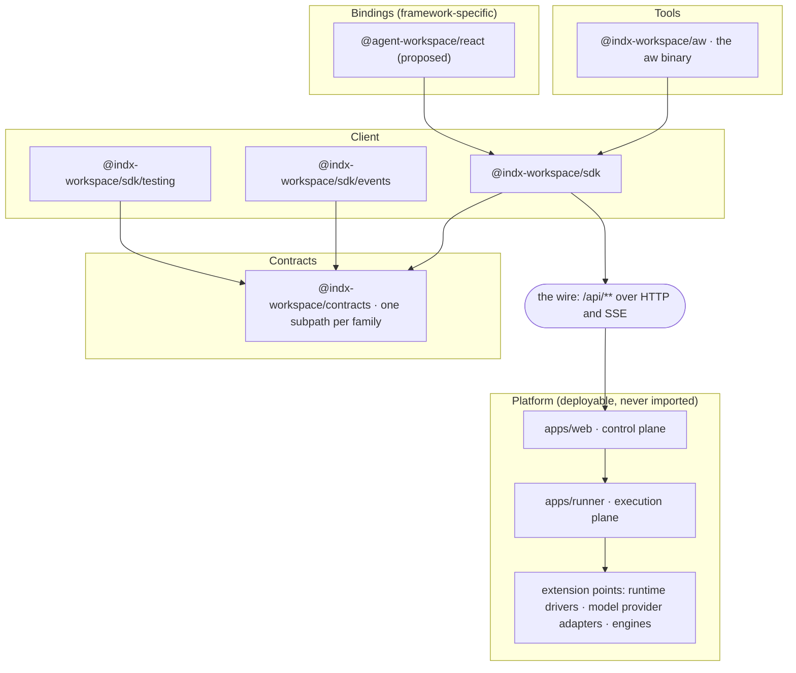

<Info>

- **Read this when:** you want to know where the platform is going before you build on a part
  marked Today / Target, or you plan an extension.
- **You will learn:** the product thesis and its six consequences, the time-to-deploy budgets, the
  developer experience, package layout, API and extension model at the destination, and what
  never changes.
- **Used in:** every chapter; the gaps each chapter lists link here or to the
  [roadmap](/concepts/roadmap).

</Info>

This page describes the **destination**: what we are building and how a developer is meant to
use it. The rest of this site documents what exists today, accurately, with a Today / Target
callout wherever today falls short of what is written here. The sequence of moves from one to
the other is on the [Migration roadmap](/concepts/roadmap); it is deliberately not the subject
of this page.

The destination is assembled from decisions the platform has already recorded — the SDK
design, the API specification, the refactoring programme's target architecture and the
platform's architecture rules. Two details are _proposals_ this page adds and marks as such: the
name and shape of the browser binding (`@agent-workspace/react`) and the module the `me` contract
lives in. A proposal becomes a decision through a recorded decision, not through
this page.

## What we are building

**Agent Workspace is a control plane for running AI agents that a product team integrates the
way they integrate any backend service — not a codebase they fork.** The developer-facing
product is one HTTP API and the things that speak it: a contracts-first, typed, runtime-neutral
client, a command line over the same client, and the platform's own screens as that client's
first consumer. Everything about _what_ an agent is and does — its
instructions, what it may touch, which model it uses, where it executes, which skills it loads,
which tools it can call, which files it sees — is **data**, created and changed through that
API. Code is needed only to teach the platform something it cannot do at all: run agents on a
new kind of infrastructure, talk to a new model provider, or execute agents with an engine other
than the Claude Agent SDK.

That thesis has six consequences, and the rest of this page is their design:

1. **One API, one client, one contract.** The control plane's own screens, a customer's
   backend, a customer's frontend and the command line all speak the same `/api/**` through
   the same packages. There is no privileged path.
2. **Everything an agent _does_ is configuration.** A workspace is fully described by its
   resources, and a resource is fully addressable over the API — created, read, updated,
   exported, imported, archived.
3. **Every consumer type is first-class.** A program, a browser on any origin, and a person at
   a terminal each have a credential designed for them.
4. **The platform is open at named points.** Where an agent runs and which engine runs it are
   extension points with an interface, a registry and a gate — and nothing else is.
5. **Every chore around the agent costs one call, or none.** A file space, people and
   permissions, a database, a sandbox, skills, tool servers and credentials, model switching,
   conversation memory, delivery into a product — each is a resource the platform already
   models, in the customer's own environment, without adopting an agent framework. The time
   budgets below are how this consequence is measured.
6. **The data plane is the platform's, natively, per cloud.** Where files, skills, secrets and
   sandboxes actually live is a contract the operator configures once, as a deployment profile —
   never a fork, never "S3-compatible" standing in for a cloud's own service. [The data
   plane](/concepts/data-plane) states that contract cell by cell; [design
   principles](/concepts/design-principles) 2 and 3 are why it is shaped this way.



## Time to deploy as a design goal

The fifth consequence is a claim about _effort_, so it is stated as budgets that can be
checked: how long each step takes a developer who has never seen the platform's code. The
target commits to five and names the roadmap items that pay for each; the walkthrough that
follows shows the calls that meet them. [What Agent Workspace
is](/concepts/what-is-agent-workspace#the-chores-it-removes) lists the chores behind them.

| Budget                                                                                                             | Target                                                                                                                | Holds today?                                                                                                                                                        | What closes it                                                                        |
| ------------------------------------------------------------------------------------------------------------------ | --------------------------------------------------------------------------------------------------------------------- | ------------------------------------------------------------------------------------------------------------------------------------------------------------------- | ------------------------------------------------------------------------------------- |
| **Time to self-host** — from nothing to a control plane with a database, object storage, a gateway and a runner    | three commands on a laptop; the same images on a VM or a cluster                                                      | Partly: one `compose.yaml` or one Helm chart from a clone and a local build                                                                                         | [P-6](/concepts/roadmap#p-6-a-published-release-with-signed-images-and-the-installer) |
| **Time to first agent** — from an API key to a running agent with a document, a skill, a tool server and a sandbox | one script, one call per resource, one call for the agent with its assignments, nothing about deployment              | Yes: one script, five set-up calls, the agent's assignments composed into `create` ([the script](/concepts/what-is-agent-workspace#time-to-first-agent-one-script)) | —                                                                                     |
| **Time to switch** — another model, another sandbox, another agent, for a person or a program                      | one update, audited; the conversation continues in its session                                                        | Yes                                                                                                                                                                 | —                                                                                     |
| **Time to embed** — an agent inside the customer's product, on the customer's origin                               | a backend that mints a scoped token and a frontend that follows the stream directly, holding no long-lived credential | Yes                                                                                                                                                                 | [P-5](/concepts/roadmap#p-5-a-react-binding)                                          |
| **Time to promote** — the same agent from development to staging to production                                     | export one document, import it where the skills and connectors of the same name exist                                 | Yes: `aw.agents.export` / `import`                                                                                                                                  | —                                                                                     |

Two architectural rules follow from the budgets and are listed under
[What never changes](#what-never-changes): **nothing
a developer does to use an agent involves the platform's code** (every chore is a resource,
every resource is one call), and **nothing a developer does depends on which engine runs the
agent** (the provider is the platform's concern, tagged on what is provider-native and hidden
behind the neutral event view everywhere else).

## The developer experience at the destination

This is the whole product, walked through once, in the order it is met — the operator's one
step first, then the developer's. The code is the target shape: a fence titled `target:` shows a
call or a command that does not exist yet, and the callout under it names the roadmap item.
Everything not marked is available today.

### 0. Self-host on your cloud

Before any of this, an operator stands the platform up on the cloud the company already runs on
— choosing where the database, the object store, the secret backend and the sandbox driver live,
once, as a deployment profile the installer validates and renders to Compose, Helm or Terraform.

```sh title="target: self-host on your cloud (illustrative)" claim="illustrative"
npx -p @indx-workspace/cli create-agent-workspace acme-ai --cloud gcp
cd acme-ai && agent-workspace deploy
```

```yaml title="agent-workspace.yaml — the deployment profile (illustrative)" claim="illustrative"
apiVersion: agentworkspace.dev/v1
kind: Deployment
cloud: gcp
storage:
  relational: cloud-sql # a postgres:// URL, or that cloud's managed PostgreSQL by name
  objects: gcs://acme-ai-files
  secrets: secret-manager
runtime:
  default: cloud-run-service
identity:
  oidc: https://accounts.google.com
  bootstrapAdmin: ops@acme.example
```

<Note>
  **Today:** the profile above is real and the generator writes it, but self-hosting still means
  building the images yourself, and applying the rendered artefact with your own `docker compose`,
  `helm` or `terraform` — see [Self-host Agent Workspace](/building/self-hosting). **Target:** the
  three-command first run against signed images. Tracked as
  [P-6](/concepts/roadmap#p-6-a-published-release-with-signed-images-and-the-installer).
</Note>

### 1. Install, and find out who you are

```sh title="target: install (illustrative)" claim="illustrative"
npm install @indx-workspace/sdk @indx-workspace/contracts
```

```ts title="target: the first call (illustrative)" claim="illustrative"
import { createClient } from '@indx-workspace/sdk';

const aw = createClient({ baseUrl, auth: { kind: 'api-key', apiKey } });

const me = await aw.me();
// { principalId, kind: 'api-key', role: 'builder', workspaceId, userId: null, label }
```

An integration begins by asking the platform who it is — principal, role, workspace — and
branches on the answer, instead of inferring its identity from the first `403`.

<Note>`aw.me()` is live, and `npm install @indx-workspace/sdk` installs it.</Note>

### 2. Define an agent as one unit, and move it between environments

An agent is a definition: instructions, permissions, model, runtime, and — by name — the skills
and connectors it uses. The definition is created in one call, exported as one document, and
imported into another workspace or another environment, where the skills and connectors are
resolved by name. Nothing about the definition is Claude-specific except the parts the
specification deliberately keeps provider-native (skills and tool policy), which travel tagged
`provider: 'claude-agent-sdk'`.

```ts title="target: one agent, one call, one document (illustrative)" claim="illustrative"
const agent = await aw.agents.create(
  {
    name: 'Release notes writer',
    instructions: 'Summarise a diff into three user-facing release-note bullets.',
    modelConnectionId: null,
    model: null,
    runtimeProfileId: null,
    permissions: {
      readFiles: true,
      writeFiles: false,
      runCommands: false,
      unrestrictedNetwork: false,
    },
  },
  { assignments: { files: [], skillIds: [changelogSkill.id], connectorIds: [github.id] } },
);

const policy = await aw.agents.getPolicy(agent.id); // tools, skills mode, limits — on the wire
const definition = await aw.agents.export(agent.id); // AgentDefinition: portable, by name
await staging.agents.import(definition); // same skills and connectors, resolved by name
await aw.agents.archive(agent.id); // history stays; nothing cascades
```

<Note>
  **Today:** `create(input, {assignments})`, `getPolicy` and `export`/`import` are real, as shown
  above; `remove` still cascades through history. **Target:** `archive` instead. Tracked as
  [RF-201](/concepts/roadmap#rf-201-agent-archive-instead-of-delete). [Design an
  agent](/building/agents) shows today's shape.
</Note>

### 3. Run it from a backend, safely

A backend starts a run, follows or waits for it, and can stop it. A retried start after a lost
response is the same run, not a second one. A run that the platform loses track of is
recovered, not stranded.

```ts title="target: idempotent start, follow, interrupt (illustrative)" claim="illustrative"
const { run } = await aw.runs.start(
  agent.id,
  { prompt: 'Summarise the diff attached to ticket 4821.' },
  { idempotencyKey: 'ticket-4821-v1' },
);

for await (const frame of aw.runs.follow(run.id, { signal })) {
  if (frame.kind === 'run-status' && frame.data.status === 'running' && budgetExceeded()) {
    await aw.runs.interrupt(run.id);
  }
}
```

Today's `start`, `follow`, `interrupt` and `waitForOutcome` are exactly this without the
idempotency key — see [Integrate a backend](/building/backend).

<Note>
  **Today:** no idempotency key; a queued run can strand if the web process dies between persisting
  and launching. **Target:** the code above, backed by database leases and attempts. Tracked as
  [S-6](/concepts/roadmap#s-6-idempotency-keys) and
  [RF-301](/concepts/roadmap#rf-301-run-leases-and-attempts).
</Note>

### 4. Show it in your own product

A customer's frontend runs on the customer's origin. It never holds a workspace API key.
Instead the customer's backend mints a short-lived token scoped to one run or one session and
hands it to the page; the page uses the same SDK with a different credential, and a thin
framework binding turns `follow` into component state.

```ts title="the backend mints, the browser follows (illustrative)" claim="illustrative"
// backend
const { token } = await aw.tokens.mint({ kind: 'run', id: run.id }, { ttlSeconds: 900 });

// browser
const page = createClient({ baseUrl, auth: { kind: 'browser-token', token } });
for await (const frame of page.runs.follow(run.id, { signal })) {
  render(frame);
}
```

```tsx title="target: the React binding (proposed) (illustrative)" claim="illustrative"
import { useRun } from '@agent-workspace/react';

export function RunView({ runId }: { runId: string }) {
  const { status, events, error } = useRun(runId);
  return <Transcript status={status} events={events} error={error} />;
}
```

<Note>
  **Today:** a customer's own frontend authenticates with a browser token
  ([Authentication](/getting-started/authentication)); [`@indx-workspace/react`](/building/react)
  ships `<Chat />` and `useConversation()` for a surface's chat. **Target:** a binding for the run
  stream itself, if RF-501 takes it — tracked as [P-5](/concepts/roadmap#p-5-a-react-binding).
</Note>

### 5. Operate it from a terminal, as yourself

The command line is a person's client as much as a machine's. A person signs in once, works
across the workspaces they belong to, and reaches every route the SDK reaches — including the
ones that refuse an API key by design.

```sh title="target: a person at the terminal (illustrative)" claim="illustrative"
npx @indx-workspace/aw login            # device-code sign-in as a user principal
aw workspaces list
aw --workspace acme agents export rel-notes > agent.json
aw --workspace acme-staging agents import < agent.json
aw runs start rel-notes --prompt "Summarise the diff." --follow
```

<Note>
  **Today:** `aw` installs with `npm install --global @indx-workspace/aw` and holds an API key, or a
  person's short-lived token after `aw login` ([Authentication](/getting-started/authentication)).
</Note>

### 6. Test without a control plane

The seam the SDK's own tests use is the seam a consumer's tests use: a recording `fetch` double
and fixture builders that produce contract-valid resources, exported as a public subpath.

```ts title="the shipped testing seam" claim="compile"
import { createClient } from '@indx-workspace/sdk';
import { fetchDouble, fixtures, jsonResponse } from '@indx-workspace/sdk/testing';

const api = fetchDouble(() => jsonResponse(200, { run: fixtures.run({ status: 'completed' }) }));
const aw = createClient({
  baseUrl: 'http://test',
  auth: { kind: 'api-key', apiKey: 'ak_test' },
  fetch: api.fetch,
});
```

[Testing](/guides/testing) covers the double, the fixtures and every failure and stream shape.

### 7. Know when you are out of date

A client says which contracts version it was built against; a control plane that no longer
serves that version says so up front, before a resource is touched, instead of the client
discovering drift one refused response at a time.

The SDK sends `X-Agent-Workspace-Contracts` on every request, and a refusal is the typed
`ContractsVersionUnsupportedError` (`426`), which names both versions and the side that must
upgrade ([Errors](/guides/errors)).

## The package layout

Five layers, one dependency direction, one seam that crosses the network. A layer imports only
the layer beneath it; nothing below the wire is importable from above it.

| Layer     | Package and entry points                                                                                                                                                                                                                                                                                                        | Holds                                                                                                                                                         | Belongs here only if…                                                              |
| --------- | ------------------------------------------------------------------------------------------------------------------------------------------------------------------------------------------------------------------------------------------------------------------------------------------------------------------------------- | ------------------------------------------------------------------------------------------------------------------------------------------------------------- | ---------------------------------------------------------------------------------- |
| Contracts | `@indx-workspace/contracts` — `.` and one subpath per family (`./agents`, `./runs`, `./run-events`, `./sessions`, `./projects`, `./workspaces`, `./team`, `./invitations`, `./api-keys`, `./files`, `./skills`, `./connectors`, `./models`, `./runtimes`, `./secrets`, `./shares`, `./observability`; proposed: `./principals`) | Zod schemas, derived types, bounds, problem codes, event names                                                                                                | it can be true of the wire without any client or server code existing              |
| Client    | `@indx-workspace/sdk` — `.`, `./events`, `./testing`                                                                                                                                                                                                                                                                            | `createClient`, transport, auth, the three error classes, one resource client per family, the SSE follower, the neutral `AgentEvent` view, the testing double | every consumer needs it regardless of framework or runtime                         |
| Bindings  | `@agent-workspace/react` (proposed)                                                                                                                                                                                                                                                                                             | hooks, cache policy, reconnect state                                                                                                                          | it depends on a UI framework — nothing framework-specific is allowed in the client |
| Tools     | `@indx-workspace/aw` — the `aw` binary                                                                                                                                                                                                                                                                                          | argument parsing, output, exit codes, profiles, sign-in                                                                                                       | it is about a terminal, not about the API                                          |
| Platform  | `apps/web`, `apps/runner`, `packages/core`, `packages/gateway`, `packages/runtime`, `packages/cli`                                                                                                                                                                                                                              | routes, persistence, execution, credential substitution, drivers, adapters                                                                                    | it runs on the server side of the wire                                             |

Today's layout — every package including the server-side ones, the dependency edges
`dependency-cruiser` enforces, and the four layers one resource crosses with their file paths —
is the contributor's structure map, which is kept in the platform source.

Three properties of the layout hold today and are meant to hold forever:

1. **No barrel of everything.** A consumer imports the family it uses
   (`@indx-workspace/contracts/runs`), so a bundle carries only the schemas it validates and
   an unrelated family's change cannot touch a consumer's types.
2. **Types resolve from source, runtime from `dist/`.** Each subpath's `types` condition points
   at `src/*.ts` and `default` at `dist/*.js`; type-checking never needs a build and runtime
   always gets JavaScript (enforced by `pnpm package-exports:check`).
3. **`zod` is the only runtime dependency**, pinned exactly and shared by both packages — the
   reason the contracts can be consumed by a server that is not this one.

## The API

The Configure surface — every resource family — has one shape at the destination. These are
the properties a consumer relies on; the [Public surface and stability](/concepts/public-surface)
page states which of them hold today.

### Every consumer type has a credential

| Consumer                              | Credential                                                     | Scope                                    |
| ------------------------------------- | -------------------------------------------------------------- | ---------------------------------------- |
| A backend, CI, a machine              | `auth: { kind: 'api-key' }`                                    | one workspace, one role, long-lived      |
| The control plane's own screens       | `auth: { kind: 'session' }`                                    | the signed-in person's current workspace |
| A customer frontend on its own origin | `auth: { kind: 'browser-token' }`                              | one run or one session, minutes          |
| A person at a terminal                | a device-code sign-in producing a user-scoped session for `aw` | every workspace the person belongs to    |

### Every resource is fully addressable

Whatever the control plane's own UI can do to a resource, the API can do, and every lifecycle
has all its verbs: agents are created with their assignments, read with their policy, exported,
imported, archived and restored; skills and secrets can be deleted (refused while referenced);
connectors can be updated and disabled; runtime profiles can have a field cleared; a file's
metadata can be read without downloading it; a run can be interrupted.

### Every route speaks one envelope

One error envelope, `{ error: { code, message, details? } }`, on every route. One item envelope
per family. Cursor pagination on every list that can grow. `principalId` on every row that has
an owner. Credentials write-only everywhere — no response schema has a credential field. The
one deliberate irregularity is kept: item routes answer a bare resource for some families and
`{ run }`, `{ session }`, `{ workspace }` for others, because normalising the wire is a breaking
change that belongs to a versioned API, and the SDK's uniform methods already hide it.

### Every resource is provider-neutral where it can be

The resource model does not change shape to accommodate a second engine. What is portable —
identity, instructions, permissions, the model pair, runtime placement, files, connectors,
limits, session identity, the platform's own event frames and the neutral `AgentEvent` view —
stays workspace-owned; what is provider-native — skills, the tool policy, transcripts, the raw
message in `frame.data` — travels tagged with its `provider`. [Runtime
neutrality](/concepts/runtime-neutrality) has the table.

## The data plane at the destination

Where an agent's files, skills, secrets and sandbox actually live is not a fifth resource family
a builder configures — it is the operator's, set once as three profiles when the platform is
self-hosted, and the builder's SDK has no field for any of it: no bucket, no table, no key ring,
no disk path appears in `@indx-workspace/contracts` or in any builder guide on this site. [The
data plane](/concepts/data-plane) is the contract those three profiles fill in, cloud by cloud.

```yaml title="agent-workspace.yaml — the deployment profile (illustrative)" claim="illustrative"
apiVersion: agentworkspace.dev/v1
kind: Deployment
cloud: gcp
storage:
  relational: cloud-sql # a postgres:// URL, or that cloud's managed PostgreSQL by name
  objects: gcs://acme-ai-files
  secrets: secret-manager
runtime:
  default: cloud-run-service
identity:
  oidc: https://accounts.google.com
  bootstrapAdmin: ops@acme.example
```

The document, its schema and the artefacts rendered from it exist today — [The deployment
profile](/concepts/data-plane#the-deployment-profile). What each value it _may_ name still needs is
the roadmap item beside it.

| Profile    | Fields                                                                                                                                                                                                                                        | Roadmap item                                                                                                                                                                                        |
| ---------- | --------------------------------------------------------------------------------------------------------------------------------------------------------------------------------------------------------------------------------------------- | --------------------------------------------------------------------------------------------------------------------------------------------------------------------------------------------------- |
| `storage`  | `relational` (managed PostgreSQL or a raw `postgres://` URL), `objects` (`s3://`, native `gcs://` on GCP, native `azblob://` on Azure, or `local-filesystem`), `secrets` (`local-key`, AWS `kms`, GCP `secret-manager`, or Azure `key-vault`) | [D-2](/concepts/roadmap#d-2-object-storage-on-every-cloud-natively) and [D-3](/concepts/roadmap#d-3-secret-backends-on-every-cloud) remain open until every cloud slice has its required live proof |
| `runtime`  | `default` — the sandbox driver every agent's runtime profile falls back to unless it names its own                                                                                                                                            | [D-4](/concepts/roadmap#d-4-a-verified-managed-cloud-sandbox-per-cloud)                                                                                                                             |
| `identity` | `oidc` (the issuer URL), `bootstrapAdmin` (the first Owner's email)                                                                                                                                                                           | already true today — any OIDC issuer works                                                                                                                                                          |

## The extension model

Data first, code last. A customer changes an agent's behaviour without code; INDX
changes the platform's _capabilities_ through four named points, each an interface, a registry
keyed by a contract value, and a gate. [Extend the platform](/building/extending-the-platform)
walks through each with the real names.

| Extension point                                                | Interface                                                                                                          | Keyed by                                                             |
| -------------------------------------------------------------- | ------------------------------------------------------------------------------------------------------------------ | -------------------------------------------------------------------- |
| Runtime driver — _where_ an agent executes                     | `packages/runtime/src/driver.ts`, registered in `registry.ts`                                                      | `RuntimeDriver` in `@indx-workspace/contracts/runtimes`              |
| Model provider adapter — _which model API_ the gateway proxies | `packages/gateway/src/providers/*`, registered in `providers/registry.ts`                                          | `MODEL_PROVIDERS` in `@indx-workspace/contracts/runs`                |
| Engine — _which harness_ executes the agent                    | the `AgentEngine` port in `packages/engine`, one adapter package per engine, reached through the runner's registry | `engine` on the policy, the run, the session and every neutral frame |
| A route — _a new capability_ on the wire                       | contract → conformance test → client method → CLI command → generated reference (API specification §9)             | a new contracts module or export                                     |

Nothing else is an extension point. `packages/core`, the runner's `/run` protocol and
`apps/web/server/**` are the platform; a customer who needs them changed opens an issue or a
pull request, and the change arrives on the wire as a contract.

## The control plane as first consumer

The product's own screens hold no HTTP client and no parser of their own for any family the SDK
covers. Every screen goes through `createClient({ auth: { kind: 'session' } })`, every response
is a contract type, and an import rule forbids the application from re-declaring a published
schema. This is the guarantee behind the thesis: the API a customer sees is the API the product
is built on, so a route the product's screens need but the SDK cannot call is, by definition, a
bug in the SDK.

<Note>
  **Today:** the run screen's live stream and assistant-message parsing come from
  `@indx-workspace/sdk/events` and `apps/web/contracts/*.ts` re-export the package, but most screens
  still call `fetch` themselves. **Target:** every screen through the SDK, re-exports deleted, a
  feature-owned browser layer with mechanically enforced direction. Tracked as
  [A-1](/concepts/roadmap#a-1-browser-screens-call-the-sdk),
  [A-2](/concepts/roadmap#a-2-remove-the-application-re-exports) and
  [A-3](/concepts/roadmap#a-3-a-typed-feature-layer-in-the-browser).
</Note>

## What never changes

These properties hold today and are preserved by every move on the roadmap; they are the reason
the roadmap is possible rather than items on it.

- **One dependency direction.** `aw` → `sdk` → `contracts` → `zod`; nothing server-side is
  reachable from any of them, and the rule is a build failure, not a review comment.
- **Strict contracts.** An owned schema refuses unknown keys. Drift is an error, not data.
- **Principals, not users.** Authorization compares principal ids; an API key is never treated
  as a person, and no route falls back to "the oldest Owner".
- **One boundary file per engine SDK.** `packages/engine-claude-agent-sdk/src/boundary.ts` is the
  only importer of `@anthropic-ai/claude-agent-sdk`, and every engine added after it gets exactly one such file
  (`packages/engine-<id>/src/<boundary>.ts`), held as an allow-list checked for set equality
  rather than relaxed into a pattern. Tool policy and transcripts stay
  engine-native; the portable core is honoured by every engine or refused by name.
- **Credentials are write-only.** A value goes in once and never comes back.
- **The application is a consumer.** Whatever the product's own screens can do, the SDK can do.
- **Using an agent never touches the platform's code.** Every chore around an agent is a
  resource, and every resource is one call; code enters only at the four extension points.
- **Using an agent never depends on which engine runs it.** The engine is the platform's
  concern — tagged on what is engine-native, hidden behind the neutral event view everywhere
  else — so a consumer's code survives a second engine unchanged, and billing does too, because
  usage is metered at the gateway rather than reported by the engine.
- **PostgreSQL is the only relational store.** Every durable row the platform owns lives there,
  on whichever cloud's managed service answers `DATABASE_URL`; no other database becomes a second
  source of truth for a workspace, an agent, a run or a session.
- **The operator configures placement; the builder never does.** Storage, runtime and identity
  are the deployment profile's fields, set once by whoever self-hosts; nothing in
  `@indx-workspace/contracts` or `@indx-workspace/sdk` lets a builder's code choose a bucket, a
  region or a sandbox driver on its own.

## From here to there

Today's layout differs from this page in the completeness of a few lifecycles (agent archive,
skill revisions, an idempotent run start), in envelope regularity, and in how far
the product's own screens have moved onto the SDK. Each difference is one entry on the
[Migration roadmap](/concepts/roadmap), which also states the order of the moves and the rule
that governs a dangerous one: add → backfill → switch writers → validate → switch readers →
enforce → remove, never a flag day.

<CardGroup cols={2}>
  <Card title="Public surface and stability" icon="shield-check" href="/concepts/public-surface">
    Consume, Configure, Extend, Internal — and what each promises now.
  </Card>
  <Card title="Migration roadmap" icon="road" href="/concepts/roadmap">
    Every gap named on this page, today's behaviour, and where it is tracked.
  </Card>
  <Card title="Which surface for which job" icon="signs-post" href="/building/overview">
    From "I want to…" to the method and the page.
  </Card>
  <Card title="Extend the platform" icon="puzzle-piece" href="/building/extending-the-platform">
    The four extension points with their real interfaces and gates.
  </Card>
</CardGroup>
