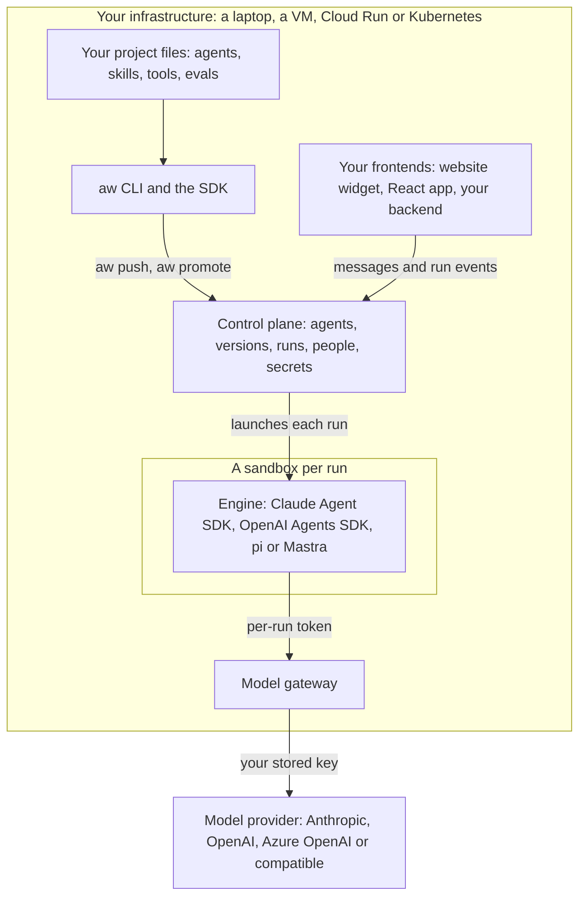
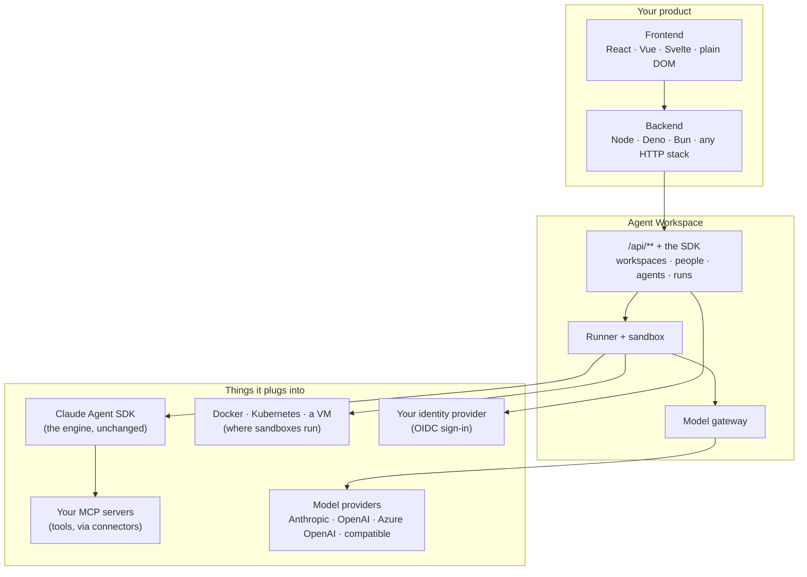
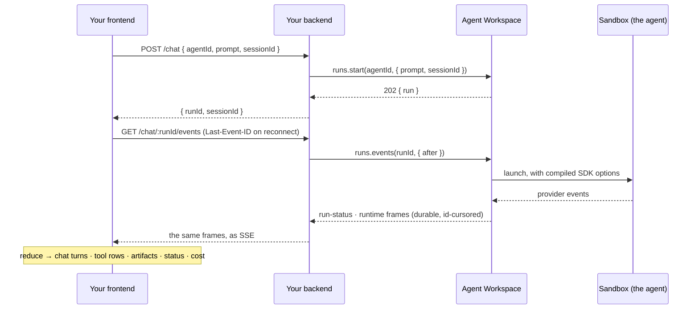

<Info>

- **Read this when:** you have seen the overview map and want the one picture of what Agent
  Workspace is before you install it.
- **You will learn:** how your project files, `aw`, the control plane, the engines in their
  sandboxes and your frontends fit together inside your own infrastructure; which chores around an
  agent it removes; and how it relates to the tools you already use.
- **Used in:** every chapter, starting with [Chapter 1: Run your first agent](/path/first-agent).

</Info>

Writing an agent with the Claude Agent SDK takes an afternoon. Everything after that is what
stalls a rollout: who may change the agent, where it executes, whose credentials it holds, how a
teammate switches it to another model or another cloud, and how the result reaches the people
— or the product — that need it. **Agent Workspace is the layer around the SDK that answers
those questions**, runs in your own infrastructure, and exposes everything it manages through
one API so that the same agents can be driven from its own UI, from your backend, from your
frontend, or from a terminal.



Read it left to right. You keep the agent as files in your repository; `aw` (or the SDK) saves
them to the control plane; each run starts the agent's engine in a sandbox; the engine reaches
the model only through the gateway, which holds the provider key so the sandbox never does; and
your website, app or backend talks to the same control plane. Everything except the model
provider runs where you deploy it.

**What you can do**

- [Skip the chores around an agent](#the-chores-it-removes): files, people, storage, sandboxes, keys.
- [Stand up a complete agent from one script](#time-to-first-agent-one-script).
- [Keep the Claude Agent SDK and the tools you already use](#how-it-relates-to-what-you-already-use).
- [Drive agents from your backend](#calling-it-from-a-backend) or [show them in your frontend](#calling-it-from-a-frontend).
- [Run it on any cloud, or none](#self-hosted-on-any-cloud-or-none).

[Use cases](/concepts/use-cases) is the same product in six concrete shapes; [Target
architecture](/concepts/target-architecture) is what it is meant to become; [Which surface for
which job](/building/overview) is the index from what you want to do to the page that shows
how.

## Three things you get

Every chore below exists to deliver three things, stated in full on [Design
principles](/concepts/design-principles):

- **Managed agents, in your own cloud.** _"The Claude Managed Agents experience — agents,
  sessions, files, tools, sandboxes, nothing to operate — but the data never leaves our
  account."_ The same five services and images run on a laptop, one VM, or AWS, Google Cloud or
  Azure. [The data plane](/concepts/data-plane) is the contract behind it.
- **Build the agent; everything around it is one call.** _"I wrote the agent in an afternoon and
  never wrote a line for storage, users, credentials, or deployment."_ Every chore in the table
  below is a resource with a full lifecycle behind `aw.<resource>.*`. [Time to first agent: one
  script](#time-to-first-agent-one-script) is that call, end to end.
- **Switch anything, embed anywhere, in minutes not sprints.** _"We moved the agent to Azure
  OpenAI and a gVisor sandbox in a ticket, promoted it to prod by name, and it lives in our own
  product's UI."_ Model, sandbox, cloud and agent are all data. [Embed an agent in your
  product](/building/embedding) shows the last part.

## The chores it removes

Building the agent is the fun part. Around it sits a list of chores every team rediscovers —
a place for the agent's files, people and permissions, a database, somewhere to run it,
skills, tool servers and their credentials, a way to switch models, memory across
conversations, and getting all of that into a deployed environment rather than one laptop.
Agent Workspace's promise is that **each chore is one call, or zero**, and that the whole list
takes minutes, not a sprint. Where that is not yet true today, the row says so.

| The chore                                             | Without Agent Workspace                                                                      | With it                                                                                                                                                                                      | Today                                                                                                                                                                                                                                                                                                                                                                                                                                     |
| ----------------------------------------------------- | -------------------------------------------------------------------------------------------- | -------------------------------------------------------------------------------------------------------------------------------------------------------------------------------------------- | ----------------------------------------------------------------------------------------------------------------------------------------------------------------------------------------------------------------------------------------------------------------------------------------------------------------------------------------------------------------------------------------------------------------------------------------- |
| A place for the agent's documents                     | an S3 bucket, a schema, an upload path, access rules                                         | `aw.files.upload(path, bytes)` into the workspace's own file space; assign to an agent with `read` or `read-write`                                                                           | ✅                                                                                                                                                                                                                                                                                                                                                                                                                                        |
| Users, roles, machine credentials                     | an auth system, a permissions table, an admin screen                                         | a workspace with Owner / Admin / Builder / Viewer, invitations, API keys — `aw.team.*` or the UI                                                                                             | ✅                                                                                                                                                                                                                                                                                                                                                                                                                                        |
| A database and object storage for agent state         | design the tables for agents, runs, sessions, events; run migrations; pick and wire a bucket | five services, one `compose.yaml` or one Helm chart; every row already modelled; the developer never configures either — the operator points the deployment at the cloud's own services once | ✅ from a clone, with placement stated once as a [deployment profile](/concepts/data-plane#the-deployment-profile); the three-command install waits for a published release ([P-6](/concepts/roadmap#p-6-a-published-release-with-signed-images-and-the-installer)); the native-per-cloud contract is [D-2](/concepts/roadmap#d-2-object-storage-on-every-cloud-natively) and [D-3](/concepts/roadmap#d-3-secret-backends-on-every-cloud) |
| Somewhere for the agent to run, safely                | a container image, a sandbox, network rules, a job runner                                    | a runtime profile: driver, sizing, network policy, filesystem; `local`, `docker`, `kubernetes`                                                                            | ✅ (managed-cloud drivers not yet verified)                                                                                                                                                                                                                                                                                                                                                                                               |
| Reusable instructions and helper files (skills)       | a convention, a sync script, a way to version it                                             | `aw.skills.import({ name, files })`; assigned by id; materialised into the sandbox on every run                                                                                              | ✅                                                                                                                                                                                                                                                                                                                                                                                                                                        |
| Tool calling and the credentials it needs             | MCP JSON on each machine, secrets in env vars, no test                                       | `aw.connectors.create({ transport, url, authType, credential })`, `test()`, assign — the credential is stored write-only and the agent sees the tools                                        | ✅                                                                                                                                                                                                                                                                                                                                                                                                                                        |
| Model and provider keys                               | a key per developer, rotated by hand, visible to the agent                                   | a model connection behind the gateway; the sandbox gets a per-run token, never the key                                                                                                       | ✅                                                                                                                                                                                                                                                                                                                                                                                                                                        |
| Switching the model, the runtime, or the agent itself | code changes and a redeploy                                                                  | one `aw.agents.update`, audited; sessions carry the conversation                                                                                                                             | ✅                                                                                                                                                                                                                                                                                                                                                                                                                                        |
| Memory across conversations; durable, resumable runs  | a transcript store, a queue, reconnection logic                                              | sessions and runs with an id-cursored event stream; `follow` resumes; `interrupt` stops one                                                                                                  | ✅                                                                                                                                                                                                                                                                                                                                                                                                                                        |
| Showing it in your product                            | a chat UI protocol, streaming, reconnects                                                    | relay the stream through your backend, or a browser token straight to the browser; reduce it with the SDK's parser                                                                           | ✅                                                                                                                                                                                                                                                                                                                                                                                                                                        |
| Moving an agent dev → staging → prod                  | re-create everything by hand                                                                 | `agents.export` / `import` by name                                                                                                                                                           | ✅                                                                                                                                                                                                                                                                                                                                                                                                                                        |
| Knowing what it cost and who did what                 | logging you write yourself                                                                   | `metrics.recentRuns`, `audit.list`, `run.usage`, `run.cost`                                                                                                                                  | ✅                                                                                                                                                                                                                                                                                                                                                                                                                                        |

None of the rows requires an agent framework, a workflow engine, or a line of platform code.
The agent stays a Claude Agent SDK agent; everything around it is a resource you create once
and change as data.

## Time to first agent: one script

From an API key to a running agent with a document, a skill and a tool server — every chore in
the table above, in one file, against a control plane you self-host. This compiles against the
SDK as it exists today. Each step is one call:

1. Upload a document the agent may read: `aw.files.upload`.
2. Import a skill, a `SKILL.md` directory: `aw.skills.import`.
3. Register a tool server with its credential stored write-only: `aw.connectors.create`.
4. Choose where it runs, a sandbox profile: `aw.runtimes.profiles.create`.
5. Create the agent with its files, skill and tool server assigned: `aw.agents.create`.
6. Run it and wait for the outcome: `aw.runs.start`, then `aw.runs.waitForOutcome`.

<Accordion title="first-agent.ts — the whole script">

```ts title="first-agent.ts" claim="compile"
import { createClient } from '@indx-workspace/sdk';

const baseUrl = process.env.AGENT_WORKSPACE_URL;
const apiKey = process.env.AGENT_WORKSPACE_API_KEY;
const githubToken = process.env.GITHUB_MCP_TOKEN;
if (baseUrl === undefined || apiKey === undefined || githubToken === undefined) {
  throw new Error('Set AGENT_WORKSPACE_URL, AGENT_WORKSPACE_API_KEY and GITHUB_MCP_TOKEN');
}
const aw = createClient({ baseUrl, auth: { kind: 'api-key', apiKey } });

// 1. A document the agent may read — the workspace's own file space.
const handbook = await aw.files.upload(
  'handbook/release-process.md',
  new TextEncoder().encode('# Release process\n1. Tag. 2. Notes. 3. Announce.\n'),
  { contentType: 'text/markdown' },
);

// 2. A skill — a SKILL.md directory, stored once, materialised into every sandbox.
const skillMd =
  '---\nname: release-notes\ndescription: Write release notes from a diff.\n---\nSummarise the diff into three user-facing bullets.\n';
const skill = await aw.skills.import({
  name: 'release-notes',
  files: [{ path: 'SKILL.md', contentBase64: btoa(skillMd) }],
});

// 3. A tool server — an MCP server with its credential stored write-only.
const github = await aw.connectors.create({
  name: 'github',
  transport: 'http',
  url: 'https://mcp.github.example/mcp',
  authType: 'bearer',
  credential: githubToken,
});

// 4. Where it runs — a sandbox profile, reused by every agent that names it.
const sandbox = await aw.runtimes.profiles.create({
  name: 'standard-sandbox',
  driver: 'docker',
  networkPolicy: 'open',
  filesystem: 'read-write',
  timeoutSeconds: 600,
});

// 5. The agent — instructions, permissions, model, runtime, and what it may use — one call.
const { agent } = await aw.agents.create(
  {
    name: 'Release notes writer',
    instructions: 'Use the release-notes skill. Read the handbook before writing.',
    modelConnectionId: null, // the workspace default, set once in the Models screen
    model: null,
    runtimeProfileId: sandbox.id,
    permissions: {
      readFiles: true,
      writeFiles: false,
      runCommands: false,
      unrestrictedNetwork: false,
    },
  },
  {
    assignments: {
      files: [{ fileId: handbook.id, access: 'read' }],
      skillIds: [skill.id],
      connectorIds: [github.id],
    },
  },
);

// 6. Run it, from anywhere that has the key.
const { run } = await aw.runs.start(agent.id, { prompt: 'Write the notes for PR #4821.' });
const settled = await aw.runs.waitForOutcome(run.id);
console.log(settled.status, settled.cost.amount);
```

</Accordion>

Two things this script does not do, on purpose: it does not know which engine runs the agent
(the platform does), and it does not contain a single line of deployment — the control plane,
the database, the object store, the gateway and the sandbox were stood up once with
[Self-host Agent Workspace](/building/self-hosting) and serve every script like this one.

Setting up is five calls, the agent's assignments composed into `create` in one of them; to move
the result to another environment, `aw.agents.export` it and `import` it there
([Move an agent between workspaces](/building/moving-agents)).

## Keep the SDK. Add the layer around it.

Agent Workspace never replaces the agent loop. The Claude Agent SDK still reasons, plans, calls
tools and manages context; it is confined to one file of the platform
(`packages/engine-claude-agent-sdk/src/boundary.ts`) and is the reference engine, one of four
([Runtime neutrality](/concepts/runtime-neutrality)). Agent Workspace stores
what an agent is, secures the credentials it needs, launches it inside the sandbox you chose,
and streams what it did back — to a browser, to your backend, or to your product.

| The Claude Agent SDK owns                                   | Agent Workspace owns                                                                     |
| ----------------------------------------------------------- | ---------------------------------------------------------------------------------------- |
| reason, plan, use tools, manage context, run the agent loop | configure, store, secure, deploy, isolate, observe, and expose all of it through one API |

Everything you configure in the UI compiles into ordinary SDK options — a model, a working
directory, MCP servers, skills, allowed tools, turn and budget limits, an environment — and
nothing else. That is why there is nothing to migrate off: the UI's fields _are_ the SDK's
options.

## The model: a workspace, its people, its agents, its runs

```text
Workspace (the tenant)
 ├─ People       memberships with a role (Owner · Admin · Builder · Viewer), invitations,
 │               API keys for machines — every request runs as exactly one principal
 ├─ Agents       name, instructions, permissions, model, runtime, and by reference:
 │    ├─ Skills        SKILL.md directories the runtime loads
 │    ├─ Connectors    MCP servers the agent may call
 │    └─ Files         documents it may read or write
 ├─ Projects     a grouping with a default agent, model and files
 ├─ Sessions     a conversation with one agent, resumable across runs
 │    └─ Runs    one execution: status, usage, cost, and a durable event stream
 ├─ Model connections    providers and credentials (write-only) behind a gateway
 ├─ Runtime profiles     where and with what limits an agent executes
 ├─ Secrets · Shares · Audit · Metrics
```

Four properties of the model matter more than the rest:

- **Every resource belongs to one workspace, and every request runs as one principal.** A
  person's membership or a machine's API key — never a bare user, never a fallback. Roles decide
  what a principal may read, write or run; ownership decides whose rows are "own".
  [Workspaces and principals](/concepts/workspaces-and-principals).
- **An agent is data.** Its instructions, permissions, model, runtime, skills, connectors and
  files are rows you change through the API, not code you deploy. Switching an agent to another
  model or another sandbox is an update, and it is audited.
  [Design an agent](/building/agents).
- **A run leaves a durable trail.** Status transitions, the provider's events, usage and cost
  are persisted and replayable from any cursor; a client that disconnects resumes where it
  stopped. [Run lifecycle](/concepts/run-lifecycle).
- **Credentials go in and never come out.** Provider keys live behind a gateway that substitutes
  a short-lived, run-scoped token; connector and runtime credentials are write-only; the agent's
  sandbox never holds a provider key. [Choose models and
  runtimes](/building/models-and-runtimes).

## How it relates to what you already use

Agent Workspace sits _between_ the things a team already has — an agent engine, model
providers, tool servers, a web stack, infrastructure — and adds the management and delivery
layer none of them provides on its own. It replaces none of them: the Claude Agent SDK stays
the engine, MCP servers plug in as connectors, provider keys sit behind the gateway, and your
backend and frontend are ordinary clients.



<Accordion title="Each thing you already have, and how it fits">

| You already have…                                                                             | Relationship                                                                                                                                                                                                                                                                                                                                                | Where it shows up                                                |
| --------------------------------------------------------------------------------------------- | ----------------------------------------------------------------------------------------------------------------------------------------------------------------------------------------------------------------------------------------------------------------------------------------------------------------------------------------------------------- | ---------------------------------------------------------------- |
| **The Claude Agent SDK** (`@anthropic-ai/claude-agent-sdk`)                                   | _Inside._ It is the reference engine (the OpenAI Agents SDK, pi and Mastra are the other three); Agent Workspace compiles what you configured into its ordinary options (`model`, `mcpServers`, `allowedTools`, `maxTurns`, `env`, …) and calls it from one boundary file. You never call it yourself, and nothing you configure is outside its vocabulary. | [Runtime neutrality](/concepts/runtime-neutrality)               |
| **MCP servers** (the Model Context Protocol)                                                  | _Plugged in as connectors._ Any MCP server — yours, a vendor's, `stdio` or remote — is registered once with its credential and assigned to the agents that may call it; the agent sees its tools as `mcp__<connector-name>__<tool>`.                                                                                                                          | [Connect an MCP server](/building/mcp-servers)                   |
| **A model provider account** (Anthropic, OpenAI, Azure OpenAI, an OpenAI-compatible endpoint) | _Behind the gateway._ The key is stored write-only; each run gets a short-lived token bound to one model; the sandbox never sees the provider key. Switching provider is an update to the agent.                                                                                                                                                            | [Choose models and runtimes](/building/models-and-runtimes)      |
| **An agent framework** (a graph or chain library, a multi-agent orchestrator)                 | _Not replaced, not required._ An Agent Workspace agent _is_ a Claude Agent SDK agent — instructions, tools, skills — so there is no framework layer to adopt. Mastra already runs as one of the four engines; another framework would be a further engine adapter, which is an extension point of the platform, not something the SDK exposes today.        | [Extend the platform](/building/extending-the-platform)          |
| **A chat or copilot UI kit** for your frontend                                                | _Complementary._ Those kits render a stream of typed events into components; Agent Workspace supplies exactly such a stream — durable, resumable by id, with a neutral event view — plus everything _around_ the agent (its definition, sessions, files, people) over the same API. Feed the kit from the stream, or use the reducer this site provides.    | [Embed an agent in your product](/building/embedding)            |
| **A backend stack** (Next.js, Express, Fastify, Hono, a worker, a cron)                       | _A client._ `@indx-workspace/sdk` is isomorphic `fetch`; it has no framework dependency and one runtime dependency (`zod`).                                                                                                                                                                                                                                 | [Integrate a backend](/building/backend)                         |
| **A frontend stack** (React, Vue, Svelte, anything)                                           | _A client of your backend today._ The SDK's stream parser and the neutral event view are framework-free; you wrap them in your framework's state primitive.                                                                                                                                                                                                 | [Build a frontend](/building/frontend)                           |
| **Infrastructure** (Docker, Kubernetes, a VM, a cloud sandbox product)                        | _Where sandboxes run._ A runtime profile names the driver; the same images run everywhere.                                                                                                                                                                                                                                                                  | [Self-host Agent Workspace](/building/self-hosting)              |
| **An identity provider** (any OIDC issuer)                                                    | _Signs people in._ Agent Workspace is not an IAM product; it maps a signed-in person to a membership with a role. Machines use API keys.                                                                                                                                                                                                                    | [Workspaces and principals](/concepts/workspaces-and-principals) |
| **A cloud account** (AWS, Google Cloud, Azure)                                                | _The place it runs, natively._ Managed Postgres, the cloud's object store, its secret service, its sandbox product; see the data-plane table for which cells are verified today.                                                                                                                                                                            | [The data plane](/concepts/data-plane)                           |

</Accordion>

## Calling it from a backend

A backend holds a workspace API key and drives agents with the SDK — start a run, wait for or
stream its outcome, act on it. Six lines is the whole loop:

```ts title="backend.ts (illustrative)" claim="illustrative"
import { createClient } from '@indx-workspace/sdk';

const baseUrl = process.env.AGENT_WORKSPACE_URL;
const apiKey = process.env.AGENT_WORKSPACE_API_KEY;
if (baseUrl === undefined || apiKey === undefined) {
  throw new Error('Set AGENT_WORKSPACE_URL and AGENT_WORKSPACE_API_KEY');
}
const aw = createClient({ baseUrl, auth: { kind: 'api-key', apiKey } });

const { run } = await aw.runs.start(agentId, { prompt: 'Triage the overnight alerts.' });
const settled = await aw.runs.waitForOutcome(run.id);
console.log(settled.status, settled.usage.totalTokens, settled.cost.amount);
```

The same client manages everything else — agents, skills, connectors, files, sessions, people —
with one method per operation, a validated response or one of three typed errors, and never raw
JSON. `aw`, the command line, is the same surface for a terminal or CI.
[Integrate a backend](/building/backend) covers roles, idempotency, error mapping and
observability.

## Calling it from a frontend

A frontend never holds the workspace key. Your backend starts the run and relays its event
stream; the frontend reads that stream with the SDK's own parser and folds it into a chat
panel, a canvas, or whatever your product shows. The conversation lives in a _session_, so a
reload or a second device resumes exactly where it stopped.

<Accordion title="The flow and a minimal renderer">



```ts title="frontend.ts" claim="compile"
import { readSseFrames, classifyRunEventFrame, toAgentEvent } from '@indx-workspace/sdk/events';

interface RunView {
  status(status: string): void;
  turn(id: string, text: readonly string[]): void;
  working(tool: string): void;
}

export async function renderRun(runId: string, view: RunView, signal: AbortSignal): Promise<void> {
  const response = await fetch(`/chat/${runId}/events`, { signal });
  if (response.body === null) throw new Error('no stream');
  for await (const raw of readSseFrames(response.body, signal)) {
    const frame = classifyRunEventFrame(raw);
    if (frame.kind === 'run-status') view.status(frame.data.status);
    if (frame.kind === 'runtime') {
      const event = toAgentEvent(frame);
      if (
        event?.frame === 'agent.message' &&
        event.role === 'assistant' &&
        event.messageId !== null
      ) {
        view.turn(
          event.messageId,
          event.blocks.flatMap((b) => (b.type === 'text' ? [b.text] : [])),
        );
      }
      if (event?.frame === 'agent.tool.call') view.working(event.name);
    }
    if (frame.kind === 'done') return;
  }
}
```

</Accordion>

Offering several agents in a switcher, a canvas of what the agent produced, and the complete
backend-relay _or_ browser-token flow are on [Embed an agent in your
product](/building/embedding); the store and a React hook are on [Build a
frontend](/building/frontend).

<Note>
  Two supported paths for a frontend on your own origin: relay the event stream through your backend
  (shown above), or have your backend mint a short-lived, run- or session-scoped browser token
  (`aw.tokens.mint`) and call the control plane directly with the same SDK — see
  [Authentication](/getting-started/authentication).
</Note>

## Four ways in, one API

The control plane's own screens, your backend, your frontend and the `aw` command line all
speak the same `/api/**` through the same packages. There is no privileged path — a route the
product's screens need but the SDK cannot call is, by definition, a bug.

| You want to…                                                             | Use                                                                 | Page                                                           |
| ------------------------------------------------------------------------ | ------------------------------------------------------------------- | -------------------------------------------------------------- |
| Configure and run agents from a browser, with no code                    | the control plane's UI (`http://<your-host>/`)                      | [Self-host Agent Workspace](/building/self-hosting)            |
| Drive agents from a service, a worker, or CI                             | `@indx-workspace/sdk` with an API key, or `aw`                      | [Integrate a backend](/building/backend), [CLI](/cli/overview) |
| Put an agent inside your own product — a chat panel, a canvas, a copilot | your backend on the SDK, relaying the event stream to your frontend | [Embed an agent in your product](/building/embedding)          |
| Manage the workspace — people, keys, models, runtimes — from code        | the same SDK, with an Owner or Admin credential                     | [Resources](/resources/workspaces)                             |

## Self-hosted, on any cloud or none

Agent Workspace is five services — the web control plane, the runner, the model gateway,
PostgreSQL and object storage — shipped as container images that run unchanged on a laptop, a
single VM, or a Kubernetes cluster. Where an agent's _sandbox_ runs is a separate, per-profile
choice: a local process, a sandboxed process, Docker, Kubernetes, or a managed cloud sandbox.
There is no cloud-specific fork of the application. [Self-host Agent
Workspace](/building/self-hosting) is the honest guide, including which drivers are verified
today and which are not.

## What it deliberately is not

The product succeeds through subtraction. It is not another agent framework, not a workflow
canvas, not a RAG or embeddings layer, not a vector database, not a model-routing proxy of its
own, not a Kubernetes UI, not an identity provider, and not a billing system. Each of those is
either the Claude Agent SDK's job, a tool an agent can call through a connector, or a system you
already run. The [target architecture](/concepts/target-architecture) keeps that list
unchanged.

## How it compares

The alternatives are not wrong; they answer a different question. Categories, not product
names:

|                               | Agent Workspace                         | Build it in-house  | A general AI platform      | A managed agent cloud |
| ----------------------------- | --------------------------------------- | ------------------ | -------------------------- | --------------------- |
| Agent runtime                 | the Claude Agent SDK, unchanged         | the SDK, unchanged | the platform's own runtime | the vendor's          |
| Self-hosted                   | by design                               | yes                | depends                    | no                    |
| Where agents execute          | a runtime profile you choose per agent  | you implement it   | the platform's default     | fixed by the vendor   |
| Switching model or cloud      | an update to a row; no SDK code changes | you implement it   | usually                    | limited               |
| Embedding in your own product | one API, one event stream, one SDK      | you implement it   | usually a widget           | usually a widget      |
| Services to operate           | five                                    | grows              | many                       | none, and no choice   |

## Where to go next

<CardGroup cols={2}>
  <Card title="Use cases" icon="lightbulb" href="/concepts/use-cases">
    Six concrete shapes — from an in-product copilot to a locked-down review agent — and which
    surfaces each one touches.
  </Card>
  <Card title="Embed an agent in your product" icon="window" href="/building/embedding">
    The happy path: a chat panel or a canvas in your frontend, driven by a run's event stream.
  </Card>
  <Card title="Self-host Agent Workspace" icon="server" href="/building/self-hosting">
    Laptop, single VM, or Kubernetes; the five services; what the setup wizard asks.
  </Card>
  <Card title="Public surface and stability" icon="shield-check" href="/concepts/public-surface">
    Consume, Configure, Extend, Internal — which parts are yours and what each promises.
  </Card>
  <Card title="Design principles" icon="compass" href="/concepts/design-principles">
    Why the platform is shaped this way: the three values and the eight principles behind this page.
  </Card>
  <Card title="The data plane" icon="database" href="/concepts/data-plane">
    The per-cloud contract behind "managed agents, in your own cloud."
  </Card>
</CardGroup>
