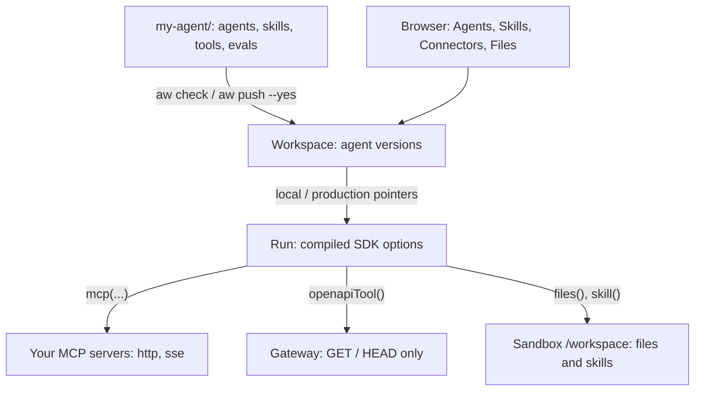

<Info>

- **Read this when:** you want to see, in one place, how an agent, its skills, tools, documents, surfaces and evals are written as files, and how the same agent looks in the browser.
- **You will learn:** the project layout and what the loader allows, every `defineAgent()` field, how skills, MCP connectors, tools and files reach an agent, and what is not possible yet.
- **Used in:** [Chapter 2 · Build your agent](/path/build) (most of this page), [Chapter 3 · Test and improve it](/path/test) (evals) and [Chapter 5 · Ship it to your servers](/path/ship) (push and promote).

</Info>

An agent is a folder of plain files you review and version like the rest of your code.

**In plain words.** You describe an agent in a few small files: what it should do, which documents
it may read, which company systems it may call, and how much it may spend. The `aw` command-line
tool sends those files to Agent Workspace, which keeps each change as a numbered version. People
who never open a terminal see the same agent in the browser.

**What you can do**

- [Lay out an agent project](#lay-out-an-agent-project)
- [Know what the loader runs](#know-what-the-loader-runs)
- [Define an agent in one file](#define-an-agent-in-one-file)
- [Work on the same agent in code and in the browser](#work-on-the-same-agent-in-code-and-in-the-browser)
- [Bring Claude skills as they are](#bring-claude-skills-as-they-are)
- [Connect internal systems over MCP](#connect-internal-systems-over-mcp)
- [Give an agent a tool from an API or from your code](#give-an-agent-a-tool-from-an-api-or-from-your-code)
- [Give an agent your documents](#give-an-agent-your-documents)
- [Ship a first agent from the browser](#ship-a-first-agent-from-the-browser)
- [Start from one of ten tutorials](#start-from-one-of-ten-tutorials), then
  [make it yours](#from-tutorial-to-your-own-agent)

**Where this fits in the path.**

- [Chapter 1 · Run your first agent](/path/first-agent): the [Quickstart](/getting-started/quickstart) writes this folder for you.
- [Chapter 2 · Build your agent](/path/build): the layout and `aw check` in [Agents as code](/guides/agents-as-code), the definition in [Design an agent](/building/agents), the model in [Models and runtimes](/building/models-and-runtimes), then [Skills](/building/skills), [Tools from code](/guides/tools-from-code), [MCP servers](/building/mcp-servers) and [Secrets](/resources/secrets).
- [Chapter 3 · Test and improve it](/path/test): `evals/<agent>.yaml` in [Evaluations](/guides/evaluations).
- [Chapter 4 · Put it in your product](/path/embed): `surfaces/<name>.ts` in [Frontend](/building/frontend).
- [Chapter 5 · Ship it to your servers](/path/ship): `aw push` and `aw promote` in [Deploy](/guides/deploy) and [Moving agents](/building/moving-agents).
- [Chapter 6 · Run it for your team](/path/operate): who may edit an agent, in [Team](/resources/team) and [Shares](/resources/shares).

<Frame caption="The Skills screen: the same skills you keep as files in the project, shown in the console.">
  
</Frame>

## Lay out an agent project

One folder holds everything an agent is. The CLI reads the folder and the server stores what it
finds.

```text
my-agent/
├── agent-workspace.yaml      environments, connectors, policy
├── agents/
│   ├── assistant.ts          defineAgent()
│   └── assistant.md          its instructions
├── surfaces/
│   └── main.ts               defineSurface()
├── skills/
│   └── release-notes/
│       └── SKILL.md          a skill
├── evals/
│   └── assistant.yaml        cases for "assistant"
└── tools/
    ├── orders.ts             openapiTool()
    ├── get-order.ts          defineTool() schema
    └── get-order.run.ts      defineTool() code
```

| Path                     | What it is                                                                                                         | Who reads it                                          |
| ------------------------ | ------------------------------------------------------------------------------------------------------------------ | ----------------------------------------------------- |
| `agent-workspace.yaml`   | The project file: environments, model connections, connectors, and a `policy` that caps every agent in the project | `aw dev`, `aw check`, `aw push`, `aw promote`         |
| `agents/<name>.ts`       | One agent per file, the default export of `defineAgent()`                                                          | The loader, then the server as a version              |
| `agents/<name>.md`       | The agent's instructions, read beside the `.ts` file                                                               | The loader                                            |
| `surfaces/<name>.ts`     | A chat surface (page, try page and widget) for one agent, from `defineSurface()`                                   | Saved as part of its agent's version                  |
| `skills/<name>/SKILL.md` | A Claude skill folder, plus any supporting files                                                                   | `aw dev` and `aw push --yes` sync it to the workspace |
| `evals/<agent>.yaml`     | Test cases for one agent, named after it                                                                           | `aw eval`                                             |
| `tools/*.ts`             | Tools declared in code: `openapiTool()` or `defineTool()`                                                          | `aw check`, and `aw dev` registers them               |

`aw init --yes` (or `npm create`) writes the starting layout: one agent, one surface, and for every
theme except `blank`, an eval file. Every `*.ts` file directly in `agents/` and `surfaces/` is
loaded, in file-name order; subdirectories and `*.d.ts` files are not.

## Know what the loader runs

Definition files are TypeScript, but there is no compiler and no build step.

| Rule                      | What it means for you                                                                                                                                                                                                                                                   |
| ------------------------- | ----------------------------------------------------------------------------------------------------------------------------------------------------------------------------------------------------------------------------------------------------------------------- |
| Node's own type stripping | You need **Node 24 or later**. Types, interfaces, `as`, `satisfies` and `import type` are erased. `enum`, `namespace` with values and parameter properties are refused: use a union of string literals or an `as const` object.                                         |
| Two kinds of import       | A definition may import only `@indx-workspace/sdk/define` and project-relative `.ts` files. `node:*`, other npm packages, `.js`, `.json` and `import()` are refused as `import_refused`. `import type` from anywhere is fine.                                           |
| Not sandboxed             | The files run **as you**, on your machine, like any script in the repo. The loader withholds only the key variables (`AGENT_WORKSPACE_API_KEY`, `ANTHROPIC_API_KEY`, every `apiKeyRef`, every `secret()` name). Run `aw check` only on files you would run with `node`. |
| Skill frontmatter         | A `skills/<name>/SKILL.md` starts with `---` YAML frontmatter: `name` is the folder's name (1–64 lower-case letters, digits and hyphens, no hyphen at either end) and `description` is not empty. `aw check` names the line of a refusal.                               |
| Eval file name            | Each eval file is named after its agent: `evals/<agent>.yaml`. `aw eval` with no arguments runs every agent that has one.                                                                                                                                               |
| Time limit                | Each load runs in a separate process, stopped after 30 seconds (`loader_timeout`).                                                                                                                                                                                      |

<Tip>
  Run `aw check` after every edit. It loads the files, asks the server to dry-run each agent, and
  prints one line per agent or per problem, such as `agents/assistant.ts: ok (would be version 4)`.
  It saves nothing and exits `1` on any problem, so it fits in CI.
</Tip>

The full list of local error codes is in
[Agents as code](/guides/agents-as-code#check-your-files-before-you-save).

## Define an agent in one file

`defineAgent()` takes the whole agent: instructions, model, engine, permissions, tools, skills,
files and limits. This is the manual-search agent from [Tutorial 1](/tutorials/manual-search):

```ts title="agents/manual-search.ts" claim="compile"
import { defineAgent, files, mcp, skill } from '@indx-workspace/sdk/define';

export default defineAgent({
  name: 'manual-search',
  instructions: { file: './manual-search.md' },
  model: 'default',
  engine: 'claude-agent-sdk',
  permissions: { readFiles: true }, // read-only by construction
  tools: [mcp('manual-index')],
  skills: [skill('cite-answer')],
  files: [files('manuals', 'read')],
  limits: { maxTurns: 12, maxBudgetUsd: 0.5 },
});
```

| Field          | What it means                                                                                                                                                                                                                       | Left out                                        |
| -------------- | ----------------------------------------------------------------------------------------------------------------------------------------------------------------------------------------------------------------------------------- | ----------------------------------------------- |
| `name`         | The agent's name in the workspace, 1–200 characters. A new name creates the agent; an existing one gets a new version.                                                                                                              | Required                                        |
| `instructions` | The system prompt, inline, or `{ file: './<name>.md' }` read beside the `.ts` file. The file must stay inside the project (`instructions_unreadable`).                                                                              | Required                                        |
| `model`        | `'default'`: the workspace's model connection named `default`, else the deployment's default (`claude-sonnet-4-5` for Anthropic under `aw dev`). Another string names a model connection; `{ connection, id }` picks a model on it. | `'default'`                                     |
| `engine`       | Which engine runs the agent loop: `claude-agent-sdk`, `openai-agents`, `pi` or `mastra`.                                                                                                                                            | `claude-agent-sdk`                              |
| `permissions`  | Four switches: `readFiles`, `writeFiles`, `runCommands`, `unrestrictedNetwork`.                                                                                                                                                     | Every switch off                                |
| `tools`        | `mcp('<connector>')`, `openapiTool()`, `defineTool()` (and `postgresTool()`, whose gateway gate is still closed)                                                                                                                    | No tools                                        |
| `skills`       | `skill('<name>')`: a `skills/` folder or a skill the workspace already has                                                                                                                                                          | No skills                                       |
| `files`        | `files('<path>', 'read' \| 'read-write')`: workspace files the agent may use                                                                                                                                                        | No files                                        |
| `limits`       | `maxTurns` and `maxBudgetUsd` per run                                                                                                                                                                                               | The engine's own default; no per-run budget cap |

A bare string in `model` is a connection's name, not a model id: `model: 'claude-haiku-4-5'` is refused
as a missing `model-connection`. Write `model: { connection: 'default', id: 'claude-haiku-4-5' }`
instead. `aw check` refuses an `id` the connection's `aw models discover` list does not offer, as
`model_not_found`.

There is no `description` field, and every key not in this table is refused. A switch that is off
removes its tools from the model, not just a prompt line:

| Switch off            | Claude Agent SDK tools removed    |
| --------------------- | --------------------------------- |
| `readFiles`           | `Read`, `Glob`, `Grep`            |
| `writeFiles`          | `Write`, `Edit`, `NotebookEdit`   |
| `runCommands`         | `Bash`, `BashOutput`, `KillShell` |
| `unrestrictedNetwork` | `WebFetch`, `WebSearch`           |

The `policy` in `agent-workspace.yaml` is a ceiling over every agent in the project: a permission is
on only when the agent asks for it and the policy does not set it `false`, and each limit is the
smaller of the two.

<Accordion title="The project file from the same tutorial">

```yaml title="agent-workspace.yaml (excerpt) (illustrative)" claim="illustrative"
connectors:
  manual-index:
    url: http://127.0.0.1:8787/mcp
    transport: http
policy:
  permissions: { writeFiles: false, runCommands: false, unrestrictedNetwork: false }
  limits: { maxBudgetUsd: 1 }
  promotion: { minEvalScore: 0.9 }
```

`promotion.minEvalScore` is the share of eval cases (0 to 1) a version must pass before `production`
takes it. Saving the file while `aw dev` runs applies `models` and `connectors` at once; a change to
`policy` needs a restart of `aw dev`.

</Accordion>

## Work on the same agent in code and in the browser

There is one definition. `aw push --yes` saves the files as a new version and points the `local`
environment at it; `aw promote --yes` points `production` at it. Admins and builders open the same
agent in the browser and can change it there.

<Steps>
  <Step title="Check">

    `aw check` dry-runs every agent and saves nothing.

  </Step>
  <Step title="Save a version">

    `aw push` shows the plan; `aw push --yes` saves. Pushing unchanged files saves no version.

  </Step>
  <Step title="Promote, or roll back">

    `aw promote --yes` moves `production` (gated by `minEvalScore` when set). `aw rollback --yes`
    moves it back in one request. `aw versions` shows both pointers and the last ten moves.

  </Step>
</Steps>

What the browser shows today, against what the marketing page draws:

| On the marketing page          | In the product today                                                                                                    |
| ------------------------------ | ----------------------------------------------------------------------------------------------------------------------- |
| Overview tab                   | **Configuration** tab: name, instructions, model, engine                                                                |
| Permissions tab                | **Configuration** tab: the four permission checkboxes                                                                   |
| Files, Skills, Connectors tabs | **Configuration** tab: one resources section that assigns files (with read or read/write access), skills and connectors |
| Versions tab                   | **Versions** tab: the agent's versions and its environment pointers                                                     |

<Warning>
  **Creating an agent does not save a version yet.** An edit in the browser saves a version with
  `via: "ui"`, but creating an agent in the browser or with `POST /api/agents`, and setup
  reconciliation, save none (V-2, #648). `aw push --yes` after a browser edit saves your files as
  the next version on top, and the browser edit stays in `aw versions`. Pick one place to edit each agent.
</Warning>

## Bring Claude skills as they are

A skill stays a `SKILL.md` folder: Claude's own format. Agent Workspace stores the folder and
exports it byte for byte; it does not invent a skill format of its own.

```markdown title="skills/release-notes/SKILL.md (illustrative)" claim="illustrative"
---
name: release-notes
description: Draft release notes from merged pull requests.
allowed-tools: Read, Grep
---

Read the merged PRs since the last tag and draft release notes as three bullets.
```

Write `allowed-tools` on one line. The frontmatter reader is deliberately narrow and is not a YAML
parser: a list form is stored, but the field reads back as `null`.

| Action            | From the CLI                                                               | In the browser                                   |
| ----------------- | -------------------------------------------------------------------------- | ------------------------------------------------ |
| Create            | Add `skills/<name>/SKILL.md`; `aw dev` or `aw push --yes` syncs it         | **Skills → Create skill** (name and description) |
| Import a folder   | `aw skills import ./cite-answer` (the name defaults to the folder's)       | Not in the browser today                         |
| Edit              | Edit the folder; or `aw skills update`                                     | The skill's own page edits `SKILL.md`            |
| Enable or disable | `aw skills enable` / `aw skills disable`                                   | The skill's own page                             |
| Export            | `aw skills export cite-answer ./out`                                       | Not in the browser today                         |
| Assign            | `skill('cite-answer')` in `defineAgent`                                    | The agent's resources section                    |
| Delete            | `aw skills remove <name>` (refused with `409 skill_in_use` while assigned) | —                                                |

At run time the runner writes every assigned, enabled skill under `<CLAUDE_CONFIG_DIR>/skills/<name>/`
in that run's sandbox, the runner's equivalent of `.claude/skills/<name>/`, read-only. A disabled
skill is silently left out. An edit reaches every agent that uses a skill without pinning a
revision on its next run; `aw skills publish` freezes a numbered revision an agent can pin
([Revisions](/building/skills#revisions)). Deleting a folder never deletes the
workspace skill; `aw check` lists it as "only in the workspace".

## Connect internal systems over MCP

A connector is a saved way to reach one MCP server you host. Add it in the browser
(**Connectors → Add connector**), with the SDK, or in `agent-workspace.yaml`. Then name it in an
agent with `mcp('<name>')`.

<Steps>
  <Step title="Fill in the form">

    Name, transport, URL, and authentication.

  </Step>
  <Step title="Test connection">

    Probes the server with the credential and stores nothing (`testDraft` in the SDK).

  </Step>
  <Step title="Save, then assign">

    The credential is sealed as a secret and never shown again. Assign the connector to an agent.

  </Step>
</Steps>

| Option                      | What it means                                                | Status today                                                                                                           |
| --------------------------- | ------------------------------------------------------------ | ---------------------------------------------------------------------------------------------------------------------- |
| HTTP (streamable)           | Connects to the server's `url` over streamable HTTP          | Works                                                                                                                  |
| SSE                         | The older Server-Sent Events transport                       | Works                                                                                                                  |
| Local command (stdio)       | Launch a command as the MCP server                           | **Stored, cannot run.** Tests answer `stdio-probe-unavailable`. A project file names only `http` and `sse` connectors. |
| No authentication           | No credential                                                | Works                                                                                                                  |
| Bearer token                | Sent as a bearer token                                       | Works                                                                                                                  |
| API key                     | An API-key credential                                        | Works                                                                                                                  |
| OAuth token                 | A token you already hold; the form has no OAuth sign-in flow | Works                                                                                                                  |
| Raw MCP JSON under Advanced | Paste a raw MCP configuration                                | **Not in the product.** The form has no Advanced section.                                                              |

The agent never holds the credential: it goes to the secrets layer and is folded into the run's MCP
configuration by the platform. Each assigned connector is auto-approved as
`mcp__<server>__*`, where `<server>` is the connector's record key: its name when that is a
lowercase slug, otherwise `connector-<id>`. A remote connector's traffic follows the runtime profile's network policy.

## Give an agent a tool from an API or from your code

Two ways to give an agent a tool without running an MCP server of your own:

|                | `openapiTool()`                                                                                    | `defineTool()`                                                               |
| -------------- | -------------------------------------------------------------------------------------------------- | ---------------------------------------------------------------------------- |
| What it is     | An OpenAPI 3.0 or 3.1 document becomes tools, one per allowed operation                            | Your own TypeScript function, with a Zod input schema                        |
| Who runs it    | The gateway, which holds the credential (on the `local` driver this is advisory: see below)        | A tool host `aw dev` starts on your machine                                  |
| What it may do | Reads only: `GET` and `HEAD`. `openapiTool()` refuses a write rule for now; the gateway already runs a write only after approval. | Anything your code does                                                      |
| Deployable     | **Yes.** Once the tool is registered in the workspace, a version that uses it can be promoted.     | **Only where the operator enables the tool sandbox.** Elsewhere `aw promote` refuses with `422 code_tool_needs_host`. |

<Accordion title="An openapiTool() in code">

```ts title="tools/orders.ts" claim="compile"
import { openapiTool, secret } from '@indx-workspace/sdk/define';

export default openapiTool({
  name: 'orders',
  spec: 'apis/orders.openapi.json',
  auth: secret('ORDERS_TOKEN'),
  allow: ['GET /**'],
});
```

</Accordion>

Import it into the agent and add it to `tools`. `secret('ORDERS_TOKEN')` names a credential;
`aw dev` reads its value from its own environment, so it is never in a file you commit. `allow`
takes `GET <glob>`, `HEAD <glob>` or `operationId:<id>`, where `*` matches one path segment and a
final `**` the rest. `aw dev` and `aw push --yes` register the tool before they save a version.

On the default `local` driver there is no sandbox, so an agent allowed to run commands could reach
the stored credential. "The agent never sees the token" holds only on the `docker` driver
(`sandbox-runtime` is a reserved driver id with no implementation). See
[Tools from code](/guides/tools-from-code).

<Accordion title="The same idea in code: defineTool()">

```ts title="tools/get-order.ts" claim="compile"
import { defineTool, z } from '@indx-workspace/sdk/define';

export default defineTool({
  name: 'get_order',
  description: 'Look up an order by its id',
  input: z.object({ id: z.string().describe('Order id, like A-1042') }),
  run: './tools/get-order.run.ts',
});
```

The run file is ordinary Node and may import any npm package. It is typed with
`ToolRun<typeof getOrder>` (imported with `import type`, so the loader never reads it) and receives
the arguments plus `{ signal, runId, agent }`. `run` is relative to the project root. Each call times
out after 30 seconds unless `limits.timeoutMs` (up to 600000) says otherwise.

```ts title="tools/get-order.run.ts (illustrative)" claim="illustrative"
import type { ToolRun } from '@indx-workspace/sdk/define';
import type getOrder from './get-order.ts';

const run: ToolRun<typeof getOrder> = async ({ id }, { signal }) => {
  const res = await fetch(`${process.env.ORDERS_URL}/orders/${id}`, { signal });
  return res.ok ? res.json() : { error: `order ${id} not found` };
};
export default run;
```

For a deployment, use `openapiTool()` or an MCP server you host.

</Accordion>

## Give an agent your documents

Upload files into folders in the workspace file store, then assign them to an agent, read-only or
read-write. The agent reads them with the SDK's own file tools.

| Access     | In code                                  | What the agent can do                                                                    |
| ---------- | ---------------------------------------- | ---------------------------------------------------------------------------------------- |
| Read       | `files('manuals', 'read')` (the default) | Read, glob and grep the files. Materialised read-only in the sandbox. Needs `readFiles`. |
| Read-write | `files('drafts', 'read-write')`          | Also write. Needs `writeFiles` too: a read-write grant without it is ineffective.        |

**Not RAG, not embeddings.** There is no vector index and no retrieval step. Files are stored as
bytes and read by the agent's file tools. Search over thousands of pages is your own MCP server, as
in [Tutorial 1](/tutorials/manual-search).

In the browser, **Files** lets you browse folders, create a folder, and upload one file at a time.
With the SDK, `aw.files.upload`, `list`, `download`, `move` and `remove` do the same.

<Note>
  The [CAD drawing tutorial](/tutorials/cad-drafting) notes that a file the agent writes inside a
  run does not come back to the workspace file store today; its backend writes the output itself.
</Note>

## Ship a first agent from the browser

No code is needed for a first agent: no `.claude` directory, no MCP JSON, no Dockerfile. The browser
path has five steps.

| Step                    | Screen                                                  | What you choose                                                                                                          | Status today                                                                                                                                                                             |
| ----------------------- | ------------------------------------------------------- | ------------------------------------------------------------------------------------------------------------------------ | ---------------------------------------------------------------------------------------------------------------------------------------------------------------------------------------- |
| 01 Connect a model      | **Administration → Models → Add Provider**              | Anthropic, Anthropic-compatible endpoint, Microsoft Azure OpenAI, OpenAI, or an OpenAI-compatible endpoint, with its key | Works. The key is write-only. Non-Anthropic adapters are fixture-verified, not proven against the provider. The add form has **Save**; the connection is tested when you rotate its key. |
| 02 Add files and skills | **Files**, **Skills**                                   | Upload files; create or edit skills                                                                                      | Works. Importing a skill folder is CLI or SDK only.                                                                                                                                      |
| 03 Add connectors       | **Connectors → Add connector**                          | HTTP or SSE, authentication, **Test connection**                                                                         | Works. stdio is stored but cannot run.                                                                                                                                                   |
| 04 Set permissions      | **Agents → New**, step 4                                | Read files, write files, run commands, unrestricted network                                                              | Works. High-risk switches start off. `maxTurns` and `maxBudgetUsd` are set in code or with the SDK, not on this screen.                                                                  |
| 05 Choose a runtime     | **Agents → New**, step 5; **Administration → Runtimes** | A runtime profile; **Test Runtime** on the runtimes screen                                                               | `local` (no isolation) and `docker` are implemented; `kubernetes` is partially verified; the two managed-cloud drivers are implemented but not live-verified.                            |

<Accordion title="What the five screens become">

Everything you choose compiles into ordinary Claude Agent SDK options for each run: the hydrated
`/workspace` as `cwd`, the model, the connectors as `mcpServers` with
`strictMcpConfig: true`, the assigned skills, the tools a switched-off permission removes as
`disallowedTools`, `maxTurns` and `maxBudgetUsd`, `settingSources: ['project']` so the sandbox
image's own user and local `.claude` settings are not read, and a short-lived gateway token for the
run instead of a provider key. See
[Design an agent](/building/agents).

</Accordion>

## Start from one of ten tutorials

Ten tutorials build an agent Japanese enterprises ask for, end to end, with every file: the agent,
its skill, the project policy, the surface, the backend call and the evals. Each one is also a
benchmark. Its score is the share of the capabilities the use case needs that the SDK provides
today (provided = 1, works with code you write = 0.5, not provided = 0).

| #   | Tutorial                                                                                 | Score / 100 |
| --- | ---------------------------------------------------------------------------------------- | ----------- |
| 1   | [Manual search](/tutorials/manual-search)                                                | 69          |
| 2   | [CAD drawing](/tutorials/cad-drafting)                                                   | 45          |
| 3   | [Quotation](/tutorials/quotation)                                                        | 55          |
| 4   | [Ringi review](/tutorials/ringi-review)                                                  | 50          |
| 5   | [Customer inquiry](/tutorials/customer-inquiry)                                          | 56          |
| 6   | [Excel consolidation](/tutorials/excel-consolidation)                                    | 50          |
| 7   | [Contract review](/tutorials/contract-review)                                            | 50          |
| 8   | [Meeting minutes](/tutorials/meeting-minutes)                                            | 45          |
| 9   | [Skill-transfer and maintenance troubleshooting](/tutorials/maintenance-troubleshooting) | 50          |
| 10  | [Quality defect and past-trouble analysis](/tutorials/quality-defect)                    | 61          |

The sixteen example configurations by team are these ten tutorials plus the six shapes on
[Use cases](/concepts/use-cases): a copilot inside your product, a team workspace with roles,
automation from a backend, a review agent with commands contained, an internal support agent, and
the model and cloud you already approved. They are example configurations, not customer stories.
Every tutorial uses `model: 'default'` and the `claude-agent-sdk` engine and names no runtime
profile. The workspace therefore needs a default model and a default runtime profile, or the run is
refused.

## From tutorial to your own agent

<Steps>
  <Step title="Pick the closest tutorial">

    Read its "Where the SDK stands" section: what works today and what you would write yourself.

  </Step>
  <Step title="Run it locally">

    `aw dev` runs the project on one Node process with an embedded PostgreSQL, no Docker, and syncs
    `agents/`, `surfaces/`, `tools/` and `skills/` on every save. Node 24 or newer.

  </Step>
  <Step title="Write the skill and assign the files">

    A `SKILL.md` under `skills/<name>/` (or `aw skills import ./<folder>`); documents assigned with
    `files(path, 'read')` or `'read-write'`.

  </Step>
  <Step title="Write down what good means">

    Cases in `evals/<agent>.yaml`, run with `aw eval`, which exits `1` on any failure. A thumbs-down
    becomes a case with `aw eval add-case <run-id> --yes`.

  </Step>
  <Step title="Save a version and promote it">

    `aw push --yes` moves `local`; `aw promote --yes` moves `production`, gated by `minEvalScore`.
    `aw rollback --yes` moves it back.

  </Step>
</Steps>

## How it fits together



## Limits today

- **No typed data back from a run.** The benchmark's "Struct" column is "not provided yet" for all
  ten tutorials: a backend gets text and parses it.
- **stdio connectors are stored but cannot run.** Use `http` or `sse`; every connector in the
  tutorials is an MCP server you host.
- **A deployment runs code tools only when the operator enables the tool sandbox.** Otherwise a
  version with a `defineTool()` tool cannot be promoted (`422 code_tool_needs_host`). Deploy with
  `openapiTool()` or an MCP server there. With the sandbox on, `aw push --yes` uploads the tool bundles and a run calls the
  tool in its own session's sandbox. The sandbox is off by default
  (`AGENT_WORKSPACE_TOOL_HOST_IMAGE`) and shares one network across sessions until #841.
- **`openapiTool()` only reads.** `GET` and `HEAD`; writes go through your backend.
- **No webhooks.** Your backend polls or streams, and a retried start is safe only with an
  `idempotencyKey` ([N-3](/concepts/roadmap#n-3-webhooks-for-run-outcomes),
  [S-6](/concepts/roadmap#s-6-idempotency-keys)).
- **No retrieval.** There is no vector index or RAG pipeline, and none is on the roadmap; search is
  your own MCP server.
- **Creating an agent saves no version** (V-2), and the browser has no skill import or export.
- **Tools defined in code are not versioned:** editing one changes every version that uses it. A
  skill can be pinned to a published revision ([Revisions](/building/skills#revisions)).
- **Public runnable agent shares are off** (`400 invalid_share`). For public visitors, publish a
  surface with `allowedOrigins`.
- **Other model providers and managed-cloud sandboxes are not live-proven.**

## Go deeper

<CardGroup cols={2}>
  <Card title="Agents as code" icon="code" href="/guides/agents-as-code">
    Every `aw check` line, `aw push` action, and the promotion gate.
  </Card>
  <Card title="Tools from code" icon="wrench" href="/guides/tools-from-code">
    `openapiTool()`, `defineTool()`, `secret()` and the tool host.
  </Card>
  <Card title="Design an agent" icon="robot" href="/building/agents">
    Permissions, assignments, and what the platform enforces.
  </Card>
  <Card title="Author a skill" icon="book-open" href="/building/skills">
    The SKILL.md folder, import, update and runtime placement.
  </Card>
  <Card title="Connect an MCP server" icon="plug" href="/building/mcp-servers">
    Transports, credentials, and how a connector reaches the model.
  </Card>
  <Card title="defineAgent and friends" icon="brackets-curly" href="/reference/sdk/define">
    The full `@indx-workspace/sdk/define` reference.
  </Card>
  <Card title="Agents" icon="user-gear" href="/resources/agents">
    `aw.agents`: versions, pointers and resource assignments.
  </Card>
  <Card title="Skills" icon="layer-group" href="/resources/skills">
    `aw.skills`: every method and error code.
  </Card>
  <Card title="Connectors" icon="network-wired" href="/resources/connectors">
    `aw.connectors`: every field and refusal.
  </Card>
  <Card title="Files" icon="folder-open" href="/resources/files">
    `aw.files`: upload, list, move and delete.
  </Card>
  <Card title="Agent contracts" icon="file-code" href="/reference/contracts/agents">
    The agent schemas behind the definition.
  </Card>
  <Card title="Skill contracts" icon="file-code" href="/reference/contracts/skills">
    The skill schemas and name pattern.
  </Card>
  <Card
    title="Tool connector contracts"
    icon="file-code"
    href="/reference/contracts/tool-connectors"
  >
    Request bodies and limits for tools defined in code.
  </Card>
  <Card title="Connector contracts" icon="file-code" href="/reference/contracts/connectors">
    Transports and authentication types.
  </Card>
  <Card title="Use cases" icon="briefcase" href="/concepts/use-cases">
    Six shapes of deployment, each with its configuration.
  </Card>
  <Card title="Tutorial gallery" icon="table-list" href="/tutorials">
    The ten tutorials and the full benchmark.
  </Card>
</CardGroup>
