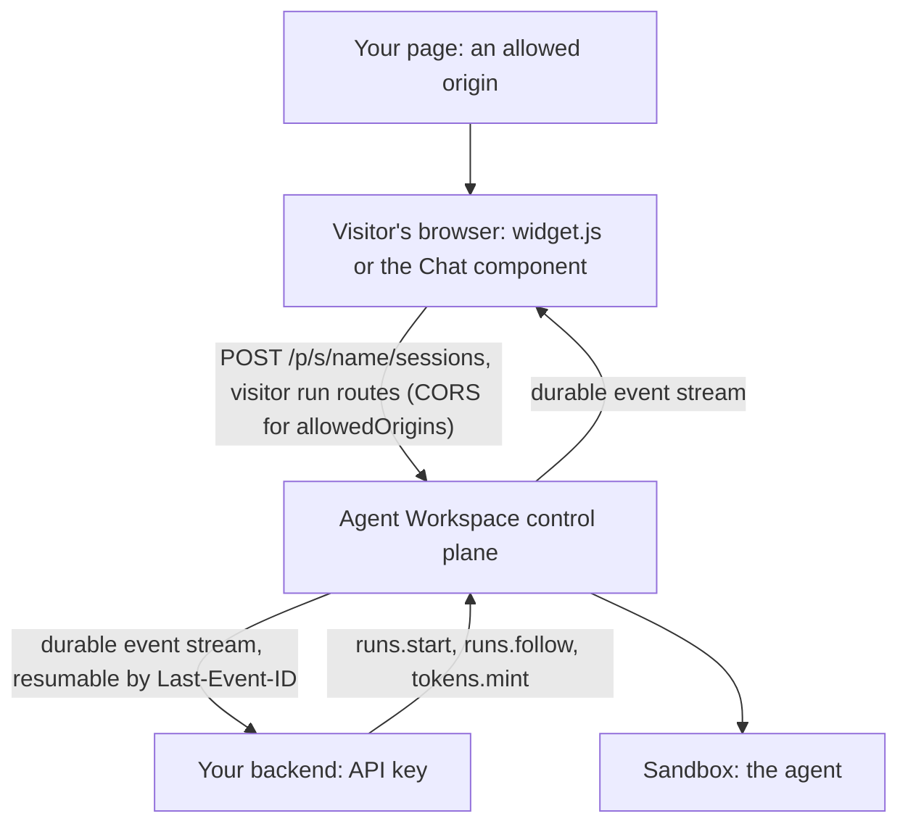

<Info>

- **Read this when:** you are choosing how users will reach the agent from your product: your backend, a one-tag widget, a React chat, or a shared snapshot.
- **You will learn:** how to start and stream a run from a backend and resume it after a drop, why the API key stays on the server and what a browser gets instead, and how a surface, its origins and its visitor limits work.
- **Used in:** [Chapter 4 · Put it in your product](/path/embed) (all of it), with sharing in [Chapter 6 · Run it for your team](/path/operate).

</Info>

One agent, three ways out: a backend call that streams every step, a one-tag widget, and a React
component, each limited to the origins you allow.

**In plain words.** Your server asks Agent Workspace to run an agent and watches what it does,
step by step. For a chat on your website, you describe the chat once in a small file, and Agent
Workspace serves it as a widget you paste with one tag, or as a React component. Only the sites
you list may show it, and the secret key never leaves your server.

What you can do:

- [Start a run from your backend and stream what the agent does](#start-a-run-from-your-backend-and-stream-it)
- [Pick up a stream again after a disconnect](#resume-a-stream-after-a-disconnect)
- [Keep the API key on the server, and give a browser a short-lived token](#keep-the-key-on-the-server)
- [Describe the chat once as a surface](#describe-the-chat-as-a-surface)
- [Put it on any page with one tag](#put-it-on-a-page-with-one-tag)
- [Render it in React, or draw it yourself](#render-it-in-react)
- [Allow the sites that may embed it](#allow-the-sites-that-may-embed-it)
- [Share a snapshot of an agent, session, project or skill](#share-a-snapshot)

**Where this fits in the path.**

- [Chapter 2 · Build your agent](/path/build): the surface file sits beside the agent, as in [Agents as code](/guides/agents-as-code).
- [Chapter 4 · Put it in your product](/path/embed): choose a path in [Building overview](/building/overview), set up keys in [Authentication](/getting-started/authentication), then [Frontend](/building/frontend), [Embedding](/building/embedding), [React](/building/react), [Backend](/building/backend), [HTTP API](/building/http-api) and [Streaming](/guides/streaming).
- [Chapter 5 · Ship it to your servers](/path/ship): `allowedOrigins` take effect for visitors after promotion, in [Deploy](/guides/deploy).
- [Chapter 6 · Run it for your team](/path/operate): sharing policy and snapshots in [Shares](/resources/shares).

<Frame caption="The one-tag chat widget on a plain HTML page.">
  
</Frame>

## Start a run from your backend and stream it

**What it is.** Three calls on your server. `createClient` connects to your workspace with an API
key. `aw.runs.start` queues a run. `aw.runs.follow` streams the run's events and reconnects on its
own if the connection drops (up to 5 times by default, 3 seconds apart). `toAgentEvent` turns each frame into a neutral event, so your code
reads `agent.message` or `agent.tool.call`, never one engine's private format.

**Why it matters.** You see the answer as it is written, and every tool the agent calls on the way.
The same loop works for every agent: only `agentId` changes.

```ts title="stream.ts (illustrative)" claim="illustrative"
const aw = createClient({ baseUrl, auth: { kind: 'api-key', apiKey } });
const { run } = await aw.runs.start(agentId, { prompt: 'Summarise the open incidents.' });

for await (const frame of aw.runs.follow(run.id)) {
  const event = toAgentEvent(frame); // null for platform frames: run.status, done, …
  if (event?.frame === 'agent.message' && event.role === 'assistant') {
    for (const block of event.blocks) if (block.type === 'text') console.log(block.text);
  }
}
```

`createClient` comes from `@indx-workspace/sdk`; `toAgentEvent` from `@indx-workspace/sdk/events`.
The assistant's turn can arrive more than once as it grows, with the same `messageId`: replace by
id, never append.

**Only need the result?** Skip the stream. `aw.runs.waitForOutcome(run.id)` follows the stream to
its end, then returns the settled run: `status`, `usage.totalTokens` and `cost.amount` (a decimal
string). The settled run carries no answer text; read that from the `agent.message` events.

The stream is server-sent events at `GET /api/runs/:id/events`. The SDK gives you three ways in:

| Entry point                        | What it does                                                                                                                                | Use it when                                                              |
| ---------------------------------- | ------------------------------------------------------------------------------------------------------------------------------------------- | ------------------------------------------------------------------------ |
| `aw.runs.events(runId, { after })` | One connection, frames until `done`. A drop throws a `TransportError`; you keep the last event id yourself and pass it as `after` next time | You relay the stream to a browser, and the browser does the reconnecting |
| `aw.runs.follow(runId)`            | `events`, reconnecting with `Last-Event-ID` until `done` (`maxReconnects`, default 5)                                                       | Your backend reads the stream itself                                     |
| `aw.runs.waitForOutcome(runId)`    | Follows to the end, then returns the settled run                                                                                            | You only need status, tokens and cost                                    |

<Accordion title="Every event a UI meets">

| Frame                                                                     | Meaning                                                                                                           |
| ------------------------------------------------------------------------- | ----------------------------------------------------------------------------------------------------------------- |
| `run.status`                                                              | The run moved to `queued`, `running`, `completed`, `failed` or `cancelled`; `error` carries the safe failure text |
| `agent.message`                                                           | A turn's `text` and `reasoning` blocks, keyed by `messageId`                                                      |
| `agent.tool.call` / `agent.tool.result`                                   | A tool call and its answer, paired by `toolCallId`                                                                |
| `agent.usage` / `agent.result`                                            | The engine's own token counters and terminal accounting (billing is the settled run's `cost`)                     |
| `agent.session`, `agent.message.delta`, `agent.native`, `agent.malformed` | Session opened, partial text, anything with no neutral meaning, anything the adapter could not parse              |
| `stream-reset`                                                            | What follows does not continue what you have: clear and keep reading                                              |
| `run-failed`                                                              | This connection could not deliver a successful run                                                                |
| `done`                                                                    | The stream is over. It says nothing about success: read the last `run.status`                                     |

The full vocabulary is on [Streaming](/guides/streaming) and [Events](/reference/sdk/events).

</Accordion>

## Resume a stream after a disconnect

**What it is.** Every run is a durable event stream. The control plane stores each event with a
monotonic `id`. A client that reconnects sends the last id it saw as `Last-Event-ID` and gets only
what came after it, not a replay.

**Why it matters.** A network blip, a redeploy or a page reload does not lose the run or its
transcript. The run keeps going on the server while nobody watches.

- **On your backend:** `aw.runs.follow` does it for you.
- **In a browser behind your relay:** relay `aw.runs.events(runId, { after: lastEventId })` as
  SSE and pass the browser's `Last-Event-ID` header as `after`. A reload resumes. [Embed an agent in
  your product](/building/embedding#stream-an-agent-run-into-your-own-ui) has the relay in full.
- **If the cursor cannot be resumed,** a `stream-reset` frame arrives: drop what you rendered and
  continue.

The citation check on the landing page (`backend/ask.ts`) is built on this. Its `runAndRead`
starts the run, follows it with `aw.runs.follow`, and rebuilds the answer and the tool calls from
the neutral events. The backend then keeps only citations that a `read_section` call really
returned in that run. `runAndRead` is not an SDK export: it is a small helper the gallery examples
share (`tests/gallery/shared/run-answer.ts` in the repository), and you write your own or copy it.
[Manual search agent](/tutorials/manual-search) walks through the example step by step.

<Note>
  `follow` waits a fixed delay between reconnects and ignores the stream's `retry:` field today.
  Backoff is tracked as [K-3](/concepts/roadmap#k-3-backoff-and-retry-hints-in-follow). Build on the
  reconnect, not on the delay.
</Note>

## Keep the key on the server

**What it is.** A workspace API key is long-lived and carries one fixed role. It belongs on a
server. A browser never gets one. A browser gets one of two things instead:

| A browser uses                      | What it can do                                                             | How you get it                                                                     |
| ----------------------------------- | -------------------------------------------------------------------------- | ---------------------------------------------------------------------------------- |
| A **surface**                       | Open a visitor session and chat with one agent, from the origins you allow | `defineSurface`, below. No credential to handle                                    |
| A **browser token**, run-scoped     | Read that one run and follow its events                                    | `aw tokens mint --scope run --id <runId>` or `aw.tokens.mint({ kind: 'run', id })` |
| A **browser token**, session-scoped | Start runs in that one session and follow them                             | `aw tokens mint --scope session --id <sessionId>`                                  |

A browser token lives 60 to 3600 seconds (`--ttl`, default 300). Only its hash is stored, and the
mint response is the only time it is shown. It stops working when it expires, when its run reaches
`completed`, `failed` or `cancelled`, when its session is archived, or when you revoke the key that
minted it. So mint it while the run is still live. A browser token cannot mint another
one (`403 token_out_of_scope`).

<Steps>
  <Step title="Your backend mints the token">

```ts title="illustrative" claim="illustrative"
const { token, expiresAt } = await aw.tokens.mint({ kind: 'run', id: run.id }, { ttlSeconds: 900 });
```

  </Step>
  <Step title="Your frontend uses it">

```ts title="illustrative" claim="illustrative"
const aw = createClient({ baseUrl, auth: { kind: 'browser-token', token } });
for await (const frame of aw.runs.follow(runId)) render(frame);
```

  </Step>
</Steps>

<Warning>
  The general API sends no CORS headers. A browser token works only when the page and the control
  plane share an origin, directly or through your own reverse proxy. A page on a different origin
  goes through your backend, or uses a surface.
</Warning>

## Describe the chat as a surface

**What it is.** A surface is the public face of an agent: which agent it talks to, how it looks,
and what it shows. You write it once in `surfaces/<name>.ts`. `aw dev` syncs it to your local draft
on every save; `aw push --yes` saves it with the agent's version.

```ts title="surfaces/manual-desk.ts (illustrative)" claim="illustrative"
export default defineSurface({
  name: 'manual-desk',
  agent: 'manual-search',
  title: 'Manual search',
  layout: 'side',
  theme: { colour: '#2563EB' },
  parts: {
    greeting: 'Ask about the equipment manuals. Every answer cites its page.',
    suggestedPrompts: ['How often is the hydraulic unit inspected?'],
    toolTrace: 'collapsed',
    feedback: true,
  },
});
```

The surface is then served at three addresses:

| Address                 | What it is                                                                          |
| ----------------------- | ----------------------------------------------------------------------------------- |
| `/p/s/<name>`           | The chat as a page of its own. This is what the widget's iframe shows               |
| `/p/s/<name>/try`       | A try page with the widget tag to copy. It serves the local draft, on loopback only |
| `/p/s/<name>/widget.js` | The one-tag loader script                                                           |

**Layouts.** Where the widget appears on the host page (the default is `dock`):

| `layout` | What the visitor sees                                                   |
| -------- | ----------------------------------------------------------------------- |
| `dock`   | A round launcher bottom-right that opens a panel of about 380 by 600 px |
| `side`   | A tab on the right edge that opens a full-height drawer, 420 px wide    |
| `page`   | The launcher opens the chat as a full-window overlay                    |
| `inline` | One frame in the page's flow, right after the tag, with no launcher     |

**Parts.** What the chat shows. All optional:

| `parts.`           | Meaning                                                   | Values                            |
| ------------------ | --------------------------------------------------------- | --------------------------------- |
| `greeting`         | The first line the visitor reads                          | Up to 500 characters              |
| `suggestedPrompts` | Buttons that send a prompt                                | 1 to 6, up to 200 characters each |
| `disclaimer`       | A note under the composer                                 | Up to 1000 characters             |
| `toolTrace`        | How the agent's tool calls are shown                      | `hidden`, `collapsed` or `full`   |
| `feedback`         | Thumbs up or down on each answer                          | `true` or `false`                 |
| `history`          | The visitor's earlier conversations, kept in that browser | `true` or `false`                 |
| `agentSwitcher`    | Let the visitor switch between agents                     | `{ agents: [...] }`, 1 to 6 names |

<Accordion title="The rest of a surface definition">

- `theme`: `colour` (`#rrggbb`), `radius` (0 to 32 px), `mode` (`light`, `dark`, `system`),
  `density` (`compact`, `comfortable`), `locale` (`en`, `ja`) and `logo`.
- `toolResults`: render a named tool's result as `text`, `card` or `table` (up to 64 entries). A key
  matches the tool's exact name in the run, or the bare name after the last `__`, so
  `toolResults: { find_files: 'table' }` also matches Claude's `mcp__<connector>__find_files`. A
  single `_` is not a separator, so Mastra's `<server>_<tool>` needs the full name.
- `allowedOrigins` and `limits.turnsPerConversation`: [below](#allow-the-sites-that-may-embed-it).
- Anything else is refused: the schema is strict. Every bound is on
  [surfaces](/reference/contracts/surfaces).

</Accordion>

## Put it on a page with one tag

**What it is.** A script tag that places the launcher and the chat's iframe on any HTML page. No
build step, no framework.

<Steps>
  <Step title="Run your project">

Run `aw dev`. Its ready screen prints the web origin (`http://127.0.0.1:3000` unless that port was
busy) and the tag for each surface.

  </Step>
  <Step title="Paste the tag">

```html title="illustrative" claim="illustrative"
<script src="http://127.0.0.1:3000/p/s/main/widget.js" async></script>
```

  </Step>
  <Step title="Serve it beyond your machine">

Add your site's origin to `allowedOrigins`, save it with `aw push --yes`, then run
`aw promote --yes`, as described
[below](#allow-the-sites-that-may-embed-it).

  </Step>
</Steps>

## Render it in React

**What it is.** `@indx-workspace/react` is the same chat as a component. `<Chat/>` renders the
whole conversation. `useConversation()` gives you its state to render your own way. React 18.3 or
19 is a peer dependency.

```sh claim="run"
npm install @indx-workspace/react @indx-workspace/sdk
```

```tsx title="src/App.tsx" claim="compile"
import { Chat } from '@indx-workspace/react';
import '@indx-workspace/react/styles.css';

export function App() {
  return <Chat surface="main" baseUrl="http://127.0.0.1:3000" />;
}
```

`surface` is the surface's name, and `baseUrl` is your Agent Workspace. Import the stylesheet once.
Pass the object `defineSurface` returns as `definition` to get its theme, title, greeting and
prompts; without it the chat uses the default theme.

Three levels of control:

| You want                   | Do this                                                                                                                                         |
| -------------------------- | ----------------------------------------------------------------------------------------------------------------------------------------------- |
| The chat as it is          | `<Chat surface baseUrl />`                                                                                                                      |
| Your own part of it        | `components={{ Composer }}`; any of `MessageList`, `Message`, `Composer`, `ToolResult`. Each receives only the props its exported type declares |
| Your own markup throughout | `useConversation({ surface, baseUrl })`                                                                                                         |

`useConversation()` returns:

| Field                          | What it holds                                                         |
| ------------------------------ | --------------------------------------------------------------------- |
| `messages`                     | The conversation so far                                               |
| `send(prompt)`                 | Send a turn                                                           |
| `status`                       | `idle`, `restoring`, `sending` or `ended` (`ended` at the turn limit) |
| `runStatus`                    | The current run's status badge, or `null`                             |
| `failure`                      | The last refusal or failure, including a surface's `429`, or `null`   |
| `turns`                        | The turns of this conversation                                        |
| `rate(runId, rating)`          | Thumbs up or down on an answer                                        |
| `agents`, `switchAgent(agent)` | The agents the surface offers, and the switch                         |

[Your own React](/building/react) has a custom composer and a whole chat built on the hook.

## Allow the sites that may embed it

**What it is.** `allowedOrigins` on the surface lists the sites whose pages may show it.

```ts title="illustrative" claim="illustrative"
defineSurface({ name: 'support', agent: 'support', allowedOrigins: ['https://shop.example.com'] });
```

The rules:

- **Up to 20 exact origins.** No path, no trailing slash, no wildcard. `https://` only, except
  `http://` on `localhost`, `127.0.0.1` or `[::1]`.
- **What they control.** The page's `frame-ancestors`, and CORS on the session bootstrap
  (`POST /p/s/<name>/sessions`) and the four visitor run routes: `POST /api/agents/:id/runs`,
  `GET /api/runs/:id`, `GET /api/runs/:id/events` and `POST /api/runs/:id/feedback`. No
  credentials are granted and no cookie is sent: the visitor's token travels in the request.
- **Any other origin** is refused with `403 surface_origin_not_allowed`, before a session opens.
- **The promoted version's list is in force.** Once an agent has been promoted, visitors get the
  `production` version's origins. An origin you add to the draft is refused (with
  `details: ["promotion-pending"]`) until you run `aw promote` again.
- **Local development.** While a surface lists no `allowedOrigins`, the `aw dev` draft admits pages
  on `localhost` and `127.0.0.1` on any port. That default is for the local draft only.

**What a visitor may do.** Visitors are rate-limited per minute (`429 surface_rate_limited`, with
`Retry-After`):

| Per minute                                | Limit    |
| ----------------------------------------- | -------- |
| New sessions, per client                  | 10       |
| Turns, per visitor session / per client   | 10 / 60  |
| Ratings, per visitor session / per client | 30 / 120 |

A conversation is also capped at `limits.turnsPerConversation` turns (1 to 1000). A surface that
lists `allowedOrigins` and sets no cap gets 50; one with neither has no cap. Reaching the cap
answers `429 surface_turn_limit_reached`, and waiting does not lift it: that conversation is over.
The rest of the API sends no CORS headers.

## Share a snapshot

**What it is.** A share publishes a copy of an agent, a session, a project or a skill. It is a
**snapshot**, not a live view: later changes do not reach it.

| Option             | Choices                              | What it means today                                                                                                                                            |
| ------------------ | ------------------------------------ | -------------------------------------------------------------------------------------------------------------------------------------------------------------- |
| Visibility         | `private`, `workspace`, `public`     | `public` mints a `/p/<token>` link anyone can open. It is refused while the workspace's sharing policy has public sharing off; only the Owner sets that policy |
| Expiry             | `24 h`, `7 days`, `30 days`, `never` | Counted from publication; `never` is the default                                                                                                               |
| Passphrase         | optional                             | Up to 1,024 characters, stored hashed, never returned                                                                                                          |
| Mode (agents only) | `definition`, `runnable`             | `definition` only. `runnable` is compiled off and refused with `400 invalid_share`                                                                             |
| Revoke             | `aw shares revoke <id>`              | The link stops resolving at once                                                                                                                               |

<Accordion title="Publish a share with the SDK">

```ts title="illustrative" claim="illustrative"
const share = await aw.shares.publish({
  subjectType: 'session',
  subjectId,
  subjectLabel: 'Support call walkthrough',
  visibility: 'public',
  expiry: '7 days',
  passphrase,
});
console.log(share.url); // "/p/<token>"
```

</Accordion>

`aw shares list` and `aw shares revoke` exist; publishing is an SDK call only. See
[Shares](/resources/shares) for every field and refusal.

## How it fits together



Two paths reach the same runs and the same event vocabulary. A surface serves anonymous visitors
with no credential of yours in the browser. Your backend holds the key, so it can add your own
user identity, rate limits and product logic.

## Limits today

- **The hosted widget cannot say who is signed in.** A surface session carries no field for your
  user or any context from the host page, so a widget serves anonymous visitors. For per-user data,
  run your own chat through your backend, as in [Customer inquiry agent](/tutorials/customer-inquiry).
- **Browser tokens are same-origin only.** The general API sends no CORS headers. Cross-origin, use
  a surface or your backend.
- **Visitor limits are counted per control-plane process,** and per client only when
  `AW_TRUSTED_PROXY_HOPS` is set; without it, every client shares one bucket. Several replicas
  each admit their own limit, and a restart resets the turn counts.
- **`follow` reconnects after a fixed delay** and ignores `retry:`
  ([K-3](/concepts/roadmap#k-3-backoff-and-retry-hints-in-follow)). Pass `runs.start` an
  `idempotencyKey` to retry it safely ([S-6](/concepts/roadmap#s-6-idempotency-keys)).
- **A run's files pass through your backend.** A session token can mint presigned download URLs only for
  `.attachments/<sessionId>/` ([Files](/resources/files#createdownloadurl)); it uploads through
  `POST /api/sessions/:id/attachments`.
- **Shares are composed by the caller.** `publish` stores the label and content you send, not a
  server-authored snapshot, and the CLI has no `shares publish`
  ([RF-103](/concepts/roadmap#rf-103-server-owned-share-snapshots)). Today the ownership check
  answers "unknown" for agent and skill subjects, so a Builder or Viewer cannot publish either kind.
- **No public runnable agents.** `mode: 'runnable'` is refused with `400 invalid_share`.
- **Opening a public `/p/<token>` link** has no SDK method; it is an unauthenticated page.
- **The try page** (`/p/s/<name>/try`) is served on loopback only.

## Go deeper

<CardGroup cols={2}>
  <Card title="Embed an agent in your product" icon="plug" href="/building/embedding">
    The relay, a chat panel, a canvas, agent switching and browser tokens, in full.
  </Card>
  <Card title="Your own React" icon="react" href="/building/react">
    `<Chat />
    `, replacing a part, and a whole chat on `useConversation()`.
  </Card>
  <Card title="Build a frontend" icon="window" href="/building/frontend">
    Cross-origin rules and a framework-agnostic run store.
  </Card>
  <Card title="Integrate a backend" icon="server" href="/building/backend">
    Roles, error mapping, timeouts and stopping a run.
  </Card>
  <Card title="HTTP API" icon="globe" href="/building/http-api">
    The same calls without the SDK.
  </Card>
  <Card title="Streaming" icon="wave-square" href="/guides/streaming">
    The wire format, `events` vs `follow`, reconnection and resume.
  </Card>
  <Card title="Retries and idempotency" icon="rotate" href="/guides/retries-and-idempotency">
    What is safe to retry, and what is not yet.
  </Card>
  <Card title="Public surface and stability" icon="shield" href="/concepts/public-surface">
    What the public can reach, and the compatibility promise.
  </Card>
  <Card title="Runs" icon="play" href="/reference/sdk/runs">
    `start`, `events`, `follow`, `waitForOutcome`.
  </Card>
  <Card title="Events" icon="list" href="/reference/sdk/events">
    `toAgentEvent` and the SSE parser.
  </Card>
  <Card title="Tokens" icon="key" href="/reference/sdk/tokens">
    `tokens.mint` and its TTL bounds.
  </Card>
  <Card title="Shares" icon="share-nodes" href="/resources/shares">
    Publish and revoke, and what publish does today.
  </Card>
  <Card title="Surface contract" icon="file-code" href="/reference/contracts/surfaces">
    Every surface field and bound.
  </Card>
  <Card title="Run events contract" icon="file-code" href="/reference/contracts/run-events">
    Frame names and payload schemas.
  </Card>
  <Card title="Routes" icon="route" href="/reference/contracts/routes">
    Every `/api/**` route.
  </Card>
  <Card title="Token contract" icon="file-code" href="/reference/contracts/tokens">
    The token scope grammar and TTL bounds.
  </Card>
  <Card title="Share contract" icon="file-code" href="/reference/contracts/shares">
    Subject types, visibilities, modes and expiries.
  </Card>
  <Card title="Customer inquiry agent" icon="headset" href="/tutorials/customer-inquiry">
    A widget for anonymous visitors next to a signed-in chat through your backend.
  </Card>
  <Card title="SDK shares reference" icon="share-nodes" href="/reference/sdk/shares">
    `shares.list`, `publish`, `revoke`.
  </Card>
</CardGroup>
