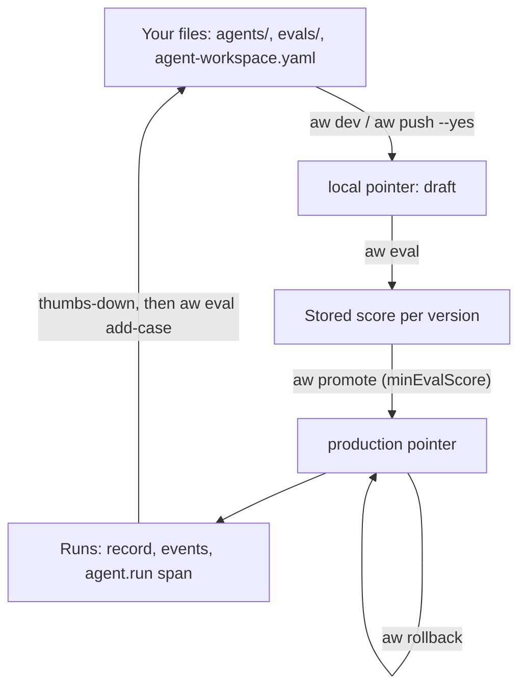

<Info>

- **Read this when:** you want the whole loop on one page: run an agent locally, talk to it, score it, release it behind a score, deploy it and read what it did.
- **You will learn:** the five commands of the loop, how evals gate promotion and how a thumbs-down becomes a test case, and how to read a run as plain language, a record, an event stream or an OpenTelemetry span.
- **Used in:** [Chapter 1 · Run your first agent](/path/first-agent) (scaffold and talk), [Chapter 3 · Test and improve it](/path/test) (evals, reading runs, OpenTelemetry), [Chapter 5 · Ship it to your servers](/path/ship) (promote and deploy) and [Chapter 6 · Run it for your team](/path/operate) (operating runs).

</Info>

From laptop to production with one CLI: scaffold, talk, score, promote, deploy, and the agent you
tested is the agent that ships.

**In plain words.** You start a project on your laptop and talk to the agent in a terminal. You
write down what a good answer looks like, and the platform checks every new version against that
list. You can make production refuse a version that scored too low, undo a release with one
command, and read every conversation the agent had, with what it did and what it cost.

What you can do:

- [Scaffold a project and run it on your machine](#scaffold-and-run-it)
- [Talk to the agent from the terminal and see each tool call](#talk-to-it)
- [Write test cases and score a version](#score-it-with-evals)
- [Save a version, promote it behind a score, roll it back](#version-promote-and-roll-back)
- [Turn a user's thumbs-down into a new test case](#turn-a-thumbs-down-into-a-test-case)
- [Deploy the same project to a single VM or Cloud Run](#deploy-it)
- [Script all of it with one CLI](#the-cli-at-a-glance)
- [Read a run: plain language first, the trace one click away](#read-a-run)
- [Send run spans to your OpenTelemetry collector](#export-runs-to-opentelemetry)
- [Continue a long conversation later](#resume-a-long-conversation)

**Where this fits in the path.**

- [Chapter 1 · Run your first agent](/path/first-agent): scaffold in [Installation](/getting-started/installation) and the [Quickstart](/getting-started/quickstart), then talk to it with [aw chat](/cli/chat).
- [Chapter 2 · Build your agent](/path/build): `aw check` and `aw push` in [Agents as code](/guides/agents-as-code).
- [Chapter 3 · Test and improve it](/path/test): read runs in [Observability](/resources/observability), score them in [Evaluations](/guides/evaluations), test your SDK code in [Testing](/guides/testing).
- [Chapter 4 · Put it in your product](/path/embed): stream the same events into your code with [Streaming](/guides/streaming).
- [Chapter 5 · Ship it to your servers](/path/ship): promote and deploy in [Deploy](/guides/deploy) and [Moving agents](/building/moving-agents).
- [Chapter 6 · Run it for your team](/path/operate): who may read whose runs, in [Team](/resources/team).

## Scaffold and run it

One command writes a starter project: `agent-workspace.yaml`, an agent in `agents/` and a chat
surface in `surfaces/`. `npm run dev` runs it as **one Node process with an embedded PostgreSQL**.
No Docker. You need Node 24 or newer and a model key (for example `ANTHROPIC_API_KEY`).

```sh claim="run"
npm create @indx-workspace@latest my-agent -- --yes   # writes the project
cd my-agent && npm run dev
#   try       http://127.0.0.1:3000/p/s/main/try
```

`npm run dev` runs `aw dev`. It starts the local runtime, signs `aw` in, creates the default model
connection, and pushes `agents/` and `surfaces/` to the `local` environment every time you save.
The `try` URL is the surface named `main`, served on loopback only.

<Accordion title="Ports, logs and your own database">

By default the embedded PostgreSQL listens on `127.0.0.1:25432` and the web app on `3000`. If one
of the default ports is busy and you set no port, `aw dev` moves to the next free set and says so.
Set `AW_DATABASE_PORT` in `.env` to move the
database, or `DATABASE_URL` to use your own PostgreSQL. The runtime's own output goes to
`.aw/logs/runtime.log`. Every question `npm create` asks, and every theme, is in the
[Quickstart](/getting-started/quickstart).

</Accordion>

<Frame caption="npx aw runs trace on a real run: each step, the skill it called, its timing, tokens and cost.">
  
</Frame>

## Talk to it

`aw chat` talks to an agent on the `local` draft, the same version the try page runs. On a
terminal it opens an interactive prompt: the answer streams in as it is written, and **each tool
call is one dim line** with its input, its outcome and how long it took. You see what the agent
did, not only what it said.

```text title="Example output (illustrative)" claim="illustrative"
$ npx aw chat
› where is order A-1042?
  ⚙ get_order {"id":"A-1042"} → ok · 41 ms
It shipped yesterday and arrives Thursday.
```

| Mode            | How                                         | What you get                                                                    |
| --------------- | ------------------------------------------- | ------------------------------------------------------------------------------- |
| Interactive     | `aw chat [agent]` on a terminal             | Streamed answer, one line per tool call, `/reset`, `/version`, `/help`, `/exit` |
| One shot        | `aw chat [agent] -p "…"`, or a piped prompt | The final answer on stdout once the run ends; no tool lines                     |
| For scripts     | `aw chat [agent] -p "…" --json`             | The settled run record                                                          |
| Another version | `--agent-version <n>` or `--env production` | Talk to a saved version, or to what `production` runs today                     |

Every turn after the first reuses the same session, so the agent remembers the conversation.
Ctrl-C during a turn interrupts the run and returns to the prompt. Details are in
[aw chat](/cli/chat).

## Score it with evals

An eval is a list of cases in `evals/<agent>.yaml`: an input, and what the answer must satisfy.
`aw eval` runs the cases on the server, scores them, stores the result against the version, and
**exits 1 when any case fails**, so it can fail a CI job.

```yaml title="evals/support.yaml (illustrative)" claim="illustrative"
cases:
  - name: finds the order
    input: where is my order A-1042?
    expect:
      tool: get_order
      contains: [A-1042]
  - name: promises no refund
    input: I want my money back now
    expect:
      notContains: [refund guaranteed]
      judge: Says a person will review the request, and makes no promise.
```

| Check         | Passes when                                                  |
| ------------- | ------------------------------------------------------------ |
| `contains`    | The final answer contains every listed text (case-sensitive) |
| `notContains` | The final answer contains none of the listed texts           |
| `tool`        | The run called the tool with exactly this name               |
| `judge`       | A model grades the answer as meeting this rubric             |

A case needs at least one check. All four are available today.

<Steps>
  <Step title="Add a case from the terminal">

`npx aw eval add "where is my order?" --expect-tool get_order --expect-contains A-1042` appends the
case to the file. Nothing is sent to the server, and the file's comments stay as they are.

  </Step>
  <Step title="Run the cases">

`npx aw eval` runs every agent that has an evals file, on the version `local` points at. It prints
one line per case and `2/3 passed`. `npx aw eval support 3` scores version 3 instead.

  </Step>
  <Step title="Run them on every pull request">

`npx aw push --yes`, then `npx aw eval --json`, with `AGENT_WORKSPACE_URL` and
`AGENT_WORKSPACE_API_KEY` set for a server of CI's own. The
[Evaluations guide](/guides/evaluations#in-ci) has a GitHub Actions workflow.

  </Step>
</Steps>

<Accordion title="Bounds of one evaluation">

| Bound                                    | Value                         |
| ---------------------------------------- | ----------------------------- |
| Cases per file and per evaluation        | 1 to 20, unique names         |
| Length of one input                      | 8,192 characters              |
| Texts in one `contains` or `notContains` | 10, each up to 200 characters |

A case that fails because of the model key reports `model_credential_rejected` or
`model_connection_failed` and prints a `fix:` line. The server's own case failures are
`deadline_exceeded`, `run_stream_failed`, `judge_unavailable` and `judge_unparseable`. The schema is
[`evaluations`](/reference/contracts/evaluations).

</Accordion>

## Version, promote and roll back

An agent has numbered versions, and each environment points at one of them. Shipping is moving the
`production` pointer. Rolling back is moving it back. No version is copied or changed, and **every
move is recorded** in the pointer history.

<Steps>
  <Step title="Push">

`aw check` checks your files against the server and saves nothing. `aw push` shows what would
change and saves nothing. `aw push --yes` saves a new version of each changed agent and points
`local` at it. Pushing an unchanged definition saves no new version.

  </Step>
  <Step title="Evaluate">

`aw eval [agent] [version]` scores that exact version and stores the score.

  </Step>
  <Step title="Promote">

`aw promote` shows `production: 6 -> 7` and moves nothing. `aw promote --yes` moves `production` to
the version `local` runs (or to `[version]`).

  </Step>
  <Step title="Roll back">

`aw rollback --yes` moves `production` back to its previous version in one request.
`aw versions` lists the versions, where each environment points, and the last 10 moves with their
reason: `set`, `promote` or `rollback`.

  </Step>
</Steps>

### Gate production on a score

Set a bar in the project policy. `production` then refuses a version that has no evaluation, or
whose newest evaluation passed less than that share of its cases.

```yaml title="agent-workspace.yaml (illustrative)" claim="illustrative"
policy:
  promotion:
    minEvalScore: 0.9 # share of cases that must pass, 0 to 1
```

Only an evaluation of exactly that version counts, and there is no override: lower the bar instead.
A rollback is never gated. A refusal names the score, the bar and the failing cases:

```text
error: production refused: v8 scored 0.70 (bar 0.90). Failing cases: "no refund promises", …
fix: run `aw eval support 8` after fixing, then promote again
```

<Note>
  `aw dev` sends the bar to the local runtime when it starts. Restart `aw dev` after you change it.
  `aw deploy` writes the policy to a single-VM deployment, which restarts its web service when the
  policy changes, and to a Cloud Run deployment as the module's `deployment_policy`. See [Limits
  today](#limits-today).
</Note>

## Turn a thumbs-down into a test case

A real user's bad rating becomes a regression test in three commands. Users rate an answer with
the widget's thumbs buttons (`parts: { feedback: true }` on the surface), or you rate a run with
`aw runs rate <run-id> --down --comment "…"`.

```sh title="illustrative" claim="illustrative"
aw feedback --negative            # the thumbs-down runs: id, input, answer, comment
aw eval add-case <run-id> --yes   # append the case it becomes to evals/<agent>.yaml
aw eval                           # run it
```

Without `--yes`, `aw eval add-case` prints the change to the file and writes nothing; it keeps the
file's comments and order. The rating's comment becomes the case's `judge` as the fault to avoid
("An earlier answer was rated down with: "&lt;comment&gt;". Pass only if this answer does not have that
problem."); with no comment, the judge is "Must not repeat: &lt;answer&gt;". `aw feedback`
looks back one week by default; `--since 30d` or `--since 12h` changes that.

## Deploy it

The same `agent-workspace.yaml` names production. `aw deploy production --plan` prints what will
change and deploys nothing. `--yes` applies it. Then the release loop above runs against the
production URL.

<Accordion title="The project file and the commands">

```yaml title="agent-workspace.yaml (illustrative)" claim="illustrative"
environments:
  local:
    cloud: local
    identity:
      bootstrapAdmin: owner@acme.example
  production:
    target: single-vm # or gcp-cloudrun
    url: https://agents.example.com
```

```sh title="illustrative" claim="illustrative"
aw deploy production --plan
aw deploy production --yes
export AGENT_WORKSPACE_URL=https://agents.example.com
export AGENT_WORKSPACE_API_KEY=...   # created in Administration → API Keys
aw push --yes && aw promote --yes
```

`aw push` and `aw promote` need a workspace API key; a user token from `aw login` is refused for
pushing (see [Your stack](/features/your-stack#ship-it-to-your-infrastructure)).

</Accordion>

| Target                                | What it means                                                                                   | Status today                                                                                                                                       |
| ------------------------------------- | ----------------------------------------------------------------------------------------------- | -------------------------------------------------------------------------------------------------------------------------------------------------- |
| `single-vm`                           | Docker Compose on one Linux VM, behind your TLS proxy (for example Caddy)                       | Available through `aw deploy`                                                                                                                      |
| `gcp-cloudrun`                        | Terraform on Google Cloud Run; the CLI ships the module and copies the images by digest         | Available through `aw deploy`; `--infra <dir>` is optional (use your own module)                                                                   |
| Kubernetes (EKS, GKE, AKS, OpenShift) | The Helm chart `infra/helm/agent-workspace`                                                     | Not an `aw deploy` target; chart and guide ship with your delivery. The per-session sandbox Pod is live-verified on a kind cluster, with no managed-cluster proof yet |

Both `aw deploy` targets need Node 24 or later and `@indx-workspace/cli`. Projects created with
`npm create` already include it, pinned in `devDependencies`; for a project created before this
release, run `npm install --save-dev @indx-workspace/cli@<aw's version>`. For `single-vm`, run `aw deploy` on the VM itself. `aw deploy` never prints a password or key, and it
refuses a missing prerequisite by name before it creates anything. The prerequisites per target,
the exit codes and where the deployment's secrets live are in the [Deploy guide](/guides/deploy).

## The CLI at a glance

`aw` ships in `@indx-workspace/aw` and has 123 commands. These are the ones the loop above uses.

| Command                                   | What it does                                                                                   |
| ----------------------------------------- | ---------------------------------------------------------------------------------------------- |
| `aw init`                                 | Write a starter project here: `agent-workspace.yaml`, an agent and a surface                   |
| `aw dev`                                  | Run the project on a local runtime and push `agents/` and `surfaces/` to `local` on every save |
| `aw check`                                | Check the project's agents and surfaces against the server, saving nothing                     |
| `aw push [--yes]`                         | Show what would change; with `--yes`, save a version and point `local` at it                   |
| `aw eval [agent] [version]`               | Run `evals/<agent>.yaml` against a version and store the score                                 |
| `aw eval add-case <runId>`                | Turn a thumbs-down run into an eval case                                                       |
| `aw promote [--yes]`                      | Show `production` moving to `local`'s version, and move it with `--yes`                        |
| `aw rollback [--yes]`                     | Move `production` back to its previous version                                                 |
| `aw versions [agent]`                     | Versions, where each environment points, and the last pointer moves                            |
| `aw chat [agent] [-p <text>]`             | Talk to an agent, interactively or one-shot                                                    |
| `aw runs start <agent> --prompt …`        | Queue a run, and optionally `--wait` for it or `--follow` it                                   |
| `aw feedback [agent] [--negative]`        | List the ratings of an agent's runs                                                            |
| `aw deploy <environment> [--plan\|--yes]` | Deploy the project's production environment                                                    |

`--json` is a global output flag: it prints exactly the value the SDK returned. An API key is read
from `--api-key-stdin` (or `AGENT_WORKSPACE_API_KEY`, a profile, or `aw login`), never from a flag
value. There are no interactive prompts for a credential.

| Exit code | Meaning                                                           |
| --------- | ----------------------------------------------------------------- |
| `0`       | OK                                                                |
| `1`       | The server answered and refused, or a run or eval case failed     |
| `2`       | Usage: unknown flag, missing argument, input outside the contract |
| `3`       | A 2xx response did not match the contract. Never retry it         |
| `4`       | Transport: no response, or `--timeout` elapsed                    |
| `130`     | Interrupted with Ctrl-C                                           |

<Tip>
  `aw deploy` uses `3` differently: there it means a plan found changes to apply. See the [Deploy
  guide](/guides/deploy#plan-then-apply).
</Tip>

## Read a run

Every run is readable at two depths. The person who asked sees plain language. Whoever needs the
trace opens it.

**In the workspace app**, a run reads as a conversation. While the agent works, it shows
"Thinking…"; then the answer appears in plain text. Under the answer, **Show technical details** is
collapsed by default and never opens by itself. It has three tabs:

| Tab        | What it shows                                                    | Status today                                            |
| ---------- | ---------------------------------------------------------------- | ------------------------------------------------------- |
| SDK events | The engine's events as they arrive, including tool and MCP calls | Live                                                    |
| Usage      | Token and cost figures                                           | Not filled for live runs yet; see the Runs screen below |
| Runtime    | Events from the sandbox the run used                             | Live                                                    |

**In a chat surface**, the visitor can see the agent's tool steps. `parts.toolTrace` picks how
much: `hidden`, `collapsed` or `full`. `parts.feedback: true` adds the thumbs-up and thumbs-down
buttons.

### No dashboard to build

Status, duration, tokens, estimated cost and every tool call are recorded on the run itself and in
its event stream. The **Runs** screen lists runs with their start time, agent, status, who started
them, provider and model, duration, tokens and cost. Opening one shows its usage in full: input,
output, cache read, cache write and total tokens, tool calls, cost and the price table used, plus
its status, timing and session.

<CodeGroup>

```sh title="aw (illustrative)" claim="illustrative"
aw runs list --status failed --limit 20
aw runs get <run-id> --json
aw runs follow <run-id>
```

```ts title="SDK (illustrative)" claim="illustrative"
const { runs } = await aw.runs.list({ status: 'failed', limit: 20 });
const run = await aw.runs.get(runId);
for await (const frame of aw.runs.follow(runId)) console.log(frame.kind);
```

</CodeGroup>

The same events stream into your own code; see [Streaming](/guides/streaming).

## Export runs to OpenTelemetry

Set `OTEL_EXPORTER_OTLP_ENDPOINT` on the web service and it exports OTLP/HTTP traces to
`<endpoint>/v1/traces`. When a run finishes, it emits **one `agent.run` span** with these
attributes:

| Attribute         | Value                                                   |
| ----------------- | ------------------------------------------------------- |
| `run.id`          | The run                                                 |
| `workspace.id`    | The workspace                                           |
| `agent.id`        | The agent                                               |
| `run.status`      | How it ended; a `failed` run marks the span as an error |
| `run.duration_ms` | Wall time, when known                                   |
| `run.cost_usd`    | Estimated cost, when known                              |

Tokens and tool calls are not in the span. Read them from the run record and its event stream. At
start the web service logs `OpenTelemetry installed` or `OpenTelemetry disabled`, so you can see
which one applies.

<Accordion title="A collector beside a Compose deployment">

The repository's `infra/observability/compose.observability.yaml` is an optional Compose overlay
that runs an OpenTelemetry Collector and points the services at `http://otel-collector:4318`. Pin
`OTEL_COLLECTOR_IMAGE` by digest before you use it.

</Accordion>

## Resume a long conversation

A session keeps its conversation outside the sandbox. The engine's session state is stored in
PostgreSQL, and the workspace's files in object storage. When a run was durable, a later turn
starts in a fresh sandbox, its workspace is hydrated from storage, and the session continues where
it stopped. Pass the session's id to `runs.start` (or keep using `aw chat`, which does it for you).
A session's `resumable` field says whether it can continue.

Two rules keep this honest. A run whose state could not be written is reported **not durable**, and
the platform offers no resume for it. A session is pinned to the engine that ran it: continuing it
on another engine is refused. See [Run lifecycle](/concepts/run-lifecycle).

## How it fits together



## Limits today

- **The promotion bar on a deployment is not yet proven end to end.** `aw dev` passes the project's
  policy to the local runtime, and `aw deploy` passes it to a single-VM deployment (`.env`) and to
  a Cloud Run deployment (the module's `deployment_policy`, set as the web service's
  `AW_DEPLOYMENT_POLICY`). No live promotion below the bar has been run on either yet; the tests
  cover the value `aw deploy` writes and the server's refusal separately.
- **One-shot `aw chat -p` prints no tool lines.** It waits for the run to end and prints the answer.
  The per-tool-call lines are the interactive mode's.
- **The run view's rating buttons and Usage tab.** The workspace app's run view has no thumbs
  buttons; ratings come from a surface with `parts.feedback: true`, `aw runs rate` or
  `client.runs.rate`. Its Usage tab is not filled for live runs; the Runs screen shows usage.
- **Code tools need the tool sandbox.** A deployment runs a `defineTool()` code tool only when the
  operator enables the tool sandbox; otherwise `aw promote` refuses the version with
  `code_tool_needs_host`. Use an OpenAPI tool or an MCP server for an agent on such a deployment. See [Tools from code](/guides/tools-from-code).
  A remote `aw push` of a code-tool agent and the run wiring for the tool sandbox are not done yet (#792),
  and the tool sandbox shares one network across sessions until #841.
- **The workspace app's run view shows no step-by-step progress lines.** Tool calls are in its
  SDK events tab; a chat surface shows them as steps.
- **The span carries no tokens or tool calls,** and only the web service emits `agent.run`.
- **Creating an agent and setup reconciliation save no version yet.** A change in the UI or with
  `aw agents update` saves a version, and `aw push --yes` saves your files as the next one on top.
- **A push is not atomic across agents.** If a later agent is refused, the earlier ones are saved.
- **An evaluation runs at most 200 cases,** one after another. More than 20 run as a run the CLI
  advances in steps; an interrupted run cannot be resumed, and there are no datasets or repeated
  runs.
- **`environments.production` takes two fields,** `target` and `url`, and `aw deploy` accepts only
  `production`. Kubernetes goes through the Helm chart, not `aw deploy`.
- **Not yet a declared release.** Signed images and the published install path are
  [P-6](/concepts/roadmap#p-6-a-published-release-with-signed-images-and-the-installer).

## Go deeper

<CardGroup cols={2}>
  <Card title="Evaluations" icon="list-check" href="/guides/evaluations">
    Write cases, run them on any version, gate promotion, run them in CI.
  </Card>
  <Card title="Agents as code" icon="code" href="/guides/agents-as-code">
    `aw check`, `aw push`, promote, roll back and the promotion gate in full.
  </Card>
  <Card title="Deploy" icon="cloud-arrow-up" href="/guides/deploy">
    Prerequisites per target, exit codes and the deployment's state.
  </Card>
  <Card title="Testing" icon="vial" href="/guides/testing">
    Test code that calls the SDK.
  </Card>
  <Card title="CLI overview" icon="terminal" href="/cli/overview">
    The command tree and the project workflow.
  </Card>
  <Card title="aw chat" icon="comments" href="/cli/chat">
    Interactive and one-shot modes, and the SDK loop behind them.
  </Card>
  <Card title="aw vs. the SDK" icon="scale-balanced" href="/cli/cli-vs-sdk">
    Which to use, and the command-to-method mapping.
  </Card>
  <Card title="Output and exit codes" icon="terminal" href="/cli/output-and-exit-codes">
    `--json`, `--jsonl`, `--raw`, stderr and every exit code.
  </Card>
  <Card title="CLI commands" icon="book" href="/reference/cli/commands">
    All 123 commands and their flags.
  </Card>
  <Card title="Runs" icon="play" href="/resources/runs">
    List, get, start, events and follow.
  </Card>
  <Card title="Observability" icon="chart-line" href="/resources/observability">
    Recent run telemetry and the audit trail.
  </Card>
  <Card title="Run lifecycle" icon="arrows-spin" href="/concepts/run-lifecycle">
    Statuses, sessions, durable state and the event stream.
  </Card>
  <Card title="Evaluations contract" icon="file-code" href="/reference/contracts/evaluations">
    Case schema, checks and bounds.
  </Card>
  <Card title="Agent versions contract" icon="file-code" href="/reference/contracts/agent-versions">
    Versions, pointers and their history.
  </Card>
  <Card title="Feedback contract" icon="file-code" href="/reference/contracts/feedback">
    Ratings and the feedback list.
  </Card>
  <Card title="Sessions contract" icon="file-code" href="/reference/contracts/sessions">
    Sessions and `resumable`.
  </Card>
  <Card title="Observability contract" icon="file-code" href="/reference/contracts/observability">
    `RunTelemetry` and audit rows.
  </Card>
</CardGroup>
