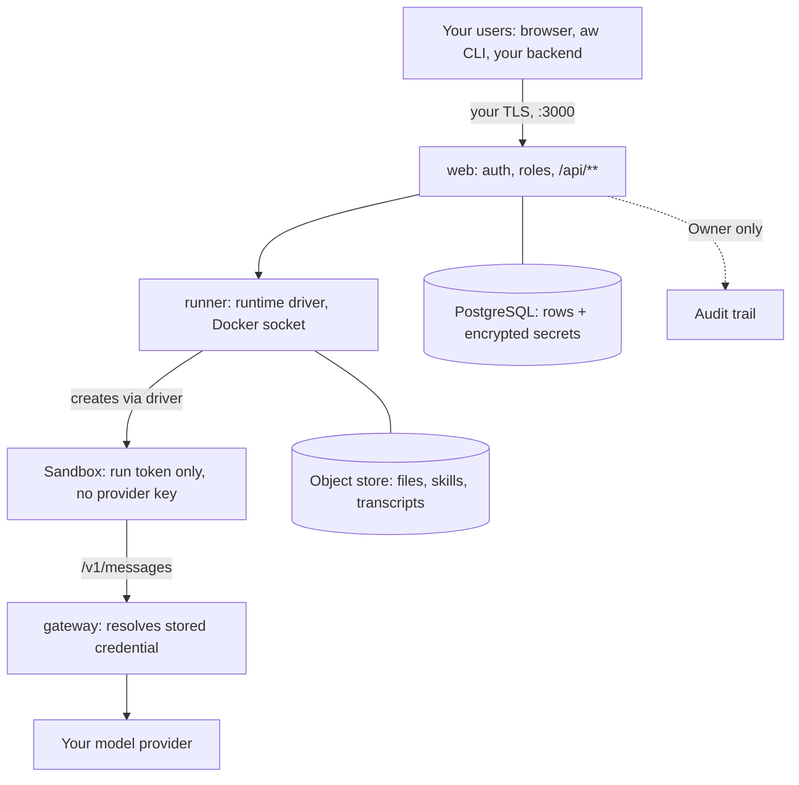

<Info>

- **Read this when:** you prepare a security review or a production rollout: where data rests, how keys are held, what each sandbox isolates, who can do what, and what is audited.
- **You will learn:** the five services and three stores, how the gateway keeps provider keys out of the sandbox, how runtime drivers, network policies and permissions limit an agent, and which items are not verified yet.
- **Used in:** [Chapter 2 · Build your agent](/path/build) (permissions and secrets), [Chapter 5 · Ship it to your servers](/path/ship) (services, drivers, network policy) and [Chapter 6 · Run it for your team](/path/operate) (roles, SSO, API keys, audit).

</Info>

Agent Workspace runs in your infrastructure, keeps model keys out of the agent's sandbox, and says
plainly which isolation has been proven and which has not.

**In plain words:** you install five services on your own machines. Your AI agents run inside
sandboxes you choose, and they never hold the key that pays for the model. Every person and every
key gets one of four roles, and changes to access, credentials and agents are written to an audit
log that only the Owner can read.

<Note>
  This page is a first-pass review document. Anything not yet verified is marked as such, and
  [Limits today](#limits-today) lists every open item in one place.
</Note>

## At a glance

| Question        | Answer today                                         |
| --------------- | ---------------------------------------------------- |
| Hosting         | Self-hosted, five services                           |
| Public port     | `web` on `3000`, and nothing else                    |
| Provider keys   | Held by the gateway only, never in a sandbox         |
| Runtime drivers | 11 ids; 6 implemented; 2 live-verified (`docker`, `kubernetes` on kind) |
| Roles           | 4: `owner`, `admin`, `builder`, `viewer`             |
| Single sign-on  | Any OIDC issuer                                      |
| Audit           | 21 actions; only an Owner can read the trail         |
| Licence         | Apache-2.0                                           |

## What you can do

- [See where every byte lives](#see-where-your-data-lives): five services, one public port, three stores
- [Start small and grow](#start-on-a-laptop-and-grow-to-a-cluster): laptop, one VM, or a cluster, with the same images
- [Keep model keys out of agents](#keep-model-keys-out-of-the-sandbox) with gateway-held credentials and per-run tokens
- [Choose the sandbox](#choose-where-agents-run) per runtime profile, and [test it before you save it](#test-and-switch-a-runtime)
- [Fence the network](#set-a-network-policy) with `none`, `restricted` or `open`
- [Give each agent only the tools it needs](#give-each-agent-least-privilege), and [match the sandbox to the job](#pick-a-runtime-by-what-the-agent-may-do)
- [Control who can do what](#control-who-can-do-what) with four roles, OIDC SSO and single-role API keys
- [Answer "who changed what"](#answer-who-changed-what) from the audit trail

**Where this fits in the path.**

- [Chapter 1 · Run your first agent](/path/first-agent): the laptop mode, in [Installation](/getting-started/installation) and the [Quickstart](/getting-started/quickstart).
- [Chapter 2 · Build your agent](/path/build): permissions in [Design an agent](/building/agents), runtime profiles in [Models and runtimes](/building/models-and-runtimes), credentials in [Secrets](/resources/secrets).
- [Chapter 4 · Put it in your product](/path/embed): API keys stay on the server, browsers get short-lived tokens, in [Authentication](/getting-started/authentication).
- [Chapter 5 · Ship it to your servers](/path/ship): services, drivers and network policy in [Deploy](/guides/deploy) and [Self-hosting](/building/self-hosting).
- [Chapter 6 · Run it for your team](/path/operate): roles and API keys in [Team](/resources/team) and [Workspaces](/resources/workspaces); the audit trail in [Observability](/resources/observability).

## See where your data lives

A full deployment is **five services**. Only `web` is exposed, on port `3000`; put your own TLS
terminator in front of it. Sandboxes are created on demand by the runtime driver. They are not a
sixth service.

| Service    | Does                                                                                                                                    | Exposed                           |
| ---------- | --------------------------------------------------------------------------------------------------------------------------------------- | --------------------------------- |
| `web`      | The UI, `/api/**`, authentication, the setup wizard                                                                                     | Port `3000`, the only public one  |
| `gateway`  | The model gateway. Swaps a per-run token for the stored provider credential. Serves an Anthropic-compatible `/v1/messages`              | Private; reachable from sandboxes |
| `runner`   | Allocates a sandbox through the chosen runtime driver and relays the agent's events. The Docker socket is mounted here and nowhere else | Private                           |
| `postgres` | PostgreSQL 17. Every durable row: workspaces, principals, agents, runs, events                                                          | Private                           |
| `storage`  | SeaweedFS, S3 or native GCS. Workspace files, skills, transcripts                                                                       | Private                           |

**Why it matters:** a security review starts with "what is exposed, and where does data rest".
Here the answer is one port and three stores, all in your network.

### The path a prompt takes

1. Your users (browser, `aw` CLI or your backend) reach `web` through your TLS on `:3000`.
   `web` checks who they are and what their role allows.
2. `web` hands the run to `runner`, which creates a sandbox through the runtime driver.
3. The agent in the sandbox calls the model at the gateway's `/v1/messages`, holding only a
   short-lived run token.
4. The gateway resolves the stored provider credential and forwards the call to your configured
   model provider. That is the one outbound hop a prompt must make.

### Three stores, one each

| Store        | Holds                                                                                 |
| ------------ | ------------------------------------------------------------------------------------- |
| PostgreSQL   | Every durable row the control plane has, including the session row                    |
| Object store | Files, skills and transcripts, in SeaweedFS, S3, GCS or Azure Blob                    |
| Secrets      | Envelope-encrypted **inside PostgreSQL** under one deployment key. Not a fourth store |

These stores hold Agent Workspace's own state. Your own databases and document systems reach an
agent only as an MCP connector or as uploaded files, never through these stores.

<Note>
  **Today:** native S3, GCS and Azure Blob adapters are implemented; their required live-bucket
  proofs are pending. Tracked as
  [D-2](/concepts/roadmap#d-2-object-storage-on-every-cloud-natively). Which cloud service answers
  each store is in [The data plane](/concepts/data-plane#the-contract).
</Note>

## Protect stored files

Files, skills and transcripts live wherever `AW_STORAGE_URL` points. This section says how that
data is encrypted, where its credentials come from and how far the app's access reaches (the
storage design, §05).

### Encrypt the disk under `file://` and self-hosted S3

| Backend                                                                          | Encrypted at rest                                                                               |
| -------------------------------------------------------------------------------- | ----------------------------------------------------------------------------------------------- |
| `s3://` on AWS, `gcs://`, `azblob://`                                            | Yes, by default, by the cloud. Nothing to switch on.                                            |
| `s3://…?endpoint=` on your own host (the bundled SeaweedFS in single-VM Compose) | **Only if you encrypt the disk.** SeaweedFS writes plain files to the `seaweedfs-data` volume.  |
| `file://` (`aw dev`, the GCP single-VM target)                                   | **Only if you encrypt the disk.** Agent Workspace writes plain files and does not encrypt them. |

An install on `file://` or on a self-hosted S3-compatible store **must** keep the data on an
encrypted disk: LUKS on Linux, BitLocker on Windows, FileVault on macOS, or an encrypted cloud
volume (check that encryption is on for the volume that holds the data). This covers the
`seaweedfs-data` volume of a [single-VM install](/guides/deploy#single-vm), the
`file:///var/lib/agent-workspace` path on the GCP single-VM target and the
`.agent-workspace/storage` directory of `aw dev`.

### Keep traffic on TLS

Every cloud endpoint is reached over TLS. When you set a custom `endpoint=` on an `s3://` URL, use
`https://`. The bundled SeaweedFS in the Compose project is never published beyond localhost; the
web service reaches it over the project's internal network.

### Keep credentials out of the URL

`AW_STORAGE_URL` never carries a key or a password. Credentials come from the environment or from
workload identity:

- **S3-compatible endpoints:** `OBJECT_STORAGE_ACCESS_KEY_ID` and `OBJECT_STORAGE_SECRET_ACCESS_KEY`
  in the environment (the Compose file and the Helm chart pass them on as `AWS_ACCESS_KEY_ID` and
  `AWS_SECRET_ACCESS_KEY`). On AWS, prefer an IAM role (IRSA on EKS, an instance profile on EC2).
- **GCS:** Application Default Credentials, which on Cloud Run is the service's own identity.
- **Azure Blob:** a managed identity.

### Limit the app to its own bucket

Give the app a dedicated bucket. On GCP the Terraform module grants the web identity bucket roles
only, never a project-wide storage role. On Azure the
`Storage Blob Data Contributor` role is scoped to the container. There is no AWS Terraform; on a
shared S3 bucket, limit the role to the prefix in your URL:

```json title="aws-storage-policy.json (illustrative)" claim="illustrative"
{
  "Version": "2012-10-17",
  "Statement": [
    {
      "Effect": "Allow",
      "Action": ["s3:GetObject", "s3:PutObject", "s3:DeleteObject"],
      "Resource": "arn:aws:s3:::<bucket>/<prefix>/*"
    },
    {
      "Effect": "Allow",
      "Action": "s3:ListBucket",
      "Resource": "arn:aws:s3:::<bucket>",
      "Condition": { "StringLike": { "s3:prefix": "<prefix>/*" } }
    }
  ]
}
```

Replace `<bucket>` and `<prefix>` with the bucket and prefix in your `s3://<bucket>/<prefix>` URL.
If you still set the old variables, [map them to the URL](/concepts/data-plane#migrating-from-the-old-variables).

## Start on a laptop and grow to a cluster

Every mode runs the same platform. Only where the sandboxes execute changes.

| Mode             | For                        | What runs                                                                                                                                                                                   | Where                              |
| ---------------- | -------------------------- | ------------------------------------------------------------------------------------------------------------------------------------------------------------------------------------------- | ---------------------------------- |
| **Laptop**       | Evaluating in minutes      | `aw dev`: one Node process with an embedded PostgreSQL. Node 24+, no Docker. Agents run on the `local` driver (no isolation)                                                                | Your machine                       |
| **Simple mode**  | One VM, one tenant         | Docker Compose: `web`, `runner`, `gateway`, PostgreSQL and object storage. Sandboxes on the `docker` driver                                                                                 | EC2, GCE, an Azure VM, on-premises |
| **Cluster mode** | Many teams, real isolation | The same images, plus a sandbox Pod per session through the `kubernetes` driver, with NetworkPolicy and limits; one Helm chart (`infra/helm/agent-workspace`) with values for each platform | EKS, GKE, AKS, OpenShift           |

<Steps>
  <Step title="Try it on a laptop">

```sh claim="run"
export ANTHROPIC_API_KEY=sk-ant-...
npm create @indx-workspace@latest my-agent -- --yes
cd my-agent && npm run dev
```

Open the `try` URL it prints (`http://127.0.0.1:3000/p/s/main/try`). Full walkthrough:
[Quickstart](/getting-started/quickstart).

  </Step>
  <Step title="Run the full platform on one VM">

`npm create @indx-workspace@latest demo -- --cloud local` writes the Docker Compose project. Then
`cd demo && pnpm install --frozen-lockfile=false && pnpm start`. You can also run
`docker compose --env-file .env up -d` yourself. See
[Self-host Agent Workspace](/building/self-hosting#run-the-full-platform).

  </Step>
  <Step title="Answer the five setup questions">

Open `/setup`. The web wizard asks five questions, one per step:

1. **Provider:** which model provider do you want to use?
2. **Credentials:** enter the provider credentials.
3. **Runtime:** which sandbox or runtime should agents use?
4. **Administrator:** sign in as the first administrator, with the email and one-time setup password the generator printed.
5. **First agent:** create your first agent.

  </Step>
  <Step title="Move to a cluster when you need it">

Use the Helm chart `infra/helm/agent-workspace` with the values file for your platform:
`values-eks.yaml`, `values-gke.yaml`, `values-aks.yaml` or `values-openshift.yaml`. See
[Deploy to a VM or a cluster](/building/self-hosting#deploy-to-a-vm-or-a-cluster).

  </Step>
</Steps>

<Warning>
  The laptop's `ANTHROPIC_API_KEY` is read by the control-plane process, not by the agent. Even in
  `aw dev`, the agent's run environment never receives it.
</Warning>

## Keep model keys out of the sandbox

**Credentials never enter a sandbox.** The agent runs in the sandbox, but the key that pays for its
model calls stays with the gateway.

| Guarantee                                 | What it means                                                                                                                                                                                                                   |
| ----------------------------------------- | ------------------------------------------------------------------------------------------------------------------------------------------------------------------------------------------------------------------------------- |
| Gateway-resolved provider keys            | Provider credentials are stored encrypted and resolved only by the gateway. Never by the runner, never by the sandbox                                                                                                           |
| A run- and model-bound token              | Inside the sandbox, the agent gets `ANTHROPIC_BASE_URL` pointing at the gateway and a short-lived `ANTHROPIC_AUTH_TOKEN` bound to one run and one model                                                                         |
| The run environment refuses provider keys | The compiled run environment refuses `ANTHROPIC_API_KEY` outright, even as an agent secret of that name. The run is not compiled                                                                                                |
| Write-only secrets                        | Secrets, connector credentials and runtime credentials go in once and are never returned by any response. There is no read of a single secret. Only an Owner can manage secrets, deleting included; every other role gets `403` |

**How to do it:** enter the provider key once, in the setup wizard or the Models screen, or from
code with `aw.models.connections.create({ name, provider, apiKey })`. Never put a provider key in
the runner's environment. To rotate it, call `aw.models.connections.rotateCredential(id, apiKey)`.
Details: [Connect a model provider](/building/models-and-runtimes#connect-a-model-provider).

### Envelope encryption and key backends

Secrets are envelope-encrypted inside PostgreSQL under one deployment key. Local deployments read
that key from `MASTER_ENCRYPTION_KEY`. In the cloud, the key can come from the cloud's key service:

| Key backend               | How it holds the deployment key                         | Status                           |
| ------------------------- | ------------------------------------------------------- | -------------------------------- |
| Azure Key Vault           | Loaded directly from Key Vault through managed identity | Verified (passing live proof)    |
| AWS KMS                   | Decrypts a KMS-wrapped copy of the key                  | Implemented, awaiting live proof |
| GCP Secret Manager + CMEK | Loaded from Secret Manager under a Cloud KMS CMEK       | Implemented, awaiting live proof |

Tracked as [D-3](/concepts/roadmap#d-3-secret-backends-on-every-cloud).

<Frame caption="The Runtimes screen: where agents run and which isolation each runtime gives them.">
  
</Frame>

## Choose where agents run

**Same agent. Your choice of sandbox.** A runtime profile names one of eleven driver ids. The agent,
its skills and its connectors do not change when the driver does. Each driver is labelled with
exactly what has been verified.

| Driver              | Tier | Isolation                                                                        | Runs on                                          | Use it for                                          | Status today                                                                       |
| ------------------- | ---- | -------------------------------------------------------------------------------- | ------------------------------------------------ | --------------------------------------------------- | ---------------------------------------------------------------------------------- |
| `local`             | P0   | None: same process and user as the runner                                        | The control-plane host                           | Development and evaluation only                     | Implemented; **no isolation**, warning banner required                             |
| `sandbox-runtime`   | —    | None: the id has no implementation                                               | Nothing: a project that names it runs on `local` | Nothing; use `docker` for a sandbox on one host     | Reserved id, not implemented; runs on `local` with no isolation                    |
| `docker`            | P0   | One container per session; the Docker socket is mounted into `runner` only       | A Docker host                                    | Self-hosting on one VM: **the recommended default** | Implemented; isolation live-verified                                                |
| `kubernetes`        | P1   | One Pod per session, optionally with a gVisor RuntimeClass                       | Your cluster: EKS, GKE, AKS, OpenShift           | Many teams, NetworkPolicy, resource limits          | Implemented; isolation live-verified on kind with Calico, no managed-cluster proof |
| `aca-sessions`      | P2   | Hyper-V microVM per session, no persistent file system                           | Azure Container Apps dynamic sessions            | Teams that want no sandbox hosts of their own       | Implemented; not exercised by the live driver suite                                |
| `cloud-run-service` | P1   | One private Cloud Run v2 service per session                                     | Google Cloud Run                                 | Teams that want no sandbox hosts of their own       | Implemented; not exercised by the live driver suite                                |
| `gke-agent-sandbox` | P2   | gVisor, managed by GKE                                                           | GKE                                              | —                                                   | Roadmap: named only, not implemented                                               |
| `aws-agentcore`     | P2   | Firecracker microVM per session                                                  | Bedrock AgentCore Runtime                        | —                                                   | Roadmap: named only, not implemented                                               |
| `aws-ecs`           | P2   | VM-isolated Fargate task                                                         | ECS on Fargate                                   | —                                                   | Roadmap: named only, not implemented                                               |
| `cloud-run-sandbox` | P2   | Cloud Run sandbox in a gen2 microVM                                              | Cloud Run service or worker pool                 | —                                                   | Roadmap: named only, not implemented                                               |
| `external`          | P3   | Vendor-defined                                                                   | Third-party sandbox providers                    | —                                                   | Available (E2B); passed the provider live lane (run 37809484699)                   |

Three drivers run today (`local`, `docker`, `kubernetes`); two more are
implemented and awaiting live proof. Tiers are the specification's priority order (P0 first). The
source of truth for each driver's standing is
[Which runtime drivers are real today](/building/self-hosting#which-runtime-drivers-are-real-today).

**How to do it:** create a profile and point the agent at it. A run always executes on its agent's
profile; there is no per-run runtime override. Every field is on [Runtimes](/resources/runtimes).

<Accordion title="Create a profile and point an agent at it">

```ts title="illustrative" claim="illustrative"
const profile = await aw.runtimes.profiles.create({
  name: 'docker-standard',
  driver: 'docker',
  networkPolicy: 'none',
  filesystem: 'read-write',
  timeoutSeconds: 900,
});
await aw.agents.update(agentId, { runtimeProfileId: profile.id });
```

</Accordion>

## Test and switch a runtime

The **Administration → Runtimes** screen lists every driver. A driver that is not usable here is
shown **disabled with the reason, never hidden**: for example "No runtime connection is
configured.", "The runtime image is not reachable." or "Not configured — this runtime is not
registered.".

<Steps>
  <Step title="Pick a driver">

Select it on the Runtimes screen (or at step 3 of the setup wizard).

  </Step>
  <Step title="Click Test Runtime">

**Test Runtime** creates a real sandbox through the driver, sends it an echo, shows the
transcript, and destroys the sandbox. The button is enabled only when a connection exists and the
image is reachable.

  </Step>
  <Step title="Save">

**Save** stays disabled until Test Runtime has passed for that driver. A run on a driver whose
test has not passed is refused before any sandbox starts.

  </Step>
</Steps>

**Changing an agent's runtime** is an `agent-changed` audit row. The new profile is used by the
agent's next run; a run never moves to another runtime mid-flight.

The Runtimes screen also shows an example comparison, **Docker → Azure Container Apps dynamic
sessions**, to explain the two kinds of finding a switch can have:

| Kind                 | Example                                                                                                                | Effect                                                                            |
| -------------------- | ---------------------------------------------------------------------------------------------------------------------- | --------------------------------------------------------------------------------- |
| ⚠ Warning            | "Domain allowlist is not supported on this runtime." `restricted` becomes all-or-nothing egress                        | Does not block                                                                    |
| ✕ Blocking condition | "This agent uses a local command connector (Filesystem MCP)." The target has no outbound network for package downloads | Blocks: bundle the connector into the runtime image, or switch it to a remote URL |

<Note>
  **Today:** that comparison panel is a fixed illustration on the screen. It is not computed for
  your agent and does not stop **Save**. What does stop a bad configuration is the server: an
  unenforceable network policy is refused (see [Set a network policy](#set-a-network-policy)), and a
  `stdio` connector runs only in the tool sandbox, which is off by default.
</Note>

### What survives a runtime switch

|     | What                                  | Why                                                                                                                                                                          |
| --- | ------------------------------------- | ---------------------------------------------------------------------------------------------------------------------------------------------------------------------------- |
| ✓   | Workspace files                       | Object storage is the source of truth. Assigned files are materialized into each new sandbox, and read-write files are written back after the run                            |
| ✓   | Skills and connectors                 | Materialized into the workspace at launch, on every run                                                                                                                      |
| ✓   | The session, when its run was durable | Its state is stored, then resumed. A run whose state could not be written is reported not durable and is not offered a resume. A session is pinned to the engine that ran it |
| ✕   | Anything else in the old sandbox      | Sandboxes are disposable by design                                                                                                                                           |

If switching a runtime requires editing the agent, the driver is wrong, not the agent.

## Set a network policy

Each runtime profile states its network policy. It is a required, explicit choice.

| Policy       | Meaning                                                                                                                                                                          |
| ------------ | -------------------------------------------------------------------------------------------------------------------------------------------------------------------------------- |
| `none`       | The model gateway and nothing else. On `docker` the sandbox sits on a dedicated egress network that reaches only the gateway; on `kubernetes` it is a default-deny NetworkPolicy |
| `restricted` | The gateway plus the profile's `allowedDomains`, through an allowlist proxy. `docker` and `kubernetes` accept it only when the deployment sets the proxy image (see below)        |
| `open`       | Everything. Choose it deliberately                                                                                                                                               |

**A policy the driver cannot enforce is refused**, not silently downgraded. Where it is caught
depends on the driver:

| Driver         | What it refuses today                                                                                | When                                                                                            |
| -------------- | ---------------------------------------------------------------------------------------------------- | ----------------------------------------------------------------------------------------------- |
| `aca-sessions` | Anything but the one policy its pool is set to (`none` or `open`)                                    | When you save the profile: `422 network_policy_not_enforceable`, naming the policies it accepts |
| `docker`       | `restricted` and any `allowedDomains` unless `AGENT_WORKSPACE_EGRESS_PROXY_IMAGE` is set            | When a run starts, before any container is created                                              |
| `kubernetes`   | `restricted` and any `allowedDomains` unless the driver is given the egress proxy image              | When a run starts, before any Pod is created                                                    |
| Cloud Run, ACA | `restricted`                                                                                         | When a run starts, before any sandbox is created                                                |
| `local`        | Nothing, because it enforces nothing: egress is whatever the host can reach                          | Never. Development only                                                                         |

<Tip>
  To keep an agent off the internet: set the profile's policy to `none`, and turn off the agent's
  `unrestrictedNetwork` permission so `WebFetch` and `WebSearch` are removed.
</Tip>

**An agent without `unrestrictedNetwork` never gets `open`.** On a driver other than `local`, a run of
such an agent on an `open` profile is lowered to `restricted`, limited to the hosts of its remote
(`http` or `sse`) MCP connectors, or to `none` when it has none. Where the driver cannot enforce
the lowered policy, the run is refused with `network_policy_unenforceable`; it is never run `open`.
With the proxy image set, `open` also goes through the proxy, so private addresses, the cloud
metadata address and ports other than 80 and 443 are unreachable.

## Give each agent least privilege

**A permission that is off removes its tools.** Each agent has four permission switches, and all
four are required when you create it. When a switch is off, the compiled Claude Agent SDK options
deny its tools through `disallowedTools`. Withholding an approval is not enough, because
`allowedTools` grants and does not restrict.

| Switch off            | Tools denied                      |
| --------------------- | --------------------------------- |
| `readFiles`           | `Read`, `Glob`, `Grep`            |
| `writeFiles`          | `Write`, `Edit`, `NotebookEdit`   |
| `runCommands`         | `Bash`, `BashOutput`, `KillShell` |
| `unrestrictedNetwork` | `WebFetch`, `WebSearch`           |

Three more rules are added on every run:

- **Only the agent's connectors.** Connectors assigned to the agent are auto-approved as
  `mcp__<name>__*`, and only those: `strictMcpConfig: true`, so a `.mcp.json` in the workspace
  cannot add a connector nobody registered.
- **No host settings.** `settingSources` is `['project']`: only the workspace's own `CLAUDE.md`
  and `.claude/skills/` load. The sandbox image's user and local Claude settings never do. (The
  Claude Code built-in skills still load; an agent's skill policy is what narrows those.)
- **Read-only means read-only.** A read-only file grant denies `Write`, `Edit` and `NotebookEdit`
  on that path, and any read-only grant denies the shell tools, since a shell redirect could write
  anyway.

<Accordion title="Example: compiled options for a read-only agent (simplified)">

An agent with only `readFiles` on, one connector and a read-only `manuals` folder:

```ts title="illustrative" claim="illustrative"
const options = {
  settingSources: ['project'], // never the image's user or local settings
  strictMcpConfig: true, // only this agent's connectors
  allowedTools: ['mcp__manual-index__*'],
  disallowedTools: [
    'Write',
    'Edit',
    'NotebookEdit',
    'Bash',
    'BashOutput',
    'KillShell',
    'WebFetch',
    'WebSearch',
    'Write(/workspace/manuals/**)',
    'Edit(/workspace/manuals/**)',
    'NotebookEdit(/workspace/manuals/**)',
  ],
};
```

Real connector keys and workspace paths differ per run. The order and de-duplication rules live in
the engine adapter (`packages/engine-claude-agent-sdk/src/tools.ts`).

</Accordion>

### Put a ceiling on a whole project

A policy ceiling caps every agent, whatever its own definition asks for. Write it as `policy:` in
the project's `agent-workspace.yaml` (`aw dev`), or as JSON in `AW_DEPLOYMENT_POLICY` on a
deployment.

```yaml title="illustrative" claim="illustrative"
policy:
  permissions: { writeFiles: false, runCommands: false, unrestrictedNetwork: false }
  limits: { maxBudgetUsd: 1 }
```

A save or a run that would go past the ceiling is refused with `403 policy_cannot_widen`, the Owner
included. A ceiling can also list allowed `engines`, `models` and connector `tools`. Field
reference: [policy-ceiling](/reference/contracts/policy-ceiling).

## Pick a runtime by what the agent may do

Start from the kind of work, not the team. Each row down hands the agent more power, so it asks
more of the runtime.

| The work                                                                  | Permissions                                                           | Recommended runtime                                                       | Network policy                                    |
| ------------------------------------------------------------------------- | --------------------------------------------------------------------- | ------------------------------------------------------------------------- | ------------------------------------------------- |
| **Read-only Q&A**: answers from manuals, rules, a handbook                | `readFiles` only, or all off when every read goes through a connector | `docker` (live-verified)                                                 | `none`                                            |
| **Writes files**: drafts, generated output                                | `readFiles`, `writeFiles`, plus a read-write file assignment          | `docker`                                                                  | `none`                                            |
| **Runs commands or scripts**: cost models, Office parsing, linters, tests | `runCommands` on, `unrestrictedNetwork` off                           | `kubernetes` with a gVisor RuntimeClass (partially verified), or `docker` | `none`                                            |
| **Touches the internet**: hosts beyond the gateway                        | `unrestrictedNetwork` on                                              | `docker` or `kubernetes`                                                  | `open` (see note)                                 |
| **Public-facing visitors**: a chat widget on your site                    | All four off                                                          | `docker`                                                                  | `none`; the surface allows up to 20 exact origins |

<Note>
  `restricted` with `allowedDomains` is the right fit for "touches a few named hosts"; `docker` and
  `kubernetes` accept it only with the egress proxy image configured (the repository's `compose.yaml`
  sets it; the `compose.yaml` that `aw deploy` writes does not). gVisor is available through a Kubernetes
  RuntimeClass, not on Docker. `local` has no isolation and is for development only.
</Note>

## Control who can do what

### Four roles

Every member has exactly one of four roles. **The roles are monotonic** (ADR-0152): each role can
do at least everything the roles below it can, so an Admin can confer every role but Owner.

| Role      | Can                                                                                                                                                           | Cannot                                                        |
| --------- | ------------------------------------------------------------------------------------------------------------------------------------------------------------- | ------------------------------------------------------------- |
| `owner`   | Everything. The only role that reads the audit trail, manages secrets and runs setup. Owns the public-sharing policy                                          | —                                                             |
| `admin`   | Full control of agents, skills, files and connectors. Manages projects, API keys, members, invitations, users, models, model connections, runtimes and shares | Secrets, audit, setup                                         |
| `builder` | Reads any agent, skill, file or connector; writes its own and runs its own or granted agents. Reads runtime profiles. Owns its own projects and sessions      | Edit other people's rows; API keys, members, models, runtimes |
| `viewer`  | Reads agents. Runs only agents it is explicitly granted. Reads its own sessions and runs                                                                      | Skills, files, connectors; any ungranted agent                |

Full resource-by-role table: [Ownership and sharing](/concepts/ownership-and-sharing#the-role-table).

### Single sign-on

Agent Workspace is not an identity provider. It signs people in through **any OIDC issuer**: Entra
ID, Okta or Cognito, Google. Set all four variables together, or none:

```sh title="illustrative" claim="illustrative"
OIDC_ISSUER_URL=https://login.example.com
OIDC_CLIENT_ID=agent-workspace
OIDC_CLIENT_SECRET=...           # from your secret store, never committed
OIDC_REDIRECT_URI=https://agents.example.internal/api/auth/callback
```

A password **bootstrap admin** (`BOOTSTRAP_ADMIN`, `BOOTSTRAP_ADMIN_PASSWORD`) covers first setup.
The password is compared in constant time and never written to the database.

### API keys

For backends and CI. **One fixed role per key; no finer scopes.**

- Optional `expiresAt` (an ISO-8601 instant later than now).
- The plaintext `ak_live_…` is shown **once** at mint; a read returns only a display prefix.
- Refused on every route under `/api/workspaces/**` and `/api/invitations/**` with
  `403 api_key_not_permitted`, whatever the key's role.
- The `aw` CLI never accepts a key as a flag; pipe it in with `--api-key-stdin`, or use
  `AGENT_WORKSPACE_API_KEY`.
- API keys must never reach a browser. For a browser, your backend mints a short-lived run or
  session token instead ([Authentication](/getting-started/authentication)).

Create the first key in the web UI at **Administration → API Keys**, with the smallest role the job
needs: Builder for automation that starts runs of agents its own member created, Admin to run
agents others saved, Owner or Admin for administration.

## Answer "who changed what"

Changes to access, credentials and agents are recorded. Each row records the **actor, action,
subject and time**, with the actor and subject labels snapshotted when the row is written, so a
line still reads after either is renamed or deleted. A row has no free-form metadata, by design: a
request body is where a secret would end up. **Only an Owner can read the trail.**

<AccordionGroup>
  <Accordion title="The 21 audit actions">

| Area              | Actions                                                                                              |
| ----------------- | ---------------------------------------------------------------------------------------------------- |
| People            | `user-created`, `user-deleted`                                                                       |
| Agents and access | `agent-changed`, `permission-changed`, `connector-changed`, `runtime-profile-changed`                |
| Credentials       | `provider-credential-changed`, `api-key-created`, `api-key-revoked`                                  |
| Projects          | `project-created`, `project-deleted`, `project-archived`, `project-restored`                         |
| Sharing           | `session-published`, `public-link-revoked`, `runnable-link-stopped`, `public-sharing-policy-changed` |
| Invitations       | `invitation-created`, `invitation-resent`, `invitation-revoked`, `invitation-accepted`               |

The list is `AUDIT_ACTIONS` in `@indx-workspace/contracts/observability`.

  </Accordion>
</AccordionGroup>

Read it as an Owner, newest first, in the product or from the CLI:

```sh title="illustrative" claim="illustrative"
aw audit list            # one page (default 100, up to 500 with --limit)
aw audit list --all      # every page
```

From code: `aw.observability.audit.list()` and `.listAll()` ([Observability](/resources/observability)).

## How it fits together



## Small on purpose

| Number | What                                                                    |
| ------ | ----------------------------------------------------------------------- |
| 1      | Node process on a laptop, with an embedded PostgreSQL                   |
| 5      | Services in production: `web`, `runner`, `gateway`, PostgreSQL, storage |
| 11     | Runtime driver ids behind one interface; 4 you can run today            |
| 21     | Audited actions, from permissions to runtime switches                   |
| 0      | Proprietary agent formats: skills stay `SKILL.md`                       |

## Limits today

Read these before you plan a production rollout.

<Warning>
  - **No managed-cloud driver has a live isolation proof.** `aca-sessions` and `cloud-run-service`
  are implemented but not exercised by the live driver suite. Tracked as
  [D-4](/concepts/roadmap#d-4-a-verified-managed-cloud-sandbox-per-cloud). - **`kubernetes` is
  verified on kind only.** The isolation workflow checks it on a kind cluster with Calico; no
  managed-cluster proof has been published. - **Five driver ids are roadmap only:** `gke-agent-sandbox`, `aws-agentcore`,
  `aws-ecs`, `cloud-run-sandbox`, `external`
  ([D-4](/concepts/roadmap#d-4-a-verified-managed-cloud-sandbox-per-cloud)). - **`stdio` MCP
  connectors run only in the tool sandbox,** which is off by default and not yet wired end to end.
  Use `http` or `sse` ([Connect an
  MCP server](/building/mcp-servers)). - **`restricted` needs the egress proxy image.** `docker` and `kubernetes`
  refuse `restricted` and `allowedDomains` when a run starts unless it is set; the isolation
  workflow's docker and kind lanes verify `restricted`, metadata refusal and no DNS egress. Cloud Run and ACA sessions refuse `restricted`. Only `aca-sessions` refuses an unenforceable policy
  earlier, at save time. - **Deny-by-default networking is the design intent, not the shipped
  default.** Set each runtime profile's policy deliberately. - **The runtime-switch comparison on
  the Runtimes screen is illustrative**, not computed for your agent. - **Key backends other than
  Azure Key Vault, and native per-cloud object stores, await live proof**
  ([D-2](/concepts/roadmap#d-2-object-storage-on-every-cloud-natively),
  [D-3](/concepts/roadmap#d-3-secret-backends-on-every-cloud)). - **Not yet a declared release.**
  The npm packages and images are published, but the platform's release verdict is still blocked
  (signed images with SBOM and provenance are pending). Tracked as
  [P-6](/concepts/roadmap#p-6-a-published-release-with-signed-images-and-the-installer).
</Warning>

## Go deeper

<CardGroup cols={2}>
  <Card title="Self-host Agent Workspace" icon="server" href="/building/self-hosting">
    The five services, the three modes, the driver table and the four security-boundary rules.
  </Card>
  <Card title="Choose models and runtimes" icon="microchip" href="/building/models-and-runtimes">
    Model connections, the gateway, runtime profiles and drivers in detail.
  </Card>
  <Card title="The data plane" icon="database" href="/concepts/data-plane">
    Which cloud service answers each store today, and the deployment profile.
  </Card>
  <Card title="Design principles" icon="compass" href="/concepts/design-principles">
    Managed agents in your own cloud, and the rules behind every choice above.
  </Card>
  <Card title="Ownership and sharing" icon="users" href="/concepts/ownership-and-sharing">
    The full role table and how grants work.
  </Card>
  <Card
    title="Workspaces and principals"
    icon="id-badge"
    href="/concepts/workspaces-and-principals"
  >
    Why API keys act for one workspace with no human membership.
  </Card>
  <Card title="Authentication" icon="key" href="/getting-started/authentication">
    API keys, sessions and browser tokens.
  </Card>
  <Card title="Runtimes resource" icon="cube" href="/resources/runtimes">
    Every field and error for runtime profiles and connections.
  </Card>
  <Card title="Team" icon="user-plus" href="/resources/team">
    Members, invitations and API keys from the SDK.
  </Card>
  <Card title="Observability" icon="chart-line" href="/resources/observability">
    Recent runs and the audit trail over the API.
  </Card>
  <Card title="Secrets (SDK)" icon="lock" href="/reference/sdk/secrets">
    The write-only secrets client.
  </Card>
  <Card title="Runtimes (SDK)" icon="code" href="/reference/sdk/runtimes">
    Every method of the runtimes client.
  </Card>
  <Card title="Contracts: runtimes" icon="file-code" href="/reference/contracts/runtimes">
    `RUNTIME_DRIVERS` and the profile schema.
  </Card>
  <Card
    title="Contracts: policy ceiling"
    icon="file-code"
    href="/reference/contracts/policy-ceiling"
  >
    The ceiling's fields and how it narrows an agent.
  </Card>
  <Card title="Contracts: secrets" icon="file-code" href="/reference/contracts/secrets">
    The secret resource and its limits.
  </Card>
  <Card title="Contracts: API keys" icon="file-code" href="/reference/contracts/api-keys">
    Key format, roles and expiry.
  </Card>
  <Card title="Contracts: team" icon="file-code" href="/reference/contracts/team">
    Membership and invitation schemas.
  </Card>
  <Card title="Contracts: observability" icon="file-code" href="/reference/contracts/observability">
    `AUDIT_ACTIONS` and the audit row.
  </Card>
</CardGroup>
