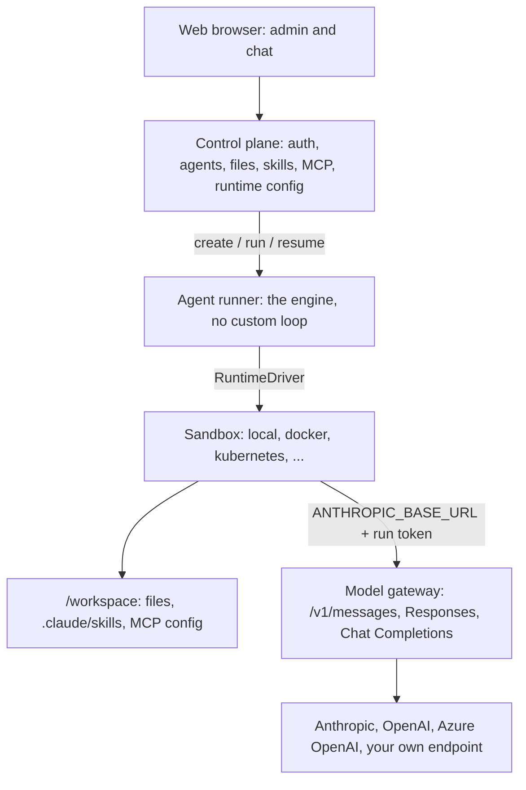

<Info>

- **Read this when:** you are deciding which engine, model, skills, tools, frontend and runtime to use, or want to know what a choice turns into and what does not work yet.
- **You will learn:** how each of the six choices becomes a generator flag and a committed file, what a setting compiles into for the Claude Agent SDK, and the limits of each engine, model and runtime today.
- **Used in:** [Chapter 1 · Run your first agent](/path/first-agent) (create the project), [Chapter 2 · Build your agent](/path/build) (engine, model, skills, tools), [Chapter 4 · Put it in your product](/path/embed) (frontend) and [Chapter 5 · Ship it to your servers](/path/ship) (where it runs).

</Info>

Choose every layer of the agent — the engine, the model, the skills, the tools, the frontend and
where it runs — and keep the control plane on servers you operate.

**In plain words.** Agent Workspace is the part around an AI agent that a company has to build
anyway: where agents are stored, who may use them, where their code runs, and what they did. You
keep the agent framework and the model provider you picked. Each choice is a flag when you create
the project and a line in a file you commit, and everything runs on your laptop, your VM, your
cluster or your Google Cloud project.

What you can do:

- [Pick the six layers and get the command and files](#pick-the-six-layers)
- [Choose the engine that runs the agent loop](#choose-the-engine)
- [Choose the model, including one you host yourself](#choose-the-model)
- [Start from a skill set and add your own tools](#start-from-skills-and-add-your-tools)
- [Run it on a laptop with one Node process](#run-it-on-a-laptop)
- [Ship it to a VM, Cloud Run or Kubernetes](#ship-it-to-your-infrastructure)
- [See what a setting compiles into for the Claude Agent SDK](#see-what-a-setting-compiles-into)
- [Know what a model or runtime cannot do before you rely on it](#know-what-does-not-work)

**Where this fits in the path.** Each layer is chosen at one step of the development path:

- [Chapter 1 · Run your first agent](/path/first-agent): create the project with its flags in the [Quickstart](/getting-started/quickstart).
- [Chapter 2 · Build your agent](/path/build): engine and model in [Models and runtimes](/building/models-and-runtimes), skills in [Skills](/building/skills), tools in [Tools from code](/guides/tools-from-code) and [MCP servers](/building/mcp-servers).
- [Chapter 3 · Test and improve it](/path/test): check what each choice costs and does in [Observability](/resources/observability).
- [Chapter 4 · Put it in your product](/path/embed): the frontend, from [Frontend](/building/frontend) to [Backend](/building/backend).
- [Chapter 5 · Ship it to your servers](/path/ship): where it runs, in [Deploy](/guides/deploy) and [Self-hosting](/building/self-hosting).
- [Chapter 6 · Run it for your team](/path/operate): add a provider adapter or runtime driver in [Extending the platform](/building/extending-the-platform).

## Pick the six layers

**What it is.** The builder at the top of the
[home page](https://lp.agentworkspace.indx.jp/#stack-cmd) turns six choices into the commands and
the three files the generator writes. This page is the long version of that builder. The
[tutorial](/tutorials/your-stack) walks the same path end to end.

**Why it matters.** Nothing about your agent lives only in a database screen. The project is plain
files in your repository: review it, diff it, roll it back.

| Builder chip group | Options on the page                                                       | Where the choice lands                                                          |
| ------------------ | ------------------------------------------------------------------------- | ------------------------------------------------------------------------------- |
| Engine             | Claude Agent SDK, Mastra, OpenAI Agents, pi                               | `--engine`, then `engine:` in `agents/<name>.ts`                                |
| Model              | Anthropic, OpenAI, Azure OpenAI, Self-hosted LLM                          | `--provider` (and `--model-base-url`), then `models:` in `agent-workspace.yaml` |
| Skills             | Support, Knowledge, Automation, Review, Copilot                           | `--theme`, then `skills:` in the agent                                          |
| Tools              | REST API (OpenAPI), PostgreSQL                                            | `--tools openapi,postgres`, then `tools/<name>.ts`                              |
| Frontend           | Chat page, Site widget, React `<Chat/>`, API only                         | No flag: `surfaces/main.ts`, then your own page or backend                      |
| Runs on            | Laptop, On-prem VM, Google Cloud Run, Kubernetes, AWS AgentCore (roadmap) | `environments:` in `agent-workspace.yaml`, or the Helm chart                    |

The generator also accepts `--theme blank`, which the builder does not show. Run
`npm create @indx-workspace@latest -- --help` for every flag; the full question list is in the
[setup contract](/reference/contracts/setup).

The builder shows three tabs. Each is described below.

<Tabs>
  <Tab title="commands">

Four steps. The flags appear only when you leave a default (`claude-agent-sdk`, `anthropic`,
`support`, no tools):

```sh claim="run"
npm create @indx-workspace@latest my-agent -- --yes \
    --engine mastra --provider openai-compatible \
    --model-base-url http://gpu-01.internal:8000/v1 \
    --theme knowledge --tools openapi
export OPENAI_API_KEY=...
cd my-agent && npm run dev
```

Step 3 depends on the frontend (see [Put it in your frontend](#put-it-in-your-frontend)). Step 4
depends on where it runs (see [Ship it](#ship-it-to-your-infrastructure)).

  </Tab>
  <Tab title="agent-workspace.yaml">

The project file. It holds no secret, only the **name** of the variable the key is read from, and
it is meant to be committed:

```yaml title="illustrative" claim="illustrative"
apiVersion: agentworkspace.dev/v2
kind: Project
name: my-agent
models:
  default:
    provider: azure-openai
    credential:
      secret: AZURE_OPENAI_API_KEY
    baseUrl: https://acme.openai.azure.com
    deployment: your-deployment
    apiVersion: your-api-version
environments:
  local:
    cloud: local
    identity:
      bootstrapAdmin: admin@localhost.test
```

With the default Anthropic model, the generator writes no `models` block. `production` (a
`target` and a `url`) is something you add for `aw deploy`. Every key is in the
[project file reference](/reference/contracts/project-file).

  </Tab>
  <Tab title="agents/<name>.ts">

The agent, as TypeScript. The file is named after the agent (`assistant` for Support,
`knowledge`, `automation`, `reviewer`, `copilot`):

```ts title="illustrative" claim="illustrative"
import { defineAgent, skill } from '@indx-workspace/sdk/define';
import openapiTool from '../tools/openapi';

export default defineAgent({
  name: 'knowledge',
  instructions: 'You answer questions from the knowledge you have been given. ...',
  engine: 'mastra',
  model: 'default', // the `models.default` connection in agent-workspace.yaml
  tools: [openapiTool],
  skills: [skill('cite-sources')],
});
```

  </Tab>
</Tabs>

## Choose the engine

**What it is.** The engine is the harness that runs the agent loop: it turns the agent and a
prompt into model calls and tool calls. Agent Workspace does not have its own loop. The Claude
Agent SDK is the default; Mastra, the OpenAI Agents SDK and pi are the others.

**Why it matters.** You keep the framework you trust, and you can move an agent between engines by
changing one line. Skills, connectors and limits go with it where the new engine supports them;
where it does not, the run is refused by name.

**How.** Pass `--engine` when you create the project, or change `engine:` in `agents/<name>.ts`
and save; `aw dev` applies it. `npx aw engines list` prints what your deployment has installed.

| Engine            | Id                 | MCP connectors | Skills | Model dialects it speaks                               | Status     |
| ----------------- | ------------------ | -------------- | ------ | ------------------------------------------------------ | ---------- |
| Claude Agent SDK  | `claude-agent-sdk` | ✓              | ✓      | Anthropic Messages                                     | Default    |
| Mastra            | `mastra`           | ✓              | ✓      | Anthropic Messages, OpenAI Responses, Chat Completions | Registered |
| OpenAI Agents SDK | `openai-agents`    | ✓              | —      | OpenAI Responses, Chat Completions, Anthropic Messages | Registered |
| pi                | `pi`               | —              | ✓      | Anthropic Messages                                     | Registered |

An engine is used only when its runtime image is installed in your deployment. An agent that asks
for something its engine cannot honour is refused by name, not run without it:

<Warning>

- **OpenAI Agents SDK runs no skills.** An agent with a skill is refused with
  `engine_capability_unsupported`. The Support and Knowledge starters come with a skill, so pick
  Review, Automation or Copilot, or remove the skill.
- **pi takes no MCP connectors.** An agent assigned one is refused.
- **pi speaks only Anthropic Messages.** With an OpenAI-family model connection, the gateway
  translates, as it does for the Claude Agent SDK: the run is in compatibility mode. (The landing
  page says such a connection is refused; the run composer lets Anthropic Messages reach every
  provider, as the [engine matrix](/resources/engines) states.)

</Warning>

The [engine matrix](/resources/engines) has the full capability set (resume, fork, turn and budget
caps), and [Runtime neutrality](/concepts/runtime-neutrality) explains what every engine must
honour.

## Choose the model

**What it is.** A model connection is a provider, a credential and, for some providers, an
endpoint. The agent names a connection (`model: 'default'`), never a key.

**Why it matters.** The key stays in your shell or your secret store. The agent's own process only
ever sees a short-lived gateway token for one run.

**How.** Pass `--provider` and, where the provider needs an endpoint, `--model-base-url`; then
export the variable the project file names.

| Builder chip    | Provider id         | Key variable           | Endpoint                                                                           | Status             |
| --------------- | ------------------- | ---------------------- | ---------------------------------------------------------------------------------- | ------------------ |
| Anthropic       | `anthropic`         | `ANTHROPIC_API_KEY`    | Optional                                                                           | Native             |
| OpenAI          | `openai`            | `OPENAI_API_KEY`       | Optional                                                                           | Compatibility mode |
| Azure OpenAI    | `azure-openai`      | `AZURE_OPENAI_API_KEY` | Required, e.g. `https://acme.openai.azure.com`, plus `deployment` and `apiVersion` | Compatibility mode |
| Self-hosted LLM | `openai-compatible` | `OPENAI_API_KEY`       | Required, e.g. `http://gpu-01.internal:8000/v1` (vLLM, Ollama, your gateway)       | Compatibility mode |

There is also `anthropic-compatible` for an Anthropic-shaped endpoint; it asks for `--model-base-url` too. For Azure, the generator
writes `your-deployment` and `your-api-version` placeholders; replace them. Saving the project
file while `aw dev` runs applies the new `models` at once. See
[Models and runtimes](/building/models-and-runtimes) and the [models resource](/resources/models).

## Start from skills and add your tools

**What it is.** A theme is a starter: an agent, its instructions, a surface and an eval file. Some
themes include one example skill (a folder with a `SKILL.md`) or example tools.

| Builder chip | `--theme`    | Agent file             | What it starts with                                     |
| ------------ | ------------ | ---------------------- | ------------------------------------------------------- |
| Support      | `support`    | `agents/assistant.ts`  | Skill `refund-policy`                                   |
| Knowledge    | `knowledge`  | `agents/knowledge.ts`  | Skill `cite-sources`                                    |
| Automation   | `automation` | `agents/automation.ts` | Tools `delivery-estimate` and `orders`, with a fake API |
| Review       | `review`     | `agents/reviewer.ts`   | No skill                                                |
| Copilot      | `copilot`    | `agents/copilot.ts`    | No skill; a small web app                               |

**Your tools.** `--tools` adds the tools that reach your own systems:

| Builder chip       | `--tools` value | What it writes                                                                                                                                             |
| ------------------ | --------------- | ---------------------------------------------------------------------------------------------------------------------------------------------------------- |
| REST API (OpenAPI) | `openapi`       | `tools/openapi.ts`: an `openapiTool()` over your OpenAPI document (`--openapi <path or https URL>`, default `openapi.json`), `GET` only until you widen it |
| PostgreSQL         | `postgres`      | `tools/postgres.ts`: a read-only `postgresTool()` with one placeholder table to replace                                                                    |

Your MCP servers are not a generator flag: name them under `connectors:` in the project file and
assign them with `mcp('<name>')`. See [Tools from code](/guides/tools-from-code),
[MCP servers](/building/mcp-servers) and [Skills](/building/skills).

## Run it on a laptop

**What it is.** `npm run dev` runs `aw dev`: one Node process with an embedded PostgreSQL that
serves the chat, the admin screens and the API on `http://127.0.0.1:3000`.

**Why it matters.** You evaluate it in minutes with no Docker and no cloud account. You need Node
24 or newer (the packages declare `"node": ">=24"`) and a key for your model provider.

<Steps>
  <Step title="Create the project">

`npm create @indx-workspace@latest my-agent -- --yes`. With `--yes` it takes the recommended
answer to every question no flag answers, installs the dependencies and does not start the server.

  </Step>
  <Step title="Export the key and start it">

`export ANTHROPIC_API_KEY=sk-ant-...`, then `cd my-agent && npm run dev`.

  </Step>
  <Step title="Talk to it">

Open the try URL the ready screen prints (`http://127.0.0.1:3000/p/s/main/try`), or run
`npx aw chat -p "hi"`.

  </Step>
</Steps>

The full Docker Compose platform, run from a repository checkout, has its own five-step setup
wizard (Provider, Credentials, Runtime, Administrator, First agent); see
[Self-hosting](/building/self-hosting). For a first run, use the [Quickstart](/getting-started/quickstart).

## Put it in your frontend

The project's surface, `surfaces/main.ts`, is already a hosted chat page. Step 3 of the builder
changes with the Frontend chip:

| Builder chip    | What you do                                                                                                                                                                       |
| --------------- | --------------------------------------------------------------------------------------------------------------------------------------------------------------------------------- |
| Chat page       | Open or share the try URL from the ready screen                                                                                                                                   |
| Site widget     | `<script src="https://agents.acme.example/p/s/main/widget.js" async></script>`                                                                                                    |
| React `<Chat/>` | `npm install @indx-workspace/react @indx-workspace/sdk`, then `<Chat surface="main" baseUrl="https://agents.acme.example" />` (React 18.3 or 19)                                  |
| API only        | `npm install @indx-workspace/sdk`, then `await aw.runs.start(agentId, { prompt })` from your backend (the builder prints `{ agentId, prompt }`; the SDK takes the agent id first) |

Add your site's origin to the surface's `allowedOrigins`. The
[embedding feature page](/features/embed-in-your-product) covers each option in depth.

## Ship it to your infrastructure

**What it is.** The same project, deployed to servers you operate. `aw deploy` handles a single VM
and Google Cloud Run; Kubernetes is a Helm chart.

| Builder chip     | How, today                                                                                                                              | Status                                                                           |
| ---------------- | --------------------------------------------------------------------------------------------------------------------------------------- | -------------------------------------------------------------------------------- |
| Laptop           | `npm run dev`                                                                                                                           | Available                                                                        |
| On-prem VM       | `target: single-vm`: Docker Compose (web, runner, gateway, PostgreSQL, object storage) behind your TLS proxy                            | Available through `aw deploy`                                                    |
| Google Cloud Run | `target: gcp-cloudrun`: the CLI ships the Terraform module and copies the images by digest; `--infra <dir>` is optional                  | Available through `aw deploy`                                                    |
| Kubernetes       | `helm upgrade --install agent-workspace ./infra/helm/agent-workspace -f values.yaml`, with values files for EKS, GKE, AKS and OpenShift | Helm chart; not `aw deploy`                                                      |
| AWS AgentCore    | The `aws-agentcore` runtime driver is named in the contract, not implemented                                                            | Roadmap, [D-4](/concepts/roadmap#d-4-a-verified-managed-cloud-sandbox-per-cloud) |

<Steps>
  <Step title="Name production in the project file">

```yaml title="illustrative" claim="illustrative"
environments:
  production:
    target: single-vm # or gcp-cloudrun
    url: https://agents.acme.example
```

  </Step>
  <Step title="Plan, then apply">

`npx aw deploy production --plan` prints what it will do. `npx aw deploy production --yes`
applies it. On Cloud Run it also needs Terraform and Docker with `buildx`. It never prints a password; it names the file or
command that holds the Owner's.

  </Step>
  <Step title="Push and promote your agents">

`aw push` and `aw promote` need a workspace **API key**: create one in **Administration → API
Keys** on the deployment, then run
`AGENT_WORKSPACE_URL=https://agents.acme.example AGENT_WORKSPACE_API_KEY=... npx aw push --yes && npx aw promote --yes`.

  </Step>
</Steps>

<Warning>

The builder and the deploy output print `aw login --url <url>` before `aw push`. `aw login`
stores a user token, and the deployment accepts that token only on the person-facing routes (`me`,
`workspaces`, `invitations`, sharing policies); `aw push` is refused with it. The CLI says so
itself: "reads workspaces; pushing with it is not supported yet". Use an API key as above.

</Warning>

Every prerequisite `aw deploy` checks is in [Deploy](/guides/deploy).

## See what a setting compiles into

**What it is.** On the Claude Agent SDK engine there is no agent model of our own in between: what
you set in the agent editor becomes the options object the SDK's `query()` receives, for every run.
The compile lives in one module, `packages/engine-claude-agent-sdk` (`compile.ts`, `tools.ts`).

**Why it matters.** If you know the SDK, you know what the product will do. Nothing to migrate off
later.

The [configurator](https://lp.agentworkspace.indx.jp/#configurator) shows a simplified version.
What each setting produces:

| Configurator setting | Options                                                               | Compiles into                                                                  |
| -------------------- | --------------------------------------------------------------------- | ------------------------------------------------------------------------------ |
| Model connection     | Anthropic · Claude, Azure OpenAI, OpenAI                              | `model`: the provider's model id                                               |
| Skills               | `contract-review`, `security-review`, `financial-analysis` (examples) | `skills: [...]`, the names assigned to the agent                               |
| Connectors (MCP)     | Contract Search, Ticketing, GitHub (HTTP), Filesystem (stdio)         | `mcpServers: { <name>: { type, url } }` and `allowedTools: ["mcp__<name>__*"]` |
| Permissions          | Read files, Write files, Run commands, Unrestricted internet          | A switch that is off adds its tools to `disallowedTools`                       |
| Runtime              | `local`, `docker`, `kubernetes`, `aca-sessions`                       | Where the run executes; `cwd` is the run's workspace, `/workspace` by default  |

The permission switches remove these Claude tools when off:

| Switch                | Tools added to `disallowedTools`  |
| --------------------- | --------------------------------- |
| Read files            | `Read`, `Glob`, `Grep`            |
| Write files           | `Write`, `Edit`, `NotebookEdit`   |
| Run commands          | `Bash`, `BashOutput`, `KillShell` |
| Unrestricted internet | `WebFetch`, `WebSearch`           |

<AccordionGroup>
  <Accordion title="Every UI concept and the SDK option it becomes">

| UI concept         | Claude Agent SDK option                                                                                |
| ------------------ | ------------------------------------------------------------------------------------------------------ |
| Agent model        | `model`                                                                                                |
| Working directory  | `cwd` (`/workspace`)                                                                                   |
| Skills             | `skills`, materialised under `.claude/skills/`                                                         |
| MCP connectors     | `mcpServers`                                                                                           |
| Instructions       | `systemPrompt: { type: 'preset', preset: 'claude_code', append: <instructions> }` (omitted when empty) |
| Permissions        | `tools: { type: 'preset', preset: 'claude_code' }` + `disallowedTools`                                 |
| Connector approval | `allowedTools: ['mcp__<name>__*']`                                                                     |
| Max turns          | `maxTurns`                                                                                             |
| Budget             | `maxBudgetUsd`                                                                                         |
| Session resume     | `resume`                                                                                               |
| Environment        | `env`: this run's gateway token, never a provider key                                                  |
| Agent events       | the SDK event stream, relayed and normalised                                                           |
| Host settings      | `settingSources: ['project']` and `strictMcpConfig: true`                                              |

`settingSources` is `['project']`, not empty: the `project` source is what loads the skills and
`CLAUDE.md` placed in the workspace. `user` and `local` are left out, so the sandbox image's own
home directory can never add tools or instructions. `strictMcpConfig: true` stops a `.mcp.json` in
the workspace from adding connectors nobody registered.

  </Accordion>
  <Accordion title="Why upgrades stay boring">

The Claude Agent SDK is an upstream npm dependency pinned to an exact version
(`@anthropic-ai/claude-agent-sdk` in `packages/engine-claude-agent-sdk/package.json`), not code
copied into the repository. Every SDK-specific translation sits in that one adapter package, so an
upstream option change is handled there and nowhere else. The same project can run on the `mastra`,
`openai-agents` or `pi` engine when its runtime image is installed; the Claude Agent SDK stays the
default.

  </Accordion>
</AccordionGroup>

The configurator also prints notices for the combination you picked. These are what they mean:

| Notice                                     | When                                                     | What is true today                                                                                 |
| ------------------------------------------ | -------------------------------------------------------- | -------------------------------------------------------------------------------------------------- |
| Compatibility mode                         | A non-Claude model connection                            | See [Know what does not work](#know-what-does-not-work)                                            |
| stdio connectors are stored but cannot run | Filesystem (stdio)                                       | The platform refuses to spawn a command; a test answers `stdio-probe-unavailable`. Use HTTP or SSE |
| No isolation                               | `local` runtime                                          | Runs as the control plane's own process and user; development only                                 |
| Partially verified                         | `kubernetes`                                             | Implemented; verified on kind, no managed-cluster proof                                                     |
| Not live-verified                          | `aca-sessions`                                           | Implemented; not exercised by the live driver suite                                                |
| ✓ No capability gaps                       | Claude + HTTP connectors + `docker`                       | —                                                                                                  |

## How it fits together

The Claude Agent SDK owns reasoning, planning, tool use, context and the agent loop. Agent
Workspace owns what is around it: configure, store, secure, deploy, isolate, observe.



The gateway holds the provider key; the sandbox only gets a token for one run. A runtime profile
names one of eleven driver ids. Their standing today, from
[Self-hosting](/building/self-hosting#which-runtime-drivers-are-real-today):

| Driver                                                                           | Standing                                                                                                        |
| -------------------------------------------------------------------------------- | --------------------------------------------------------------------------------------------------------------- |
| `local`                                                                          | Implemented; no isolation, development only                                                                     |
| `sandbox-runtime`                                                                | Reserved id; not implemented, so a project that names it runs on `local`                                        |
| `docker`                                                                         | Implemented; isolation live-verified; the single-VM default; `restricted` needs the egress proxy image         |
| `kubernetes`                                                                     | Implemented; partially verified (one Pod per runtime, default-deny NetworkPolicy, optional gVisor RuntimeClass) |
| `aca-sessions`, `cloud-run-service`                                              | Implemented; not live-verified                                                                                  |
| `gke-agent-sandbox`, `aws-agentcore`, `aws-ecs`, `cloud-run-sandbox`             | Named; not implemented ([D-4](/concepts/roadmap#d-4-a-verified-managed-cloud-sandbox-per-cloud))                |
| `external`                                                                       | Available (E2B); passed the provider live lane (run 37809484699)                                                |

<Accordion title="Everything the 'works with' strip names, and where it is used">

| Area     | Names                                                                  | Where                                                                                  |
| -------- | ---------------------------------------------------------------------- | -------------------------------------------------------------------------------------- |
| Engines  | Claude Agent SDK, Mastra, OpenAI Agents SDK, pi                        | [Engines](/resources/engines)                                                          |
| Models   | Anthropic, Azure OpenAI, OpenAI, OpenAI-compatible                     | [Models](/resources/models)                                                            |
| Tools    | MCP over HTTP / SSE, OpenAPI tools                                     | [MCP servers](/building/mcp-servers), [Tools from code](/guides/tools-from-code)       |
| Runtimes | Docker, Kubernetes, gVisor RuntimeClass, Node 24                       | The driver table above                                                                 |
| Stores   | PostgreSQL 17, S3, GCS, Azure Blob, SeaweedFS (S3-compatible endpoint) | [Data plane](/concepts/data-plane); native S3, GCS and Blob adapters await live proofs |
| Ops      | OpenTelemetry (`OTEL_EXPORTER_OTLP_ENDPOINT`)                          | [Export runs](/features/run-observe-evaluate#export-runs-to-opentelemetry)             |
| Identity | Any OIDC issuer: Entra ID, Okta, Google                                | [Data plane](/concepts/data-plane)                                                     |
| Embed    | React 18.3 or 19 (`@indx-workspace/react` peer dependency)             | [Put it in your frontend](#put-it-in-your-frontend)                                    |
| Deploy   | Google Cloud Run; EKS, GKE, AKS, OpenShift through the Helm chart      | [Ship it](#ship-it-to-your-infrastructure)                                             |

</Accordion>

## Know what does not work

**What it is.** A non-Claude model reached through the gateway runs in **compatibility mode**. It
runs, but it is not equivalent. Every provider adapter declares capability flags and, where it
translates, a verdict per feature. The rule: never silently claim 100% compatibility.

What the gateway's provider adapters declare today (`packages/gateway/src/providers/`):

| Capability         | Anthropic          | OpenAI         | Azure OpenAI  | OpenAI-compatible |
| ------------------ | ------------------ | -------------- | ------------- | ----------------- |
| Streaming          | ✓                  | ✓              | ✓             | ✓                 |
| Tools              | ✓                  | ✓              | ✓             | ✓                 |
| Thinking           | ✓                  | ~ approximated | − unsupported | −                 |
| Prompt caching     | − not yet verified | ~ approximated | − unsupported | −                 |
| Context management | ✓                  | ✓              | − unsupported | −                 |

<Note>

The landing page's matrix is marked illustrative and differs from this table. Anthropic prompt
caching is declared `false` until a credential-bound replay verifies it; OpenAI declares caching
with an approximated verdict; Azure declares thinking and context management unsupported. A
provider compatibility suite exists and the adapters are fixture-verified; live-provider results
are not published yet.

</Note>

**Where you see it.** The agent editor shows _"This model does not fully support Claude prompt
caching. The agent can still run, but behavior may differ."_ when the selected model's
`promptCaching` flag is false. The runtime screen marks a driver **Unverified** until its
_Test runtime_ has passed in your deployment, marks `local` **No isolation**, and is disabled when
no runtime connection is configured or its image is unreachable.

### What this deliberately is not

Not another agent framework, not a workflow canvas, not RAG, embeddings or a vector database, not a
LiteLLM port, not a Kubernetes management UI, not an identity provider (it uses your OIDC issuer),
not a billing system. If you want a visual canvas or a vector store, Dify or n8n are the better fit.

### How it compares

|                   | Agent Workspace                                                    |
| ----------------- | ------------------------------------------------------------------ |
| Agent loop        | The Claude Agent SDK, unchanged (or Mastra, OpenAI Agents SDK, pi) |
| Control plane     | In your infrastructure                                             |
| Licence           | Apache-2.0                                                         |
| SDK and CLI       | TypeScript only                                                    |
| Non-Claude models | Compatibility mode, said before you rely on it                     |

## Limits today

- **Your model provider sees your prompts.** The control plane, its database, files and keys stay
  on your servers, but with Anthropic, OpenAI or Azure OpenAI each model call goes to that provider.
  Only a self-hosted `openai-compatible` model keeps model traffic inside your network.
- **Not every choice is a flag.** The generator has no flag for the frontend, the production target
  or an MCP server; you edit `surfaces/main.ts`, `environments:` and `connectors:`.
- **`aw deploy` covers a VM and Cloud Run.** Kubernetes is the Helm chart; `aw deploy` has no AWS
  or Azure target yet.
- **`aw login` cannot push.** `aw push` and `aw promote` against a deployment need an API key.
- **AWS AgentCore, GKE Agent Sandbox, ECS, Cloud Run sandboxes and external sandboxes** are named,
  not implemented, and no managed-cloud driver has a live isolation proof:
  [D-4](/concepts/roadmap#d-4-a-verified-managed-cloud-sandbox-per-cloud).
- **Kubernetes** is partially verified; **`aca-sessions`** and **`cloud-run-service`** are not
  live-verified.
- **stdio MCP connectors** run only in the per-session tool sandbox, which is off by default and not
  yet wired end to end ([Connect an MCP server](/building/mcp-servers)); use HTTP or SSE.
- **Engine gaps:** OpenAI Agents SDK has no skills; pi has no MCP connectors; only pi can fork a
  session (Claude Agent SDK, Mastra and OpenAI Agents SDK refuse a fork).
- **Compatibility mode** on non-Claude models: thinking and prompt caching are approximated or
  unsupported, and live-provider results are not published.
- **A `defineTool()` tool** (the Automation starter's `delivery-estimate`) runs under `aw dev` but
  cannot be promoted yet.
- **TypeScript only**, and you operate it: five services in production, with your own upgrades and
  backups.

## Go deeper

<CardGroup cols={2}>
  <Card title="Tutorial: your stack" icon="route" href="/tutorials/your-stack">
    One agent, each layer changed in turn.
  </Card>
  <Card title="Quickstart" icon="rocket" href="/getting-started/quickstart">
    Your first agent in three commands.
  </Card>
  <Card title="Installation" icon="download" href="/getting-started/installation">
    Packages, Node 24 and the embedded runtime.
  </Card>
  <Card title="What is Agent Workspace" icon="circle-info" href="/concepts/what-is-agent-workspace">
    What it owns and what it leaves to the SDK.
  </Card>
  <Card title="Architecture" icon="sitemap" href="/concepts/architecture">
    Packages, dependency direction, trust boundary.
  </Card>
  <Card title="Runtime neutrality" icon="shuffle" href="/concepts/runtime-neutrality">
    What every engine must honour or refuse.
  </Card>
  <Card title="Models and runtimes" icon="microchip" href="/building/models-and-runtimes">
    Connect providers and pick where agents run.
  </Card>
  <Card title="Engines" icon="gears" href="/resources/engines">
    The engine catalogue and capability matrix.
  </Card>
  <Card title="Models" icon="brain" href="/resources/models">
    Connections, providers and discovered capabilities.
  </Card>
  <Card title="Self-hosting" icon="server" href="/building/self-hosting">
    Compose, Kubernetes and driver standing.
  </Card>
  <Card title="Deploy" icon="cloud-arrow-up" href="/guides/deploy">
    `aw deploy` prerequisites per target.
  </Card>
  <Card title="Project file" icon="file-code" href="/reference/contracts/project-file">
    Every key of `agent-workspace.yaml`.
  </Card>
  <Card title="Setup questions" icon="list-check" href="/reference/contracts/setup">
    Every generator flag and its values.
  </Card>
  <Card title="Engine contracts" icon="code" href="/reference/contracts/engines">
    `ENGINE_IDS`, wire protocols, descriptors.
  </Card>
  <Card title="Model contracts" icon="code" href="/reference/contracts/models">
    Capability keys and provider config rules.
  </Card>
  <Card title="CLI commands" icon="terminal" href="/reference/cli/commands">
    `aw deploy`, `aw push`, `aw engines list` and the rest.
  </Card>
  <Card title="Extend the platform" icon="puzzle-piece" href="/building/extending-the-platform">
    Add a provider adapter or a runtime driver.
  </Card>
</CardGroup>
