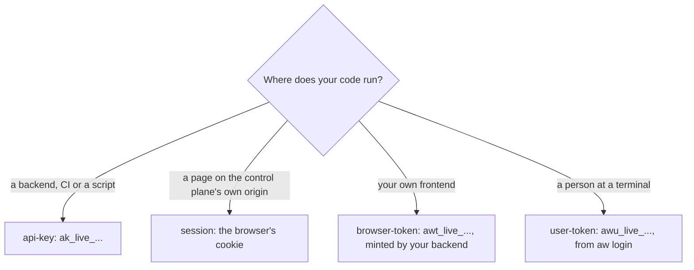

<Info>
**Chapter 4 · Put it in your product — step 2 of 8** · [the chapter map](/path/embed)

- **You will:** pick the credential for where your code runs, and mint an API key.
- **You will learn:** what each credential may reach, why a key never goes to a browser, and the four roles.
- **You need:** [Which surface for which job](/building/overview).

</Info>

Pick the credential for where your code runs: an API key for a backend, CI or the CLI, the
session cookie for a page on the control plane's own origin, or a short-lived browser token for
your own frontend. `createClient` takes exactly one `auth` value, and every request carries it.



**What you can do**

- [Call the API from a backend, CI or the CLI](#api-key-—-a-backend-ci-or-the-cli) with an API key.
- [Get a key](#getting-a-key) and [see what it may do](#what-an-api-key-can’t-do).
- [Let your frontend follow one run](#browser-token-—-a-customer’s-own-frontend-off-the-control-plane’s-origin) with a browser token.
- [Understand the four roles](#roles).
- [Keep the key out of your code](#keeping-the-key-out-of-code).

## `api-key` — a backend, CI, or the CLI

Use an API key for anything that is not a browser page signed into the control plane: your
backend, a CI job, or `aw`.

```ts claim="compile"
import { createClient } from '@indx-workspace/sdk';

const baseUrl = process.env.AGENT_WORKSPACE_URL;
const apiKey = process.env.AGENT_WORKSPACE_API_KEY;
if (baseUrl === undefined || apiKey === undefined) {
  throw new Error('Set AGENT_WORKSPACE_URL and AGENT_WORKSPACE_API_KEY');
}
const aw = createClient({ baseUrl, auth: { kind: 'api-key', apiKey } });
```

The client sends the key as `Authorization: Bearer <key>` on every request. It's the same header
from any HTTP client, not only this SDK — see [Call the API without the SDK](/building/http-api).

### Getting a key

Mint one from the workspace UI (**Administration → API Keys**), or from the CLI once you already
have a session or another key with permission to create one. On the workspace `aw dev` runs, sign
in to the UI with the `console` row of its ready screen (the first-run password is in
`.agent-workspace/secrets/local-secrets.json` unless your environment sets it); inside the project, `npx aw`
already uses the local key `aw dev` stored:

```sh title="illustrative" claim="illustrative"
aw team api-keys create --name "ci-deploys" --role builder
```

The response shows the key's plaintext exactly once, with a `warning` saying so. There is nowhere
to retrieve it again: the stored resource never carries the secret or its hash, only a display
prefix.

<Accordion title="The key's shape">

A whole presented key matches `API_KEY_PATTERN` from `@indx-workspace/contracts/api-keys`:

```ts title="illustrative" claim="illustrative"
export const API_KEY_PREFIX = 'ak_live_';
export const API_KEY_ID_LENGTH = 22;
export const API_KEY_SECRET_LENGTH = 43;

export const API_KEY_PATTERN = new RegExp(
  `^${API_KEY_PREFIX}[A-Za-z0-9_-]{${API_KEY_ID_LENGTH}}_[A-Za-z0-9_-]{${API_KEY_SECRET_LENGTH}}$`,
);
```

That is `ak_live_` followed by a 22-character key id, an underscore, and a 43-character secret —
the whole string is the bearer token. A key read back from the API is shown only as its _display
prefix_, `ak_live_<key id>` (`API_KEY_DISPLAY_PREFIX_PATTERN`), which is not enough to
authenticate and exists only so a list is recognisable. The mint response is
`MintedApiKeyResponseSchema` (`key` plus `warning`); the stored resource is
`ApiKeyResourceSchema`.

</Accordion>

### What an API key can't do

Every route under `/api/workspaces` and every route under `/api/invitations` refuses an API-key
principal outright, with `403 api_key_not_permitted`, before any other authorisation check runs.
This is deliberate: an API key is scoped to one workspace with one fixed role and represents no
person, so it has no memberships to list and no identity to own a new workspace. The refusal also
closes a cross-tenant bug.

So `aw.workspaces.list|get|create|update` and `aw.team.invitations.*` need
`auth: { kind: 'session' }`. Everything else — agents, runs, sessions, projects, secrets,
runtimes, models, files, skills, connectors, `aw.team.members`/`aw.team.apiKeys`, shares,
observability — accepts an API key, subject to the key's [role](#roles).

To see which workspace and role a key resolved to, run `aw me` or call
[`aw.me()`](/reference/sdk/client#me) — the one route both credential kinds answer, and every
consumer's first call. A revoked key or an expired session answers `401 unauthenticated`, never a
`200` with a stale principal.

<Accordion title="What aw.me() returns">

```ts title="illustrative" claim="illustrative"
const me = await aw.me();
// { principalId, kind: 'api-key', role: 'builder', workspaceId, userId: null, label: 'ci' }
```

`kind` is `membership` for a session and `api-key` for a key; `userId` is `null` for exactly an
API-key principal, because a key represents no person.

</Accordion>

## `session` — a browser page on the control plane's own origin

`auth: { kind: 'session' }` sends no `Authorization` header; every request is made with
`credentials: 'include'`, so the browser attaches the session cookie the control plane's own
origin set. It only works for a page served from that origin — it is how the control plane's own
UI calls its own API, not a credential you can hand to an arbitrary frontend or backend.

<Note>
  A person signs the CLI in with `aw login`, a device flow that ends in a short-lived
  `awu_live_…` user token — `auth: { kind: 'user-token', token }` in the SDK. It acts as that
  person, with their current role, but only on the person-facing routes: who am I, workspaces,
  invitations, the sharing policy, sign-out and workspace switch. Everything else
  still takes an API key. The credential each consumer type ends
  up with is tabulated on [Target
  architecture](/concepts/target-architecture#every-consumer-type-has-a-credential).
</Note>

<Accordion title="The ClientAuth type">

```ts title="illustrative" claim="illustrative"
type ClientAuth =
  | { readonly kind: 'api-key'; readonly apiKey: string }
  | { readonly kind: 'session' }
  | { readonly kind: 'browser-token'; readonly token: string }
  | { readonly kind: 'user-token'; readonly token: string };
```

</Accordion>

## Browser token — a customer's own frontend, off the control plane's origin

Your backend mints a short-lived token scoped to one run or one session and hands it to the
frontend over your own channel; the frontend calls with it. A workspace API key must never reach
a browser.

```ts title="illustrative" claim="illustrative"
const token = await backend.tokens.mint({ kind: 'run', id: run.id });
// hand `token.token` to the frontend, over your own channel — never over the wire this SDK sends

const aw = createClient({
  baseUrl: 'https://your-frontend-origin.example',
  auth: { kind: 'browser-token', token: token.token },
});
```

A run-scoped token may read that run and follow its events, and nothing else; a session-scoped
token may additionally start a run in that session. Every other route — including the
workspace's run list, and minting another token — is refused. The token stops working once it
expires (`60`–`3600` seconds, default `300`), once the run or session it names reaches a terminal
state, or once the credential that minted it is revoked. See [Embed an agent in your
product](/building/embedding) for the end-to-end flow and the [browser-token
reference](/reference/contracts/tokens) for the full grammar and problem codes.

<Note>
  **A browser token is a credential, not a CORS policy.** This deployment sends no
  `Access-Control-Allow-Origin` and refuses `OPTIONS`, so a frontend on a genuinely different origin
  from the control plane still cannot complete the `fetch` — the browser blocks it before the token
  is ever read. Today the token works for a frontend that shares the control plane's origin, or that
  reaches it through a **same-origin proxy** you run (which is why the `baseUrl` above is your own
  frontend's origin, not the control plane's). Cross-origin support needs an allowed-origins
  configuration and a decision about what `OPTIONS` means in §21; until then, see [Call the HTTP API
  directly](/building/http-api#browser-calls) for the backend relay. The one exception is a hosted
  surface's chat: its session bootstrap and the visitor run routes answer CORS for the origins in a
  surface's `allowedOrigins`, and the bootstrap mints the visitor's own session-scoped token, valid
  for one hour ([Build a frontend](/building/frontend#chat-component-react)).
</Note>

<Accordion title="Minting, scopes and refusals in detail">

Minted by your own backend — `POST /api/tokens`, `aw.tokens.mint(scope)` — with `auth: {
kind: 'api-key' }` or `{ kind: 'session' }`; never by the frontend itself. The mint response
carries the plaintext exactly once, the same shape an API key's mint response does
(`MintTokenResponseSchema`'s `token` field, plus a `warning`); the stored form is a hash.

The token sends `Authorization: Bearer awt_live_…`, exactly as an API key does, and never sets
`credentials: 'include'`; it cannot act as the API key that minted it. A `scope` narrows it to
exactly one row:

```ts title="illustrative" claim="illustrative"
type TokenScope = { kind: 'run'; id: string } | { kind: 'session'; id: string };
```

Most out-of-scope routes are stopped at the edge with `401 unauthenticated` before a handler
runs, and a route inside the grammar's prefix but outside its cells answers `403
token_out_of_scope` from the authorisation gate. The minting principal's role is re-read from the
directory on every request, never carried in the token itself, so a revoked key or a demoted
member takes effect on the token's very next call.

</Accordion>

## Roles

A credential — key or session — authenticates _as_ one of four roles per workspace: `owner`,
`admin`, `builder` or `viewer` (`MEMBERSHIP_ROLES` in `@indx-workspace/contracts`). Broadly,
`owner` can do everything, `admin` manages most resources workspace-wide, `builder` can read
broadly and write/run what it owns, and `viewer` is read-only (and can run an agent only when
explicitly granted).

The SDK does not encode the permission table client-side — it surfaces whatever the server
decides, as a `403 forbidden` `ApiProblemError` (see [Errors](/guides/errors)). The API
specification's §3.3 reproduces the full resource-by-role table as of its date; treat it as
documentation of current server behaviour, not a contract the SDK enforces — always branch on the
`403` you actually receive.

## Keeping the key out of code

Never write a key literally into source. Every example on this site reads
`process.env.AGENT_WORKSPACE_API_KEY`, as [above](#api-key-—-a-backend-ci-or-the-cli); treat that
as the convention.

- Set it in your process environment, a `.env` file excluded from version control, or your CI
  provider's secret store — never in a committed file.
- The SDK itself reads no environment variables (see [Configuration](/getting-started/configuration)); `AGENT_WORKSPACE_URL` and
  `AGENT_WORKSPACE_API_KEY` are a convention this documentation and the `aw` CLI share, not
  something `createClient` looks up for you. You choose how the value reaches your code.
- The `aw` CLI goes further and refuses `--api-key <value>` as a flag by design, because a flag
  value lands in shell history; it only accepts a key via those two environment variables, a
  profile file, or piped stdin (`--api-key-stdin`). See [Configuration](/cli/configuration).

Continue with [Quickstart](/getting-started/quickstart) to put a key to use, or
[Team](/resources/team) for the full `aw.team.apiKeys` and membership API.
