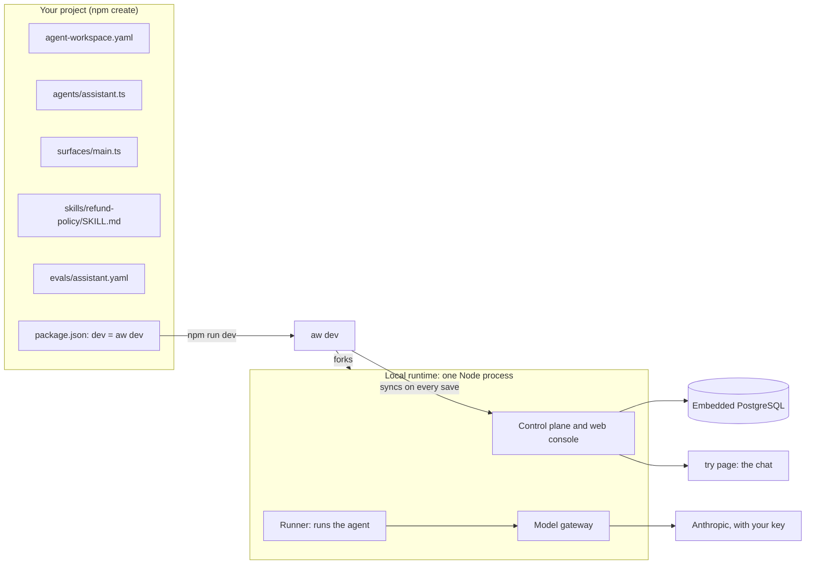

<Info>

**Chapter 1 · Run your first agent — step 2 of 3** · [the chapter map](/path/first-agent)

- **You will:** create a project with `npm create` and start it with `npm run dev`.
- **You will learn:** what the generator writes, what the local runtime runs, and where to talk to the agent.
- **You need:** Node 24 or newer ([Installation](/getting-started/installation)) and an Anthropic API key (create one in the [Anthropic Console](https://console.anthropic.com/settings/keys)).

</Info>

Run an agent on your machine in a few minutes: one Node process, no Docker. When it works, [Call
it from code](/building/backend#call-it-from-code-starting-from-aw-dev) takes the same running
workspace from your own backend, and [Run the full platform](/building/self-hosting#run-the-full-platform)
is the Docker Compose deployment.

**What you can do**

- [Create and start your first agent](#your-first-agent) with one command.
- [Have a coding agent do the install](#install-with-claude-code) for you.
- [Start from a complete example](#starters) instead of a blank project.
- [Talk to it, evaluate it, and give it tools](#next-15-minutes) in the next 15 minutes.

## How it fits together

`npm create` writes a project of plain files; `npm run dev` runs `aw dev`, which forks the local
runtime from the project's own dependencies and pushes your agent into it on every save.



The files shown are what the `support` theme writes for the agent `assistant`; every theme writes
`agent-workspace.yaml`, `agents/<agent>.ts`, `surfaces/main.ts`, `AGENTS.md`, `package.json`,
`pnpm-workspace.yaml` and `.gitignore`. The embedded PostgreSQL runs beside the Node process and
keeps its data under `.agent-workspace/` in the project, which `.gitignore` lists.

## Your first agent

You need Node 24 or newer and an Anthropic API key. Docker is not needed. Set the key in the shell
that runs `npm run dev`, the way your shell does it:

| Shell                       | Command                                 |
| --------------------------- | --------------------------------------- |
| macOS, Linux, WSL, Git Bash | `export ANTHROPIC_API_KEY=sk-ant-...`   |
| PowerShell                  | `$env:ANTHROPIC_API_KEY = 'sk-ant-...'` |
| cmd.exe                     | `set ANTHROPIC_API_KEY=sk-ant-...`      |

On a terminal the shortest path is one command with no flags. It asks everything as a menu or a
default you accept with Enter, installs the dependencies, and starts the project:

```bash claim="run"
npm create @indx-workspace@latest
```

Without a person (a coding agent, or any run where `CI` is set or stdin or stdout is not a
terminal) nothing prompts: `--yes` takes every recommended answer and installs the dependencies, and
never starts the server. Flags and `--answers <file>` set any answer; see
[Running without a person](/cli/overview#running-without-a-person).

```sh claim="run"
npm create @indx-workspace@latest my-agent -- --yes
cd my-agent && npm run dev    # runs aw dev
# open the try URL from the ready screen
```

<Steps>
  <Step title="Create the project">
    `npm create` writes `agent-workspace.yaml`, the agent `agents/assistant.ts`, the surface
    `surfaces/main.ts`, an `AGENTS.md` for coding agents, and a `package.json` whose `dev` script is
    `aw dev`. The generator's flags go after npm's `--`.
  </Step>
  <Step title="Start it">
    `npm run dev` runs `aw dev`: the local runtime, one Node process with an embedded PostgreSQL. It
    reads `ANTHROPIC_API_KEY` from its environment and never writes the key to the project; if the
    key is missing it offers to open the provider's console and take it there.
  </Step>
  <Step title="Chat with it">
    Open the `try` URL from the ready screen and send a message. The run uses the workspace's
    default runtime profile, `local`, and the model connection `aw dev` set up from your key.
  </Step>
  <Step title="Check and save it">
    `npx aw check` checks the project's agents and surfaces against the running workspace and saves
    nothing. While `aw dev` runs, every save already saves a version the way `npx aw push --yes`
    does, so `npx aw push` there reports nothing to change; `push` is for a workspace `aw dev` does
    not sync, such as a shared one. See [Agents as code](/guides/agents-as-code).
  </Step>
</Steps>

<Warning>

Agent runs use the workspace's default runtime profile `local`: the runtime creates it at start
and makes it the default, unless the workspace already has one, and an agent that names no runtime
profile runs on that default. That profile names the `local` driver, the runtime's in-process
runner, which has no isolation — commands run as you — so it is for development only. The
generated project sets no `runtime.default`, so the runtime's `Runtime:` startup line names the
driver it detected on the host (Docker when it is reachable, otherwise `local`), and the no-isolation
warning appears only when that is `local`; runs on the `local` profile stay on the in-process
`local` driver, with no isolation, whatever driver that line names.

To try a container sandbox, start with `npx aw dev --sandbox docker` (or set
`runtime.default: docker` under `environments.local` in `agent-workspace.yaml`): the runtime makes
a `docker` profile the default and runs every agent in a container, and it refuses to start when
Docker or the runtime image (`RUNTIME_IMAGE`, by default `agent-workspace/runtime:dev`) is missing.
Its network is `open` and unproxied: the container can reach your LAN and the internet, unlike a
deployment, whose egress goes through an allowlist proxy. Known limits (issue #786): no release
ships the runtime image for this use, so build it from the Agent Workspace repository with
`docker build -f runtime.Dockerfile -t agent-workspace/runtime:dev .`; and only an agent with the
`unrestrictedNetwork` permission runs there, because a sandbox reached on the host loopback cannot
also be cut off from the network. Any other agent's run fails at start. Every container and network
the sandbox starts carries the label `agent-workspace.compose-project=aw-dev-<folder>-<hash>`, so
`docker ps --filter label=agent-workspace.compose-project` finds them; stopping `aw dev` removes
them, along with any a killed session of the same project left behind.

</Warning>

<AccordionGroup>
  <Accordion title="What npm create asks, writes and installs">

`npm create @indx-workspace@latest my-agent -- --yes` writes a `kind: Project` project with the
recommended answers: `agent-workspace.yaml`, the agent `agents/assistant.ts`, the surface
`surfaces/main.ts`, and a `package.json` that pins `@indx-workspace/aw`,
`@indx-workspace/embedded` and `@indx-workspace/sdk`, pins `@indx-workspace/cli` as a dev
dependency (`aw deploy` imports its deploy steps from it), answers npm's install-script prompt in an
`allowScripts` block (pnpm's in `pnpm-workspace.yaml`), and whose `dev` script is `aw dev`. It also
writes an `AGENTS.md` that tells a coding agent how to run the project without a terminal, and the
theme's starter files (the `support` theme: a `README.md`, the `refund-policy` skill and
`evals/assistant.yaml`).

Without a directory it first asks `Project name` (typed, `my-agent` when you press Enter; a name
that already exists is refused and asked again); without a directory and without a terminal it
uses `my-agent` and says so on stderr. On a terminal it then asks the setup questions as
arrow-key menus (see `aw init` below), among them `Where should agents run their tools?`
(`--sandbox`): `auto`, the recommended answer, lets the runtime pick Docker when it is reachable,
and `local` writes `runtime.default: local`, the in-process driver with no isolation (see the
warning above). It then shows the files, and asks before writing. After writing it
asks `Install dependencies now?` (Yes is the default), runs the install with the package manager
that ran `npm create` (npm, pnpm, yarn or bun), and asks `Start it now?` (Yes again), which runs
`<manager> run dev` in the project so you land on the ready screen. A terminal session looks like
this:

```text title="Example output (illustrative)" claim="illustrative"
? Project name (my-agent) my-agent
...
create will write:
  package.json
  pnpm-workspace.yaml
  agent-workspace.yaml
  agents/assistant.ts
  surfaces/main.ts
  ...
v Write these <n> files into /home/you/my-agent? yes

Created /home/you/my-agent
aw dev reads ANTHROPIC_API_KEY from its environment; no key is written to a file.
v Install dependencies now? yes
(the package manager's own output)
v Start it now? yes
npm run dev
```

`--install` / `--no-install` and `--start` / `--no-start` answer those two questions (`--start`
implies `--install`); starting keeps `aw dev` in the foreground until Ctrl+C, and create exits
with its code. `--yes` means install, and do not start. Without a terminal nothing is
installed or started unless a flag says so. Whatever was not done is printed as the next steps,
in order, for your shell: `cd`, the install, the key (the `export` line, or on Windows both the
PowerShell and cmd lines), then the run:

```text
Next steps:
  cd my-agent
  npm install
  export ANTHROPIC_API_KEY=<your key>
  npm run dev
```

Setting the key before `npm run dev` is optional: if it is missing, `aw dev` offers to open the
provider's console and takes the key there. `aw login` is not part of this output; run it later
when you want to share a workspace ([Authentication](/getting-started/authentication)).

  </Accordion>
  <Accordion title="What aw dev does and the ready screen">

`npm run dev` runs `aw dev`, which starts the published local runtime
(`@indx-workspace/embedded`) from the project's own dependencies: one Node process with an
embedded PostgreSQL. `aw dev` reads `ANTHROPIC_API_KEY` (and `ANTHROPIC_BASE_URL`, if set) from
its environment — set it in the shell, never in a file; no key is written to the project. On a
terminal with no key, `aw dev` offers a numbered choice (Enter takes the first): open the
provider's console to create one (it opens your browser, or prints the link), paste a key
(hidden), or skip. A pasted key is not written to the project, but the local runtime keeps it in
its own database: a later `aw dev` without the variable runs on it, and the ready screen says
`stored key checked`. When the provider rejects the key, `aw dev` does not offer to open the
chat; set the variable to a valid key and restart. The line it prints to set the key is
`export NAME=…` on macOS and Linux, and on Windows both PowerShell `$env:NAME="…"` and cmd
`set NAME=…`. On WSL the console opens in the Windows browser (`wslview`, else `cmd.exe start`).

On Windows, run it from a terminal that is not elevated: PostgreSQL refuses to start under an
account with administrator rights, and `aw dev` then stops with that reason. WSL works too.

It takes `--quiet` (no ready screen), `--open` / `--no-open` and `--verbose` (stream the
runtime's output); the web port is `--port <n>`, else `PORT` in `aw dev`'s environment, else
`environments.local.port` in `agent-workspace.yaml`, 3000 when none is given. The embedded PostgreSQL listens on `127.0.0.1:25432`; set `AW_DATABASE_PORT` in
the project's `.env` to move it, or `DATABASE_URL` to use your own PostgreSQL instead. The
runtime's own output (initdb, PostgreSQL, Next) goes to `.aw/logs/runtime.log`, which the
generated `.gitignore` lists. It prints one screen when everything is up:

```text
  Agent Workspace · my-agent · local

  try       http://127.0.0.1:3000/p/s/main/try
  console   http://127.0.0.1:3000
            sign in as <owner email>
            password in .agent-workspace/secrets/local-secrets.json
  chat      npx aw chat

    runtime   ready in 6.1 s   logs: .aw/logs/runtime.log
    model     default · workspace default model · key checked
    signed in as <owner email> (workspace <slug>)
    agent     assistant  (agents/assistant.ts)
    surface   main

  evals     3 cases · npx aw eval
  embed     <script src="http://127.0.0.1:3000/p/s/main/widget.js" async></script>
  react     https://docs.agentworkspace.indx.jp/building/react

  watching agents/ surfaces/ tools/ skills/ · edit a file and save
```

The first thing on the screen is the chat page (`try`). On a terminal, `aw dev` then asks
`Open the chat in your browser? (Y/n)`; Enter opens it. `--open` opens it without asking (also
where there is no terminal) and `--no-open` never asks; with `--quiet`, or when the output is not
a terminal, it never asks (`--open` still opens). The `console` row says how to sign in to the
local web console: the URL, the email, and where the first-run password is (your environment,
`.env`, or `.agent-workspace/secrets/local-secrets.json`; the password is never printed).

Every save under `agents/`, `surfaces/`, `tools/` or `skills/`, or to `agent-workspace.yaml`, syncs again and prints one `synced:` line. When the
runtime stops on its own, `aw dev` prints the last 20 lines of the log and its path. With
`NO_COLOR` set, or when the output is not a terminal, the screen has the same content without
colour or the tick marks. Ctrl+C stops it (it says `stopping the local runtime…` at once; the
runtime and its database can take a few seconds).

For a start in the background, `npx aw dev status` exits 0 and prints the URL once the runtime is
ready (`--json` prints `{"running":true,"url":…,"port":…,"pid":…}`), and fails while it is still
starting or stopped; `npx aw dev stop` stops it, its runtime and its database. To delete a project
directory on macOS or Linux, run `chmod -R u+w .agent-workspace` in it first: the skill folders an
agent's runs read are kept read-only.

  </Accordion>
  <Accordion title="If a port is busy">

When the project does not set `environments.local.port` and 3000, 4000, 8080 or 25432 is taken,
`aw dev` moves all four to the next free set and says so (`web on :3001 (3000 was busy)`). A port
you set is never moved: it is reported as busy and nothing starts. The gateway, runner and
database ports move with the web port: each is its default plus the web port's distance from
3000, so `port: 3070` gives 4070, 8150 and 25502. A derived port above 49151 (the start of the
operating systems' dynamic ranges) is not used: that service keeps its default port. From web
port 26720 up the database stays on 25432, from 44072 the runner stays on 8080, and from 48152
the gateway stays on 4000. A `GATEWAY_PORT`, `RUNNER_PORT` or
`AW_DATABASE_PORT` in `aw dev`'s own environment turns the automatic move off; one in `.env` is
still checked by the runtime and refused when busy.

| Role                | Default | Setting that moves it                                                 |
| ------------------- | ------- | --------------------------------------------------------------------- |
| web                 | 3000    | `aw dev --port`, `PORT`, or `environments.local.port`                 |
| gateway             | 4000    | the web port, or `GATEWAY_PORT` in the project's `.env`               |
| runner              | 8080    | the web port, or `RUNNER_PORT` in the project's `.env`                |
| embedded PostgreSQL | 25432   | the web port, `AW_DATABASE_PORT` in `.env`, or `DATABASE_URL` instead |

With a port set, `aw dev` checks all of them before it starts anything, reports every port that
is not free in one message, and starts nothing:

```text
error: the local runtime cannot start; nothing was started. These ports are not free:
  port 3000 (web) is already in use: stop the process that holds it, or set environments.local.port in agent-workspace.yaml to a free port below 49152
```

Change the port (`port: 3200` also moves the gateway, runner and database to 4200, 8280 and 25632) or set the variable named in the message in a `.env` next to the project file.

  </Accordion>
  <Accordion title="Which model and profile the first run uses">

A message sent from the `try` page runs the agent on the workspace's default runtime profile,
`local`, which the runtime creates at start, with the `default` model connection `aw dev` set up
from `ANTHROPIC_API_KEY`. The runtime serves the surface's page, its try page and the one-tag
widget snippet from the same origin. The generated agent says `model: 'default'`, which names
that connection but no model id, so the run uses the deployment default model the local runtime
sets: `claude-sonnet-4-5` for Anthropic, or its newest dated release
(`claude-sonnet-4-5-YYYYMMDD`) when the provider's model list has only those. See [Choosing a
model at each level](/building/models-and-runtimes#choosing-a-model-at-each-level).

Inside the project, `aw` takes the URL from `agent-workspace.yaml` and the local key `aw dev`
stored, so no `AGENT_WORKSPACE_*` variable is needed — and none may be set to point it elsewhere:
`AGENT_WORKSPACE_URL` outranks the project file.

  </Accordion>
  <Accordion title="Start in an existing directory (aw init)">

Run `npx @indx-workspace/aw init` there. On a terminal it asks the same setup questions as
`npm create`, theme first, lists the files and asks before writing. Every choice is an arrow-key
menu (up and down or `k` and `j` move, space toggles a multi-select, Enter accepts, Ctrl-C leaves)
with the recommended answer preselected and marked, each theme shows a one-line summary, and the
file confirmation is a Yes/No menu that defaults to Yes; text questions stay typed with the
default shown. `--yes` takes the recommended answers without asking, and without a terminal
`--yes` is required. It writes the same files `npm create` writes for the same answers
(`agent-workspace.yaml`, the agent, the surface and `AGENTS.md`), refuses to overwrite any file
that exists and never edits `package.json`. It also makes sure `.gitignore` lists `node_modules/`,
`.agent-workspace/`, `.aw/` and `.env`, as `npm create` does: it creates the file, or appends
only the missing lines to yours, and the confirmation names it. It then prints what to run next: `npm init -y` when the directory has no
`package.json`, the `npm install -D` line for the three packages at `aw`'s version, the variables
`aw dev` reads, `next: npx aw dev`, and the same `to share a workspace later: aw login …` line.

`aw init` takes the same setup flags as `npm create` (`--theme`, `--provider`, `--agent`, and the
rest; `npx @indx-workspace/aw init --help` lists them with their defaults), and a flag answers its
question so it is not asked.

  </Accordion>
  <Accordion title="WSL: Windows Node, EPERM, or the project landed elsewhere">

Under WSL, run Node from inside the Linux distribution. When `which node` or `which npm` points
under `/mnt/c` (Windows Node on the PATH, for example because nvm is not loaded in this shell),
Windows `cmd.exe` cannot start in the WSL directory and falls back to `C:\Windows`: the install
fails with `EPERM … mkdir 'C:\Windows\my-agent'`, and `npx aw` says it could not determine the
executable. `npm create` stops at once with `error: this is Windows Node.js running inside WSL`
when it detects this. Install Node 24 inside the distribution (for example
`nvm install 24 && nvm use 24`), check that `which node` is no longer under `/mnt/c`, and run the
command again.

If the project lands somewhere other than the directory you ran `npm create` in, pass an absolute
path, for example `npm create @indx-workspace@latest "$PWD/my-agent"`, and `cd` where the output
says it wrote the project.

  </Accordion>
</AccordionGroup>

## Install with Claude Code

Let a coding agent (Claude Code, Codex, and the like) do the install. Paste this into the chat
from the directory where the project should go, with your key already set in the shell the agent
runs in:

```text
Create an Agent Workspace project here and run it. Run
`npm create @indx-workspace@latest my-agent -- --yes`, then `cd my-agent`.
Read my-agent/AGENTS.md and follow it: start `npm run dev` in the background (it never exits),
wait for the ready screen, run `npx aw chat -p "hi"`, and tell me the try URL. If the model key
variable is not set, ask me for it and do not write it to any file.
```

The generated `AGENTS.md` carries the rest: where the runtime's log is, how to check it, the key
commands for each shell, and that a key is never committed. `aw init` writes the same file, and
keeps yours if the directory already has one.

## Starters

`--theme` picks the project you start from. Three are complete, runnable examples with a README, a
file map and evals that pass; the others are small starts.

| Theme        | What it shows                                                             |
| ------------ | ------------------------------------------------------------------------- |
| `support`    | A skill and surface parts: suggested prompts and feedback on each answer. |
| `automation` | A code tool and an API tool, with the fake orders API they call.          |
| `copilot`    | A small Vite page that renders `<Chat/>` from `@indx-workspace/react`.    |
| `knowledge`  | Instructions and a skill for answering from documents.                    |
| `review`     | Instructions for reviewing work.                                          |
| `blank`      | One agent and one surface, nothing else.                                  |

## Next 15 minutes

`my-agent` here is the project you just made. Everything below is in the current release.

To pick the engine (Mastra, OpenAI Agents SDK, pi), the model, the tools, the frontend and
where it runs, follow [Build an agent on your own stack](/tutorials/your-stack).

- **Talk to it in the terminal.** The ready screen prints `chat  npx aw chat`. `aw chat -p "hi"`
  sends one prompt; without `-p` it opens an interactive loop that streams the answer and prints
  each tool call as one line. See [aw chat](/cli/chat).
- **Run a first evaluation.** A new project comes with `evals/<agent>.yaml` and a few cases. `npx aw eval`
  runs every agent that has such a file against the draft, and
  `npx aw eval add "<input>" --expect-contains <text>` appends a case. See
  [Evaluations](/guides/evaluations).
- **Rate a run.** `aw runs rate <run-id> --up|--down --comment "..."` records a rating, and
  `aw eval add-case <run-id> --yes` turns a thumbs-down into a test case. See
  [Evaluations](/guides/evaluations#from-a-rated-run-to-an-eval-case).
- **Change how the surface looks.** Edit a colour in `surfaces/main.ts` and save; the try page
  updates. Released in 0.3.0. See [Agents as code](/guides/agents-as-code).
- **Give the agent a tool.** Today, `openapiTool()` over your own OpenAPI document, released in
  0.3.0: [Tools from code](/guides/tools-from-code). A tool written as a TypeScript function,
  released in 0.4.0: [`defineTool`](/reference/sdk/define).
- **Give the agent a skill.** Skills are project files, released in 0.4.0: [Skills](/building/skills).
- **Give the agent your files.** Upload them in **Files**, then grant the folder with
  `files('<folder>')`: [Files](/resources/files#give-an-agent-the-files-you-upload).
- **Put it in your app.** The `<Chat/>` component from `@indx-workspace/react`, released in 0.4.0:
  [Build a frontend](/building/frontend). The [embedding guide](/building/embedding) drives a
  run's event stream from your own frontend.
- **Call it from code.** [Integrate a backend](/building/backend#call-it-from-code-starting-from-aw-dev),
  released in 0.3.0.
