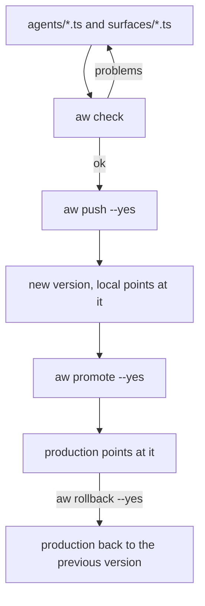

<Info>
**Chapter 2 · Build your agent — step 1 of 7** · [the chapter map](/path/build)

- **You will:** define the support agent and its chat surface as TypeScript files, and save them as a version.
- **You will learn:** the project layout, what `aw check` and `aw push` decide, and how `local` and `production` point at versions.
- **You need:** a project from [Chapter 1: Run your first agent](/path/first-agent).

</Info>

Keep your agents and chat surfaces as TypeScript files next to `agent-workspace.yaml`. `aw check`
tells you whether they would save, `aw push --yes` saves them as versions, and `aw promote` ships a
version to `production`.



**What you can do**

- [Define an agent in a file](#define-an-agent-in-a-file)
- [Give it a chat surface](#give-it-a-chat-surface)
- [Check your files before you save](#check-your-files-before-you-save)
- [Save a new version](#save-a-new-version)
- [Promote to production and roll back](#promote-to-production-and-roll-back)
- [Turn a thumbs-down into an eval case](#from-a-thumbs-down-to-an-eval-case)

`aw init --yes` writes this layout with one agent and one surface:

```text
my-agent/
├── agent-workspace.yaml
├── agents/
│   ├── assistant.ts          one agent per file
│   └── assistant.md          instructions read beside it
└── surfaces/
    └── main.ts               one surface per file, naming its agent
```

Every `*.ts` file directly in `agents/` and `surfaces/` is loaded (subdirectories and `*.d.ts` are
not), in file-name order.

## Define an agent in a file

A file in `agents/` default-exports what `defineAgent` returns:

```ts title="agents/assistant.ts" claim="compile"
import { defineAgent, mcp, skill } from '@indx-workspace/sdk/define';

export default defineAgent({
  name: 'assistant',
  instructions: { file: './assistant.md' },
  model: 'default',
  engine: 'claude-agent-sdk',
  tools: [mcp('github')],
  skills: [skill('release-notes')],
});
```

- `name` finds the existing agent; a name no agent has yet is created.
- `instructions` is inline text or `{ file: './<name>.md' }`, read beside the `.ts` file. It must
  stay inside the project, or the agent is refused with `instructions_unreadable`.
- `model: 'default'` uses the project or workspace default model, and otherwise the deployment's
  default for the connection's provider (`claude-sonnet-4-5` for Anthropic under `aw dev`); see
  [Models and runtimes](/building/models-and-runtimes). `engine`, `permissions`, `tools`, `skills`,
  `files` and `limits` are optional.

A misspelt field fails in `aw check` before any request, with the same `invalid_agent_version` the
server would give. To give the agent your own functions or an HTTP API as tools, see
[Tools from code](/guides/tools-from-code).

**Skills.** A folder `skills/<name>/` holding a `SKILL.md` is a project skill; reference it with
`skill('<name>')`. `aw check` refuses a `skill('x')` that names neither a folder nor a workspace
skill, and `aw push` lists each folder as `create`, `update` or `unchanged`. See
[Author a skill](/building/skills#skills-in-a-project).

## Give it a chat surface

A file in `surfaces/` default-exports what `defineSurface` returns and names its agent:

```ts title="surfaces/main.ts" claim="compile"
import { defineSurface } from '@indx-workspace/sdk/define';

export default defineSurface({
  name: 'main',
  agent: 'assistant',
  title: 'Ask the assistant',
  theme: { colour: '#2563EB' },
});
```

Surfaces are saved as part of their agent's version. A surface naming an agent no file defines is
refused (`surface_agent_unknown`), and so are duplicate surface names (`surface_name_duplicate`) and
duplicate agent names (`agent_name_duplicate`).

<Warning>
  **Definition files are your own code, and run as you.** They are not sandboxed: through `process`
  they can reach every Node.js built-in, read any file you can (including the credentials `aw login`
  stores under `~/.config/agent-workspace/`), and use the network. The loader withholds only the key
  variables from the process's environment: `AGENT_WORKSPACE_API_KEY`, `ANTHROPIC_API_KEY` and every
  variable a profile names as its `apiKeyRef`. Run `aw check` and `aw push` only on files you would
  run with `node`.
</Warning>

<Accordion title="What a definition file may contain">

The files run with **Node's own type stripping** (Node 24 or later), not through a compiler, in a
child process with a closed module linker.

**Erasable syntax only.** Types, interfaces, `as`, `satisfies` and `import type` are removed before
the file runs. `enum`, `namespace` with values, parameter properties and the legacy `import x =`
form are refused with Node's own message:

```text
✗ agents/assistant.ts:5:1  TypeScript enum is not supported in strip-only mode
```

Use a union of string literals or an `as const` object instead of an `enum`. When type stripping is
turned off (`process.features.typescript` is `false`, for example with
`--no-experimental-strip-types` in `NODE_OPTIONS`), nothing is loaded:

```text
agent-workspace.yaml: local typescript_unavailable [Node.js v24.x runs with TypeScript type stripping turned off; remove --no-experimental-strip-types from NODE_OPTIONS]
```

**Imports: `@indx-workspace/sdk/define` and project-relative `.ts` files.** `@indx-workspace/sdk/define`
is served from `aw`'s own copy, so the project needs no `node_modules` for `aw check`. A relative
specifier (`./` or `../`), such as `import { orders } from '../tools/orders'`, names a `.ts` file:
`.ts` is appended when it is not written, whatever the specifier ends in, so `./x.js` names
`x.js.ts`, never `x.js`. Exactly one candidate is tried (no `index.ts`, no `.js` to `.ts` rewrite).
The file's real path, after symlinks, must stay inside the project and not under a `node_modules`
folder of it. An imported file is your own code: it runs in the same process, once per load.

Everything else is refused as `import_refused`: `node:*` modules, other packages, absolute or URL
specifiers, specifiers that contain `%`, `?`, `#`, `:` or a backslash, an import or re-export with
attributes (`with { type: 'json' }`), `.js` and `.json` files, and `import()`.
`import type { X } from '…'` from anywhere is fine, because the whole statement is erased. The
inline form `import { type X } from '…'` keeps the import after stripping, so it is checked like any
other import. A refusal names the specifier, and the file that made it when that is not the
definition itself:

```text
agents/assistant.ts: local import_refused [node:fs]
agents/support.ts: local import_refused [node:fs, tools/orders.ts]
```

`aw dev` watches `agents/`, `surfaces/`, `tools/` and `skills/` (and the OpenAPI documents the tools
name), so an edit to a file imported from outside those directories is synced on the next save of a
watched file.

Each load runs in a separate process that `aw` stops after 30 seconds (`loader_timeout`, attributed
to the file that was running). `import.meta.url`, `.filename` and `.dirname` are what `node` gives a
module. `console.*` output goes to `aw`'s stderr, never its stdout, so `--json` output stays
parseable. A symbolic link is followed when its target is a file inside the project.

</Accordion>

## Check your files before you save

```sh title="illustrative" claim="illustrative"
aw check          # add --json for one machine-readable object
```

`aw check` loads the files and asks the server to check each agent without saving anything. It
agrees with `aw push` on whether a push would save anything, and prints one line per agent, or one
line per problem in the form `<file>: <status|local> <code>[ [details]]`:

```text
agents/assistant.ts: ok (would be version 4)
agents/support.ts: ok (unchanged, local 2)
agents/assistant.ts: 422 engine_capability_unsupported [mcp]
```

It exits `0` when every agent would save and `1` on any problem.

<AccordionGroup>
  <Accordion title="Every line aw check prints">

```text
agents/assistant.ts: ok (would be version 4)
agents/support.ts: ok (unchanged, local 2)
agents/triage.ts: ok (version 3 already holds this definition; local would move from 2 to 3)
agents/billing.ts: ok (edited outside aw push; version 1 would be applied again)
agents/assistant.ts: 422 engine_capability_unsupported [mcp]
agents/assistant.ts: 403 forbidden
surfaces/main.ts: 400 invalid_agent_version [surfaces.0.theme.colour: Invalid hex colour]
agents/support.ts: local default_export_missing [the file must `export default` its definition]
✗ agents/billing.ts:4:16  (root): Unrecognized key: "instruction" (did you mean "instructions"?)
```

A definition the SDK refuses as it loads names the line of its `defineAgent()` or `defineSurface()`
call, `✗ <file>:<line>:<column>`, with each refused field and, for an unknown key, the nearest known
one; a bad `engine` or `model` lists the forms it accepts.

`would be version N` means a push would create the agent or save a new version; `unchanged` means
the newest version already holds the definition and `local` runs it, so a push saves nothing. An
existing agent's next version goes through the version check, and a new agent through a dry-run
create.

| Status  | Meaning                                                                                                                                |
| ------- | -------------------------------------------------------------------------------------------------------------------------------------- |
| `local` | refused on this machine before any request (the codes in the table below)                                                              |
| `400`   | `invalid_agent_version`: the definition fails the contract, locally or on the server; a `surfaces.<i>` detail names the surface's file |
| `403`   | the key's role, or its ownership of the agent, does not allow the save                                                                 |
| `422`   | the server refuses the version, for example a tool the agent's engine cannot run                                                       |

  </Accordion>
  <Accordion title="Local error codes">

| Local code                      | Cause                                                                                               |
| ------------------------------- | --------------------------------------------------------------------------------------------------- |
| `typescript_unavailable`        | `process.features.typescript` is `false`                                                            |
| `typescript_syntax_unsupported` | the file uses syntax type stripping cannot erase                                                    |
| `default_export_missing`        | the file has no default export                                                                      |
| `not_a_definition`              | the default export was not made by `defineAgent` (in `agents/`) or `defineSurface` (in `surfaces/`) |
| `import_refused`                | the file, or a file it imports, imports something the loader does not serve                         |
| `module_failed`                 | the file threw while it ran                                                                         |
| `module_unfinished`             | the loader ended while the file ran: a top-level `await` that never settles, or `process.exit()`    |
| `file_link_refused`             | the file is a symbolic link whose target is missing, not a file, or outside the project             |
| `file_name_unsupported`         | the file name holds a control or format character, a backslash or a colon                           |
| `instructions_unreadable`       | the `.md` instructions file is missing, unreadable or outside the project                           |
| `surface_agent_unknown`         | a surface names an agent no file defines                                                            |
| `agent_name_duplicate`          | two agent files use the same `name`                                                                 |
| `surface_name_duplicate`        | two surface files use the same `name`                                                               |
| `loader_timeout`                | loading took longer than 30 seconds                                                                 |

  </Accordion>
  <Accordion title="Exit codes and --json output">

| Code | When                                                                                               |
| ---- | -------------------------------------------------------------------------------------------------- |
| `0`  | every agent would save                                                                             |
| `1`  | at least one problem (stderr ends with `error: <n> problems`), or there is no `agents/*.ts` at all |
| `3`  | the server's answer does not match the contract                                                    |
| `4`  | no response (network failure or `--timeout`)                                                       |

With `--json`, `aw check` prints one object, also when it exits 1:

```json title="illustrative" claim="illustrative"
{
  "ok": false,
  "problems": [
    {
      "file": "agents/assistant.ts",
      "status": 422,
      "code": "engine_capability_unsupported",
      "details": ["mcp"]
    }
  ],
  "agents": [
    {
      "file": "agents/assistant.ts",
      "name": "assistant",
      "agentId": "agt_…",
      "action": "version",
      "version": 4,
      "local": { "from": 3, "to": 4 }
    }
  ]
}
```

A local problem the loader can place carries `location: { "file", "line", "column" }`, with a
project-relative `file`. `agentId` is `null` for an agent that does not exist yet. `action` is the
one `aw push` would take: `create`, `version`, `point` or `none`. `version` is the version `local`
would run after the push, and `local.from` is `null` when there is no `local` pointer yet.

  </Accordion>
</AccordionGroup>

## Save a new version

```sh title="illustrative" claim="illustrative"
aw push                                  # show what would change; saves nothing
aw push --yes                            # save
aw push --yes --summary "Tighten the tone"
```

`aw push` runs `aw check` first and sends nothing if there is a problem. With `--yes` it saves a new
version of each changed agent and points the `local` environment at it. Pushing the same files again
saves no version. Without `--yes` it only reads and dry-runs, and prints the plan:

```text
agents/assistant.ts: version 5 of "assistant" (local 4 → 5)
  ~ definition.agent.instructions
  + definition.tools.1
```

`aw push --yes`, like `aw dev`, also creates or updates each changed `skills/<name>/` folder before
it saves the agents that name it. A workspace skill with no folder is never deleted: `aw check` lists
it as "only in the workspace".

<Note>
  A push is not atomic across agents: they are saved one at a time, so when a later agent is refused
  the earlier ones are already written.
</Note>

<AccordionGroup>
  <Accordion title="What aw push does for each agent">

| Action    | When                                                                            | With `--yes`                                                                |
| --------- | ------------------------------------------------------------------------------- | --------------------------------------------------------------------------- |
| `create`  | no agent has this name                                                          | creates the agent at version 1 and sets its `local` pointer, in one request |
| `version` | the definition differs from the agent's newest version                          | saves a new version (`via: "aw-push"`), then points `local` at it           |
| `point`   | the newest version already holds this definition, but `local` runs an older one | points `local` at the newest version; saves no version                      |
| `point`   | the same, `local` runs it, but the agent was edited after `local` last moved    | points `local` at that version again, which applies it over the edit        |
| `none`    | the newest version holds this definition, `local` runs it, and no edit since    | nothing                                                                     |

The comparison is made after both sides are parsed by the contract, with object keys in any order
and arrays in order. A changed path starts with `+` (only in the files), `-` (only on the server) or
`~` (in both, with another value). The definition and surfaces are compared with the agent's newest
version; an agent that has no version yet is compared with its current export. `point` and `none`
list no change. Without `--yes`, the run exits 0 and a notice on stderr ends it:
`nothing was saved: run aw push --yes to save`.

`--summary <text>` sets the summary of every version the push saves; it is checked against the
contract before anything runs, and an invalid one is a usage error (exit 2). Without it the summary
is `aw push: <agent file>`, cut with `…` to the 200 characters a summary may hold.

  </Accordion>
  <Accordion title="aw push --json output">

```json title="illustrative" claim="illustrative"
{
  "saved": false,
  "problems": [],
  "agents": [
    {
      "file": "agents/assistant.ts",
      "name": "assistant",
      "agentId": "agt_…",
      "action": "version",
      "version": 5,
      "local": { "from": 4, "to": 5 },
      "changes": [{ "op": "~", "path": "definition.agent.instructions" }],
      "saved": false
    }
  ]
}
```

`saved` is `true` only when `--yes` was given and every agent was saved; each agent saved before a
later refusal has `"saved": true` in `agents`. `agentId` is `null` for an agent a push without
`--yes` would create, and `local.from` is `null` when there was no pointer.

  </Accordion>
  <Accordion title="The raw version commands behind aw push">

Like `aw push`, each command that changes something prints what it would do and saves only with
`--yes`.

```sh title="illustrative" claim="illustrative"
aw agents versions list <agent-id>
aw agents versions create <agent-id> --file body.json [--summary <text>] [--yes]
aw agents pointers set <agent-id> local 3 [--yes]
```

- **`agents versions list`** prints the versions (`number`, `summary`, `via`, `createdAt`) and one
  `<environment> -> <number>` line per pointer. `--json` prints exactly the SDK's value:
  `{ items, pointers }`.
- **`agents versions create`** reads an `AgentVersionBody` (`--file <path>` or `--file -`) and
  validates it against the contract before sending. Without `--yes` it runs the server's check
  and prints `would be saved as version <n>; pass --yes to save`; with `--yes` it saves the version
  with `via: "api"` and prints it. It does not move any pointer.
- **`agents pointers set`** takes the environment and the version number as positionals (the
  global `--version` switch prints `aw`'s own version). The environment must be one the platform
  knows (`local` in this slice) and the version a positive integer; anything else is a usage error.
  Without `--yes` it reads the versions and prints `local: <from> -> <to>; pass --yes to move it`
  (`--json`: `{ environment, from, to, saved: false }`); with `--yes` it moves the pointer.

</Accordion>
</AccordionGroup>

## Promote to production and roll back

`aw push` moves `local`; `production` moves only when you promote. Both are pointer moves: no version
is copied or changed.

```sh title="illustrative" claim="illustrative"
aw push --yes       # v7 becomes local
aw promote --yes    # production: 6 -> 7
aw rollback --yes   # production: 7 -> 6, in one request
aw versions         # local -> 7, production -> 6, and the last 10 moves
```

Without `--yes`, `aw promote` only checks the move. `[agent]` is the agent's name; without it, the
commands use the only agent in `agents/`.

<Accordion title="Promote, rollback and versions in detail">

- **`aw promote [agent] [version]`** points `production` at the version `local` points at, or at
  `[version]`. Without `--yes` it asks the server to check the move and prints
  `production: 6 -> 7; pass --yes to move it`; with `--yes` it moves the pointer and prints
  `production: 6 -> 7`. `--json` prints `{ environment, from, to, saved, bar }`. It is refused
  with `409 no_pointer` when `local` points at nothing, and by the promotion gate below.
- **`aw rollback [agent]`** points `production` back at the version before its pointer's. A
  rollback steps back past the version it left, so rolling back twice goes two versions back
  (`13 -> 12`, then `12 -> 11`), never forward again. With no earlier version it exits 1 with
  `409 nothing_to_roll_back`.
- **`aw versions [agent]`** prints what `aw agents versions list` prints: the versions, one
  `<environment> -> <number>` line per pointer, and the last 10 moves (`movedAt`, `environment`,
  `version`, `reason`, where `reason` is `set`, `promote` or `rollback`).

Each move appends one entry to the environment's pointer history in the same transaction. Any
refusal the server answers is printed as `error: <code>: <message>` and exits 1. The SDK methods are
`client.agents.pointers.promote`, `rollback`, and their dry runs `checkPromote` and `checkRollback`.

</Accordion>

### The promotion gate

Set a bar, and `production` refuses a version whose newest evaluation (`aw eval`) passed less than
that share of its cases:

```yaml title="agent-workspace.yaml (illustrative)" claim="illustrative"
policy:
  promotion:
    minEvalScore: 0.9 # 0 to 1
```

The bar gates every move of `production` except a rollback, and only an evaluation of exactly that
version counts. There is no override: lower the bar in the policy instead. With no bar, promotion
needs no evaluation.

<Note>
  The bar reaches the server when `aw dev` starts. A bar added to `agent-workspace.yaml` while `aw
  dev` runs is not applied until you restart it; against the project's own `aw dev`, `aw promote`
  refuses when the two differ and moves nothing.
</Note>

<Accordion title="What a refused promotion looks like">

```sh title="illustrative" claim="illustrative"
aw promote --yes
# error: production refused: v8 scored 0.70 (bar 0.90). Failing cases: "no refund promises", …
# fix: run `aw eval support 8` after fixing, then promote again
```

The bar gates `aw promote`, its dry run, and `aw agents pointers set … production`. The server
answers `409 promotion_gate_failed` (details `version:`, `score:`, `bar:` and one `case:` per
failing case) or `409 promotion_not_evaluated` when the version has no evaluation. The pass rate is
compared unrounded, so 19,999 of 20,000 cases does not reach a bar of 1. With no bar, `aw promote`
says so on stderr: `no promotion bar is set; production needs no evaluation`.

Saving `agent-workspace.yaml` while `aw dev` runs applies its `models` and `connectors` at once, with
no restart. The runtime reads the policy, the port, the runtime driver and the default engine only
when it starts, so a change to one of them prints one line, for example
`agent-workspace.yaml: policy changed; restart aw dev to apply`, and is not applied:

```sh title="illustrative" claim="illustrative"
aw promote --yes
# error: agent-workspace.yaml sets bar 0.90, but the running aw dev has no bar; production was not moved
# fix: restart aw dev to apply agent-workspace.yaml, then run aw promote again
```

</Accordion>

### From a thumbs-down to an eval case

A visitor rates an answer with the widget's buttons (`parts: { feedback: true }` on the surface).
Turn that rating into a test case in three commands:

```sh title="illustrative" claim="illustrative"
aw feedback --negative              # lists the run, its input, answer and comment
aw eval add-case <run-id> --yes     # appends the case to evals/<agent>.yaml
aw eval                             # runs it; the comment is the fault the judge checks for
```

The comment becomes the case's judge as the fault to avoid (`An earlier answer was rated down with:
"<comment>". Pass only if this answer does not have that problem.`), so a complaint such as "Too
long." fails a long answer instead of asking for one; without a comment, the judge is
`Must not repeat: <answer>`. The file's comments and the order of its cases are kept. To rate
a run without a browser, use `aw runs rate <run-id> --down --comment "Must not promise a refund"`
(or `--up`); it calls the same `POST /api/runs/:id/feedback`. The SDK methods are
`client.runs.rate(runId, { rating, comment })` and `client.agents.feedback.list`.

## Current limits

These are declared gaps of the current slice, not bugs:

- **Creating an agent does not save a version yet.** A console edit or `aw agents update`
  (including `--engine`) saves a version with `via: "ui"` and points `local` at it, but creating an
  agent (`aw agents create`, `POST /api/agents`) and setup reconciliation save none yet (V-2,
  #648). `aw push --yes` after a console edit saves your files as the next version on top, and the
  console edit stays in `aw versions`. There is no `aw pull` yet.
- **A `403` is a role, ownership or ceiling refusal.** A `403` `aw check` reports comes from
  role-based access (the key's role does not allow the save, or the agent belongs to someone else)
  or, when the deployment sets a policy ceiling (`AW_DEPLOYMENT_POLICY`), from
  `403 policy_cannot_widen`, whose `details` name each field that exceeds it.
- **One importable package.** Only `@indx-workspace/sdk/define` and project-relative `.ts` files
  load; a definition cannot import any other npm package.
- **Experimental Node APIs.** The loader uses `vm.SourceTextModule` and
  `module.stripTypeScriptTypes`, both experimental in Node 24; their warnings are silenced in the
  loader process only.
