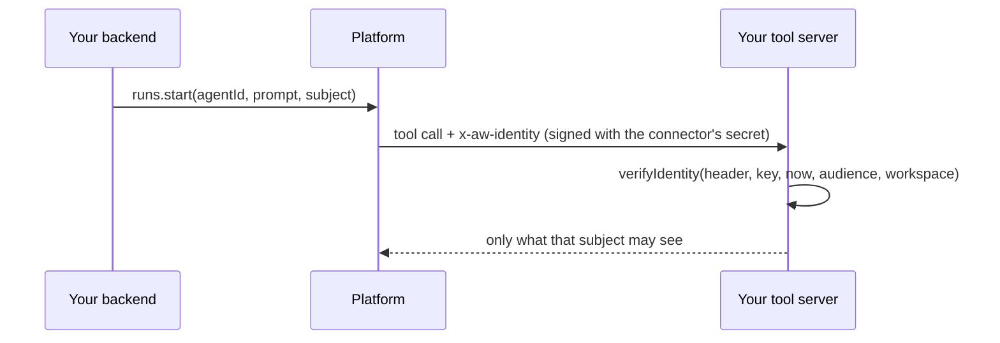

A tool that reads customer data has to know whose data to read. If the only way to tell it is the
prompt, anyone who can type into the prompt can claim to be someone else. Instead, your backend names
the signed-in person when it starts the run, and the platform signs that name for the tool.

**What you can do**

- [Start a run for a person](#start-a-run-for-a-person)
- [Act as the signed-in person](#act-as-the-signed-in-person)
- [Opt a connector in](#opt-a-connector-in)
- [Check the header in your server](#check-the-header-in-your-server)
- [Rotate the key](#rotate-the-key)
- [Know what a refusal means](#know-what-a-refusal-means)



## Start a run for a person

Pass `subject` to `runs.start()`. It is the id your own system uses for the person, 1 to 256
characters. Only an API key may set it; any other caller gets `403 run_subject_forbidden`.

```ts title="backend/chat.ts (illustrative)" claim="illustrative"
await aw.runs.start(agentId, {
  prompt: question,
  subject: signedInUser.id, // from your session, never from the prompt
});
```

Take the subject from your own session. Text the person typed is not evidence of who they are.

A run nobody starts by hand, such as a schedule or a webhook, has no session to take it from. Set a
`subject` on the [trigger](/resources/triggers#a-caller-for-every-firing) instead: every run it
starts asserts that caller, and the firing body cannot change it.

A run that pauses for approval keeps its subject. The run that carries on after the decision acts
for the same person, and the person who approves only decides: the approval request cannot name a
different subject.

## Act as the signed-in person

A `subject` names the person to your tools, but the run still uses the API key's permissions. To
start runs with the person's own permissions, give your backend an `app-backend` endpoint client and
exchange the person's ID token for a short-lived access token. The ID token must come from the
deployment's own identity provider (`OIDC_ISSUER_URL`), issued to the app named by the client's
`oidcAudience`.

```ts title="backend/act-as.ts (illustrative)" claim="illustrative"
import { createClient } from '@indx-workspace/sdk';

// No credential of its own: the exchange authenticates with the client pair.
const exchanger = createClient({ baseUrl, auth: { kind: 'session' } });

const { access_token } = await exchanger.auth.exchange({
  clientId: process.env.AW_APP_CLIENT_ID ?? '',
  clientSecret: process.env.AW_APP_CLIENT_SECRET ?? '',
  idToken: signedInUser.idToken, // from your sign-in, never from the request body
});

const asPerson = createClient({ baseUrl, auth: { kind: 'access-token', token: access_token } });
await asPerson.runs.start(agentId, { prompt: question });
```

The token reaches only five routes: starting a run on one of the client's bound agents, reading a
run and its events, interrupting a run, and `me`. On each one it still needs the person's own role
and agent grants, so a person without a grant to an agent is refused even if the client binds it.
Anything else answers `403 token_out_of_scope`.

The token lasts 300 seconds (`expires_in`) and has no refresh token. Keep one per person until it
expires, then exchange again with a fresh ID token; each exchange writes an audit row. Keep the
client secret and both tokens on the server, and never log them. A person who is not a member of
the client's workspace gets `403 subject_not_member`; a wrong or revoked client gets
`401 invalid_client`.

## Opt a connector in

A connector receives the header only when it names a secret to sign with. Set `identity` on the
connector in `agent-workspace.yaml`, or on an `openapiTool()` with `secret()`.

```yaml title="agent-workspace.yaml (illustrative)" claim="illustrative"
connectors:
  task-tracker:
    url: http://127.0.0.1:8788/mcp
    transport: http
    identity:
      secret: TASK_TRACKER_IDENTITY_SECRET
```

```ts title="tools/erp.ts (illustrative)" claim="illustrative"
openapiTool({
  name: 'erp',
  spec: 'apis/erp.openapi.json',
  auth: secret('ERP_TOKEN'),
  identity: secret('ERP_IDENTITY_SECRET'),
  allow: ['GET /orders/*'],
});
```

Create the secret with `aw secrets set TASK_TRACKER_IDENTITY_SECRET` and give your server the same
value. The platform signs the caller with it: an `openapiTool` call gets a fresh assertion each time,
and an MCP connector gets one assertion when the run starts, valid for five minutes, so a longer run
is refused with `identity_assertion_expired`. A connector without `identity` gets no header.

## Check the header in your server

The header is `x-aw-identity`: `base64url(payload).base64url(HMAC-SHA256)`. The payload holds `sub`
(your `subject`), `principalKind` (`membership`, `api-key` or `visitor`), `workspace`, `runId`, `aud`
(the connector id) and `exp`. It is valid for five minutes.

`verifyIdentity()` checks the shape, the signature, the expiry, the audience and the workspace. It
never throws; it returns the payload or a code.

```ts title="your tool server (illustrative)" claim="illustrative"
import { verifyIdentity } from '@indx-workspace/sdk';

const result = await verifyIdentity(
  request.headers['x-aw-identity'] ?? '',
  process.env.TASK_TRACKER_IDENTITY_SECRET ?? '',
  new Date(),
  { audience: CONNECTOR_ID, workspace: WORKSPACE_ID },
);
if (!result.ok) return reply(401, { code: result.code });
const person = result.payload.sub; // look up what this person may see
```

Then scope by `person`: keep a table from `sub` to what that person may read, filter every list,
search and count by it, and refuse an out-of-scope id with the same words as a missing id, so the
refusal does not confirm that the record exists. Refuse a call with no header too; do not fall back to
"everyone".

Do not log the header. It is a bearer proof for up to five minutes.

## Rotate the key

Pass a list of keys, the new one and the old one, while the secret changes:

```ts title="your tool server (illustrative)" claim="illustrative"
await verifyIdentity(header, [newKey, oldKey], new Date(), expected);
```

Set the new value with `aw secrets set`, deploy your server with both, then drop the old key once
the five minutes have passed.

## Know what a refusal means

| Code                          | Status | Meaning                                                      |
| ----------------------------- | ------ | ------------------------------------------------------------ |
| `identity_assertion_invalid`  | 401    | Missing, malformed, wrong key, or a payload with extra keys. |
| `identity_assertion_expired`  | 401    | Past `exp` plus 30 seconds of clock skew.                    |
| `identity_audience_mismatch`  | 401    | Signed for a different connector.                            |
| `identity_workspace_mismatch` | 401    | Signed for a different workspace.                            |

Return the code only, never the header.
