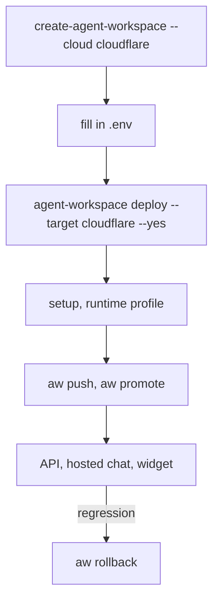

<Info>
**Chapter 5 · Ship it to your servers — a lightweight host** · [the chapter map](/path/ship)

- **You will:** deploy the control plane, gateway, runner manager and your project's frontend to Cloudflare, with agent sessions on E2B.
- **You will learn:** the files and variables the deploy reads, how a runtime profile points an agent at E2B, and why the Cloudflare Sandbox driver runs nothing yet.
- **You need:** a project from `npm create @indx-workspace`, a Cloudflare account with a workers.dev subdomain and an API token, Docker, a PostgreSQL database, an R2 API token, and an E2B account.

</Info>

This is the path the lightweight deploy journey runs on the `cloudflare-e2b` lane. The latest green run is
38254091925 on `main`
at `c3b26c6d`: create, eval, deploy, setup, push and promote, a run through the API with a code tool,
hosted chat, the widget with its allowed origin, the frontend and rollback all passed on that lane.
[Limits](#limits) names what the other lane, `cloudflare-cloudflare-sandbox`, does not run.

**What you can do**

- [Generate the deployment](#generate-the-deployment) with `--cloud cloudflare` and E2B as its runtime
- [Fill in `.env`](#fill-in-env) and [deploy](#deploy)
- [Set up the deployment](#set-up-the-deployment) and [give the agent an E2B runtime profile](#give-the-agent-a-runtime-profile)
- [Push and promote](#push-and-promote) an agent
- [Call it](#call-it): the API, hosted chat and the widget
- [Roll back](#roll-back)



## Generate the deployment

```sh title="illustrative" claim="illustrative"
npx -p @indx-workspace/cli create-agent-workspace acme-ai-deploy --cloud cloudflare
```

The profile it writes names the sandbox driver in `agent-workspace.yaml`. A Cloudflare profile
defaults to `cloudflare-sandbox`, which refuses every run today ([Limits](#limits)), so set
`runtime.default` to `external` (E2B) and render the files again:

```yaml title="agent-workspace.yaml (illustrative)" claim="illustrative"
runtime:
  default: external
```

```sh title="illustrative" claim="illustrative"
npx -p @indx-workspace/cli agent-workspace render acme-ai-deploy
```

Install Wrangler (`npm install --global wrangler@4.147.0`) and export `CLOUDFLARE_API_TOKEN` and
`CLOUDFLARE_ACCOUNT_ID`. The token needs Containers: Edit and Workers Scripts: Edit.
`agent-workspace doctor` checks that Wrangler is on `PATH`. Docker runs the migrations and pushes the
platform images to Cloudflare's registry.

## Fill in `.env`

Open `acme-ai-deploy/.env` and set:

| Variable | What it is |
| --- | --- |
| `DATABASE_URL` | An external PostgreSQL URL. A Worker reaches a database outside Cloudflare; Neon works. |
| `OBJECT_STORAGE_ACCESS_KEY_ID`, `OBJECT_STORAGE_SECRET_ACCESS_KEY` | An R2 API token's key pair. The bucket is created when it does not exist. Without a key pair the control plane installs no skills, files or session-state API. |
| `EXTERNAL_PROVIDER`, `E2B_API_KEY` | `e2b` and your E2B key. |
| `E2B_RUNTIME_TEMPLATE`, `E2B_TOOL_HOST_TEMPLATE` | Templates pinned as `<template>:<build_id>`; see [E2B runtime template](/guides/deploy#e2b-runtime-template). The tool host turns on code tools. |

## Deploy

```sh title="illustrative" claim="illustrative"
npx -p @indx-workspace/cli agent-workspace deploy acme-ai-deploy --target cloudflare --yes
```

To deploy your project's `web/` app too, export `AGENT_WORKSPACE_FRONTEND=<path to web/>` first: it is
deployed as its own Worker and its origin joins every served surface's `allowedOrigins`. Without
`--yes` the command only plans. The deploy pushes the platform images, runs the migrations against
`DATABASE_URL`, deploys the gateway, manager, control plane and frontend Workers, and prints the control
plane's address. The Owner's password is `BOOTSTRAP_ADMIN_PASSWORD` in `.env`.

<Note>
`aw deploy` has no `cloudflare` target: the project file's `environments.production.target` takes
`vercel` but not `cloudflare`. Deploy to Cloudflare with `agent-workspace deploy --target cloudflare`.
</Note>

## Set up the deployment

Open `<control plane address>/setup` and finish first-run setup: your model provider and its key, the
Owner account, and the runtime. Choose `external` and paste the E2B key as the runtime credential.
Setup stores it as the encrypted `external default` runtime connection and tests the runtime with it.
Then sign in and [mint an API key](/getting-started/authentication) for `aw`.

## Give the agent a runtime profile

A run executes on its agent's [runtime profile](/building/models-and-runtimes#size-and-sandbox-it-with-a-runtime-profile).
Create one with driver `external`, the `external default` connection, and network policy `none`
(E2B runs a tool sandbox with network `none` or `open`, not `restricted`), then attach it to the agent:

```sh title="illustrative" claim="illustrative"
aw runtimes profiles create --file profile.json
```

```json title="profile.json (illustrative)" claim="illustrative"
{
  "name": "e2b-sandbox",
  "driver": "external",
  "runtimeConnectionId": "<id of the external default connection>",
  "networkPolicy": "none",
  "filesystem": "read-write"
}
```

`aw runtimes profiles create` prints the new profile's id. Attach it once `aw push` has created the
agent (see [Push and promote](#push-and-promote)):

```sh title="illustrative" claim="illustrative"
echo '{"runtimeProfileId":"<profile id>"}' | aw agents update <agent id> --file -
```

Create the [secret](/resources/secrets) a code tool declares on the deployment before the first run.

## Push and promote

```sh title="illustrative" claim="illustrative"
export AGENT_WORKSPACE_URL=https://<control plane address>
export AGENT_WORKSPACE_API_KEY=<the key you minted>
aw push --yes
aw promote <agent> <version> --yes
```

`aw push` creates the agent on the deployment. `agent-workspace deploy` sets no promotion bar, so
`aw promote` passes any version until you set one. Set it with `AW_DEPLOYMENT_POLICY`, as JSON, in the
deployment's environment, for example `{"promotion":{"minEvalScore":1}}`. With a bar set, `aw promote`
needs a passing `aw eval run` of that version first; see [Evaluations](/guides/evaluations).

## Call it

- **The API.** `POST /api/agents/<agent id>/runs` with your API key and `{ "prompt": "…" }`, then read
  `/api/runs/<run id>/events`. See [Streaming](/guides/streaming).
- **Hosted chat.** `<control plane address>/p/s/<surface>` serves the surface's chat page.
- **The widget.** Load `<control plane address>/p/s/<surface>/widget.js` from your frontend. A session
  opens only from an origin in the surface's `allowedOrigins`; another origin is refused. The deploy adds
  your frontend's own origin.

The `cloudflare-e2b` lane ran each of these against the deployment in run 38254091925.

## Roll back

```sh title="illustrative" claim="illustrative"
aw rollback <agent> --yes
```

Production moves back to the previous version. The lane promotes a second version and rolls it back.

## Limits

- **Cloudflare Sandbox (`cloudflare-sandbox`) refuses every run.** It refuses every network policy,
  `none` included, with `network_policy_unsupported`, until a live run proves Cloudflare denies
  egress (ADR-0131). On the `cloudflare-cloudflare-sandbox` lane of run 38254091925, create, eval,
  deploy, setup and the frontend passed; `aw push` of an agent with a code tool is refused
  `422 code_tool_needs_host`, and the push, gate, API, hosted chat, widget and rollback rows are `n/a`.
  A Cloudflare host runs sessions on `external` (E2B), as above.
- **No `aw deploy` target.** `aw deploy production` cannot deploy to Cloudflare.
- **Sandbox release.** When a run on `external` ends, the control plane kills the E2B tool sandboxes
  that run started (#1066). The session's runtime sandbox ends at E2B's deadline.
- **Verified live, the `cloudflare-e2b` lane:** `aw promote` was refused below the eval bar (v2), and a turn through the
  project frontend completed with the code tool's data in the reply (run 38254091925).
