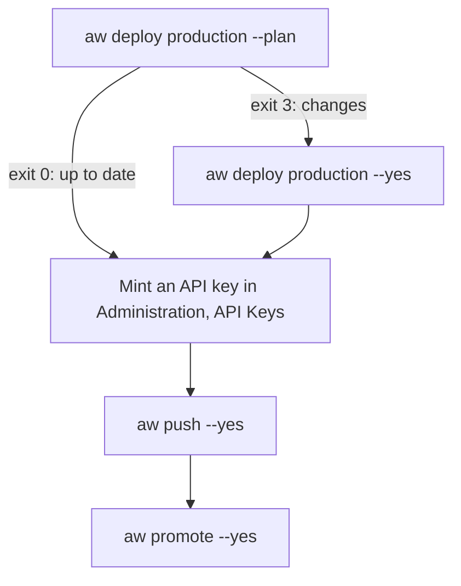

<Info>
**Chapter 5 · Ship it to your servers — step 1 of 3** · [the chapter map](/path/ship)

- **You will:** deploy your project to a VM, Google Cloud Run or Kubernetes and push and promote your agents to it.
- **You will learn:** the two fields of a `production` environment, how plan-then-apply works, and which directory holds the deployment's secrets.
- **You need:** a project that runs with `aw dev` ([Chapter 1](/path/first-agent)), and a Linux VM with Docker, a GCP project with billing, or a Kubernetes cluster with Helm.

</Info>

Take the project you run with `aw dev` to production with one command. `aw deploy production`
plans by default and applies only with `--yes`.

**What you can do**

- [Name a production environment](#name-a-production-environment) in the project file you already have
- [See the plan, then apply it](#plan-then-apply)
- [Put it on a single VM](#single-vm) behind your own TLS proxy
- [Put it on Google Cloud Run](#google-cloud-run)
- [Put it on Kubernetes](#kubernetes)
- [Back up the deployment's secrets](#where-the-deployment’s-state-lives)



## Name a production environment

A project names where it runs in production in the same `agent-workspace.yaml` that `aw dev` reads.
`aw deploy production` turns that environment into a deployment through the existing
`agent-workspace deploy` steps (Docker Compose for a VM, Terraform for Cloud Run, Helm for Kubernetes).

```yaml title="agent-workspace.yaml (illustrative)" claim="illustrative"
apiVersion: agentworkspace.dev/v2
kind: Project
name: acme-ai
environments:
  local:
    cloud: local
    identity:
      bootstrapAdmin: owner@acme.example
  production:
    target: single-vm # or gcp-cloudrun, or kubernetes
    url: https://agents.example.com
```

`production` takes exactly two fields. `target` names the deploy recipe, `single-vm`,
`gcp-cloudrun` or `kubernetes`. `url` is the `https:` origin the deployment is served at, with no credential and no
path. The first Owner is `environments.local.identity.bootstrapAdmin`.

## Plan, then apply

See what the deploy will do, apply it, then push your agents to it.

```sh title="illustrative" claim="illustrative"
aw deploy production --plan     # prints what the deploy will do; nothing is deployed
aw deploy production --yes      # applies that plan
export AGENT_WORKSPACE_URL=https://agents.example.com AGENT_WORKSPACE_API_KEY=<key>
aw push --yes && aw promote --yes
```

`aw push` refuses the user token `aw login` stores, so push with a workspace API key: sign in as
the Owner, mint one in **Administration → API Keys** (see
[Connect to a control plane](/cli/overview#connect-to-a-control-plane)), and pass it with the
deployment's URL as above.

`aw deploy` never prints a password or key. It names the file or the command that holds the
Owner's password. `aw deploy` passes the project's `policy` to the deployment as
`AW_DEPLOYMENT_POLICY`, so `aw promote` there holds the same eval bar as `aw dev`.
Every prerequisite that `aw deploy` can check is refused by name before anything is created.
A Vercel or Cloudflare plan without the account's token or id reads nothing from the account: it
says so and lists what an apply would create, as if nothing existed yet. `--yes` still needs both.

<AccordionGroup>
  <Accordion title="Exit codes">

| Exit | Meaning                                                                         |
| ---- | ------------------------------------------------------------------------------- |
| 0    | The deployment matches the project, or `--yes` applied the plan                 |
| 1    | A prerequisite or a deploy step was refused; the message names the fix          |
| 2    | A usage error, such as `--plan --yes` or an environment other than `production` |
| 3    | A plan found changes; re-run with `--yes` to apply them                         |

`agent-workspace deploy`, which a deployment project made with `create-agent-workspace --cloud`
runs (`npm run deploy` there), exits 2 instead of 3 for pending changes.

  </Accordion>
  <Accordion title="Prerequisites per target">

| Target         | The Owner provides                                                                                       | Checked by `aw deploy`                     |
| -------------- | -------------------------------------------------------------------------------------------------------- | ------------------------------------------ |
| all            | Node.js 24 or later, and `@indx-workspace/cli` (already in projects made with `npm create`)            | yes                                        |
| `single-vm`    | A Linux VM with Docker Engine and the Compose plugin                                                     | yes                                        |
| `single-vm`    | The release images for the CLI's version, published and public (`images-v<version>`)                     | yes                                        |
| `single-vm`    | A DNS A record for the `url` host pointing at the VM                                                     | on `--yes`                                 |
| `single-vm`    | Ports 80 and 443 open, and Caddy terminating TLS in front of `127.0.0.1:3000`                            | no; named in the next steps                |
| `gcp-cloudrun` | `project_id` in the module's `terraform.tfvars`, and the module initialised with a GCS backend           | yes                                        |
| `gcp-cloudrun` | Terraform 1.8 or later                                                                                   | on PATH; the version by the module at plan |
| `gcp-cloudrun` | Docker with `buildx`, signed in to Artifact Registry, to copy the four release images by digest          | on `--yes`                                 |
| `gcp-cloudrun` | A GCP project with billing, and `gcloud auth application-default login`                                  | no; Terraform's own error                  |
| `gcp-cloudrun` | The `url` host mapped to the web service                                                                 | no; named in the next steps                |
| `kubernetes`   | A cluster you can `kubectl` to, with an ingress controller and a NetworkPolicy-enforcing CNI             | no; Helm's own error                       |
| `kubernetes`   | Helm 3 or later on PATH (the chart ships with `@indx-workspace/cli`)                                      | yes                                        |
| `kubernetes`   | PostgreSQL and an S3-compatible bucket, and the three Secrets the chart reads in `agent-workspace`       | no; named in the next steps                |
| `kubernetes`   | The `url` host pointing at the ingress controller; cert-manager for TLS                                  | no; named in the next steps                |
| `vercel`       | The Vercel CLI on PATH (`npm install --global vercel@63.1.0`), Docker for the migrations, and `VERCEL_TOKEN` and `VERCEL_TEAM_ID` in the environment | the CLI on PATH, by `agent-workspace doctor` and at deploy |
| `vercel`       | An S3-compatible bucket as one `AW_STORAGE_URL` in `.env` (`s3://<bucket>`, and for a store that is not AWS S3 `?endpoint=` and `region=`, such as `s3://<bucket>?endpoint=https://<account>.r2.cloudflarestorage.com&region=auto`), and its key pair as `OBJECT_STORAGE_ACCESS_KEY_ID` and `OBJECT_STORAGE_SECRET_ACCESS_KEY`; create the bucket first, deploy does not | on `--yes`; a `file:` or invalid `AW_STORAGE_URL`, an empty key for an `s3://` URL, or an old `OBJECT_STORAGE_*` or `AW_*_ROOT` variable left next to the URL is refused before anything is applied |
| `cloudflare` (a `--cloud cloudflare` project and `agent-workspace deploy`; `aw deploy` does not take this target yet) | Wrangler on PATH (`npm install --global wrangler@4.147.0`), Docker for the migrations, and `CLOUDFLARE_API_TOKEN` and `CLOUDFLARE_ACCOUNT_ID` in the environment | Wrangler on PATH, by `agent-workspace doctor` and at deploy |
| `cloudflare`   | An R2 API token's key pair as `OBJECT_STORAGE_ACCESS_KEY_ID` and `OBJECT_STORAGE_SECRET_ACCESS_KEY` in `.env`; the bucket is the one `AW_STORAGE_URL` names (`s3://<bucket>`) and is created when it does not exist | on `--yes`; empty keys, or a URL that is not `s3://`, are refused before anything is applied |
| `vercel`, `cloudflare` | With `RUNTIME_DRIVER=external` (E2B), `E2B_RUNTIME_TEMPLATE=<template>:<build_id>` in `.env`; the runner manager refuses an image digest | on `--yes`; an unpinned template is refused before anything is applied |
| `vercel`, `cloudflare` | Optional with `RUNTIME_DRIVER=external`: `E2B_TOOL_HOST_TEMPLATE=<template>:<build_id>` in `.env` turns on code tools (the tool sandbox runs in E2B) | on `--yes`; an unpinned template is refused before anything is applied |
| `vercel`       | With `RUNTIME_DRIVER=vercel-sandbox`, `VERCEL_SANDBOX_RUNTIME_IMAGE=<team-slug>/<name>-manager/<repository>@sha256:<digest>` in `.env`: the runtime image pushed to the manager project's Vercel Container Registry, the only registry Vercel Sandbox runs from | on `--yes`; any other reference is refused before anything is applied |
| all            | A model provider key, added in the Models screen after `aw login`                                        | no; not part of deploy                     |

  </Accordion>
</AccordionGroup>

## Single VM

Run `aw deploy production --yes` on the VM, from the project directory. Web is published on
`127.0.0.1:3000` only, so the deployment is reachable only through the TLS proxy, for example
`caddy reverse-proxy --from agents.example.com --to 127.0.0.1:3000`.

The Owner's password is `BOOTSTRAP_ADMIN_PASSWORD` in the state's `.env`.

<Accordion title="A fresh VM, start to finish">

On a new Ubuntu or Debian VM, as a user who can run `docker`:

```sh title="illustrative" claim="illustrative"
# 1. Docker Engine with the Compose plugin: https://docs.docker.com/engine/install/
sudo usermod -aG docker "$USER"            # log out and back in

# 2. Node.js 24 or later, then aw. A project made with `npm create` already includes
#    @indx-workspace/cli, pinned in its devDependencies. For a project made before this
#    release, add it: npm install --save-dev @indx-workspace/cli@<aw's version>
npm install --global @indx-workspace/aw

# 3. Firewall: SSH and the proxy only. Web stays on 127.0.0.1:3000.
sudo ufw allow 22/tcp && sudo ufw allow 80/tcp && sudo ufw allow 443/tcp && sudo ufw enable

# 4. Deploy from the project directory (the DNS A record for the url host must already point here)
aw deploy production --plan
aw deploy production --yes

# 5. TLS in front of web: Caddy fetches and renews the certificate itself
sudo apt install caddy
printf 'agents.example.com {\n\treverse_proxy 127.0.0.1:3000\n}\n' | sudo tee /etc/caddy/Caddyfile
sudo systemctl reload caddy
```

Every Compose service restarts with Docker (`restart: unless-stopped`), and the Caddy package
installs its own systemd unit, so the deployment comes back after a reboot with nothing else to
write. Open `https://agents.example.com`, sign in as the Owner, add a model key in the Models
screen, and then take the first backup below.

</Accordion>

## Upgrade, roll back and back up

The deployment's state is the database and the object store, plus the state directory's `.env`
(see [Where the deployment's state lives](#where-the-deployment’s-state-lives)). Migrations only go
forward, so the safe order is always: back up, upgrade, check, and keep the backup until you are
sure.

**Upgrade.** `aw deploy` keeps the image digests `.env` pins; it never moves them on its own. To
upgrade, install the new CLI version, then run `agent-workspace render --upgrade` in the state
directory: it resolves the new release's web, gateway, runner and runtime digests, writes them over
the pins and prints each move (`--check` shows them without writing). Or replace the pinned
references with the new release's digests yourself
(set `AW_WEB_IMAGE`, `AW_GATEWAY_IMAGE`, `AW_RUNNER_IMAGE` and `AW_RUNTIME_IMAGE` for one run, or edit
the `WEB_IMAGE`, `GATEWAY_IMAGE`, `RUNNER_IMAGE` and
`AGENT_WORKSPACE_RUNTIME_IMAGE_CLAUDE_AGENT_SDK` lines), and review the plan before applying it:

```sh title="illustrative" claim="illustrative"
cp -p .env .env.before-upgrade      # in the state directory; this is also your rollback record
aw deploy production --plan         # exits 3 while changes are pending
aw deploy production --yes
```

Migrations run once. They hold a PostgreSQL advisory lock, so if two starters meet, the second waits
and then applies nothing. Under the project `aw` writes, `web` applies them as it starts; under the
repository's Compose file a one-shot `migrate` service runs first and `web` waits for it to exit
successfully; under the Helm chart a pre-install/pre-upgrade Job runs first, and a failed Job stops
the `helm upgrade` before any pod changes (`--set migrations.enabled=false` skips it).

**Roll back.** A rollback has two parts. Put the previous image references back (copy
`.env.before-upgrade` over `.env`, or set the previous digests the same way), and run
`aw deploy production --yes`. If the upgrade applied migrations, the previous images do not know the
new schema and cannot be assumed to run on it, so also restore the database from the backup you
took before upgrading, using the restore below.

**Back up a Compose project** (the single VM, or a project from `--cloud local`). Run these from
the directory that holds its `compose.yaml` and `.env`: the state directory on the single VM, the
project directory otherwise. The volumes are archived with the PostgreSQL image `.env` already pins
by digest, so nothing unpinned is pulled, and a volume the project never created is skipped:

```sh title="illustrative" claim="illustrative"
project="$(sed -n 's/^COMPOSE_PROJECT_NAME=//p' .env)"
image="$(sed -n 's/^POSTGRES_IMAGE=//p' .env)"
docker compose exec -T postgres sh -c 'pg_dump -Fc -U "$POSTGRES_USER" "$POSTGRES_DB"' > "backup-$(date +%F).dump"
for v in seaweedfs-data workspace-data; do
  docker volume inspect "${project}_$v" >/dev/null 2>&1 || continue
  docker run --rm --entrypoint tar -v "${project}_$v":/data:ro -v "$PWD":/out "$image" czf "/out/$v-$(date +%F).tgz" -C /data .
done
cp -p .env "env-$(date +%F)"        # holds MASTER_ENCRYPTION_KEY; store it apart from the dump
```

Copy everything off the machine. The dump is useless without the `.env` that holds the master key,
since stored provider credentials are encrypted with it. `seaweedfs-data` is the object store and
`workspace-data` holds the web service's files, skills and session transcripts. `seaweedfs-data`
exists only when the project runs SeaweedFS (`COMPOSE_PROFILES=object-storage` in `.env`); with an
external S3 bucket, or the local filesystem a `--cloud local` project defaults to, there is no such
volume. Never point `docker run -v` at a volume that does not exist: Docker creates it outside the
Compose project, and `agent-workspace stop --volumes` does not remove it. Copy an external bucket
with your provider's tools.

**Restore, and rehearse it.** Restore to a scratch VM or project first, and open the UI before you
rely on a backup:

Stop `web` before the restore if it is running (`docker compose stop web`).

```sh title="illustrative" claim="illustrative"
project="$(sed -n 's/^COMPOSE_PROJECT_NAME=//p' .env)"
image="$(sed -n 's/^POSTGRES_IMAGE=//p' .env)"
docker compose create               # creates the project's own volumes, starts nothing
docker compose up --detach postgres
docker compose exec -T postgres sh -c 'dropdb -U "$POSTGRES_USER" --if-exists "$POSTGRES_DB" && createdb -U "$POSTGRES_USER" "$POSTGRES_DB"'
docker compose exec -T postgres sh -c 'pg_restore -U "$POSTGRES_USER" -d "$POSTGRES_DB" --no-owner' < backup-2026-01-31.dump
for v in seaweedfs-data workspace-data; do
  [ -f "$v-2026-01-31.tgz" ] || continue
  docker run --rm --entrypoint tar -v "${project}_$v":/data -v "$PWD":/in "$image" xzf "/in/$v-2026-01-31.tgz" -C /data
done
aw deploy production --yes          # or `agent-workspace start` for a --cloud local project
```

**Move a Compose project from PostgreSQL 17 to 18.** A project generated before PostgreSQL 18
keeps its 17 pin: `render --upgrade` never moves `POSTGRES_IMAGE`, because a new major cannot open
the old data directory. To move it, install the new CLI and run `agent-workspace render`, so
`compose.yaml` names the data directory (`PGDATA`) for both majors. Then take the backup above with
the 17 image, set `POSTGRES_IMAGE` in `.env` to the `postgres:18-alpine` digest
(`docker buildx imagetools inspect postgres:18-alpine` prints it), and give PostgreSQL an empty
volume before you restore into it:

```sh title="illustrative" claim="illustrative"
project="$(sed -n 's/^COMPOSE_PROJECT_NAME=//p' .env)"
docker compose stop
docker volume rm "${project}_postgres-data"   # only after the dump is copied off the machine
```

Then follow the restore above with `backup-<date>.dump`. To go back, restore the old `.env` (its
17 pin) and the same dump the same way.

**Cloud Run.** Upgrade and rollback are the same `--plan` then `--yes` with the new or previous
image references; Cloud SQL's point-in-time recovery is the database backup. To restore, clone the
instance to a moment before the upgrade, then point the module at the clone or copy the data back:

```sh title="illustrative" claim="illustrative"
gcloud sql instances clone <instance> <instance>-restore --point-in-time=2026-01-31T09:00:00Z
```

Check the clone before you switch to it. The object store is a GCS bucket: turn on object
versioning, or copy it with `gcloud storage cp --recursive`, before an upgrade you may need to undo.

## Google Cloud Run

The Terraform module ships inside `@indx-workspace/cli`; there is nothing else to download. On every
run `aw deploy` writes it beside the deployment's state, to
`~/.config/agent-workspace/deployments/<project>/production.infra/terraform/gcp-cloudrun`, and
leaves your `terraform.tfvars` and `.terraform/` there alone. Pass `--infra <dir>` only to use a
`gcp-cloudrun` module from a checkout instead.

Cloud Run cannot pull from `ghcr.io`, so `aw deploy production --yes` copies the four release images
into the module's Artifact Registry by digest: each service runs `<registry>/<name>@sha256:…`, the
digest the release published, and a tag is never used to pick an image. Without `--yes` the copies
are only listed. A `--yes` that copies stops there, before Terraform, and asks for `--plan`, so the
first apply is always one a plan showed. The copy uses your own Docker credentials (`gcloud auth configure-docker
<region>-docker.pkg.dev`); if it fails, `aw deploy` prints the exact `docker buildx imagetools
create` commands and applies nothing. The module generates the Owner's password; read it with
`terraform -chdir=… output -raw bootstrap_admin_password`.

The module protects the Cloud SQL instance: `deletion_protection` is on and point-in-time recovery
is enabled, so a `terraform destroy` stops at the database until you turn the protection off
deliberately.

<Accordion title="The Cloud Run commands">

```sh title="illustrative" claim="illustrative"
aw deploy production --plan   # writes the module, then names what is missing: project_id, terraform init
MODULE=~/.config/agent-workspace/deployments/acme-ai/production.infra/terraform/gcp-cloudrun
echo 'project_id = "acme-prod"' > "$MODULE/terraform.tfvars"
terraform -chdir="$MODULE" init -backend-config="bucket=acme-prod-tfstate" -backend-config="prefix=agent-workspace"
aw deploy production --yes    # the first run names the one targeted apply that creates the repository
aw deploy production --yes    # copies the images by digest, then stops: "Images copied. Run --plan to review, then --yes."
aw deploy production --plan   # the full Terraform plan
aw deploy production --yes    # applies that plan
terraform -chdir="$MODULE" output web_url
```

</Accordion>

## Kubernetes

`aw deploy` installs the Helm chart shipped inside `@indx-workspace/cli`, the one its version was
released with; there is nothing else to download. Pass `--infra <dir>` only to install the chart of
a checkout instead (its `helm/agent-workspace`).

```sh title="illustrative" claim="illustrative"
aw deploy production --plan
aw deploy production --yes
```

Helm installs the release `agent-workspace` into the `agent-workspace` namespace of the cluster your
`kubectl` context points at. `aw deploy` writes no credential. It writes one values file beside the
deployment's state, `deploy/helm/values.yaml`, with the four image digests (kept across runs, as
for the other targets), an Ingress for the host in `url`, and the project's policy ceiling when the
project sets one. Without the helm-diff plugin the plan lists the resources the chart renders and
always counts as a change.

You create three Secrets in the `agent-workspace` namespace before the first `--yes`, because the
migrate Job needs the database one before any pod starts: `agent-workspace-database`,
`agent-workspace-object-store` and `agent-workspace-secrets`. The first holds `DATABASE_URL`, the
second `AW_STORAGE_URL`, `AW_STORAGE_SIGNED_UPLOAD_MAX_BYTES` and the `OBJECT_STORAGE_*` key pair, and the third everything else the services read, such as
the master key and session secret. Put each variable in exactly one of them. The Owner is
`BOOTSTRAP_ADMIN` and the password `BOOTSTRAP_ADMIN_PASSWORD` in `agent-workspace-secrets`.

The chart's NetworkPolicy denies everything and then allows what the services need: DNS, the
database port, the model providers for web and the gateway, the object store for web, the
Kubernetes API for the runner manager, and web to the runner manager. The runner manager also
needs `RUNNER_MANAGER_URL` (`http://agent-workspace-runner-manager:8080`), `RUNNER_MANAGER_TOKEN` and
`MODEL_GATEWAY_URL` (`http://agent-workspace-gateway:4000`) in `agent-workspace-secrets`.

`aw deploy` sets exactly these chart values, and nothing else:

| Value                             | Set from                                        |
| --------------------------------- | ----------------------------------------------- |
| `images.*`                        | the four image digests, pinned by the first run |
| `ingress.enabled`, `ingress.host` | `url`                                           |
| `ingress.className`               | `AW_INGRESS_CLASS_NAME`                         |
| `ingress.tls.clusterIssuer`       | `AW_TLS_CLUSTER_ISSUER`                         |
| `database.cidr`                   | `AW_DATABASE_CIDR`, such as `10.20.0.0/24`      |
| `deploymentPolicy`                | the project's `policy`                          |

The three variables apply to the run that sees them, and later runs keep them. Until
`AW_DATABASE_CIDR` is set, the database rule allows its port to any address, and every run prints a
warning saying so.

Everything else is a manual values-file edit: `database.podSelector` and `database.namespace`,
`dns.namespace` and `dns.podSelector` when your cluster DNS is not CoreDNS in `kube-system`,
`ingress.controllerNamespace`, and the OpenShift, EKS, GKE or AKS settings of the matching
`values-*.yaml`. Make it in a file of your own named by `AW_HELM_VALUES`, which Helm reads between
the chart's values and the overlay; `aw deploy` rewrites `deploy/helm/values.yaml` on every run, so
an edit there is lost.

Agent turns run on the chart: the runner manager starts one Pod per session in the release
namespace (the `kubernetes` runtime driver), under a Role limited to that namespace. It runs as one
replica. This is proven on a kind cluster in CI, from this same `aw deploy` command; no managed
cluster has been proven yet. A setup with `runtime: kubernetes` selects the driver.

Two chart values matter in production. `kubernetesApi.cidr` is empty by default, so the runner
manager may reach any host on 443 and 6443; set it to the API server address
(`kubectl get endpoints kubernetes`). `runtime.egressProxyImage` is empty by default: without a
digest-pinned egress proxy image, an `open` session reaches only the gateway and `restricted` is
refused. Set both in a values file named by `AW_HELM_VALUES`, because `aw deploy` sets neither.

## E2B runtime template

A `vercel` or `cloudflare` deployment with `RUNTIME_DRIVER=external` runs sessions in E2B, which
runs a template, not an OCI image. `aw deploy` refuses a template that is not pinned as
`<template>:<build_id>`, and the build id is only known once E2B has built the template.

In this repository the `E2B runtime template` workflow
(`.github/workflows/e2b-template.yml`, run by hand on `main`, environment `providers-live`) builds
it with `E2B_API_KEY` from the environment's secret and prints the pin in its job summary. The pin is
not a secret. The workflow cannot write repository variables, so set `E2B_RUNTIME_TEMPLATE` from the
summary yourself:

```sh title="illustrative" claim="illustrative"
gh variable set E2B_RUNTIME_TEMPLATE --body 'aw-runtime:<build_id>'
```

The `tool-host` choice of the same workflow builds the tool sandbox's template from the checkout's
own `tool-host.Dockerfile` build context, so it needs no published image; set
`E2B_TOOL_HOST_TEMPLATE` from its summary the same way:

```sh title="illustrative" claim="illustrative"
gh variable set E2B_TOOL_HOST_TEMPLATE --body 'aw-tool-host:<build_id>'
```

A tool sandbox is removed with its session's runtime. If no close reaches it, it ends 15 minutes
after the last run that used it. Set `AGENT_WORKSPACE_TOOL_SANDBOX_TIMEOUT_SECONDS` (60 to 3600) in
`.env` to change that; a run that lasts longer loses its tools partway through (ADR-0132).

Outside this repository, build the template from the runtime image with
`E2B_API_KEY=… node infra/e2b/build-template.mjs` (set `RUNTIME_IMAGE` to build from another image)
and put the pin it prints in the state's `.env`.

## Where the deployment's state lives

The first run creates the deployment's internal state at
`~/.config/agent-workspace/deployments/<project>/production/`. The directory is created `0700` and
its `.env` `0600`. Its secrets are generated once and never regenerated, so **back that directory
up**: for `single-vm`, `.env` holds `MASTER_ENCRYPTION_KEY`. Later runs re-render it from your
project. If you change the Owner's email, the next run rewrites only the `BOOTSTRAP_ADMIN` line of
`.env`.

The state lives outside the project so its secrets never land in the project's repository, and it is
found by the project's `name`. The first project to deploy records its directory in
`~/.config/agent-workspace/deployments/<project>/project-directory`, and `aw deploy` from any other
directory with the same `name` is refused instead of being handed that deployment. Give the other
project its own `name`; if you moved the project, delete that file once and deploy again.

<Note>
  On Windows, Node.js cannot set those modes; it maps them to the read-only attribute only. The
  directory and `.env` take the access control list they inherit, which under `%USERPROFILE%` grants
  only your account, `SYSTEM` and Administrators by default.
</Note>
