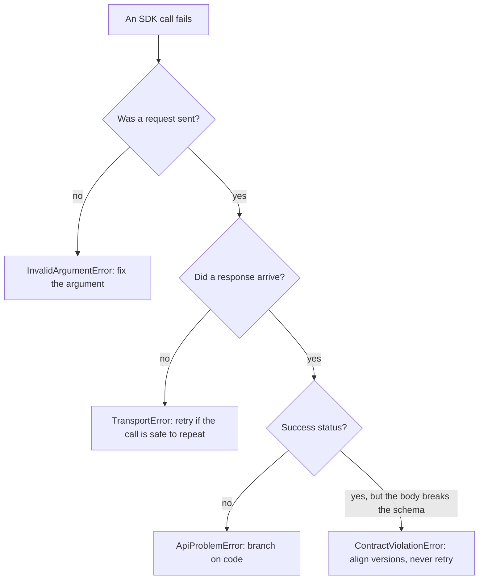

<Info>

- **Read this when:** an SDK call or a stream fails and you need to decide whether to retry, fix the
  argument, upgrade a side, or show the user a message.
- **You will learn:** the four typed error classes and when each is raised, how to branch on a
  stable `code`, and the codes any route or a run start can return.
- **Used in:** [Chapter 4: Put it in your product](/path/embed) and [Chapter 5: Ship it to your
  servers](/path/ship).

</Info>

The SDK turns every failure, from a plain request or from a step of an event stream, into one of
four typed errors. No raw `fetch` error escapes untyped, and the server's different error bodies all
arrive as the same `{ status, code, message }`.

**What you can do**

- [Catch every failure with one branch](#catch-every-failure-with-one-branch)
- [React to a server refusal by its code](#apiproblemerror-the-server-answered-and-refused)
- [Fix a client and server version mismatch](#fix-a-client-and-server-version-mismatch)
- [Tell a broken contract, a lost connection and a bad argument apart](#contractviolationerror-the-response-does-not-match-the-contract)
- [Look up what a code means](#common_problem_codes)

## Catch every failure with one branch

A call either resolves with a validated value or rejects with one of these four classes. There is
no fifth case.



```ts title="errors.ts (illustrative)" claim="illustrative"
import {
  ApiProblemError,
  ContractViolationError,
  InvalidArgumentError,
  TransportError,
} from '@indx-workspace/sdk';

try {
  await aw.agents.get(agentId);
} catch (error) {
  if (error instanceof ApiProblemError)
    console.error(`server refused: ${error.status} ${error.code}`);
  else if (error instanceof TransportError) console.error(`no response, aborted=${error.aborted}`);
  else if (error instanceof ContractViolationError)
    console.error(`do not retry: ${error.issues.join('; ')}`);
  else if (error instanceof InvalidArgumentError) console.error(`fix the argument: ${error.code}`);
  else throw error;
}
```

<Accordion title="Branching on the category only: the kind field">

`packages/sdk/src/errors.ts` defines one abstract base, `AgentWorkspaceError`, that every SDK
failure extends. Its `kind` field is the cheapest way to branch when you only need the category:

```ts title="illustrative" claim="illustrative"
abstract class AgentWorkspaceError extends Error {
  abstract readonly kind: 'problem' | 'contract' | 'transport' | 'argument';
}
```

`'problem'` is `ApiProblemError`, `'contract'` is `ContractViolationError`, `'transport'` is
`TransportError`, and `'argument'` is `InvalidArgumentError`. Prefer `instanceof` over reading
`kind` when you also want the class's own fields (`status`, `code`, `issues`, `aborted`):
TypeScript narrows the type for you.

</Accordion>

## ApiProblemError: the server answered and refused

The server sent a status the call did not expect (almost always a non-2xx). Branch on **`code`**,
the stable machine-readable string; never parse `message`.

| Field               | What it is                                                                                                              |
| ------------------- | ----------------------------------------------------------------------------------------------------------------------- |
| `status`            | The HTTP status the server sent.                                                                                        |
| `code`              | The stable string to branch on.                                                                                         |
| `message`           | Safe prose the server chose; fine to log or show a user, never to parse.                                                |
| `details`           | `readonly string[]`, present only when there is more to say (per-field validation errors, for example); `[]` otherwise. |
| `retryAfterSeconds` | Parsed from a `Retry-After` header, or `null`. See [Retries and idempotency](/guides/retries-and-idempotency).          |

```ts title="illustrative" claim="illustrative"
const failure = await aw.agents.get('missing').catch((e: unknown) => e);
if (failure instanceof ApiProblemError && failure.code === 'agent_not_found') {
  // failure.status is 404
}
```

### Three envelope spellings, one shape

<Tip>
  Branch on `code`, not on which envelope shape arrived: the SDK already did that normalisation for
  you. The two older spellings stay readable so a client built from this release still gets the
  `code` from a deployment that has not upgraded.
</Tip>

<Note>
  **Today:** the RBAC layer and the audit route answer the standard `{ code, message }` envelope, with `detail` repeating `message` until the next major release. The one route still answering a bare code is `POST /api/runtimes/test`, tracked as S-4 in the API specification §8.
</Note>

<Accordion title="The three envelope spellings the SDK normalises">

The control plane does not answer every failure with the same JSON shape. `http.ts`'s
`readProblem` tries three schemas from `@indx-workspace/contracts`, in order, and normalises
whichever one matches onto `{ code, message }`:

| Envelope                               | Shape                                    | Where it comes from                                                                                                                                                                                                                                                                                                                                                                                                                                                                                                                                                                                                                                                                                                                                                                                                                                                                                                                                                                                                                                                 |
| -------------------------------------- | ---------------------------------------- | ------------------------------------------------------------------------------------------------------------------------------------------------------------------------------------------------------------------------------------------------------------------------------------------------------------------------------------------------------------------------------------------------------------------------------------------------------------------------------------------------------------------------------------------------------------------------------------------------------------------------------------------------------------------------------------------------------------------------------------------------------------------------------------------------------------------------------------------------------------------------------------------------------------------------------------------------------------------------------------------------------------------------------------------------------------------- |
| Standard (`ApiProblemSchema`)          | `{ error: { code, message, details? } }` | Every route that has converged on the platform's own contract — including, since SDK unit 6, the RBAC layer (`/api/memberships`, `/api/users`, `/api/api-keys`, `/api/invitations`, and any RBAC-gated route's `401`/`403`/`500 authorisation_undecidable`/`503 rbac_runtime_not_configured`), and `GET /api/audit-events`, and since #238 the edge gate's own `401 unauthenticated` and `403 cross_origin` (which name the failed check in `details`, e.g. `no_session_cookie`) and `POST /api/setup`. Every `/api/**` route answers it except the OIDC browser redirects (`GET /api/auth/login`, `POST /api/auth/callback`, `GET /api/auth/workspace` and the browser-form branch of `POST /api/auth/workspace`) and `POST /api/runtimes/:id` (the driver test, `POST /api/runtimes/test`, S-4); the public share pages under `/p/*` sit outside `/api`. `apps/web/server/error-envelope-inventory.test.ts` pins that exclusion list. The RBAC routes also send `detail`, a deprecated duplicate of `message` that is removed in a later release; read `message`. |
| RBAC detail (`ApiProblemDetailSchema`) | `{ error: { code, detail } }`            | A deployment older than SDK unit 6, where the RBAC layer spelled the prose `detail`. `detail` becomes `message`.                                                                                                                                                                                                                                                                                                                                                                                                                                                                                                                                                                                                                                                                                                                                                                                                                                                                                                                                                    |
| Bare code (`ApiProblemBareCodeSchema`) | `{ error: '<code>', message? }`          | `POST /api/runtimes/test`, and `GET /api/audit-events` on a deployment older than SDK unit 6. `message` becomes `''` when the server didn't send one.                                                                                                                                                                                                                                                                                                                                                                                                                                                                                                                                                                                                                                                                                                                                                                                                                                                                                                               |

If none of the three parses (a proxy's HTML error page, an empty body, anything that is not the
platform's error envelope) the SDK does not guess: `code` is `unrecognised_error_body` and
`status` is still the fact you have to branch on.

</Accordion>

## Fix a client and server version mismatch

Every request carries `X-Agent-Workspace-Contracts`, the `@indx-workspace/contracts` version the SDK
was built against. A control plane that does not serve that version answers
`426 contracts_version_unsupported` before it authenticates, authorises or reads anything, and the
SDK raises **`ContractsVersionUnsupportedError`**, a subclass of `ApiProblemError`. Its `skew` tells
you which side to upgrade. **Never retry it**: the answer changes only when one side is upgraded.

```ts title="illustrative" claim="illustrative"
if (error instanceof ContractsVersionUnsupportedError && error.skew !== null) {
  console.error(`upgrade the ${error.skew.upgrade}`); // 'client' or 'server'
}
```

<Accordion title="skew in detail, and the malformed-header case">

`skew` is `{ clientVersion, serverVersion, servedMinimum, upgrade }`. `upgrade` is `'client'` when
the client is older than the oldest served version and `'server'` when it is newer than the server.

`skew` is `null` when the `426` carries no readable served range (the headers are missing or
unparsable) or one that, by this client's reading, serves it: something between you and the
control plane answered, or the two disagree. Do not read `null` as "not the control plane".

A tool with its own HTTP client gets the same verdict from any response with
`readContractsVersionSkew(response.headers)`. A header that is not a plain `MAJOR.MINOR.PATCH` is
`400 contracts_version_malformed`, an ordinary `ApiProblemError`. The policy behind the range is
on [Public surface and stability](/concepts/public-surface#versions-and-deprecation).

</Accordion>

## ContractViolationError: the response does not match the contract

The response **succeeded**, but its body does not satisfy the schema this SDK build was compiled
against, or is not JSON. The client and server have drifted. **Never retry a
`ContractViolationError`**: the identical request gets the identical mismatched body back.

It carries `status`, `issues` (one `"<path>: <message>"` per Zod issue, `"$: ..."` without a path)
and `contractsVersion`. To fix it:

1. Confirm which `@indx-workspace/contracts` version your build resolves and which control-plane
   release you are pointed at.
2. Pin `@indx-workspace/contracts` (and `@indx-workspace/sdk`) to the version that release ships,
   or upgrade the control plane to match your SDK.
3. If both are already aligned, this is a real bug: file it with `issues` attached.

`runs.events` and `runs.follow` raise the same error for a platform frame (`run.status`,
`run-failed`, `stream-reset`) whose `data` fails its schema, and for a `200` from
`GET /api/runs/:id/events` whose `content-type` is not `text/event-stream`; see
[Streaming](/guides/streaming).

## TransportError: no response arrived

No response at all: a network failure, your own `{ signal }` aborting, or a `timeoutMs` deadline
expiring before headers arrived. **`aborted`** is `true` when a signal (yours or the deadline) is
the reason, `false` for every other network failure (DNS, connection refused, a connection dropping
mid-stream, `fetch` itself rejecting). **`cause`** is the underlying error, unwrapped: a
`DOMException` named `TimeoutError` for a `timeoutMs` deadline, your own reason for
`AbortController.abort(reason)`, or `fetch`'s own rejection (a `TypeError` in most runtimes).

[Timeouts and cancellation](/guides/timeouts-and-cancellation) covers exactly when `aborted` is
`true`, what `timeoutMs` does and does not cover, and how `runs.follow` treats a `TransportError` as
a dropped connection to reconnect from.

## InvalidArgumentError: the SDK refused an argument

The SDK refused the call before sending anything, so there is no `status`. `code` is
`'invalid_path_segment'`: an id that goes into the request path is `''`, `'.'` or `'..'` (the URL
parser would resolve it to a different route; `agents.get('..')` would otherwise reach `/api/`,
issue #488), or holds a lone UTF-16 surrogate, which cannot be percent-encoded. Every other id is encoded as one
opaque path segment. `value` is the
refused value. The refusal is a rejected promise, never a synchronous throw. **Never retry it**:
fix the argument, usually an id read from an empty field or a relative path.

A file is addressed by its path through `fileRouteId`, whose base64url output is never `.` or
`..`, so for the `files` methods only the empty path is refused.

## `COMMON_PROBLEM_CODES`

Domain codes (`agent_not_found`, `session_not_usable`, `project_archived`, and so on) live with
their resource, for example under [Runs](/resources/runs), and in full at
`/reference/contracts/<module>` (for example [runs](/reference/contracts/runs) or
[agents](/reference/contracts/agents)). The codes you can meet on any route, and the ones that
refuse a run start, are below.

<Note>
  `api_key_not_permitted` (`403`) is raised only by every `/api/workspaces` route and every
  `/api/invitations` route, refusing an API-key principal before any other check runs, because a key
  represents no person and has no memberships to act on. See
  [Authentication](/getting-started/authentication) for which client methods this affects.
</Note>

<AccordionGroup>

<Accordion title="COMMON_PROBLEM_CODES: codes on any route">

`@indx-workspace/contracts`'s `COMMON_PROBLEM_CODES` is the vocabulary of `code` values a caller can
meet on **any** route, with the status each travels under.

| Code                        | Status | Meaning                                                                  |
| --------------------------- | ------ | ------------------------------------------------------------------------ |
| `unauthenticated`           | 401    | No credential was recognised — no usable API key or session.             |
| `forbidden`                 | 403    | The caller authenticated, but its role doesn't permit this action.       |
| `authorisation_undecidable` | 500    | The RBAC layer couldn't decide the call before the domain handler ran.   |
| `malformed_body`            | 400    | The request body isn't valid JSON.                                       |
| `invalid_body`              | 400    | The body parsed but failed schema validation.                            |
| `unsupported_media_type`    | 415    | The request's `Content-Type` isn't one the route accepts.                |
| `request_body_too_large`    | 413    | The body exceeds the server's size limit.                                |
| `internal_error`            | 500    | An unhandled failure on the server.                                      |
| `service_unavailable`       | 503    | The server can't serve the request right now. Check `retryAfterSeconds`. |
| `upstream_failure`          | 502    | A call the server made to another system failed.                         |

Version negotiation adds two more, published separately as `CONTRACTS_VERSION_PROBLEM_CODES`:
`contracts_version_unsupported` (`426`) and `contracts_version_malformed` (`400`).

`COMMON_PROBLEM_CODES` has no per-code TSDoc beyond the table's own header comment; the
descriptions above are read from the code name, its status, and the one elaboration the
`ApiProblemDetailSchema` comment gives for `authorisation_undecidable`
(`packages/contracts/src/problem.ts`).

</Accordion>

<Accordion title="Run-start codes: model and credential problems">

Starting a run can be refused before anything executes, because the workspace's configuration
cannot run the agent yet. These are `422` (the request is well formed and the agent exists) and come with a one-line `fix` in `aw`:

| Code                            | Status | Meaning                                                                                                                                                                                                          |
| ------------------------------- | ------ | ---------------------------------------------------------------------------------------------------------------------------------------------------------------------------------------------------------------- |
| `agent_runtime_profile_missing` | 422    | The agent has no runtime profile and the workspace has no default.                                                                                                                                               |
| `model_connection_unresolved`   | 422    | No usable model connection: none configured, the named one was deleted, it is not ready, or its credential cannot be read.                                                                                       |
| `model_connection_failed`       | 422    | The provider could not be reached at all (connection refused, name not resolved). The key is not the problem: check the connection's base URL and the network.                                                   |
| `model_unavailable`             | 422    | The connection works, but the selected model is not on its model list.                                                                                                                                           |
| `model_credential_rejected`     | 422    | The provider answered `401` or `403`: the connection's API key was rejected. Replace the key. A run whose key is rejected only once it is running fails at once with this code, in seconds, instead of retrying. |
| `policy_cannot_widen`           | 403    | The run asks for more than the project's policy ceiling allows (an engine or a model outside its allowlist).                                                                                                     |

`aw dev` checks each model connection's key at start and prints a `warning:` naming the variable
to set (never its value). `aw runs` and `aw eval` print a `fix:` line under the error and report an
evaluation case by its code (`model_credential_rejected`, `model_connection_failed`) instead of a
generic `run_failed`. A refusal message is also available in Japanese: send `Accept-Language: ja`
and the server honours q-values.

</Accordion>

</AccordionGroup>

See also: [Call the API without the SDK](/building/http-api) reads this same `{ error: { code,
message, details? } }` envelope directly, with no SDK to normalise it.
