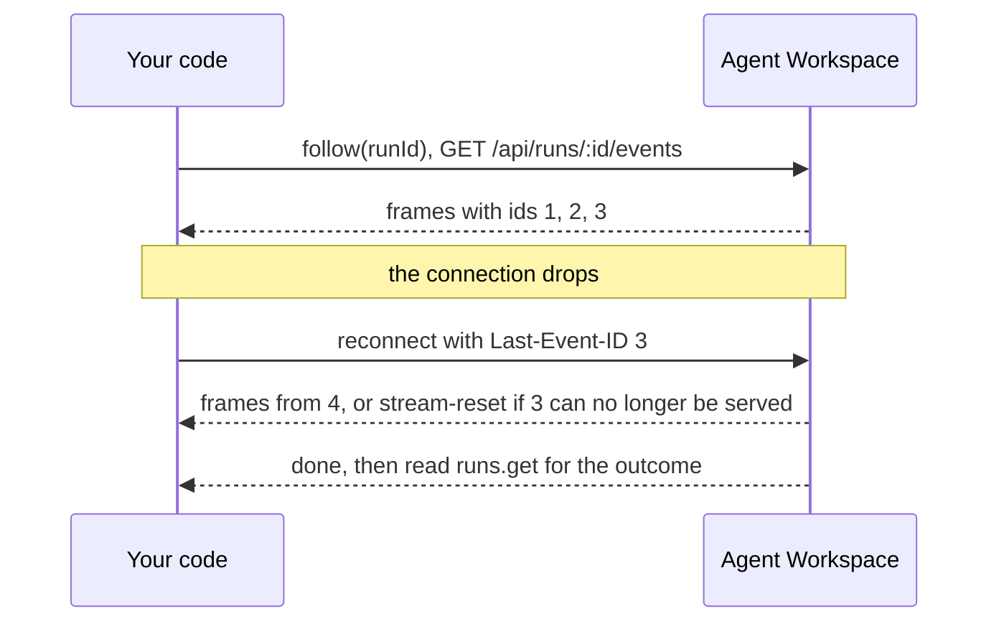

<Info>
**Chapter 4 · Put it in your product — step 8 of 8** · [the chapter map](/path/embed)

- **You will:** watch a run live, survive a dropped connection and resume from a saved cursor.
- **You will learn:** `events` versus `follow` versus `waitForOutcome`, the wire format, and the neutral `agent.*` events.
- **You need:** a run to watch ([Integrate a backend](/building/backend)).

</Info>

`GET /api/runs/:id/events` is a live, resumable feed of one run's progress. The SDK reads it for
you, reconnects when it drops, and hands you typed, engine-neutral events.

What you can do:

- [Print an agent's answer as it streams](#print-an-agent’s-answer-as-it-streams)
- [Pick how to consume a run](#events-follow-and-waitforoutcome): one connection, auto-reconnect, or just the outcome
- [Survive a dropped connection](#reconnection)
- [Resume later from a saved cursor](#resuming-with-after-and-last-event-id)
- [Parse a stream you already hold](#using-the-parsers-directly-on-a-stream-you-already-hold), such as a browser `fetch` body
- [Render tool calls, usage and results](#the-neutral-agentevent-view)



## Print an agent's answer as it streams

With a client from [Configuration](/getting-started/configuration), start a run and follow it:

```ts title="stream.ts (illustrative)" claim="illustrative"
import { toAgentEvent } from '@indx-workspace/sdk/events';

const { run } = await aw.runs.start(agentId, { prompt: 'Summarise the open incidents.' });

for await (const frame of aw.runs.follow(run.id)) {
  const event = toAgentEvent(frame);
  if (event?.frame === 'agent.message' && event.role === 'assistant') {
    for (const block of event.blocks) if (block.type === 'text') console.log(block.text);
  }
}
```

`toAgentEvent` returns `null` for the platform's own frames (`run-status`, `run-failed`,
`stream-reset`, `done`) and a typed `agent.*` event for everything the agent did.

## `events`, `follow`, and `waitForOutcome`

`aw.runs` exposes the same stream three ways:

| Call                            | What it does                                                                                                    | Reach for it when                                                    |
| ------------------------------- | --------------------------------------------------------------------------------------------------------------- | -------------------------------------------------------------------- |
| `aw.runs.follow(runId)`         | Yields frames, reconnecting with `Last-Event-ID` whenever the connection drops before `done`                    | Almost always — a live view or a relay to your own log               |
| `aw.runs.events(runId)`         | One connection, no retry; throws a `TransportError` carrying the last durable event id if it ends before `done` | You handle reconnection yourself (a relay the browser reconnects to) |
| `aw.runs.waitForOutcome(runId)` | Drains `follow`, then returns `runs.get`'s settled record                                                       | You only want the outcome, not the events                            |

Breaking out of a `for await` loop closes the connection for you; `break` or `return` is enough.

<AccordionGroup>
  <Accordion title="events in detail">

One connection to `GET /api/runs/:id/events`, yielding classified frames until the server's `done`
frame. If the connection ends or breaks before `done` — a clean close, a reset, an abort — it
throws a [`TransportError`](/guides/errors#transporterror-no-response-arrived), carrying the last
durable event id it saw so a caller can resume. A `200` whose `content-type` isn't
`text/event-stream` is refused as a `ContractViolationError` (and its body is cancelled before the
error is thrown, releasing the connection). This is the primitive `follow` is built on.

  </Accordion>
  <Accordion title="waitForOutcome in detail">

```ts title="illustrative" claim="illustrative"
const settled = await aw.runs.waitForOutcome(run.id);
console.log(settled.status, settled.usage.totalTokens, settled.cost.amount);
```

If the run still reports a non-terminal status after the stream ends, that's the platform
contradicting its own contract (the store writes the terminal status before the stream's last
frame), and `waitForOutcome` raises a `ContractViolationError` rather than handing back a
live-looking record.

  </Accordion>
  <Accordion title="The generators' return value, and early exit">

Both `events` and `follow` are `AsyncGenerator<RunEventFrame, RunStreamEnd, void>`. Their return
value, available as `{ value }` from a manual `.next()` call once `done` is `true`, is a
`RunStreamEnd`: `{ readonly lastEventId: string | null }`. `for await` loops discard it; call
`.next()` yourself if you need it (for example, to persist a resume cursor after a normal end).

Stopping iteration early cancels the underlying response body rather than leaking the connection:
`events` releases its reader in a `finally`; `follow` wraps its inner `events()` call in a
`try`/`finally` that calls `stream.return({ lastEventId: lastSeen })` on early exit, which triggers
the cancellation underneath.

  </Accordion>
</AccordionGroup>

## Reconnection

`follow` reconnects for you. Defaults: up to `maxReconnects` 5 attempts, `reconnectDelayMs` 3000 ms
apart (both are `follow` options).

- On a dropped connection (a `TransportError` whose cause isn't the caller's own signal), `follow`
  waits `reconnectDelayMs`, then reconnects `events` with `after` set to the last durable event id
  it saw (`run-status` or `runtime` frame with a non-null `id`) — sent as `Last-Event-ID`.
- It gives up and rethrows once `reconnects >= maxReconnects`.
- It **never re-sends a `start`** — reconnecting only re-opens the read side of an already-queued
  run. If `runs.start` itself never got a response, that's a separate concern; see
  [Retries and idempotency](/guides/retries-and-idempotency).
- A `timeoutMs` headers deadline firing mid-follow is treated exactly like a network drop and
  reconnected from — see [follow() reconnects after a timeout; only your own signal ends it](/guides/timeouts-and-cancellation#follow-reconnects-after-a-timeout-only-your-own-signal-ends-it).
- Only the caller's **own** `options.signal` aborting stops `follow` for good, ending it with a
  `TransportError` whose `aborted` is `true`.
- A `200` that isn't an event stream (a `ContractViolationError`) is never retried — drift is not a
  dropped connection.

<Note>
  **Today:** `follow` waits a fixed `reconnectDelayMs` between attempts and ignores the stream's
  `retry:` field. **Target:** the follower observes `retry:` and backs off exponentially. Tracked as
  [K-3](/concepts/roadmap#k-3-backoff-and-retry-hints-in-follow). Build on the reconnect; do not
  build on the fixed delay.
</Note>

## Resuming with after and Last-Event-ID

To pick a run back up later — after a process restart, say — persist the last event id you saw and
pass it as `after`:

```ts title="illustrative" claim="illustrative"
for await (const frame of aw.runs.follow(runId, { after: lastEventId })) {
  // continues after lastEventId; nothing lost, nothing repeated
}
```

`after` is sent as the `Last-Event-ID` header; omit it (or pass `null`) to replay from the
beginning. `follow` manages it internally across reconnects, so you only need it when calling
`events` directly or resuming across restarts. Treat an id as an opaque string.

If the server can no longer serve your cursor, it answers with a `stream-reset` frame instead of
silently restarting: `{ reason, resumedAfter }`, where `resumedAfter` is the oldest id the stream
can actually start after (`null` when nothing is retained). Treat it as **discard what you've
rendered and start over**. Both `events` and `follow` yield it as-is; it is data, not a drop, and
does not trigger a reconnect.

<Accordion title="The id: grammar">

A durable event's id is `<sequence>` or `<sequence>.<sub-index>`, where `<sequence>` is at most 19
ASCII digits and `<sub-index>` at most 3.

A sub-index appears when one stored row serves **several** frames, which is how a run recorded
before the neutral vocabulary is replayed: the row holds one engine message, the read path upgrades
it into one or more neutral frames, and they share the row's sequence. Ordering is
`(sequence, sub-index)`, lexicographic, and strictly increasing across the whole stream, so
`Last-Event-ID` can name any frame and resume neither loses one nor repeats one. A row serves
either one bare `<sequence>` frame or a contiguous `<sequence>.0 … <sequence>.n` run, never a
mixture. Both forms round-trip through `after` and `Last-Event-ID`.

</Accordion>

## What `done` does and does not mean

`done` means the stream is over — **nothing further will be delivered on this or any later
connection**. It says nothing about whether the run _succeeded_. `run-failed` says a connection
could not deliver a successful run; the run's settled outcome is `runs.get(runId)` (or the
`RunResource` `waitForOutcome` returns): `status` (`completed`, `failed` or `cancelled` once
terminal) and `error`.

## Using the parsers directly on a stream you already hold

`@indx-workspace/sdk/events` parses a `ReadableStream<Uint8Array>` you opened yourself — a browser
page's `fetch` body, say — without pulling in the HTTP client:

```ts title="run-view.ts (illustrative)" claim="illustrative"
import { classifyRunEventFrame, readSseFrames, toAgentEvent } from '@indx-workspace/sdk/events';

const response = await fetch(`${origin}/api/runs/${runId}/events`, {
  headers: { accept: 'text/event-stream' },
  credentials: 'include', // the page's own session cookie — see /getting-started/authentication
});
for await (const raw of readSseFrames(response.body!)) {
  const event = toAgentEvent(classifyRunEventFrame(raw));
  // render event as in the first example
}
```

`readSseFrames(body, signal?)` reassembles frames across chunk boundaries (including a multi-byte
UTF-8 character split across two chunks) and cancels the reader when you stop iterating or `signal`
aborts. `parseSseFrame` and `splitSseFrames` are its building blocks, for a caller assembling its
own reader loop. It is the same parsing `aw.runs.events` and `follow` use internally.

<Accordion title="Why not EventSource?">

The platform names every frame explicitly, and `EventSource.onmessage` only fires for an _unnamed_
frame (WHATWG HTML §9.2); there's no wildcard listener for the nine agent frame names, and
`EventSource` can't send `Authorization`. Reading the body as a stream and parsing this small
format directly is the only way to receive a frame this module didn't already know the name of,
and the only way to use header-based auth.

</Accordion>

## The neutral `AgentEvent` view

An `AgentEvent` **is** a validated `agent.*` frame, not a translation of one: the engine's adapter
in the runner normalises once, and the SDK only parses. A second engine adds nothing to this
module.

- **`toAgentEvent(frame)`** returns `null` for the platform's own frames and the parsed frame for a
  `runtime` one. A payload that fails its schema, or whose `event:` name disagrees with its own
  `frame` field, is a
  [`ContractViolationError`](/guides/errors#contractviolationerror-the-response-does-not-match-the-contract)
  naming the issues — the platform wrote that frame, so a mismatch is drift, never user data, and
  not something to retry. It never returns a partially-read object.
- **`assistantResponseFromAgentEvent(event)`** reads just the assistant's visible text, for a chat
  view. Only an `agent.message` with `role: 'assistant'`, a non-null `messageId` and at least one
  non-blank text block becomes an `AssistantResponse` (`{ id, text }`); reasoning, tool use, usage
  and results never leak into a conversation this way.

One frame is exactly one event: a tool call and a tool result are frames of their own. Within a
run, the `agent.tool.call` naming a `toolCallId` always arrives **before** the `agent.tool.result`
that answers it — an invariant of the stream, proved over the mapping in
`formal/AgentWorkspace/Theorems/Invariants/AgentFrames.lean`.

<AccordionGroup>
  <Accordion title="Every AgentEvent variant">

Every variant carries `engine` (which engine produced it) and `raw` (the engine-native message it
was derived from, capped at `AGENT_FRAME_RAW_MAX_BYTES`).

| `frame`               | Fields                                                                                                                       | Meaning                                                                                                                                                                                         |
| --------------------- | ---------------------------------------------------------------------------------------------------------------------------- | ----------------------------------------------------------------------------------------------------------------------------------------------------------------------------------------------- |
| `agent.session`       | `engineSessionId: string`, `model: string \| null`                                                                           | The engine opened or resumed its own session. `engineSessionId` is what it will accept back to continue the conversation.                                                                       |
| `agent.message`       | `messageId: string \| null`, `role: 'assistant' \| 'user'`, `blocks: readonly AgentMessageBlock[]`                           | One whole turn's prose. A repeated non-null `messageId` is the same turn grown, which is what lets a transcript replace instead of appending.                                                   |
| `agent.message.delta` | `messageId: string \| null`, `block: 'text' \| 'reasoning'`, `text: string`                                                  | One increment of a message being streamed. Emitted only by an engine whose `capabilities.streamingText` is `true`; the Claude Agent SDK does not emit it in this release.                       |
| `agent.tool.call`     | `toolCallId: string`, `name: string`, `kind: AgentToolKind`, `input: unknown`                                                | The engine invoked a tool. `kind` is one of ACP's tool-call kinds (`read`, `edit`, `delete`, `move`, `search`, `execute`, `fetch`, `mcp`, `other`).                                             |
| `agent.tool.result`   | `toolCallId: string`, `status: 'completed' \| 'failed'`, `output: string`, `isError: boolean`                                | The tool answered. `status` says whether the call ran; `isError` is the engine's verdict on the answer — a tool that completed and returned an error has both.                                  |
| `agent.usage`         | `inputTokens`, `outputTokens`, `cacheReadInputTokens \| null`, `cacheCreationInputTokens \| null`, `reasoningTokens \| null` | The engine's own counters, **informational**. Billing is metered at the gateway (`run_usage_records`). A counter the engine did not report is `null`, never `0`.                                |
| `agent.result`        | `stopReason: AgentStopReason`, `turns: number \| null`, `engineCostUsd: number \| null`                                      | How the engine's turn ended: `end_turn`, `max_turns`, `max_budget`, `refusal`, `cancelled` or `error` (aligned with ACP's prompt-turn stop reasons). The **run's** own outcome is `run.status`. |
| `agent.native`        | `type: string`, `payload: unknown`                                                                                           | Everything the engine emitted that has no neutral meaning. Never dropped, never interpreted — `type` is the engine's own name for the message. This frame is what makes the closed set safe.    |
| `agent.malformed`     | `reason: string`                                                                                                             | The engine produced something its adapter could not parse. Distinct from `agent.native`, which is well-formed and merely unmapped.                                                              |
| `agent.approval.requested` | `toolCallId: string`, `toolName: string`, `canonicalCall: string`                                                       | The engine stopped before a tool call the agent requires approval for. The run waits in `awaiting_approval` until a person approves or rejects the call.                                        |
| `agent.handoff`       | `reason?: string`                                                                                                            | The agent handed the conversation to a person; the run still ends `completed`. `reason` is for the operator: a visitor's (session-scoped token's) stream omits it.                              |

`AgentMessageBlock` is `{ type: 'text'; text }` or `{ type: 'reasoning'; text }`. Tool use is not a
block: it is its own frame.

```ts title="illustrative" claim="illustrative"
type AgentEvent = AgentFrame; // the discriminated union from @indx-workspace/contracts/run-events

function toAgentEvent(frame: RunEventFrame): AgentEvent | null;
function assistantResponseFromAgentEvent(event: AgentEvent): AssistantResponse | null;
```

  </Accordion>
  <Accordion title="Reading an older run">

A run recorded before the neutral vocabulary replays as `agent.*` frames too: the server upgrades
each stored row on read, through the same mapping a live run goes through, so the `AgentEvent`
sequence is identical to a fresh run of the same engine messages. Nothing about it is visible to a
client except the `id:` grammar — one stored row can serve several frames, sharing the row's
sequence with a `.<sub-index>` suffix.

  </Accordion>
  <Accordion title="Engines and streaming deltas">

`engine` is `'claude-agent-sdk'`, `'openai-agents'`, `'pi'` or `'mastra'`, the members of `ENGINE_IDS`.
The frame set, the tool kinds and the stop reasons were chosen against ACP so that a generic
adapter maps one-to-one; the OpenAI Agents adapter, the pi adapter and the Mastra adapter produced
the same frames from different SDKs without adding one.

`agent.message.delta` is emitted by `openai-agents`, `pi` and `mastra` (text and reasoning
deltas); the Claude engine does not emit it, because enabling the Claude Agent SDK's partial
messages was out of scope for the neutral vocabulary.

  </Accordion>
</AccordionGroup>

## The wire format

You rarely need this when using the SDK; it is what a raw HTTP client or a relay reads. Every
frame carries an explicit `event:` name (`id:` too, for frames that can be resumed) and a `data:`
payload, per the SSE grammar in WHATWG HTML §9.2. Three kinds arrive, told apart by name
(`@indx-workspace/contracts/run-events`):

1. **Control frames** — `CONTROL_FRAME_NAMES`: `done`, `run-failed`, `stream-reset`. Written by
   the stream about itself. No `id:`, ever — none of them may move a client's resume cursor.
2. **The platform's lifecycle event** — `RUN_STATUS_EVENT`, the literal string `'run.status'`. A
   durable, replayable event the control plane appends on every run status change.
3. **Neutral agent frames** — `AGENT_FRAME_NAMES`: `agent.session`, `agent.message`,
   `agent.message.delta`, `agent.tool.call`, `agent.tool.result`, `agent.usage`, `agent.result`,
   `agent.native`, `agent.malformed`, `agent.approval.requested`, `agent.handoff`. One closed, engine-neutral vocabulary: an adapter meeting
   something it cannot express emits `agent.native` rather than inventing a name. Every frame names
   its `engine` and carries the engine-native message in `raw`.

Durable events (kinds 2 and 3) carry a monotonic `id:`, the resume cursor.

They also carry `at:`, an ISO-8601 instant: when the control plane recorded the event (its receive
time, not the engine's clock). It is absent from control frames and from a server that predates the
field, and a parser that ignores unknown fields is unaffected by it. `aw runs trace` prints it as an
offset from the run's start, which is how a slow run's time splits between model turns and tool
calls.

<AccordionGroup>
  <Accordion title="data schemas">

- `RunStatusEventDataSchema` — `{ status: RunStatus, error: string | null }`.
- `RunFailedFrameDataSchema` — `{ status: RunStatus | 'unknown', message: string }`. `'unknown'`
  means producing the stream threw and this connection genuinely doesn't know the run's outcome —
  reconnecting with `Last-Event-ID` is the right move.
- `StreamResetFrameDataSchema` — `{ reason: string, resumedAfter: string | null }`.
- `AgentFrameSchema` — a discriminated union on `frame`, one strict arm per name, every arm
  carrying `engine` and `raw`. `raw` is `unknown` on purpose: it is another vendor's shape and this
  contract promises nothing about it. A payload over `AGENT_FRAME_RAW_MAX_BYTES` (64 KiB) is
  **truncated with a marker** (`AgentFrameRawTruncationSchema`, recognised by
  `isAgentFrameRawTruncated`) and never rejected — the neutral fields beside `raw` are what a
  consumer renders.
- `RelayedEventDataSchema` — `z.looseObject({ kind: z.string().min(1) })`, the pre-neutral envelope.
  Only the read path still meets it.

</Accordion>
<Accordion title="Pre-neutral event names">

`RELAYED_EVENT_NAMES` (`system`, `system-unknown`, `result`, `result-unknown`, `sdk-event`,
`unknown`, `malformed`) is what this stream carried _before_ the neutral vocabulary. Rows recorded
under those names are still in `run_events` and are **upgraded on read**, so a client only ever
sees the neutral set. Nothing writes them any more.

</Accordion>
  <Accordion title="RunEventFrame: the classified shape">

`classifyRunEventFrame` (`@indx-workspace/sdk/events`) turns one parsed `SseFrame` into a
`RunEventFrame`:

```ts title="illustrative" claim="illustrative"
type RunEventFrame =
  | { kind: 'run-status'; id: string | null; at?: string; data: RunStatusEventData }
  | { kind: 'runtime'; id: string | null; at?: string; name: string; data: unknown }
  | { kind: 'run-failed'; data: RunFailedFrameData }
  | { kind: 'stream-reset'; data: StreamResetFrameData }
  | { kind: 'done' };
```

A malformed **platform** frame (one the server itself wrote, that fails its own schema) is refused
as a [`ContractViolationError`](/guides/errors#contractviolationerror-the-response-does-not-match-the-contract)
— that's drift in the platform's own contract, not something to retry.

A `runtime` frame keeps `data: unknown` here, and is validated by
[`toAgentEvent`](#the-neutral-agentevent-view) instead, so a payload that fails its schema cannot
make the stream unreadable for a consumer that only wanted the resume cursor. Never read
`frame.data` by hand — `toAgentEvent` is the one parser.

  </Accordion>
</AccordionGroup>

## See also

- [Errors](/guides/errors) — `ContractViolationError` for a malformed platform frame,
  `TransportError` for a dropped connection.
- [Timeouts and cancellation](/guides/timeouts-and-cancellation) — why `timeoutMs` never
  cuts an open stream, and how `follow` treats a headers timeout as a drop.
- [Runs](/resources/runs) — the full `runs` method reference, including `start` and
  `list`.
- [RunsClient](/reference/sdk/runs) and [Events](/reference/sdk/events)
  — generated signatures.
- [run-events](/reference/contracts/run-events) — every frame schema.
- [Run lifecycle](/concepts/run-lifecycle) and
  [Runtime neutrality](/concepts/runtime-neutrality) — the bigger picture this page's
  mechanics serve.
