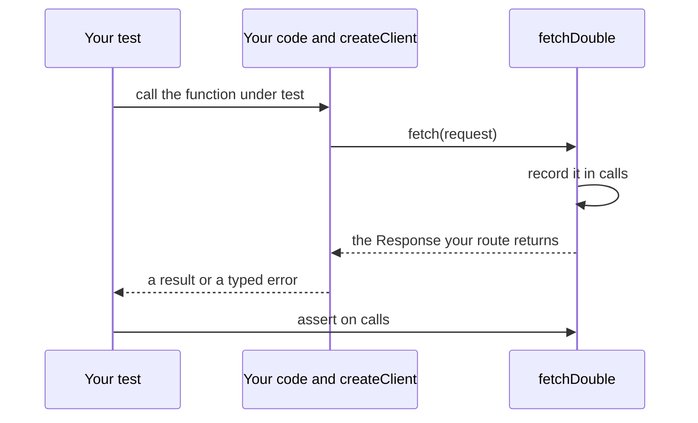

<Info>
**Chapter 3 · Test and improve it — step 3 of 3** · [the chapter map](/path/test)

- **You will:** test your code that calls Agent Workspace, with no server and no network.
- **You will learn:** how to inject the recording `fetch` double, answer with contract-valid fixtures, and simulate each error and stream shape.
- **You need:** code that uses `@indx-workspace/sdk` and a test runner such as Vitest or Jest.

</Info>

<Note>
  This page tests **your integration code**, not the agent's answers. To check that the agent
  answers well, write eval cases and run `aw eval`: see [Evaluations](/guides/evaluations).
</Note>

Test your code that calls Agent Workspace without a server or a network.
`@indx-workspace/sdk/testing` gives you a `fetch` that records every request and answers with
whatever you choose; it is the same module the SDK's own suites use.

**What you can do**

- [Test without a network](#test-without-a-network) in a few lines
- [Check what your code sent](#check-what-your-code-sent): URL, method, headers, body
- [Answer with realistic data](#answer-with-contract-valid-fixtures) the server could really send
- [Simulate each failure](#simulate-each-failure): error envelopes, bad shapes, timeouts, aborts
- [Test streams and reconnects](#test-streams-and-reconnects)
- [Test automation that calls `aw`](#testing-cli-driven-automation)
- [Run an agent against a scripted model](#run-an-agent-against-a-scripted-model) with no model key



## Test without a network

`createClient` takes a `fetch` implementation
([`ClientOptions.fetch`](/reference/sdk/client#clientoptions)), the only place the SDK reaches the
network. Hand it the double and you get a client that never touches the network:

```ts title="agent.test.ts" claim="compile"
import { expect, it } from 'vitest';
import { createClient } from '@indx-workspace/sdk';
import { fetchDouble, jsonResponse } from '@indx-workspace/sdk/testing';

it('lists agents', async () => {
  const api = fetchDouble(() => jsonResponse(200, { agents: [] }));
  const aw = createClient({
    baseUrl: 'https://aw.example.com',
    auth: { kind: 'api-key', apiKey: 'ak_live_test' },
    fetch: api.fetch,
  });
  expect(await aw.agents.list()).toEqual([]);
  expect(api.calls[0]?.url.pathname).toBe('/api/agents');
});
```

The examples here use [Vitest](https://vitest.dev), but nothing is Vitest-specific: `fetch`,
`Response`, `ReadableStream` and `AbortController` are Web platform APIs, so the same double works
under Jest or any other runner with those globals. `route` sees every request in order
(`calls[0]`, `calls[1]`, ...) and decides the answer; for a sequence of calls (create, then list),
close over a counter or branch on `request.url.pathname` and `request.method`.

<Accordion title="Everything @indx-workspace/sdk/testing exports">

All of them are free of any test runner.

| Export                                               | What it is                                                                                                                                            |
| ---------------------------------------------------- | ----------------------------------------------------------------------------------------------------------------------------------------------------- |
| `fetchDouble(route)`                                 | A `fetch` that records every call in `calls` (`RecordedRequest`: URL, method, headers, init, parsed JSON body) and answers with `route`'s `Response`. |
| `jsonResponse(status, body, headers?)`               | A JSON response with the `content-type` the SDK expects; `204` gets an empty body.                                                                    |
| `eventStreamResponse(text)`                          | A complete `text/event-stream` body, then a clean end.                                                                                                |
| `droppedEventStreamResponse(text, cause?)`           | A stream that delivers `text`, then fails the way a dropped connection does.                                                                          |
| `openEventStreamResponse(text)`                      | A stream that stays open until the consumer cancels it; `cancelled()` says whether it did.                                                            |
| `drain(iterable)`                                    | Consume an async iterable to its end.                                                                                                                 |
| `fixtures.agent`, `fixtures.run`, `fixtures.session` | Contract-valid resources, parsed by their contracts schema ([below](#answer-with-contract-valid-fixtures)).                                           |

</Accordion>

## Check what your code sent

Each `RecordedRequest` holds the resolved URL (including query string), method, headers, and the
parsed JSON body:

```ts title="illustrative" claim="illustrative"
const [call] = api.calls;
expect(call?.method).toBe('POST');
expect(call?.headers.get('authorization')).toBe('Bearer ak_live_test');
expect(call?.json).toMatchObject({ name: 'Triage' });
```

For a client built with session auth, assert the credential mode instead of a header: the SDK sends
no `Authorization` at all, and `init.credentials` is `'include'`. An API-key client is refused on
`/api/workspaces` and `/api/invitations` in production; your fixture route can still answer `200`
for a unit test that only exercises request-building, but don't rely on that as a substitute for
[the conformance pattern](#what-not-to-test) if you're asserting real server behaviour. See
[Authentication](/getting-started/authentication) for when each auth kind applies.

<AccordionGroup>
  <Accordion title="A full create request, asserted">

```ts title="illustrative" claim="illustrative"
const api = fetchDouble(() => jsonResponse(201, {/* ... */}));
const aw = createClient({
  baseUrl: 'https://aw.example.com',
  auth: { kind: 'api-key', apiKey: 'ak_live_test' },
  fetch: api.fetch,
});

await aw.agents.create({
  name: 'Triage',
  instructions: 'Be brief.',
  modelConnectionId: null,
  model: null,
  permissions: {
    readFiles: true,
    writeFiles: false,
    runCommands: false,
    unrestrictedNetwork: false,
  },
});

const [call] = api.calls;
expect(call?.method).toBe('POST');
expect(call?.url.pathname).toBe('/api/agents');
expect(call?.headers.get('authorization')).toBe('Bearer ak_live_test');
expect(call?.headers.get('content-type')).toBe('application/json');
expect(call?.json).toMatchObject({ name: 'Triage' });
```

  </Accordion>
  <Accordion title="Session auth">

```ts title="illustrative" claim="illustrative"
const aw = createClient({
  baseUrl: 'https://aw.example.com',
  auth: { kind: 'session' },
  fetch: api.fetch,
});
await aw.workspaces.list();
expect(api.calls[0]?.headers.has('authorization')).toBe(false);
expect(api.calls[0]?.init.credentials).toBe('include');
```

  </Accordion>
</AccordionGroup>

## Answer with contract-valid fixtures

`fixtures.run`, `fixtures.agent` and `fixtures.session` fill every required field, apply your
overrides last, and parse the result with the resource's contracts schema, so a fixture the server
could never send throws where it is built. A terminal run status also gets its `startedAt`,
`endedAt` and `durationMs`, and the three share ids, so a run belongs to the agent and session the
other two builders return.

```ts claim="compile"
import { createClient } from '@indx-workspace/sdk';
import { fetchDouble, fixtures, jsonResponse } from '@indx-workspace/sdk/testing';
import { expect } from 'vitest';

const run = fixtures.run({ status: 'completed' });
const api = fetchDouble(() => jsonResponse(200, { run }));
const aw = createClient({
  baseUrl: 'https://aw.example.com',
  auth: { kind: 'api-key', apiKey: 'k' },
  fetch: api.fetch,
});
expect(await aw.runs.get(run.id)).toEqual(run);
```

For a resource without a builder, build the body from the same Zod schemas the SDK validates
against (`@indx-workspace/contracts/*`, see [contracts](/reference/contracts/index)) and parse it
_in the test_. A fixture that drifts from the schema then fails your test the same way a real
drifted response would fail in production — as a `ContractViolationError`, not as a passing test
built on a shape the server no longer sends.

<Accordion title="A fixture built by hand from its schema">

```ts title="illustrative" claim="illustrative"
import { AgentResourceSchema } from '@indx-workspace/contracts/agents';

const agentFixture = AgentResourceSchema.parse({
  id: '11111111-1111-4111-8111-111111111111',
  workspaceId: '44444444-4444-4444-8444-444444444444',
  name: 'Support',
  instructions: '',
  modelConnectionId: null,
  model: null,
  runtimeProfileId: null,
  permissions: {
    readFiles: true,
    writeFiles: false,
    runCommands: false,
    unrestrictedNetwork: false,
  },
  createdBy: null,
  ownerPrincipalId: 'p1',
  createdAt: '2026-09-21T10:00:00.000Z',
  updatedAt: '2026-09-21T10:00:00.000Z',
});

const api = fetchDouble(() => jsonResponse(200, { agents: [agentFixture] }));
const aw = createClient({
  baseUrl: 'https://aw.example.com',
  auth: { kind: 'api-key', apiKey: 'k' },
  fetch: api.fetch,
});
expect(await aw.agents.list()).toEqual([agentFixture]);
```

`AgentResourceSchema.parse(...)` throws immediately if you typo a field name or forget one the
schema requires — that's the point. Keep a small module of these fixtures per resource family you
test against, one call to `<Resource>Schema.parse` each, and reuse them across tests.

</Accordion>

## Simulate each failure

Every SDK call fails as exactly one of three typed errors ([Errors](/guides/errors) covers all of
them). Produce each from the route:

- **`ApiProblemError`** — answer a non-2xx envelope, such as
  `jsonResponse(404, { error: { code: 'agent_not_found', message: 'No such agent.' } })`.
- **`ContractViolationError`** — answer a 2xx whose body doesn't satisfy the schema. Never retry on
  this error: it means the server's answer doesn't match the contract the SDK was built against,
  and retrying sends the identical broken request again.
- **`TransportError`** — reject the `fetch` call (`Promise.reject(new TypeError('fetch failed'))`),
  or abort it. An abort or a `timeoutMs` deadline gives `aborted: true`.

<AccordionGroup>
  <Accordion title="ApiProblemError: the three envelope spellings">

The control plane spells its error envelope three ways, and all three normalise to the same
`{ status, code, message, details, retryAfterSeconds }` shape on `ApiProblemError`:

```ts title="illustrative" claim="illustrative"
import { ApiProblemError } from '@indx-workspace/sdk';

// 1. The standard envelope.
const standard = fetchDouble(() =>
  jsonResponse(404, { error: { code: 'agent_not_found', message: 'No such agent.' } }),
);

// 2. The `detail` spelling an older deployment's RBAC layer answered (team/membership routes).
const detail = fetchDouble(() =>
  jsonResponse(409, { error: { code: 'last_owner', detail: 'The last owner cannot leave.' } }),
);

// 3. The bare-code spelling (runtimes/test, and audit-events on an older deployment).
const bare = fetchDouble(() => jsonResponse(400, { error: 'invalid_limit' }));

const aw = createClient({
  baseUrl: 'https://aw.example.com',
  auth: { kind: 'api-key', apiKey: 'k' },
  fetch: standard.fetch,
});
const failure = await aw.agents.get('missing').catch((error: unknown) => error);
expect(failure).toBeInstanceOf(ApiProblemError);
expect((failure as ApiProblemError).code).toBe('agent_not_found');
```

A body that matches none of the three spellings (a proxy's HTML error page, an empty body) still
becomes an `ApiProblemError`, with `code: 'unrecognised_error_body'` and the real `status`
preserved — that's worth its own test if your code branches on `code`.

  </Accordion>
  <Accordion title="ContractViolationError: a 2xx with the wrong shape">

```ts title="illustrative" claim="illustrative"
import { ContractViolationError } from '@indx-workspace/sdk';

const api = fetchDouble(() => jsonResponse(200, { agents: [{ id: 'a1' }] })); // missing required fields
const aw = createClient({
  baseUrl: 'https://aw.example.com',
  auth: { kind: 'api-key', apiKey: 'k' },
  fetch: api.fetch,
});
await expect(aw.agents.list()).rejects.toBeInstanceOf(ContractViolationError);
```

  </Accordion>
  <Accordion title="TransportError: a network failure or an abort">

A rejected `fetch` call (network failure, DNS, TLS):

```ts title="illustrative" claim="illustrative"
import { TransportError } from '@indx-workspace/sdk';

const api = fetchDouble(() => Promise.reject(new TypeError('fetch failed')));
const aw = createClient({
  baseUrl: 'https://aw.example.com',
  auth: { kind: 'api-key', apiKey: 'k' },
  fetch: api.fetch,
});
const failure = await aw.agents.list().catch((error: unknown) => error);
expect(failure).toBeInstanceOf(TransportError);
expect((failure as TransportError).aborted).toBe(false);
expect((failure as TransportError).cause).toBeInstanceOf(TypeError);
```

An abort, via your own `{ signal }` ([Timeouts and cancellation](/guides/timeouts-and-cancellation)):

```ts title="illustrative" claim="illustrative"
const controller = new AbortController();
const api = fetchDouble((request) => {
  expect(request.init.signal?.aborted).toBe(true);
  return Promise.reject(new DOMException('aborted', 'AbortError'));
});
const aw = createClient({
  baseUrl: 'https://aw.example.com',
  auth: { kind: 'api-key', apiKey: 'k' },
  fetch: api.fetch,
});
controller.abort();
const failure = await aw.agents
  .list({ signal: controller.signal })
  .catch((error: unknown) => error);
expect(failure).toBeInstanceOf(TransportError);
expect((failure as TransportError).aborted).toBe(true);
```

  </Accordion>
  <Accordion title="A timeoutMs deadline, with fake timers">

A `timeoutMs` deadline behaves the same way — `aborted: true` with a `DOMException` named
`TimeoutError` as `cause` — because `timeoutMs` covers only the wait for response _headers_
(see [Timeouts and cancellation](/guides/timeouts-and-cancellation)). Drive it with fake timers
instead of a real wait:

```ts title="illustrative" claim="illustrative"
import { vi } from 'vitest';

it('treats a headers deadline as an aborted TransportError', async () => {
  vi.useFakeTimers();
  try {
    // A route that never resolves on its own — only the deadline's abort ends it, exactly as a
    // real `fetch` that never receives headers would behave.
    const api = fetchDouble(
      (request) =>
        new Promise((_, reject) => {
          request.init.signal?.addEventListener('abort', () => {
            reject(request.init.signal?.reason);
          });
        }),
    );
    const aw = createClient({
      baseUrl: 'https://aw.example.com',
      auth: { kind: 'api-key', apiKey: 'k' },
      fetch: api.fetch,
      timeoutMs: 5000,
    });

    const pending = aw.agents.list().catch((error: unknown) => error);
    await vi.advanceTimersByTimeAsync(5000);
    const failure = await pending;

    expect(failure).toBeInstanceOf(TransportError);
    expect((failure as TransportError).aborted).toBe(true);
  } finally {
    vi.useRealTimers();
  }
});
```

The SDK's own `http.test.ts` tests the same deadline with a short _real_ timeout (5 ms) instead of
fake timers, since the fixture there also streams a body after the headers arrive. Prefer fake
timers when your fixture never needs to resolve, and a short real timeout when it does (a stream
body, for example, where you want to assert bytes actually arrived before the deadline would have
fired).

  </Accordion>
</AccordionGroup>

## Test streams and reconnects

`runs.events` and `runs.follow` read a `text/event-stream` body ([Streaming](/guides/streaming)).
Write the frames as plain template strings (`event: <name>`, an optional `id: <id>`, one or more
`data: <line>` fields, and a blank line) and answer with:

- `eventStreamResponse` — a complete stream;
- `droppedEventStreamResponse` — one that fails mid-stream, so `runs.follow` reconnects with
  `Last-Event-ID`;
- `openEventStreamResponse` — one that stays open, to assert a consumer that stops early releases
  the connection.

<Tip>
  Pass `reconnectDelayMs: 0` in tests — the default is 3000 ms, and there's no reason to make a test
  suite wait for it.
</Tip>

A `stream-reset` frame — the server telling the client its resume cursor is gone — comes through
`events`/`follow` like any other frame, not as an error; a consumer that renders a transcript is
expected to discard what it has and start over.

<AccordionGroup>
  <Accordion title="A single-connection read">

```ts title="illustrative" claim="illustrative"
const api = fetchDouble(() =>
  eventStreamResponse(
    'event: run.status\nid: 1\ndata: {"status":"running","error":null}\n\n' +
      'event: sdk-event\nid: 2\ndata: {"kind":"event","type":"assistant"}\n\n' +
      'event: done\ndata: null\n\n',
  ),
);
const aw = createClient({
  baseUrl: 'https://aw.example.com',
  auth: { kind: 'api-key', apiKey: 'k' },
  fetch: api.fetch,
});

const frames = [];
for await (const frame of aw.runs.events(runId)) frames.push(frame);
expect(frames).toEqual([
  { kind: 'run-status', id: '1', data: { status: 'running', error: null } },
  { kind: 'runtime', id: '2', name: 'sdk-event', data: { kind: 'event', type: 'assistant' } },
]);
```

  </Accordion>
  <Accordion title="A dropped connection that runs.follow resumes">

```ts title="illustrative" claim="illustrative"
let attempt = 0;
const api = fetchDouble(() => {
  attempt += 1;
  return attempt === 1
    ? droppedEventStreamResponse('event: sdk-event\nid: 5\ndata: {"kind":"event"}\n\n')
    : eventStreamResponse('event: sdk-event\nid: 6\ndata: {"kind":"event"}\n\nevent: done\n\n');
});
const aw = createClient({
  baseUrl: 'https://aw.example.com',
  auth: { kind: 'api-key', apiKey: 'k' },
  fetch: api.fetch,
});

const seen: string[] = [];
for await (const frame of aw.runs.follow(runId, { reconnectDelayMs: 0 })) {
  seen.push(frame.kind === 'runtime' ? `runtime:${frame.id ?? ''}` : frame.kind);
}
expect(seen).toEqual(['runtime:5', 'runtime:6']);
expect(api.calls[1]?.headers.get('last-event-id')).toBe('5'); // resumed from the last id seen
```

  </Accordion>
  <Accordion title="A stream-reset frame">

```ts title="illustrative" claim="illustrative"
const api = fetchDouble(() =>
  eventStreamResponse(
    'event: stream-reset\ndata: {"reason":"retention","resumedAfter":null}\n\n' +
      'event: sdk-event\nid: 9\ndata: {"kind":"event"}\n\nevent: done\n\n',
  ),
);
const aw = createClient({
  baseUrl: 'https://aw.example.com',
  auth: { kind: 'api-key', apiKey: 'k' },
  fetch: api.fetch,
});

const frames = [];
for await (const frame of aw.runs.events(runId)) frames.push(frame);
expect(frames[0]).toEqual({
  kind: 'stream-reset',
  data: { reason: 'retention', resumedAfter: null },
});
```

  </Accordion>
</AccordionGroup>

## Testing CLI-driven automation

If your automation shells out to `aw ... --json`, spawn the real binary in your test and parse
stdout with the contracts schema, for example `AgentResourceSchema.array().parse(JSON.parse(stdout))`
for `aw agents list --json`. Your test then fails the same way a drifted CLI output would fail in
production. Assert on the exit code (`0` ok, `1` `ApiProblemError`, `2` usage, `3`
`ContractViolationError`, `4` `TransportError`) instead of parsing stderr — [Output and exit
codes](/cli/output-and-exit-codes) has the full contract.

<Note>
  Unlike the SDK, `aw` ships no in-process test double: the published `@indx-workspace/aw` does not
  export one. To test code that calls `aw`, spawn the real binary as shown below.
</Note>

<Accordion title="A test that spawns aw">

```ts title="automation.test.ts (illustrative)" claim="illustrative"
import { execFile } from 'node:child_process';
import { promisify } from 'node:util';
import { AgentResourceSchema } from '@indx-workspace/contracts/agents';

const run = promisify(execFile);

it('lists agents as JSON', async () => {
  const { stdout } = await run('aw', ['agents', 'list', '--json'], {
    env: {
      ...process.env,
      AGENT_WORKSPACE_URL: process.env.TEST_AGENT_WORKSPACE_URL,
      AGENT_WORKSPACE_API_KEY: process.env.TEST_AGENT_WORKSPACE_API_KEY,
    },
  });
  const agents = AgentResourceSchema.array().parse(JSON.parse(stdout));
  expect(agents.length).toBeGreaterThan(0);
});
```

`--json` prints exactly the SDK's returned value; `--jsonl` prints one JSON object per line for a
listing.

</Accordion>

## Run an agent against a scripted model

A scripted model is a **test tool**. It replays a file of assistant turns, text and tool calls, in
order, so `aw dev`, `aw chat` and `aw eval` run with no real model key and the agent's tool
sequence is the same every time. It is for the local runtime only. It cannot be switched on in a
deployment: the gateway and the web process refuse to start when it is enabled outside the `local`
posture.

<Warning>
  Use a scripted model in tests and CI, never in an agent you ship. It is opt-in twice: you set
  `AW_SCRIPTED_MODELS_DIR` for the process, and the agent names a `scripted:` model id.
</Warning>

Write one JSON file per script, named `<name>.json`, in an absolute directory. A name is lowercase
letters, digits and `-`, at most 64 characters, starting with a letter or digit:

```json title="scripts/order-status.json (illustrative)" claim="illustrative"
{
  "turns": [
    { "text": "Let me check.", "toolUses": [{ "name": "get_order", "input": { "id": "A-100" } }] },
    { "text": "Your order has shipped." }
  ]
}
```

Each turn has `text`, `toolUses`, or both, and no other keys. A turn with `toolUses` ends with the
tool-use stop reason; any other turn ends the reply. The gateway keeps no state: the turn it answers
with is the number of assistant messages already in the conversation, so a tool call and its result
move the run to the next turn. A conversation that asks for a turn past the end of the file fails
with a `400` that names the script and its turn count.

Point the agent at the script by model id, on an Anthropic or Anthropic-compatible connection, and
start the runtime with the directory set:

```yaml title="agent-workspace.yaml (excerpt) (illustrative)" claim="illustrative"
model:
  connection: default
  id: 'scripted:order-status'
```

```sh title="illustrative" claim="illustrative"
AW_SCRIPTED_MODELS_DIR="$PWD/scripts" npx aw dev
npx aw eval add 'where is order A-100?' --expect-contains shipped
npx aw eval
```

**What to know**

- **No provider key.** When every agent names a `scripted:` model, `aw dev` asks for no key and
  gives each unset model secret the placeholder `scripted`, which is never sent anywhere for a
  `scripted:` model. An agent on any other model still needs its real key.
- **Your own fake or proxy instead.** To keep a real model's wire format but point it at a recording
  proxy or an Anthropic-shaped fake, set `ANTHROPIC_BASE_URL` for `aw dev`; see
  [Send model calls through your own gateway](/cli/configuration#send-model-calls-through-your-own-gateway).
- **Which engines.** The scripted model speaks the `anthropic-messages` protocol, which every
  engine uses on an Anthropic-family connection. On an OpenAI connection every route (Messages,
  Responses, and Chat Completions) refuses a `scripted:` model with
  `scripted_model_protocol_unsupported`, and nothing is sent to the provider.
- **Model discovery.** The scripted ids are added to the connection's model list. If the provider's
  own list cannot be read, the scripted ids are listed alone, so a placeholder key does not stop a
  scripted run.
- **Use `contains`-style expectations.** A `judge` expectation calls the connection's real model, so
  it would be answered by the script and fail. Match turns by input and `judge` verdicts are not
  supported yet.
- **Failures are explicit.** A missing or invalid script file, an unsafe name and an exhausted
  script each answer `400`; the message never contains the directory path.

## What not to test

Don't re-test what the SDK's own suites already prove: that a resource method builds the right URL
and body, that a response is validated against its schema, or that `readSseFrames` /
`classifyRunEventFrame` parse the wire format correctly. That's `packages/sdk/src/http.test.ts`,
`packages/sdk/src/index.test.ts`, `packages/sdk/src/resources/*.test.ts` and
`packages/sdk/src/events/*.test.ts`. Spend your tests on _your_ code's use of
the client: which methods it calls, how it reacts to each error kind, and what it does with a
stream.

If you maintain the control plane itself, hand-written fixtures can't prove your server's real
responses satisfy the contract — they can drift from what your serializers produce without either
side's tests noticing. `apps/web/server/sdk-conformance.test.ts` is the pattern for that: it renders
real records through the application's own serializers (`toAgentResource`, `renderRun`, and so on)
and parses the result with the same contracts schemas, so a drift fails there first.

## Related pages

<CardGroup cols={2}>
  <Card title="Errors" href="/guides/errors">
    The full error taxonomy and what to do with each kind.
  </Card>
  <Card title="Streaming" href="/guides/streaming">
    The complete run-event frame vocabulary, `events` vs. `follow`, and reconnection.
  </Card>
  <Card title="createClient / ClientOptions" href="/reference/sdk/client">
    Full signature of `createClient`, `ClientOptions.fetch`, and the three error classes.
  </Card>
  <Card title="Contracts reference" href="/reference/contracts/index">
    Every schema and export, by module — the source of every fixture on this page.
  </Card>
</CardGroup>
