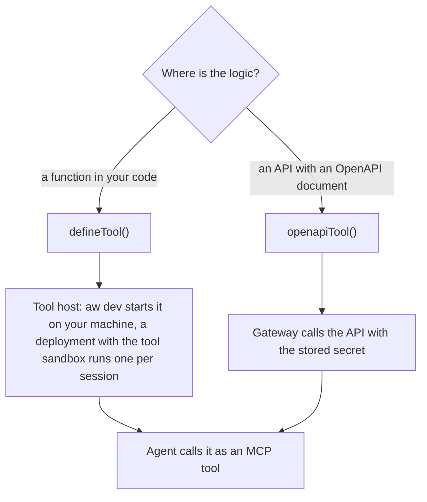

<Info>
**Chapter 2 · Build your agent — step 5 of 7** · [the chapter map](/path/build)

- **You will:** give the support agent an orders lookup tool from an OpenAPI document, or a function from your own code.
- **You will learn:** where each kind of tool runs, how `secret()` keeps the token out of your files, and which operations an API tool may call.
- **You need:** an agent as files from [Agents as code](/guides/agents-as-code), and `aw dev` running.

</Info>

Give an agent a tool without running an MCP server of your own. Use `defineTool()` when the logic is
yours: `aw dev` runs your TypeScript function on your machine. Use `openapiTool()` when the logic
already sits behind an OpenAPI document: the gateway calls the API for you, and runs a write only for a call a person approved.

**What you can do**

- [Let the agent call a function from your codebase](#let-the-agent-call-a-function-from-your-codebase)
- [Let the agent read an HTTP API](#let-the-agent-read-an-http-api)
- [Keep the API token out of your code](#keep-the-api-token-out-of-your-code)
- [Choose which operations the agent may call](#choose-which-operations-the-agent-may-call)
- [Check, then save](#check-then-save)



## Let the agent call a function from your codebase

A code tool is two files: a declaration (name, description, input schema, run file) and a run file
that is ordinary Node, with any npm import.

```ts title="tools/get-order.ts" claim="compile"
import { defineTool, z } from '@indx-workspace/sdk/define';

export default defineTool({
  name: 'get_order',
  description: 'Look up an order by its id',
  input: z.object({ id: z.string().describe('Order id, like A-1042') }),
  run: './tools/get-order.run.ts',
});
```

```ts title="tools/get-order.run.ts (illustrative)" claim="illustrative"
import type { ToolRun } from '@indx-workspace/sdk/define';
import type getOrder from './get-order.ts';

const run: ToolRun<typeof getOrder> = async ({ id }, { signal }) => {
  const res = await fetch(`${process.env.ORDERS_URL}/orders/${id}`, { signal });
  return res.ok ? res.json() : { error: `order ${id} not found` };
};
export default run;
```

Import the declaration into the agent (`import getOrder from '../tools/get-order.ts'`) and add it to
`tools: [getOrder]` in `defineAgent`. Run `aw dev`, and the agent can call it. `console.log` in the
run file prints to your terminal, prefixed with `[tool get_order]`.

<Note>
  **A deployment runs code tools only where its operator turned the tool sandbox on.** It is off by
  default. The operator sets `AGENT_WORKSPACE_TOOL_HOST_IMAGE` on both the web service and the
  runner (in the Compose stack, `TOOL_HOST_IMAGE` in `.env`). With it on, `aw push --yes` creates
  the `aw-dev-tools` connector and saves the version with the bundle of each tool, a run calls the
  tool in its own session's sandbox through the gateway, and `aw promote` and `aw rollback` move
  the bundle together with the version. With it off, `aw check` and `aw push` refuse the agent by
  name instead of dropping the tool: `agents/assistant.ts: 422 code_tool_needs_host
  [connector:aw-dev-tools]`. Known limit: every tool sandbox shares one internal network with the
  gateway and the runner until #841, so turn it on only for tenants you trust.

  On a `vercel` or `cloudflare` deployment the flag is set by `aw deploy`, and only with
  `RUNTIME_DRIVER=external` (E2B): put the pinned tool-host template in `.env` as
  `E2B_TOOL_HOST_TEMPLATE=<template>:<build_id>` (see [Deploy](/guides/deploy)). The tool runs in
  its own E2B sandbox with no network access, and a tool that declares `allowedDomains` is refused
  at run time until egress is proven there. `vercel-sandbox` and `cloudflare-sandbox` keep the
  refusal.
</Note>

<AccordionGroup>
  <Accordion title="defineTool options">

`input` is a Zod object, stored as JSON Schema. `run` is a path to a `.ts` or `.js` file relative to
the project root, not to the declaration file (from `tools/get-order.ts` write
`./tools/get-order.run.ts`), and `limits.timeoutMs` (1–600000, default 30000) bounds a call. The run
file imports the declaration with `import type`, which Node erases, so the loader that evaluates your
definitions never reads it: a definition may still import only `@indx-workspace/sdk/define` and
project-relative `.ts` files ([Agents as code](/guides/agents-as-code)).

  </Accordion>
  <Accordion title="How the tool host runs it">

`aw dev` starts a tool host: a child Node process, with your project's `node_modules` and your
environment, that imports each run file below `tools/` and serves the tools to the local runtime
over MCP on `127.0.0.1`, behind a path token that is fresh for each `aw dev`. A tool call gets the
arguments and `{ signal, runId, agent }`: `signal` aborts when the call times out, `runId` is the
run that called it and `agent` the calling agent's name. An error the function throws reaches the
model as a tool error carrying its message.

`aw dev` registers the host as the connector `aw-dev-tools` in the `local` environment, before it
saves the agent's version, and the version lists that connector. Editing a run file restarts only
the host; saving a declaration syncs a new version as usual. All of an agent's code tools share the
one connector.

`aw check` reports each tool before the agents:

```text
tools/get-order.ts: get_order (code) ok
agents/assistant.ts: ok (would be version 1)
```

`aw check` does not start the tool host. Before `aw dev` has registered `aw-dev-tools` in the
workspace, the agent's dry run answers `422 agent_definition_references_missing
[connector:aw-dev-tools]`; run `aw dev` once and check again. Against a deployment, `aw check`
treats that answer as the connector `aw push --yes` will create and says so. Do not create a
connector of that name yourself: `aw dev` points its own at the host's URL, which changes on every
start, and refuses one it did not create (a credential, another transport or a non-loopback URL)
with `tool_host_connector_conflict`; `aw push` refuses one it did not create the same way and never
re-points it. Rename or delete that connector, then save again. Against the runtime `aw dev`
started, `aw check` and `aw push` take its `aw-dev-tools` as the tool host and pin no bundle, as
`aw dev` itself does: the version they save is the one `aw dev` already keeps in sync.

A deployment hosts the same tools with the same contract: a per-session tool sandbox runs the
bundle each version pins, and `aw push` registers the connector at a reserved address
(`https://tool-sandbox.invalid/mcp`) that no network resolves. A run never connects to it: the
control plane swaps it for the gateway's `/v1/tool-sandbox/mcp` route with the run's own token, and
only the gateway holds the credential for the sandbox. The decision, and why the host trusts the
files you wrote, is recorded in the project's ADR-0115, "Code tools run in a tool host that aw dev
starts", and ADR-0118, "Run code tools in a per-session tool sandbox".

  </Accordion>
</AccordionGroup>

## Let the agent read an HTTP API

Put the API's OpenAPI document in the project (for example `apis/orders.openapi.json`) and add one
file under `tools/`:

```ts title="tools/orders.ts" claim="compile"
import { openapiTool, secret } from '@indx-workspace/sdk/define';

export default openapiTool({
  name: 'orders',
  spec: 'apis/orders.openapi.json',
  auth: secret('ORDERS_TOKEN'),
  allow: ['GET /orders/*'],
});
```

Import it into the agent (`import ordersTool from '../tools/orders'`, then `tools: [ordersTool]`).
`aw dev` registers it as a catalog connector before it saves the agent's version, and at run time the
gateway calls the API with the credential it holds. Tools defined in code are catalog connectors that
run in the gateway; the request bodies and limits are in
[the tool connector contract](/reference/contracts/tool-connectors).

<Tip>
  **Setup can write it for you.** Answer `openapi` to "Which internal tools should the agent call?"
  in `npm create` (or `aw init` on a terminal) and give the document's path. Setup writes
  `tools/orders.ts`, named after the document's file name, with `allow: ['GET /**']`, and imports it
  into the agent. No generated file needs an edit.
</Tip>

An `mcp('<name>')` in the same `tools` list names an MCP connector the workspace already has; an
`openapiTool()` is created by `aw dev` from the file. The `pi` engine has no MCP, so an agent on `pi`
with a tool is refused with `422 engine_capability_unsupported`.

`postgresTool()` is in the SDK and the gateway has its executor, but the gateway's gate for
PostgreSQL tools is still closed (#598, parked), so a run answers `403 tool_not_in_run` for one.

<AccordionGroup>
  <Accordion title="openapiTool options">

| Option    | Meaning                                                                                                                                                                                       |
| --------- | --------------------------------------------------------------------------------------------------------------------------------------------------------------------------------------------- |
| `name`    | The connector's name in the workspace, 1–200 characters.                                                                                                                                      |
| `spec`    | A project-relative path, or an `https://` URL with no fragment and no credential in it. `aw` reads it, never the server.                                                                      |
| `allow`   | The rules that pick the operations the agent may call (below).                                                                                                                                |
| `auth`    | Optional. `secret('NAME')` is sent as `Authorization: Bearer`; `{ header: 'X-Api-Key', credential: secret('NAME') }` sends it in that header. Left out, the API is called with no credential. |
| `baseUrl` | Optional. The base URL to call; left out, the document's first server.                                                                                                                        |

Any other key is refused when the file loads.

  </Accordion>
  <Accordion title="What OpenAPI documents are accepted">

OpenAPI 3.0 and 3.1, JSON or YAML, at most 1 MiB, with at most 128 operations, `$ref` within the
document only, and parameter styles `simple` and `form`. Anything else is refused by name as
`422 connector_spec_invalid`. A path `spec` must stay inside the project; an `https` one is fetched
by `aw` with a 10-second timeout, never over a redirect to a URL that is not `https`.

Each allowed operation becomes one tool named after the operation, at most 41 characters, so the
model sees names such as `mcp__orders__getOrderByOrderNumber`. Two operations that would get the
same name are refused with `422 connector_tool_name_collision`.

  </Accordion>
  <Accordion title="How an API tool runs">

The agent never holds the credential. A run's request names the gateway's tool route
(`POST <gateway>/v1/tools/<connectorId>/mcp`) with the run's own token; the gateway checks that the
connector belongs to the run, adds the credential and calls the API. Its answers are
`401 tool_run_not_active`, `403 tool_not_in_run`, `502 tool_upstream_failed` and
`504 tool_upstream_timeout`.

The developer-journey CI job (Journey E2E) runs both paths on `main`, with packages packed from this
repository and a stub Anthropic API: setup writing the tool (B3a) and a hand-written tool with the
`aw dev` restart (B3b). In each, the widget answers with the API's data, and the fake API records
`GET /orders/<id>` with the token. Run 37137992202, on `main` at `d0ceb28e`, took 28.0 s (B3a) and
4.0 s (B3b) of their 900 s budgets.

  </Accordion>
</AccordionGroup>

## Keep the API token out of your code

`secret('ORDERS_TOKEN')` names a credential; the value is never in a file you commit. `aw dev` reads
it from its own environment:

```sh title="illustrative" claim="illustrative"
export ORDERS_TOKEN=…        # from your own secret store; never commit it
npm run dev                  # aw dev
```

If the variable is unset, `aw dev` prints a notice and skips that tool; if its value changed since
the last start, it rotates the credential.

A tool's secrets, and a connector's `identity` secret, can never be a storage connection's
credential: a name that starts with `STORAGE_CONNECTION_` is refused when the tool is pushed or the
version is saved, and is never read for a run.

<Accordion title="How secret() is stored and withheld">

A name is `A-Z` first, then `A-Z`, `0-9` or `_`, at most 128 characters. Names the local runtime
reserves (`PORT`, `PATH`, any `AW_` name) are refused.

On the local runtime, `aw dev` sends the value only in the connector's create or update request. It
keeps an HMAC fingerprint of it in `.agent-workspace/secret-fingerprints.json`, never the value, and
the runtime stores the value sealed under `.agent-workspace/`. Every variable a `secret()` names is
withheld from the runtime and from the loader that evaluates your files. The platform's own tests
check that the token is in no file but that sealed store, and in no log, no transcript and not in the
environment of the runtime `aw dev` started.

- An unset variable prints
  `notice: ORDERS_TOKEN is not set: run export ORDERS_TOKEN=… in the shell aw dev started from, then restart aw dev`, and that
  tool is skipped.
- A value changed since the last start prints `notice: ORDERS_TOKEN changed: rotating the credential`.
- A `secret()` added while `aw dev` runs is read from `aw dev`'s environment at the next save. When
  the variable is unset the notice above prints and the tool is skipped; export it and restart
  `aw dev`. When it is set, the runtime started before the name was known and already holds it in its
  environment, so `aw dev` prints
  `ORDERS_TOKEN was in aw dev's environment when the runtime started; restart aw dev to withhold it from the runtime`.

</Accordion>

## Choose which operations the agent may call

`allow` holds 1–256 rules:

- `<METHOD> <glob>`: the method in upper case (`GET`, `HEAD`, `POST`, `PUT`, `PATCH` or `DELETE`),
  then a path glob starting with `/`. `*` matches one path segment and a final `**` matches the
  rest, so `GET /orders/*` admits `GET /orders/{orderNumber}` but not
  `GET /orders/{orderNumber}/items`.
- `operationId:<id>`: one operation by its id, whatever its method.

Reads run freely. A rule that admits a write (`POST /refunds`, or `operationId:createRefund`) is
accepted, and compose makes that operation implicitly `requireApproval`: the run pauses, and the
gateway runs the call only after a person approved exactly that call, with those arguments
(`approval_required` otherwise, before the upstream is dialled), and only once per approval: a
repeat of the same call gets `approval_already_used`. You write no approval code, and a write you
do not name in `allow` is not exposed. A rule that names no operation in the document, or an
operation whose method is not one of those six, is `422 connector_spec_invalid`.

## Check, then save

- **`aw check`** dry-runs every tool through the server's connector registration, before the
  agents, and saves nothing. It sends the placeholder credential `aw-check-placeholder`, never the
  secret's value. It prints `tools/orders.ts: orders (openapi) ok` for a tool that passed, and
  problems against the tool's file, such as `tools/orders.ts: 422 connector_spec_invalid […]`. Until
  `aw dev` has created a tool, an agent that uses it may answer
  `422 agent_definition_references_missing [connector:orders]`.
- **`aw dev`** applies the tools before each sync saves a version: a tool is created the first
  time, and registered again when its file, its document or its secret's value changed. Nothing
  is deleted. `tools/` and every document a tool names are watched, so saving
  `tools/orders.ts` or `apis/orders.openapi.json` syncs again.
- **`aw push`** applies the same tools before it saves agent versions, from the shell's
  environment and by the same rules as `aw dev`: created when absent, registered again when the
  document, the allow list or the secret's value changed, nothing deleted. A CI job that runs
  `aw push --yes` therefore needs the secrets your tools name. Without `--yes` it is the read-only
  form: it lists the tools it would create and sends nothing. A code tool is not a connector of its
  own: after the agents' dry runs pass, push uploads its bundle and creates the one `aw-dev-tools`
  connector, on a deployment whose operator turned the tool sandbox on and otherwise refuses by
  name (see the note above). An unset secret skips its tool, so an agent that uses it is refused with
  `agent_definition_references_missing [connector:<tool>]`. `aw dev` and `aw push` share
  `.agent-workspace/secret-fingerprints.json`, which is not kept per target, so a rotated secret
  already sent to one target is not sent again to another: re-send it to each target.

## Current limits

These are declared gaps, not bugs:

- **Credential isolation on the `local` driver is advisory.** A fresh project runs on the
  in-process `local` driver: no sandbox, open network, your own user. An agent allowed to run
  commands can read the runtime's files under the project, including the sealed store and the key
  that seals it, and can reach the API without the gateway. The token stays out of every process
  environment `aw dev` starts, but "the token never enters the sandbox" holds only on sandboxing
  drivers (`docker`).
- **Private hosts.** A base URL on a private address is reachable only when the deployment lists
  it in `EGRESS_ALLOW_HOSTS`.
- **The tool sandbox is off by default and shares a network.** Every tool sandbox shares one
  internal network with the gateway and the runner until #841.
- **Tools are not versioned.** An agent's version names the tool's connector, so editing a tool
  changes every version that uses it.
