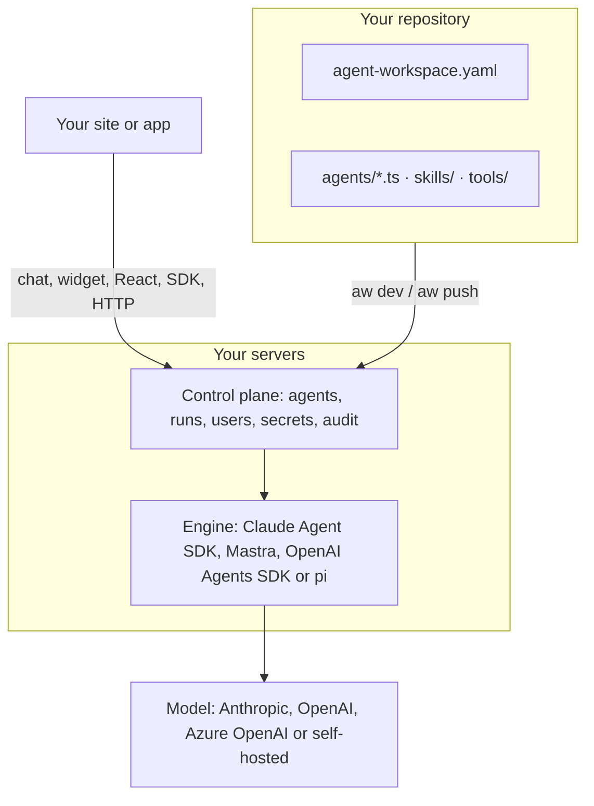

Agent Workspace runs AI agents on your own servers. You describe an agent in a few files you
commit (its instructions, engine, model, skills and tools), talk to it locally, put it in your
product, and deploy it to your own infrastructure. These docs follow that order.

<Frame caption="Where chapter 1 ends: your agent answering a refund question on its try page, about a minute after the first command.">
  
</Frame>

## The path

Building an agent goes through six chapters, and a seventh is optional. Each chapter ends with something working, and each
page inside it says at the top what you will do, what you will learn and what you need first.

<CardGroup cols={3}>
  <Card title="1 · Run your first agent" icon="rocket" href="/path/first-agent">
    Install, create a project with one command, chat with it.
    **You end with:** an agent answering on your laptop.
  </Card>
  <Card title="2 · Build your agent" icon="hammer" href="/path/build">
    Instructions, engine, model, skills, tools, MCP servers, credentials.
    **You end with:** the agent you want, as files in your repository.
  </Card>
  <Card title="3 · Test and improve it" icon="list-check" href="/path/test">
    Read each run's tool calls and cost, write evaluation cases.
    **You end with:** a regression suite for local runs and CI.
  </Card>
  <Card title="4 · Put it in your product" icon="window-maximize" href="/path/embed">
    A hosted page, a script tag, React, your backend or plain HTTP.
    **You end with:** users reach the agent inside your site or app.
  </Card>
  <Card title="5 · Ship it to your servers" icon="cloud-arrow-up" href="/path/ship">
    Deploy, push and promote to a VM, Google Cloud Run or Kubernetes.
    **You end with:** the agent in production on infrastructure you control.
  </Card>
  <Card title="6 · Run it for your team" icon="users" href="/path/operate">
    Roles, workspaces per environment, shared agents, extensions.
    **You end with:** a platform your team uses, with an audit trail.
  </Card>
  <Card title="7 · Run it on other platforms" icon="shuffle" href="/path/platforms">
    Optional. Export to a hosted agent platform, eject to code, switch the engine.
    **You end with:** a report of what each platform keeps and drops.
  </Card>
</CardGroup>

Chapters 2 and 3 are a loop: you change the agent, check it, and change it again until it is good
enough to put in front of users.

New here? Start at [chapter 1](/path/first-agent). It takes one command and no Docker.

## One example, all the way through

The chapters share one running example, so each step builds on the last:

1. **Chapter 1:** create a **customer-support agent** from the `support` theme. It already has a
   `refund-policy` skill.
2. **Chapter 2:** give it an orders lookup tool from your OpenAPI document and the API key that
   tool needs.
3. **Chapter 3:** write evaluation cases for refund questions and watch what each run did.
4. **Chapter 4:** put a chat widget on your website.
5. **Chapter 5:** deploy it to your own server.
6. **Chapter 6:** give your support team access.
7. **Chapter 7 (optional):** export the agent to another platform and read what it drops.

## How the pieces fit

[What Agent Workspace is](/concepts/what-is-agent-workspace) explains this picture in one page.
[The data plane](/concepts/data-plane) says what stays on your servers.

## Jump to a task

| I want to… | Go to |
| ---------- | ----- |
| Run an agent on my machine | [Quickstart](/getting-started/quickstart) |
| Pick the engine, the model, the frontend and the infrastructure in one go | [Build on your own stack](/tutorials/your-stack) |
| Give the agent reusable instructions | [Author a skill](/building/skills) |
| Let the agent call my code or my REST API | [Tools from code](/guides/tools-from-code) |
| Connect an MCP server | [Connect an MCP server](/building/mcp-servers) |
| Use another model or engine | [Choose models and runtimes](/building/models-and-runtimes) |
| See what a run did and what it cost | [Observability](/resources/observability) |
| Catch regressions | [Evaluations](/guides/evaluations) |
| Put a chat in my React app | [Your own React](/building/react) |
| Call the agent from my backend | [Integrate a backend](/building/backend) |
| Deploy to my servers | [Deploy](/guides/deploy) |
| Self-host the whole platform | [Self-host Agent Workspace](/building/self-hosting) |
| Control who may do what | [Authentication](/getting-started/authentication) and [Team](/resources/team) |
| See a full use case end to end | [Use-case gallery](/tutorials) |

## Beyond the path

The path covers what to do. These sections cover the rest; open them when a page sends you
there.

<CardGroup cols={2}>
  <Card title="Product tour" icon="images" href="/features/your-stack">
    Each section of the product site, explained in full.
  </Card>
  <Card title="How it works" icon="diagram-project" href="/concepts/design-principles">
    The design, the architecture, what stays on your servers, the lifecycle of a run.
  </Card>
  <Card title="SDK client in depth" icon="code" href="/getting-started/configuration">
    Configuration, errors, timeouts, pagination and retries for code that calls the API.
  </Card>
  <Card title="Resource guides and reference" icon="book" href="/resources/agents">
    One page per resource (agents, runs, files, models…), and the generated reference.
  </Card>
  <Card title="CLI" icon="terminal" href="/cli/overview">
    Every `aw` command, its configuration, its output and exit codes.
  </Card>
  <Card title="Where it is going" icon="road" href="/concepts/roadmap">
    What is planned, and where today's behaviour differs from the target.
  </Card>
</CardGroup>

Wherever today's behaviour differs from the target, the page says so in a **Today / Target**
callout linked to the [Migration roadmap](/concepts/roadmap).

<AccordionGroup>
  <Accordion title="The three packages">

A program outside the control plane talks to it through three packages: typed requests in, a
validated response or one of three typed errors out, never raw JSON or prose to parse.

| Package                     | What it is |
| --------------------------- | ---------- |
| `@indx-workspace/contracts` | Zod schemas and derived types for every resource family the control plane exposes — the wire contract, with no framework or database dependency. |
| `@indx-workspace/sdk`       | An isomorphic typed client built on the contracts: `createClient`, a resource client per family, an SSE follower with resume, and three typed error classes. |
| `@indx-workspace/aw`        | The `aw` command line: every SDK method the control plane will let a stored API key call, with `--json`/`--jsonl` output and stable exit codes. |

The packages are published under `@indx-workspace`; the `@agent-workspace` npm scope belongs to
an unrelated publisher. [Installation](/getting-started/installation) has the requirements.

  </Accordion>
</AccordionGroup>
