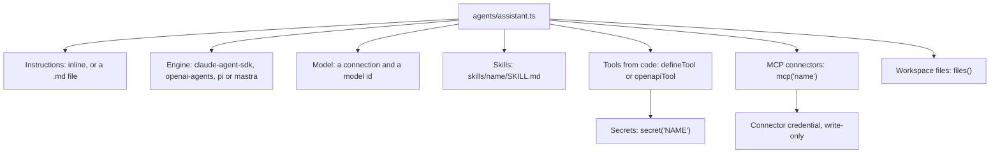
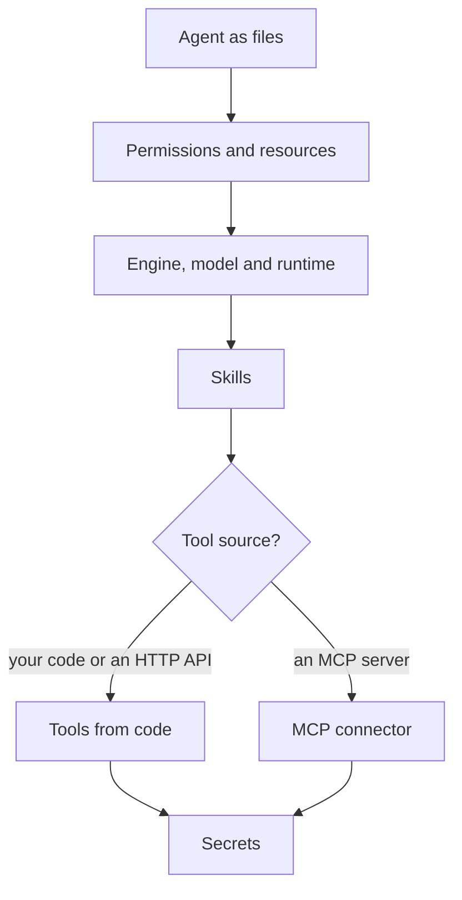

**Where you are:** after [Chapter 1: Run your first agent](/path/first-agent), before
[Chapter 3: Test and improve it](/path/test).

## What you will have at the end

The support agent `assistant` from the `support` theme lives in `agents/assistant.ts` with its
instructions inline (the generator writes no `agents/assistant.md`; `instructions: { file:
'./assistant.md' }` moves them there, see [Agents as code](/guides/agents-as-code)), the `refund-policy` skill in `skills/refund-policy/`, and an
orders lookup tool in `tools/orders.ts` built from your OpenAPI document, whose token is named
with `secret('ORDERS_TOKEN')` and never committed. `aw check` passes, and `aw push --yes` saves it
as a version.

<Frame caption="The finished agent in the console: its instructions, engine, model, skills and tools in one place.">
  
</Frame>

## What an agent is made of

The engine decides which of these it can honour: `openai-agents` has no skills, and `pi` has no
MCP (so no connectors and no tools from code, which reach the agent as connectors). An agent
assigned something its engine cannot run is refused with `422 engine_capability_unsupported`, not
run without it. See [Run it on another engine](/building/agents#run-it-on-another-engine).

## The map

<Steps>
  <Step title="Keep the agent as files">
    You define the agent in `agents/assistant.ts`, check it with `aw check` and save it with `aw
    push --yes`. You learn the project layout and how versions, `local` and `production` work.
    [Agents as code](/guides/agents-as-code)
  </Step>
  <Step title="Decide what the agent may do">
    You set the four permission switches and assign files, skills and connectors. You learn least
    privilege and what each setting controls once a run starts. [Design an agent](/building/agents)
  </Step>
  <Step title="Choose the model and where it runs">
    You connect a model provider and pick a model and a runtime profile. You learn the order in
    which a run's model is resolved and what each runtime driver isolates. [Choose models and
    runtimes](/building/models-and-runtimes)
  </Step>
  <Step title="Write a skill">
    You write `skills/refund-policy/SKILL.md` and reference it with `skill('refund-policy')`. You
    learn how a skill is imported, assigned and synced from a project folder. [Author a
    skill](/building/skills)
  </Step>
  <Step title="Give it tools from your code or an API">
    You add the orders lookup with `openapiTool()`, or your own function with `defineTool()`. You
    learn which operations an API tool may call and where each kind of tool runs. [Tools from
    code](/guides/tools-from-code)
  </Step>
  <Step title="Connect an MCP server">
    You register a remote MCP server as a connector, test it and assign it. You learn how its tools
    reach the model and what network they run under. [Connect an MCP server](/building/mcp-servers)
  </Step>
  <Step title="Store credentials">
    You store workspace credentials write-only and rotate them. You learn why a value never comes
    back and when a secret cannot be deleted. [Secrets](/resources/secrets)
  </Step>
</Steps>

## Choose quickly: skill, tool, MCP server or file?

| If you want the agent to…                                              | Use                                               | Read                                                                                        |
| ---------------------------------------------------------------------- | ------------------------------------------------- | ------------------------------------------------------------------------------------------- |
| Follow a procedure or policy, written in Markdown (the refund policy)  | A skill                                           | [Author a skill](/building/skills)                                                          |
| Call a function from your own codebase                                 | A code tool, `defineTool()` (deployments need the tool sandbox) | [Tools from code](/guides/tools-from-code#let-the-agent-call-a-function-from-your-codebase) |
| Read an HTTP API you already describe with OpenAPI (the orders lookup) | An API tool, `openapiTool()`                      | [Tools from code](/guides/tools-from-code#let-the-agent-read-an-http-api)                   |
| Use tools an existing MCP server already offers                        | An MCP connector, `mcp('name')`                   | [Connect an MCP server](/building/mcp-servers)                                              |
| Read or edit documents in the workspace                                | A file grant, `files()`                           | [Design an agent](/building/agents#assigning-resources-files-skills-connectors)             |
| Run on another engine than Claude                                      | `engine` in `defineAgent`                         | [Design an agent](/building/agents#run-it-on-another-engine)                                |

## What is not there yet

- A deployment runs code tools only when the operator enables the tool sandbox; otherwise a version
  that uses one cannot be promoted ([Tools from code](/guides/tools-from-code#current-limits)).
  The tool sandbox is off by default (`AGENT_WORKSPACE_TOOL_HOST_IMAGE`), and it shares one network
  across sessions until #841.
- API tools expose reads only, and tools are not versioned
  ([Tools from code](/guides/tools-from-code#current-limits)).
- `stdio` MCP connectors are stored but not run ([Connect an MCP server](/building/mcp-servers)).
- Creating an agent (`aw agents create`, `POST /api/agents`) and setup reconciliation save no
  version yet; console edits and `aw agents update` do
  ([Agents as code](/guides/agents-as-code#current-limits)).

<Card title="Next: Chapter 3, Test and improve it" icon="arrow-right" href="/path/test">
  See every run, its tools and its cost, and catch regressions with an eval suite.
</Card>
