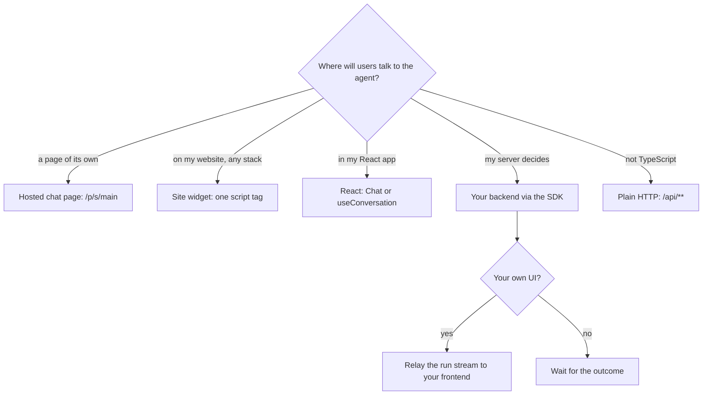
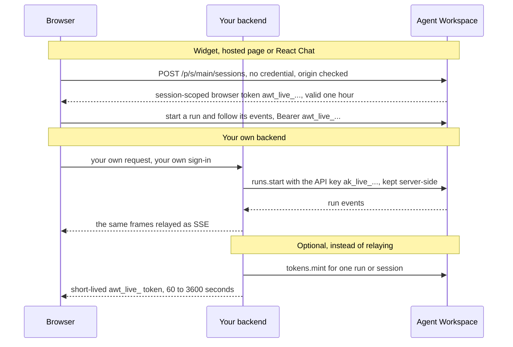
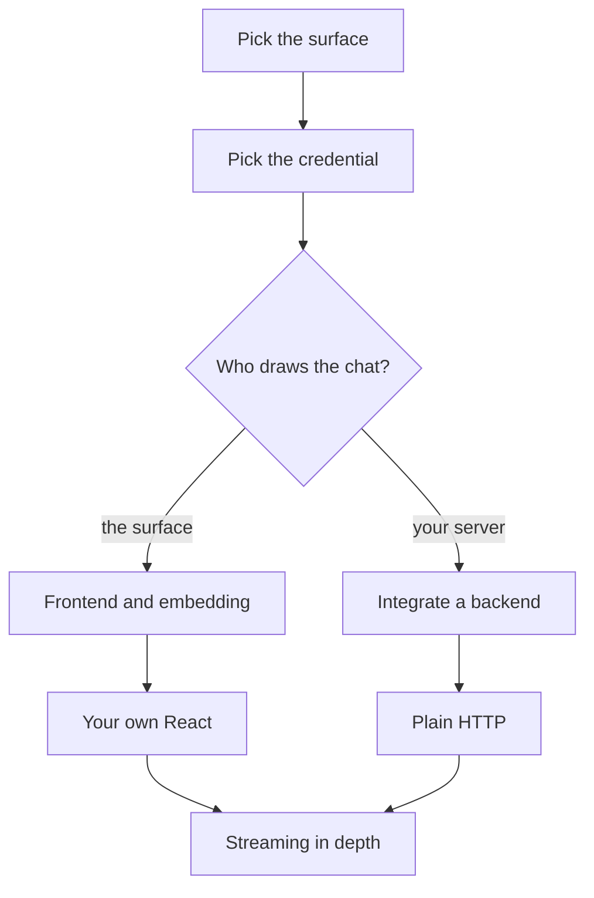

**Where you are:** after [Chapter 3: Test and improve it](/path/test), before
[Chapter 5: Ship it to your servers](/path/ship).

## What you will have at the end

Customers on your website ask the support agent `assistant` about a refund, through the `main`
surface's chat: a one-tag widget, or `<Chat/>` in your React app. Your backend can also start a
run of the same agent from its own code with an API key, wait for the answer or relay its live
stream, and map failures onto your own API's errors.

<Frame caption="The one-tag widget on a plain HTML page, answering a visitor.">
  
</Frame>

## Where will users talk to the agent?

The first three need no code on your server: the surface opens each visitor's session itself. The
last two put the API key on your server, and your frontend, if any, talks only to your server.

## Who holds which credential

A workspace API key (`ak_live_…`) never reaches a browser: it is long-lived and carries a whole
role. What a browser holds is always a short-lived token scoped to one run or one session. Details
and limits: [Authentication](/getting-started/authentication).

## The map

<Steps>
  <Step title="Pick how users reach the agent">
    You find your job in a decision table and the page that shows it. You learn the four ways your
    code touches the platform: what you consume, configure, extend, or leave alone. [Which surface
    for which job](/building/overview)
  </Step>
  <Step title="Choose the credential">
    You mint an API key for a server, or a browser token for one run or session. You learn what each
    credential may reach and why a key never goes to a browser.
    [Authentication](/getting-started/authentication)
  </Step>
  <Step title="Build a frontend">
    You show the surface's chat or render a live run in your own page. You learn which credential a
    page can use and the failure modes of a live view. [Build a frontend](/building/frontend)
  </Step>
  <Step title="Embed the agent in your product">
    You paste the widget tag, or build a relay, a chat panel and a canvas. You learn the frames a UI
    reduces and how to switch agents. [Embed an agent in your product](/building/embedding)
  </Step>
  <Step title="Make the chat your own in React">
    You render `<Chat />
    `, replace its composer, or draw everything with `useConversation()`. You learn the parts you
    can swap and how a deployed page is admitted. [Your own React](/building/react)
  </Step>
  <Step title="Call the agent from your backend">
    You start a run with an API key and wait for it or stream it. You learn which role to mint, how
    to stop a run, and how to map SDK errors. [Integrate a backend](/building/backend)
  </Step>
  <Step title="Call the API without the SDK">
    You call `/api/**` from Python, Go or a shell with one header. You learn the response and error
    shapes and how to generate a client from OpenAPI. [Call the API without the
    SDK](/building/http-api)
  </Step>
  <Step title="Stream a run in depth">
    You follow a run, survive a dropped connection and resume from a cursor. You learn the wire
    format and the neutral `agent.*` events. [Streaming](/guides/streaming)
  </Step>
</Steps>

## Choose quickly

| If you want…                                                 | Read                                                                                       |
| ------------------------------------------------------------ | ------------------------------------------------------------------------------------------ |
| The chat on any web page, with no build step                 | [Embed an agent: one tag](/building/embedding#show-the-chat-with-one-tag-or-one-component) |
| The chat inside a React app, styled or rebuilt by you        | [Your own React](/building/react)                                                          |
| A chat panel, canvas or agent switcher you draw yourself     | [Embed an agent: the relay](/building/embedding#stream-an-agent-run-into-your-own-ui)      |
| A job, a worker or CI to run the agent and act on the answer | [Integrate a backend](/building/backend)                                                   |
| A backend in Python, Go or a shell                           | [Call the API without the SDK](/building/http-api)                                         |

## What is not there yet

- A customer's own frontend on another origin cannot call the rest of the API directly; only a
  surface's chat is admitted cross-origin ([Build a frontend](/building/frontend#pick-the-credential-your-page-can-use)).
- No webhook tells your backend a run finished; follow the stream or poll `runs.get`
  ([N-3](/concepts/roadmap#n-3-webhooks-for-run-outcomes)).
- `runs.start` is idempotent only when you pass an `idempotencyKey`
  ([S-6](/concepts/roadmap#s-6-idempotency-keys)).
- File bytes for a canvas pass through your backend; only a session's `.attachments/` downloads can
  come straight from the object store ([Files](/resources/files#createdownloadurl)).

<Card title="Next: Chapter 5, Ship it to your servers" icon="arrow-right" href="/path/ship">
  Run the agent in production on your own VM, Cloud Run or Kubernetes.
</Card>
