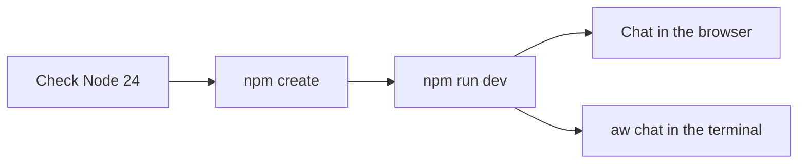

**Where you are:** the start of the path. Next: [Chapter 2: Build your agent](/path/build).

## What you will have at the end

A project made from the `support` theme, running on your laptop: the agent `assistant` with its
`refund-policy` skill, answering in the browser on the `try` page and in the terminal through
`aw chat`. Every file that defines it is in your project directory, ready to commit.

## The map

<Steps>
  <Step title="Install">
    Check you have Node 24 or newer and get the `aw` command line, or add the SDK to an existing
    app. You learn which `@indx-workspace/*` package does what.
    [Installation](/getting-started/installation)
  </Step>
  <Step title="Create and start the agent">
    Run `npm create @indx-workspace@latest`, pick the `support` theme, and let it start `npm run
    dev`. You learn what the generator writes and what the local runtime runs.
    [Quickstart](/getting-started/quickstart)
  </Step>
  <Step title="Talk to it from the terminal">
    Run `npx aw chat` for a conversation, or `-p` for one answer in a script. You learn which
    version answers and the three SDK calls behind a chat turn. [aw chat](/cli/chat)
  </Step>
</Steps>

## Choose quickly

| If you want…                                    | read…                                                                                      |
| ----------------------------------------------- | ------------------------------------------------------------------------------------------ |
| A new project                                   | [Quickstart](/getting-started/quickstart)                                                  |
| A coding agent to do the install                | [Install with Claude Code](/getting-started/quickstart#install-with-claude-code)           |
| Agent Workspace in a directory you already have | [Start in an existing directory](/getting-started/quickstart#your-first-agent) (`aw init`) |
| Only the SDK in an existing app                 | [Install from npm](/getting-started/installation#install-from-npm)                         |

## What is not there yet

- The local runtime is for development only: runs use the in-process `local` driver, which has no
  isolation and runs commands as you. See the warning in the
  [Quickstart](/getting-started/quickstart#your-first-agent). To run the agent in a Docker
  container instead, opt in with `npx aw dev --sandbox docker`; it needs Docker running. The
  container's network is `open` and goes through no egress proxy locally, so it limits file and
  process access, not what the agent can reach on the network. For now it needs a runtime image
  built from the Agent Workspace repository and runs only agents with `unrestrictedNetwork` (see the
  [Quickstart](/getting-started/quickstart#your-first-agent), issue #786).

<Card title="Chapter 2: Build your agent" icon="arrow-right" href="/path/build">
  Give the agent its instructions, engine, model, skills, tools and credentials as committed files.
</Card>
