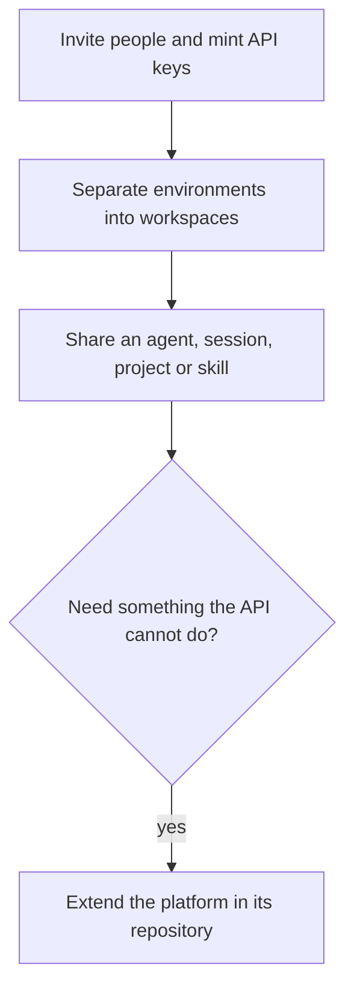

**Where you are:** after [Chapter 5: Ship it to your servers](/path/ship). This is the last
required chapter of the path; [Chapter 7](/path/platforms) is optional.

## What you will have at the end

Your support lead is a Builder in the workspace that runs `assistant`, your CI has its own API key
with the smallest role it needs, and a separate workspace keeps staging apart from production. The
team can open a read-only share of the agent, and you know which changes need a pull request
against the platform rather than an API call.

<Frame caption="Administration, API Keys: one key per automation, each with the smallest role it needs.">
  
</Frame>

## The map

<Steps>
  <Step title="Add your team">
    Add members with one of four roles (Owner, Admin, Builder, Viewer), invite people after `aw
    login`, and mint or revoke workspace API keys. You learn which routes need a person rather than
    a key, and that a key's secret is shown once. [Team](/resources/team)
  </Step>
  <Step title="Separate environments into workspaces">
    Create, rename, archive and switch workspaces, and decide whether public sharing is allowed. You
    learn that a workspace is the tenant boundary and that only a person, not an API key,
    administers workspaces. [Workspaces](/resources/workspaces)
  </Step>
  <Step title="Share an agent">
    Publish a read-only snapshot of an agent, session, project or skill to the workspace or as a
    public link, and revoke it. You learn the visibilities and expiries, and what publish does
    today. [Shares](/resources/shares)
  </Step>
  <Step title="Extend the platform">
    Find the extension point for a new runtime driver, model provider, engine or API route. You
    learn that these are code changes in the platform's repository, with the gates that check each.
    [Extend the platform](/building/extending-the-platform)
  </Step>
</Steps>

## Choose quickly

| If you want…                                       | Read                                                                                                  |
| -------------------------------------------------- | ----------------------------------------------------------------------------------------------------- |
| To give a person access                            | [Team: invitations](/resources/team#invitations-create) or [members.add](/resources/team#members-add) |
| To give automation or CI access                    | [Team: apiKeys.create](/resources/team#apikeys-create)                                                |
| To keep staging and production apart               | [Workspaces](/resources/workspaces), then [Move an agent](/building/moving-agents)                    |
| To let others open an agent without editing it     | [Shares](/resources/shares)                                                                           |
| To run agents on a new host or through a new model | [Extend the platform](/building/extending-the-platform)                                               |

## What is not there yet

- Removing a member whose rows are still referenced surfaces a raw failure, and the invitee's
  accept page does not exist in the control plane
  ([RF-202](/concepts/roadmap#rf-202-member-offboarding),
  [RF-203](/concepts/roadmap#rf-203-invitation-acceptance)).
- A share's label and content are composed by the caller, not derived by the server, and the CLI
  has no `shares publish` ([RF-103](/concepts/roadmap#rf-103-server-owned-share-snapshots)).
  Runnable agent shares are refused in this release.
- Nothing on the [Extend](/building/extending-the-platform) surface is reachable from the SDK, the
  CLI or the API; it needs a change to the platform's repository.

<Card title="Next, optional: Run it on other platforms" icon="arrow-right" href="/path/platforms">
  Chapter 7: export the agent to Claude Managed Agents, Microsoft, Google or AWS, or eject it to code.
</Card>
