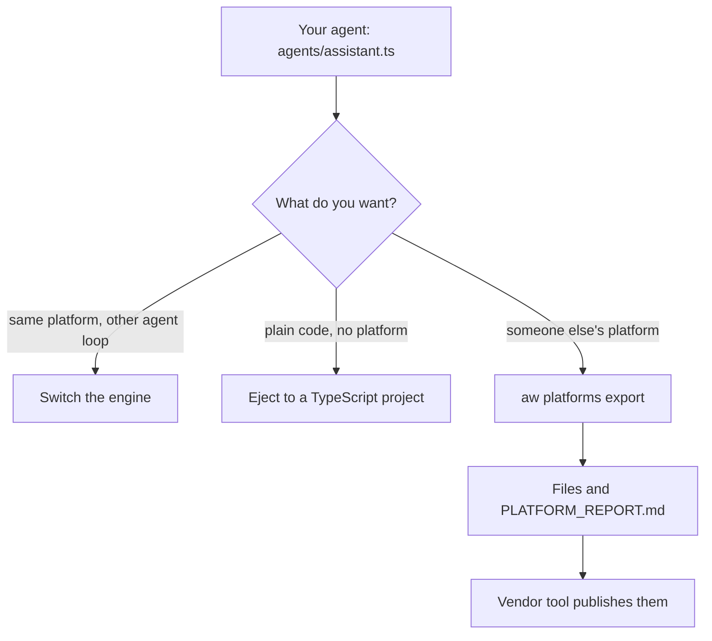

**Where you are:** after [Chapter 6: Run it for your team](/path/operate). This chapter is optional,
and it is an alternative to [Chapter 5: Ship it to your servers](/path/ship) for production: Chapter 5
runs the agent on infrastructure you own, this chapter runs it on someone else's platform. The next stop is the [tutorials](/tutorials).

## What you will have at the end

The support agent `assistant`, with its `refund-policy` skill, exported to Claude Managed Agents and
to Copilot Studio. Each export is a folder of the platform's own files plus a `PLATFORM_REPORT.md`
that says, field by field, what the platform carries as it is, what it translates and what it
drops. Most platforms need a setting before they will export: Claude Managed Agents needs a Claude
`model` (a fresh project's agent names none, and the export is refused), and Copilot Studio needs a
`publisherPrefix`. Each guide states what its platform needs.

## The map

An agent is one portable definition. From it you can change the loop it runs on, copy it out as plain
code, or hand it to a hosted platform.

<Steps>
  <Step title="Export an agent to another platform">
    Export, read the report, check with `aw platforms doctor` and import an agent back. You learn the
    portable definition, the three verdicts and the exit codes.
    [Export an agent](/platforms/overview)
  </Step>
  <Step title="Claude Managed Agents">
    Export Markdown agents, skills and an environment, and publish with Anthropic's `ant` tool. You
    learn that only Claude models are accepted. [Claude Managed Agents](/platforms/claude-managed-agents)
  </Step>
  <Step title="Copilot Studio">
    Export a cloned-agent folder with MCP actions and knowledge files, and pack it with `pac`. You
    learn the instruction limit and why live push is experimental. [Copilot Studio](/platforms/copilot-studio)
  </Step>
  <Step title="Microsoft 365 declarative agent">
    Export an app package with a declarative agent manifest and a plugin, and provision it with `atk`.
    You learn that Microsoft 365 Copilot chooses the model. [Microsoft 365 declarative agent](/platforms/m365-declarative-agent)
  </Step>
  <Step title="Microsoft Foundry">
    Export a prompt-agent definition per agent. You learn the model deployment it needs and that
    publishing from `aw` is not available yet. [Microsoft Foundry](/platforms/microsoft-foundry)
  </Step>
  <Step title="Gemini Enterprise">
    Export an Agent Card and a registration request, and let Gemini Enterprise call your agent over
    A2A. You learn that the agent keeps running on your deployment. [Gemini Enterprise](/platforms/gemini-enterprise)
  </Step>
  <Step title="AWS AgentCore">
    Export an AgentCore harness project and deploy it with `agentcore`. You learn that the platform
    id and the runtime driver id are different things. [AWS AgentCore](/platforms/aws-agentcore)
  </Step>
  <Step title="Eject to plain code">
    Generate a standalone TypeScript project for the Claude Agent SDK, Mastra or the OpenAI Agents
    SDK. You learn what that project no longer has. [Eject](/platforms/eject)
  </Step>
  <Step title="Switch the engine">
    Change the agent loop and keep the platform. You learn what changes per engine and which
    switches are refused. [Switch the engine](/platforms/switch-engine)
  </Step>
</Steps>

The [platform compatibility matrix](/platforms/matrix) puts every platform side by side.

## Choose quickly

| If you want…                          | Read                                                                                                                                  |
| ------------------------------------- | ------------------------------------------------------------------------------------------------------------------------------------- |
| Claude-only, hosted by Anthropic      | [Claude Managed Agents](/platforms/claude-managed-agents)                                                                             |
| Teams and Microsoft 365 users         | [Microsoft 365 declarative agent](/platforms/m365-declarative-agent) or [Copilot Studio](/platforms/copilot-studio)                   |
| Azure                                 | [Microsoft Foundry](/platforms/microsoft-foundry)                                                                                     |
| Google Workspace and Gemini           | [Gemini Enterprise](/platforms/gemini-enterprise)                                                                                     |
| AWS                                   | [AWS AgentCore](/platforms/aws-agentcore)                                                                                             |
| No platform at all, plain code        | [Eject](/platforms/eject)                                                                                                             |
| The same platform, another agent loop | [Switch the engine](/platforms/switch-engine)                                                                                         |

## What is not there yet

- Gemini Enterprise and Microsoft Foundry publish over REST with your own `gcloud` / `az` login,
  plan-first ([Gemini Enterprise](/platforms/gemini-enterprise#publish),
  [Foundry](/platforms/microsoft-foundry#publish)).
- The publish commands for the other platforms are labelled "unverified against a live tenant" on
  their pages where the vendor's output has not been confirmed, and pushing to Copilot Studio needs
  `--experimental` ([Copilot Studio](/platforms/copilot-studio#publish)).
- Local (stdio) MCP servers are dropped on every hosted platform, and a code tool reaches a hosted
  platform only through the project's public MCP endpoint ([Export an agent](/platforms/overview#your-code-tools-on-another-platform)).
- Code written for Mastra or the OpenAI Agents SDK cannot be imported back
  ([Export an agent](/platforms/overview#import-an-agent-from-a-platform)).

<Card title="Next: the tutorials" icon="arrow-right" href="/tutorials">
  Build a complete agent for a real job, step by step.
</Card>
