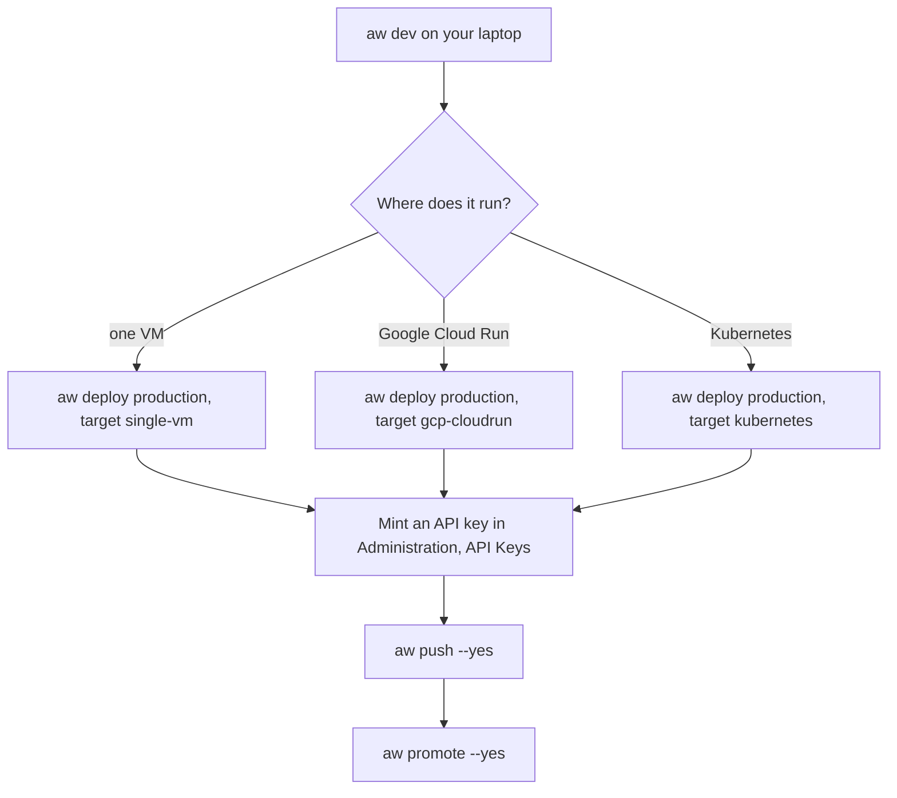

**Where you are:** after [Chapter 4: Put it in your product](/path/embed), before
[Chapter 6: Run it for your team](/path/operate).

## What you will have at the end

The support agent `assistant`, with its `refund-policy` skill, runs on a deployment you own, at an
`https:` address such as `https://agents.example.com`. Its version was pushed with a workspace API
key and promoted to `production`, so your website talks to that deployment instead of your laptop.
You know where the deployment's secrets live and how to back them up.

## The map

`aw dev` runs the project on your laptop. To go to production you stand up a deployment, then push
and promote the same agents to it.

`aw push` and `aw promote` read `AGENT_WORKSPACE_URL` (the deployment's address) and
`AGENT_WORKSPACE_API_KEY` (a workspace API key; `aw push` refuses the token `aw login` stores).

<Steps>
  <Step title="Deploy the project">
    Name a `production` environment in `agent-workspace.yaml`, see the plan with `aw deploy
    production --plan`, apply it with `--yes`, then push and promote your agents. You learn the three
    targets, what `aw deploy` checks for you, and which directory to back up.
    [Deploy](/guides/deploy)
  </Step>
  <Step title="Move an agent between workspaces">
    Export an agent as a name-keyed `AgentDefinition` and import it into another workspace, for
    example from staging to production. You learn what the file carries (names, never ids or
    secrets) and what happens when a resource is missing. [Move an agent](/building/moving-agents)
  </Step>
  <Step title="Self-host the whole platform">
    Run the full platform with Docker Compose, describe the deployment in one file, and deploy it to
    a VM or a Kubernetes cluster. You learn the five services, which runtime drivers are real today,
    and where the security boundary is. [Self-host](/building/self-hosting)
  </Step>
</Steps>

## Choose quickly

| If you want…                                  | Do                                                                        | Read                                                                                         |
| --------------------------------------------- | ------------------------------------------------------------------------- | -------------------------------------------------------------------------------------------- |
| One team on one Linux VM, behind your own TLS | `aw deploy production` with `target: single-vm`                           | [Deploy: Single VM](/guides/deploy#single-vm)                                                |
| A managed service on Google Cloud             | `aw deploy production` with `target: gcp-cloudrun`                        | [Deploy: Google Cloud Run](/guides/deploy#google-cloud-run)                                  |
| Several teams on Kubernetes                   | `aw deploy production` with `target: kubernetes`                          | [Deploy: Kubernetes](/guides/deploy#kubernetes)                                              |
| A lightweight host on Vercel                  | `agent-workspace deploy <dir> --target vercel`, sessions on E2B           | [Deploy on Vercel](/guides/deploy-vercel): verified live with E2B (run 38254091925)          |
| A lightweight host on Cloudflare              | `agent-workspace deploy <dir> --target cloudflare`, sessions on E2B       | [Deploy on Cloudflare](/guides/deploy-cloudflare): verified live with E2B (run 38254091925)  |
| To copy one agent into another workspace      | `aw agents export` then `aw agents import`                                | [Move an agent](/building/moving-agents)                                                     |

## What is not there yet

- `aw deploy` has three targets covered in this chapter, `single-vm`, `gcp-cloudrun` and `kubernetes`.
  The Kubernetes target installs the Helm chart and runs agents: the runner manager creates a Pod per
  session on the `kubernetes` driver, proven on a kind cluster. No managed cluster has been proven yet.
- The lightweight deploy journey (run 38254091925, `main` at `1523d4ba`) passed on all four lanes. The
  two E2B lanes, `vercel-e2b` and `cloudflare-e2b`, ran the whole path: deploy with
  `agent-workspace deploy <dir> --target vercel|cloudflare`, setup, push and promote, a promote refused
  below the eval bar (v2), a run through the API with a code tool, hosted chat, the widget, a turn through
  the frontend with the code tool's data in the reply, and rollback. The native-sandbox lanes
  passed create, eval, deploy, setup and the frontend, and their run rows are `n/a`:
  `vercel-vercel-sandbox` is refused `code_tool_needs_host` because Vercel Sandbox has no tool host
  (#940), and `cloudflare-cloudflare-sandbox` refuses every run (ADR-0131). `aw deploy production`
  with `target: vercel` is proven only through setup and the frontend (`vercel-vercel-sandbox`);
  `aw deploy` has no `cloudflare` target.
- A Cloudflare host runs sessions with the E2B sandbox (`RUNTIME_DRIVER=external` in `.env`):
  the native `cloudflare-sandbox` driver refuses every network policy, so it runs no session until
  a providers-live run proves Cloudflare denies egress under `none` and the driver declares it again
  (ADR-0131).
- A Cloud Run deploy uses the Terraform module shipped with `@indx-workspace/cli`; `--infra` is
  only for a module checkout. Its first run still needs one targeted `terraform apply` that creates
  the Artifact Registry repository, and the images are not yet signed
  ([P-6](/concepts/roadmap#p-6-a-published-release-with-signed-images-and-the-installer)).
- No AWS or Google Cloud sandbox driver has a live isolation proof: AWS AgentCore, AWS ECS, GKE
  Agent Sandbox and Cloud Run sandbox are named in the contract but not implemented. The `docker`
  driver and the `kubernetes` driver (on a kind cluster with Calico, not a managed cluster) are
  live-verified by the isolation workflow. The E2B (`external`) and Vercel Sandbox
  (`vercel-sandbox`) provider sandboxes passed the providers-live lane on main; Cloudflare Sandbox
  (`cloudflare-sandbox`) is deployed by its providers-live lane but runs nothing: on a Cloudflare host
  the default `cloudflare-sandbox` driver refuses every network policy, `none` included (ADR-0131), so
  it creates no sandbox and sessions run on E2B. Tracked as
  [D-4](/concepts/roadmap#d-4-a-verified-managed-cloud-sandbox-per-cloud).
- The `docker` driver refuses a `restricted` network policy and `allowedDomains`; the allowlist
  proxy exists as a package and image but no driver uses it yet
  ([Which runtime drivers are real today](/building/self-hosting#which-runtime-drivers-are-real-today)).

<Card title="Chapter 6: Run it for your team" icon="arrow-right" href="/path/operate">
  Give teammates roles, separate environments into workspaces, share agents and extend the platform.
</Card>
