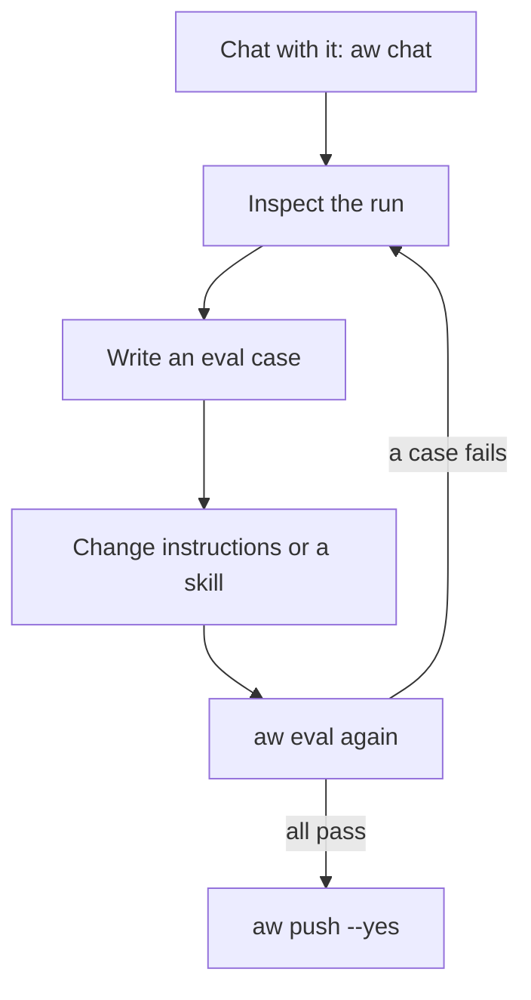

**Where you are:** after [Chapter 2: Build your agent](/path/build), before
[Chapter 4: Put it in your product](/path/embed).

## What you will have at the end

Your support agent `assistant` has an `evals/assistant.yaml` that checks its refund answers and its
`get_order` lookups, and `aw eval` scores every change you make to its instructions or the
`refund-policy` skill. When a run goes wrong you can open it and see each tool call, its tokens
and its cost. If your own code calls the agent through the SDK, its tests run without a server.

## The map

Improving the agent is a loop. You talk to it, read what it did, write down what a good answer
looks like, change the agent, and score it again. You push only when the score holds.

<Steps>
  <Step title="Inspect a run">
    Read what a run did: its status, duration, tokens and cost with `aw runs get`, and every tool
    call with its input and output with `aw runs events`, or as the recent-runs window and the
    audit trail. You learn where run data lives and which view is durable.
    [Observability](/resources/observability)
  </Step>
  <Step title="Write and run evals">
    Write cases in `evals/assistant.yaml`, run them with `aw eval` on the draft, turn a thumbs-down
    into a case and run the suite in CI. You learn the four checks and how a score gates a
    promotion. [Evaluations](/guides/evaluations)
  </Step>
  <Step title="Test your own code">
    Test the code that calls Agent Workspace with the recording `fetch` double from
    `@indx-workspace/sdk/testing`, without a network. You learn to assert requests and simulate
    every failure and stream shape. [Testing](/guides/testing)
  </Step>
</Steps>

## Choose quickly

The two kinds of test check different things. Most projects want both.

| If you want to check…                                                       | Use                                                                      | Read                                      |
| --------------------------------------------------------------------------- | ------------------------------------------------------------------------ | ----------------------------------------- |
| That the agent answers well: right tool, no forbidden text, passes a rubric | `aw eval` against the agent on a real server and model                   | [Evaluations](/guides/evaluations)        |
| That your app's code calls the SDK correctly and handles each error         | The `fetch` double in `@indx-workspace/sdk/testing`, no server, no model | [Testing](/guides/testing)                |
| Why one run went wrong                                                      | The run record and its events                                            | [Observability](/resources/observability) |

## What is not there yet

- An evaluation runs at most 200 cases, one after another; there are no datasets and no repeated
  runs to measure variance, and an interrupted run cannot be resumed.
- The OpenTelemetry `agent.run` span carries no tokens or tool calls; read them from the run record.
- The workspace app's Usage tab is not filled for live runs; the Runs screen shows usage.
- The promotion bar reaches single-VM and Cloud Run deployments made with `aw deploy`, but no live
  promotion below the bar has been run on either yet.
- `aw` ships no in-process test double; to test code that calls `aw`, spawn the real binary.

The full list is in [Limits today](/features/run-observe-evaluate#limits-today).

<Card title="Chapter 4: Put it in your product" icon="arrow-right" href="/path/embed">
  Let users talk to the agent inside your site or app, or call it from your backend.
</Card>
